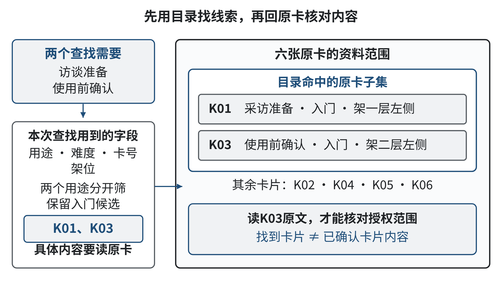
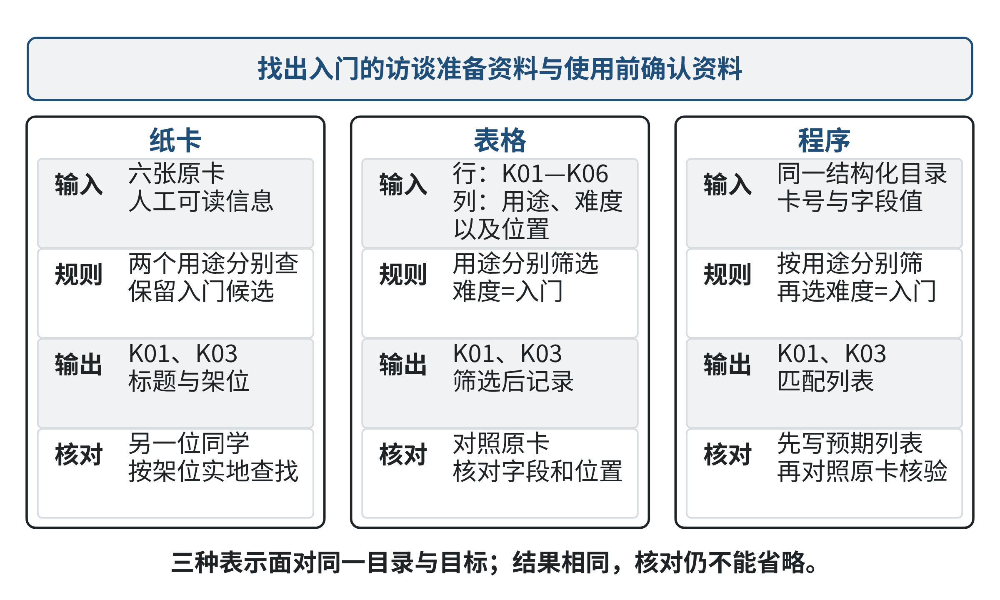
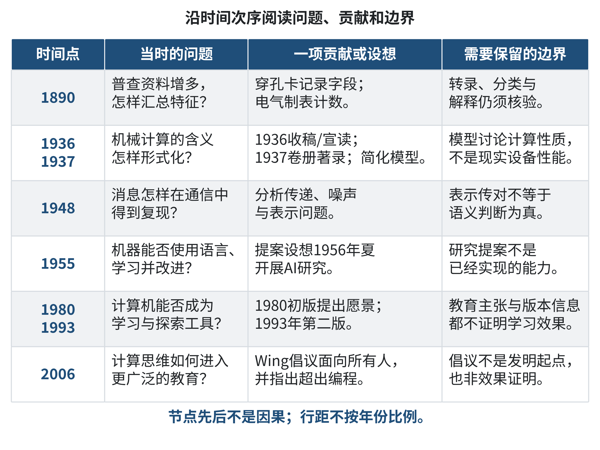
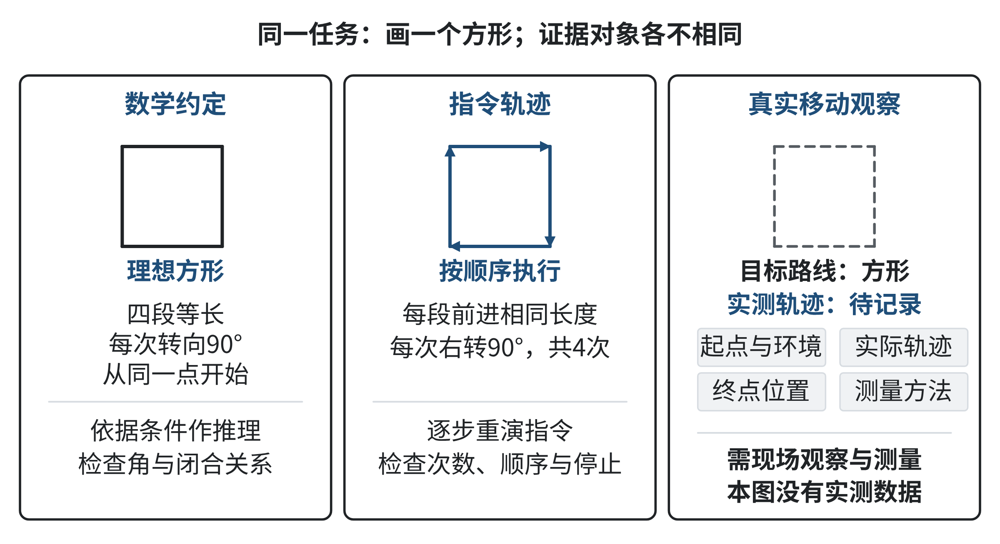
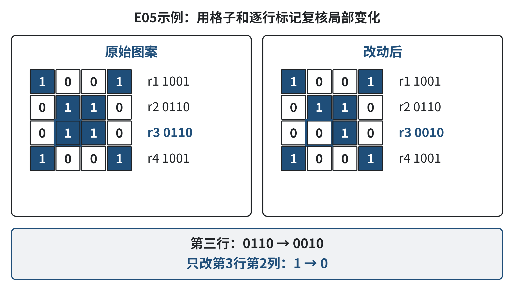
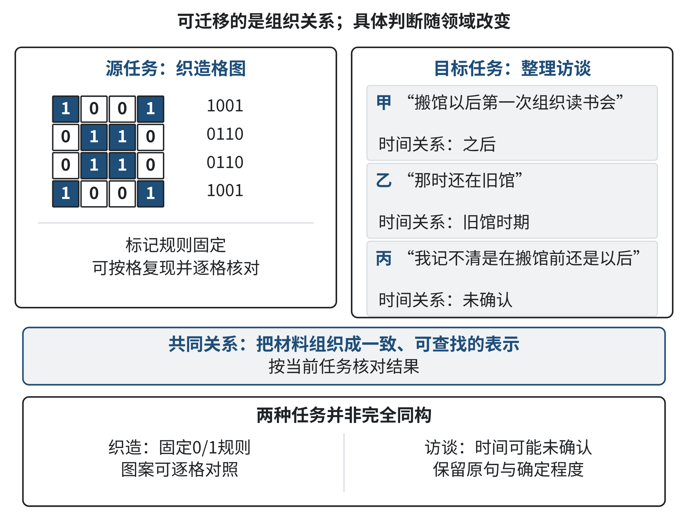
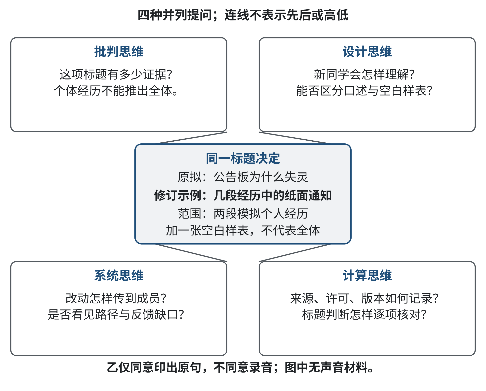

# 第一章 计算思维：数字时代的核心素养

一段操作可以凭经验完成，也可以被写出来交给别人重复；一份资料可以由熟悉它的人解释，也可以整理成陌生人能够查找的记录。把经验变为明确表示，把任务组织为可执行过程，再检查结果和适用条件，这些看似平常的行动，连接着计算发展的重要历史问题。

计算思维并非在当代AI出现之后才开始。人们曾为了制作图案、处理统计资料和说明机械计算的含义，重新考虑怎样记录信息、怎样组织规则、怎样利用工具。后来，计算也进入学习与跨学科研究。工具不断变化，使“人负责什么，机器负责什么”有了不同答案；问题的界定、证据的检查和结果的解释仍需要认真思考。

本章沿这一历史脉络建立入口。我们先从手工整理小资料开始，用容易复现的动作认识基本概念；再观察几个有出处的历史节点；然后追踪这些思想如何跨过领域边界；最后把计算视角与批判、设计、系统视角结合起来。历史案例说明当时面对的问题和思想变化，今天的模拟活动帮助读者理解这些关系，两者的证据身份会分别说明。

读者不必先掌握复杂模型，也不必开通某种AI工具。基础活动可以用纸笔完成。已有编程经验有助于理解执行过程，但本章的重点是把会做的操作解释清楚，找到不会的条件，再用小例子检查理解。后面的章节会在这些基础上进一步讨论AI时代的计算思维重构。

**学习目标**

- 用一个简单例子说明计算思维与编程、工具使用的关系，并解释表示和步骤为何影响结果。
- 说明至少三个历史节点回应的问题、贡献与限制，分清来源支持的事实和本书的教学解释。
- 结合思维工具的演进，识别跨学科任务的共同结构，并说明迁移时需要重新确认的领域条件。
- 在一个小任务中结合批判、设计、系统与计算视角，形成有依据、可检查的改进方案。
- 写出一项自己的知识缺口，用材料、小测试与反馈记录一次理解或方案的修正。

**学习路线**

1.1建立共同语言，1.2追踪历史问题，1.3学习跨界迁移，1.4组织互补视角。各节先读案例与示范，再做基础或应用练习。E01—E08分布于各节，E09在章末连接全章；详细参考解统一放在“参考解与讨论”。可以先独立完成再查阅题解，开放题也可以采用不同合理路径。标为拓展的活动增加新困难，基础任务不依赖它们。

## 1.1 计算思维定义与内涵：超越编程

**导语**

你可能遇到过这样的情形：自己熟悉一间资料室，别人却不知道东西放在哪里；一位同学能凭记忆找到文件，换一个人就要从头翻找。问题并不只是“有没有写程序”，而是我们有没有把目标、资料和查找办法说明白，能不能让别人照着做并确认结果。计算思维关心的正是怎样把问题变得可理解、可处理、可检查。程序和智能工具能够承担其中一些工作，但它们不能代替我们决定要找什么、哪些信息重要，以及结果是否可信。

本节从一组小资料卡开始，先学习如何把“熟人知道”变成“新来的人也能查”，再逐步认识抽象、分解、模式识别、算法、评估、自动化和泛化七个教学观察视角。它们帮助我们描述解决问题时可能作出的不同判断，不是人人必须依次执行的七步流程。学完后，你应能用日常语言解释计算思维与编程的关系，并在简单资料整理任务中说明自己保留了哪些信息、采用什么规则、怎样检验。

### 1.1.1 从“熟人知道”到“别人能查”

以下是一段原创课堂模拟：一个刚成立的学习小组把六张资料卡放在桌上的小资料架里，想让第一次参加活动的同学也能独立找到入门材料；老成员原来只靠记忆拿取，整理时决定为每张卡记录标题、用途、难度、形式和位置，现有卡片分别是：K01《第一次访谈要问什么》（采访准备、入门、文字、架一层左侧），K02《怎样把录音转成文字》（材料整理、入门、文字、架一层右侧），K03《授权范围和署名》（使用前确认、入门、文字、架二层左侧），K04《录音示例》（访谈示例、进阶、音频、架二层右侧），K05《怎样给展签写说明》（成果呈现、进阶、文字、架三层左侧），K06《整理旧照片的检查单》（材料整理、入门、文字、架三层右侧）；新同学问：“我第一次整理一段访谈，开始前想先看看准备事项，也想知道录音和使用要确认什么，能不能告诉我从哪里找？”小组希望给出的结果至少包括相关卡片的标题和架位，并让不了解老成员记忆的人也能按同一规则复查。

这个情境小到可以手工完成，却已经包含一个真实的问题。目标不是“把六张卡排得漂亮”，而是让第一次来的人凭提供的信息找到适合的资料。若老成员只是说“这个我熟，K01在左边”，他完成的是一次个人回忆；如果新同学换个人、换个时间就无法重复，经验还没有变成可共享的处理办法。小组需要把目标写清楚，把每张卡的关键特征记录下来，说明怎样从问题走到候选结果，并检查结果是否回答了问题。

目录中的“用途、难度、形式、位置”是为当前查找而选的描述。新同学提到两个需要：开始访谈前准备什么，以及录音和使用要确认什么。按用途查找，可以先列出“采访准备”和“使用前确认”两类，再排除只是进阶示例或成果呈现的卡片，最后返回K01和K03的标题与位置。这里有一个重要限制：目录只帮助找到资料，不会自动证明卡片标题涵盖了所有应当确认的事项。要回答“授权范围具体是什么”，还必须阅读K03原文；若资料不充分，应说明还缺什么，而不是由目录替材料作出判断。

还要留意，这句话里包含两个并列的查找需要，不是要求同一张卡同时讲“访谈准备”和“使用前确认”。如果把两个用途错误地当成必须同时满足的条件，六张卡里就可能没有任何一张符合，整理者会误报“没有资料”。反过来，若把问题宽泛地理解为“找访谈相关材料”，又可能把K02、K04甚至其他只在主题上沾边的卡片全部返回。把一句话拆成几个具体需要，再说明每类结果各自满足哪个需要，能让输出既不漏项，也不会把“有点相关”误说成“回答了问题”。这一步不是复杂数学，而是认真听懂请求的基本功。

这种区分让一个容易混淆的界线变得可见：把材料输入电脑、让程序排序，或请智能工具提出分类建议，都只是可能采用的手段。即使全程手工整理，只要我们认真说明问题、选择适当信息、规定处理过程，并检查结果是否合用，也在进行计算思维。反过来，代码运行成功并不自动证明问题定义恰当，更不表示输出符合人的需要。思考方式与实现工具有关，却不能被某一种工具替代。

图1-1把目录线索、原卡和内容判断分开。顺着编号找到K01、K03后，仍需阅读原文，才能判断它们是否回答了具体问题。

**图1-1 资料卡查找的几层结果**

来源：本书原创教学示意；资料卡及查询情境为本书课堂模拟。

### 1.1.2 用七个观察视角逐步读懂计算思维

“计算思维”并不意味着把所有生活问题都写成代码，也不要求每个人都用同一套术语分析每件事。2006年，Jeannette M. Wing在一篇短文中倡议把计算思维视为面向所有人的基本能力之一，讨论它与问题解决、系统设计及理解人类行为之间的联系，并明确指出它不等同于编程。这里的重点不是给某种工具冠名，而是提醒我们关注计算能处理什么问题、需要怎样表达问题，也关注计算过程的能力与限制。[1]

Wing在2010年与Jan Cuny、Larry Snyder共同使用的表述，把重点放在“表述问题及其解决方案，使信息处理者能够有效执行”上；信息处理者可以是人、机器，也可以是二者的组合。[2] 用这句话读前面的资料架案例，我们会问：请求有没有说清楚？目录能不能让人依规则执行？返回结果是否满足新同学的需要？如果由机器整理卡片，输入、输出和核对方式是什么？这是一种看待问题与解决办法的角度，不是“所有问题都要自动化”的主张。

原提纲列出的抽象、分解、模式识别、算法、评估、自动化和泛化，可以作为本书的七个教学观察视角。它们不是Wing定义里的固定七项，也不是已有的一套公认顺序，更不是七道关卡。实际解决问题时，人可能先评估目标是否清楚，再补充资料；也可能在执行中发现分类不合适，回头修改表示。视角的价值在于帮我们看见一项判断，而不是把思考变成机械填表。

**抽象：为当前目标选出有用的信息。** 抽象常被误解成把事情讲得很空，或一开始就画复杂模型。这里先把它理解成“保留回答当前问题所需要的信息”。新同学要找入门的访谈准备卡片，卡片的颜色、纸张厚度和谁把它放回资料架可能暂时无关；用途、难度和位置则有用。若要查找音频材料，“形式”就变得重要；若要计算归还日期，“借阅时间”就必须加入。信息是否重要，不由它本身看起来技术不技术决定，而由目标决定。删去不相关信息能让查找更直接，但删掉了有用条件，结果就会偏离问题。

因此，抽象总有一个需要说清楚的参照：我们为了什么任务来描述对象？同一张K04录音示例卡，对“找一份音频样例”的人很重要，对“找第一次采访前的文字准备”的人可能排在后面。如果目录只记“录音卡”，完全不记难度或使用阶段，新同学就可能拿到不适合的材料。抽象不是单纯删减，而是有理由地选择、记录和暂时搁置信息。问题改变时，也要重新判断哪些信息仍然重要。

**分解：把较大的任务拆成能处理、又能重新连起来的部分。** “让新人找到资料”可以拆成几件小事：听懂他要做什么，查看目录中有哪些相关项目，排除不适合的材料，回到原卡核对，最后把标题与架位交给他。拆开之后，每一步的结果能供下一步使用，问题就不再是一团模糊的“帮我找”。但如果只列出五个动词、彼此之间没有输入输出，仍然不能保证事情完成。比如“分类”之后要留下什么标签？谁用这些标签筛选？筛选后怎样核对？这些连接关系同样需要交代。

分解也不等于越细越好。六张卡时，逐张阅读一遍可能比建索引快；若有几万张材料，手工一张张翻查就不合适。我们应把任务拆到足以分工、说明和检查，同时保留这些部分为什么相连。遇到困难时，可以问：“当前卡住的是问题表述、资料记录、查找规则，还是结果核对？”这个问题常常比立刻增加一个工具更能帮助我们定位困难。

**模式识别：发现可以复用的共同特征。** K01和K03虽然标题不同，却都适合第一次参与的同学；它们都可以归入“入门材料”。这个重复特征能帮助建立检索入口。如果六张卡反复出现“入门、进阶”两个等级，目录就可以按等级筛选。识别模式并非认为所有相似材料完全相同。K01是采访准备，K03是使用前确认；把它们都标成入门，不应抹去各自用途。一个标签常常不够，多个维度可以同时描述同一张卡。

表面相似也可能误导。K02与K06都是文字卡，也都属于入门，但前者讲录音转写，后者讲旧照片整理；格式和难度相同，不代表主题相同。分类应根据任务需要选择共同特征，并检查这些特征是否真的有助于查找。若新人常用的是“我现在在活动的哪一步”，按阶段组织可能比按材料形式组织更有用；如果问题是“我能否在手机上听”，形式就成为关键。模式是为问题服务的线索，不能代替对具体材料的了解。

**算法：写出可以照着完成的处理步骤。** 在日常语言中，算法可以先理解为一组有顺序、足够明确、可据以执行的步骤。对资料卡查找，我们可以这样处理：先复述新同学的目标；再把目标拆成“采访准备”和“使用前确认”；接着在卡片目录中筛出用途匹配且难度适合的项目；然后回到原卡核对标题与位置；最后给出资料名称和架位，并说明目录无法回答的内容要阅读原卡。每一步都有可检查的结果：目标是否理解正确、候选是否按条件筛选、输出是否能在资料架上找到。

“够明确”很重要。说“找几张有用的卡片”对熟悉资料的人可能清楚，对新同学则未必。按什么标准算“有用”？如果找不到怎么办？出现三张合适卡片时都返回，还是只挑一张？这些边界可视任务需要逐步补上。对于六张卡，按序查看每张的用途和难度已经是一种可执行的算法；把步骤写成伪代码或写进程序，是表达和执行它的不同方式。流程能否回答问题，不能只看它像不像程序。

**评估：依据目标检查过程和结果。** 新同学拿到了两个标题，任务就一定成功了吗？还要看他是否能在对应架位找到卡片、是否理解这是目录线索而非授权结论、难度是否合适。可以挑一位没参与整理的同学试查两条问题：一条询问访谈准备，一条询问材料使用前的确认。让他只看目录操作，再记录他找到什么、在哪里犹豫、是否能从位置找到原卡。若他把K05当成授权说明，可能意味着标题或用途描述不够清楚；若他找到了K03却把卡片当成最终答案，则说明目录没有提醒读者核对原文。

评估不是最后才做的“打分”。我们可能先定下成功标准，再整理目录；也可能试查后发现目标表述太宽，需要改成两个具体问题。关键是结果必须有依据：是否找到正确材料、是否遗漏该有的候选、是否让新用户看懂、花费的时间是否可接受。评价标准也会影响抽象和算法：若目标要求快速查找，分类方式和步骤长度都要考虑时间；若目标强调不误导，回到原文确认就不能省略。

试查时可以分别留意两类问题：该返回的卡片没有出现，说明目录可能漏记用途或筛选条件太窄；不该返回的卡片混进来，说明关键词或类别太宽。只问“有没有找到东西”会把这两种错误都藏起来。对六张卡来说，我们可以把每条测试问题的预期结果先写在纸上，再逐条核对实际输出。资料数量不大，人工逐项查看足以说明方法；随着目录变大，抽查策略才需要跟着改变。

**自动化：让合适的重复步骤由工具承担。** 六张卡可以由人手工查看，专门做一个程序并不一定值得。卡片增加到几千张、需要每天同步更新时，程序可能帮忙按主题排序、筛选并显示架位。它仍须得到人准备的目录信息和规则：哪些标签代表“访谈准备”？出现“录音”一词但主题是剪辑时要如何处理？同一张卡有多个用途时怎么显示？若规则写得不清楚，自动化会把同一种不清楚重复得更快。

类似地，生成式人工智能可以根据已输入的标题建议候选分类或检索词，但“建议”不等于事实。它可能把标题相近的材料混在一起，也可能用目录没有提供的信息补全描述。使用者应能把候选逐一对应到原始卡片，确认标签、位置和内容；无法核实的部分就标明尚未核实。没有外部账户或某个品牌工具，我们依然可以手工检查列表。工具是否自动，不能取代对目标、输入、规则和结果的判断。

**泛化：把可复用的做法带到新情境，再检查改变了什么。** 资料卡的经验可以用到图书架、实验室器材柜或数字资料库：先问使用者要完成什么，再选出必要描述，建立查找办法并检查结果。这是可迁移的共同结构。但不同地方的规则并不一样。图书要记录作者与版本，实验器材可能需要记录数量、状态和借用责任，数字材料还要考虑文件权限和更新时间。若把“用途、难度、架位”原封不动地套给器材柜，就可能遗漏安全和库存信息。

判断是否真正迁移，可以做一个小检验：换了对象后，原有步骤哪些仍有效，哪些字段需要改，新增规则从哪里来？对六张卡有效的逐张扫描，也许适合几十件器材；更多设备则需要索引或分区。做得好不是要求处处使用同一张表，而是保留问题分析的经验，并根据新目标重选信息、过程和评价。一个案例中的成功只证明它在那个目标和条件下可行，不证明所有场景都应照搬。

### 1.1.3 手工示范：把查找想法变成可复核的步骤

现在完整地走一遍前面资料架的任务。读者的原话包含“第一次整理访谈”“开始前”“录音和使用要确认什么”“入门材料”。先不打开任何程序，我们把目标转成普通人能检查的条件：找出适合新手的准备资料，以及使用前确认资料；结果列标题、卡号和架位；目录只能用于定位，不替代阅读正文。把每个条件写出来，能减少整理者凭自己对“相关”的印象随意挑选。

第一步，逐张读目录。K01的用途是采访准备、难度入门，符合第一项；K02是录音之后整理材料，和“开始前”不匹配；K03用途是使用前确认、难度入门，符合第二项；K04属于进阶示例，不能满足“入门”；K05是成果呈现，不是准备或确认；K06关于旧照片，也与访谈录音的当前问题无关。于是得到两个候选K01、K03。第二步回看它们的标题与架位：K01在架一层左侧，K03在架二层左侧。第三步给新同学返回两条定位，并补一句“卡片题名不能代替卡内说明；如要确认具体许可内容，请阅读K03”。

这个过程可以由不同人复核：如果另一个同学用相同条件查出K02，双方就能对照分歧发生在“开始前”是否包含录音转写；若把“准备”理解得更宽，可以讨论是否将K02作为补充，而不是悄悄改变规则。显式规则让不同答案可以被讨论。若目录有错误，例如K03其实标为进阶，读者也可以指出依据，更新标签再重做，而不是责怪使用者没有记住老成员的习惯。

试想把同一工作交给一个按规则排序的程序。输入至少要包括卡号、用途、难度、标题和位置；查询词需要映射到类别；输出要说明匹配依据并保留原始编号。程序可以快速给出K01、K03，但它不能仅靠一列标题推断授权的全部边界。若标签缺失，应告诉使用者哪些信息不全；若一张卡同时满足准备和整理两个用途，程序可以保留两个标签，而不是强迫归进唯一类别。人和程序的主要差别在于执行速度、规模与错误形态，不在于人永远可靠或机器天然客观。

目录本身也会变化。资料卡换了位置、补充了正文或难度描述被改动后，旧索引可能仍然能“运行”，却给出过期信息。规模不大时，整理者只要在移动卡片后同步改写位置，并请未参与整理的人按目录实地找一次即可；材料更多时，可以记录最近核对日期，或把“原卡位置是否仍有效”设为抽查项。更新不是额外装饰，而是使输出继续对应现实所需的检查。计算思维并不保证一次设计永远正确，它让我们能指出哪些输入、条件或目标变化后，需要重新执行和评估。

这也帮助我们理解为什么“写了程序”不能当作计算思维的全部。编程是用某种形式语言把处理办法写给计算设备执行的活动；计算思维则还包括决定问题是什么、哪些输入需要记录、规则怎样解释、怎样评价结果，以及是否值得让设备处理。一个程序可以体现计算思维，也可能只是在机械执行没有经过检验的要求。我们可以先用纸笔把小问题解决，再判断是否有必要编程；也可以在程序试跑后反过来发现原来漏了一种情况。

七个视角也不需要按先后顺序走完。若测试者无法找到K03，我们可能从结果评估退回算法，发现分类条件没有“使用前确认”；也可能先回到抽象阶段，发现卡片目录根本没有记录用途。自动化系统上线后，用户的问题还可能让我们重新判断目标本身。它们共同指向一种迭代过程：提出当前问题的描述，试着处理，观察结果，补充必要条件，再次检查。第一章下一节将沿历史问题回看这些思考方式如何发展；此处先记住，定义不是一个复杂术语清单，而是一种让问题与解决办法都能讲清、能执行、可检验的工作习惯。

图1-2对照同一查找目标的三种表示与执行方式。换用表格或程序，目标、用途条件和返回标题与架位的要求仍要说清楚。

**图1-2 同一查找问题的表示与执行**

来源：本书原创教学示意；六张资料卡为本书课堂模拟。

### 1.1.4 思维训练：先判断，再独立整理

下面两项练习从概念辨认走向实际应用。所需资料都列在题目中，可以手工完成；不需要编程、外部账户或尚未出现的图。先完成题目，再到章末“参考解与讨论”核对，不要提前寻找答案。

**E01 基础概念判断**

小组把八本活动资料从一张桌子搬到两层书架。整理者先决定记录“资料名、使用阶段、难度、位置”；随后有人手工按阶段摆放，有人写了一个按标题排序的小程序，还有人让人工智能建议“准备、进行、整理”三个类别。程序输出与人工建议都没有和原始资料逐项核对。

请完成以下任务：

1. 从情境中选出至少三种计算思维观察视角，分别指出它们对应哪一个具体动作或缺失的检查。
2. 说明写排序程序属于什么活动，为什么它既可能体现计算思维，也不能单独证明整理问题已经解决。
3. 指出人工智能建议类别后至少需要做的一项核对，并解释如果不核对，可能出现什么错误。
4. 用两三句话向一位没有学过本节术语的同学解释“计算思维超越编程”是什么意思。

评价依据：能从具体信息而不是只抄术语作判断；能分清想问题、执行程序和使用工具；能说明一种可操作的核对方法，并认识到几种活动可以同时出现。

**E02 应用：为数字海报资料架设计查找规则**

以下是另一组原创教学模拟卡片。卡片用于制作一张介绍社团旧照片整理过程的数字海报，所有资料均为虚构教学材料。表1-1提供查找所需的标题、用途、难度、形式和位置。

**表1-1 数字海报资料卡（教学示例）**

| 卡号 | 标题 | 用途 | 难度 | 形式 | 位置 |
| --- | --- | --- | --- | --- | --- |
| P01 | 开始画海报草图 | 确定版面 | 入门 | 图文卡 | 架A |
| P02 | 标题与字号示例 | 排版 | 入门 | 图片卡 | 架B |
| P03 | 打印纸张的小区别 | 准备材料 | 入门 | 文字卡 | 架A |
| P04 | 扫描旧照片的步骤 | 数字化 | 入门 | 文字卡 | 架C |
| P05 | 照片使用说明 | 使用前确认 | 入门 | 文字卡 | 架C |
| P06 | 批量调整图片尺寸 | 后期处理 | 进阶 | 演示卡 | 架C |
| P07 | 成品排版案例 | 排版 | 进阶 | 图片卡 | 架B |

一位第一次参加活动的同学提出：“我想先知道旧照片怎样扫描，也要弄清楚能不能把照片放进海报。”请先为他设计一套不超过六步的手工查找规则，再写出应推荐的卡片卡号、标题和架位。解释目录能回答什么、不能回答什么；最后提出一项方法，检查新同学是否能独立使用你的目录。你可以指出还需阅读卡片正文或查看照片来源，不得仅凭标题判断照片已经获得使用许可。

成果要求：写出目标、使用的字段、筛选条件、返回内容和核验方法；至少解释一次为什么排除一张看起来相关的卡片。评价依据：步骤可由另一位同学复做；推荐结果符合“入门、扫描或使用前确认”的请求；清楚地区分“找到资料”和“确认资料支持的结论”；测试安排能发现目录不清或定位错误。

**反思**

回想你第一次看到“计算思维”这个名称时，是否把它直接等同于编程、数学公式或某种软件操作？现在请用一个自己的日常例子，说明你要解决什么问题、哪些信息对它有用、打算怎样处理，以及通过什么证据判断结果达到目标。再问自己：如果任务或使用者改变，你会调整哪些信息和步骤？能提出这些问题，意味着你已经从“记住定义”走向使用一种思考办法。七个观察视角可以帮助你检查，不要求每次都齐全，也不替你作出领域判断。

## 1.2 计算思维溯源：从图灵到现代——思维范式的革命性演变

当我们说“把问题写成明确步骤”时，很容易把这看成一条普通的学习建议。然而，明确步骤究竟意味着什么，机器能执行哪些步骤，为什么同一台机器能够处理不同问题，这些问题曾改变人们对计算的认识。计算机没有先给出所有答案，再等待人类寻找用途；许多关键思想产生于具体困难，也产生于对既有方法的追问。

本节从统计工作的一项历史困难进入，再回到图灵对机械计算的分析，随后观察信息表示、学习工具和人工智能研究提出的新问题。这里的历史线索不是完整的计算机史，也不是一条必然走向今天的进步阶梯。我们关注的是：一种困难怎样被重新表述，新方法解决了什么，又把什么问题留给后来的人。

### 1.2.1 案例：人口记录怎样成为可处理的信息

19世纪末，美国人口普查需要把大量个人调查记录汇总成统计结果。调查表里有年龄、婚姻状况等不同项目，仅靠逐张阅读和手工累计，资料增加时处理负担也随之增加。美国人口普查局的历史记录说明，1890年普查使用了赫尔曼·霍勒瑞斯的电气制表系统：调查信息先转录到穿孔卡，卡上的不同位置表示不同特征，再通过触针与电路读出相应信息，完成计数和交叉统计。这里介绍的是主管机构记录的历史事实，不是复原某位工作人员的亲身经历。[3]

这项变化首先发生在信息表示上。同样一份调查资料，可以作为自然语言表格供人阅读，也可以转化为位置与孔洞的组合，供设备识别。转化并不是把纸换成另一种纸，而是约定一种一致的对应关系：一个位置代表哪项信息，出现孔洞表示什么，怎样保证每张卡都按同样的约定制作。缺少这层约定，设备只能接触到物理孔洞，无法得到统计工作需要的类别。

其次，资料记录与汇总操作被分开。一个人可以负责调查，一个人可以负责转录，设备承担一部分重复计数，工作人员再组织结果。分开之后，任何一处错误都可能沿流程传递。原调查记录写错，与转录时穿错孔，是两种不同问题；机器忠实读出错误卡片，也不会使结果变成正确。因而，“机械处理更快”只能说明某些操作能力发生变化，不能单独证明整个统计结果可信。

最后，统计问题本身需要人的判断。统计哪些类别、哪些回答应当合并、如何解释结果，不能由孔洞自动决定。历史制度中的一些分类，也不能因当时被记录就被视为今天合适的分类。这提醒我们，表示方法既服务于处理，又体现某种选择；分析历史技术时，除了看它提高了哪些能力，也要问它接受了哪些分类前提。

为看清其中的思维变化，下面用一个原创教学示例做手工模拟。它不是1890年人口数据，也不仿制原卡的具体尺寸和布局。假设六张阅读活动登记卡只记录两项信息：是否借过书，以及是否参加过讨论。甲、丙、戊借过书，乙、丙参加过讨论，其余情况均为否。若只求借书人数，可以把“借过书”作为一个可明确判断的字段，逐卡检验并累计。若求两项活动都参加的人数，就必须在同一张卡上同时检查两个字段。

甲符合借书条件但不符合讨论条件；乙情况相反；丙同时符合；丁两项都不符合；戊只符合借书；己两项都不符合。因此两个单项人数分别为三人和两人，交叉人数为一人。先做这次小核对，可以发现交叉统计不是把两个总数相加。总数相加会把丙计算两次，也无法直接回答“有多少不同的人参加过至少一项”。问题变了，需要保留和使用的关系也变了。

这个示例揭示了一种历史上不断出现的转变：把散落在叙述中的信息，变成可以一致识别的表示，再把重复操作组织成可执行过程。用本书的语言，这与抽象、分解和算法思维有关。但这是今天的教学分析，不能据此断言当时的参与者已经使用了本书的术语体系。

### 1.2.2 图灵追问的不是计算速度，而是计算的含义

从统计设备转向图灵，需要改变提问层次。前面的设备针对某类已约定的操作；更深的问题是：如果一个过程被称为“机械地计算”，这个过程至少应具备什么性质？能否不用依赖某一种实际机器，先把机械计算本身说清楚？

图灵在《论可计算数及其在判定问题中的应用》中，用简化的符号带、读写操作和有限控制状态讨论计算。论文标明1936年收稿与宣读，相关卷册以1937年著录；两种年份不能不加说明地混用。他还讨论了能够模拟其他机器的通用计算机器，以及某些一般判定过程不存在的边界。这里仅采用这些基本思想，不展开原论文的形式证明。[4]

为什么要用如此简化的模型？实际机器包含材料、动力、尺寸和维护等细节。若直接把所有细节都放进讨论，很难分清某个困难究竟来自特定装置，还是来自计算过程本身。简化模型暂时隐藏这些工程差异，保留与执行规则有关的要素。我们因此可以研究：当前读到什么，当前处于什么状态，按照约定下一步做什么。

可以用“在纸上数记号”的原创活动建立直觉。在一排格子里，前三格各有一个记号，第四格为空。执行者从第一格开始，看见记号就把已数数量增加一并移到下一格；看见空格就停止并报告数量。这里“空格”的意义不是由执行者临时猜测，而由活动约定为这段记录的结束。若中间允许空格，原规则就需要改写。这个小例子不是图灵原论文中的机器表，而是帮助理解明确操作的课堂类比。

执行过程中至少有三种信息：纸上留下的记号、执行者当前看的位置，以及已经数到多少。这些信息共同决定下一步。只说“数一数”时，熟练的人能补足细节；要让别人复现过程，就应解释从哪里开始、怎样移动、什么时候停止。把熟练者默会的动作展开，正是理解机械步骤的重要入口。

不过，清晰步骤不要求人放弃思考。我们在规定过程之前仍要选择任务与表示。例如，数三张卡和数卡上的三个孔，结果可能同样是三，却回答不同问题；若目标是统计参加活动的不同人，重复登记还需要另一个约定。规则执行者能够严格服从步骤，不代表规则制定者已经正确理解了问题。

图灵研究的重要性还在于把“计算”与“某台机器的样子”分开。判断一种过程是否可机械执行，不必先决定它使用齿轮、电路还是纸笔。相反，先明确过程的操作性质，再研究怎样实现，可以让不同实现方式接受共同的讨论。这是抽象带来的力量：我们能够在材料差异之外看到结构，也能把结构重新交给具体装置实现。

这种抽象同时带来限制。模型暂时忽略实际机器的速度与存储上限，不能据此说现实设备可以即时完成任何规模的任务。纸笔可以照着步骤处理六张卡，也可以原则上处理更多卡，但数据增加时需要的时间和空间也会增加。可描述的过程、可计算的过程与现实中值得执行的过程，不能简单合并为一件事。

### 1.2.3 通用计算：同一个执行者为什么能做不同任务

假设教室里有一名只能按明确书面指令行动的执行者。给他一份“逐卡累计借书人数”的说明，他完成计数；再给他一份“按编号把卡片排列”的说明，他完成排序。纸张、笔和工作台没有变，改变的是所接收的处理说明。这种日常对照可以帮助我们理解通用计算思想，但它本身并不证明某个执行者具备通用机器的全部能力。

专用工具把一种主要操作固定在工具结构中。要转去做别的任务，可能需要另一种设备，或者改变装置。通用计算的思想则让处理规则也成为可以表示和读取的信息。机器不只读入被处理的资料，也能读入描述处理方式的内容。它通过理解这些表示与操作约定，按规则模拟不同计算过程。这里的“理解”指按编码规则执行，不等于具有人的语义理解。

用两份简短指令作比较，可以看出这一变化的价值。第一份说明要求“从左到右读六张卡，每遇到借书为是的卡，累计一”；第二份要求“先找编号最小的卡放在新位置，再从剩余卡中继续找最小编号，直到全部移动”。第一份关心类别是否满足，第二份关心大小关系。共同的执行者需要能够读取、比较、记住暂时结果并移动对象，但具体组合由任务说明决定。

我们今天在手机或计算机上切换功能，容易把这种能力当成天然属性。回到历史问题，就能看到一项重要认识：任务的变化未必需要整台机器的更换，也可以通过处理说明的变化实现。软件因而不仅是某个功能的名称，更是对计算过程的一种表达与组织。

这项认识也帮助解释“数据与规则”的关系。一张卡在统计活动里是资料；一份决定怎样统计的指令，在另一个处理层面又可以作为待阅读的资料。学生不必在本章掌握编译器或机器指令，只需看到：角色取决于任务。一段写着“按编号排序”的文字，对执行者是规则，对检查说明是否含糊的人则是检查对象。

在AI时代，这种层次关系仍然重要。例如，让一个模型根据书面规则提出分类方案，并没有取消规则；规则只是被写成了另一类输入。模型生成的建议，又成为需要人或程序检查的资料。若没有分清这些层次，就容易把“说明写出来了”“建议生成了”和“过程已经正确执行了”混在一起。

通用性也不保证所有任务的结果具有相同可信度。按照已确认字段求总数，与根据含糊故事判断人物动机，所需依据不同。即使都能借助同一台设备，前者可以逐项核对，后者可能需要补充语境、比较解释并保留分歧。历史上的通用计算思想扩大了工具的适用面，也迫使使用者更认真地区分各种问题。

### 1.2.4 计算能力的边界与现实任务的边界

认识计算的力量，需要同时认识它的边界。图灵的工作不只是提供一种执行模型，也揭示某些一般判定过程无法按设想存在。这个结论不能被通俗地改写为“困难的问题计算机都解决不了”，更不能被改写为“机器永远没有创造力”。它针对的是明确表述的计算问题及一般方法，适用范围需要严谨理解。

本章不要求证明这些理论结果，而要求先形成三种区别。第一种是问题是否已经说清楚。如果问“选出最好的一篇回忆文章”，却没有说明“最好”涉及史料价值、可读性还是作者代表性，那么首先缺少的是目标界定。增加计算时间不会自动替人决定评价标准。

第二种是一个明确问题是否存在所要求的计算方法。这属于理论层面的讨论，需要对问题、输入范围和方法作清晰定义。遇到这一层次的结论，读者应看其前提与证明，而不能用某次软件没有给出答案作为一般性证据。一次失败可能只是具体实现的问题。

第三种是方法在现实条件下能否使用。一个过程可能有明确步骤，却需要超出当前条件的时间、资料或存储空间。班级中逐张核对几十张卡，与大型机构处理持续增长的记录，实践困难不同；方法可以继续存在，而使用它的成本可能不再合适。

这三种边界会交织，但调查顺序可以清楚。先问目标和输入是否充分，再问有哪些候选方法及已知限制，最后问现实资源是否支持执行。当执行结果不理想时，沿这一顺序回查，通常比直接给工具贴上“聪明”或“不聪明”的标签更有帮助。

一个小反例能说明问题。某个学生整理十条回忆记录时，程序按年份排列正确；老师却指出排序无法解决“哪段回忆最值得展出”。程序并未因此被证明失去计算能力，原来只是排序任务与展览决策不是同一问题。后者还涉及授权、信息价值、读者理解和历史语境。把能算的部分算好，可以支持决策，但不能据此声称整个决策已经完成。

理解边界还会改变我们的学习策略。面对不会的内容，学生可以记录“我没有理解字段如何形成”，或者“我知道步骤，但没有验证新材料是否满足前提”。这些表述比“我不会计算思维”更具体，也更容易找到适合的学习资源。理论告诉我们不要期待一个解决所有问题的万能过程；学习实践告诉我们把当前缺口描述成可以进一步调查的具体问题。

### 1.2.5 信息表示：符号被传对了，意义就被理解了吗

计算需要表示，信息交流也需要表示。香农1948年的《通信的数学理论》研究在通信条件下如何复现所选择的消息，并区分通信工程问题与消息的语义意义。这里的区分帮助我们理解一种重要抽象：可以暂时不讨论消息讲的是什么，先研究传输过程中能否保留其表示。[5]

这一思想不是说意义不重要。它是为解决一个特定层面的工程问题，暂时把意义放在讨论之外。就像检查复印件有没有漏字，可以先逐行核对；判断这篇文章是否可信，则需要阅读内容和来源。两次检查对象相同，评价问题却不同。

下面考虑两张内容完全相同的活动通知。一张清晰传到收件人手中，另一张因拍摄模糊看不清地点。前者较好地保留了文字表示，后者发生了传递问题。但前者也可能写着一个本来就错误的地址。传递忠实与内容正确是两件事。若只检查传输，就无法发现源头写错；若只讨论地址真实性，又可能忽略图片根本不可读。

数字表示进一步使不同材料可以经过类似的存储、复制和传输过程。文字、声音和图像在表示方式上不同，却都能成为可处理的数字记录。但“都能数字化”不等于“都应该以同样的方法评价”。照片的色彩保留是否充分、录音中的停顿是否影响意思、表格的数值是否准确，需要不同知识判断。

把一段口述录音转成文字尤其能显现层次。第一层是记录有没有漏掉词句；第二层是标点是否恰当地表达停顿；第三层是说话者所说的事实是否得到其他材料支持；第四层是公开展示是否符合其同意的范围。一个层次通过，不会自动使其他层次通过。这是从历史上的表示抽象走向今天应用判断的一条线索。

信息表示的视角也提醒我们，分类、编码和压缩会产生取舍。若把“上午十点以后到场”简写成“迟到”，处理起来方便，却丢掉了活动开始时间是否改变、当事人是否提前请假的语境。这样的取舍可以服务某个已确认问题，但不能随意用于另一个问题。表示越便于操作，越需要知道它保留和省略了什么。

因此，学习计算思维并不是追求把所有内容压成数字。重要的是在需要处理的层次上采用合适表示，同时保留与问题判断有关的含义。香农的研究帮助人们在通信层面作出严谨分析；本书借此提出的学习提醒，则是作者对跨层次检查的教学解释，不能误当成原论文对所有社会信息的结论。

### 1.2.6 从计算工具到学习工具：把想法变成可观察的对象

计算史也包含一个教育问题：计算机是把答案交给学生的工具，还是让学生表达和修改想法的工具？帕佩特的《Mindstorms》初版于1980年，提出让计算机成为学习与探索工具的愿景；MIT发布的机构资料区分了初版与1993年第二版。这是一项教育思想，不是对任意学生、任意课堂效果的保证。[6]

为了体会这种转向，可以不用任何软件，做一个原创的“纸上海龟”活动。把笔想象为有朝向的行走者，初始朝向上方；每次“前进”就沿当前朝向画一段等长线，每次“右转”就把方向顺时针转九十度。依次执行四次“前进、右转”，会画出闭合方形，并回到初始位置与朝向。

这个活动的新意不在于方形本身。学生早已知道方形的样子，却未必能把“画方形”转成另一名执行者可复现的指令。过程把一个原先藏在脑中的想法变成了可以观察的对象：在哪里转向，长度是否相同，最后是否回到起点，都可以逐步检查。

若第三次右转漏掉，后面的轨迹会改变。此时只把最后结果擦掉重新画，可能得到正确图形，却没有找到指令为什么出错。逐步重演则能定位首次偏离。学习者不只是在接受评价，也是在形成自己的检查办法。错误提供了一条具体线索，使“我理解了吗”从泛泛自问转化为可见证据。

还可以在不增加复杂数学的情况下改变任务：保持四段等长，但每次只转四十五度，观察图形是否仍闭合。学生首先看到自己的猜想与执行结果不一致，再追问哪个条件发生变化。这类变化让概念学习包含试验、解释和修正，而不只是记忆术语。

这里的执行活动与物理实验也有区别。纸面规则由我们设定，理想的方向变化按约定发生；真实绘图设备却可能受摩擦、校准和测量误差影响。因此，一份指令在理想条件下画出方形，不证明任意机器人都能按同样精度实现。若换成实际设备，需要加入观察和测试。学习工具的价值，正是在可控制的简单环境中先帮助我们看见关系，再准备面对更复杂环境。

这个历史视角延伸到今天的AI学习。让AI直接生成一段解释，学生可能获得完整文本，却仍没有表达过自己的理解。如果先写下预测，要求AI指出可能的疑问，再用原材料和小例子检查双方说法，工具就进入了学习过程。这里的关键不是一定使用AI，而是让思考过程留下可比较、可修正的痕迹。

我们也应避免反过来把“有程序活动”直接等同于“发生了学习”。一个学生可能照抄正确指令却说不清转向原因；另一个学生虽然第一次画错，却能说明首次偏离和修改依据。教师或同伴需要结合解释、操作与新情境判断掌握程度。教材可以提供这些任务，真实学习效果仍需要实际读者与课堂证据。

### 1.2.7 人工智能研究提出的新问题与计算思维的教育倡议

把AI只理解为近年的聊天工具，会遮住它的研究历史。1955年的达特茅斯夏季研究计划提案，拟在1956年夏研究机器怎样使用语言、形成概念、解决问题和改进自身等问题。提案提出的是研究设想，其中的大胆假说不能被当作后来已经普遍实现的事实。[7]

它与“把已知步骤交给机器”形成了有意义的联系，也带来新的困难。若我们已经知道怎样逐卡累计，总数可以按明确过程求得；若希望机器从例子中识别类别，问题还包括怎样选取例子、怎样得到处理方式以及怎样评价新例子上的表现。这些困难不只与执行速度有关，也与知识和经验如何进入计算过程有关。

这里暂不展开学习算法，只用一个教学对照建立方向。为了区分展览资料，有人写了清楚的关键词规则：“出现‘开馆’就归入场馆活动”；另一个方案参考若干已分类材料，再提出新材料的候选类别。两种办法都可能面对“这段话其实是在回忆未开馆时的准备工作”这样的例外。新方案能够提出候选，不意味着领域解释、资料确认和结果检查自然消失。

因此，当人机分工改变时，计算思维也会面对新的要求：人不只设计每一条细节规则，还要说明希望解决什么问题，准备什么材料，怎样检查所得候选。人需要判断哪些任务适合交给工具，哪些判断依赖当事人、专业知识或社会责任。本章先建立这些问题的背景，第二章将系统讨论AI参与后基础方法的变化。

2006年Wing提出面向所有人的计算思维倡议，强调这种思维超出编程，并关注计算过程的能力和限制；2010年的定义表述进一步凸显问题与解的表示以及有效执行。前面已经介绍过这两项来源，此处把它们放回教育讨论的脉络。它们帮助把专业领域的若干思想组织成更广泛的学习议题，而不能据此说计算思维从2006年才存在。[1][2]

名称的传播与实践的出现不是同一件事。统计设备、通用计算模型、信息表示和学习工具发生在不同历史情境中；今天把它们联系起来，是为了理解问题解决的共同结构。若为了讲得整齐而把这些事件说成一条由某个人预先设计的路线，历史就被改写成了目的明确的故事。

更稳妥的学习方式是保留差异：霍勒瑞斯的系统回应统计处理压力，图灵追问机械计算的性质，香农选择通信问题中的表示层次，帕佩特关注学习者与计算工具的关系，AI研究探索机器处理知识与学习的可能。这些问题相互启发，但并不等同。认识它们各自的目标，比记住一个“计算机越来越聪明”的概括更有帮助。

图1-3按各自的问题联系几个历史节点。图中位置仅用于组织阅读，不表示时间距离、完整计算史或单一路线的因果关系。

**图1-3 历史问题与思想的联系**

来源：本书依据本章参考文献[1]、[3]—[7]作教学性整理。

### 1.2.8 数学逻辑、物理实证与计算：三种提问怎样配合

原提纲要求比较数学逻辑思维与物理实证思维。比较的目的不是给学科排序，而是理解我们提出哪一种问题时，需要哪一种证据。一个说明在逻辑上自洽、一种自然现象在观察中出现、一个处理过程按步骤运行，三者可以相关，却不能相互代替。

以纸上方形活动为例，若已经约定四段等长、每次直角转向且从同一点开始，数学推理可以说明理想图形的性质。若使用小车实际移动，则要观察它是否偏离，测量设备如何行动；这里需要实证。若写出指令并让执行者逐步照做，就关注过程是否完整、转向次数是否正确、何时结束；这里体现计算过程的组织。

一个简明检验是问：“我这次的结论靠什么成立？”若靠预先约定的条件和推理，应说明这些条件；若靠观察，应说明观察对象、方法与可能误差；若靠过程运行，应说明输入、规则与实际执行。遇到错误时也沿相应路径查找：条件误用、测量偏差和步骤遗漏，需要不同修正。

计算与数学有紧密联系，但得到一个可证明的关系之后，仍可能需要选择怎样执行；计算与物理有紧密联系，但模拟结果符合一份模型之后，仍需检查模型是否适合现实。比如在理想模型里按每秒相同步数计算行程，能得到可重复的数值；如果真实地面坡度改变，仅重复同一计算并不能补足遗漏的物理条件。

我们在历史案例中也应采用同样区分。主管机构记录某项装置被使用，是有关历史发生的材料；从中分析表示与操作的关系，是本书的解释；声称它改善了今天学生的迁移能力，则需要另一类教学研究或课堂证据。把这三层分清，可以同时学习计算方法和证据意识。

图1-4将三类检查并列。纸面方形的条件、执行者走过的指令步骤和真实移动的观察证据，需要分别说明，不能相互替代。

**图1-4 三类检查的证据对象**

来源：本书原创教学示意，依据1.2.8方形活动；不含实际设备测量。

### 1.2.9 思维训练：用历史问题组织一条学习线索

**E03 基础：把史实与教学解读分开。** 阅读本节后，用霍勒瑞斯、图灵和帕佩特三个节点制作一份简短记录，每个节点写明当时面对的问题、来源明确支持的一项事实、本书据此作出的一项教学解释，以及尚不能据此推出的一项结论。材料仅使用本节和章末相应来源即可，不要求额外检索。成果是三段记录，每段150—200字。评价看事实与解释是否分清、限制是否具体、是否避免把人物排列当作历史分析；参考解见章末。

**E04 应用：三类问题需要三类检查。** 以下是原创教学材料。某小组用画图指令绘制长方形，规则为“前进两格、右转九十度、前进一格、右转九十度，重复这组操作一次”。纸笔执行时回到起点；实际小车执行时终点偏离；展示说明却写着“这证明所有地面上都能准确闭合”。请分别指出理想几何关系、指令过程和实际行动应当怎样检查，选择至少一处说明的缺口，并提出补充证据。成果为一页分析，无需机器人或软件。评价看是否准确复现指令、是否把理想条件和实测条件分开、是否提出能改变判断的证据；不要求估计实际误差数值。

**拓展提示。** 有兴趣的读者可以查看图灵论文开头和通用机器部分，找出原文如何区分具体机器与一般计算问题。只记录你真正理解的一个区别，并写出一个还需要学习的术语。这是额外阅读，不作为E03或E04的完成门槛。

### 1.2.10 反思：我怎样讲述技术的变化

回看本节，选择一个你原来只知道名字的历史节点。现在能否用“问题—新表示或新过程—留下的限制”重新说明它？如果只能列年代与发明名称，哪一层联系仍然没有建立？

再检查自己是否把一种工具的能力直接扩大成所有任务的能力，或者把一次成功运行直接当成现实世界的证明。写下一个你改变了说法的地方，并标出改变依据来自史料、逻辑推理还是手工运行。良好的历史理解不是让过去替今天作出答案，而是帮助我们识别今天的问题继承了什么，又增加了什么。

## 1.3 计算思维的普适性：为何是跨学科的钥匙？

我们已经看到，计算的历史并不只属于某一种机器。统计工作要求把记录转化为一致的表示，通用计算研究让规则也能成为被读取的信息，教育探索让学习者把想法变成可操作的对象。接下来要问：这些思想离开原来的场景，还能帮助哪些问题？

“普适性”容易让人误以为一种方法可以原样解决所有任务。本节将从织造中的信息控制进入，结合机械化、电气化、信息化与智能化观察思维工具怎样扩展。读完后，应能找到不同领域中的共同结构，也能说明为什么相似结构还需要不同的领域条件。

### 1.3.1 案例：织物图案为什么可以存放在卡片里

提花织造要在一行行织造过程中选择抬起哪些经线，让线与线的交织形成图案。Science Museum Group的藏品说明指出，提花机构利用一系列穿孔卡记录相关指令，控制哪些经线抬起；其中一组馆藏是1870年模型织机配用的卡片，不能把这组藏品误认为技术最初出现时的原件。这个案例来自机构记录，下面的纸格演示则是本书为理解机制另作的简化。[8]

图案设计者看到的是整体形状，机构需要的是每一步可以辨认的选择。两者之间必须建立映射：图案中的某一位置对应哪根线，在这一行应当怎样行动，卡片序列按什么顺序读取。视觉设计没有因此失去重要性，而是需要借助一种执行者能够识别的表示进入制作过程。

用四行四列纸格进行模拟。第一行依次为黑、白、白、黑，第二行为白、黑、黑、白，第三行与第二行相同，第四行与第一行相同。约定黑格写成1、白格写成0，四行就成为1001、0110、0110、1001。这里的1和0只是本活动的两种标记，不表示实际提花卡采用四孔或相同尺寸。

接着让一位同学负责读行，另一位按读到的标记填格。双方不必同时看原始图案，也能复现它。若第三行错读成0100，结果在第三行第三列发生变化；若第二、第三行交换，由于两行相同，本示例的结果不会改变。于是我们不仅得到一种表示，也得到一个可以检查的关系：哪些位置的错误会改变图案，哪些序列变化在这个特定例子里不影响结果。

这个对照使“模式”变得具体。相同的行可以重复使用，首尾两行形成另一组相同结构。设计者可以把四行写成“A、B、B、A”，另附A和B的含义，减少重复书写。不过，读行者必须能正确查到A和B代表什么；省掉定义只留下字母，会使执行过程失去依据。压缩表示带来方便，也增加了一项解释责任。

计算机历史博物馆的分析机资料进一步说明，巴贝奇拟用穿孔卡控制分析机，并借鉴了提花织机的思想。这里是设计思想的联系，不能说分析机当时已完整建成，更不能把织机直接称为现代通用计算机。[9]从本节的教学角度看，这是一条值得追踪的跨领域线索：对制作图案有用的可记录控制方式，也能启发人们组织计算过程。

真正迁移的不是“卡片”这个物体本身。若只把同样的卡片拿到另一个领域，未必有任何帮助。需要迁移的是一种关系：把目标过程中的选择表达出来，让执行装置能够按这些选择行动，再对结果进行检查。新领域的输入、操作、输出与评价发生变化时，对应关系也必须重新建立。

图1-5把原创简化图案与逐行标记对应起来，并另示E05采用的变化：只改动第3行第2列。它与前文的0100错读例子不同，可以同时在格子和行标记中核对这一个差异。

**图1-5 图案与逐行标记**

来源：本书原创纸格教学示意；不是历史提花卡的复原。

### 1.3.2 从机械化到智能化：工具变化使哪些问题变得重要

原提纲用机械化、电气化、信息化、智能化提示技术演进。为了学习，本节把它们作为四种观察重点：动作怎样被组织，表示怎样被读取，资料怎样被共享，处理方式怎样根据数据与反馈形成。这不是适用于所有国家和行业的严格年代划分。不同方式可能长期并存，一个工艺也可能同时使用手工判断和数字工具。

**机械化的观察重点是动作的可组织性。** 在纸格模拟中，我们把“做出一幅图案”拆成逐行选择。动作序列可以被反复执行，整体图案不再完全依靠每次临时判断。对于学习者而言，重要的变化是把熟练动作展开为能说明、能复现的过程。工艺技能仍然决定材料选择、质量判断与异常处理；把部分动作交给装置，不会自然囊括整个制作知识。

**电气化的观察重点可以放在信号与控制的连接。** 前节介绍的普查制表把卡片孔洞、触针与电路联系起来，使某些记录进入重复统计操作。这里保留该案例的窄事实，不把所有电气装置都说成计算装置。教学上我们看到的是：人先约定信息的物理表示，装置再据此动作。读取的便利，使字段一致与转录正确更值得重视。

**信息化的观察重点是表示的存储、共享与多次利用。** 假设一个原创教学资料室原来只有手写登记本，后来把记录整理为电子表格。同一条记录可以被检索、排序、汇总和与其他记录比较。这个模拟并不代表某家机构真实的发展过程，它帮助我们看到：当资料能服务多种任务时，最初的字段、含义和记录规则会影响更多后续活动。

例如，手写本里“五月”有时指资料形成时间，有时指收到资料的时间。现场管理员靠记忆还能区分，复制到电子表格后，陌生使用者就可能把不同含义放在一起统计。因此，资料数量增加之前，还应把字段说明补齐。把信息化等同于“把纸拍照上传”，会忽略信息能否被一致理解与重新使用的问题。

**智能化的观察重点是如何获得和评价处理方式。** 在原创模拟中，资料室可以请AI根据资料描述提出类别候选或摘要候选。这有可能减少逐条构思的负担，但候选是否适用还要看记录是否充分、类别是否符合研究目的、摘要是否保留限制。AI参与使人机分工发生变化，也提高了说明目标、准备资料和检查结果的重要性。本章只建立这个方向，具体机制留给第二章。

四种观察重点可以用来读同一个任务，而不必把一个现实组织强行归入某个时代。今天制作纸质展板时，图案设计、电子文件、自动排版和人工校对可能同时出现。工具变化扩展了我们能做的事，也改变了容易忽略的条件；学习计算思维，应同时追踪能力与条件的变化。

### 1.3.3 共同结构为什么能够成为跨学科的入口

织造、统计和资料整理的目的不同，却可以出现共同结构。织造需要按位置选择动作，统计需要按字段识别记录，资料整理需要按任务建立可检索表示。借助明确表示、可执行过程和结果检查，我们可以把复杂叙述变成若干能够讨论的关系。

共同结构的价值在于帮助沟通。设计者说“保留图案对称”，执行者需要知道哪个位置与哪个位置相对；研究者说“比较两个阶段”，整理者需要知道阶段边界与记录时间；展览策划者说“读者容易找到材料”，交互设计者需要知道查找目标与使用动作。一个领域的要求，经过恰当表示，可以成为另一个领域能够处理的问题。

但是，这种共同语言不是把领域知识消除。图案的对称是否符合设计目的，需要视觉判断；阶段划分是否有史料依据，需要研究知识；检索结果是否让使用者理解，需要观察与反馈。计算过程可以保留、传递和检查这些要求，却不能在没有知识的情况下替人创造所有要求。

一个简单课堂合作可以显示这种区别。三位同学分别负责资料主题、查找步骤和使用体验。第一位希望按“场馆、活动、人物”分组；第二位指出一条记录可能同时涉及活动与人物；第三位发现新读者并不知道这些分类词的含义。若只按第一人的分组建立三个文件夹，程序完全可能运行正确，读者仍找不到所需记录。

整合后的方案可以给一条记录保留多个主题标签，同时允许按时间或来源查找，并用一个小例子说明标签含义。这个修改不是给编程题换一个名字：历史整理知识改变了记录之间的关系，交互观察改变了呈现方式，信息技术支持了多种检索。这三种贡献共同改变了方案。

因此，计算思维可以被称为跨学科的钥匙，是因为它帮助打开交流和行动的入口。一把钥匙并不包括房间里的全部知识。进入新领域之后，我们还要学习该领域用什么材料、怎样确定概念、凭什么评价结果，以及谁有权确认相关条件。

### 1.3.4 从数量到意义：同一个“总数”也需要不同规则

跨领域迁移常从熟悉的操作开始，例如计数。但即使是计数，任务变了，什么应算作一个对象也可能变化。为了具体说明，下面给出一个原创的资料保存示例，而不是机构的实际业务记录。

资料室有六条记录：一张海报的原件，一张同海报的扫描件，一段活动录音，一份该录音的文字转写，一张另一场活动的照片，以及这张照片的一份缩小图。若问“需要保存多少个文件或实物条目”，六条可以分别登记；若问“有多少件不同来源材料”，可能应把每个原件与其派生副本联系起来；若问“记录了多少场不同活动”，还需要知道海报、录音和照片所涉及的活动关系。

这三个总数没有一个可以只靠另两个自动推得。文件数不是来源材料数，来源材料数也不是活动数。一个来源可能记录多场活动，一场活动也可能留下多件材料。学习者应先说清计数对象，再决定如何去重和汇总。这样做不需要复杂公式，却能避免把操作熟练误当成问题理解充分。

若把织造示例中的“每一行一个指令”直接搬来，要求每条记录只归属于一个活动，就可能切断材料与事件之间的真实联系。可迁移的是明确对象与关系的习惯，而不是一对一的具体安排。结构相似性必须经过检查，不能由表面上都使用“记录”二字来决定。

进一步考虑资料状态。某条记录标为“已收集”，只说明资料进入收藏过程；“可公开展示”还需要授权条件；“史实已核对”还需要来源比较。若把三个含义压成一个“完成”，后续查询虽然方便，却可能显示错误状态。领域知识在这里改变了表示，而非只给表示补上一句说明。

这种区分也会影响自动化。批量复制文件的程序可以依据明确路径执行，公开展示的决定却需要在条件确认之后进行。可重复的操作适合自动处理，涉及证据或许可的未确认情况则应保留为需要判断的事项。把它们全部写成相同的开关，会掩盖任务的不同性质。

本节使用资料整理是为了建立一个可完整理解的例子。换到商品库存、课程学习记录或环境观测，同样要重新解释“对象”“时间”“重复”与“完成”。我们不能仅凭资料室中的一个合理方案就宣布它适用于所有场景；可以带走的是提问方法，再在新场景中确认答案。

### 1.3.5 迁移的四次检查：从相似表面走向可用关系

完成跨界迁移，可以依次做四次检查。这是本书组织学习活动的方法，不是一个必须覆盖所有任务的公认固定流程。四次检查分别帮助我们看清目标、共同结构、领域差异和验证条件；真实任务中可以往返进行。

**第一，说明两个任务分别要什么成果。** 织造要得到符合设计的织物，统计要得到特定口径的数量，资料展览要帮助观众理解材料。若成果没有分清，很容易因都“处理信息”而误认为评价方式也相同。用一句具体的话写成果，比先寻找抽象术语更有效。

**第二，指出可以迁移的关系。** 例如“每一步读取一个明确标记并采取动作”“同一对象的不同记录需要联系”“重复操作应采用一致规则”。关系应当有可以指认的对象和操作，而不只是“它们都需要创新”。若说不清关系，可以先用两三个小实例说明，再逐渐概括。

**第三，寻找会改变做法的差异。** 一行织造指令在本模拟中含四种位置判断，一条口述记录却可能含多个主题与不确定日期。前者的目标可以按既定格图核对，后者的理解可能需要其他材料。正是这些差异提醒我们改表示、加条件或保留人工判断。

**第四，用新场景的小材料试一遍。** 选择一条典型记录和一条可能破坏原规则的记录，按迁移后的办法处理，观察结果是否符合新目标。只试典型材料，容易得到看似顺利的过程；加一个具体差异，才可能发现原办法哪里需要调整。

下面用一组完整示范说明。源任务是把纸格图案按行转换为明确标记。目标任务是把三段访谈整理成可查找主题。甲谈到“搬馆以后第一次组织读书会”；乙说“那时还在旧馆”；丙说“我记不清是在搬馆前还是以后”。我们的目标是方便按搬馆相关经历查找，同时保留原话中的确定程度。

可迁移的关系是从材料中形成一致可识别的表示。领域差异在于：访谈含时间不确定性，不能把每句都硬填入一个确定阶段。于是我们可以记录主题标签“搬馆”、时间关系“之后/旧馆时期/未确认”，并保留对应原句。试运行时，甲可以按明确的“之后”找到，乙按“旧馆时期”找到，丙可以在“待确认”集合中找到，而不必被强行分入某一个时间组。

如果查找目标只是“所有提到搬馆的回忆”，第三条应被保留；如果目标是“搬馆后某次活动的可靠日期”，第三条又不能直接提供确定答案。一次表示应服务于具体目标，它不必同时解决所有研究问题。试运行帮助学生发现：一条记录的可检索性与它能否支持特定结论，可以不同。

这个示范中没有要求AI。学生可以在纸上或表格里完成。若使用AI，它可以先提出主题或时间关系候选，学生再逐句核对，并特别检查“不记得”“可能”等限定有没有丢失。工具被放在明确步骤之后，输出与原材料的对应关系可以检查，人也能看见自己在哪一处作了修正。

图1-6呈现迁移中可以保留的表示关系与必须重审的领域条件。把织造中的0/1规则用于访谈整理时，不能把语义判断也当成确定的机械动作。

**图1-6 迁移中保留与改变的关系**

来源：本书原创教学映射，内容取自1.3.1与1.3.5的格图和虚构访谈示例。

### 1.3.6 领域知识怎样进入表示、方案和评价

一些跨界案例表面上包含多个专业，实际只让各专业轮流出现，没有共同改变问题。判断是否发生了整合，可以看三个位置：领域知识有没有改变表示，是否改变处理方案，又是否改变评价标准。

以本节访谈整理为例，历史研究知识要求保留原句与来源，不能让摘要取代材料；语言与交流知识提醒我们限定词和叙述语境会影响意思；信息技术提供主题标签、索引和查询。第一种知识改变了保存对象，第二种改变了抽取规则，第三种改变了可操作方式。它们不是一套软件做完以后附加的背景介绍。

再看一个原创校园资料借阅示范。某件纸质海报适合近距离查看，却不适合反复交接。保存知识可能提出“让读者查看扫描件，原件用于必要核对”；交互知识要求读者知道扫描件与原件的关系；计算方法可以把两者关联并标清检索路径。整合后的成果不是“借得越多越好”，而是在可查阅与保存条件之间形成适当方案。

此时评价也发生变化。仅用查找时间衡量，会奖励一切最快展示的办法；加入材料保存与语境完整，才能比较方案是否真正满足目标。一个流程减少了查找步骤，却可能把尚未核对的时间写成确定事实；它在效率上更好，在资料解释上却不合格。不同评价项需要一起考虑，并明确哪些是本任务必须满足的条件。

这不意味着评价一定要变成复杂的加权分数。基础任务可以先列两个或三个清楚问题：是否找到所需材料，是否保留原句与限定，是否符合约定的使用范围。满足这些要求之后，再比较方便程度。学习者可以通过具体样例检查，而不必首先建立高密度指标模型。

跨界协作还需要确认知识缺口。计算机学生可能会设计查询，却不熟悉资料形成时间和回忆时间的区别；历史背景学生可能了解语境，却不清楚字段怎样影响检索。有效合作不是谁替谁包办，而是把当前不清楚的地方说出来，找到能够提供证据的人或材料，再共同修订方案。

把“我不知道”写成具体问题，也是一项终身学习能力。“我不知道这句是日期不确定还是事件不确定”，就可以去比对原句或询问材料提供者；“我不知道多标签是否能同时检索”，就可以用三条记录做小测试。知识缺口变得具体之后，资源选择与检验也更有方向。

### 1.3.7 普适性不等于所有问题都应被完全计算化

计算思维提供了一种组织问题与检验过程的方式，却不要求把人的经验全部化为数值。一个展览访客说“这段录音让我想到自己的家”，可以成为重要反馈；若任务是理解这种体验，我们应保留叙述和语境，而不是立即把它转成一项统一分数。

有些问题包含明确可操作的部分，也包含需要解释、协商或保留分歧的部分。资料查找可以设计具体步骤，展览内容选择却可能有多种合理价值取向。计算思维能够帮助说明选择依据、整理证据和观察后果，但不能仅凭过程清晰就宣布价值取舍已经获得所有人的认同。

同样，形成数字记录并不能保证材料已经完整。一个未被记录的群体不会因为表格整理准确就自动进入结果，一段没有留下的回忆也不会由程序自然补齐。资料来源决定了可分析范围。若评价方案只看已有记录上的正确性，仍可能遗漏谁没有进入资料的问题。

学生应当学会在表示边界处停下来问：我能据此回答什么，还有什么不能回答？对于缺失信息，可以明确记录待确认；对于有不同解释的材料，可以并列说明；对于需要当事人确认的事项，可以保留确认步骤。这样做使过程更忠实于任务，也为后续学习留出空间。

工具能力继续增强时，这种提问不会过时。一份自动生成的摘要可能帮助人迅速了解候选材料，但若它删去限定词，读者会得到比原材料更强的结论。若它把陌生术语解释得很流畅，也仍应检查解释是否适合本任务。计算思维在这里帮助我们组织检查，批判与设计等视角将进一步帮助我们理解检查对象。

从历史看，思维工具的扩展不断把更多活动纳入可以表示、执行和比较的范围。今天的学习重点，是在这种扩展中保持对领域知识和人的处境的注意。普适性使我们愿意进入新领域，边界意识使我们能够在新领域认真学习。

### 1.3.8 思维训练：把一种结构迁移到另一种任务

**E05 基础：检查表示并解释工具变化。** 使用本节四行四列的图案和1/0约定，把图案改为第一行1001、第二行0110、第三行0010、第四行1001。请画出新图案，指出相对原图改变的格子，并判断原先的“A、B、B、A”表示是否仍能直接使用。再依据1.3.2，在机械化、电气化、信息化、智能化四种观察重点中任选两项，各指出一个本章已有例子，比较工具怎样处理信息或动作，以及仍需人确认的一项领域条件；不要求把它们划成严格年代。成果为一张纸格图、100—150字表示说明和150—200字工具比较。评价看位置是否对应、重复关系变化及新表示是否清楚，是否把工具变化和具体判断联系起来；参考解见章末。

**E06 应用：迁移到阅读记录。** 以下为原创教学材料。四条阅读记录分别为：R1“读过文章甲全文，能解释作者的主要依据”；R2“只读了文章甲的摘要，不清楚证据来自哪里”；R3“读过文章乙全文，但不能区分作者结论与自己的推测”；R4“重读文章乙并写了一条质疑，正在找支持或反驳材料”。一个同学建议套用资料室规则：只按文章名称分组，并把所有条目标为“已完成”。请说明可迁移的共同结构，至少两处会改变方案的领域差异，以及你建议保留的字段或分类。再用R2和R4试行新表示，说明它能回答什么学习问题、不能直接证明什么。成果为一页记录与说明，可用纸笔。评价看是否保留学习过程差异、是否避免把读过等同掌握、是否用给定材料检查自己的方案；不得编造阅读成绩或把“正在找证据”写成“已获证实”。

**拓展任务方向。** 选择一个自己熟悉的资料整理方法，迁移到另一个不熟悉的小任务。先学习新任务的一项领域规则，再用两条材料测试迁移。记录那项新知识怎样改变做法。拓展需要额外学习，不属于本节基础完成要求。

### 1.3.9 反思：我迁移的是方法，还是只迁移了名称

回顾纸格、穿孔卡、统计记录和学习记录的关系，写下一个可以带到新任务中的共同结构，以及一个必须重新确认的领域条件。若只能说“它们都要用计算机”，就再向前追问：究竟需要表示什么，哪一项操作可以复现，结果怎样检查？

再回看自己最近一次使用熟悉方法的经历。有没有因为材料长得相似，就沿用了原来的分类或“完成”标准？新领域的哪项知识会使你修改做法？把这项知识缺口记录下来，选一个小材料测试修正后的方法。跨界能力从这样的具体学习和修正中形成。

## 1.4 计算思维 vs 其他思维方式：互补与融合

**导语**

一个校园项目常常同时包含事实、人的感受、使用者的需要和信息处理过程。只盯着其中一面，方案可能看起来很整齐，却没回答真正的问题：展板有很多资料，观看者仍不明白资料从哪里来；数字页面可以搜索，讲述者却没有同意公开；设计很新颖，说明文字却把个别经历写成了普遍结论。理解不同思维方式的价值，不是给它们排出名次，而是看它们各自能帮我们发现什么、还留下什么问题。

本节用一个小型口述史数字展的模拟方案，辨认批判、设计、系统和计算四种观察角度。我们会看它们怎样相互补充，并怎样让人文知识、观看体验和信息技术真正改变方案。这里的四种角度是本书为教学分析采用的观察框架，不是彼此排斥的学术分类，也不是每个问题都要按顺序套用的检查表。它们共同帮助我们说明：为什么选择某种呈现方式，依据是什么，怎样检查观众理解了什么，以及结论不能越过哪些边界。

### 1.4.1 一场小型口述史数字展的模拟

以下情境完全为课堂教学创作，不是真实学校、社团或口述史项目：一个学习小组想用一块展板和一页离线展示稿，向第一次参加活动的同学说明“纸面值班表如何传递临时改动，以及它可能在哪些地方失灵”。资料包含三件模拟材料：教材编写者原创的甲口述文本，设定为甲只同意在本次课堂展示中呈现确认后的文字，不同意转发或公开发布；乙批准在课堂展板上印出自己的一句话，不同意录音；一张没有姓名、联系方式或其他个人信息的空白值班表样图，只能在本次课堂练习中展示。甲、乙和这些限制都是教学设定，不表示实际采访或授权；观看者是第一次接触该背景的新同学，整理者要在不上传资料的条件下，用不超过三分钟的展览让他们看懂两段材料、空白表格和展示者的解释分别说明了什么，不需要制作真人录音或配音。

甲的完整模拟口述文本为：“原来的值班时间写在纸面表上。临时换了安排以后，我把变更贴回公告板；如果有人晚到，或者那几天没有经过那条走廊，他就不一定知道已经改过。”乙获准印出的模拟原句为：“我通常路过公告板时才看见改动，离开那条走廊后不知道最近是否又有更新。”空白表样只显示栏目，不包含实际排班：

**表1-2 空白值班表样式（教学示例）**

表1-2仅展示字段结构，所有数据格留空。

| 日期 | 原安排 | 临时改动 | 更新时间 |
| --- | --- | --- | --- |
| （留空） | （留空） | （留空） | （留空） |

这个任务看起来像是“选几份材料，做一页展览”，实际上同时包含好几类判断。讲述者的同意限定了展示媒介、场合和传播范围；口述内容只代表有限的个人经历；新同学需要可读、可听或可回看的线索；整理者还要决定如何把证据组织成一条易懂的展示路径。若将它简化成“把文件放上网页”，既越过了资料允许的范围，也可能丢失听众真正需要理解的背景。先看清楚这些条件，才能比较不同思维方式带来的帮助。

在这个案例中，甲的模拟口述文本可在课堂文字展示中呈现；乙只同意印出原句，因此不应替乙配上想象的声音。空白值班表能说明表格栏位的形式，却没有任何实际排班记录，也不能证明某次变更发生过。两位讲述者的经历可以彼此参照，但不能凭两段材料推出“所有人都看不到通知”。这些界线不是制作时才补的一句免责声明，而是决定哪些资料能被选入、怎样呈现、如何写结论的条件。

### 1.4.2 四种视角分别帮助我们问什么

**批判性思维先问：这项说法有什么依据？** 观看者看到展览标题“公告板为什么失灵”，可能以为所有参与者都错过过消息。整理者应检查：两段口述分别支持什么？它们的情境是否相同？空白样表能证明流程如何设计，还是只显示一份空表？“有人不知道更新”是否能推出“制度必然无效”？这些问题不是为了否定讲述者，而是避免把个人叙述、展示解释和更大范围的结论混成一件事。

在这里，讲述者描述自己的经验，是有价值的材料；整理者解释材料，却需要说清楚解释依据。可以把“甲提到临时改动并非总能到达晚到的人”与“这套通知办法对每个人都无效”分开。前一句若与甲的确认稿一致，是这段口述直接表达的内容；后一句扩大到了所有人和所有时刻，需要更多材料支撑。批判性思维关心论据和结论是否相称，也提醒我们主动寻找尚未看见的情况：是否有人一直会查看公告板？是否存在口头通知？当前资料没有回答这些问题时，展览应保留未知，而不是替材料补上答案。

**设计思维转向：谁要使用这个展示，怎样才能理解？** 展览对象不是已经熟悉材料整理的作者，而是第一次看到它的新同学。观看者可能先读标题，再决定要不要看甲的模拟口述文本；也可能先看空白表格，不知道表格与两段口述的关系。设计者可以先画一个纸面原型：第一格交代这是虚构情境，第二格呈现题内提供的甲口述文本，第三格呈现乙批准的句子，最后用一段短说明提示“样表展示栏位，不代表真实记录”。这不是先追求视觉效果，而是让读者知道每一份材料从哪里来、可以怎样理解。

原型是否好用，可以请一位没参加设计的同学在三分钟内浏览，再让他回答几个问题：甲与乙同意的展示方式有何不同？空白样表能说明什么？两段个人经历能否代表所有参与者？如果同学把空白样表看成真实值班记录，或以为甲的模拟文本可以转发，问题可能出在标注、版面或材料呈现方式。设计思维重视从使用者的行为和反馈修正方案；它并不意味着设计者必须满足所有想象中的需求，也不能用一次试读证明展览适合所有观众。

**系统思维关注：材料、人员和通知关系怎样连在一起？** 一张值班表并不是孤立的纸。要让它发挥作用，必须有人填写，有人把新安排放到约定位置，也要有人有机会看到；临时变化还涉及变化何时发生、由谁确认、其他人如何得知。如果通知只更新在公告板上，信息就沿着“填写者—张贴位置—路过的人”这条路径传播。晚到的人或不经过该处的人，可能与信息路径断开。若有人能确认每位相关成员都已收到消息，流程就多了一条反馈；若没有反馈，负责者也许不知道哪些人仍不知情。

系统视角把单个对象放进关系中，帮助我们寻找延迟、依赖和反馈。它让展览不只展示一张纸，而是展示“安排如何变动、通过什么路径传递、接收者如何确认”。但它不自动给出最好的制度设计。增加群发消息、建立共享表单或规定成员每日查看，都有成本和适用条件；是否合适还要看参与者、隐私、工作习惯和资源。系统图能指出某个环节可能失联，却不能取代对参与者经验的核实，也不能用“整个系统”一词掩盖具体责任。

**计算思维继续追问：如何把资料和处理过程讲清楚、可复核？** 观看者需要知道哪句话来自甲、哪句话来自乙，空白样表又属于什么材料。整理者可以为每件资料保留编号、来源角色、材料类型、许可范围、展示位置和核对状态；用一条简单规则决定材料是否可以进入课堂展示：先核对许可是否覆盖本次媒介和场合，再检查文字是否与确认版本一致，最后为观众标明资料类型与解释边界。这个过程不需要建立数据库或编程，纸面清单已经可以让另一位整理者复查。

如果材料数量扩大，数字目录可能帮助按来源、类型或许可范围检索；但字段由人选择，许可文字也要准确记录。用标题搜索找到“乙的语句”，并不说明那份语句可以用于任何传播场合。系统能按规则筛选已记录的数据，却不能把没有取得的同意自动补出来。这里的计算视角强调表示、操作步骤和检验；它与系统视角相遇于“怎样描述信息路径”，与批判视角相遇于“哪些结论有证据”，与设计视角相遇于“观众能否理解结果”。

这些角度没有必要各占一个互不相干的工作阶段。整理者在画展板时也可能发现证据不足；试读者误解一段话时，团队要检查是版面表达、上下文说明还是材料本身造成的。批判检查展示的说法是否超过证据，设计观察观看者如何读，系统分析资料从讲述者到观众的传递关系，计算思维让资料表示、筛选规则和核对步骤可以重复执行。它们可能围绕同一决定同时发挥作用，也可能提醒我们回到更早的决定重新考虑。

### 1.4.3 让不同领域的知识实际改变方案

跨学科不是在同一页上放入几个学科名称。人文与口述史方面的知识提醒我们：讲述者不是供设计者任意剪裁的“素材”，要尊重其同意范围、保留必要语境、避免把个体经验冒充整体历史。交互与展览设计方面的知识要求我们考虑观看者如何进入材料、如何辨认说话者与资料类型、是否需要字幕或文字路径、怎样根据试读反馈调整展示。信息技术与计算方法则帮助团队用一致的编号和字段记录材料，说明如何筛选、核对、呈现和维护信息。

这些知识会改变作品本身。若只考虑技术，团队可能做一个能搜索的页面，却把资料传播到不被允许的范围；考虑了口述史规范后，呈现范围和摘录方式被重新限定。若只考虑资料准确，团队可能把全部说明写成一长段文字；考虑观看者的任务后，团队会把材料分成可辨认的来源块，给出从背景到两段经历的阅读顺序，并加入简短的上下文标签。若只考虑版面吸引力，团队可能用大标题把“公告板失灵”当成既定事实；考虑证据后，标题就应改为“几段经历中的公告板通知”，并说明材料数量和来源。

一张可用的纸面原型就足以连接这几类知识。第一栏写明“教学模拟”及场景；第二栏呈现题内的甲口述文本，注明它是本书创作的模拟文字、仅按题设用于本次课堂展示；第三栏印出乙获准在课堂展板印出的原句，不制作乙的声音；第四栏展示空白值班表，并写明它只是样式样例；末尾用一段短话区分两段个人经历与整理者的解释。试读后，如果观看者把样式样例当作实际记录，就要加上更明确的标签；如果读者认为甲和乙表达完全矛盾，就要把二者的不同经历和已知背景写清，而不是把其中一段删掉。

团队可以把“每一份材料怎样从来源进入展板”写成一张短清单：先确认资料编号和原件；再检查使用媒介是否在同意范围内；再核对摘录、标签和上下文；最后由未参与整理的人对照原件检查一次。这个过程看似简单，却将尊重讲述者、保持资料准确和让展示可复查连在一起。它不是机械流程的胜利，而是不同领域对同一目标提出的必要条件。

我们还可以具体观察一次看似很小的修改。小组最初拟题为“公告板为什么失灵”，因为它醒目，也像是在回答一个明确问题。批判性思维会问：现有材料足以说明系统“失灵”吗？两位讲述者描述的是怎样的经历？系统视角会追问：通知只经过公告板吗，还有其他路径吗？设计思维会请新同学读标题，看看他会不会误以为接下来是一份完整调查报告。计算思维则会把标题、支持材料和适用范围分别记录，并在输出前检查标题中的每个判断是否有对应资料。四个问题共同促成更谨慎的标题，例如“几段经历中的纸面通知”，再在副标题中说明本展为课堂模拟、只使用两段个人叙述和一张空白样表。

这次修改不是让内容变得平淡，而是把阅读者的预期调整到证据能够支持的范围。若后来取得了更多资料，标题可以再改；当前不能为了听起来有力就把有限材料写成普遍结论。对展览这种小作品，减少一处误导可能比增加一个动画效果更有价值。设计的可读性和批判的准确性并不对立：清楚的范围说明能帮助观众更准确地理解材料，也让团队知道下次应当补什么证据。

计算表示也可以从最简单的纸面清单开始。每一项材料都可以有一个不重复的编号，登记材料形式、允许的展示方式、确认版本和当前状态。这样，整理者不需要凭文件名猜哪一段可播，也能在编辑展板后重新核对。若允许的展示方式有变化，应以新的明确授权更新记录；若记录中没有说明某项使用能否进行，当前结果应为“尚不能确认”，而不是自动视作许可。记录字段的目的不是制造复杂表格，而是让需要遵守的条件不会在传递中消失。

试想展示材料以后增加到几十件，重复核对变得耗时，团队可能需要一份数字目录或简单筛选程序。自动筛选可以根据“课堂播放”“课堂印刷”“仅供整理”等字段列出候选材料，但最终仍需要人把候选和许可说明对照。系统显示“可展示”只是依据已有记录执行了某个规则；若授权范围录错、记录过期或场合不匹配，速度再快也会稳定地产生错误结果。这里不是先建设工具再寻找用处，而是先明确要减少哪种错误、记录依据由谁确认，再判断工具是否能帮助。

如果小组尝试让人工智能为三件材料拟一段摘要，输出可能流畅地写成“公告板通知使成员经常错过活动变更”。这句话听起来完整，却把“甲的叙述”“乙的一句获准引用”和“没有真实排班的空白样表”揉成了对整体制度的判断。整理者不能因为句子通顺就直接采用，而要逐句追问：哪一段原始材料支持“经常”？空白样表能否证明发生过错过？两位讲述者是否表达了完全相同的经验？核对后，摘要或许应改为“在这两段模拟叙述中，讲述者谈到获取临时安排的不同经历；空白样表只展示栏目形式。”即使改写后的句子仍不准确，也应继续修改或弃用。语言自然、结构完整、事实有根据是不同的判断；模型输出不能扩大材料许可，更不能替代来源核验。

这种检查既涉及批判思维对证据强度的判断，也涉及设计思维对读者理解的关注，还涉及计算思维对输入、出处和输出的对应检查。一个工具可能减少整理时间，却不一定减少误导；若它让来源更难辨认或把不确定内容说得更肯定，团队就应调整用途或停止采用。衡量是否有帮助，必须看它改变了哪个实际步骤，以及改变以后有什么证据表明结果更好，而不是看它用了多新的技术。

要检查是否真有跨界融合，可以问一个具体问题：如果删去某一领域知识，方案会不会改变？删去人文/口述史知识，团队可能忽视同意边界和个人经验的有限范围；删去交互设计知识，展示可能无法让首次观看者辨认材料；删去计算方法，编号、来源和核对规则可能变得难以维护。只把段落标成“人文”“设计”“计算”，而最终作品与评价标准完全不变，并没有真正整合。跨界的价值在于知识改变需求、表示、方案或检查方式。

不同要求有时会互相牵制。为方便不同观看者理解，设计者可能希望提供文字；题设已经允许甲的确认文本用于本次课堂展示，因此可以采用，但不能顺势把它转发或公开发布。若资料没有给出这样的许可，易读性需求也不能自动扩大讲述者的同意范围；团队需要先确认可行的替代呈现方式。系统分析可以指出传播范围在哪里改变，批判检查展板说法是否准确，设计考虑观众是否看得懂，计算记录确认版本和使用条件。任何一项都不能单独取消其他责任。

反过来，一份结论严谨的展板如果观众无法读懂，仍没有完成展示任务；一份易读的页面若失去来源和许可信息，也不能算作可靠方案。每种视角都让某些问题变得突出，同时也有自己的盲区。遇到取舍时，可以先守住明确的事实和许可边界，再通过小原型检查读者体验，最后调整信息表示和处理方式。这个顺序是本案例的一种可行选择，并非适用于所有情境的固定流程；新证据或新限制出现时，团队仍需回到相关判断重新讨论。

如果小组对方案意见不同，也不必先判断谁“更有批判性”或“更懂设计”。把争论落回到材料、观众任务、信息关系和核验条件上，往往更容易找到下一步能实际检查的办法。

图1-7让四种视角围绕同一拟标题相互补充。它们共同影响标题、材料范围与核对方式，各自提出的检查不能被其他视角代替。

**图1-7 同一展览决定中的四种视角**

来源：本书原创教学示意；只依据题内两段模拟文字和空白表样，不加入真人录音、真实授权或题外材料。

### 1.4.4 思维训练：识别视角，再修订展示方案

以下练习从辨认观察角度进入方案改进。两题使用的材料都完整写在题内；不需要访问校园、联系真实讲述者或上传任何文件。每种视角都可以在一个任务中多次出现，判断重点是它带来了什么额外的问题或判断。

**E07 基础识别：四种观察角度**

一个虚构的“旧物修理角”想为第一次来访的人做一页开放时间和服务说明。小组现有两周的值班记录、三位志愿者的一句反馈、一个纸面版面草图和一张列出“物品、问题、处理状态”的登记单。整理时出现以下四个建议：

甲说：“现在只有两周记录，不能写成‘每周都有人值班’；我们还不知道第三周是否照常开放。”

乙说：“先请没来过的人看这张草图，让他找出入口、开放时间和该带什么，再根据他的停顿改标题。”

丙说：“登记单由志愿者填写，开放时间由另一位同学更新；如果两边信息不同，来访者可能按错误时间出发。我们要给更新时间和确认人留位置。”

丁说：“每条服务记录用同样的三个字段；先检查物品类型，再看问题，再输出当前处理状态，并用一条已完成和一条未完成记录核对结果。”

请完成以下任务：

1. 分别说明甲、乙、丙、丁主要体现了哪一种观察角度，并指出每个角度想额外确认的是什么。
2. 指出至少一处两个角度可以共同参与的决定，说明它们各自提供的判断有什么不同。
3. 说明两周记录和三位志愿者的反馈能支持哪些有限结论，不能直接支持哪些更宽的结论。

评价依据：能把批判、设计、系统、计算角度与具体问题对应；不会把四种角度理解成互斥标签；能保留材料的时间范围和数量限制。

**E08 应用：改进口述史课堂展览**

回到本节的教学模拟，题目内可直接使用的资料如下，均为教材原创模拟材料，不需要图片、真人录音或配音：甲的口述文本为“原来的值班时间写在纸面表上。临时换了安排以后，我把变更贴回公告板；如果有人晚到，或者那几天没有经过那条走廊，他就不一定知道已经改过。”题设仅允许在本次课堂展示中呈现这段文字，不可转发或公开发布；乙批准在课堂展板印出的原句是“我通常路过公告板时才看见改动，离开那条走廊后不知道最近是否又有更新。”乙不同意录音；空白表样只提供表头文字“日期、原安排、临时改动、更新时间”，无姓名、联系方式和实际排班数据，只可在本次课堂练习中展示。

以上内容只反映两位虚构讲述者各自经历，空白表不是实际排班记录。展览面向第一次接触此事的同学，时间不超过三分钟，必须离线完成，不能实施上传。

请设计一个纸面或文字版低保真方案，包含：材料展示顺序；每件材料旁的一句来源/类型说明；一段不超过三句的解释，区分个人叙述、样式样例和整理者推论；一项使首次观看者容易理解的设计调整；一个可检查资料编号、同意范围和原件一致性的简短步骤；一次不涉及真实讲述者的试读方法。最后说明目前资料不能支持的至少一个结论，以及你会怎样在方案中避免暗示该结论。

评价依据：没有越过任何许可边界；没有把两段经历说成全体成员的共同经历；观众能辨认说话者、资料形式与空白样表；所提检查步骤可由另一位整理者执行；试读能发现实际的理解困难；不同领域知识确实改变材料选择、阅读顺序或表达方式。方案只需写在纸上，不要求制作程序、联系真实项目或发布作品。

**反思**

回看你为E08选择的一个关键安排：它是为了检查证据、照顾观看者、说明信息关系，还是让材料处理规则可以复核？再找出一处需要两种以上角度共同判断的决定，说明它们分别补充了什么。若删去一项领域知识，作品会如何变化？最后问自己：即使展示容易观看、材料也能搜索，是否仍有未经同意、缺少来源或证据不足的地方？成熟的方案不是找到一种万能思维，而是能看见不同判断的责任与界线。

## 章末综合训练

**E09 应用：策划一个“思维工具怎样变化”的小展览。**

下面六张材料卡是本书为训练编写的摘要。其中的历史信息以本章来源为依据，摘要不是史料原件；第六张是原创当代模拟。使用给定材料即可完成，额外查阅原文属于拓展。活动不要求实际公开发布或收集他人的真实资料。

材料卡A：提花机构以穿孔卡序列控制织造中的经线选择。它帮助把图案中的逐行选择转成机构可识别的表示；本章介绍的馆藏卡属于1870年模型，不能据此确定技术最早出现的年份。

材料卡B：1890年美国人口普查使用电气制表系统，调查信息经过转录与穿孔卡表示进入统计过程。系统读取资料，并不决定统计分类的社会含义。

材料卡C：图灵论文以简化模型讨论机械计算、通用机器和计算边界。论文的1936年收稿/宣读与1937年卷册著录应分别说明；通用计算思想不意味着现实设备可以即时完成所有任务。

材料卡D：香农的通信研究区分消息表示的传递与语义问题。表示被保留，并不能单独证明消息所述事实真实；一份复制清楚的通知仍可能含错误地址。

材料卡E：帕佩特提出让计算机成为学习与探索工具的愿景。本章的纸面指令活动展示怎样把想法变成可观察过程；这一示范不等于已经证明某种课堂教学效果。

材料卡F：在一个原创当代模拟中，AI根据三段资料提出主题与摘要候选。F1原句为“2020年，我们把活动通知从纸面名单改成共享表”；F2原句为“可能也是2020年，我第一次收到临时改动提醒，具体年份记不清”；F3原句为“那次我到场才知道安排改了，但不记得是哪一年”。候选摘要为“这三段回忆中的经历都发生在2020年”。工具帮助形成候选，读者还需要回到原句检查年份依据与限定。这些句子与年份都是自拟教学材料，不是现实调查。

**任务与成果。** 为一名尚未学过本章的同学策划三块文字展板，不必制作图片。先选择至少三张材料卡，覆盖早期记录或控制、计算/信息思想、当代学习或AI中的至少三个观察重点；这些重点是展览组织线索，不要求据此给历史严格分期。每块展板写150—200字说明，解释材料回应的问题、带来的变化和仍需检查的条件，不能只列人物与年份。

再写一段300字左右的观众路线说明：观众先做什么小操作，怎样看到前后变化，最后应能作出哪个新判断。提出两个用于询问试读者的问题，其中一个检查是否理解了史实与解读的区别，另一个检查能否把方法带到一个新材料。若没有真实试读者，可以按给定材料先写下预期回答与一种可能的误解，不把预期当成已经发生的反馈。

最后，结合四种思维视角写一页修订记录。批判视角指出一处需要来源或限定的说法；设计视角说明一个观众可能遇到的理解困难；系统视角追踪一处错误怎样影响后面的展板或阅读；计算视角给出一个可重复的核对步骤。写清你依据哪项检查修改了哪句说明，并保留修订前后两种说法。

**评价依据。** 成果应保持来源身份与年代条件准确，说明历史问题而非人物年表；小操作材料完整、陌生同学能照做；跨界联系指向具体关系，保留领域差异；四视角都在修改中发挥作用；不把AI候选、设想的反馈或一次示范夸大为已经证实的结论。不同材料组合都可以合理，完整性与依据比装饰性更重要。

## 本章回顾

本章从资料整理中的表示与步骤出发，回到统计、机械计算、信息通信和计算机教育的历史问题。我们看到，计算思维不仅涉及运行程序，还涉及怎样把问题说清楚，怎样选择能够操作的表示，怎样组织执行过程，以及怎样判断结果是否支持原来的目标。

历史节点各有任务。电气制表帮助处理统计记录，图灵研究机械计算的性质与边界，香农在通信问题中选择适当的抽象层次，帕佩特关注学习者怎样借助计算表达与修改想法。AI研究提出机器使用语言、学习与解决问题等方向。这些思想不能归为一个简单的“速度越来越快”的故事，也不能全部套入今天的术语后就称为历史事实。

跨学科的共同结构为迁移提供入口。我们可以学习明确对象与关系、使步骤可复现、保留检查依据，但要重新理解新领域的概念、材料与评价。图案、统计资料与口述记录都可用表示处理，它们的意义与判断条件仍有差别。迁移不是只更换例子名称，而是让新的领域知识改变表示、方案或评价。

批判、设计、系统与计算视角帮助我们从不同方面完善同一任务。证据和推理、使用者体验、联系与反馈、明确操作与检验可以相互支持。AI加入后，部分候选形成方式改变了，人也更需要说明目标、检查依据并承担适当判断。第二章将继续讨论这种变化如何作用于抽象、分解、模式识别、算法设计和评估优化。

## 关键术语

**计算思维**：围绕问题与解的表示、可执行过程及其检验进行思考。本章采用原提纲中的若干教学视角，不把它们理解为所有任务都必须依次完成的固定步骤。

**抽象与分解**：前者选择与当前目标相关的要素与关系，后者组织可以分别处理又相互联系的部分。选择与拆分需要服从任务，而非单纯减少文字或增加小标题。

**模式识别与泛化**：识别实例之间可复用的关系，并在明确适用条件的情况下把它用于新实例。表面相似还不足以支持迁移。

**算法、评估与自动化**：把处理方式组织为明确过程，按目标与条件检查结果，并在适合时让装置或软件承担重复操作。三者不能代替问题界定与领域判断。

**通用计算**：通过对处理规则的表示与执行，使一种计算机制能够模拟不同计算过程。通用性应与现实资源条件和具体问题的可信度分开理解。

**数字表示与领域条件**：前者使材料能够被存储、处理与传递；后者说明这些材料在具体领域中是什么意思、怎样使用、如何评价。两者共同影响方案。

**互补思维**：在同一问题中结合不同提问角度，让证据、体验、系统关系与执行过程相互支持；不是把思维方式排成高低等级。

## 参考解与讨论

以下解答给出推理与评价要点。开放任务可以存在其他合理方案；对照时应检查自己的依据与条件，不只比较用词是否相同。

### E01 基础概念判断

1. 记录资料名、使用阶段、难度和位置，是围绕“让人找得到”选择信息，体现抽象。按阶段摆放，利用重复出现的用途分类，体现模式识别；整理者若按一个稳定顺序看卡、贴标签和放回书架，也使用了算法。最容易遗漏的是评估：题目已明确程序和人工建议都没有逐项核对，因此不能据输出断言整理成功。答案可以列出其他有根据的视角，但须指明情境中的具体动作或缺失。
2. 编写按标题排序的小程序属于编程；写程序前要决定整理目标、输入字段和排序规则，这些判断属于计算思维的一部分。按标题排得正确，只能说明程序实现了该排序，不能证明分类能帮助使用者找到所需材料。若读者实际按活动阶段查找，排序规则可能没有解决真正的问题。程序测试也要看输入数据是否完整、输出是否符合使用目的。
3. 人工智能给出的三个类别只能作为候选。整理者要把每本资料逐一对应到类别，查看标题和实际用途是否支持该标签，并把无法确认的项目标成待核对。比如一本资料虽提到“整理”，实际可能只适用于进阶操作；未经核对便按入门材料推荐，会让新同学拿到不适合的内容。工具建议不自动成为资料事实。
4. 可用自己的话回答：“计算思维是先把要解决的问题和需要的信息讲清，再安排可执行的办法，并检查它有没有达到目的。编程是让计算设备执行办法的一种方式；不写程序也可以用计算思维，写了程序也还要判断问题和结果。”表达可以不同，但要保留这两层区别。

### E02 应用：为数字海报资料架设计查找规则

一种可复做的手工规则是：第一，复述需求，分成“入门的扫描方法”和“照片使用前的说明”两项；第二，按每张卡的用途找候选；第三，排除进阶卡以及只讲排版、打印的卡；第四，核对难度；第五，返回卡号、标题和位置；第六，提醒读者再看卡片正文和照片来源。推荐P04《扫描旧照片的步骤》（架C）和P05《照片使用说明》（架C）。两项需求并列，因此可以各推荐一张材料，不应要求一张卡同时完成两件事。

P06涉及图片处理，但它讲批量调整尺寸，难度又是进阶；对于第一次参加活动、先想知道扫描和使用条件的人，暂不作为基础推荐。P02和P07虽与图片或版面有关，回答的是排版问题；P03是打印纸张信息；它们都没有直接回答眼前的两个需要。

目录能帮助定位标题和架位，不能证明P05具体允许怎样使用照片，也不能仅凭“照片使用说明”认定旧照片已获海报使用许可。应阅读卡片正文和照片来源条件；材料没有说明时，标出缺失，不替提供者作决定。可请一位没参与整理的同学按目录找出两张卡，并说明各自回答哪项需要；若选择不符，就修改目录说明或规则。

### E03 参考解与讨论

霍勒瑞斯节点面对的是大量调查资料的统计处理。来源支持的事实是1890年普查使用电气制表系统，信息经过穿孔卡表示进入统计过程。教材据此解释：一致的表示使重复计数可以组织起来。尚不能推出的是“机器统计出的全部分类与结论都正确”，因为记录、转录、分类和解释仍有不同检查问题。

图灵节点面对的是怎样明确描述机械计算及其边界。原论文支持简化模型、通用计算机器与一般判定边界的讨论；1936收稿/宣读与1937卷册著录应区分。教材用纸格活动解释“明确操作”如何帮助复现过程。尚不能推出的是现实设备可以即时完成任何规模的任务，也不能把一个小活动当作原论文全部理论的证明。

帕佩特节点关注计算机如何成为学习与探索工具。机构资料支持《Mindstorms》初版1980及其教育愿景，1993为第二版。教材用原创纸面指令活动说明想法怎样变成可观察过程。尚不能推出的是活动已经提高所有读者的学习效果；判断效果需要真实读者操作、解释与新情境任务等证据。

记录的主要价值是分清材料身份。若写“霍勒瑞斯用抽象、分解七步法解决普查”，就把作者教学框架反推成当时的事实；若只写年份，尚未解释问题与方法的联系。其他节点记录只要保留这种区别，也可以得到合理评价。

### E04 参考解与讨论

从初始朝向上方开始，第一组指令画出向上两格、向右一格两段，之后朝向下方；第二组画出向下两格、向左一格两段，最后回到起点和初始朝向。四次转向、相对边长与指令次序共同支持这个理想结果。改变初始朝向会旋转整个图形，不改变在给定理想条件下闭合的判断。

纸面检验需要明确“格”与直角转向的约定，逐条执行并查看中间位置。几何判断解释在这些理想条件下为何闭合；过程检查确认实际执行的指令是否与说明一致。小车检验则要记录实际移动与转向，还要关注地面、设备、校准或测量条件；题目未给这些数据，不能直接算出偏离原因。

“所有地面上都能准确闭合”扩大了证据范围。给定材料只呈现一次纸笔过程和一次小车偏离，不能支持该全称说法。最小修订是把理想结论限定在约定条件下，并把小车偏离列为需要调查的现象。可补充设备执行记录与在明确地面条件下的重复观察，以判断哪一步首先偏离；不能仅用“再换一个程序”代替取证。

合理答案不必给出唯一硬件原因。能分清模型、指令与现实过程，提出能够区分候选解释的观察，就已经完成本题核心目标。

### E05 参考解与讨论

新图案四行为：黑白白黑、白黑黑白、白白黑白、黑白白黑。与原图相比，第三行第二列从黑变白，其余位置不变。原先B=0110，而新第三行为0010，所以“A、B、B、A”不能在保持原定义时直接表示新图案。

可以增加C=0010，把序列改为“A、B、C、A”；也可以直接逐行写1001、0110、0010、1001。前者便于说明相同首尾行，后者便于直接执行，两种方案都需要让读者知道符号对应关系。只写“A、B、C、A”而不定义C，仍不完整。

本题检查的不是必须采用压缩，而是能否识别重复关系的变化并保持表示清楚。原规则有效的条件改变时，需要修改规则或表示，而非把新材料硬说成旧模式。

工具比较可以选择本章的织造与电气制表案例。织造把逐行的经线选择记录为机构能够执行的控制表示，仍需确认图案和制作条件；电气制表把个人资料的字段表示与读取、累计相连，仍需确认调查、转录与统计类别。共同之处是把一部分信息与重复动作组织起来，差异是前者服务制作图案，后者服务统计记录，不能互换评价标准。也可以选择资料电子化与AI候选整理，比较记录的共享/检索和候选形成方式，并说明字段含义或原句限定仍要核对。四项观察重点允许并存，不应据这两例写成普遍的技术年代分期。

### E06 参考解与讨论

可以迁移的共同结构是给记录建立明确字段与查找方式，让不同使用者理解记录对应的对象与状态。阅读记录的领域差异是：同一文章可以有多次阅读，读过、理解依据、提出质疑和查证中是不同状态；一条质疑也不等于已形成有证据支持的结论。只按文章名分组不能表达这些区别。

一种可行表示保留记录ID、文章、阅读范围、当前能解释的内容、尚不清楚的地方、下一项检查。R2对应文章甲，范围为摘要，不清楚证据来源，下一项检查是查找全文的依据段落；R4对应文章乙，已经重读并提出质疑，但支持或反驳材料尚在查找，下一步是记录具体质疑和所找到材料的关系。题目没有给出质疑内容，不能替学生编造它已被证明。

这种表示能帮助回答“下一步应该读哪一部分或查什么”，也能把一篇文章的多次学习联系起来。它不能单靠自填记录证明已经掌握；还需要能否准确解释、处理新材料或回应具体问题等证据。可以采用其他字段组合，只要保留给定差异、不过度补全，并在R2、R4上实际展示即可。

若使用分类，分类应允许同一记录包含多个学习动作。例如“已重读”与“查证中”可以同时成立，不需要硬合并成一个含糊的“完成”。领域知识因此真实改变了表示与评价。

### E07 基础识别：四种观察角度

1. 甲主要体现批判性思维：他检查“两周记录”是否足以支持“每周都有人值班”，并指出缺少第三周的信息。乙主要体现设计思维：他让第一次使用者实际尝试找入口、时间和准备事项，再依据停顿修改版面。丙主要体现系统思维：他关注登记单与开放时间由不同人员维护，信息不同步会沿服务关系影响来访者，并建议标出更新时间和确认人。丁主要体现计算思维：他规定统一字段、处理顺序和输出内容，再用完成与未完成的记录核对规则是否可行。每段可能同时涉及其他角度，回答时说明“主要”依据即可。
2. 乙与丙可以共同影响“在哪里标注更新时间”这个决定。系统视角指出信息更新和确认人之间的关系；设计视角会检查第一次来访者能否看见并理解这项说明。甲也可参与，因为标题和开放时间陈述要符合记录支持的范围；丁则可确保更新时间在目录或输出中有一致字段。
3. 两周记录可以说明这两周内登记到的值班情况；三位志愿者的反馈可以说明这三位志愿者各自表达了什么。它们不能直接证明每周都开放、所有志愿者都有相同看法，也不能说明没有来访者遇到问题。要回答更广的问题，需要更长时间的记录、其他角色的资料或明确标注结论范围。

### E08 应用：改进口述史课堂展览

方案可以先用一句话标出这是虚构课堂情境、展览时间和材料范围，再依次呈现甲的题内模拟口述文本“原来的值班时间写在纸面表上。临时换了安排以后，我把变更贴回公告板；如果有人晚到，或者那几天没有经过那条走廊，他就不一定知道已经改过。”、乙批准的原句和空白值班表样图。甲旁注明“本书创作的模拟口述文字，仅按题设用于本次课堂文字展示，不转发/公开发布”；乙旁注明“题设仅批准在课堂展板印出此句”；样图标注“空白样式示例，不是实际排班记录”。解释可写：“这两段材料呈现两位讲述者对纸面通知的个人经历，样表只展示栏目形式。它们不能证明所有成员都错过通知。”

可把版面分成三个清晰材料块，在每块上标注来源角色和材料类型，并给出先读背景、再比较两段经历、最后查看样表的路径。整理者可用编号清单逐项对照题内文本、许可范围和最终标注，再请未参与设计的同学看纸面稿三分钟。请他复述甲和乙各自说了什么、样表是否代表真实记录、材料能否公开发布；若答错，就修改标注或顺序。试读本身不接触讲述者或上传材料。

目前不能断言“所有成员都无法及时收到安排”，因为证据只有两段个人经历和一张空白表；展览应写明材料范围，避免使用“普遍失灵”等确定性标题。本方案只满足课堂模拟任务，不代表真实项目已完成调查或出版审查。

### E09 参考解与讨论

一种可行组合是A、C、F。第一块从四行纸格的逐行选择开始，说明整体图案怎样变成明确指令；第二块把问题推进到同一执行机制如何根据不同规则完成不同计算；第三块用AI摘要丢失限定词的模拟，引出今天的新检查责任。它们共同讨论表示、规则和判断的关系，各自历史背景与证据条件仍然保留。

第一块说明可以写：“图案需要整体设计，织造机构需要逐行可识别的选择。穿孔卡把相关选择记录下来，使机构按序行动。观众可以先把两行格子中的选择写成标记，再请同伴只按标记填格，比较所得图案与原图。本章的四格演示只说明表示与动作的对应关系，不复原原件结构；馆藏卡属于一八七〇年模型，不能用它确定技术最早出现的年份。卡片帮助重复执行，图案是否符合设计目的、材料是否适合织造，仍需另外判断。”第二、三块采用相同的事实边界原则，但不必机械重复句式。

观众路线可以先让同学按两行标记填格，再让他比较“数符合条件的卡”与“按编号排列”两份指令，最后核对三段原句和候选摘要中的年份。这些小操作共享“说明目标、读取表示、执行或检查”的结构，新增困难逐渐出现。路线需要把每次操作的材料放在展板中，不能只写“请观察一台机器”。

第一个试读问题可以是：“展板里哪句是机构或原论文支持的史实，哪句是今天用来理解它的解释？”第二个可以是：“若一条新回忆写着‘可能是搬馆以后’，你会怎样保留它，并能据此得出多强的时间结论？”前者检查证据身份，后者检查迁移。回答术语准确还不够，应能说明材料与判断之间的关系。

修订记录的一种例子是把“AI已经确定了三段资料的发生年份”改为“AI提出年份候选，其中两段仍缺少确定依据”。批判视角发现结论强于原句；设计视角增加原句与候选的并列呈现；系统视角追踪错误日期如何进入后续排序与展览叙事；计算视角要求逐段核对候选日期是否得到原句支持，并记录未确认项。四种贡献共同改变了成品。

若只按年份排出三块展板，未必完成任务；若只让AI扩写材料卡，也未必留下自己的判断。评价应检查学生是否解释了历史变化、形成了可开始的小操作，并用具体证据完成一次修订。没有真实试读时，记录中应写“预期误解”与“拟检查方法”，实际反馈位置留在后续课堂验证中。

## 参考文献

[1] WING J M. Computational thinking[J]. Communications of the ACM, 2006, 49(3): 33-35. DOI: 10.1145/1118178.1118215. https://www.cs.cmu.edu/~wing/publications/Wing06.pdf.

[2] WING J M. Computational Thinking: What and Why?[EB/OL]. (2010-11-17)[2026-10-12]. https://www.cs.cmu.edu/~CompThink/resources/TheLinkWing.pdf.

[3] U.S. CENSUS BUREAU. About the 1890 Decennial Census[EB/OL]. (2023-10-02)[2026-10-12]. https://www.census.gov/programs-surveys/decennial-census/decade/1890/about-1890.html.

[4] TURING A M. On computable numbers, with an application to the Entscheidungsproblem[J]. Proceedings of the London Mathematical Society, 1937, s2-42(1): 230-265. DOI: 10.1112/plms/s2-42.1.230. https://www.cs.virginia.edu/~robins/Turing_Paper_1936.pdf.

[5] SHANNON C E. A mathematical theory of communication[J]. Bell System Technical Journal, 1948, 27: 379-423, 623-656. https://people.math.harvard.edu/~ctm/home/text/others/shannon/entropy/entropy.pdf.

[6] MIT MEDIA LAB. Mindstorms[EB/OL]. [2026-10-12]. https://www.media.mit.edu/publications/mindstorms/.

[7] MCCARTHY J, MINSKY M L, ROCHESTER N, et al. A proposal for the Dartmouth summer research project on artificial intelligence[EB/OL]. (1955-08-31)[2026-10-12]. https://www-formal.stanford.edu/jmc/history/dartmouth/dartmouth.html.

[8] SCIENCE MUSEUM GROUP. Jacquard cards: 1911-346/2[EB/OL]. [2026-10-12]. https://collection.sciencemuseumgroup.org.uk/objects/co471243/jacquard-cards.

[9] COMPUTER HISTORY MUSEUM. The Engines[EB/OL]. [2026-10-12]. https://www.computerhistory.org/babbage/engines/.
