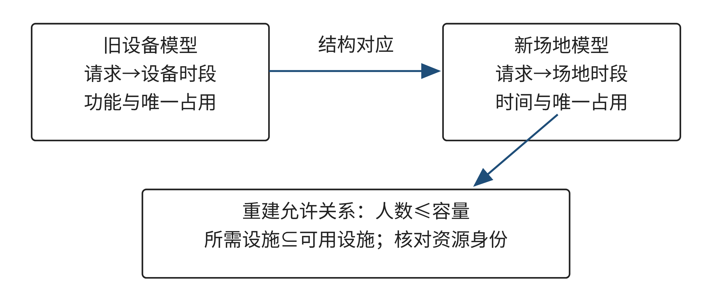
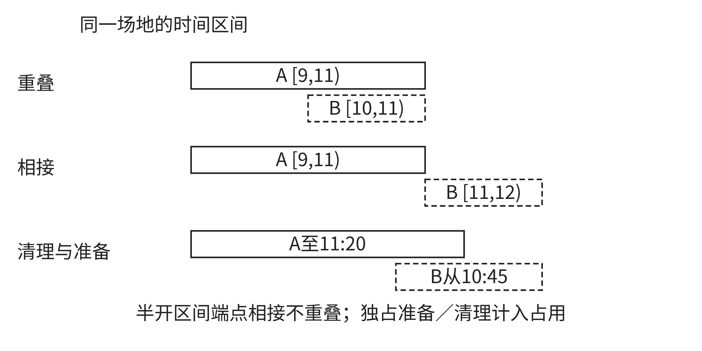

# 1.3 计算思维的普适性与迁移条件

计算思维能进入许多领域，不表示一套程序或规则可以不经检查地搬到任何情境。真正可迁移的往往是问题中的某些关系：不同请求要取得资源，某些选择彼此冲突，结果必须满足明确条件。换了领域之后，资源代表什么、数据按什么口径记录、哪些例外会改变结论，都需要重新核对。Wing曾倡议把计算思维看作超越编程的通用能力；这里的“通用”指它能帮助人分析不同领域的问题，并不意味着所有领域共享同一组规则[[S01]]。

本节从一个原创社区场地案例出发，区分可行性随对象与位置映射保留的条件、容量和设施如何改变候选关系，以及连续占用如何改变问题表示和状态检查。随后把这种分析扩展到分类阈值、数据不确定性与公平决策，练习说明旧方法适用到哪里、需要怎样修订，以及哪些判断必须由相关人员承担。

## 1.3.1 案例：社区活动的场地安排

一个社区服务点要在三个完整时段内安排四项活动。组织者手头有一张类似设备借用的旧表：每项请求找一个可用资源，在允许的时段完成，并避免同一资源同一时段重复占用。现在资源换成活动场地，需求增加了参加人数与所需设施。若沿用旧表，安排结果可能看起来没有时间冲突，却未必容纳得下参加者，也未必提供活动需要的全部设备。

以下E03是本书自拟的教学数据，不代表西南财经大学、真实社区或真实场地。时段S1、S2、S3依次排列，每个时段是一个完整单位。C1容量为12人，在三个时段均开放，配有投影；C2容量为24人，只在S2、S3开放，配有投影和计算机。活动时长均为一个完整时段。

**表1-X13a E03场地与时段数据**

| 场地编号 | 容量（人） | 可用时段 | 设施 |
| --- | ---: | --- | --- |
| C1 | 12 | S1、S2、S3 | projector（投影） |
| C2 | 24 | S2、S3 | projector（投影）、computers（计算机） |

| 时段编号 | 顺序 | 时段长度 |
| --- | ---: | --- |
| S1 | 1 | 一个完整时段 |
| S2 | 2 | 一个完整时段 |
| S3 | 3 | 一个完整时段 |

**表1-X13b E03活动请求数据**

| 请求编号 | 参加人数（人） | 允许时段 | 所需设施 | 活动时长 |
| --- | ---: | --- | --- | ---: |
| Q1 | 10 | S1 | projector（投影） | 1 |
| Q2 | 8 | S1、S2 | projector（投影） | 1 |
| Q3 | 20 | S2、S3 | projector（投影） | 1 |
| Q4 | 16 | S2、S3 | computers（计算机） | 1 |

来源：本书自拟教学数据，数字只用于演示迁移与检验。

安排必须同时满足六项硬约束：每个请求恰好安排一次；参加人数不得超过场地容量；请求所需设施必须全部包含在场地设施中；所选时段同时属于请求允许的时段和场地开放时段；同一场地同一时段至多安排一个请求；每项活动占用一个完整时段。满足全部硬约束后，才可按S1、S2、S3的先后比较方案；时段顺序是偏好，不会替代或放宽硬约束。设施用集合表达时，检查条件是“请求所需设施 ⊆ 场地设施”，不能只看场地是否拥有其中一项。

**E03 迁移练习与评价**

请先完成四项任务，再评价自己的迁移依据。允许使用纸笔、电子表格或程序；工具不同，交付内容相同。每个结论都要能追溯到给定数据与规则。

1. **作出结构映射。**指出E01共享设备任务中的哪些对象、属性和关系可对应到E03；区分可以继承的规则、需要重新解释的字段和新增条件。说明为什么“没有场地时段冲突”仍不足以证明安排可行。
2. **整理候选并完成安排。**为每个请求列出同时符合人数、设施、场地开放时段和请求允许时段的候选场地—时段组合；选择一组安排全部请求的方案，以“请求、场地、时段”三列提交，并逐行保留判断依据。
3. **验证并检验反例。**逐项检查提交的安排是否满足六项硬约束。再检查把E01另一组可行安排仅作名称替换后形成的候选“Q3—C1—S3、Q4—C2—S3”：找出Q3仍违反的条件，并判断Q4—C2—S3是否满足容量、设施和时段要求。说明这个反例揭示的是哪条迁移假设失效。
4. **处理容量变化。**只把C2容量改为18人，其他数据、偏好与硬约束保持不变，重新判断能否安排全部请求，并给出足以支持判断的理由。若建议增加场地、改变时段、调整人数或拆分活动，另列为待协商提案；提案经相关人员确认并成为新输入后，才构成另一个问题实例。

**表1-X13c E03交付物与评价依据**

| 交付物 | 评价重点 |
| --- | --- |
| 结构映射说明 | 对应关系有依据，区分可继承规则与新增条件 |
| 候选清单及完整安排 | 候选由人数、设施、两方时段条件共同筛选；每项请求恰好一次 |
| 逐项检查与反例分析 | 检查全部硬约束；指出反例改变了哪项判断 |
| 容量变化结论 | 用候选和约束支持有解或无解判断；协商提案不冒充当前解 |

来源：本书自拟练习。评分关注结构对应、领域条件、例外与反例，以及证据能否支持调整；开放表达可以不同，但结论须满足同一组输入与硬约束。完整参考解与讨论另列于[章末E03参考解](answers-e03.md)，本练习页不提供结论。

## 1.3.2 哪些可行性会随映射保留

设备与场地在字面上都叫“资源”，还不足以说明它们能互相替换。先把旧任务的请求集合记作 `R`，把可选位置集合记作 `P`。一个位置可以写成“资源、时段”的组合。对每项请求 `r`，允许关系 `A` 给出它可以使用的位置；方案则为每项请求选择一个位置。方案可行至少要求每项选择属于对应的允许集合，且不同请求的选择不违反资源冲突规则。这个小模型不是通用理论定理，而是对本节单位置排程的明确约定。

若新旧任务之间有可说明的一一对应，可把旧请求 `r` 映到新请求 `φ(r)`，把旧位置 `p` 映到新位置 `ψ(p)`。对旧方案中的每个安排，迁移后的安排就是把 `φ(r)` 放在 `ψ(p)`。这里至少有三件事需要同时核对：不同旧请求没有被合并成同一个新请求；不同旧位置仍映到不同新位置；每个被采用的新请求—新位置组合仍属于新任务的允许关系。还要检查冲突规则本身是否保留。满足这些条件时，可以推出映射后的旧方案继续满足它所继承的单位置规则。

这个结论有清楚的边界。它只说明旧方案中已映射的请求满足被检查的规则，不自动说明新任务的全部请求都已安排，也不说明新领域没有额外条件，更不保证公平、低成本或实际效果最好。若新任务增加了请求、硬约束或新的资源冲突，必须单独补入并重新检查。反过来，如果只证明一个具体方案中的位置被映射，不能据此断言旧问题的每一个可行方案都能迁移；要作更广的结论，就必须逐项证明相关允许关系和冲突关系都被保留。

“单射”在这里有直观含义：两个不同对象不能映到同一个新对象，两个不同位置也不能映到同一个新位置。假设旧问题有两台彼此独立的设备D1、D2，二者都能在S2供不同请求同时使用。若新问题把D1和D2都称作同一间场地C，那么旧的D1-S2和D2-S2会合并成同一个C-S2。原来不冲突的两个位置因此变成冲突。错误不在搜索顺序，而在资源身份的映射丢失了区别。若真实场地里确有两台可以并行使用的独立设备，模型就应继续区分设备资源；若同一场地确实不能并行举办活动，则必须新增唯一占用检查。先确认“资源”指房间、设备还是服务能力，才能决定采用哪种对应。

映射还要保留关系，而不只是保留对象。旧设备“具备显示功能”和新场地“有投影”可以构成能力对应，但新活动可能同时要求投影与计算机。若把“满足所需能力”简化成“至少有一种所需设施”，集合关系就被削弱了。反过来，若把场地所有设施都当作请求必须具备的条件，又把需求扩大了。对每个迁移规则，都要说明它在新任务中表达了什么可观察的条件。

还要区分保住一份方案与保住全部解的结构。只证明当前方案中的每一对请求—位置在新任务中仍被允许，只能说明这一份旧方案可被映射；其他旧候选可能因新条件消失。若要声称两类任务的所有解可以往返对应，还必须检查映射是否覆盖新问题所需的对象、是否保留双向允许关系，以及新问题是否没有旧模型之外的额外限制。若教学目标只是迁移一份已审核方案，就不必证明所有解等价，但仍须逐条检查新约束。把结论范围写清，可以避免由“一个例子可行”跳到“这种方法在任何相似问题中都可行”。

图1-5并排展示两套任务的结构对应与容量、设施等新增检查，可对照上述映射条件逐项查看。

图1-5 设备借用与社区场地分配的可迁移关系和新增条件

来源：本书原创教学图，展示本节E01与E03的结构对应及容量、设施等新增检查；数据为教学示例。

## 1.3.3 容量与设施改变候选关系

单位置排程中，一项请求仍然选择一个“资源—时段”位置。若新领域增加容量要求，候选筛选会改变：超出容量的位置从该请求的允许集合中排除。设施条件也会筛选候选，但它可以更复杂，因为一个请求可能同时需要多项设施。只要请求仍占用一个位置，且不同请求的冲突仍按单个“资源—时段”判断，问题的整体表示和占用状态就没有因此变成连续区间；改变的是哪些位置允许哪些请求。

如1.1节的局部选择反例所示，逐项存在可选位置并不保证整体组合可行；迁移到新领域时仍须核对所有请求的共同占用。搜索可以帮助寻找组合，剪枝可以减少不可能的分支，但要声称无解，仍需给出覆盖全部候选的理由，不能只凭“程序没找到”。

容量和设施数字常隐藏领域口径。字段“参加人数”可能是报名人数、预计到场人数或包含带队人员的总人数；“容量”可能表示法定上限、座位数，或考虑设备摆放后建议的舒适人数。这些值即使单位都写“人”，含义未必相同。设施字段也可能表示“登记在册”“当日可用”或“已经测试正常”，它们不能不加区分地视为同一属性。迁移时要记录数值来源、更新时间、单位和确认状态；不确定的预计人数可以记录范围，不要无说明地压成一个精确整数。

如果新数据改变了一个已建模字段，例如场地容量更新，程序可以按新输入重新筛选候选；如果旧模型完全没有容量约束，仅在表格上添加一列并不等于算法已开始检查容量。表示、约束生成和输出验证必须指向同一个定义。否则表格里存了数字，搜索器仍会按旧允许集合安排，独立检查器也可能遗漏这一项。

实际工作中，还可把允许关系的来源拆开看：场地开放时间由场地管理方确认，活动允许时间由组织者确认，设施状态由负责设备的人确认，人数由报名或组织记录支持。几个口径合在一起，才构成候选条件。若有一项仍未知，合理做法是标记待确认并评估结论是否依赖该值；不能让默认值悄悄替代现场判断。

## 1.3.4 连续占用改变表示与检查

一个新变化可能不只是筛掉更多候选，而是改变“选择一个位置”这件事的含义。活动如果跨越多个时段，选择开始时刻不能代表场地的完整占用。只为活动增加 `duration=2` 字段，但仍只把开始时段标为已占，冲突检查依旧看不到它占用的第二个时段。新数据字段没有自动改变旧状态更新与检查逻辑。

考虑同一场地的两项教学示例活动。活动A从9:00开始，连续使用两小时，活动B从10:00开始，使用一小时。用半开区间表示实际占用：A为 `[9:00, 11:00)`，B为 `[10:00, 11:00)`。左端点计入占用，右端点不计入；两项活动在10:00至11:00同时占用场地，因此冲突。两个开始时刻不同，旧的“开始时段不能相同”检查却会放过它。

如果另一活动为 `[11:00, 12:00)`，它与A的结束点相接，但没有共享任何时间长度。在没有准备、清理或交接间隔的模型里，端点相接不构成重叠。对两个半开区间 `[s₁, e₁)`、`[s₂, e₂)`，当且仅当 `s₁ < e₂` 且 `s₂ < e₁` 时重叠。如果把端点也算作占用，边界相接会被误判；如果实际要求清场、布置或设备检查，单纯按活动起止时间判断又会漏掉真实占用。

准备和清理必须先转成模型所采用的占用口径。例如，活动A在9:00—11:00使用场地，结束后需20分钟清理；活动B在11:00开始前需15分钟布置。若这两个过程都需要独占场地，两项活动的实际占用区间会延伸并发生冲突。若准备可在活动室外完成，或清理与另一项活动不共用同一空间，区间又不同。时间数值只是示例；谁来确认每项活动怎样使用场地、需要哪些准备步骤，是领域事实，不应由程序替人猜测。

有两种常见表示可表达连续占用。固定时段且每个时段粒度足够时，可为一次安排生成占用位置集合，例如 `O(A)={C-S1,C-S2}`；合法安排要求不同活动的占用集合不相交。若起止时刻不落在固定网格上，则可直接保存开始与结束时间，在相同资源上比较半开区间。选择哪种表示，要看需要识别的最小时间差、时钟精度和业务记录方式。网格太粗会把不同占用合成一格或掩盖短暂重叠；网格过细又增加数据与检查负担。

连续占用还会改变搜索时的状态更新。选择A之后，算法必须把A占用的全部位置标为不可用；尝试另一分支时，必须撤销同一批状态；检查完整方案时，也要比较所有占用集合或区间，而不是只比较开始位置。若候选生成、状态维护和最后验证采用不同口径，就可能出现“搜索阶段认为可行，复核阶段认为冲突”的不一致。图1-6用一对边界相接与区间重叠的情形，帮助读者检查表示是否区分了两者。

图1-6 半开区间中的连续占用、端点相接与准备清理时间

来源：本书原创教学图，区分活动区间的重叠、无间隙端点相接和纳入准备/清理后的实际占用；时间为教学示例。

## 1.3.5 模型实例和算法策略分别迁移

讨论“沿用原办法”时，至少要分清三个对象。问题实例是这一批具体请求、容量、开放时间与设施状态；模型是哪些对象、属性、允许关系、冲突和目标被表达；算法策略是在这个模型上如何生成候选、选择下一个请求、更新占用、回退并判断。三者变化的方式不同，不能用一句“换到新领域了”笼统概括。

若仅更新一个已纳入模型的容量数值，变化的是问题实例，候选筛选读取新值即可。若原模型没有容量条件，现在必须增加“参加人数不超过可用容量”，变化的是模型；候选生成与独立检查都要实现这一关系。若一次安排占用多个连续位置，则模型中的一项选择已经由单位置变成一段资源使用，状态更新与冲突检查需要随之改变。此时仍可沿用递归试探、选择候选和回退的搜索骨架，但不能沿用只标记开始位置的状态语义；请求排序、冲突剪枝等策略也要在新的候选和状态上重新验证。

迁移算法策略时，可以询问它依赖哪些操作：候选由什么关系生成，选择后哪些资源状态变化，失败时撤销什么，检查怎样证明全部请求被处理。若这些操作的接口含义不变，算法骨架可能复用；若状态范围或冲突定义变化，旧实现即使还能运行，也不再保证解决新模型。性能也要另行衡量。一个策略在小数据上找到方案，不证明它对更大实例足够快；算法成功返回，也不证明模型覆盖了真实任务要求。

因此，迁移结论要说清层次：“数据值更新后仍使用同一候选结构”“新增约束后复用搜索骨架但重建候选检查”“占用语义改变，重写状态与验证”等描述，比“算法通用”更可检验。学生能够指出哪些函数或判断要变、哪些步骤可以保留，就已经在说明迁移的条件，而不是只给旧程序改变量名。

## 1.3.6 分类阈值迁移：同一分数为何不等于同一决定

迁移问题不限于排程。分类系统经常把不同对象压缩为分数，再用一个阈值触发处置。字段名称相同、分值范围相同，并不能证明阈值适用。要先问分数代表什么、根据哪些资料产生、阈值要触发什么行动、错误会给谁带来什么后果。这里的判断是本书的教学分析，不是某个外部分类理论的完整复述。

设一个虚构的服务中心给申请生成0至100的优先分数。第一种用法是分数达到60时，把申请送交人工复核；分数只决定复核次序，不直接拒绝服务。第二种用法也有一个0至100分数字段，却要据此自动取消资格。即使两个系统都写着“priority_score”，同一个60也不必对应同样的证据强度，更不能自动继承第一种用法的后果。由“排在前面看一看”改成“剥夺申请资格”，改变的是决策动作和错误代价，不是表头。

一个可执行的阈值模型至少要把输入、分数含义、判定边界和后续动作连起来。若分数是人为加权的指标，应披露各项权重与数据口径；若是模型预测，应说明目标事件和观察时间窗；若缺少历史结果或标签不可靠，要明确哪些分值只是暂定。临界样本能帮助检查规则：分别查看阈值下方、阈值附近和上方的案例，确认输入证据、分数变化与动作变化是否符合预期。这样能发现单位倒置、缺失值默认、同一字段混入不同语义等问题，但不能替代对阈值后果的讨论。

不确定性应进入结果解释。假设一个分数由报名资料估算，输入缺项时系统把空白记成零，结果可能表现为低分，实际上只是资料未核实。可以区分“确认”“估计”“未核查”，对估计值做上下界或情境比较；若跨过阈值时结论会改变，就把该申请转入补充资料或人工复核，而非把估计值当作事实。对小样本，观察到的比例也可能因个别记录变化而大幅波动；应报告样本数量和不确定范围，避免用一个小数点后的排名掩饰证据不足。

公平性判断也需要有具体程序。制定阈值前，相关人员应先说明哪些人受到决定影响、哪些错误更有代价，公开可接受的处置和复核流程。试用阶段可以抽取边界案例，按相关群体与资料完整程度查看输入缺失、误判和申诉结果；如果覆盖不均或错误集中，先追查数据来源和规则，再考虑调整阈值或增加补充证据。即使统计结果没有明显差异，也不能单凭数字决定某种处置是否公平；受影响的人能否理解理由、纠正错误和提出异议，仍是制度设计的一部分。

计算可以比较不同阈值下的通过数量、复核工作量与各类错误，却不能自行决定权利如何权衡。一个指标权重或阈值通常把选择写进系统：谁设定了边界，谁授权了动作，谁能纠正误判，都会影响结果。把这些责任和记录机制说明白，才不会让“系统算出的分数”被误当作中立答案。

## 1.3.7 迁移时如何处理领域口径与未知项

新领域专家不是程序的外部顾问，而是帮助定义对象与关系的共同建模者。场地管理者可以确认“开放”是否包含布置时间，活动组织者可以解释参加人数来自报名数还是预计到场数，服务规则制定者可以说明一个分数会触发哪类行动。模型把他们提供的判断转成可检验的字段或规则，但不能替他们决定尚未达成一致的含义。

对每个会改变结论的字段，至少记录单位、定义、来源、时间和状态。状态可以区分已确认、估计和未核查；缺失不等于“没有”，估计也不等于“确定”。若输入是范围，分别用上下界检查结论是否稳定；若两个边界给出不同决定，就指出差异并收集能区分它们的新证据。若证据暂时无法补齐，输出应保留“未知”或“待复核”，而不是强行给出确定结果。

这类做法也适用于机械化、电气化、信息化和智能化等场景词汇。它们可以提醒我们比较工具承担的动作与信息处理，却不构成一个让旧方案必然升级或适用的严格历史定律。检查迁移时，应回到任务：机器代替了什么操作，自动系统使用什么数据，判断边界由谁确认，反馈出现后怎样修改。工具能力变化可能扩大规模、降低某类成本，也可能让错误更快传播；具体判断依赖任务和证据，不能从标签推出。

**本节反思：把迁移结论说到证据所及之处**

回到任意一个你熟悉的任务，写下旧方法依赖的对象、允许关系和冲突规则，再说明新情境保留了什么、改变了什么。反思时可以追问：哪些对应是一一保留的，哪条新条件会筛掉旧候选？如果选择占用一段时间、多个资源或不同优先权，旧状态还表达得了吗？一个分数跨到新领域后，口径、阈值和触发动作是否仍相同？哪些数据是估计值，结论对它们有多敏感？谁能确认规则、复核结果并申诉？

迁移不是给旧方法换一个领域名称，也不是要求每个新问题从零开始。它是在可说明的对应关系上保留一部分结构，在新条件出现时重建允许关系、状态或决策依据，再用边界案例检验改动是否足够。可迁移的结论应同时写明保留了什么、尚未覆盖什么，以及出现何种新证据时需要再次修订。
