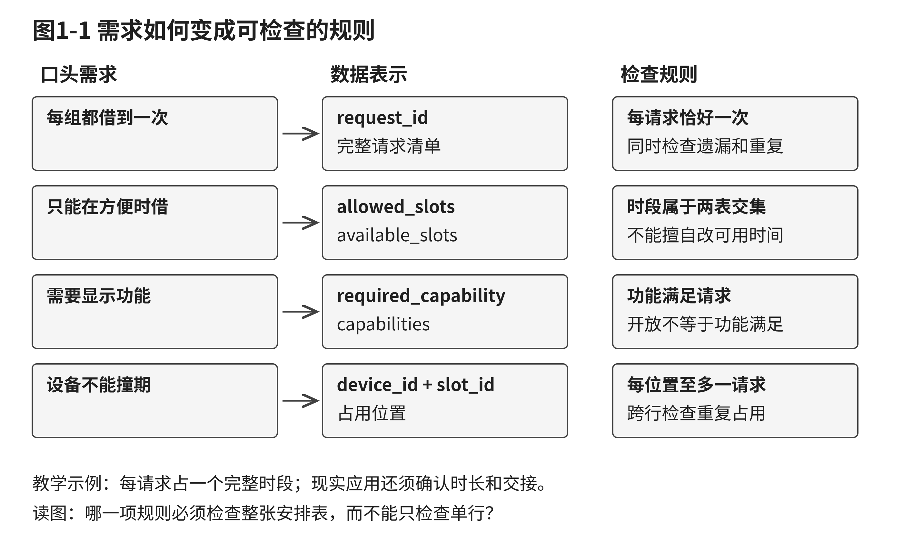
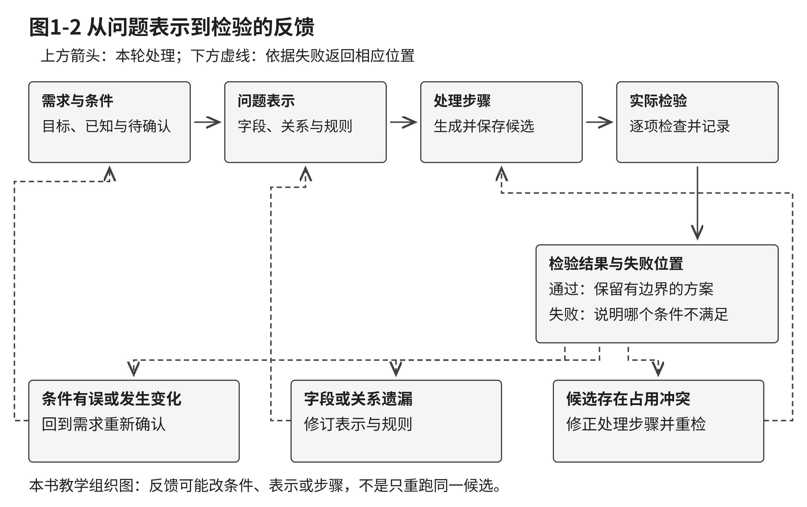
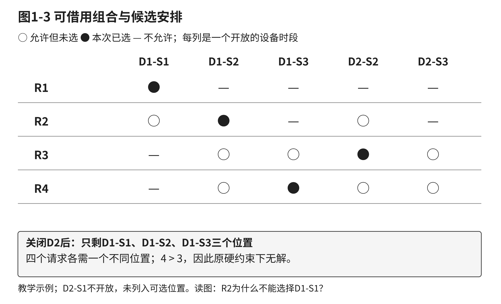
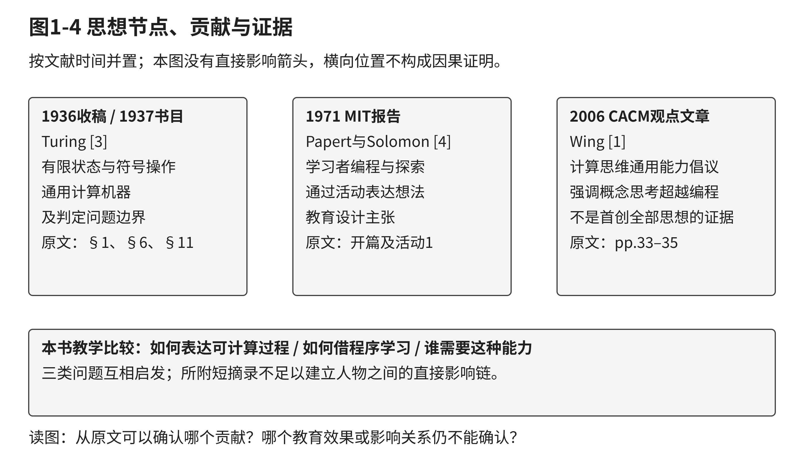
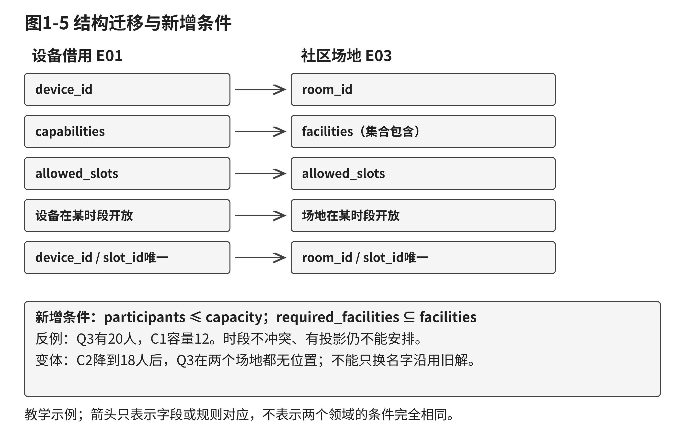
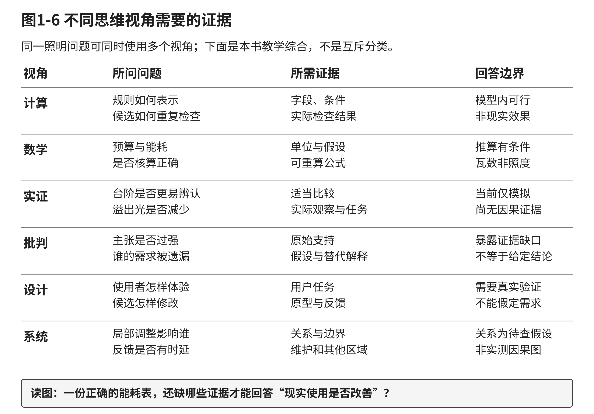
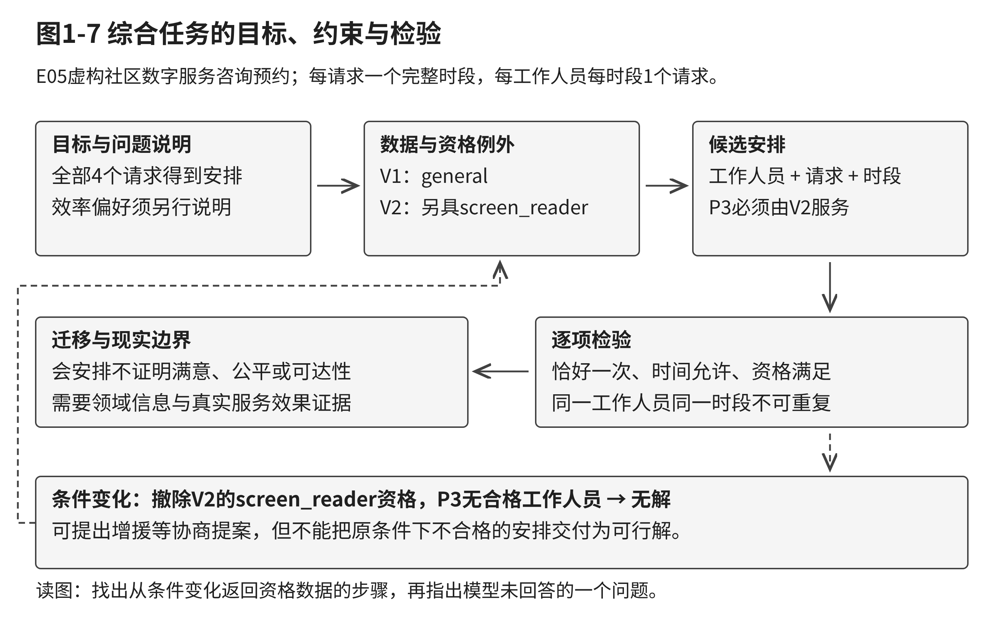

# 第一章 计算思维：从现实问题到可检验的解决过程

一张排程表填满了，任务就完成了吗？一个程序正常运行了，现实问题就解决了吗？一个智能助手给出了流畅的回答，我们就可以据此行动了吗？这些判断都需要回到同一件事：目标是否说清楚，条件是否被准确表示，处理过程是否可以说明，结果是否经得起检查。本章从小规模资源安排出发，建立全书共同的问题解决语言。

你已经学过程序设计，也可能熟悉集合、分支和循环。本章会请你暂时把注意力从语法移到问题本身：为什么选择这些字段，为什么某项要求是硬约束，为什么一个看似合理的候选仍然失败。手工表格、程序和AI都可以参与；课程评价看你能否说明推理与检验依据。

## 学习目标

表1-1 本章学习目标与可观察成果

| 学习成果 | 学完后能完成的工作 | 用什么判断是否掌握 |
| --- | --- | --- |
| LO1 | 区分计算思维、编程、算法与工具使用，用反例解释区别 | 概念对照与一个未经核验的工具输出反例 |
| LO2 | 把含糊需求改写为目标、输入、硬约束、偏好、输出与检查标准 | 一页问题说明，明确至少一项待确认条件 |
| LO3 | 运用抽象、分解、模式识别和明确步骤形成候选，并根据失败修正 | 候选安排、逐项核验与条件变化分析 |
| LO4 | 依据原文比较计算理论、程序学习与通用能力倡议 | 思想节点、支持位置、贡献与局限表 |
| LO5 | 迁移共同结构，重建新领域条件并用反例检查边界 | 字段与规则映射、新增条件及失效说明 |
| LO6 | 为同一问题选择互补视角，说明各自需要什么证据 | 证据需求表、综合建议和有限结论 |

## 学习路线

1.1用共享显示设备建立“问题—表示—过程—检验”的联系；1.2读少量原始文献，区分理论、教育设计与倡议；1.3把设备借用迁移到社区场地分配，处理容量和设施例外；1.4用照明情境比较计算、数学、实证、批判、设计和系统视角。章末换用数字服务咨询预约，检验你是否能够独立说明整个过程。

各节先阅读案例和方法，再完成E01—E04；章末E05需要综合运用。练习的表格、原文短摘录和参考指引均随稿提供，不依赖特定品牌、付费账户或真实校内设施。先尝试，再看参考解；尤其保留一条失败候选，说明修正依据。设备、场地、照明和咨询情境均为本书自拟教学示例。

本章建立方法轮廓。第二章深入各项核心方法，第三章展开AI素养与人机核验，第四至六章继续学习论证、创新和综合项目。现在的目标是能用清楚的表示、有限的结论和具体证据解释一次问题解决。

## 1.1 计算思维的定义与内涵：超越编程

面对一个复杂任务，人们很容易先问“用什么软件”“要不要写程序”或“能不能让人工智能给出答案”。这些问题有用，却通常不是解决问题的第一步。假如目标还没有说明白，输入信息互相矛盾，必须满足的条件与可以商量的偏好混在一起，那么再熟练地操作工具，也可能只是更快地得到一个不合要求的结果。计算思维关心的，正是怎样把一个现实任务整理成可以理解、处理和检查的过程。

本节从共享显示设备借用的情境开始。我们将先识别口头要求中的目标、数据和遗漏条件，再讨论计算思维与编程、算法和工具使用的关系，观察几种常用方法如何共同工作，最后把规则落到一项可以手工完成、也可以用程序复核的练习中。读完本节，你应能说明为什么编程只是计算思维的一种实现方式；能把含糊的需求改写为输入、约束、输出和检查标准；也能在条件变化后重新判断方案是否成立。

### 1.1.1 案例：设备够用，为什么仍会发生借用冲突

设想一个课程项目组负责协调共享显示设备的借用。几位同学提出了不同请求：有人只能在一个时段使用，有人有两个可选时段；一台设备三个时段都开放，另一台设备只在后两个时段开放。所有请求都需要显示功能。项目组的口头目标是：“让每组都借到设备，尽量早点安排，最好也公平一些。”

听起来，设备不少，安排也不复杂。于是有人按请求到达顺序填表：每个请求都有一行，看起来没有遗漏。但两条请求可能被放在同一台设备的同一时段，造成重复占用。行数齐全不等于方案可用。

另一个人可能提出：“设备有两台，四个请求分开排就行。”但设备是否开放、请求是否允许在该时段使用、设备是否具备所需功能，都会影响一个组合能否成立。资源总数只是问题的一部分，资源、时段与请求之间的对应关系才决定安排。

“尽量早点”也需要解释：是先满足较早提出的请求，还是降低所有请求的平均等待时间？“公平”指等待时间接近，还是按申请顺序处理？这些词不能自行给出唯一标准。把偏好悄悄当成硬条件，等于替项目组作出未经确认的判断。

因此，安排之前要先澄清“完成”是什么意思。一个可检查的初步目标可以写成：为每个请求安排一台具备显示功能且当时开放的设备和一个允许使用的时段；每个请求恰好安排一次；同一台设备在同一时段最多服务一个请求；在满足这些条件以后，再比较较早完成等偏好。这个表达还没有替项目组决定公平标准，也没有指定使用什么软件，但已经指出了方案必须具备哪些可观察的性质。

**读图任务：**沿图1-1从口头要求走到检查规则。请标出哪一项信息来自明确数据，哪一项仍需要向提出者确认；再找出一个如果漏掉就会造成重复占用的字段或关系。图中的箭头表示整理和澄清的过程，不代表所有现实问题都必须按照固定顺序处理。

**来源说明：**本书原创教学图，依据本节共享设备教学示例与作者工作性框架绘制。

案例里的困难并不是缺少一个更聪明的排程按钮，而是原先的说法没有充分说明对象、时段、条件和验收方式。把“大家尽量都能用”转成可执行的安排，不是把一句话翻译成代码这么简单。首先要决定现实中哪些信息与任务相关；其次要写清楚可接受方案的规则；然后才可以形成候选安排并逐项检查。任何一步都可能暴露新的问题：数据有误，规则遗漏，偏好没有被解释，或者当前资源确实不足。

这个案例是为本书编写的教学情境，设备、请求与时段都不是学校的真实记录。它故意把“能否安排”“如何选择较好的安排”和“发生变化后怎么办”放在一起，帮助我们看到现实问题常同时包含事实、规则和判断。接下来各小节会把这些部分拆开说明，再在练习中重新组合。

### 1.1.2 计算思维、编程、算法与工具使用

“计算思维”很容易让人想到计算机，随后又想到编程。二者确实相关：程序可以把一套明确的处理步骤交给计算机执行；写程序也常迫使我们说清数据如何组织、条件如何判断、结果如何产生。但“可以写成程序”与“已经理解问题”并不是一回事。程序能精确执行写入其中的规则，即使规则遗漏了重要对象，程序也可能准确地给出一个现实上不可用的答案。

在说明本书的教学组织方式前，先看有明确出处的学术表述。Wing在2006年的文章中将计算思维联系到运用计算机科学的基本概念来解决问题、设计系统和理解人类行为，并特别强调其核心是概念化，而不是只写程序[1, pp. 33–35]。2010年的说明将一项定义归于Cuny、Snyder与Wing共同提出，因此不宜把计算思维的全部思想或这一定义表述成Wing个人独自创立[2, p. 1]。这里引用的是相关作者对概念范围和贡献归属的说明，并不意味着不同研究对计算思维的边界完全一致。

为了在本章开展分析，我们采用一个明确标注为**本书工作性定义**的表述：计算思维是围绕一个目标，把现实问题整理为可讨论的表示，明确处理规则和适用条件，形成能够执行或推演的步骤，并依据检查结果判断、修正和说明方案的思考过程。这个说法服务于本章的学习任务，强调问题、表示、规则、执行和检验之间的关系；它是本书作者为教学组织作出的综合解释，不意味着学术界只有这一种表述，也不把它当作某个统一分类体系的正式定义。

这里的“表示”，是把与目标有关的对象、关系和状态表达出来，可以是一张表、一幅图、一组符号或一段规则。表示不是现实本身，而是为任务作出的选择。安排设备时需要请求、设备和时段；若要判断设备是否需要维修，故障记录和维护时间就更重要。保留或略去信息，应由目标决定。

“规则”说明什么安排可以接受，或怎样根据已知信息采取下一步。比如，“设备要合适”不够具体；“设备具备请求所需功能，并在所选时段开放”就能检查。规则明确后才容易交给程序处理，但可形式化不等于合理：规则若错误排除一类请求，程序只会稳定地重复错误。

“执行或推演”不只指运行代码。人可以手工填表或模拟流程，程序可以枚举组合。不同方式的速度和规模不同，但都应能说明输入、步骤及输出依据。“检查和修正”则要求将结果对照条件，而不是只看表格是否整齐或程序是否运行成功。

四个相近概念可以这样区分。**问题解决**是一个更广泛的目标，指人们面对问题并设法得到可接受结果；它可以依靠经验、协商、实验、设计或计算，也可以同时使用多种方式。**算法**是针对某类任务的一套明确处理步骤，说明输入、操作、判断和输出；每一步应可执行，并能对规定的输入在有限步骤内结束。它可以由人执行，也可以交给机器执行。**编程**是用某种计算机语言表达指令，使计算设备能够按照这些指令处理数据或控制操作。**工具使用**是调用软件、设备或服务的功能来完成工作。计算思维关注如何理解和组织问题、如何形成规则和过程、如何判断结果是否合适；它可能促成算法和程序，也可能在不写程序的情况下完成。

表1-2 计算思维与相近概念

| 概念 | 主要关注的问题 | 可能留下的成果 | 一个容易混淆的地方 |
| --- | --- | --- | --- |
| 问题解决 | 目标是什么，什么结果可以接受 | 方案、行动、解释或决定 | 不是每种问题都能完全转换成规则 |
| 计算思维 | 怎样表示问题、组织处理过程并检查结果 | 问题说明、约束、流程、候选方案和检查依据 | 不是某种软件的名称，也不是一项固定步骤清单 |
| 算法 | 怎样用明确步骤完成一类处理 | 操作顺序、判断规则及输入输出说明 | 一个算法可以服务于计算思维，但算法本身不替人确认目标 |
| 编程 | 怎样把指令写成计算机可执行的形式 | 源代码、运行结果和相关测试 | 代码可以正确运行，却实现了错误或不完整的规则 |
| 工具使用 | 怎样调用某项功能帮助工作 | 被整理、计算、检索或呈现的结果 | 熟练操作工具不自动说明操作者理解了处理依据 |

同一借用任务可以有不同做法。有人在表格中手动安排，再按硬约束检查；没有编程，也可以先整理对象和条件并检验结果。有人写程序枚举候选并排除重复占用，程序承担了执行工作。也有人让智能助手生成安排，却未核对开放时段；还有人写出能运行的程序，却只比较设备总数和请求数。后两者使用了工具或代码，仍不能证明方案符合具体条件。

因此，不能只凭“有没有代码”或“用了什么工具”判断是否进行了计算思维。还要看目标和数据是否清楚、关键关系是否表达、规则是否区分硬约束与偏好、步骤能否复现，以及结果是否按标准核验。

这个过程观避免了两种误解：把计算思维缩窄为写代码，或把一切问题解决都纳入其中。本节关注的是能否表达问题、说明规则和步骤、核对结果并回应发现。任务未必需要把每一步写成文档或交给机器执行，但关键理由应当说得清楚。

### 1.1.3 核心方法如何共同工作

面对复杂问题，单一方法往往不足以形成可靠方案。抽象帮助我们决定当前任务需要哪些信息；分解帮助我们处理相互关联的子问题；模式识别帮助我们发现不同情境间可借鉴的结构；算法思维把处理过程写得更明确；评估检验方案是否达到目标；自动化可以承担重复执行；泛化则帮助我们判断已经形成的规则是否能用于新情境。这些方法会交错出现，不要求每次都按一套固定次序依次完成。

表1-3 核心方法在借用任务中的协同

| 方法 | 在借用任务中的作用 | 可留下的证据 | 常见风险 |
| --- | --- | --- | --- |
| 抽象 | 保留请求、设备、功能、时段和开放状态等关键要素 | 字段说明、问题表示及被暂时忽略的信息 | 删除了实际影响安排结果的条件 |
| 分解 | 分别整理请求、资源、时段、约束和检查步骤 | 子任务清单及它们之间的依赖 | 把彼此相关的安排问题拆开后不再核对整体 |
| 模式识别 | 识别同类功能要求、可用时段及重复占用关系 | 共同规则、类别和例外清单 | 把表面相似误当成条件完全一致 |
| 算法思维 | 明确如何生成、比较和检查候选安排 | 处理顺序、判断条件和停止依据 | 步骤说得不清，或规则本身不合适 |
| 评估 | 对照目标、硬约束和约定的偏好检查方案 | 检查表、反例、失败原因和修订记录 | 只检查是否有输出，不检查输出是否合格 |
| 自动化 | 让程序或工具重复执行明确操作 | 可重复运行的记录和机器输出 | 自动执行了未经确认的规则，或错误地信任输出 |
| 泛化 | 判断共同规则能否用于其他请求、设备或情境 | 适用范围、假设和例外 | 把局部有效的安排经验当作普遍规则 |

**抽象不是随意删信息。**假如目标是给每个请求安排显示设备，设备的装饰颜色可能与当前判断无关，可以暂时不记录；设备是否有显示功能、何时开放就不能略去。决定某项信息是否重要，要问“如果它改变，方案的可行性或评价会不会跟着变”。如果会，就需要把它纳入表示，或者明确说明暂时不考虑它的原因。抽象可以降低问题的复杂度，也可能造成盲点，因此应能追溯选择。

**分解要保留联系。**可以把借用任务拆成整理请求、整理设备、生成候选、处理占用和评价结果等部分。拆开后，各部分更容易理解；但若只分别检查每个请求是否有可选时段，就可能没有发现两个请求争用同一台设备的同一个时段。分解的结果不是若干互不相关的小任务，而是带有依赖关系的工作结构。子问题分别处理后，仍要回到整体目标检查它们能否同时成立。

**模式识别要与例外意识同时出现。**两个请求都需要显示功能，看起来属于同一类；但如果一个只能在第一时段，另一个可在后两个时段，安排灵活程度就不一样。识别共同结构可以帮助复用规则，例如两条请求都应检查设备功能、开放时间和占用情况；保留差异则能避免把所有记录误当成完全相同。模式是一种待检验的概括，不能因为两个对象有相同名称，就假定它们在所有影响因素上相同。

**算法思维让过程可以跟踪。**学生可以提出一个简单流程：先为每条请求列出符合功能、开放时间和请求时段限制的候选组合；再按顺序选择组合；每选择一个组合，就从其他请求的候选中移除同一设备与时段；若某条请求没有剩余组合，则回退并尝试其他选择；完成后逐条核验。这个流程包含输入、状态更新、判断和失败后的处理，比“找一个不冲突的安排”更容易重现。它只是用于教学示范的搜索策略，不代表所有情况下效率最好，也不代表偏好已获得充分定义。

**评估贯穿方案形成前后。**在生成方案前，先确认什么算合格，能够减少“先做完再争论标准”的情况；生成候选后，按照这些标准查错；条件变化后，则重新检查原有方案是否仍可用。评估需要把目标、检查项和结果联系起来。若一条安排违反硬约束，即使它满足了所有偏好，也不能称作当前条件下的合格解。若硬约束都满足但一项偏好没有达到，准确的描述应是“可行但不符合这一偏好”，而不是“一定无解”。

**自动化扩大执行规模，不代替确认。**手工查看四条请求足够直观；程序可以自动生成候选、排除冲突并重复检查。规模增长后仍需评估处理代价，穷举未必能及时完成。自动化前要说明数据格式、条件和输出要求；空字段、重复记录或未涵盖的例外也要处理。先用少量可人工核对的例子检查程序，再处理更多数据，更容易发现规则和实现中的问题。

**泛化不是照抄。**借用安排中的“对象—资源—时间—冲突”结构，可能出现在场地分配、实验设备预约或团队会议协调中。这个共同结构可以作为迁移的线索，却不能保证原有规则全部适用。场地安排可能新增人数上限和无障碍要求；团队会议可能需要检查成员是否同时参加另一个会议。迁移的第一步是指出共同之处，第二步是主动寻找新条件和反例，再决定哪些规则可复用。

方法共同工作时会产生反馈：需求不清就回去询问；请求没有候选就核对数据和规则；检查失败就修订并重新验证；偏好未达成共识则记录待协商。修正说明模型与现实之间出现了差异，学生应说明改了什么、依据是什么，以及改后重查了哪些条件。

分析问题不意味着每次都要使用全部术语。任务较小时不必强行列出每种方法；只有在存在重复规则、共同结构或条件变化时，相应视角才有助于分析。术语是讨论思考过程的工具，不应成为额外负担。

### 1.1.4 从问题说明到可检验的处理过程

一种可操作的组织方式是先弄清问题要得到什么结果，再理清将要处理的信息和条件，接着形成处理步骤并检查结果，必要时回头修正。也可以把它表达为“问题类型—解决步骤—方法与工具”：先判断当前需要回答的是描述现状、解释差异、比较方案还是设计行动；再把目标拆成有依赖关系的步骤；最后为每一步选择适当的方法和工具。这个三层框架是本书采用的教学组织方式，借鉴样稿的表达线索后重新组织；它不是公认的唯一分类，也不把抽象、分解、模式识别固定分配给某一层。

**第一步，写清目标和交付物。**目标应描述任务完成后希望得到什么，而不只重复原始要求。借用问题的交付物可以是一张请求、设备和时段对应表，加上一份未能满足条件或仍需确认的清单。提前写明交付物，能帮助学生判断哪些信息需要记录，也便于另一个人复查。目标中若含有“合理”“公平”“方便”等词，应继续问它们指什么、由谁判断、依据什么材料判断。尚未达成一致的目标可以标为待确认，不要悄悄替提问者做价值选择。

**第二步，列出输入和输入状态。**除了数据内容，也要关心数据从哪里来、是否完整、何时有效。请求表可能有请求编号、所需功能和可用时段；设备表可能有设备编号、功能和开放时段；时段表可能有顺序。若“可用时段”为空，它可能表示设备当时没有开放，也可能表示尚未录入。两种含义不能混为一谈。数据表可以增加“来源”“确认状态”或“备注”字段，用来区分已知事实、暂定信息和需要询问的内容。

**第三步，把条件分类并写成可检查的形式。**硬约束决定一个方案是否合格，违反其中任何一项都意味着当前方案不满足任务。偏好用于比较多个已经合格的方案，例如在不违反硬约束的前提下尽量早完成。对“平均等待时间较短”这样的偏好，还需要定义如何计算以及是否需要额外数据。对于必须由人协商的条件，应单独列出，而不是以算法默认值取代协商。分类时可以使用这样的提问：“如果不满足这项要求，方案是否立刻失去资格？”若是，它可能属于硬约束；若仍可接受但不够理想，它更像偏好。

**第四步，安排处理步骤并说明依赖。**在借用任务中，先根据请求和设备信息建立可选组合，再选择不冲突的组合，最后检查全部请求是否恰好安排一次。若任何请求没有候选组合，不能跳过它，也不能随意给它增加时段；要回查输入和限制是否正确，并标出需要协商的条件。步骤之间的依赖要写清楚：冲突检查必须知道设备与时段的对应关系；偏好比较则应在硬约束检查之后进行。

**第五步，按标准检查输出。**一个输出表看起来整齐，并不代表完整或正确。检查表应逐项对应规则：有没有遗漏请求？有没有多次安排同一请求？所用设备是否具备功能并开放？时段是否在请求允许范围内？设备时段组合是否被重复使用？偏好是否确实按约定计算？把检查依据与结果一起保存，可以使方案可复核。若结果只包含“通过”两个字，却没有说明检查对象与规则，读者仍无法知道它通过了什么。

**第六步，记录失败和迭代。**检查发现错误后，先定位它属于哪类问题：原始数据录错、请求条件模糊、规则互相冲突，还是处理步骤遗漏了某种情况。不同原因需要不同修正。修正数据时应说明依据；增加规则时应确认由谁认可；调整步骤后要重新运行或重新推演；改动硬约束时则需要重新说明任务已发生变化。不能只修改最终表格，却保留无法解释的新结果。

图1-2把上述关系表示为问题、表示、规则、步骤、输出和检验之间的循环。读图时要注意，回到前一个环节并不一定意味着整个任务重来。例如，若设备实际开放时间有误，可以仅更新设备数据并重新检查受影响的候选；若目标中的“公平”没有定义，则可能需要回到提出者那里澄清评价标准。反馈的范围应与发现的问题相匹配，同时记录新方案依赖了哪些修订。

**读图任务：**沿图1-2找出至少两条可以回到前面环节的路径，并说明它们分别适用于哪种发现：输入记录不完整、约束相互冲突，或方案未达到偏好。再解释为什么“运行完成”不能直接替代“结果通过检查”。

**来源说明：**本书原创教学图，依据本节作者工作性框架绘制。

工具选择应放在目标、规则和步骤初步明确之后。少量请求可以手工枚举；表格适合整理和筛选；程序适合重复检查较多候选；智能工具可以协助改写需求或提出候选，但其数据、规则和输出仍需验证。要说明工具帮助哪一步、需要什么输入、输出如何检查，以及遇到冲突时由谁判断。

生成式人工智能可能以自信口吻输出错误或虚构内容，也可能偏离输入或前后矛盾。美国国家标准与技术研究院的生成式人工智能风险框架将这类风险称为“confabulation”[9]。因此，流畅回答不能充当来源或核验结果；学生仍需检查信息出处，并将工具输出与原始条件逐项比对。

需要特别区分“没有找到方案”和“证明没有方案”。一种启发式流程可能试了几次都失败，但那只说明这几次尝试没有成功；有限枚举检查了全部合法候选，才可能为一个规模明确的问题提供较强的无解依据。与之相对，若输入数据不完整，就不能把程序未找到方案说成任务客观无解。输出应标明它属于已验证可行、在给定检查范围内未找到、已证明不可能，还是因信息不足暂不能判断。状态说清楚，才能避免把不确定结果包装成肯定结论。

把整个处理过程写成问题说明时，可以使用一页简表：目标和交付物；输入字段与来源；硬约束；偏好及其比较方法；未知或待确认事项；处理步骤；输出格式；检查项；条件变化后的应对方式。这样的说明不要求每项任务都写成长文档。它的价值是让任务的关键假设显现出来，并给执行和复查提供共同参照。

### 1.1.5 思维训练：安排借用并检验资源变化

本练习为教学示例，数据不来自真实课程或学校。请你为四个借用请求安排共享显示设备，先形成问题说明，再给出至少一组方案并逐项检查；随后处理一项设备关闭的变化。建议用时四十分钟，可独立完成，也可两人互相检查。练习不要求你写程序；如果愿意使用程序或表格，仍须提交数据、规则和逐项核验结果。

#### 练习数据

三个完整时段按以下顺序排列：

表1-4 E01时段及顺序

| 时段编号 | 顺序 |
| --- | ---: |
| S1 | 1 |
| S2 | 2 |
| S3 | 3 |

设备信息如下：

表1-5 E01设备与开放时段

| 设备编号 | 具备功能 | 可用时段 |
| --- | --- | --- |
| D1 | display（显示） | S1、S2、S3 |
| D2 | display（显示） | S2、S3 |

请求信息如下：

表1-6 E01借用请求

| 请求编号 | 所需功能 | 允许时段 |
| --- | --- | --- |
| R1 | display（显示） | S1 |
| R2 | display（显示） | S1、S2 |
| R3 | display（显示） | S2、S3 |
| R4 | display（显示） | S2、S3 |

**读图任务：**图1-3区分允许组合和已选组合。请指出哪一组选择会导致同一设备在同一时段被重复占用，并说明“这个时段允许使用”为什么仍不足以证明候选安排合格。

**来源说明：**本书原创教学图，依据E01数据与本节约束分析绘制；组合及安排均为教学示例。

每个请求占用一个完整时段。安排必须遵守以下硬约束：

表1-7 E01硬约束与检查

| 编号 | 硬约束 | 如何检查 |
| --- | --- | --- |
| H1 | 每个请求恰好安排一次 | 输出中R1、R2、R3、R4各出现一次 |
| H2 | 设备在所选时段开放 | 设备的可用时段包含所选时段 |
| H3 | 设备具备所需功能 | 设备功能包含请求所需功能 |
| H4 | 所选时段属于请求允许时段 | 请求的允许时段包含所选时段 |
| H5 | 同一设备在同一时段最多安排一个请求 | 任意两行不能有相同的设备编号和时段编号 |

在全部硬约束满足后，可以把较早完成作为比较偏好的一个参考；这不是必须满足的硬约束，也没有规定唯一最优方案。如果你要比较等待时间或公平性，必须先说明采用什么口径，不能因为一组安排较早就说它天然公平。

#### 完成任务

**任务一：重述问题。**请用自己的话写出目标、输入、硬约束、可比较的偏好、输出格式和至少一个可能需要确认的问题。输出格式为三列：请求编号、设备编号、时段编号。说明“每个请求都有安排”和“每个请求只安排一次”的区别。

**任务二：形成候选并作出选择。**对每个请求列出所有符合设备功能、开放时段和请求允许时段的候选组合。然后选择一组完整安排。不要只写“安排成功”，请保留候选或选择过程，使同学能够复核你如何排除冲突。

**任务三：逐项验证。**用下表检查你的安排。若某一项失败，应先说明冲突所在，再调整方案并重新检查全部条件；不能因为最后一行看起来合理，就忽略前面安排产生的占用。

表1-8 E01学生核验记录表

| 检查项 | 你的核验结果 | 依据或说明 |
| --- | --- | --- |
| R1至R4各安排恰好一次 |  |  |
| 设备功能符合请求 |  |  |
| 设备在选定时段开放 |  |  |
| 时段属于请求允许范围 |  |  |
| 同一设备时段没有重复占用 |  |  |
| 偏好比较依据清楚 |  |  |

**任务四：处理条件变化。**现在设备D2关闭，即D2的可用时段变为空集合。重新判断四个请求能否都满足原有硬约束。若你认为可行，给出安排并逐项核对；若你认为不可行，写出不能继续安排的依据。不得为了得到可行答案而私自更改请求时段、设备开放状态或“恰好安排一次”的要求。可以另写一项协商建议，但要明确标注它改变了什么条件、仍需谁确认。

#### 参考安排与答案指引

原条件下，一组可行安排如下：

表1-9 E01参考安排

| 请求编号 | 设备编号 | 时段编号 |
| --- | --- | --- |
| R1 | D1 | S1 |
| R2 | D1 | S2 |
| R3 | D2 | S2 |
| R4 | D1 | S3 |

逐项检查：R1只允许S1，D1具备显示功能且在S1开放；R2允许S1或S2，使用开放的D1和S2；R3允许S2或S3，使用开放的D2和S2；R4允许S2或S3，使用开放的D1和S3。四个请求各出现一次。D1分别在S1、S2、S3使用一次，D2在S2使用一次，没有任何同设备、同时段的重复组合。因此这是一组符合全部硬约束的参考答案。它不是唯一解，其他安排只要逐项满足硬约束，也可以得到相同评价。枚举本组有限数据的全部候选后，原条件共有十二组可行安排；这个数值只描述题目给定的数据与规则，不能推广为其他排程任务的规律。

表1-10 E01参考安排逐项核验

| 请求 | 功能与开放检查 | 允许时段检查 | 设备—时段占用检查 |
| --- | --- | --- | --- |
| R1 | D1具备display；S1开放 | S1属于R1的允许时段 | D1—S1只安排R1 |
| R2 | D1具备display；S2开放 | S2属于R2的允许时段 | D1—S2只安排R2 |
| R3 | D2具备display；S2开放 | S2属于R3的允许时段 | D2—S2只安排R3 |
| R4 | D1具备display；S3开放 | S3属于R4的允许时段 | D1—S3只安排R4 |

D2关闭后，只有D1可用，而D1只提供S1、S2、S3三个设备—时段位置。每个请求都必须安排一次，总共需要四个不同的设备—时段位置；同一个位置不能重复使用。因此四个请求不可能同时完成安排。也可以从请求限制看到，R1必须占用D1—S1，R2只能使用D1—S1或D1—S2，R3和R4各只能使用D1—S2或D1—S3；后面三个请求无法在只剩两个可用位置时全部各自占用一个位置。这不是“还没找到一个好安排”，而是在给定硬约束下没有可行解。

若要讨论调整，可以提出例如增加可用设备、开放一个新时段或由请求者确认可替代时段等协商方案。但这些建议改变了题目条件，必须明确标作待确认提议；在对方确认并更新数据前，不能把它们当成已经满足原始问题的答案。练习评分看的是问题表示是否完整、候选是否符合数据、检查是否覆盖全部硬约束，以及结论是否准确区分可行、不可行和待协商。仅仅得到一个看似整齐的表格，不能替代这些推理证据。

这项练习还说明，条件变化可能使此前可行的任务变成无解。一个可靠的处理过程不能只在首次输入时运行一次，而应在资源、请求或规则变化后重新检查。若条件没有变化，原检查可以复用；若可用设备已关闭，至少功能、开放状态、占用和整体可行性都要重查。保留变化前后的数据和检查记录，能够说明结论为何发生改变。

### 本节反思：从结果回看思考过程

请选取本节练习或自己经历过的一项资源安排任务，回答以下问题，并尽量引用具体记录：

1. 哪个目标或条件起初含糊？你通过什么问题把它说清楚？仍未确认的内容是否被单独标出？
2. 你选择保留哪些信息、略去哪些信息？如果某项被略去的信息发生变化，会不会改变方案？
3. 你把任务分成了哪些部分？这些部分之间有什么依赖？整体检查是否发现了单独检查时看不出的冲突？
4. 你的候选方案如何产生？执行过程是否能够由另一位同学依照相同数据重现？
5. 检查发现过什么失败？你依据什么修正了数据、规则或安排？修正后重新核验了哪些条件？
6. 条件变化后，原方案还成立吗？如果不成立，是某一行需要替换、偏好需要重谈，还是当前约束下已经无解？请说明证据。

反思的重点不是给自己的工作贴上“用了计算思维”的标签，而是让决策过程能够被检查。能够说明规则来自哪里、哪些判断仍待确认、结果经过什么检验，以及失败后如何修正，比是否使用了特定软件更能展示你是否理解了问题。

## 1.2 计算思维的思想来源与演进

“计算思维是什么”并不是一个只靠术语定义就能回答的问题。它涉及人们怎样描述计算、怎样使用计算机进行学习和创造，也涉及如何把某种思考方式介绍给计算机专业之外的学习者。阅读相关历史时，时间相近或后来都被放进“计算思维”主题，并不自动证明一位作者影响了另一位作者。本节用三份原始材料比较不同问题：理论研究如何刻画计算行为，教育工作者怎样设想学习者与计算机的关系，以及计算思维如何被倡议为通用能力。比较的重点是各自的证据、贡献和边界。

### 1.2.1 案例：执行规则与借助程序理解问题

想象两项课堂任务。第一项要求学生按照一组明确规则，把少量记录排好顺序，并报告结果。第二项则要求学生用程序控制一个屏幕上的小型绘图对象，尝试改变指令，观察图形怎样变化，再解释哪些指令导致了哪些结果。两项任务都使用计算机，但学生与计算机的关系并不相同：前一项主要是让设备执行已经写明的步骤；后一项把程序作为一种表达和探索的媒介。

如果我们只看工具，可能会把两项任务都称为“使用计算机”；如果只看代码，可能又会把第二项简化为“练习编程”。更值得追问的是：学习者是在执行现成规则，还是在构造、比较和修改规则？学生是否能解释输入如何影响输出？遇到与预期不同的结果时，是依据观察回到程序检查，还是只重试到图形看起来满意？这些问题将我们带向不同的思想来源，也提醒我们避免把计算设备的出现直接等同于某种学习效果。

例如，执行排序任务的学生可以先记录原始次序、逐次比较相邻记录并记下每一步的变化。如果他只提交最后一列结果，教师无法判断他是理解了规则、抄写了答案，还是偶然得到正确次序。如果他能指出每次比较为什么交换或保留，便留下了可以复核的过程证据。绘图任务也可以采用类似要求：运行前先预测改变一个指令会带来什么，运行后对照预测，再解释差异。程序运行提供可观察的反馈，解释和比较才显示学生如何使用反馈。

这两个情境都是本节的教学例子，不是对历史人物或真实课程的描述。它们帮助读者带着问题阅读后文：哪些来源讨论“能被规则化处理的计算”，哪些来源讨论“学习者如何参与计算活动”，哪些来源则面向公众倡议一种能力？看清问题差异，比按年份记忆人物姓名更有助于理解思想演进。

### 1.2.2 可计算性与问题表示的边界

1930年代，图灵研究可计算数及判定问题。他的论文以形式化方式描述机器的配置、符号操作和可能行为，并在后文讨论通用机器及判定问题边界。原文发表于1937年；论文页上记录收稿与报告日期分别为1936年5月和同年11月。因而，说明这一研究节点时可以同时写明“1936年收稿、报告”和“1937年出版”，而不把两种日期混成一个结论。[3]

对本章而言，这项工作的教学价值不在于把复杂理论压缩成一句“所有问题都能计算”，而在于让学生看到：要讨论机器能否完成某项处理，必须先明确机器的状态、可操作符号和规则。原文的机器配置描述，表明行为取决于可写清的状态条件；这一观点支持我们理解计算模型如何被定义，却不证明现实中所有任务都可由同一程序完成。尤其是价值选择、目标不清和证据不足，不能简单归类为理论意义上的不可计算问题。

图灵论文也帮助区分两种判断。第一种是：某个问题在给定的形式模型内能否由规则化过程处理；第二种是：现实任务是否已被正确表示、是否拥有所需数据、结果是否符合人的目标。前者属于计算理论中的严格问题，后者还需要领域知识、证据和人的判断。借用安排若因为关闭一台设备而无法满足全部请求，是当前有限数据与硬约束下的资源不足；这不是判定问题，也不能用“不可计算”来描述。

阅读机器配置的论述时，可以把它想成一个可追踪的状态描述：在某个时刻，机器处于什么状态，符号带上有什么内容，规则允许下一步怎样移动或改变状态。输入、当前配置和操作规则共同限定后续可能行为。学生不需要在本节掌握论文的全部数学细节，但可以用一张小表手工追踪有限步骤，观察为什么准确描述初始状态和转换规则是讨论计算过程的前提。

表1-11 形式模型与应用判断的层次

| 判断层次 | 需要回答的问题 | 不能由该层单独推出的结论 |
| --- | --- | --- |
| 形式模型 | 模型规定了哪些状态、符号和转换规则？ | 现实任务已被完整地表示 |
| 可计算性分析 | 在给定模型下，是否存在相应的有效过程？ | 过程所追求的目标在现实中合理 |
| 应用判断 | 数据、规则和目标是否适合当前情境？ | 只要程序结束，结果就有效或公平 |

这样的区分可以防止把理论术语用得过宽。说一个数据表当前没有可行安排，是在给定记录和规则下没有找到满足全部约束的组合；说一个问题不可计算，则需要对形式模型、问题表述和理论结果作严格说明。课堂练习中应优先使用“当前约束下无可行方案”“数据不足，暂不能判断”等精确说法，不把它们混写为“机器不能解决”。

### 1.2.3 程序探索、学习与建构

1971年，Seymour Papert与Cynthia Solomon发表报告《Twenty Things To Do With A Computer》。其中一段把两种教育取向作了鲜明对照：一种设想是用计算机“训练”儿童，另一种设想是让儿童编程控制计算机。报告还列出多种计算机活动，包括通过程序控制图形对象进行探索。这里的重点不是一项受控实验结论，而是一种教育设计主张：学习者可以通过表达、尝试和修改程序，主动参与探索问题。[4]

这个节点让计算机不再只是接收任务并返回结果的设备，也可以成为学习者构造想法、观察后果的环境。例如，学生改变绘图指令中的角度，比较闭合图形与未闭合图形，再尝试说明哪些条件需要调整。程序在这里既是操作对象，也是思考留下的可见痕迹。若结果与预期不同，学生可以检查指令和假设，重新运行并记录变化。

这种做法有助于我们理解计算机活动如何承载探索，但不能据此声称任何编程活动都会自动带来深度学习，也不能用这份报告证明本教材或所有年龄学习者必然获益。教学设计主张需要与实际效果研究区分。报告作者、年代、活动内容和它能支持的教育观点，应依据原文说明；至于这些做法在具体课程中的成效，还需要针对课程目标和学习者另行评价。

从教学设计角度看，关键不是让每个学生都写更多代码，而是让程序与思考之间建立可检查的联系。教师可以要求学生先提出预测，再运行一个短程序，保存输出，找出预测与结果不同的位置，并依据证据修改解释。这样的作业能呈现学生的假设、试验和修正过程。若学生只是复制一段程序并按下运行，屏幕上出现图形并不能单独说明他理解了图形由哪些规则生成。

这份报告提出的活动思路还提醒我们，计算机学习可以与数学、自然观察、语言表达和设计活动相连。但跨学科连接需要由具体目标支撑：例如画图活动可以帮助观察角度和重复结构，文本处理活动可以帮助比较表达规则；若只是把几个学科名称并列，却没有说明学生要处理什么问题，就没有形成有意义的融合。这里的跨学科解释属于本书的教学分析，不是对报告效果的额外断言。

### 1.2.4 计算思维作为通用能力的倡议

2006年，Jeannette M. Wing在《Communications of the ACM》发表《Computational Thinking》，倡议把计算思维作为更广泛人群可学习和运用的能力。她以计算机科学的基本概念为切入口，讨论如何解决问题、设计系统和理解人类行为；文中还特别强调概念化的重要性，而不是把计算思维缩减为编写程序。[1]

这一表述与前面的教育设计主张有联系，但其写作目的不同：图灵关注形式化计算及其边界；Papert与Solomon讨论计算机活动与儿童学习的教育取向；Wing则面向更广泛的读者提出通用能力倡议。我们可以在一章中并置这些节点，比较它们共同关心的表达、过程和理解，也可以指出关注对象不同；但在没有原文证据时，不能画出一条“前者直接导致后者”的影响链。

2010年Wing的说明中，一项定义被明确归于Cuny、Snyder与Wing共同提出。它强调把问题及其解决方案表达为信息处理者能够有效执行的形式；信息处理者可以是人、机器或二者组合。[2] 这与2006年的通用能力倡议相关，但不能把2010年这项共同署名的定义说成Wing个人独自创造，也不能将它倒写成2006年文章中的逐字定义。

因此，本书在第一章采用“问题表示—处理规则—执行或推演—结果检查”的教学组织方式，是为帮助学生完成本章任务所作的作者解释。它吸收了上述材料中可支持的概念线索，但不是图灵、Papert、Solomon或Wing共同提出的一套完整四阶段框架。区分来源论断和本书教学设计，可以减少对历史人物的过度归功，也让读者知道哪些内容需要回到原文核查。

表1-12 思想节点的贡献与解释边界

| 思想节点 | 原文主要关心什么 | 本节用于解释什么 | 写作时需要避免的跳跃 |
| --- | --- | --- | --- |
| 图灵，1936/1937 | 形式化描述机器行为与计算边界 | 计算过程需要明确表示和规则 | 不能推成所有现实问题都能或都不能计算 |
| Papert与Solomon，1971 | 计算机活动中的学习者参与和探索 | 程序可以成为表达与试验媒介 | 教育主张不等于已经测得的普遍效果 |
| Wing，2006；2010 | 通用能力倡议及对定义的进一步说明 | 计算思维超越编程，且需要明确问题与可执行过程 | 不能把全部概念史归给一篇文章或一位作者 |

比较表帮助我们发现，这些来源可以共同支持一个有限结论：理解计算不仅要观察设备执行了什么，也要考察问题如何表达、谁在形成规则、哪些结果能够被检查。它们并没有提供一套相同的术语表或统一教学步骤。本书把多个观点组织为学生可练习的案例与任务，是课程设计的工作，而不是复述任一原文的全部主张。

### 1.2.5 AI时代延续了哪些问题

人工智能工具可以帮助人们生成文本、整理资料、归纳模式或提出候选方案，但工具输出并不会自动解决“问题是否表示正确”这一更早的判断。一个系统可能依据不完整的输入流畅作答，也可能把不确定信息写成肯定结论。美国国家标准与技术研究院的生成式人工智能风险框架将这类以自信口吻输出虚假或错误内容的风险称为“confabulation”，并指出输出还可能偏离输入或彼此矛盾。[9]

所以，AI时代出现了新的工具能力，也保留了若干旧问题：目标是否明确，数据是否足以支撑判断，规则是否适用，机器输出是否经过核验。一个学生可以让生成式工具提出借用安排，但仍需检查请求是否遗漏、设备时段是否冲突、参考条件是否被擅自修改。工具可以承担重复计算或提出候选，人则要确定约束来自哪里、哪些偏好尚待协商、什么证据足以支持结论。

这种分工不是说人类总能做出正确判断，而是要求把任务和责任说清楚。若把输出交给程序或模型处理，先要声明输入、操作和验收标准；若工具生成了新的事实性信息，还要查证来源；若现有资料不足，就应把结论标记为待确认或需要进一步观察。AI能扩大探索和处理规模，却不能用输出的流畅程度替代真实证据。

例如，学生让生成式工具“按年代总结计算思维的发展”，工具可能把不同作者关注的问题拼成一条连续、看似必然的进步线。检查时不应只问句子是否通顺，还要逐条追溯作者、文献、年份和支持位置；若来源只说明观点相似，就不能把它改写成直接影响。若引用链接确实存在，也要继续核对链接页面是否包含当前论断。AI可以辅助定位待查信息或生成比较表，但最后的来源判断仍需要读者检查原文。

### 1.2.6 思维训练：给演进图补上证据与局限

请阅读以下三段原文摘录及其出处。摘录、译文和定位均随练习提供；译文是本书的教学译释。任务不是背诵人物生平，而是判断每段材料能支持什么结论、不能支持什么结论。预计用时三十分钟，可个人完成，也可两人互相核对。

表1-13 E02原文摘录与支持位置

| 节点 | 原文短摘录 | 教学译释 | 来源与位置 |
| --- | --- | --- | --- |
| T | “the configuration determines the possible behaviour of the machine” | 配置决定机器可能的行为。 | Alan M. Turing, 1937, “On Computable Numbers, with an Application to the Entscheidungsproblem”，§1 p.231，PDF p.2。[3] |
| P | “Some think of using the computer to program the kid; others think of using the kid to program the computer.” | 一种取向是用计算机训练儿童，另一种取向是让儿童编程控制计算机。 | Seymour Papert与Cynthia Solomon, 1971, “Twenty Things To Do With A Computer”，原报告p.1开篇，2022重印PDF p.3。[4] |
| W | “Conceptualizing, not programming.” | 强调概念思考，超越单纯编程。 | Jeannette M. Wing, 2006, “Computational Thinking”，p.35首条特征。[1] |

**任务一：填写证据表。**为每个节点补全思想主题、原文实际支持的贡献、不能由这段材料推出的结论。T节点关注形式化计算行为；P节点关注教育取向；W节点关注计算思维的通用能力倡议及概念化与编程的关系。

表1-14 E02学生证据比较表

| 节点 | 思想主题 | 摘录支持的贡献 | 摘录不能证明什么 |
| --- | --- | --- | --- |
| T |  |  |  |
| P |  |  |  |
| W |  |  |  |

**任务二：检查时间和因果。**一份初稿写道：“因为Papert与Solomon先提出儿童编程的教育观点，所以Wing在2006年据此发明了计算思维。”请找出这句话中需要原文支持的因果主张，并改写为证据允许的说法。

**任务三：制作演进图。**在图1-4的时间线上标注T、P、W三个节点，写明年份、贡献和局限。图灵节点标记“1936年收稿/报告；1937年出版”，Papert与Solomon标记1971年，Wing标记2006年。只有存在材料支持时才画有向影响箭头；这三段摘录本身不足以证明节点之间存在直接影响。

**提交成果：**一张四列表、对“先后导致发明”的改写，以及带出处和边界说明的演进图草稿。可以先用纸笔或表格完成，再决定图形排版；不需要为了完成任务安装特定软件。你可以在图上用不同线型区分“时间先后”“主题可比较”和“原文支持的影响”，并在图例中解释；若没有影响证据，保留并列节点比画一支暗示因果的箭头更准确。

**读图任务：**查看图1-4时，检查年份、来源和贡献是否一一对应。若图中有箭头，请指出箭头表示时间先后、相似问题，还是有来源支持的直接影响；若说明文字没有区分这些关系，应在图旁补上证据或改用不表示因果的连线。

**来源说明：**本书绘制；图1-4据[1]、[3]、[4]整理，连线只表示教学比较，不表示无来源支持的直接影响。

#### 参考答案指引

表1-15 E02参考概括与解释边界

| 节点 | 可接受的概括 | 解释边界 |
| --- | --- | --- |
| T | 以明确配置和符号条件描述机器可能的行为，为形式化讨论计算提供依据。 | 不证明所有现实任务可计算，也不说明价值问题可由同一过程决定。 |
| P | 比较计算机训练儿童与儿童编程控制计算机的教育取向，提出学习者参与表达和探索的活动思路。 | 摘录是取向比较，不是效果数据；不证明所有儿童或课程都会获益。署名应保留Papert与Solomon。 |
| W | 将计算思维介绍为超越单纯编程的概念化能力，并倡议更广泛人群学习和运用。 | 不代表编程没有价值，也不能证明Wing在2006年发明了全部相关思想。 |

“先后出现”只能支持年代顺序，不能单独支持“因为前者所以后者”的因果关系。可接受的改写是：“图中三份文献讨论不同问题；本书把它们并置作教学比较，所附摘录不足以证明人物之间存在直接影响链。”答题重点是准确追溯、区分贡献、说明解释边界，并避免把历史相邻写成因果。若使用书目年份，还应说明Turing论文页上记载1936年收稿和报告，正式出版年按1937年引用；不得只保留一个日期而遮蔽不同口径。

练习按四个维度评价：是否准确找到原文位置，是否区分三个节点的贡献，是否说明摘录的解释边界，是否避免无证据的因果表达。一个简短答案若明确指出“来源并列比较而非因果链”，可以比人物介绍很长但混淆贡献的答案得分更高。接受不同的概括方式，但原文定位、日期口径和结论强度要与证据一致。

### 本节反思：把历史论断放回证据中

1. 哪一项结论直接由原文摘录支持？是哪一项属于本书作者把不同来源并置后的教学解释？
2. 读到“某概念诞生于某年”或“某人受另一人影响”时，你会寻找什么证据？年代先后为什么不够？
3. 图灵、Papert与Solomon、Wing分别在处理什么问题？把他们放进同一张图，哪些共同点是比较结果，哪些不能写成直接影响？
4. AI工具给出一个看似合理的历史概述时，你会怎样核对作者、年份、原文位置和论断边界？

历史学习不只是记住年份和姓名，还要能分辨证据的强弱。准确引用一段原文，不等于它能证明所有相关结论；明确写出局限，才能让读者知道论证在哪一步停止。

## 1.3 计算思维的普适性与迁移条件

人们常说，计算思维可以用于很多领域。这个说法不应被理解成“换一个场景，照搬同一套规则就能得到正确答案”。更准确的问题是：两个任务在目标、对象、关系和限制上有哪些共同结构？现有规则依赖什么条件？新情境增加了哪些领域要求？只有回答这些问题，才能判断哪些经验可以迁移。

本节把第一节的共享设备安排迁移到社区活动场地分配。两个问题都要在有限时段内为请求匹配资源、满足时间限制并检查重复占用；场地任务却新增了人数容量和设施要求。你将练习提取共同结构、补上新条件、用反例检验迁移结果，并判断哪些现实问题仍需要调查或协商。完成后，应能说明迁移既不等于复制，也不等于只把表格里的名称换掉。

### 1.3.1 案例：名字换了，规则还能照搬吗

先回忆共享设备任务：每个请求都要安排一次，设备要满足功能、在对应时段开放，请求要允许该时段，同一设备同一时段不能被重复使用。现在换一个情境：社区要在几个时段内安排活动场地。每项活动有预计参加人数、可用时段和所需设施；每个场地有容量、开放时段和设施。看起来，“请求—资源—时段”的结构仍然存在。

若只做表面替换，可以把“设备编号”换成“场地编号”，把“功能”换成“设施”，照抄原先的唯一占用规则。这样能保留一部分重要限制，却漏掉一个新问题：某间场地即使开放、也有投影设备，是否装得下参加者？原设备练习没有要求对人数做比较，因为其数据没有容量字段；场地任务则必须把参加人数和容量纳入可行性判断。沿用旧规则会把时段安排得没有冲突，却可能把二十人分到只能容纳十二人的房间里。

迁移的价值正是在这种“相同与不同”之间。完全忽略已有结构，每个新问题都从零开始，容易重复劳动；只看相似而不检查差异，又会把旧假设带进新情境。一个可靠的迁移过程要先找共同关系，再寻找会改变结果的新条件，并检查旧规则在这些条件下是否仍成立。

可以想象两种负责人的反应。第一种说：“上次已经能排出四条记录，这次也照那个表填。”她很快发现没有一处时段冲突，却把二十人的活动安排到十二人场地。第二种说：“这是全新问题，过去的表格和检查都没有用。”他重新从零开始，却再次发现同一场地同一时段不能安排两项活动。前者忽略变化，后者忽略可复用的结构。迁移要保留的是经过说明的关系，变化的是需要重新收集或验证的字段和规则。

在E01原条件下，下面是另一组可行安排；它与前文展示的参考解不同，但也满足每个请求恰好一次、允许时段和设备功能、设备开放与同设备同一时段唯一占用。

表1-16 E01另一组可行安排

| E01请求 | 设备 | 时段 |
| --- | --- | --- |
| R1 | D1 | S1 |
| R2 | D2 | S2 |
| R3 | D1 | S3 |
| R4 | D2 | S3 |

若仅把设备改名为场地、把功能改名为设施，并把其余时段照搬，得到Q1-C1-S1、Q2-C2-S2、Q3-C1-S3、Q4-C2-S3。Q1、Q2和Q4可分别满足容量与设施要求，但Q3有20人，C1只能容纳12人。这样就能精确定位迁移失误：旧安排本身可行，时段关系也没冲突；新情境中的容量规则使Q3失效，而不是所有映射都错了。

社区场地是教学示例，不对应真实社区的制度、建筑或资源。现实使用还可能涉及无障碍通行、消防要求、清洁时间、场地审批和设备兼容等条件。本节数据只选取人数、容量、时段和设施来练习模型迁移；没有纳入的因素不代表它们在现实中不重要。

### 1.3.2 从表面相似到结构对应

比较两个任务时，可先分别描述它们的目标和组成，再把可能对应的部分并排列出。共享设备任务的请求对应场地任务的活动请求；设备对应场地；功能对应设施；设备开放时段对应场地开放时段；请求允许的时段仍对应请求允许的时段；同一设备—时段唯一占用则对应同一场地—时段唯一占用。这里迁移的是关系，而不是字母编号、表头名称或答案本身。

表1-17 设备借用与场地分配的结构对应

| 共享设备任务 | 社区场地任务 | 可迁移的关系 | 需要重新确认的内容 |
| --- | --- | --- | --- |
| 请求编号 | 活动请求编号 | 每项请求都要有可区分的标识 | 编号含义及请求是否完整 |
| 所需功能 | 所需设施 | 资源必须满足请求提出的能力要求 | 设施是否足够、是否存在兼容性 |
| 设备开放时段 | 场地开放时段 | 可选时段必须属于资源开放范围 | 场地是否需要额外布置或清理时间 |
| 请求允许时段 | 活动允许时段 | 资源安排要落在请求允许的时间内 | 时段是否连续、活动时长是否固定 |
| 设备—时段唯一占用 | 场地—时段唯一占用 | 同一资源同一时段不能重复分配 | 场地之间是否可合并或共享 |
| 无容量字段 | 参加人数与场地容量 | 不能由原任务规则直接推出 | 人数如何估计、容量依据是什么 |

这个映射表不是把两个问题说成完全相同，而是把“已经相似的部分”和“尚待处理的差异”放在一起。若只列相似项，读者可能看不到新领域要求；若只列差异，也可能忽略可以复用的约束检查。较好的分析会为每项对应说明依据，并将无法继承的字段明确标出。

可以按以下思路完成一次结构映射。首先用一句话说清新任务的目标和结果形式；其次识别任务中的实体、属性和相互关系；然后把旧问题中可能复用的规则逐条对照；接着问“若这个字段改变，安排是否仍有效”；最后把发现的新条件写入模型，并用一个边界例子检查修改是否足够。这个过程不是必须的固定算法，而是帮助学生避免只按名称类比的检查路线。

实际填写映射表时，可以同时记录旧字段代表什么、新字段代表什么、关系为何可复用，以及旧问题中没有表达的新条件。例如，设备是否具备display与场地是否具备projector，都是资源能否满足请求的能力匹配；但“设备只有一种功能”不能转成“场地只需要一种设施”，因为活动可能要求多个设施同时具备。把设施要求表示为集合，就可以检查请求需要的每项设施是否都包含于场地设施集合中。字段形式会随领域变化，底层逻辑关系仍可保留。

把新旧问题各自画成简单关系图，也有助于检查映射。设备任务可以写成“请求—需要功能—可用时段”和“设备—具备功能—开放时段”，再连到“请求选择设备和时段”；场地任务则使用活动、参加人数、所需设施、场地容量和开放时段形成对应关系。两张图若只在节点名称上匹配，却无法说明关系如何对应，迁移就停留在表面。图中没有旧节点对应的新条件，正是提醒我们继续调查的线索。

映射内容还可以分成三类：可以继承的约束，例如每个请求恰好安排一次；需要替换表示的概念，例如设备功能变为场地设施，检查要从单一功能扩展到集合包含；新加入的领域条件，例如参加人数不超过场地容量。把三类分开，有助于在模型出错时定位原因：旧规则被错误套用、概念映射不充分，或新增条件没有记录完整。

领域知识在映射中不可缺少。程序员可以看出“容量”是一个数值字段，却未必知道一个场地的标称容量是否应包含通道、设备摆放或工作人员空间；社区工作人员或安全人员可能掌握这些含义，但不一定熟悉如何写成可执行约束。两类知识需要相互说明：领域人员澄清字段代表什么，计算思维分析这些条件如何进入表示和检查。若数据由估算得来，也要记录估算方式和不确定性，不能把近似值误写成精确事实。

结构相似性也有程度。两个任务可能共享“在有限时段内安排资源”的骨架，但一个任务可以将请求分配给单个资源，另一个可能允许多人或多个组织共同使用同一场地；前者适用的唯一占用规则不能未经确认地转移到后者。另一个任务可能要求场地连续使用两小时，而模型中的时段只有一个完整单位；若时段粒度不够，单靠更换字段名仍无法表达任务。因此，迁移之前要问清对象是否可分、时段是否足够精细，以及哪些资源关系允许共享。

迁移的证据可以是一张映射表、更新后的规则清单、一个符合新条件的候选方案和一个失败案例。能列出对应项但没有验证方案，只展示了类比；能给出方案却不说明新约束，也无法证明已经完成迁移。把边界案例加入说明，可以看出学生是否知道规则在哪些情境下会失效。

**读图任务：**图1-5展示设备借用和场地分配的共同结构，以及容量等新增条件。请找出一条可以迁移的关系和一条不能直接继承的规则，并说明若省略新增条件，哪一项候选安排会失效。

**来源说明：**本书原创教学图，依据E01、E03教学示例与本节作者的结构映射框架绘制。

### 1.3.3 表示和执行的适用条件

把问题表示成数据和规则，通常需要若干前提。至少要知道有哪些对象，哪些属性与当前目标有关，输入能否按共同口径记录，约束是否足够明确，以及执行结果怎样检查。如果这些条件尚未满足，第一步往往不是写程序，而是补充观察、确认字段或请相关人员解释规则。

在校园场地安排中，活动、参加人数、时段和场地通常能形成结构化记录；若人数变化很大，可以记录预计范围并说明何时确认最终数字。公共服务预约也可能具有“申请—服务资源—时段”的结构，但排队资格、紧急程度、服务对象的实际需要和人工复核要求，会改变安排规则。业务资料归类则可能没有时段和互斥资源，却需要确定文件类别、元数据、命名规范和例外处理。三者可以共享“目标—对象—关系—规则—检验”的分析视角，却不共享完全相同的数据表或算法。

表1-18 不同情境的结构化条件

| 情境 | 可以结构化的部分 | 需要领域知识说明的部分 | 可能的验证方式 |
| --- | --- | --- | --- |
| 校园活动场地 | 请求、人数、时段、容量、设施 | 人数来源、场地限制、活动布置时间 | 检查每项请求与容量、设施和时间条件 |
| 公共服务预约 | 申请、服务项目、可用资源、时间 | 资格、优先规则、紧急例外与人工复核 | 抽查规则执行并复核例外处理 |
| 业务资料归类 | 文件标识、日期、类别字段和保存位置 | 分类口径、隐私要求、缺失信息的处理 | 对照原始文件检查分类和索引结果 |

同一个“规则”在不同场景中的证据要求可能不同。场地容量可以根据被确认的场地资料表示成数字，但公共服务中的优先顺序可能需要依据公开政策并接受人工复核；业务文件的自动分类则需要抽查错误类别并追踪原始记录。数据能够放入表格，不意味着数据可信；字段形式相同，也不意味着规则依据相同。

工具可以帮助人们降低某些操作成本，但工具能力应与任务条件对应。用本书的教学语言，可以把工具支持粗略比较为机械化的重复动作、电气化的动力支持、信息化的数据记录和处理、智能化的内容识别与候选生成。这里的四类词语仅用于比较“工具可以承担什么操作、需要什么输入、结果怎样检查”，不是严格的历史年代划分，也不表示技术必然按照单一路径升级。

表1-19 工具功能的教学比较

| 比较用语 | 本书关注的工具支持 | 仍要确认的内容 |
| --- | --- | --- |
| 机械化 | 以稳定动作重复完成某类操作 | 动作是否适合目标对象，偏差如何发现 |
| 电气化 | 由动力支持延长或扩大操作过程 | 能源、设备条件和使用边界是否符合任务 |
| 信息化 | 记录、传递、检索并处理结构化信息 | 数据来源、字段一致性、访问和更新责任 |
| 智能化 | 识别输入、归纳内容或生成候选结果 | 结果是否有依据、误差如何抽查、未知项由谁判断 |

把这些词用作比较框架，可以追问任务的哪一部分发生变化：是操作重复得更快，信息更容易保存和检索，还是系统开始依据输入自动识别并给出候选？若没有这类任务和工具功能之间的说明，单纯列出四个词并不能解释计算思维的应用。这里也不为它们添加年代边界或必然演进关系；具体历史论断需要另有来源支持，本节只用它们帮助学生分析工具和任务的关系。

例如，在资源安排中，电子表格可以筛选条件并显示重复项；程序可以按照既定规则批量检查；智能工具可以把自然语言要求整理成候选字段或提出可能遗漏的问题。三者的价值取决于输入数据和检查方式，而不是工具名称。若容量数据录错，自动排程可能迅速生成错误结果；若智能工具把“尽量安静”自行转换为没有依据的分值，表格中看似精确的数字也掩盖了待协商的判断。工具能处理已经表示的内容，不能替代对表示是否充分的审查。

一个模型适用于某个任务，还需要考虑输入信息质量、规则稳定程度和结果风险。对象清楚、限制明确、结果容易逐项验证的小规模任务，适合先用表格或手工枚举建立基准；记录数量增加、规则已确认且重复检查频繁时，自动化更有价值；规则争议大、涉及权利或安全判断时，则应先讨论政策和责任，保留人工复核。这里不是按技术高低排队，而是根据任务特点选择方法。

模型也有合适的粒度。把一天划分成三个时段，足以完成本节的单时段活动练习；如果实际活动会跨时段，必须表达连续占用或准备时间。把设施记为“有/无”，适合简单核对；如果不同型号的投影设备有兼容性差异，就需要更具体的属性。表示太粗会隐藏冲突，过细则增加数据收集和维护负担。应根据学习目标和决策需要选择粒度，并说明当前简化对结论有什么影响。

迁移是否可行，还取决于几个可以直接检查的条件。第一，关键对象能够被区分，例如不同请求和不同场地有稳定编号；第二，影响判断的属性能够以一致方式记录，例如人数都按“人”计，容量也按“人”计；第三，必要关系有足够证据，例如场地开放时段经负责人员确认；第四，规则可以转成可重复检查的条件，或能明确指出哪些部分由人解释；第五，输出能与原始需求逐项比对。缺少任何一项，都可能导致形式上能运行、实际却无法判断。遇到缺少信息时，可暂缓相关决定、补做核查，或明确以教学假设代替事实，但三种状态不能混写。

类似的检查也适用于业务资料分类。一个归档流程若只有文件名而没有内容、日期或责任部门，程序无法可靠地替工作人员决定类别；若不同部门使用同一个词表示不同类别，模型需要先澄清口径。结构化格式能够让重复规则更容易执行，也会把数据治理和术语统一问题暴露出来。因此，迁移不只是把一份算法带到另一个领域，还包括检查新领域能否提供算法依赖的信息。

### 1.3.4 模型边界与无法自动决定的问题

计算模型擅长执行定义清楚的检查，却不能仅凭字段自行决定什么目标值得追求。假如两个活动都满足容量和时间限制，一个安排在较早时段，另一个让更多参加者方便，哪一个更公平？回答需要明确评价对象和价值标准；不同参与者可能有不同理由。计算可以展示各方案的等待时间或资源使用情况，但选择标准仍需由相关人员讨论或依据已有政策。

“公平”通常也不只是一个总分。按照申请先后处理可能保护先到者，却不一定照顾有特殊需要的人；让每个组织轮流使用黄金时段可能更平衡，但轮换周期和组织资格仍需说明。若把这些问题压成一个未经讨论的权重，算法会把价值判断隐藏在计算里。适当做法是公开可选标准、显示方案在不同标准下的表现，并让有权作出决定的人承担选择责任。

因果解释同样不能从结构化数据中自动产生。假设两个时段的场地申请人数不同，差异可能与活动主题、天气、宣传范围、时段安排或报名时间有关。只看到相关数据，不足以说明某一条规则导致了人数变化。需要设计合适的比较、收集补充信息，或承认现有材料不能区分替代解释。程序能够统计变化，但统计输出不会自行说明变化为何发生。

数据缺失也需要谨慎处理。空字段可能表示“没有这项设施”，也可能表示“尚未核查”；如果系统把二者都解释为“无”，就会错误拒绝请求；如果都解释为“有”，又可能把不具备条件的资源分配出去。可以为未知信息设置明确状态，安排复核责任人，并在数据确认前避免作出过强结论。任何自动补全都应记录依据，而不能让猜测伪装成事实。

决策权也需要纳入模型边界。算法可以计算按申请时间排序的结果、估算不同方案的等待时间，或列出哪些活动需要更大场地；它无法仅凭这些数字决定优先照顾哪一类参与者。若已有明确政策，可以把政策转成规则并记录依据；若政策没有覆盖特殊情况，相关人员仍需作出决定。让系统列出多个方案并解释代价，通常比把价值取舍悄悄压成一个总分更容易复核。

模型还会因时间变化而过期。场地临时关闭、活动人数增加或设施维修，都会改变输入；上周通过的安排不能保证本周依旧成立。若系统用于持续运营，需要确定谁更新状态、什么时候复核，以及异常时如何暂停自动分配。这个问题不是增加一个更聪明的规则就能解决，而是要把模型放在真实的维护责任和反馈过程中考察。

因此，模型边界应和模型本身一起交代：哪些对象和条件被纳入，哪些暂时省略；数据从哪里来，什么时候更新；输出能回答什么问题，不能回答什么问题；出现哪些例外时必须转交人工判断。清楚说明边界并不会削弱计算思维，反而让方案的适用范围可以被他人检验。

### 1.3.5 思维训练：保留共同结构并处理例外

以下社区场地数据均为本书自拟教学示例，不代表真实社区或学校。请先把E01共享设备任务的结构映射到新情境，再完成安排并处理容量变化。预计用时四十分钟，可独立完成或两人互核。每个请求占用一个完整时段，时段顺序为S1、S2、S3；所有活动时长均为一个时段。

#### 练习数据

表1-20 E03时段及顺序

| 时段编号 | 顺序 |
| --- | ---: |
| S1 | 1 |
| S2 | 2 |
| S3 | 3 |

表1-21 E03场地容量与设施

| 场地编号 | 容量（人） | 可用时段 | 设施 |
| --- | ---: | --- | --- |
| C1 | 12 | S1、S2、S3 | projector（投影） |
| C2 | 24 | S2、S3 | projector（投影）、computers（计算机） |

表1-22 E03活动请求

| 请求编号 | 参加人数（人） | 允许时段 | 所需设施 | 活动时长 |
| --- | ---: | --- | --- | ---: |
| Q1 | 10 | S1 | projector（投影） | 1 |
| Q2 | 8 | S1、S2 | projector（投影） | 1 |
| Q3 | 20 | S2、S3 | projector（投影） | 1 |
| Q4 | 16 | S2、S3 | computers（计算机） | 1 |

必须满足以下条件：每个请求恰好安排一次；参加人数不得超过场地容量；请求所需设施必须都包含在场地设施中；请求和场地都允许所选时段；同一场地同一时段最多安排一个请求；活动时长为一个完整时段。满足以上条件后，可比较较早时段，但时段顺序只是偏好，不会改变硬约束。

**任务一：作出结构映射。**指出E01中哪些对象和关系可以对应到场地数据，哪些字段是新增加的。说明为什么“没有设备时段冲突”仍不足以证明场地安排可行。

**任务二：整理候选并安排。**为每个请求列出符合人数、设施、开放时段和请求时段要求的候选场地—时段组合，再选择一组完整安排。输出请求编号、场地编号、时段编号三列。

**任务三：验证并找反例。**逐项检查每个请求；再检查1.3.1中把E01另一组可行安排仅作名称替换后得到的候选：“把Q3安排到C1-S3”。该安排没有与其他请求重复占用场地时段，且请求允许S3，也需要投影。请找出它仍然违反的条件，并说明同一改名方案中的Q4-C2-S3是否满足容量和设施要求。

**任务四：处理变化。**将C2容量改为18，其他数据和硬约束保持不变。重新判断全部请求能否安排。若你提出增加场地、改变请求时段或拆分活动的建议，请将其单独标成待协商提案，不得当作原条件下的可行解。

#### 参考安排与答案指引

在选择组合前，候选集合可以整理如下：

表1-23 E03单项条件下的候选位置

| 请求编号 | 符合单项场地条件的候选 | 形成原因 |
| --- | --- | --- |
| Q1 | C1-S1 | C1容纳10人、有投影，且场地和请求都允许S1 |
| Q2 | C1-S1、C1-S2、C2-S2 | C1和C2均容纳8人且有投影；C2在S1不开门 |
| Q3 | C2-S2、C2-S3 | C1容量不足；C2容纳20人并有投影 |
| Q4 | C2-S2、C2-S3 | 只有C2有计算机，且容纳16人 |

虽然Q2单独看来也可以使用C2-S2，但Q3和Q4都只能使用C2，并且必须分别占用S2和S3；若Q2再占用C2-S2，Q3和Q4便只剩一个位置。Q1只能使用C1-S1，因此Q2也不能占用该位置，最终被迫使用C1-S2。Q3和Q4再分别使用C2-S2与C2-S3，所以有两种互换次序；参考答案给出了其中一种。这说明候选集合只是逐条请求的局部选择，最终安排还要检查各请求共同占用资源的关系。

表1-24 E03参考安排

| 请求编号 | 场地编号 | 时段编号 |
| --- | --- | --- |
| Q1 | C1 | S1 |
| Q2 | C1 | S2 |
| Q3 | C2 | S2 |
| Q4 | C2 | S3 |

逐项核验：Q1的10人不超过C1的12人，C1有投影且S1开放，S1也是Q1允许的时段；Q2的8人不超过12人，C1有投影并在S2开放，S2属于其允许时段；Q3的20人不超过C2的24人，C2有投影并在S2开放，S2属于其允许时段；Q4的16人不超过24人，C2有计算机并在S3开放，S3属于其允许时段。C1-S1、C1-S2、C2-S2、C2-S3各只出现一次，所有请求恰好安排一次，因此这是一组可行解。按这些规则枚举全部有限候选时，原条件共有两组可行解；练习中的方案不是唯一安排。

表1-25 E03参考安排逐项核验

| 检查对象 | 参考结果 | 依据 |
| --- | --- | --- |
| Q1 | 通过 | 10≤12；C1有投影；C1和Q1都允许S1 |
| Q2 | 通过 | 8≤12；C1有投影；C1和Q2都允许S2 |
| Q3 | 通过 | 20≤24；C2有投影；C2和Q3都允许S2 |
| Q4 | 通过 | 16≤24；C2有计算机；C2和Q4都允许S3 |
| 场地时段冲突 | 无 | 四组场地—时段互不重复 |

反例“Q3安排到C1-S3”在时间和投影条件上看似合适，但C1容量只有12人，参加者有20人，违反容量约束。这个反例表明，新模型必须增加人数与容量比较；只复制设备任务中的功能和时段规则是不够的。

C2容量改为18后，Q3的20人超过C1的12人，也超过C2的18人，因此Q3在任何允许时段都没有候选场地，全部请求无法同时满足原规则。这个结论不是“尚未找到较好的排法”，而是该请求在所有候选场地下都违反容量限制。若实际项目允许更换大场地、改变人数或分场次，需要由相关人员确认，确认后再把新条件纳入模型并重新检查。

不同学生可以用不同表格或手工步骤得到同一结论。评价重点是映射是否准确、是否发现容量和设施这些领域条件、反例是否真正违反规则，以及变化后的结论是否依据全部候选而作出。只改请求或场地的名称而不写映射依据，不能证明完成了迁移；只给参考答案而没有容量、设施和时间检查，也不足以说明方案合格。

### 本节反思：迁移前先确认边界

1. 新任务与原任务共享了哪些对象关系？你依据什么判断它们可以对应？
2. 哪个条件是新情境独有的？若你没有把它加入表示，参考方案会出现什么实际问题？
3. 你能举出一个表面上符合原规则、却违反新规则的反例吗？它怎样促使你修订模型？
4. 当前练习没有记录哪些现实条件？它们会影响可行性、偏好比较，还是价值判断？由谁确认？
5. 你在哪些部分可以自动检查，哪些部分需要领域人员解释或人工复核？结论的适用范围是什么？

迁移不是证明一种方法可以解决所有问题，而是说明一条规则为何适用、在何种条件下失效，以及遇到差异时如何修改。把这些边界一起写出来，能够让经验复用而不掩盖新情境的需要。

## 1.4 与数学、实证、批判、设计和系统思维的互补

把问题整理成数据、规则和可检查的步骤，可以帮助我们发现遗漏、减少重复劳动，也能让某些答案更容易复核。但形式上符合规则，不等于现实中的目标已经实现。一个安排也许满足预算和设备参数，却没有证据说明人们走路时更容易看清台阶；一盏灯的额定功率更大，也不能单凭瓦数断定它让空间更安全。要从“模型能算”走到“方案值得采用”，还需根据问题引入数学推理、实证检验、批判性判断、设计探索和系统分析。

这些视角会互相补充，也会互相纠正。数学帮助检查单位与数量关系，实证观察检验现实表现，批判思维追问结论是否超过证据，设计思维重新理解使用者的任务，系统思维检查局部改变带来的关联影响。它们不是一张必须按顺序完成的清单，也没有哪一种能够单独回答全部问题。本节用一个公共步道照明的模拟案例练习：先明确不同人提出的需求，再区分观察、假设和候选，计算能耗，判断证据缺口，并讨论怎样重新界定问题。案例中的数据都为教学模拟，不代表真实社区调查或灯具效果。

### 1.4.1 案例：有了计算方案，还需要了解什么

设想一条虚构的社区公共步道L，管理者收到几种意见。经常经过台阶的使用者甲说，台阶边缘不容易看清，希望更容易辨认高差；住在步道旁的居民乙说，窗边直射光影响休息，希望减少溢出光；维护人员丙说，灯具检修不方便，希望更换成本可以控制。管理者丁补充了本练习的教学条件：新增一次性支出上限为4000元，而且不能减少步道可通行的时间。四种说法分别触及使用任务、居住影响、维护和预算。它们并没有被压缩成一个共同的“亮度越高越好”目标。

这组模拟材料包含三类信息：不同主体表达的需求、两个夜次的观察记录，以及两项尚未实施的候选设想。观察只覆盖各自半小时，天气、人流等条件并不相同；候选描述也没有用户测试或正式照明测定。读者需要判断：这些材料能否告诉我们哪项方案更安全、更少扰民？若还不能，下一步该补什么证据？完整需求、观察和候选数据放在1.4.6，供练习直接使用。

A设想用较大功率灯具改善部分位置，B设想通过遮光和调整方向减少溢出光；两者都可能带来未测量的影响。步道照明牵涉行人辨认高差、居民休息、维护检修和管理费用。材料没有灯具光束分布、维护周期、真实用户测试或合规测定，不能为填补这些空白自行补出数字。

先用计算视角，可以把预算、灯数、功率和点亮时间整理为字段，算出候选符合哪些已知条件。数学视角检查算式和单位。实证视角追问实施后人们的实际体验是否变化。批判视角审查主张有没有越过现有证据。设计视角了解使用者正在完成的任务、哪里遇到困难。系统视角则检查调整照明后，其他位置、维护和能源会怎样变化。每个视角都让一个原先容易被忽略的问题变得可见。

### 1.4.2 数学逻辑与实证检验

数学和逻辑能让推理过程清晰、可重复。比如，在给定灯数、额定功率和点亮时长的条件下，我们可以估算灯具消耗的电能；也可以检查一次性支出是否超过教学设定的上限。公式能告诉我们“如果这些输入成立，结果是多少”，不能告诉我们输入是否准确，也不能单独证明某个方案让人更安全。

按教学假设，每月灯具能耗可用“灯具数量×单灯额定功率×每日点亮小时数×每月天数”估算，再把瓦时除以1000换算成千瓦时。基线的计算是4盏×20瓦×6小时/天×30天/月，等于14400瓦时/月，即14.4千瓦时/月。候选A是4×30×6×30=21600瓦时/月，即21.6千瓦时/月。候选B仍为4×20×6×30=14400瓦时/月，即14.4千瓦时/月。这里假定每天完整点亮6小时、一个月按30天计算，且只计算灯具额定功率与时长。

这些数字是教学估算，不计电源驱动损耗、调光、检修、灯具实际运行状态或其他设施用电。按额定功率计算，A比基线每月多7.2千瓦时，约高出基线的一半；B与基线额定能耗相同。这个比较可以支持一个有限结论：按列出的功率和时间，A的额定能耗估算较高，B与基线相同。它不能支持“B一定节能”或“A一定浪费”，因为运行条件和实际光环境没有测量。也不能把一次性支出和每月用电量混为一个数字：3600元、2800元是方案给出的单次支出，千瓦时则是按月估算的能量。

预算上限为4000元，A的3600元和B的2800元都没有超过这个教学限制。预算筛选只说明两者在这一项约束下可继续比较，并不代表项目总体成本已知。维护人员关心检修成本，但材料没有提供未来灯具价格、维护频次或人工工时；若将“容易维护”作为重要目标，应先补充这些数据，而不能凭方案名称替代评估。

逻辑检查关注前提和结论的关系。若设定“不能削减通行时间”为硬约束，就不能为了省电而默认提前关灯；若预算是一次性支出的上限，超过上限的候选在原条件下不合格。另一类条件可能是偏好，例如“在合格候选中优先考虑较低能耗”。把硬约束和偏好分开，能避免把价值排序写成必然规则。数学推导可以准确执行已定义的条件，却不能替我们决定哪些利益应当优先、预算之外是否还要计入长期维护或照明安全。

再看观察数据。O1中8次停顿除以40人次，得到20%；O2中9次除以60人次，得到15%。这个比值描述的是两次不同条件下的记录。它不能说明台阶照明变化带来了5个百分点的改善，因为没有证明两次观察之间实施过候选，天气和人流也不同。即使算术完全正确，因果解释仍然没有依据。停顿是否表示看不清，也需要有明确的观察定义；有人停下来可能是在等同伴、查看手机或避让他人。

算式正确与现实结论可靠是两件事：单位换算和比例有助于复核，却不会说明光线分布是否合适；主观反馈也不能替代预算或能耗核验。数值、观察和解释应各自回答合适的问题。

实证检验从一个可回答的问题开始，例如遮光罩试用后台阶辨识和窗边意见是否变化。先定义对象、指标、比较条件和记录方式，在相近时段下重复观察，并记录天气、人流、灯具状态及使用者任务。前后差异还可能来自季节、活动等变化，不能自动归因于方案。

实验设计提示我们先写明目标、拟改变因素和观察响应，再安排数据收集[7]。本案例未做正式实验；真实公共空间的测量、许可和安全评估须由适当责任人处理，本练习只讨论什么证据可以回答问题。

比较A与B时，应记录位置、功率、方向、天气、时段、人流和使用者任务，选择对应需求的指标。单点照度不能说明整体辨识，意见数量也受反馈渠道影响。结果不符预期时，应修订假设，而非只挑支持原方案的数据。

### 1.4.3 批判性思维与证据强度

面对一个有说服力的主张，可以先拆成“主张—证据—假设”。主张说明希望读者接受什么；证据说明已有材料支持到哪里；假设则是从证据走向结论时依赖但尚未验证的条件。Facione所参与的专家报告把批判性思维表述为有目的的、自我调节的判断，并强调分析与评价等认知活动[5]。本节借这个概念组织检查练习；后面章节还会进一步讨论批判性思维，当前不展开谬误分类。

例如，“候选A能够让行人看清台阶”是一个效果主张；表中只有额定功率和方案设想，没有A实施后的行人任务数据；隐含假设包括更高功率会在台阶位置形成合适的光分布、没有造成过度眩光，并且实际使用者能据此更容易辨认高差。现有材料不能确认这些假设。较稳妥的改写是：“A提高了表中单灯额定功率，可能改善部分位置照明；是否改善台阶辨识尚待现场测量和用户测试。”限定结论不是逃避判断，而是让语气与证据相匹配。

还可以问：记录中谁被看见，谁没有被看见？模拟材料包含一名步道使用者、一名邻近居民、一名维护人员和一名管理者的陈述，但这不代表他们足以代表整个群体。儿童、老年人、行动或视觉能力不同的使用者、夜间工作人员等可能有不同任务和困难。我们不能说他们已提出某种意见，因为没有真实访谈；可以把“还需要邀请哪些人描述实际使用任务”列为证据计划。

数据也有边界：O1的8 lx和O2的12 lx来自不同夜次，不代表连续照度分布；O3、O4的意见条数没有说明收集范围。停顿若无统一判定标准，观察者可能记录不一；仪器位置和校准情况也待核实。批判性阅读不是否认数据，而是追问其来源、代表范围和支持强度。

一个有用的检查办法是把结论按证据层次重新写。直接记录的是“某一时段、某一位置测得某个数值”或“记录到若干次停顿”；计算得到的是“在给定假设下能耗为多少”；解释性判断是“某种因素可能与观察有关”；行动建议则还要考虑风险、成本和价值取舍。跨越层次时，应说明推理依据。比如，记录里N2停顿比例较低，不足以推出“雨天更安全”或“增加亮度减少停顿”；它最多提示后续比较时要记录天气、人流和其他相关条件。

预算也有范围：A和B都在4000元一次性上限内，但价格是否含安装、维护或旧灯处理未知。因此可以说“表中B的一次性支出较低”，不能据此断言其总成本最低。

同样要审视方案叙述中的词语。“改善”“安全”“节能”“维护方便”都需要转化成能够讨论的具体目标或证据。改善哪一个任务？用什么观察判断？安全是减少绊倒、提升辨路，还是降低某类风险？节能是额定功率估算下降，还是按实际运行账单下降？维护方便由更换时间、故障率还是工作人员评价反映？指标并非越多越好，但关键词不澄清，团队就可能以为彼此同意，实际却在回答不同问题。

批判思维也要检查自身偏好：偏好B可能忽略台阶辨识未验证，偏好A则可能低估溢出光担忧。主动寻找不利于首选方案的证据需求，或提出替代解释，有助于避免把印象当作数据。

### 1.4.4 设计思维与系统思维

设计思维关注人们如何经历问题、完成任务，以及如何通过探索和试验改进方案。Design Council公开的设计框架以发现、界定、发展、交付等活动组织设计工作，并强调过程可能反复回访，而非每次都沿一条直线前进[6]。本书在这里用它说明：先理解需求，再形成可检验的做法，观察反馈后可以重新界定问题。这一介绍不把某一套框架说成所有设计工作的唯一流程。

放到步道案例中，“增加灯具功率”是一种解决方案语言；“行人能否辨认台阶边缘”才更接近可观察的使用任务。设计探索可以先请不同使用者描述何时看不清、他们会采取什么动作，再在纸面图或低风险原型上讨论光线可能落在哪里。对于居民，可了解窗户受到直射光的时段与位置；对于维护人员，可让其描述更换灯具时的步骤、工具和困难。当前材料没有这些真实访谈，所以它们是待开展的调查，不是已得出的用户洞察。

重新表述需求会带来不同候选。“整条路更亮”容易把讨论引向功率；“辨认台阶边缘并减少窗边直射”则要求查看角度、遮光和局部光线。关键困难也可能在标记、对比度或维护，而非总亮度。新方向仍须测试，不能当作已验证方案。

反馈可以修正方案或揭示问题定义的不足：使用者指出原型旁仍难辨认，团队可调整角度；居民指出另一扇窗受直射，则应扩大检查边界。记录反馈对象和条件，避免把个人偏好当作全体意见。

系统思维则把步道放进相互关联的环境中看待。局部加亮可能影响邻近窗户，安装遮光罩可能让另一段路变暗，新增设备可能改变检修频率和耗材；管理者的运行时间安排会影响能源，也会影响夜间通行。Meadows关于系统的讨论提示我们关注边界、反馈和延迟等因素[8]。这里借其概念提出问题，不表示本案例已有长期数据，也不把某个简化图示冒称为完整系统模型。

表1-26 照明变化的关联与证据需求

| 变化 | 可能关联的部分 | 需要继续观察或确认的内容 |
| --- | --- | --- |
| 提高部分灯具功率 | 台阶可见性、窗边受光、用电量、灯具维护 | 光线实际落点、眩光、任务表现、运行记录 |
| 安装遮光罩并调整方向 | 窗边溢出光、灯具下方与邻近区域的明暗 | 是否把暗处转移、不同位置的照明分布、维护可达性 |
| 改变点亮安排 | 能耗、夜间通行和不同时段的使用者 | 是否削减可用时间、哪些人会在变化时段经过 |

这个表中的关联是待检查的问题，不是对A或B实际效果的预测结论。系统边界也不是越大越好：如果把整个城市的能源网络都纳入一个课堂小练习，学生可能难以完成；如果只看一盏灯，又可能漏掉窗户和台阶之间的影响。可以先选择与本次目标直接相连的边界，并说明尚未纳入的部分。若测量或访谈发现新的重要关联，再扩大边界。

影响也可能延迟出现：居民或许很快注意到光线变化，维护便利要到检修时才知道，能耗则需持续记录。Meadows对反馈和时延的讨论提醒我们不要用一个时点推断长期表现[8]。本案例没有长期数据，只能提出复测计划。

使用者任务能揭示具体困难，系统分析则检查改善一处是否把代价转移到别处。宏观能耗也要结合实际任务解释，以免总量变化掩盖局部问题。方案取舍还需说明哪些目标不可妥协、谁参与判断。

### 1.4.5 综合使用与重新界定问题

分析者可以来回切换视角：计算筛选发现缺少维护成本字段，就回到需求访谈；能耗估算促使核对实际点亮时长；窗边反馈可引导设计讨论查看灯具角度；系统分析则提醒检查相邻路径。新证据甚至会把“选A还是B”改成“先查清台阶任务和光线分布”。

视角来回切换表示问题理解在更新。可先写下“提升台阶辨识、减少窗边溢出光、控制一次性费用且不削减通行时间”，再拆成任务、成本和运行条件，区分硬约束与改善目标。若各方目标冲突，应公开讨论，不能用未说明的权重掩盖争议。

候选与证据计划可以一起迭代。若资源有限，可先选一项关键不确定性验证：台阶辨识、窗边溢出或检修流程。范围须匹配问题；单点照度不能代表整段步道，居民意见也不能代替行人辨识表现。

不必每个问题都使用全部视角：核算额定能耗以数学为主，了解辨路体验需要访谈、观察或测试，评估邻近影响则需系统分析。选择依据是问题所需证据，而非罗列术语。

当证据不足时，结论可以是暂缓选择。对教学案例来说，有三条合理路径：优先把B作为小范围验证对象，因为给定的一次性费用较低且额定能耗估算不增加，同时要检验台阶辨识和暗处转移；保留A进入条件性比较，因为它的费用也在预算内，但需实测照明分布、眩光、能源和维护；或者暂不选择，先收集使用者任务、关键位置测量和维护资料。这些路径的理由各不相同，没有一条由现有模拟观察证明为唯一最优。

小范围验证B不等于证明其有效，比较A也不表示高瓦数必然更好；暂不选型则应说明待补资料和复核时间。建议需列出依据、假设、代价和复核条件，并允许新证据改变判断。

本书在本节把计算、数学、实证、批判、设计和系统六种视角并列，用于教学组织和问题分析练习。这是本书的工作性框架，不是Facione、Design Council、NIST或Meadows共同提出的固定分类，也不声称覆盖所有思维方法。其用途是提醒学生：形式表示、数量推理、现实观察、证据审查、使用者体验与关联影响各有不同问题，分析者应根据具体任务选取并交叉核对。

**读图任务：**图1-6把同一照明情境放在多个视角下。任选其中两种视角，分别写出它们要回答的问题、所需证据，以及不能单独据此作出的结论；再指出新证据可能怎样促使分析者返回并修改问题定义。

**来源说明：**本书绘制；图1-6据[5]—[8]与E04模拟教学情境整理。六种视角并列为本书教学综合，不代表所引来源共同提出完整分类。

### 1.4.6 思维训练：为不同问题选择证据和方法

以下步道资料全部是本书自拟的模拟教学数据。没有真实社区调查、候选实施结果或灯具合规测定；照度读数不用于判断是否符合照明标准。建议用时35分钟。你可以把以下表格直接用于练习，也可以先遮住参考指引，和同伴交换方案。任务重点是说明每一种方法可以回答什么、需要什么证据，以及结论的范围在哪里。

#### 模拟需求

表1-27 E04模拟需求

| 提出者 | 需求陈述 | 可进一步澄清的问题 |
| --- | --- | --- |
| 步道使用者甲 | 台阶边缘看不清，希望容易辨认高差 | 哪些位置和动作最困难？怎样观察是否更容易辨认？ |
| 邻近居民乙 | 窗边直射光影响休息，希望减少溢出光 | 哪些窗户、哪个时段受影响？如何记录改变？ |
| 维护人员丙 | 灯具难检修，希望更换成本可控制 | “成本”包含购置、安装、人工还是长期检修？ |
| 管理者丁 | 教学假定新增一次性支出上限4000元，不削减可用通行时间 | 该限制如何影响候选筛选？还有哪些费用未知？ |

#### 模拟观察

表1-28 E04模拟观察

| 记录 | 位置 | 夜次与时段 | 照度（lx） | 经过人数（人次/30分钟） | 停顿次数（次/30分钟） | 天气与其他情况 |
| --- | --- | --- | ---: | ---: | ---: | --- |
| O1 | 台阶 | N1，20:00—20:30 | 8 | 40 | 8 | 干燥；同行提醒较少 |
| O2 | 台阶 | N2，20:00—20:30 | 12 | 60 | 9 | 小雨；部分撑伞，活动结束 |
| O3 | 窗边 | N1，20:00—20:30 | 18 | 15 | 1 | 干燥；收到2条溢出光意见 |
| O4 | 窗边 | N2，20:00—20:30 | 20 | 20 | 2 | 小雨；收到3条溢出光意见 |

每行观察三十分钟，N1与N2的天气、人流不同。缺少测量程序、灯具配光和受访者信息，因此数据仅供练习提出方法，不能推断候选效果。

#### 模拟候选和计算条件

表1-29 E04候选与能耗计算条件

| 项目 | 基线 | 候选A | 候选B |
| --- | --- | --- | --- |
| 灯具 | 4盏，每盏20W | 4盏，每盏30W，位置不变 | 保留4盏20W，装遮光罩并调整朝向 |
| 每日点亮时间 | 6小时 | 6小时 | 6小时 |
| 教学假定月长 | 30天 | 30天 | 30天 |
| 一次性支出 | 未提供 | 3600元 | 2800元 |
| 候选假设 | — | 较大功率可能改善部分位置；实际照度、眩光和可见性未测定 | 可能减少溢出光；台阶清晰度待测，暗处可能转移 |

能耗只按“灯数×单灯瓦数×每日小时×每月天数”估算，并用1000瓦时折合1千瓦时。该教学估算不计驱动损耗、调光、维修或其他设备。两项候选的支出都低于4000元，但没有提供长期维护成本。所有效果仍待检验。

#### 学习任务

**任务一：区分主张与材料。**从观察表中分别选取一项可以直接报告的内容、一项可计算的比例或差值，再写出一条不能由这些数据支持的因果结论。指出若要验证候选效果，还需要哪些记录。

**任务二：复核能耗与约束。**独立计算基线、A和B的每月额定能耗，并写明单位和假设。检查A、B是否满足一次性支出上限；列出计算可以支持的有限结论，以及它不能回答的照明效果或维护问题。

**任务三：设计比较。**选择“台阶辨识”“窗边溢出光”或“检修便利”中的一个问题，拟定一个小规模证据计划。说明比较对象、观察条件、记录指标、重复测量安排和可能的混杂因素。不得把本题虚拟计划写成已经完成的现场试验。

**任务四：批判主张。**评估“候选A更亮，所以步道更安全”或“候选B能省电并消除居民意见”中的一个主张。分别找出主张、已有证据、隐含假设和缺失信息，然后把结论改写为强度合适的表述。

**任务五：重新界定与系统检查。**说明至少一种候选变化可能影响的其他位置或主体，提出一个需要补充邀请或测量的对象。最后从“先试B”“条件性比较A”或“先补资料、暂不选型”中选择一条路径，并写出下一次复核该路径的条件。

#### 参考答案指导

任务一可报告“O1有8 lx、40人次、8次停顿”，并算得O1为20%、O2为15%。两者来自不同夜次、天气和人流，不能归因于照明或候选；停顿也未必表示看不清。后续应定义停顿，记录辨识任务、环境和灯具状态，并在可比条件下重复。

任务二应得基线14.4、A为21.6、B为14.4千瓦时/月。假设为4盏灯、每日6小时、每月30天，按额定瓦数估算。A和B的一次性费用3600元、2800元，均未超过4000元。A比基线多7.2千瓦时/月，B相同；不能据此推出实际电费、效果、维护总成本或安全性。

任务三没有唯一计划。台阶辨识可在固定测点、相近时段记录天气和人流，并观察预先定义的辨认任务；窗边问题可记录固定位置的光线和居民反馈范围；检修便利可记录更换步骤、耗时、工具并核实费用口径。答案应说明比较方式和限制。

任务四应指出，更高额定瓦数不等于已证明“更安全”；还需检查光线分布、眩光和辨识任务。“消除居民意见”也超出B的假设。可改写为：“A可能改善部分位置，辨识效果待测”；或“B可能减少溢出光，效果和暗处转移待验证”。

任务五可指出，调向可能改善一扇窗边，却改变灯下或邻路明暗；增大功率可能增加额定用电，更换型号也可能改变维护需求。可补充不同年龄和行动能力者的任务、维护流程或相邻区域测量。三条路径都可成立：B可先小范围验证，因费用较低且估算能耗不增，但要查辨识与暗处转移；A可在实测效果及能源、居民和维护约束可接受后再比较；也可先补证据、暂缓选型，并写明复核时间。理由和证据边界比选项本身重要。

表1-30 E04评价量规

| 评价维度 | 3分：处理有意义例外并说明边界 | 2分：清楚完整 | 1分：部分达到 | 0分：尚未说明 |
| --- | --- | --- | --- | --- |
| 问题与视角对应 | 能根据例外切换或补充视角，并说明当前视角的适用边界 | 所选视角直接对应问题，解释其能回答什么 | 提到视角，但与问题关系较笼统 | 只罗列术语，没有说明用途 |
| 证据需求 | 能处理条件不一致或异常记录，说明证据代表范围 | 提出可记录的证据、比较条件并指出限制 | 有指标但缺少条件或限制 | 没有说明证据来自哪里 |
| 约束与代价 | 能识别约束冲突或遗漏代价，标明待确认条件 | 正确使用预算、能耗、时间等条件，并指出未知成本或影响 | 识别部分条件但遗漏一项重要边界 | 将假设当成事实或漏掉关键约束 |
| 结论强度 | 能提出替代解释，说明哪些新证据会改变结论 | 结论与现有材料相称，说明不确定性和下一步 | 方向合理但语气略强或依据不完整 | 把相关差异说成因果，或声称唯一最优 |

本量规反馈推理，不评固定选项。可追问“若新证据相反，结论如何变化”，检查答题者能否据资料修订判断。

### 本节反思：不同视角回答不同问题

1. 你用数学计算确认了什么？哪些输入或现实效果仍需测量？
2. 哪条结论最容易被说得过强？现有证据能够支持到哪一步？
3. 你选择的比较方法如何照顾天气、人流、使用者差异和观察定义？
4. 灯具的局部变化可能怎样影响居民、相邻位置、维护或能源？
5. 如果新反馈与原有需求冲突，你会优先补充什么信息，并怎样重新界定问题？

能计算出来的答案只是分析的一部分。清楚的单位和逻辑帮助我们避免算错，合适的观察帮助我们了解真实表现，批判性判断让结论不超过证据，设计探索帮助重新发现任务，系统分析则提醒我们关注关联和延迟。根据问题选择这些视角，并且允许证据改变原先的问题定义，才能让计算结果进入更负责任的决策讨论。

## 综合训练 E05：社区数字服务咨询预约

一家虚构社区服务点准备提供数字服务咨询。四个预约各需一个完整时段、一个能满足所需条件的工作人员。请把设备借用与场地分配的共同结构迁移到这一情境，重点检查资格例外。全部数据为教学示例；这里的资格是题目给定的能力条件，不能作为真实认证或服务授权。

三个时段S1、S2、S3顺序为1、2、3；不允许把一个时段拆成两次服务。每名工作人员每时段只能服务一个请求，每个请求参与人数为1，持续时段数为1。

表1-31 E05工作人员与资格

| 工作人员 | 可用时段 | 给定资格 | 每时段容量 |
| --- | --- | --- | ---: |
| V1 | S1、S2、S3 | general：一般数字操作咨询 | 1个请求 |
| V2 | S2、S3 | general；screen_reader：可提供屏幕阅读器操作帮助 | 1个请求 |

表1-32 E05咨询请求

| 请求 | 允许时段 | 所需资格 |
| --- | --- | --- |
| P1 | S1 | general |
| P2 | S1、S2 | general |
| P3 | S2、S3 | screen_reader |
| P4 | S2、S3 | general |

目标是为全部请求形成可检查的安排。硬约束包括恰好一次、双方时段允许、资格满足、同一工作人员同时段不能重复占用，以及容量与时长要求。较早完成可以作为偏好，但必须说明比较口径；请求编号不能自行变成价值优先级。

来源：本书原创教学图，依据E05模拟数据与本章问题表示、迁移和检验框架绘制。

图1-7连接目标、资格数据、候选、检验与条件变化。读图时找到P3对应的资格检查，再沿虚线指出条件变化后应回到哪里；最后说明图中的检查还不能回答哪一个现实问题。

**任务与交付。**建议用时六十分钟。提交一页问题说明、三列安排表（请求、工作人员、时段）、逐项检验表和一段迁移反思。先列目标、输入、约束、偏好与输出；再对照E01或E03标出可继承的规则和必须新建的资格条件。给出至少一条失败候选并解释失败，随后形成合格安排。最后撤除V2的screen_reader资格，保留general，重新判断可行性；若提出协商方案，单独列明改动与待确认事项。

你可以手工列允许位置、使用表格筛选或写有限枚举程序。使用AI时，输入限于本题模拟数据和明确规则，要求输出候选及理由；再由你核对全部硬约束、纠正错误并保存变化记录。没有AI的作业按相同标准评价。

**参考指引。**一组可行安排为P1—V1—S1、P2—V1—S2、P3—V2—S2、P4—V1—S3。四个请求各一次，时段双方允许；P3由具备screen_reader的V2服务，其余所需general都满足；每工作人员—时段位置唯一，每次服务1个请求。本题原条件有限枚举得到6条可行安排，参考表只展示其中一条。

撤除V2的screen_reader后，P3没有任何合格工作人员，因此原硬约束下无解。给P3安排V1，或把P3的需求改成general，都会违反当前条件。请求增援或确认替代服务可以成为新任务的协商提案，不能算原题已经解决。

模型内可行还没有证明服务满意、公平或现实可达。你可以提出先了解用户完成任务所需帮助、实际服务时长和超时情况的调查路径，也可以先比较流程是否让一部分用户难以预约；两条路径都须指出新增证据及其用途。不要收集本练习不需要的真实个人信息。不同建议只要有清楚依据，就不必收敛成同一个价值立场。

## 评价与反馈

E01—E05都使用同一四级量规，各维度独立评分并注明作品证据。0表示缺失或关键错误；1表示有尝试但漏掉关键条件或证据；2表示满足当前任务并解释依据；3表示满足要求，并能处理有意义的例外、说明适用边界。分数用于定位改进方向，不能只看总分掩盖一项硬约束错误。

表1-33 E01—E05成果评价

| 任务 | 评价维度 | 达到要求的主要证据 |
| --- | --- | --- |
| E01 | 条件、表示、约束、结论状态、修正 | 合格安排及D2关闭后的无解依据 |
| E02 | 追溯、贡献、解释边界、因果谨慎 | 三份原文定位与思想比较表 |
| E03 | 结构对应、新条件、例外、调整依据 | 容量与设施检查，容量变化分析 |
| E04 | 问题与视角、证据、代价、结论强度 | 多视角建议，明确模拟资料缺口 |
| E05 | 问题说明、表示、执行、检验、迁移边界 | 完整过程与资格变化后的判断 |

评价不按工具数量、语言流畅度或立场一致性进行。若一个安排存在重复占用，即使说明很流畅，“满足全部硬约束”这一维度仍有关键错误；若开放题选择了不同候选，但说明了证据缺口与核验路径，仍可达到要求。互评时先指出作品中的具体位置，再说明相应条件和可执行的修改建议。

## 本章回顾与反思

计算思维把现实任务中的重要对象、关系和规则组织为可以处理与检查的表示。程序是执行方式之一，工具是参与者之一。判断过程是否可靠，需要检查目标、数据和规则是否合适，并把候选结果对照明确标准。无解、信息不足和搜索尚未成功，需要不同证据与不同回应。

本章的历史阅读让我们区分计算理论、教育设计与通用能力倡议；迁移练习让我们发现共同结构并处理新条件；照明情境提醒我们，模型内正确与现实有效需要不同证据。多个视角可以共同作用，也可以要求重新定义问题。

请回看最初的一条失败候选，说明它如何改变了你的表示或步骤。再选一个未被模型纳入的条件，解释为何暂时排除、若它变化会影响什么，以及下次应该向谁取得什么信息。能够提出有限而准确的结论，是继续深入学习的起点。

## 术语表

表1-34 本章术语

| 术语 | 本章使用的含义 |
| --- | --- |
| 计算思维 | 本章工作性定义：围绕目标组织表示、规则、可执行或推演的步骤，并检查、修正与说明方案 |
| 问题表示 | 为当前目标选择对象、关系和状态的表达方式 |
| 抽象 | 保留相关信息，明确被略去的信息与代价 |
| 分解 | 拆开子问题，同时保留依赖与整体检查 |
| 模式识别 | 提出共同结构或规则，并保留例外 |
| 算法 | 有明确输入、操作、判断和输出，且能在给定任务中终止的处理步骤 |
| 评估 | 对照目标与标准检查候选，并说明结论的适用范围 |
| 自动化 | 让程序或工具重复执行已明确的操作 |
| 泛化 | 提出规则的适用范围，并用新条件和例外检查它 |
| 硬约束／偏好 | 前者决定方案资格，后者比较合格候选 |
| 可行／无解 | 前者满足当前硬约束；后者有证据说明不存在满足者 |
| 迁移 | 对应结构、重建新条件并检验适用范围 |
| 模型边界 | 当前表示、假设和结论覆盖的范围 |
| 实证检验 | 用适当观察与比较检查现实主张 |

## 参考文献

引用暂用编号体例；正文及图中的编号对应下列原文。在线资料查阅日期为2026年10月11日。

[1] Wing, J. M. Computational Thinking. *Communications of the ACM*, 2006, 49(3):33–35. DOI: [10.1145/1118178.1118215](https://doi.org/10.1145/1118178.1118215)。[原文](https://www.cs.cmu.edu/~15110-s13/Wing06-ct.pdf)。

[2] Wing, J. M. *Computational Thinking: What and Why?* 17 November 2010. [作者稿](https://www.cs.cmu.edu/~CompThink/resources/TheLinkWing.pdf)，第1页定义归属说明。

[3] Turing, A. M. On Computable Numbers, with an Application to the Entscheidungsproblem. *Proceedings of the London Mathematical Society*, 1937, s2-42(1):230–265. DOI: [10.1112/plms/s2-42.1.230](https://doi.org/10.1112/plms/s2-42.1.230)。[原文](https://www.cs.virginia.edu/~robins/Turing_Paper_1936.pdf)。原文记载1936年收稿与报告，引用年份依出版社书目。

[4] Papert, S.; Solomon, C. *Twenty Things To Do With A Computer*. MIT Artificial Intelligence Memo No.248 / LOGO Memo No.3, June 1971. [MIT记录](https://dspace.mit.edu/entities/publication/35dcc702-9306-4ad7-8a42-1209517c9c1c)。[2022经许可重印的原报告扫描](https://citejournal.org/wp-content/uploads/2022/03/v21iSeminal1.pdf)。本章采用原报告开篇及活动1。

[5] Facione, P. A. *Critical Thinking: A Statement of Expert Consensus for Purposes of Educational Assessment and Instruction. Research Findings and Recommendations*. 1990. ERIC ED315423. [原报告](https://files.eric.ed.gov/fulltext/ED315423.pdf)。

[6] Design Council. *Framework for Innovation*. [官方说明](https://www.designcouncil.org.uk/resources/framework-for-innovation/)，设计过程与原则部分；网页未注明本页发布日期。

[7] NIST/SEMATECH. *e-Handbook of Statistical Methods*, §5.1.1 What is experimental design? [官方手册](https://itl.nist.gov/div898/handbook/pri/section1/pri11.htm)。

[8] Meadows, D. H. *Leverage Points: Places to Intervene in a System*. 1999. [作者文章存档](https://donellameadows.org/archives/leverage-points-places-to-intervene-in-a-system/)，反馈时延及负反馈部分。

[9] NIST. *Artificial Intelligence Risk Management Framework: Generative Artificial Intelligence Profile*. NIST AI 600-1, July 2024. DOI: [10.6028/NIST.AI.600-1](https://doi.org/10.6028/NIST.AI.600-1)。[原文](https://nvlpubs.nist.gov/nistpubs/ai/NIST.AI.600-1.pdf)，§2.2。
