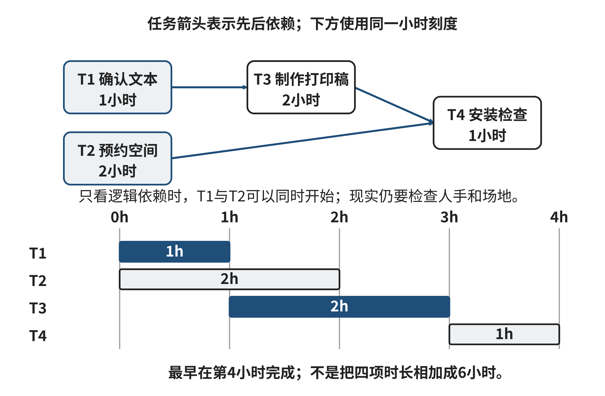
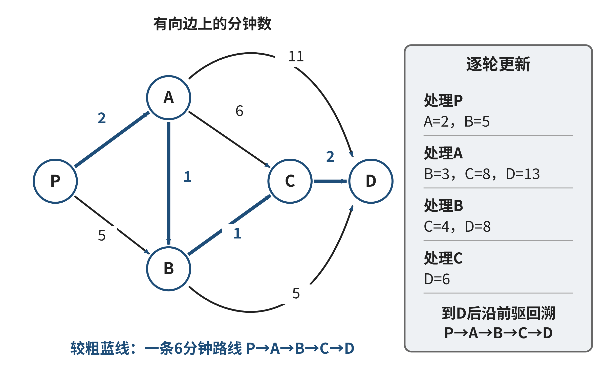
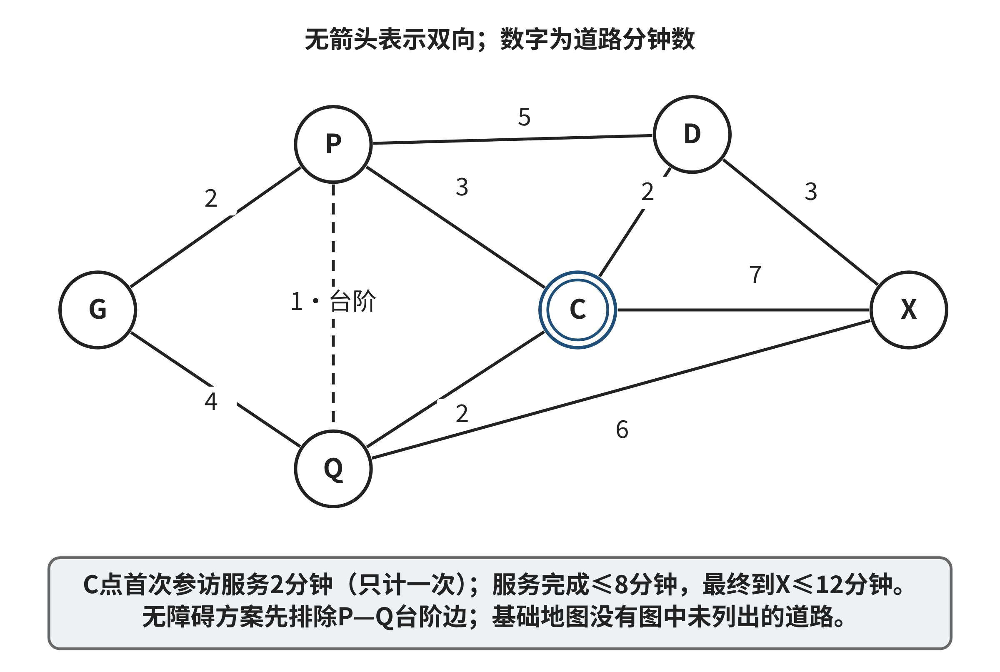

# 第二章 AI时代计算思维的重构：从基础要素到范式革命

假设你正在准备一次校园参访。过去，你可能先阅读通知，手工整理地点与时间，再查地图、选路线、向同伴解释安排。今天，AI可以先把长通知整理成表格，从图片中找出道路，预测某时段的人流，提出参访计划。这些能力让某些工作变得容易，却也带来新的问题：表格有没有遗漏限制，图中的连线是否真的可通行，预测是否适合今天，计划能否满足访客需要？

本章从这些容易理解的问题进入，不要求读者已经学过神经网络或强化学习。你会先完成一个小规模的手工操作，再看AI改变了哪个环节，最后学习怎样检验它。这里的“重构”是方法、知识来源与人机分工的变化，不是宣布抽象、分解、规则和算法已经失效。传统做法仍然提供可解释的基线；模型能够扩大表示和候选的形成方式，却不能替我们决定任务目的与可接受的风险。

例如，手工摘要与学习到的视觉表示都是减少信息的一种方式，但它们减少的信息、形成过程和检查方法不同。人工列出的任务清单与分层策略都可以组织行动，但一张看起来合理的清单并不证明依赖完整。规则和模型都能给出预测，预测正确的条件却需要用新材料检验。随着这些变化，人不再只负责逐项算答案，还要明确问题、组织证据、比较候选，并判断什么时候需要补学知识或暂停执行。

本章案例与练习中的道路、记录、AI候选和数值均为明确标记的原创教学模拟。它们用来让我们完整检查推理，不是校园实测，也不是某个模型的真实性能报告。研究资料支持相应机制，作者设计的小例子不能替研究提供效果证明。即使没有AI账户或编程环境，也可以使用书中材料完成基础任务。

**学习目标**

- 能从具体材料中选出任务必需的信息，并检查AI表示或摘要的遗漏。
- 能把任务分成有成果、有依赖的子任务，解释AI提出的拆分怎样被核验。
- 能用简单规则判断新记录，逐步理解数据学习、注意力与跨机构训练的作用及边界。
- 能比较路线候选，把预测、规划与执行分开，解释从反馈学习策略为什么仍需约束检验。
- 能用一致口径评价基线和AI方案，记录失败、代价与改进依据，并设计有边界的反馈闭环。

**学习路线**

2.1先回答“保留什么信息”，2.2回答“怎样安排工作”，2.3回答“怎样从观察中发现规律”，2.4回答“怎样形成并检查行动步骤”，2.5回答“怎样知道变化有价值”。它们相互联系，却不要求每次解决问题都按五个按钮依次操作。章末导览工作坊把这些方法连起来，用分层任务形成一份可检查的方案。

各节以熟悉情境进入，基础部分先讲明操作。标为“应用”的内容增加一个真实需要的条件，标为“拓展”的内容讨论更复杂的机制或边界。第一遍可先完成基础与应用，保留拓展问题；第二遍再检查条件改变后，原结论还能否成立。遇到新术语，先用随文例子理解它的作用，再阅读原始资料。衡量掌握程度的依据，是能否独立作出并解释一个判断，而不只是记住缩写。

## 2.1 抽象 (Abstraction)：数据本质的智能萃取

### 导语

每天打开地图、课程平台或图书馆目录时，我们都在使用别人替我们整理好的表示：现实中的地点被画成点和线，课程要求被列成字段，书籍被归入主题。整理让信息更容易处理，也必然有所取舍。地图若只标“楼”，可能回答不了“从哪扇门进去”；课程表若只写“周五”，也可能无法生成准确提醒。人工智能能够从文字和图像中提出候选字段，也能从大量样本中学习特征，但它同样只能根据输入形成表示。本节先练习从一段熟悉材料中挑出必要信息，再理解人工选择字段与AI学习表示的差别，以及怎样检查一份表示能否支撑当前任务。

### 2.1.1 案例：一条最短路线为何让人走错门

**案例描述。**一所大学为新生开放日制作校园导览。网页上把每栋建筑画成一个点，路段画成连线，旁边标注预计步行时间。访客从北门出发，系统推荐一条总时间较短的路线，终点写着“信息服务中心”。访客到了建筑北侧，却发现眼前是台阶；可无台阶进入的门在南侧，距离当前地点还要绕行。导览小组随后把门的位置补进地图。下一次测试中，程序又把从西侧进入的道路和从南侧离开的道路拼成一条路线，仿佛访客能在建筑内瞬间从一个门移动到另一个门。每条画在地图上的道路都确实存在，组合后的路线却仍然走不通。

**案例分析。**这个故障并不是加法算错了。第一版表示把“建筑”当作唯一地点，隐藏了入口之间的区别；第二版虽然新增入口，却没有说明进入和离开不同入口之间需要怎样转换。模型中的一个点或一条线，承载着对现实的主张：哪些对象相同，哪些移动可行，哪些时间可以相加。决定这些主张能否成立的，不是图画得多精细，而是它保留的信息是否足以回答访客的问题。

信息服务中心这个名字对宣传页可能足够；对规划通行路线，入口、方向、台阶和开放状态会改变可行性；对设施维修，还要知道路面和维护记录。不同读者面对同一校园，关心的字段并不相同。计算机专业学生很容易从“我可以把它画成图”直接跳到图算法，却需要先问：图上的“点”指什么，边允许什么行动，两个看起来相似的地点能否真的合并？

我们把现实情境整理成便于回答某个问题的对象、属性和关系，称为**表示**。选择保留哪些性质、暂时隐藏哪些差异，称为**抽象**。抽象不是随意删掉细节，而是围绕目标筛出足够的信息。Wing将抽象视为计算思维的重要组成，并讨论如何以一个对象代表多个对象、保留共同性质、隐藏与当前处理无关的差异[1]。本节会把这个思想落到一项具体检查上：如果两种现实情况被写成相同记录，正确行动是否可能不同？若会，就应补回能区分它们的信息，或降低系统所作承诺。

### 2.1.2 先把一段通知整理成可用记录

先看一个与后面独立练习无关的完整示例。学生事务办公室发布了一则教学模拟通知：“周五下午，设计楼301举行海报工作坊。13:50开始签到，14:00开场，15:30结束。组织者会准备纸张和马克笔。西侧电梯可到三层。”读者可能问：什么时候到场？地点在哪里？能否据此确认从校园入口到教室的无台阶路线？

第一次练习不需要机器学习或数据库知识。我们只需按顺序做四步。

第一，先写清需要回答的问题。若要设定日历提醒，签到时间比“下午”重要；若要在楼内找教室，楼名和房间号比活动材料重要；若要承诺整段路线无台阶，仅知道有一部到三层的电梯还不够，还须知道入口到电梯、出电梯到房间的连接情况。

第二，把通知中能直接找到的事实逐项记录。第三，给事实附上它实际支持的范围。第四，未写明的信息标作“未提供”，不自行补齐。表2-1展示了这份记录：

**表2-1 通知事实与未提供信息的教学示例**

| 要素 | 从通知可记录的内容 | 当前仍不知道的内容 |
| --- | --- | --- |
| 活动 | 海报工作坊 | — |
| 日期 | 周五 | 对应的具体年月日 |
| 时间 | 13:50签到；14:00开场；15:30结束 | — |
| 地点 | 设计楼301 | 从校园入口到房间的完整路线 |
| 通行线索 | 西侧电梯可到三层 | 楼外入口、各楼层间的可通行连接 |
| 材料 | 纸张和马克笔由组织者准备 | — |

来源：本书原创教学示例，通知内容为模拟。

这样一张记录可以支持提醒和基本定位，却不能支持“从任一入口均可无台阶到达教室”的承诺。我们没有把“未知”当成“没有电梯”，也没有把“有电梯”推广成“整条路线无障碍”。记录的边界与已知事实一样重要。

假设让一个文本模型根据同一通知生成结构化记录。以下是专为课堂讨论编写的**模拟候选**，不是实际模型输出：“日期：本周五；签到：13:50；地点：设计楼301；无障碍：有西侧电梯，因此可无障碍到达。”前三项基本可从通知摘出，最后的推断超出了原文：电梯只说明某一段垂直交通可用，没有说明入口、楼层走廊和房间门口的情况。若模型把“周五”换成具体日期，也需要额外的发布时间和日历上下文；当前材料没有这些信息。

我们由此得到一个可复用流程：先定问题，再从来源中摘取相关事实，标注单位、时间和出处，最后列出尚缺的信息。人工完成时，领域知识帮助选择字段；AI参与时，输出是待核对的候选记录。它可以减少整理文字的重复劳动，却不能凭格式整齐就获得事实权威。对关键字段，学生要能回到原通知逐项定位；对缺失值，要保留“未知”，不要让系统把沉默填成肯定答案。

图2-1把原通知事实与尚缺的路线连接信息分开。读图时，先指出通知直接支持的字段，再判断哪些信息必须另外核实。

**图2-1 通知事实、记录与未知信息**

来源：本书原创教学示意；通知内容为模拟。

### 2.1.3 同一材料可以有不同抽象

海报通知并没有一份唯一正确的“完整表格”。给参加者发提醒时，签到时间和地点优先；安排教室设备时，人数、投影需求和电源位置更重要；为有通行需求的参加者做路线说明时，入口、坡道、电梯与门的开放状态才是核心。同一原文可以投影成不同的记录，关键是记录适合其用途，并清楚说明还不能回答什么。

想象两位参加者都要从校园东门前往设计楼301。一位只关心普通步行时间；另一位需要无台阶路线。如果系统只记录“东门至设计楼，约8分钟”，两种需要就被合并了。若一个人经台阶捷径、另一个需要搭乘电梯绕行，两者不应被视为完全相同的通行情境。此时“交通方式或通行条件”不是装饰字段，而是会改变候选路线的条件。

可以用一个小反例判断表示是否足够：找出两种允许出现的真实情况，检查它们在当前记录中是否相同，再看正确答案是否不同。假如两扇门都记录为“设计楼入口”，但一扇有台阶、一扇可无台阶进入，它们在原表示中相同；遇到无台阶路线请求，正确答案却不同。因此当前表示不够。修复时可把门拆为两个地点，或者保留门的通行属性。哪一种更好，取决于之后的任务；若需要计算门之间的路线，就拆成节点通常更清楚；若只需要筛选可用入口，一个属性或许足够。

**拓展阅读：用符号表达同一项检查。**以下符号不是完成基础任务的先备，可以在理解门的例子后再读。令现实情况为w，整理过程为α，整理后的记录为α(w)。若两种情况w₁和w₂得到同一记录，即α(w₁)=α(w₂)，但任务要求给出不同决定，那么只依据这份记录的程序无法区分它们。因为它看到的输入相同，没有理由在两次处理中选择不同结果。这不是说任何信息压缩都不好，而是说压缩以后仍要满足目标。若两种情况的正确行动本来相同，保留它们之间的细小区别可能只增加维护成本。

此检验也能避免“字段越多越好”的误区。记录所有访客的姓名、学号、健康情况并不能自动改进路线规划；如果这些字段与路径无关，反而引入隐私与维护负担。反过来，一张字段很少的表若保留了任务所需的信息，可能更可靠。设计时可逐项问：这个字段支持哪一种判断？谁提供它，多久更新一次？误填会产生什么后果？没有来源的字段即使看起来合理，也不应被当成已证实事实。

对象如何划分同样是一项抽象选择。把地图节点设为“整栋楼”，简单直观；设为“入口”，能区分门；设为“入口加时段”，可能表达某些门只在白天开放。划得更细会带来数据维护成本，划得太粗则会把不同情境混为一谈。可从最简单的表示开始，当它不能解释一个具体错误或任务时，再添上所缺差异。每次增加字段，都应写出它消除的歧义；每次合并对象，也应检查是否会改变动作、评价或承诺。

### 2.1.4 方法应用：人工选择字段与机器学习表示

刚才我们根据问题自己挑出“时间”“入口”“通行方式”等字段，这叫**人工设计特征**：设计者先决定什么信息可能有用，再规定如何填写。对通知文本，这种方式透明、容易复核；字段是否合适，可与任务直接讨论。它的弱点也很明显：设计者可能没有想到重要线索，或只能依赖固定词汇和明确格式。不同楼宇各自写“电梯”“无障碍升降机”“可搭乘”，手工规则就需要持续维护。

交通分析中，研究者常先人工定义车速、流量、密度等指标，再用统计规则描述高峰或周期变化。这样做容易检查指标含义，却要求先约定检测范围、时间窗和测量单位；换成不同道路或设备后，口径也可能需要调整。

机器学习换了信息形成的方式。与其要求人预先说清每一种有用视觉形状或语言组合，不如给模型大量输入例子和任务标签，让算法调整内部参数，逐渐形成对分类或预测有帮助的表示。对读者来说，可以把这过程想象为：开始时模型把原始输入映射成一组内部数字；训练例子告诉它哪些输出与任务目标相符；反复比较输出与标签，参数逐步改变。训练所得的表示可能包含人工没有逐条命名的模式，但它不因此等同于人类理解，也不自动与任务的真实原因一致。

这一变化既带来能力，也转移了人的工作。手工字段要由人写出定义、检查填写一致性；学习表示则要求人检查训练材料覆盖了谁、标签如何形成、输入环境是否与使用时相近。人工设计的规则暴露在说明书里，却可能漏掉隐蔽线索；学习到的特征能组合复杂信息，却常更难直接说明每个数字的含义。两种方式都要经过任务验证，不存在“手工就可解释、AI就必然准确”的简单二分。

以图像为例，卷积神经网络（CNN）会在局部区域处理像素，再把多层处理得到的结果组合起来。入门时不必先推导卷积运算：可以先把它理解为一组可学习的图像筛查器。靠近输入的一层可能对边缘、方向和颜色变化敏感；后续层组合这些局部响应，形成更复杂的纹理或局部形状；更深层将这些响应用于任务输出。训练时具体学到什么取决于数据、标签、网络和目标，不保证每一层都对应稳定、可命名的现实概念。深度学习的重要变化之一，是让部分特征由训练数据和目标共同塑造，而非完全由程序员逐条手工指定[2]。

自动驾驶视觉提供了一个更具体的例子。Bojarski等人用单个前向摄像头的原始像素训练卷积网络，直接预测转向指令；论文报告，网络可从人类驾驶示范中学习完成任务所需的内部表示，而不需要人为逐项标注“道路边缘”[3]。入门时可以把不同层的处理粗略想成由局部边缘、纹理逐步组合成复杂视觉线索，但这只是帮助理解的比喻：不能据此断定某一层稳定对应“车道线”或“行人”。模型依靠训练道路、摄像头、标签和目标形成表示；数据没覆盖的光照、道路标线或施工情形仍须单独检验。论文中的实验只支持其特定系统与实验条件，不能证明任一CNN都能安全驾驶。

视觉解释工具可以帮助查看模型输出与输入区域的关系。Grad-CAM为给定类别计算一幅粗略热图，显示哪些较大图像区域与该类别分数相关。**拓展理解。**若继续追问它怎样得到热图，可以把机制理解为：从目标类别分数向卷积层反传梯度，用梯度概括该层不同特征图对分数的影响，再加权组合为定位图；常见做法会保留正向响应，并把较小热图放大叠到原图上。课堂中不必先会微积分，但要知道热图来自模型内部激活和梯度，并非人工标出的真实障碍边界。可以把它当成“模型在这次判断中可能利用了哪里”的线索，而不是模型思维的完整记录。热区落在台阶附近，不能证明模型理解了通行风险；热区落在背景上，提示值得调查，却也不自动证明模型完全错误。热图的分辨率、模型结构和输入都会影响呈现；它不能证明因果关系、正确性或真实通行状态[4]。

因此，表示审查至少有两个层次。第一，记录是否包含任务需要的对象、属性和关系，来源是否明确；第二，学习表示是否在不同条件下仍支持目标判断，是否存在模型借助背景或样本偏差的可能。前者可用材料对照与反例检查，后者需要分组样例、独立测试和领域人员参与。对涉及安全、可达性或公共服务的建议，模型输出只能辅助筛查；真实设施状态仍须用可靠记录或现场确认。

图2-2只示意局部响应到组合响应的关系。箭头表示计算组织，不表示已经观察到某个真实模型理解了台阶；实际学习结果还要用样例检验。

**图2-2 卷积网络的局部与组合响应示意**

来源：本书原创概念示意；非真实模型激活图或实测结果。

### 2.1.5 跨专业知识决定哪些信息重要

自动驾驶例子中的“道路特征”由图像数据和转向任务共同塑造；在科学阅读中，什么算“核心知识”则要由研究问题和证据范围来界定。设想读者把一篇机器学习论文交给GPT类大语言模型，要求整理成结构化技术摘要。可先要求它分别填写：研究问题、数据来源与对象、方法、论文实际报告的结果、作者承认的限制；每项附上原文位置，并把“原文明说”“由材料推得”和“资料未提供”分开。摘要因此成为可追溯的阅读索引，而不是把一段流畅文字当作论文结论。

以下是练习用的**模拟摘要模板**，不是任何模型生成的真实结果：“论文问题：……；数据与对象：……；方法：……；实验结果：……；适用限制：……；尚需核对：……”。读者应回到论文的摘要、实验设置、结果表和讨论部分逐项确认。例如，结果只在某个公开数据集上报告，就不能改写为“该方法适用于所有行业”。Cachola等人将科学论文极简摘要作为研究任务，发布了包含数千篇论文和多条摘要的数据集，并比较生成方法；这说明科学文献摘要可以被系统研究，但不替某次模型输出背书[5]。

这种协作也展示了跨专业学习如何落到行动。遇到“适用人群”“临床终点”等不熟悉的概念时，读者应先列出问题，再查原论文和领域定义，不能让模型补写未给出的背景。计算机方法帮助检索、对照和组织材料；领域研究者判断术语、证据与外推边界。文化遗产数字化也遵循相同原则：模型可以提出纹样相似的候选，编目人员还要核对年代、修复史和档案出处。像素相似不等于来源相同。跨领域协作中，每位参与者都可以问：字段由谁定义、证据来自哪里、输出用于发现候选还是直接决策、资料冲突时由谁处理？

### 2.1.6 思维训练：E01 信息取舍与模型复核

以下数据全部为原创教学模拟，不是校园实测值。无特别说明时，道路为有向边，表中未列出的边不存在；时间单位为分钟。H是起点，L是服务大厅。9:57从H出发，目标为在10:05前使用无台阶路线到达L。边H→J和J→L有台阶；J→L这段须不晚于10:00完成。边H→K与K→L均为无台阶；L→H为单向记录。各段数据见表2-2。

**表2-2 E01道路与通行条件教学数据**

| 道路 | 时间 | 无台阶 | 额外条件 |
| --- | ---: | --- | --- |
| H→J | 2 | 否 | 无 |
| J→L | 2 | 否 | 须不晚于10:00完成 |
| H→K | 3 | 是 | 无 |
| K→L | 4 | 是 | 无 |
| L→H | 5 | 是 | 无 |

来源：本书原创教学数据，不是校园道路或开放时间记录。

**基础：先整理一条候选。**把路线判断需要的信息写成字段清单，至少包含方向、用时、通行条件、时间限制和确认状态。手算路线H→K→L：先分别相加道路时间，再从出发时刻推算到达时刻。列出你判断“符合目标”时实际使用了哪些字段。

**应用：比较表示和模拟候选。**另一种表示把J、K合并成中间点P，只保存最短连接时间；较完整的表示则保留各点、方向、用时、通行条件和时间限制。说明哪一份能够支持当前目标，不能支持的那一份丢失了哪些区别。下面是专为练习构造的模拟AI候选，不是任何实际系统的输出：“H→J→L用时4分钟，是较快路线，建议采用。”用题面数据逐段检查它的通行资格、到达时刻和单向关系，写出至少两条需要修正或补证的地方。

**拓展：条件改变后重述结论。**先只取消“无台阶”要求，其余条件不变，判断结论是否会改变。再恢复无台阶要求，但将K→L的通行状态改为“尚未核实”；区分“已确认有可行路线”“当前没有足够证据作承诺”和“现实中一定无路”这三种说法。最后讨论若仅保留合并后的P和最短时间，哪些错误会被隐藏。拓展题不影响基础任务的完成。

交付一页字段表、一段路线计算和一段候选复核说明。评价时看每项主张能否回到题面证据，是否把未知说成未知，是否说明表示能回答的问题；字段数量和AI候选的措辞流畅度不计分。独立参考解见章末E01。

### 2.1.7 反思：你压缩了什么，留下了什么责任

本节从两扇门被合并后出现的错误开始，逐步建立了抽象的判断方法：先说清目标，再选择信息，用反例检查不同情况是否被不当地当成相同。人工设计字段使选择过程清楚，却可能漏掉未预想到的线索；AI学习表示可以从例子中形成复杂特征，但输出仍受样例和目标影响。解释图、相似度或整齐的结构化结果，都不能替代来源核验。

回看E01或通知示例：你曾准备删掉哪项信息，后来发现它会改变判断？你怎样知道一条字段是事实还是推测？若只收到一句“地图显示可通行”，你还需要查哪条记录、问哪位专业人员？把尚未解决的问题写成一张两栏清单——“当前记录可支持的决定”和“仍需取得的证据”。这份清单会成为下一节拆解任务时的输入：只有把子任务所需信息写清，模块之间才能可靠协作。

## 2.2 分解 (Decomposition)：复杂问题的AI分层破解

### 导语

一个校园活动要按时开始，往往要同时确认场地、准备材料、通知参加者、检查设备。把所有事写成一长串，容易把本可并行的工作排成队；把它们随意分给几个人，又可能有人依赖的材料还没准备好。分解就是把一个目标拆成可完成、可检查的子任务，并说明它们怎样衔接。本节先用一个小活动画出依赖，再把相同方法应用到较复杂的项目，接着比较人工计划与AI提出的任务清单。最后再进入一种更深入的AI方法：在不断变化的环境中，分层强化学习让高层目标与低层动作协同，但它不同于一份普通项目日程。

### 2.2.1 案例：展板做好了，为什么展览仍未准备好

**案例描述。**一个学生小组计划在图书馆举办微型阅读展。大家很快分了工：有人挑选作品节选，有人预约展示空间，还有人制作展板。负责设计的同学先做出了漂亮排版，打印时才发现节选尚未确定；展板的尺寸也和已经预约的空间不合，必须返工。布展当天，团队又发现一处文字需要补充来源说明，打印好的材料已无法及时替换。每个人都完成了自己理解的任务，展览却没有达到“按时、可读、来源清楚地开放”这个目标。

**案例分析。**原目标混合了若干可区分的结果：选定有权展示的文本、落实空间规格、生成展品文字、打印并安装、核对阅读效果和来源。某些任务可以并行，另一些必须等输入到齐。排版需要文本和尺寸；安装需要打印件与展位；最终开放还需要一次检查。小组的困难不在于没有忙碌，而在于任务之间的依赖没有写出来，且“完成”没有共同标准。

在实践中，“把复杂问题拆小”常被简化成一份待办清单。但没有依赖和交付物，清单只能说明做什么，不能说明何时能做、输出交给谁、怎样判断结束。分解的目标是让一个大目标能够通过若干明确的小成果逐步实现，同时使失败位置可以被发现和修正。

### 2.2.2 先完成一份可以手算的计划

先用一个与后面E02无关的小例子练习。图书馆准备一面微型展板，本例把打印版式预先固定，并假定预约的展位能够容纳它；T2确认尺寸只影响安装，不再决定T3的打印格式。这一简化条件与前面尺寸未定的失败案例不同。团队约定：T1“选定并核对一段公开展示的文本”用1小时；T2“预约展示空间并确认尺寸”用2小时；T3“制作展品文字与打印稿”用2小时，须等T1完成；T4“安装展板并检查可读性”用1小时，须等T2和T3都完成。所有时间是原创教学模拟，不是实际项目统计。暂不考虑人员冲突、等待外部批准或返工。

我们先不把任务排成单行清单，而将每项工作写成一张任务卡。表2-3列出输入、预期成果、依赖和用时：

**表2-3 微型展板任务卡的输入、成果与依赖**

| 任务 | 可检查的成果 | 需要先完成的任务 | 用时 |
| --- | --- | --- | ---: |
| T1 | 已确认可用于展示的文本 | 无 | 1小时 |
| T2 | 有尺寸记录的空间预约 | 无 | 2小时 |
| T3 | 与文本相符的展品文字和打印稿 | T1 | 2小时 |
| T4 | 已安装且完成可读性检查的展板 | T2、T3 | 1小时 |

来源：本书原创教学示例，时间和任务均为模拟。

把“需要先完成”画成箭头，就得到T1→T3→T4和T2→T4。T1、T2没有相互依赖，因此在资源允许时可以同时开始。若从0时刻开始，T1在1小时完成，T2在2小时完成；T3需等待T1，所以从1到3小时；T4需等待T2与T3，较晚的是T3，因此从3到4小时。于是这份计划的最早完成时间是4小时。

为什么不是把四项用时相加得到6小时？因为T1、T2可以在同一时段进行。为什么不能让T4在T2完成后立即开始？因为它还需要T3的打印稿。对一个任务而言，前置任务全部完成的最早时刻由其中最晚的那项决定。读者可以用纸笔按箭头向前填写开始和结束时刻，不需要调度软件。

这张图同时暴露了需求不完整的地方。若T2预约不到空间，T3仍可完成文字，却不能安装；若T1的展示权限发生变化，T3可能需要重做；若负责T2、T3的是同一位同学，即使任务之间无依赖，也不能在同一小时亲自完成两项工作。依赖图只说明题目中给定的先后条件，不自动包含人员、设备、批准和不确定性。把“没有逻辑依赖”说成“现实中一定能并行”，是从模型越界推断。

完成结果比动作名称更适合用作任务边界。“做展板”可能只是输入设计文件，也可能包含审核、打印、安装；若下一位同学不知道哪些步骤已经完成，分工会制造接口误解。给每项任务写输入、输出、责任人和完成依据，能让协作双方检查是否交接成功。由此建立的依赖关系可以再转成日程、软件模块或人机协作流程，但这些表示解决的问题不同。

图2-3把上述依赖与时间安排放在一起。先沿箭头找前置成果，再对照时间轴解释T4为何要等到第3小时才开始。

**图2-3 微型展板任务的依赖与时间安排**

来源：本书原创教学示例；时间和任务均为模拟。

### 2.2.3 好的分解让结果能够交接

正式地说，分解是把目标转成若干子任务，并为子任务安排关系，使其共同产生目标结果。最简单的依赖图用圆点表示任务、箭头表示“后者开始前需要前者的成果”。这和地图中的道路边不同：地图边表示可以移动的关系，任务箭头表示先后约束。箭头方向不可随意反转，也不等同于人员间发送消息。

对学生项目，开始时可以逐项问：最终交付物是什么？要得到它，必须先具备哪些成果？哪一项有可核对的结束标准？谁会使用这项输出？如果某个答案还不知道，就把它标成待确认，而不是默认为顺利发生。一个可执行的计划通常有三项：任务产物，任务之间的依赖，验收产物的证据。例如“安装完成”的依据可以是展板稳固、文字可读、引用信息齐全的检查记录，而不只是某位成员说“弄好了”。

任务粒度要适中。把“举办展览”只分成“前期”和“后期”并没有减少不确定性；把“打开打印机、按键、拿纸”列成大量微动作又很难维护。一个实用检验是：任务是否有清楚输入和输出，负责人是否能独立说明完成与否，失败时是否知道从哪一项恢复？若一个子任务仍包含许多未知决定，可以继续拆；若再拆只是在罗列机械动作，便可保留为一项。

依赖关系还帮助发现循环。若任务A必须等B，而B又必须等A，计划无法启动。现实中确实有“草稿—反馈—修改—复核”的往返过程，但不应把它伪装成一次性先后链。可以显式记录反馈轮次和结束条件，例如先完成草稿，再收集意见并修订，直到关键缺项被解决或达到预设的审查轮次。这样，循环是可管理的迭代，而非图中无法解释的闭环。

当项目涉及多人或多个程序模块，任务拆分也关系到接口。1972年Parnas讨论模块划分时指出，模块边界应隐藏易变的设计决定，而不应仅按处理步骤切块[6]。这里借用的是一个工程判断：把会一起变化的规则留在合适的模块中，并规定模块怎样交换结果。比如展览的文字审核规则可能经常改变，空间预订接口可能由另一团队维护；让二者通过明确字段交接，便可各自演进。模块划分与任务日程并非同一概念，但二者都要求把责任和接口说明白。

对一个子任务的局部成功，也不能自动推出整体成功。如果“文字准确”和“空间合适”分别验收，最后还应检查它们是否组合成一个按时开放的展览。整体目标可能有硬条件：展品未经许可不得发布，展位必须留出通道，超过场地容量不能开放。硬条件不能用“任务大致完成”抵消。拆解时把这类边界放在相关任务和最终检查处，才不会在分工中消失。

### 2.2.4 AI可以先提清单，人要把依赖和责任补全

自然语言助手可以把“准备一次展览”展开成候选步骤：确认主题、选取材料、制作说明、设计展板、预约场地、布置现场、发布通知。这样的清单能够提醒团队讨论遗漏，但它不是项目事实。系统不知道本校的空间规则、材料使用权、场地尺寸和谁有批准权限；如果输入没有这些条件，流畅的计划也可能把缺失信息包装成已解决。

要让AI参与分解，首先给它目标与约束，而不是只给一句“帮我计划”。可以要求候选清单逐项注明交付成果、所需输入、假设、待确认问题、可能的先后依赖和不可违反的条件。再由团队把每个依赖追溯到具体依据，把无法确认的节点保留为风险或询问项。对“能否并行”的建议，须检查人员、设备、权限和场地是否允许；依赖图没画箭头，只代表当前材料未给出先后关系。

AI还可以帮助把大目标拆成不同层次，但分层要服务协作。第一层明确开放展览需要的可观察结果；第二层列出文本、场地、版面和检查等模块；第三层在需要时展开每个模块的工作。团队可以先确认第一层，再决定哪些模块值得细分。不要一开始就生成长达数十步的细节清单，因为错误的顶层假设会传递到每一层，检查成本随之增加。

一份候选计划可用四种问题审查。**覆盖**：最终目标中的每项要求是否有任务负责？**依赖**：每项工作所需的上游成果是否已经说明？**可验证**：交付物是否能被别人检查？**异常**：若材料未到、场地变化或输入冲突，计划要暂停、改道还是请求人决定？此外，逐项寻找“孤立任务”和“无人负责的输出”：如果一项工作没有服务任何目标，可能是多余的；如果最终目标需要某个结果却没有任务产出它，计划就有缺口。

医疗影像也说明为什么要把系统输出拆开检查。一个模型的分类分数、Grad-CAM热图、病灶定位结果和临床判断不是同一个交付物。Arun等人用两类胸部X光公开数据评估了八种显著图方法，发现每种方法至少未通过一项预先设定的可信度标准；若任务目标是定位，研究中的检测或分割模型在定位指标上优于这些显著图[7]。因此，教学中的审查流程可拆为“模型给出分类候选—热图提供有限线索—专业人员对照影像和病历—有定位需求时核验定位模型”。热图不能证明病因、模型因果推理或临床诊断正确；每一步都要有与其输出相匹配的证据。该研究结论限于其数据集、方法和评价标准，不代表所有医疗影像模型。

跨界项目更需要这样的核对。设想学生与社区档案馆合作制作声音地图。历史研究者说明录音内容的出处、讲述者同意范围和时间背景；社区成员指出哪些称呼可能造成误解；音频专业人员检查录音清晰度；计算机学生设计音频片段、地点和文字之间的数据关系。AI转写可生成待校对文本、聚类工具可提出相似主题，但发布前仍需确认同意范围、专有名词和语境。领域知识改变了任务顺序：先确认授权，再公开素材；先由熟悉地方历史的人复核词义，再把说明接入地图。计算任务清单因此必须携带跨专业输入和批准证据，不能把它们都压成“上传文件”。

学习上，团队可维护一份“假设—核实—修改”记录。比如把“所有录音均可公开”记为未证实假设，寻找授权文件后更新为具体范围；发现一段录音只能用于课堂演示，就调整发布子任务。学习者还应把不懂的接口术语列出，查规范或请责任人解释，再用一个实际样例试走。这样，分解不仅安排了工作，也安排了怎样弥补知识缺口。

### 2.2.5 拓展深化：从固定计划到会调整的分层控制

前面的展览计划大体是固定的：人们根据预知条件安排步骤，开始后照计划执行，遇到变化时人工调整。另一些AI任务面对不断变化的环境，例如模拟配送车在校园道路网络中前往一个指定地点。通道可能临时关闭，设备也需要根据观察连续选择“前进、转向、停下”。这时，预先写一条固定动作序列可能不够，系统需要边观察边选动作。

**强化学习**是一种通过与环境交互、依据反馈改进行动选择的方法。对初学者，可先认识三个词：状态是系统当前用于决策的信息，如所在位置和前方通道状态；动作是它此刻可以选的行为，如继续、转弯或停下；奖励是设计者对每步结果给出的数值反馈；一段行动的累计奖励称为回报。学习策略会根据状态选择动作，并从反馈中调整。奖励的设定由人负责；若只奖励“快到目的地”，系统未必自动学会遵守安全、可达或隐私要求。奖励是学习信号，不等于完整的社会目标。

若路线较长，可以把控制分为层次。高层选择一个阶段目标，例如“先到教学楼北侧入口”；低层根据局部感知选择转弯、减速或停下等动作。到达目标后，高层再给出下一目标。这里的“分解”不是把一段自然语言改写为待办清单，而是把较长的行动过程组织成不同时间尺度的决策。下层动作的表现会影响上层计划能否实现；上层目标不够清楚或低层能力不足时，整个策略仍会失败。

FeUdal Networks是层次强化学习的一种具体研究架构：manager在较慢的时间尺度上产生较高层目标，worker在每个环境时刻根据目标选择低层动作。worker通过内在奖励学习怎样推进目标；manager则依据环境给出的外在奖励学习怎样选目标，论文的训练结构不在两者之间传递梯度[8]。这一具体架构在学习的潜在表示空间中给出目标，未必是人能直接读懂的地点名或待办事项；前文的入口示例只是帮助理解“较慢的目标决策与较快的动作选择”如何配合。该研究在特定的游戏和3D环境中评估了架构，不是所有强化学习系统的统一结构，也不证明它能直接用于校园导航或现实机器人。不能从一个研究案例跳到“AI会自动分解所有现实工作”。

输电线路巡检可以让这种层次关系落到一个具体领域。Cui等人提出从输电塔点云生成巡检航点的分层强化学习方法：先处理点云并构造覆盖区域，高层用DQN选择航点序列，低层用Q-learning优化各点的俯仰角与偏航角；奖励设计同时考虑覆盖程度和航点数量[9]。这项研究描述的是一套方法及其论文实验，不能据此宣称无人机已能在任意真实线路上自主安全飞行。

为了把接口讲清，本书再构造一个**教学模拟**：高层选择要巡检的塔和目标区域，中层把点云候选转换为待观察设备点，低层调整机身姿态或悬停角度。这里的三层拆法是教学组织，不是上述论文报告的原样架构。状态可以包含已覆盖点、剩余电量和局部风况；奖励可鼓励覆盖并惩罚多余航点，但禁飞区、最低安全距离、电池余量等条件应作为硬约束核验，不能指望奖励权重自然守住安全。若低层回报“目标不可见”或“风况超出训练范围”，高层应改选目标或暂停，请巡检人员处理。相比人工路线，策略可能减少重复动作，也可能在训练未覆盖的塔型或天气下失效；必须在经过核验的模拟条件、测试数据和受控流程中逐步评估。

这个例子显示了任务分层与普通项目清单的不同：清单描述由谁完成什么成果，强化学习策略则在状态变化时反复选择动作，依靠回报调整。无论哪种方式，都要定义接口：高层提供什么目标，低层回报什么结果，何时判成功，何时报告失败或等待决定。层次本身不会自动补全未观察到的状态，也不保证局部动作能够实现整体目标。

为解释视觉分类结果使用的Grad-CAM热图，即使显示与某个类别分数相关的区域，也不能说明高层为什么选择某个巡检目标，不能证明飞行安全，更不能替代任务执行记录。若要查策略怎样运行，应记录当时的观测、选定的子目标、下层动作、环境变化、回报和接管决定；视觉热图只对特定视觉判别提供有限线索[4]。不同组件要用与其决策相匹配的证据检查。

分层设计还会产生新的错误接口。高层下达“到东侧入口”时，若地图版本与低层的地图版本不一致，低层可能不知道该目标；worker报告“已完成”，也需说明它指到达某位置、完成某动作，还是满足整个业务目标。若两个模块使用不同的坐标系、命名或安全边界，局部结果再好也无法组成可靠行为。对关键接口应有统一定义、版本记录、失败状态和人工暂停方式；分层本身不会自动带来可靠性。

### 2.2.6 思维训练：E02 依赖、并行与计划复核

下面是原创项目模拟数据，单位为分钟，不涉及真实活动。固定活动和依赖见表2-4。暂按“前置任务一完成即可开始后续任务、资源充足、任务用时确定”计算；现实资源冲突不在基础数据中。

**表2-4 E02固定的活动与依赖数据**

| 任务 | 用时／分钟 | 前置任务 |
| --- | ---: | --- |
| A | 2 | 无 |
| B | 4 | A |
| C | 3 | A |
| D | 5 | B、C |
| E | 2 | B |
| F | 3 | D、E |
| G | 1 | F |

来源：本书原创教学模拟数据，非真实项目记录。

**基础：读懂最初的依赖。**从0分钟开始，画出A、B、C及其箭头，标出A结束后B和C最早可开始的时刻，并列出一条已有的依赖关系。只根据题目列出的先后条件说明B、C能否同时开始，同时写明现实中还需要检查什么资源假设。

**应用：计算并核对完整计划。**画出A至G的依赖图，逐项填写最早开始与结束时刻，给出项目最早完成时间。再把D的用时改为2分钟重算；然后继续改为1分钟，比较两种变化是否都缩短总时间，并解释哪个尚未完成的前置成果限制了F的开始。以下候选针对原始D用时5分钟的基准计划，请恢复表中的用时后审查。它是为本题专门构造的模拟AI排期，不是实际系统输出：“E可以在2—4分钟完成，因此F可在8分钟开始。”检查这两项建议是否满足全部前置条件，重新给出必要的纠正；不要只看候选文字的流畅程度。

**拓展：检查模块接口。**另有一份独立的接口记录：模块B所用地图标为R7，模块C所用地图标为R8；二者都标记为配置P1，但没有兼容声明或转换记录。题目也没有给出两者的直接调用关系。说明仅凭“P1相同”能否认定相关结果可组合，并给出一项最小的验证材料或适配任务。拓展问题不影响前两层计划计算。

基础与应用提交一张依赖图、一张最早时间表和一段候选复核说明。评分看箭头含义是否正确、并行假设是否说清、计算能否逐项追溯；完成拓展者另提交接口记录分析，评价其是否保留版本疑问、提出合适的验证材料。暂缓拓展不影响前两层成果的完整性。不按图画得复杂或AI候选写得流畅评分。完整参考解见章末E02。

### 2.2.7 反思：拆分以后，整体目标仍由谁负责

我们从一块没准备好的展板开始，先把目标拆成有成果的任务，再用箭头找出先后关系，最后学会按依赖计算最早完成时间。好的分解让人可以协作、检查与恢复；过粗的任务隐藏责任，过细的任务增加维护负担，遗漏接口则会让局部结果无法组合。AI可以补充候选清单与可能的先后关系，但输入未给出的场地、权限、资源和批准条件仍要由人查明。

进一步的分层强化学习把较长行为组织为高层目标和低层动作，使策略有机会根据环境反馈调整；它和人写的项目任务树有相似的层次感，却是不同的机制和证据要求。看过本节后，尝试用自己的话回答：你的任务图中哪条箭头最可能被误画？一个子任务完成的证据是什么？若环境发生变化，哪个层次有权重新选择，哪个层次必须停下报告？把答案写进图或接口说明，你的分解才从“列出了工作”走向“能被他人执行并检查”。

## 2.3 模式识别 (Pattern Recognition)：深度学习的隐规律挖掘

### 导语

医院、金融机构、电网和校园服务每天都留下大量记录：一次检查、一个交易时段、一段负荷曲线或一班接驳车都只是局部观察。把相似情境放在一起，我们有机会发现重复关系，再判断这些关系能否帮助预测新的情况。

模式识别从这种日常观察开始。本节先练习从少量记录中指出重复之处，再看一条规则怎样接受新记录的检验，最后讨论AI如何从大量样例中学习更复杂的关系。我们会进一步解释序列注意力和联邦学习为何有用、又不能替代哪些判断。读完后，你应能区分“看到了规律”“规则在新资料上有效”和“规律说明了原因”，也能指出一个数据模型在什么条件下才值得采用。

### 2.3.1 案例：跨医院数据如何共同识别临床风险模式

**案例描述。**Dayan等人报告了一项跨机构联邦学习研究：来自20家机构的数据共同训练EXAM模型，用生命体征、实验室数据和胸部X光预测有症状COVID-19患者之后的氧气需求；训练过程中没有把原始病例集中到一个数据池。论文报告了其24小时和72小时预测实验结果，并与单机构模型作了比较[10]。这是一项特定疾病、特定数据和评估方案下的研究，不是医疗机构普遍部署的性能保证。

**案例分析。**这个任务中的“模式”不是某一张影像或某一项化验单，而是多个来源的信号与后续临床结果之间，在训练数据中反复出现的组合关系。若各医院对检查字段、采样时点或“需要氧气”的标签理解不同，模型就可能把记录方式差异学成疾病模式。跨院协作因此要先核对数据定义、时间窗和结果标签，再比较整体与各机构的表现。研究报告的总体指标不能说明每一家医院、每类患者都同样受益；COVID-19的结果也不能直接推广到其他疾病。

为先看清“从重复观察到暂定规则”这一基础动作，再用一组更小的虚构记录作练习。某服务点把“拥挤”暂定为人数达到40人，并记录是否临近下课；甲、乙临近下课且人数分别为52、43；丙、丁不临近下课且人数为34、19。下表中的教学数字不代表实际交通数据。

**表2-5 四次候车观察的讲解示例**

| 记录 | 临近下课 | 下雨 | 接下来十分钟最高人数 | 按40人门槛标记 |
|---|---:|---:|---:|---|
| 甲 | 是 | 是 | 52 | 拥挤 |
| 乙 | 是 | 否 | 43 | 拥挤 |
| 丙 | 否 | 是 | 34 | 不拥挤 |
| 丁 | 否 | 否 | 19 | 不拥挤 |

来源：本书原创教学模拟与作者推演；条件见对应示例或题设。

先只看甲、乙。两次观测都临近下课，而且都达到门槛。学生可以用一句话描述共同点，提出暂定规则：“临近下课时，候车人数可能较多。”这就是基础的模式识别：从相似条件与重复结果中找出待检验的联系，不需要先理解神经网络。

把丙、丁加入后，规则在这四条记录上都说得通，但活动散场时也可能在非下课时段排队超过40人，施工改线也可能让原关系减弱。因此要补充新记录并复核条件。

模式不是贴在数据上的永久标签，而是相对于目标、观察范围和使用条件而言。交通时段、天气、校园活动和路线都可能影响需求；相关领域人员帮助解释字段，数据中的同时变化仍只能提示关联，不能单独证明原因。

### 2.3.2 从手工规则到数据中学习的模式

人观察若干记录后，可以直接写出判断规则。例如“临近下课且人数达到某阈值，就提示检查运力”。这种规则便于解释，条件由人确定；若校园出现晚间活动、路线施工或考试周，设计者需要判断是否增加条件。规则太少会漏掉重要情况，条件过多又可能只适合已看过的那些记录。

金融分析也常先用统计规则描述价格或交易指标的波动周期，再检查这种关系是否在新时段延续。换市场、制度或参与者后，历史周期未必重现；数据的周期相伴不等于已经找到造成波动的原因。

AI参与后，人的工作有一部分从逐条编写条件转向准备例子、确定任务、选择可观察的信息并检查模型表现。仍以前面的交通问题为例，模型可以接收过去某时段的天气、课表、活动安排与汇总人数，并学习如何从这些输入估计下一时段是否会拥挤。它从样例中调整内部参数，使输出与已记录的判断尽可能一致。参数可以理解为模型内部许多可调的数值；学生此处无需手算它们，只要知道模型的判断方式是由数据与训练过程共同形成，而不是由人逐条写完。

这里有几个常用词，先从例子理解即可。模型作出判断前可使用的字段，如是否下课、是否下雨，叫作特征；希望模型判断的结果，如下一时段是否拥挤，叫作标签。包含若干特征和已知标签的一条记录是一个样例。学习程序利用一批样例形成模型，再把新记录交给模型，得到预测。模型给出“可能拥挤”并不等于拥挤已经发生，更不等于这个预测能说明拥挤的原因。

手写规则和数据学习都可能帮助判断，但它们依赖的信息和责任分配不同。规则把人的明确假设直接写进条件；模型则从数据中拟合重复关系，可能发现人没有逐条想到的组合，也可能放大数据中的偏差。人仍需说明目标标签如何定义、哪些记录可以使用、误报和漏报各自有什么后果。例如，过早建议增开车辆可能增加成本；漏报高峰则会增加候车时间。优化目标不能仅由历史中出现最多的标签自动决定。

训练模型时应把已知记录分为开发部分与保留的检验部分。开发数据可用来构造或调整规则；检验数据用于检查规则面对新记录时是否仍有用。若研究者每看一次检验结果便不断改规则，再报告同一批记录上的好结果，检验数据就已参与调整，结果会显得比真实新样本更可靠。评估模型需要把数据准备和调参过程一起考虑，不能只看一个最终准确率。[11][12]

切分方式也要符合资料产生的顺序。预测未来客流时，先用较早时段开发，再用较晚时段检验，比随机打乱时间更接近实际使用。若同一场活动的多条记录被分到两边，模型可能借助相近重复信息而显得会预测新情形；若部署地点换到另一校区，还要检查当地课表、道路和出行习惯是否不同。一个模型在熟悉的校区表现良好，不足以保证它能迁移到新的校区。

字段还应在预测作出前就能取得。如果目标是提前十分钟预警，却把十分钟后的实际排队人数放进模型输入，模型即使判断完全正确，也是在使用当时不可能知道的信息。这个错误可能源于资料表把“预测时可知的条件”与“事后记录的结果”放在一起，却没有区分使用时点。准备模型前，可为每个字段标注采集时间、来源和用途；特别核对标签是否由可靠记录产生，以及样本是否只包含曾经被特别关注的线路。模型学到的是观察到的资料关系，资料缺失的群体不会自动出现在它的经验里。

### 2.3.3 读懂错误：四种结果回答不同问题

说“模型答对了八成”听上去直观，但如果拥挤事件很少，即使模型一律预测“不拥挤”，总体正确比例也可能很高。调度小组真正关心的可能是两件事：发出的提醒有多少真的对应拥挤，以及实际拥挤中有多少被提前发现。要回答这些问题，先区分四种结果。

先看另一组独立于E03的七条虚构记录，把“拥挤”记作目标事件，把“非拥挤”记作另一类；表中列出实际标签和模型预测。

**表2-6 七条预测与实际标签的讲解示例**

| 记录 | 实际标签 | 模型预测 |
|---|---|---|
| 甲 | 拥挤 | 拥挤 |
| 乙 | 拥挤 | 拥挤 |
| 丙 | 非拥挤 | 拥挤 |
| 丁 | 拥挤 | 非拥挤 |
| 戊 | 拥挤 | 非拥挤 |
| 己 | 非拥挤 | 非拥挤 |
| 庚 | 非拥挤 | 非拥挤 |

来源：本书原创教学模拟与作者推演；条件见对应示例或题设。

逐行对照：甲、乙是命中，共2条；丙是把非拥挤报成拥挤的误报，共1条；丁、戊是实际拥挤却没有提醒的漏报，共2条；己、庚是正确排除，共2条。四类记录合计7条，没有重复或遗漏。由此总体准确率为(命中+正确排除)/7=(2+2)/7，约57.1%。

在分类任务里，把希望找到的情况称为正例，把其他情况称为负例。命中也叫真正例（TP），误报是假正例（FP），漏报是假负例（FN），正确排除是真负例（TN）。精确率只看所有提醒中有多少是真正例，即TP/(TP+FP)=2/3，约66.7%；召回率只看所有实际正例中有多少被找到，即TP/(TP+FN)=2/4=50%。三种比例回答的问题不同：精确率低可能意味着无效调度较多；召回率低可能意味着高峰被漏掉较多；准确率还受正负例数量影响。哪些错误更重要，取决于交通服务目标和成本，不能由模型自动决定。对应的英文术语分别是Accuracy、Precision与Recall。它们可帮助比较候选判断，但依赖标签口径与样本构成，不能代替现场检查。

在更复杂的模型中，还可以考察不同日期、线路或服务群体的指标。若总体精确率不错，但某个校区的漏报集中在晚间，平均数就掩盖了实际问题。分组报告需要谨慎：样本过少时比例会随一两条记录大幅波动，也不应因为标签不足而把群体差异解释成个体能力。可先标出还缺哪些观测，增补资料后再评估。这个过程使错误统计成为修正数据与决策的起点，而非给模型盖一个永久的“通过”印章。

本案例把实际人数达到40人定义为“拥挤”，等于先选定了标签边界。若服务要求改变，可以重新讨论这个人数标准；测量不稳定时，40人附近的标签也容易变化。但修改标签定义不会自动改变已经固定的提醒。例如两次实际人数为35、45，预测分别为不提醒、提醒：按40人定义时两次都正确；若把实际人数标准改为30，两次都成为正例，第一条变成漏报，提醒次数却仍只有一次。我们改变的是评价问题，不是模型已经发出的动作。

另一种门槛用于把模型分数转换成提醒，称为决策门槛。固定实际标签为非拥挤、拥挤，模型分数为0.4、0.7；约定分数不小于0.5才提醒时，只提醒第二条。若只把决策门槛降到0.3，两条都提醒，第一条新增一次误报。对同一批固定分数，降低此门槛可能找到更多正例、减少漏报，也可能增加误报；这与改写实际标签不同。[13]门槛要依据服务目标和资源成本选择。学生既要问正例怎样定义，也要问分数如何转成动作；定义改变后，旧成绩与新成绩不能不加说明直接比较。

### 2.3.4 观察连续变化：注意力怎样联系不同时刻

到目前为止，我们可以把每条记录看成独立的一行。但许多任务的记录有先后顺序：五分钟前、现在、接下来的十分钟，不能随意交换。接驳车即使在同一时刻观测到相同人数，若一辆车刚刚离站，和若下一辆车还要等很久，随后排队变化也可能不同。只用当前人数会丢失上下文。

深度学习模型可通过多层计算从样例中形成内部表示。以文本为例，模型处理一句话时可以把词语转成数值表示；在序列任务中，模型还需要利用各位置之间的关系。Transformer是一类用于处理序列的神经网络架构，其中的自注意力机制提供了一种建立位置关系的方式：处理某一位置时，模型会把它与序列中其他位置作比较，估计哪些位置的信息在当前上下文下更值得参考，再按相应权重汇总信息。可以把它想成在一串候车记录中，当前时刻会“查阅”此前哪些时段与自己相似，而不是只盯着紧邻的上一条记录。[14]

若把这一步再拆开看，当前位置会形成一个“查询”向量，每个可参考位置形成一个“键”向量和一个“值”向量。查询与各个键的匹配分数决定关注权重；权重再用于合并对应的值，得到当前位置的新表示。它们都是从输入经过可学习的线性变换得到的数值表示，不是人写的一条条搜索关键词。原始Transformer使用缩放点积计算匹配，并把多组注意力并行组合。读者只需先抓住关键：模型根据训练到的参数计算关联权重，再组合输入信息，具体关联会随当前上下文而改变。

**应用案例：电网短期负荷预测。**电力调度需要估计未来一段时间的用电负荷。Zhang等人提出Time Augmented Transformer，将历史负荷与时间、温度等变量作为序列输入，研究30分钟到一天等短期预测，并在论文所用的真实负荷数据上与若干统计、机器学习和深度学习基线比较[15]。这说明Transformer可以用于非语言序列；它并不表示注意力自动“理解”了季节或天气原因。某些时刻获得较高注意力权重，只表示模型在其计算中较多使用了相应输入，不能证明该因素导致负荷变化。实际使用仍须按时间先后划分训练与检验数据，报告负荷类型、预测范围和误差；论文中的结果不能直接推广到每个地区的电网。

这种比喻只帮助建立直觉。实际注意力计算由数值向量之间的匹配关系组成；原始Transformer还使用位置信息，使模型能够利用词语或记录的顺序。注意力权重描述模型在某一步如何组合信息，并不自动等同于人能够理解的因果解释，也不能证明模型参考的字段在现实中确实造成了结果。模型可能利用与目标偶然相关的日期编码、节假日标记或数据收集习惯。若训练资料中某个校区总在雨天记录，模型也可能把“校区”误当成判断雨天需求的捷径。

用于预测未来时，模型还不能偷看未来。实际序列模型会依据任务设置只让当前位置访问允许的历史位置，或在数据准备时确保未来记录不会进入输入；如果把整段序列不加区分地同时交给模型，训练和检验便可能混入预测时尚未发生的信息。理解注意力因此不只是在图中看到若干权重，还要知道模型可访问哪些位置、每个输入何时产生，以及这些信息在实际调度时是否已经可用。模型结构越灵活，越需要把数据时间线写清楚。

深度模型的复杂结构并不使小样本问题自动变好。它需要足够且有代表性的训练资料、可靠的标签和适当的评估。某校只积累了少量拥挤记录时，先用简单基线和补充观察可能更稳妥；如果天气、课程安排发生变化，旧关系也可能失效。模型输出应带着适用范围和证据一起使用，新的环境需要再次检验。

图2-4按查询、匹配和汇总三个步骤显示注意力。此预测情境只允许访问决策时已知记录；连线不表示实际测得的权重，也不构成因果证据。

**图2-4 自注意力中查询、键和值的关系**

来源：本书原创概念示意；无实测权重。

### 2.3.5 跨机构学习：共享经验与隐私边界

联邦学习把训练步骤分布到多个机构：各方在本地数据上更新共同模型，再按约定把模型更新发给协调方汇总，随后继续本地训练。Dayan等人的跨医院研究说明了这种方式如何用于临床预测；FedAvg论文则给出了多方本地训练并聚合更新的基本方案。[16][10] 原始病例不集中并不代表模型不再共享任何信息；参与机构还要核对标签口径、字段和评估方式，才能判断汇总模型是否真的学到了可迁移的模式。

“原始记录没有集中到一处”是数据流转方式的变化，不是隐私保证。模型更新仍可能携带关于本地样例的信息；梯度是一组描述模型误差随参数微调如何变化的数值信号，该项研究在攻击者知道模型结构与参数、能够取得相应共享梯度等条件下，用优化过程尝试重建训练样本。它展示了更新泄露的可能性，不意味着任何汇总更新都会被成功还原。[17] 因此，实际方案仍要核对是否有明确授权、需要哪些字段、谁能看到更新、更新保留多久、退出后如何处理，以及是否采用安全聚合、差分隐私等额外机制。安全聚合希望让协调方看到整体汇总而非单个参与方更新；差分隐私通过控制并扰动信息降低单个样例的可识别风险，但参数选择会影响模型可用性。具体保护强度取决于威胁模型、参与人数、实现方式和参数，不能只凭“用了联邦学习”四个字下结论。

不同学校的资料也可能不相同：校区规模、接驳路线、课程时间、天气和活动安排有差别。若一方数据量很大，汇总模型可能主要反映它的模式；小校区或少数用户的情况被平均后，效果可能变差。参与方需约定标签口径、特征定义、模型更新频率和评估办法，也要查看各地表现，决定何时拒收更新或重新训练。隐私保护、跨校协作和预测质量需要共同设计，不能把数据留在本地就视为全部问题已经解决。

因此，这类项目的协作清单也不只是“谁来训练模型”：交通人员要说明可接受的候车时间和增车成本，课程与活动管理者要解释时间表的含义，数据工程人员要保证各校字段和时点一致，隐私负责人核对授权与保留周期，服务人员则检查提醒能否转成可执行的调度。每类知识都改变问题的一个环节；缺少任何一方，都可能把统计上的预测误当成可直接执行的服务承诺。

图2-5区分机构内部的原始记录与发送给协调方的模型更新。请沿两类箭头说明本地计算和聚合各做什么，再指出流程图仍未回答的隐私问题。

**图2-5 联邦学习中的本地数据与模型更新**

来源：本书原创系统示意；不表示任何真实机构部署。

### 2.3.6 思维训练：让候选规律接受新记录检验

E03：某校园服务中心想提前判断某时段是否需要增派服务人员。表中x为决策时已经记录的过去十分钟到访人数，event=1表示决策前已知有校内活动，event=0表示无活动；y=1表示随后十分钟现场记录确认需要增援，y=0表示不需要。作出预测时只能使用x和event，y用于事后核验，不能作为输入。d1—d8用于开发候选规则，d9—d12按时间先后保留作检验。下列数字为教学模拟，不是学校真实运营资料。

**表2-7 E03预测时已知输入与事后标签**

| 记录 | x（到访人数） | event | y（实际需增援） | 用途 |
|---|---:|---:|---:|---|
| d1 | 80 | 0 | 1 | 开发 |
| d2 | 70 | 0 | 1 | 开发 |
| d3 | 55 | 0 | 1 | 开发 |
| d4 | 45 | 0 | 0 | 开发 |
| d5 | 30 | 0 | 0 | 开发 |
| d6 | 60 | 1 | 1 | 开发 |
| d7 | 40 | 1 | 1 | 开发 |
| d8 | 20 | 1 | 0 | 开发 |
| d9 | 65 | 0 | 1 | 检验 |
| d10 | 48 | 0 | 1 | 检验 |
| d11 | 38 | 1 | 0 | 检验 |
| d12 | 25 | 0 | 0 | 检验 |

来源：本书原创教学模拟与作者推演；条件见对应示例或题设。

比较两条人工设定的候选规则：RA在x≥50时预测y=1，否则预测0；RB在x≥50时预测1，或者在event=1且x≥35时预测1，否则预测0。它们是为本题编写的固定规则，不是实际训练得到的AI模型。

【基础】先只检查d1、d4、d7。对每条分别写出RA与RB的预测值，再对照y。暂时不计算模型指标。自检标准是能说明每次判断使用了哪个字段和阈值，而不是凭“看上去人数很多”作答。

【应用】继续使用E03的12条教学模拟记录。d1—d8是开发部分，d9—d12是按时间保留的检验部分。对规则RA与RB分别标出四种结果：预测正确的正例、把负例报成正例、漏掉的正例、预测正确的负例。先用这些数计算总体正确比例，再计算“被判为正例的记录中有多少真实为正”和“真实正例中有多少被找到”。前一比例影响多发无效调度的可能性；后一比例影响高峰是否被漏掉。三个比例回答的问题不同，必须先看业务希望减少哪类错误。检验部分只有四条记录，每条都会让比例大幅变化；这里的目的在于练习计算与比较，不能据此估计真实部署效果。

【拓展】题目中的12条记录不足以代表整个学期，更不能证明模型部署后会有效。请为下一轮资料提出一项改进：可以在记录中增加校区和时段、按周留出检验数据、单独检验活动日，也可以检查不同地点的误报。说明新增字段为何与决策有关、由谁提供、是否需要个人信息，以及若改进数据收集后样本量仍很小应怎样处理。再审查以下模拟AI候选：“RB在开发部分全部正确，因此已经找到可靠原因，可以直接部署。”请指出结论中哪一部分可由现有记录支持、哪一部分超出了证据。

交付一页分析单：写明标签定义、规则比较表、你优先关注的错误、下一步需要补充的证据，并注明所有数据为教学模拟。评价看三点：能否依给定规则判断，是否正确区分训练/检验资料，是否把相关性、预测与因果区分开。若结果支持不了直接部署，给出范围更小的后续试验，例如先在一个服务点只记录建议并交给负责人核对，而不自动增派人员。

### 2.3.7 反思

少量记录让我们能够发现并描述重复关系，却也很容易把偶然相伴误当成规律。读到一条AI预测时，不妨追问：它使用了什么信息？标签代表什么？哪些记录是新证据？错误会影响谁？在跨机构场景中，更新共享给谁、还需要什么保护？模式识别的能力既来自归纳，也来自主动寻找它不再成立的情形。面对不熟悉的数据方法，先把目标、字段和错误后果写清，再补读与问题直接相关的资料，最后用新的记录检查自己的判断；这种学习步骤比记住更多模型名称更能迁移到下一次任务。

## 2.4 算法设计 (Algorithm Design)：从人工逻辑到数据驱动优化

### 导语

每天安排出门路线、课程活动和校园接驳，都包含一件相同的事：在若干可选步骤中，找出一套满足目标与条件的做法。最初，我们可以把候选方案写出来、算一算；问题扩大后，再用算法系统地比较。AI时代又增加了一种可能：模型根据数据估计未来变化，甚至从与环境的反复交互中学会行动策略。理解这些变化，先要知道每种方法实际回答什么问题。

本节从一张很小的校园路线图开始，带你完整手算一种找最短路线的方法，再比较“预测路况”“规划路线”和“边行动边学习策略”的区别。读完后，你应能用已给的边权检查算法和AI给出的路线，解释学习策略还需要哪些目标与反馈，并指出哪些条件不能交给模型猜测。

### 2.4.1 案例：把活动物资按时送到礼堂

**案例描述。**学生志愿者要把一箱活动物资从教学楼P送到礼堂D。校园示意图上，地点用字母表示，可通行道路用箭头表示，旁边标出预计分钟数。教学数据为：P→A 2分钟，P→B 5分钟，A→B 1分钟，A→C 6分钟，A→D 11分钟，B→C 1分钟，B→D 5分钟，C→D 2分钟。道路均为单向，未列出的道路不可用。

如果只凭直觉，志愿者可能选择从P出发时看起来较近的A，然后一路往前走。也有人会想绕到B，或者经过C。现在不急着选算法，先把能走的路线写出来并逐段相加。路线P→A→B→C→D需要2+1+1+2=6分钟；路线P→B→C→D需要5+1+2=8分钟；路线P→A→C→D需要2+6+2=10分钟；路线P→A→B→D需要2+1+5=8分钟；路线P→A→D需要2+11=13分钟；路线P→B→D需要5+5=10分钟。这六条涵盖了本图中从P到D的全部可用路线。按这些给定时间，P→A→B→C→D最短，时间为6分钟。

**案例分析。**这份小表只代表一张简化的模拟地图。真实道路是否开放、坡道能否通行、推车能否通过、路口是否施工，都比抽象图上的数字更重要。服务人员、实际使用者和活动组织者需共同确认这些条件，才形成可用的路线图；漏掉硬条件时，程序即使算术正确也会给出不合适的建议。

图上每个地点叫作一个节点，道路用连接节点的边表示。箭头表示方向，路段旁的数字表示边权，也就是本题希望累加的代价。把校园转换成这些元素，是为了解决路线问题而进行的抽象；图并不等于校园本身。若要求无障碍通行，可先删去不满足无障碍条件的边，再在剩余道路上找最短时间路线。这样硬条件直接排除了不可用路线。把楼梯路段随便加上一百分钟当惩罚，会保留模型绕过条件的可能，不能代替明确的限制。

### 2.4.2 让路线比较成为可重复的步骤

刚才我们逐条列举路线。候选很少时，手工比较透明而且容易复核；地点和道路增加后，可能路线会迅速变多，容易漏算或重复。算法把“怎样系统地找”写成有限的步骤，同一份地图在相同条件下就能得到可重复的结果。路线问题需要先说明：起点和终点是什么，边的方向与通行条件是什么，数字表示什么，以及我们要最少化的是分钟数、距离还是换乘次数。

在这个地图中，想象从P出发，把目前知道的最短到达时间写在每个地点旁。起点P的时间先记为0，其他地点暂记为“尚不知道”。每次从还没处理过的地点里，挑出目前已知到达时间最小的一个；再看它能到哪些相邻地点，若“到当前地点的时间+这一段道路的时间”更短，就更新那个地点的记录。若从P到A已知为2分钟，而A到B为1分钟，则经A到B共3分钟；这比原先记录的经P直接到B的5分钟更短，就把B改记为3。只要道路时间都不是负数，已经按最短时间挑出的地点就不会因绕行而更快，这时可以把它标为确定。重复这个过程，直到终点确定。

把步骤放到本例中可以逐轮检查：

1. 初始时P为0，A、B、C、D均未知。
2. 处理P，得到A=2、B=5。
3. 当前最小的是A=2。经A可改进B为3、C为8、D为13。
4. 当前最小的是B=3。经B把C改为4，把D改为8。
5. 当前最小的是C=4。经C把D改为6。
6. D以6分钟被确定。沿记录的前驱地点反向追踪：D来自C，C来自B，B来自A，A来自P；倒转后路线为P→A→B→C→D。

这就是Dijkstra最短路径方法的核心直觉：始终选当前已知的最小累计距离，再尝试用它改进邻近地点。它适用于边权非负的最短路线问题。[18][19] “非负”容易理解：每走一段路，累计用时不会因为经过某处而减少。若允许一段道路带负时间，刚刚确定的地点可能在之后被绕行路径改进，前述直觉便不成立；负权需要不同处理方法，不能悄悄继续套用此算法。

**拓展理解：为什么可以确定当前最小候选。**从起点已确定为0开始，每轮假定此前处理过的地点都已得到最短时间。若当前选出的地点还有一条更短的绕行路线，沿那条路一定能找到第一个尚未处理的地点；它前面的地点已处理，连接它的边当时就会更新其候选时间。这个候选时间不会超过该路线到这里的前缀时间。又因后续边权非负，前缀时间不超过整条假设路线的时间，因此这个尚未处理地点应比当前所选地点更早。这与我们选了所有未处理地点中的最小时间相矛盾，于是当前地点也可确定。这个理由只在边权非负、边权在本轮计算中固定时成立。程序还应记录每次距离更新来自哪里，这样结束后可以沿前驱还原路线，而不是只返回一个最小数字。如果终点始终没有得到有限距离，就应报告“当前图上不可达”，不能凭空补一条路。

**方法比较：动态规划与图神经网络。**还可以把最短路写成逐轮更新的动态规划。令dₖ(v)表示从P出发、最多经过k条边到达地点v的最小时间，则d₀(P)=0，其他地点为无穷大；每一轮用“原记录”和“任一前驱的旧距离加该边权”取较小值。重复足够轮次并保存前驱，就能还原候选路线。这个规则把状态、更新和停止条件显式写出，适用范围也能说明。

图神经网络（GNN）则把节点、边及其特征作为输入，通过可学习的消息传递形成距离或路径候选。Nerem等人的2026年研究分析了与Bellman-Ford算法对齐的GNN：在特定网络、稀疏正则化损失及训练条件下，作者证明训练结果可实现K轮Bellman-Ford更新，并报告了相应实验[20]。这不是“神经网络通常会自动找到最短路”的普遍定理；换图规模、分布、权重或训练目标后，模型仍可能出错。教学时可让显式动态规划给出可复核基线，再用新图检查GNN候选与基线是否一致，记录失败在哪些边和条件上。

另一种常见思路是广度优先搜索，它一层一层地访问地点，找到的是边数最少的路线。当所有道路的代价相同，边数可以代表总成本；当道路时间不同，边数最少未必分钟最少。反过来，如果一名行人每一步都只挑眼前时间最短的道路，也可能陷入局部便宜、整体更慢的路线。E04地图里的逐边贪心候选会让你亲自看见这种差别。选择算法前先看问题的代价口径，不能只凭“这个算法听过”作决定。

手工执行广度优先搜索时，可把地点放进一个先进先出的队列。先放入起点，再取出队首，把尚未发现的相邻地点依次加入队尾，同时记下各自的前驱；某个地点一旦加入就标为已发现，避免从环路重复入队。这样先处理所有一段路可到达的地点，再处理两段路可到达的地点。到达终点后沿前驱还原路线。若有多条路线包含相同的最少边数，邻接地点的处理次序可能决定返回哪一条，但这些路线在“边数最少”这个标准下同样合格。E04可让你同时看到路线的边数与分钟数为何不同。

当道路数量很多时，程序通常用一个优先队列保存当前最小的候选距离，使其不用每次从所有地点中逐个扫描。优先队列可以先理解为一种随时取出“当前最小项”的工具；本节的基础任务只要求手算小图，不要求编写它。更大的图还要考虑内存、更新频率、数据质量和运行时间。规模评估或实现优化时，再比较不同数据结构即可，不影响先理解每一轮如何更新路线。

边权如果随出发时间变化，静态图还需要重新审视。例如早高峰A→B的耗时和午间不同，路线选择不仅取决于经过哪条边，也取决于抵达该路段的时刻。一个简单做法是每隔一段时间更新耗时并重算路线；要让更新更可靠，还需考虑预测误差，避免成本轻微波动就让系统频繁改道。此处先固定每条边的数值，目的是隔离算法本身；动态道路和不确定预测是建立基线后才增加的条件。

图2-6对应本节八条有向道路及逐轮更新。先核对方向与分钟数，再检查从终点回溯所得的路线，而不是只看突出显示的结果。

**图2-6 Dijkstra逐轮更新与最短路线**

来源：本书原创教学示例；分钟数是固定模拟值。

### 2.4.3 先分清预测和规划

路线算法使用的道路分钟数可能来自地图和测量，也可能来自AI对未来拥堵的预测。这两种数字需要分开。地图记录的“道路已关闭”是调度必须遵守的条件；模型估计的“此路大约需要6分钟”是带有误差的预测。前者通常不能被模型覆盖，后者可以由模型随时间更新，但要记录来源、时间和不确定性。

当模型预测被用来更新路线成本时，系统其实串接了两个步骤：先用历史交通、天气、活动时间等可用信息估计各段未来耗时，再由规划算法在这些耗时上寻找路线。学生可以分别检查预测和规划：预测是否用到了决策时已经可见的信息，误差多大；规划是否在固定的道路和通行条件下算对了总成本。若把模型预测直接当成确定事实，或者把硬性关闭条件也当成可调成本，整条系统链条就可能给出“数学上最省、现实里不能走”的结果。

还要问代价是否只有一个数字。若送物资的人要避开台阶、按时到达并尽量减少步行，单纯最小化分钟数不能完整描述目标。可先把无障碍与开放状态作为必须满足的硬约束，再在可行路线中比较用时；若能源消耗也是目标，就应说明它如何参与比较，并检验是否与时间目标冲突。权重设置是一种价值选择：给耗时、能耗或人群拥挤更高的权重，会改变路线。算法负责在指定表示上计算，不会替师生决定哪一种服务取舍才公平。

若预测模型认为一段路可能需要5至8分钟，而不是固定6分钟，规划结果就带有不确定性。只按平均值选择可能在最常见时段最快，却在紧急送达时多次迟到。方案可根据任务考虑保守时间、备用路线或在不确定时让人确认；具体做法取决于截止时间、延误后果与可接受的额外成本。报告一个看似精确的单值会掩盖这些选择，预测的误差范围和使用条件也应成为决策材料。

这里已经发生了AI时代计算思维的一种重组。过去设计者主要编写明确的路线规则并提供固定权重；现在可由数据模型估计变化的成本，再由可检查的算法负责满足约束和比较方案。人的工作更多落在定义目标、选择证据、规定模型不得突破的条件、审查预测误差，以及处理意外情况。若系统给出“估计6分钟”的路线，服务人员还要判断这条估计是否来自相近时段、是否含有临时管制、是否需要提醒用户它可能变化。

### 2.4.4 从一次规划到根据反馈调整策略

最短路径算法拿到一张图和一组代价后，计算一次路线。接驳车调度却是连续决策：当前排队人数会变化，车辆到站后队伍会缩短，天气或道路状况也可能改变。这类问题需要考虑行动之后环境怎样变化。

强化学习提供一种通过交互学习行动策略的方式。先用一个小模拟理解基本循环，不必训练模型。设系统每隔几分钟观察“排队少/多”和“下一班车快到/还要等很久”，并在“按原时刻表等待”和“派出备用车”之间选择。每次行动后，模拟器返回队伍变化和一个奖励分数。设计者可以把奖励定义为减少乘客等待的收益，减去额外车辆的运行成本；经过多轮状态、动作、结果与反馈，学习程序调整今后在不同状态下选择什么动作的策略。策略可以理解为一张根据所见状态给行动建议的规则。

用更正式的名称描述刚才的循环：某一时刻系统能观察到的情况叫作状态，系统可选的处理方式叫作动作，行动后得到的评价信号叫作奖励；行动造成的下一组观察叫作下一个状态。策略就是根据状态选择动作的办法。系统保存“状态、动作、奖励、下一状态”这样的经验，经过多轮试验再调整策略。因为今天派出的备用车会影响后面车辆的位置，某一步奖励还可能延迟显现；策略要比较一段行动的整体结果，而不只是眼前一刻的得分。

以一个明确的虚构设定为例：当前有6位乘客等待，原班车8分钟后到。我们在模拟器中规定每产生1乘客分钟等待扣1分，备用车的运行成本折算为8分。若派出的备用车3分钟后到，假设这6人都在那时上车，则这一段等待为18人分钟，奖励为−18−8=−26；若继续等待8分钟，则这一组乘客产生48人分钟等待，暂不计原班车的共同成本，奖励为−48。分数权重是人为设定的取舍，不是交通测量。这个极小例子未考虑新乘客、后续班次或车队占用，只用于说明目标如何把等待与运行成本放到同一评价中。

强化学习与监督学习的不同在于反馈来源：监督学习通常拿已有输入及其正确标签作例子；强化学习则依据行动产生的结果和奖励调整策略，奖励未必直接告诉程序每一步“正确动作”是什么。该方法能否学会有用策略，取决于状态信息、动作范围、奖励设计、环境模拟和训练过程是否合理。奖励如果只惩罚等待，策略可能过度派车；如果只压低成本，可能让乘客等待过久。学生要看奖励是否代表公共服务目标，还要检查不可突破的安全与通行条件有没有被单独守住。深度强化学习研究曾在游戏环境中利用奖励学习控制策略，但其论文结果不自动证明校园接驳车或无人机可以安全部署。[21]

学习时还会遇到“继续利用已学会的选择”和“试试别的动作以收集信息”之间的取舍。若策略始终只派备用车，可能错过低成本方案；若每次都随机行动，又会造成不必要的等待。研究者通常在可控模拟中探索，并把现实中的安全动作范围预先固定。这样的限制不是学习算法的瑕疵，而是把公共服务条件写进系统边界。调度员也要能看见建议依据、拒绝不合理动作，并记录拒绝原因，以便发现状态或奖励设计中的缺口。

在真实服务里，试错也有边界。算法可以先在历史数据回放或模拟器中测试，也可以先以“只给调度员看、不自动执行”的方式观察候选；涉及现实车辆时，需要人工批准、安全检查和停止机制。若新场景从未在训练数据或模拟器出现，模型即使给出确定动作，也可能没有依据。运用AI不是取消流程，而是把“如何从反馈中改进”加入流程，并明确谁可以拒绝系统建议。

**应用案例：启发式规则与深度强化学习调度。**车间作业调度要把有先后关系的工序分配给不同机器。用一个原创的两作业模拟：A依次需要机器M1四分钟、M2两分钟；B依次需要M1两分钟、M2五分钟。两项工作的第一道工序都已就绪。最短加工时间规则先选B的M1工序，之后B在M2加工时，M1可以处理A，最终两项任务在第9分钟完成；若先选A，M2完成A后还要等B的M1工序，第11分钟才能全部结束。这个小例子说明规则的结果依赖工序和资源约束，不证明最短工序规则总好。深度强化学习可以在模拟作业状态中反复选择下一项派工，根据总完工时间等回报学习优先规则。Zhang等人用图神经网络表示作业状态，并在论文给定的基准实例上与若干派工规则比较[22]。实际是否值得采用，仍须在相同任务、硬约束、计算预算和独立测试实例上比较；训练未覆盖的新工序或机器故障还须单独处理。

**应用案例：显式状态机与AlphaGo搜索。**小型棋类或流程审批常可用有限状态机表示：状态记录当前局面或审批阶段，规则列出允许的下一步，转移后进入新状态。优点是边界清楚，非法动作可以拒绝；状态数很大时，逐项列举或穷举搜索会迅速变得困难。AlphaGo没有废弃围棋规则，而是把策略网络、价值网络与蒙特卡洛树搜索结合：网络为选点和局面估值提供引导，搜索再沿合法棋步展开候选[23]。这个案例说明算法可以把明确规则与学习到的估值组合起来；它是围棋专用系统的研究成果，不代表每个业务状态机都应改成MCTS，更不表示复杂状态可不定义合法转移。

### 2.4.5 思维训练：核对一张路线图上的三种答案

E04：路线规划器收到以下有向校园道路图，要求从S到T。每条边的数值是确认的分钟数；未列出的路段不可通行。所有候选均按这份固定教学数据计算。

**表2-8 E04有向道路的确认分钟**

| 起点 | 终点 | 时间（分钟） |
|---|---|---:|
| S | A | 1 |
| S | B | 4 |
| A | B | 2 |
| A | C | 1 |
| A | T | 9 |
| B | T | 2 |
| C | T | 9 |

来源：本书原创教学模拟与作者推演；条件见对应示例或题设。

某AI助手给出如下模拟候选：“建议走S→A→C→T，预计总时间4分钟。”它没有说明为何C→T的确认时间9分钟会变成另一数值。以下任务只检查给定静态图；若要引入实时预测，须另给其数据来源和时点，不能把模拟候选当成真实模型输出。

【基础】把候选路线S→A→C→T逐段相加，再对照候选S→A→B→T。只写出道路分钟数、合计和你选择的路线。检查标准是每一段都来自题目中的实际道路，不能凭地图直觉添边。

【应用】按题目给定的静态道路时间，分别用“最少道路段数”的方法和Dijkstra方法回答从S到T的路线问题；再检查模拟AI候选的总时间。提交路线、总时间、Dijkstra每轮确定的地点和一次更新记录，并说明为什么不同方法会得到不同路线。所有道路权重在此练习中都是已确认的教学数据，AI候选不能自行把它们改成另一个数值。

【拓展】先把B→T的道路时间改为−3分钟，重新比较路线，并说明负时间在真实步行中是否有合理含义。再分析另一幅小图：S→A为2，S→B为5，B→A为−4，目标为A。说明标准Dijkstra为何可能在第二幅图上给错结果。不要将第一幅图的变体上恰巧算对，当成对所有输入都可靠的证据。最后，若模拟强化学习的状态中没有记录道路关闭或通行需求，写出一个可能产生的错误行动及一种外部约束。

交付一份路线审计页，包含候选来源、逐段求和、算法适用条件和至少一个待核实的现实信息。评价看：是否守住方向与硬约束，是否区分边数和分钟数，是否能解释AI预测何时可以参与权重，以及修改前提后是否重新检查。可以和同学互换地图计算并交叉复核；遇到分歧时回到边表，不以工具输出代替证据。

做题时可以先把每个地点的暂定距离和前驱写在纸上，每轮只改动一行，再核查新路线是否沿着题目中存在的箭头。若手算与程序输出不一致，不要马上改数据去迁就结果；先检查漏边、方向、累计代价和停止条件。把不确定处记录下来，再查找与“最短路非负边权”或“队列逐层访问”直接相关的教材和原始资料，读完后用当前图重算一次。这种从疑点到来源、再回到任务验证的过程，能逐渐形成独立补知识和复核答案的习惯。

### 2.4.6 反思

从小图手算路线，是为了看清规划方法为何会作出某个选择；从AI预测或反馈策略进入，则要增加对数据、目标、状态和风险的检查。下次设计算法时，先写出希望达到的结果、不可违反的条件与可比较的代价，再决定哪些部分可由规则计算、哪些需要数据估计、哪些必须由人确认。用一次手工解读和一条反例检查程序行为，也是一种持续学习方法：它能帮助你识别自己尚不理解的步骤，进而选择补读算法、统计或领域知识，而不是把不确定性藏在模型名称后面。

## 2.5 评估与优化 (Evaluation & Optimization)：AI赋能的闭环进化系统

### 导语

设计出一个方案以后，我们往往还会遇到两个问题：它是否真的更好，以及下一步应改哪里。AI能够帮助整理结果、寻找错误、提出参数调整，甚至在预先规定的范围内自动试验。评价可以更频繁地进入设计过程，但只有比较对象、标准和调整权限清楚时，反馈才可能带来改进。本节先看多家银行联合优化风险模型的边界，再用一组小数据练习指标比较，并讨论测试、成本与闭环控制。

### 2.5.1 案例：银行联合风控如何评价模型改进

**案例描述。**多家银行希望在不把客户原始记录集中到同一数据库的前提下，合作改进信用风险评分。Wang等人提出FedKT横向联邦学习方法，并在五个信用数据集上与基线方法比较；论文讨论了不同参与方数据分布和类别不平衡对联合训练的影响[24]。横向联邦学习适用于各方字段相近、样本不同的情形。论文结果只说明其方案在对应数据和评价设置中的表现，不构成所有银行、产品或借款人的效果保证。

**案例分析。**合作并不等于各方数据完全相同：不同机构的客户构成、违约标签比例和产品规则可能不同，直接平均本地更新可能让总体指标掩盖某家银行或某类客户的退化。评价因此要同时看总体区分能力、概率校准、误拒与漏判、分机构及相关群体结果，并核对它们是否使用同一标签和观察时间窗。联邦学习让原始样本留在本地，但模型更新仍需做泄露风险分析；可研究安全聚合或差分隐私等保护措施，不能把“没有集中原始数据”说成“绝对隐私”[16][17]。在教学模拟中，模型只提出供审查的风险排序，最终授信仍须依制度和责任流程决定。

为练习最基础的均值与完成率比较，下面再看一组独立的**导览教学模拟**。它不是银行研究数据，也不代表真实校园性能。

方案B按已经核对的道路信息推荐路线；方案C加入模拟拥堵预测，希望避开人流较多的路段。筹备组先用同一组四个模拟请求比较两种方案。结果如表2-9所示。“未完成”表示没有在题设规定的时间和通行条件下完成请求，不是一个零分钟的结果。

**表2-9 四个模拟请求的初次比较**

| 请求 | 方案B耗时/分钟 | 方案C耗时/分钟 |
| --- | ---: | ---: |
| V1 | 12 | 8 |
| V2 | 10 | 9 |
| V3 | 14 | 未完成 |
| V4 | 未完成 | 未完成 |

来源：本书原创教学模拟；两方案处理同一组请求。

先看完成情况。B完成三个请求，C完成两个请求，分母都是四。因此，B的完成比例是3/4，C是2/4。再看各自成功请求的平均耗时。B的三个成功耗时合计36分钟，平均12分钟；C的两个成功耗时合计17分钟，平均8.5分钟。仅凭第二组数值，C似乎明显更好；结合第一组数值，我们知道这个结论少考虑了一个方面：C少完成了一个请求。

这个比较不需要先学复杂统计方法。关键在于给每个数字补上“对哪些请求计算”。12分钟回答的是B成功请求的平均耗时，8.5分钟回答的是C成功请求的平均耗时，两者包含的请求并不完全相同。若只比较两个方案都完成的V1与V2，B平均11分钟，C平均8.5分钟。此时可以说：在这两个共同成功的请求上，C平均快2.5分钟。这个结论仍然不能代替对全部四个请求的判断。

筹备组最终没有直接采用C，原因并非反对AI，而是活动要求先保证访客完成指定参访。V3为什么失败，成为下一轮调查的起点。可能是模型高估了某条路的拥堵，绕行超过了截止时间；也可能是C读取了错误的通行信息。前一种问题需要改进预测或路线评价，后一种问题需要修正数据和接口。如果只对“平均耗时”进行优化，两种失败都容易从报表里消失。

这个数值例子说明，完成标准与速度指标要一起报告。真实风控中，金融业务人员、模型团队、隐私人员和受影响客户都提供不同约束；准确率高不等于每类错误代价都可接受，也不等于模型可直接决定授信。

图2-7分别显示成功数量和耗时，两个尺度各回答一个问题。注意成功请求均值与共同成功子集均值使用的请求范围不同，不能混用。

**图2-7 四个模拟请求的完成情况与耗时比较**

来源：本书原创教学示例；四个请求为2.5节的模拟数据，不代表实地服务性能。

### 2.5.2 基础必学：先定义什么叫做好

评价标准应在看结果之前尽量明确。否则，我们很容易在看到某个漂亮数字后，临时把它称为最重要的指标。导览任务要问是否完成、用了多久、耗费多少资源；银行风控还要问误拒与漏判、概率是否校准、不同机构和群体的表现是否稳定。指标应来自任务目标，不必为了显得周全而一次罗列十几项。

“指标”就是把我们关心的性质变成可以记录和比较的量。例如，“路线可靠”过于含糊；“在这批请求中，满足通行要求且准时到达的请求数”则可以逐个核对。定义指标时要写清单位、分母与判断条件。分钟与秒不能混算，成功请求平均值与全部请求平均值不能混称，模型给出路线与访客实际完成参访也不能当作同一事件。

一个有帮助的顺序是先检查硬条件，再比较好坏。硬条件是当前任务不能用其他优点补偿的要求，例如轮椅路线不能包含楼梯，参访必须在开放时间内完成。两个方案都满足硬条件以后，才比较耗时、绕行距离或计算成本。这样做避免把“某些方面很优秀”误当作“整体合格”。如果活动组织者后来决定允许超时五分钟，那是任务条件改变，应明确记录，而不是在评价失败方案时悄悄放宽。

评价也应保留一个简单的基线。基线是已有的、可以解释的比较方案，不一定最先进。例如，经过核对的静态道路最短路，就是引入拥堵预测时的一种基线。没有基线，我们只知道AI方案取得一个结果，不知道它相对于原做法改善了什么。有基线也不能要求AI一定胜出；若新增模型在小范围测试中没有改善，保留原方案可能是合理结论。

**讲解示范：写一条完整的评价规则。**假设四个模拟请求必须全部满足无障碍要求，而且至少完成三个，才进入效率比较。可以把规则写成：“逐条核对通行条件；完成比例不低于3/4；在满足前两项的方案中，再比较共同成功请求的平均耗时。”这句话把合格门槛与效率指标分开了。学生可以实际执行，也能够解释为什么一个速度更快但完成率只有2/4的方案暂时不合格。

有时门槛无法在开发前完全确定，例如某类异常第一次出现。此时可以补充规则，但应说明修改缘由，并对受影响方案采用同一新规则。不能只给偏爱的方案增加例外。评价的公平性主要来自可追溯的口径和一致执行，而不是报表形式是否复杂。

### 2.5.3 方法应用：让测试回答尚未回答的问题

开发过程中，我们会查看错误并修改模型。用于这些调整的数据称为开发材料；保留到方案确定后再使用的材料，承担测试作用。这里的区别不是文件名，而是信息是否进入过选择过程。某批记录即使叫“测试集”，只要我们已经反复根据它调参数，它就参与了开发，不能继续被当作完全独立的检验。[11]

可以用一次准备演讲来理解这个区别。对着同一段稿件排练十次，能够改善熟悉程度，但不能充分证明你能回答一个新问题。模型在看过的数据上表现变好，也不能直接说明它能处理新时间、新地点或新用户。保留新材料，是为了提出一个开发过程尚未回答的问题。

在AI参与的任务中，还要分开检验不同环节。图像模型是否正确找到道路是一件事，拥堵模型是否预测准确是一件事，规划程序是否遵守通行限制又是一件事。最终路线失败时，只有一个总分很难帮助定位。可以先检查输入道路记录是否正确，再检查预测误差，最后把固定输入交给规划程序核对约束。这样分开调查的目的不是多制造报表，而是使修复落在真正出错的环节。

比较方案时应固定请求。若B处理的是四个容易任务，C处理的是四个困难任务，平均耗时的差异混入了任务组成的差异。最直接的教学做法是让两方案处理同一组固定请求，逐行记录结果。现实中若不能对同一用户重复试验，需要设计适当的分配与观察方式。本章的固定模拟对照不是现实随机实验，不能据此推出校园实际部署中的因果效果。

除了整体数字，还要查看有实际意义的分组。例如，新访客可能不熟悉道路，无障碍访客的允许路线更少。若模型改善只发生在普通访客中，而无障碍组经常失败，整体平均数可能掩盖重要问题。分组应由任务和服务对象决定，不是在结果出来后不断切分，直到找到一个有利的小组。组内样本很少时，记录可以帮助发现问题，不能支撑稳定的总体比例估计。[25]

**自己尝试。**回看V1—V4，写出一句有范围限制的效率结论，再写出一句关于完成情况的结论。两句话应能够同时成立，不把未完成填成零分钟。这项短练习只要求使用已经解释的求和、除法与请求范围。

AI能够协助把日志转换成逐请求记录，指出缺失值，或者提出“先检查V3”的调查顺序。使用这种辅助时，给出字段定义和原记录，并要求输出保留请求ID。核对时先检查行是否一一对应，再复算少量关键数字。一段措辞自信的总结，不能替代这些基础操作。如果AI建议删除失败请求以“清洗异常”，还需要判断失败是不是正是我们要评价的结果；本案例中将失败删掉，会改变评价问题。

### 2.5.4 从人工调整到受约束的自动试验

传统优化往往由人查看瓶颈、提出修改、运行一次测试，再决定是否继续。AI参与后，可以从记录中归纳常见失败，生成候选修改，或者根据已定义的评分函数搜索参数。人的工作由逐个尝试，部分转向设计试验范围、确定评价依据和核对候选。这个变化扩大了试验能力，也使错误评价标准的影响扩大：若标准本身有问题，自动化可能更快、更大量地选出不适合的方案。

先看一个无需学习训练算法的小例子。模拟拥堵预测器输出一个0到100的分数，分数越大，表示越可能拥堵。规划系统需要决定：分数达到多少时避开这条道路。这个阈值是系统设置的一种参数。阈值太低可能让大量可用道路被绕开，阈值太高可能遗漏真正拥堵的道路。我们先在开发材料上试三个候选设置，记录结果，而不是凭AI一句建议采用它。

**表2-10 三个模拟阈值设置的开发结果**

| 设置 | 误报次数 | 漏报次数 | 开发评分：误报+2×漏报 |
| --- | ---: | ---: | ---: |
| 低阈值 | 4 | 1 | 6 |
| 中阈值 | 2 | 2 | 6 |
| 高阈值 | 1 | 4 | 9 |

来源：本书原创模拟；只演示参数选择，不表示任何真实模型性能。

评分中的“2”表示本次开发任务给漏报更高代价。低阈值与中阈值得分都为6，单凭此项无法决定两者谁更合适。若改成误报与漏报同等计分，三个得分依次是5、4、5，中阈值会成为这三个候选中的最低分。这不是系统发现了唯一正确的评价，而是选择标准改变后，候选排序改变了。因此，自动搜索开始前，人要说明漏报为什么代价更高，以及这个代价是否适合当前场景。

把候选设置列出来并逐个试验，称为一种网格搜索：在预先列定的参数组合中比较。它不要求使用生成式AI，许多普通程序也能完成。AI可以参与提议搜索范围、分析失败类别或减少无效尝试，但“自动调参”和“AI优化”不能不加区别地混用。采用哪种方法，取决于参数数量、试验成本和我们掌握的信息，而不是是否需要给方案加一个新名字。

完成开发选择后，应该冻结候选，再用保留材料检查。若测试不合格，需要返回开发，记录本轮问题；后续独立评价应使用合适的新材料，不能无限反复利用同一测试结果。[12]对少量模拟数据来说，这种做法主要帮助理解流程，不保证统计稳定性。实际项目还需要考虑数据数量、时序变化与用户分布。

### 2.5.5 拓展深化：怎样理解元学习与闭环

当任务不断变化时，我们还可能问：能否利用过去多个任务的经验，使新任务更容易学会？这就是元学习的一类目标。“元”强调学习过程本身也成为研究对象，并不表示系统能够自行找到所有最佳方法。Finn等人的MAML研究以多个训练任务调整模型初始化，使模型在新的、相关任务上能够通过较少更新较快适应。[26]这里的初始化可以直观理解为开始学习时的一组参数；元训练在寻找一个更适合后续适应的起点。

三种常被混在一起的工作应分开。**超参数搜索**是在一个任务上比较学习率、树深度或阈值等候选；**优化器选择**是在指定任务和验证口径下比较Adam、SGD等更新方法；**元学习**则在一组相关任务上训练模型，使其面对新任务时可能用少量样例和更新较快适应。MAML属于第三类：学到较易微调的初始化，不会因此自动替用户选出普遍最优优化器或所有超参数[26]。即使元训练成功，新任务也要有适当数据和更新过程，仍需检验适应后的结果；训练任务与新领域差别过大时，快速适应更不能靠名称保证。原提纲提到“自动选择优化器和超参数”，可以作为更宽泛的自动化设想讨论，但须说明具体算法解决的究竟是哪一种选择。

再看闭环。“环”来自一个基本结构：采取行动，观察结果，依据结果调整下一次行动。前面的阈值试验已经具备这个结构。AI能够更频繁地参与观察、归纳和提议，但闭环并不必然意味着在线系统自动修改自己。一个每周由筹备组审核新记录、再发布新版本的流程，同样可以形成反馈闭环；是否自动执行，只是其中的权限与速度安排。

**讲解示范：为一次调整划边界。**假设系统发现午后路线经常超时，允许的自动动作只是从三个已批准的拥堵阈值中提出候选。系统可以用开发数据比较，保存候选及依据；它不能删除无障碍限制，也不能未经复核就修改公开路线。新的候选须经过独立测试，合格后由有权限的人发布；系统应让人能检查和纠正建议，人机交互的相关设计原则也强调支持有效纠正与控制[27]。这里的自动化提高了调查效率，保持了“修改什么”“谁能发布”“如何回退”的清晰边界。

闭环还有两个容易忽略的问题。第一，系统采取的行动会改变后续数据。例如，所有访客都被引导到一条原本较空的路上，那条路可能变拥堵；旧预测不一定继续适用。第二，系统看到的数据可能只来自自己选择的路线，很少经过的道路缺少记录。若把没有记录理解为“不拥堵”，就会把采样不足当作安全事实。因此，反馈质量也需要检查，自动调整并不能消除观察偏差。

关于联邦优化，沿用2.3的基本理解即可：本地更新和聚合解决“如何协作训练”的一部分问题；数据保护措施、目标一致性和各方表现仍需单独评价。方案应说明共享什么、谁能看到、怎样核验更新及各机构结果。

### 2.5.6 优化还要算投入，并知道何时暂停

模型速度变快，有时要先投入数据整理、训练或预计算。为理解这个取舍，设逐次计算一个结果需要30毫秒；另一方案先用100毫秒整理可复用信息，之后每次查询需要10毫秒。若同一份信息服务q次查询，前者总时间为30q，后者为100+10q。这里q只是查询次数，100只支付一次，单位均为毫秒。

先代入小整数比直接解不等式更容易理解。一次查询时，两方案分别为30和110；五次时都是150；六次时分别为180和160。因此，在这组固定代价和可复用条件下，超过五次查询后第二方案才严格更快。这个例子说明，我们应比较整个使用周期，而不仅是某次查询。若道路信息每次都改变，整理结果不能复用，第二方案每次都需要110毫秒；先前优势便不成立。实际数据整理或训练费用也应按相应的使用范围计算，不把一次性代价悄悄分摊到不存在的用户上。

自动化处理反馈时，还要区分“发现错误”与“知道动作是否已完成”。例如系统自动给负责人发送一条异常通知，网络超时后没有收到回复。可能是通知未发送，也可能已经送达而确认丢失。此时不能仅凭超时就重新发送同一通知。可以保留请求标识，查询接收方记录；若仍无法确认，暂停该自动动作并交由有权限的人处理。这个工程边界只影响自动发送部分，不妨碍继续做只读分析。[28]

这里没有要求读者先掌握分布式系统。需要记住的基础判断是：结果未知与已确认失败不同。允许重试的条件应由系统接口与任务性质决定；若接口保证同一标识重复提交只产生一次效果，还须确认这个保证确实成立。不能让AI根据“通常没问题”自行判断已经发生的动作。对本章模拟导览，未经确认的道路状态也类似：系统可以记录不知道，并推荐经过已确认道路的候选；不能把缺少通行记录转写成可以通行。

### 2.5.7 思维训练E05：评价一个AI候选改进

以下八个固定请求为原创教学模拟。B使用确认道路上的基线规划；C加入模拟拥堵预测。两者目标相同，满足通行要求并准时到达才算完成。表中“未完成”不具有耗时值，不得记作0。U1—U4为普通访客组N，U5—U8为无障碍访客组A。采用门槛是A组至少完成3/4；满足这一条件的方案才进入部署候选。

**表2-11 E05固定请求的比较记录**

| 请求 | 分组 | B耗时/分钟 | C耗时/分钟 |
| --- | --- | ---: | ---: |
| U1 | N | 8 | 6 |
| U2 | N | 10 | 8 |
| U3 | N | 9 | 7 |
| U4 | N | 11 | 9 |
| U5 | A | 12 | 9 |
| U6 | A | 14 | 未完成 |
| U7 | A | 未完成 | 未完成 |
| U8 | A | 13 | 10 |

来源：本书原创固定教学模拟；不得将结果写成真实校园实测。

**基础。**分别数出B与C完成多少请求，写明分母；计算各自成功请求的平均耗时。审查一条模拟AI总结：“C的成功请求平均耗时更低，因此可以直接部署。”指出这句话尚未回答的一个评价问题。提示：先写出每个平均值包含的请求ID。

**应用。**只对两方案都成功的请求比较耗时，再单独计算A组完成比例。按题设门槛判断C是否进入部署候选；用两句有范围限制的结论描述其速度变化与当前不足。给出一次最值得补充的调查，说明需要查看哪种原始记录，而不是只要求“继续优化”。

**拓展。**若为每个未完成请求记入16分钟的统一评价代价，计算两方案在全部八个请求上的平均评价值。说明这个数为何不能自动取消A组门槛。另一模拟系统逐次计算为40毫秒，复用方案一次准备120毫秒、每次查询10毫秒。按这个固定模型，判断复用次数的转折点，并说明道路信息每次变化时结论如何改变。最后，为一次自动发出的失败通知写出“可继续调查”和“应暂停执行”的条件。

提交一页评价记录，含请求范围、计算过程、门槛判断、调查建议和结论限制。基础评价看分母、缺失处理与求和；应用评价看同对象比较及分组条件；拓展评价看能否区分综合指标、硬条件与自动执行状态。核对位置为章末E05参考解与讨论。

### 2.5.8 反思：闭环改进的方向由谁确定

回顾本节，最开始的问题只是“哪个方案更快”，后来我们补上完成范围、用户分组、评价代价和调整权限。新增条件不是为了把比较变复杂，而是为了使结论与任务一致。AI可以扩大候选和试验规模，但选择什么样的反馈、允许什么样的调整，仍然决定改进方向。

请检查自己的评价记录：是否先写标准再看结果，是否保留失败，是否把开发成绩当成新任务能力，是否能从一次失败找到需要补学的知识。若暂时无法判断联邦隐私或某种调参算法，就明确写出知识缺口，选择一个对应原始研究或官方说明，补读后用自己的例子解释它解决和没有解决的问题。学会确定下一步需要什么证据，也是AI时代的重要学习能力。

## 章末综合训练

**E06：AI增强的智能校园导览工作坊**

本活动整合五种方法，但从静态地图开始。你不需要训练CNN或强化学习模型；先能检查一份小地图、解释路线并审查模型候选，再考虑学习型组件是否有必要。所有材料为原创教学模拟。图中的建筑和道路并非真实校园测绘，时间是题设固定值。

表2-12给出六个地点之间的双向道路。G为入口，P、Q为中间地点，C为必须参访的展室，D为连接地点，X为出口。“双向”表示两方向都可按相同分钟通行；表中没有列出的地点对不存在道路。P—Q含楼梯，其余道路在基础与应用任务中均确认可用且无楼梯。道路耗时不随出发时刻变化，不计除C外的停留。

**表2-12 E06模拟地图的确认道路**

| 双向道路 | 耗时/分钟 | 通行条件 |
| --- | ---: | --- |
| G—P | 2 | 无楼梯 |
| G—Q | 4 | 无楼梯 |
| P—Q | 1 | 含楼梯 |
| P—C | 3 | 无楼梯 |
| Q—C | 2 | 无楼梯 |
| P—D | 5 | 无楼梯 |
| C—D | 2 | 无楼梯 |
| Q—X | 6 | 无楼梯 |
| D—X | 3 | 无楼梯 |
| C—X | 7 | 无楼梯 |

来源：本书原创教学模拟；方向、时间和条件以本表为准。

图2-8提供E06的直观地图。边的两方向耗时相同，通行和参访条件仍以题设为准；图上相近的地点不因此存在道路。

**图2-8 E06校园导览模拟地图**

来源：本书原创教学模拟；道路、方向、时间和条件依照章末E06材料绘制。

**第一层：基础表示与候选检查。**从G出发到X，不要求访问C，也不设截止时间。手工写出两条不经过楼梯的完整路线，逐段求和；无需在这一步证明全图最短。指出图像识别若只给地点名称，还缺少哪些规划信息。审查模拟图像候选：“G与X在图片中靠得很近，补一条G—X道路。”根据本表判断能否采用，并说明需要怎样的外部证据才能修改确认地图。

**第二层：应用五种方法。**现要求无障碍访客从G在第0分钟出发，必须到C完成一次2分钟参访服务；服务结束时间不晚于第8分钟，随后到X不晚于第12分钟。允许重复访问地点，C的服务只计一次，完成后再次经过C不重复计时。不能经过P—Q。另做一份允许楼梯的普通访客方案，其他条件相同。

先写清道路记录和需要保留的“是否已完成参访”信息，再把工作分为确认地图、组织候选、核验路线和比较结果等子任务，说明依赖。对每类访客找一条符合要求的方案，并解释是否还能更短。算法可以采用逐条列举、手工最短路或程序；若使用AI，应保存输入与原输出，再用确认地图核对，不能只交一句“AI给出了最优路线”。

以下两个模型候选供独立审查，不是正确答案。候选甲说：“G—Q—X是更省时的完整参访路线。”候选乙说：“预测P—C为1分钟、C—D为1分钟、D—X为2分钟，因此按这三个预测值承诺准时。”模型可以给出估计，但本任务要求用表中的固定确认时间验收。分别指出候选还需检查什么，将“预测用于提出候选”与“确认数据用于承诺”写成两步。

模式识别组件的材料沿用本章E03的开发/测试划分，只作为模拟预测输入的学习活动。说明从人数或活动记录预测拥堵，与从图像提取道路有什么不同；你的导览方案如果暂时没有可靠预测，可以先采用确认地图基线，不编造一组训练成绩。评估采用是否满足硬条件、总耗时和失败原因三类记录，至少比较一份基线与一份候选。这里比较的是可检查的教学方案，不构成真实校园A/B实验。

**第三层：拓展与变化。**依次处理以下独立变体，每次只改列出的条件，其余保持原样：C—D关闭；在C—D关闭后，C—X通行状态未知；C服务结束截止改为第7分钟或第6分钟；最终到X截止改为第11分钟。说明哪些变化只需重新求和，哪些需要重新形成候选，哪些证据仍然缺少。对于未知道路，可以分别分析只使用确认可用边，以及乐观假设未知边可用但仍耗时7分钟的模型，不把未知改称已关闭或已开放。

若希望进一步引入强化学习，先写状态、允许动作和奖励的自然语言定义，说明怎样在模拟环境中限制无障碍违规，怎样保留独立测试任务。不要求本轮真正训练；奖励得分高不能替代上述时间与通行检查。将未学会的知识列成一项具体补学任务，如“用一个四状态例子解释累计奖励”，并给出读后可以检验掌握程度的作品。

**成果与评价。**基础与应用提交一份两到三页方案，附道路表或图、两类访客路线、逐段时间记录和AI候选裁决；完成拓展者另附至少一次条件变化分析，暂缓拓展不影响前两层成果的完整性。基础成果看信息是否来自给定材料、方向与求和是否正确；应用成果看依赖清楚、服务/通行/到达条件都被检验；拓展成果看能否区分预测、确认事实、未知信息和固定模型的不可行结论。开放部分依据论据和适用范围评价，不要求选择最多AI技术。完整参考推演见章末E06参考解与讨论。

## 本章回顾

AI时代的计算思维变化首先体现在过程，而不是术语数量。抽象从手工选字段，扩展到学习表示与生成摘要；分解从人工安排模块，扩展到AI提出子任务以及学习型分层控制；模式识别从显式规则，扩展到在数据中学习复杂关联；算法设计可以结合预测、可检查规划和反馈学习策略；评价则更多地进入开发与使用过程，形成有边界的闭环。

这些变化保留了五个基础问题：信息是否足够，子任务是否能组成整体，观察是否支持规则，行动是否符合条件，改进是否经过一致比较。你在基础任务中已经能够检查其中一部分。更复杂的模型并不会取消这些问题，反而要求明确什么来自确认事实，什么来自模型估计，什么仍然不知道。

跨界创新也可以从小任务开始。导览既包含图与算法，也包含活动时间、无障碍服务和用户理解；金融或医疗中的学习模型还要依赖业务定义、测量方式与数据权限。领域知识改变任务条件和评价，而不是只给程序换一个名称。面对不熟悉的领域，先记录知识缺口，再选材料学习，并用一个可以检查的判断证明自己理解了它。

本章使用的小数据能够展示错误怎样发生、条件怎样改变结论，不能证明某种AI方式在现实中总是有效。接下来的学习将进一步讨论AI素养与人机协作。携带本章形成的习惯：明确成果，检查假设，保存原材料，比较候选，记录失败，根据证据修正。

## 关键术语

**抽象与表示**：依据任务选择并组织信息；表示是选定信息的具体记录形式。**特征**：用于区分或预测的输入性质；学习表示的一部分可以由训练形成。**分解与依赖**：将问题组织成子任务，并说明某项工作开始前需要哪些成果。**模式与模型**：模式是观察中值得检验的关系；模型是把输入转换为预测或其他输出的具体机制。

**训练与测试**：训练或开发用材料参与学习和选择，独立测试检验尚未用于这些调整的材料。**注意力**：根据当前表示与其他表示的匹配，组织所需信息的机制；不等于人类注意或因果解释。**联邦学习**：在分散数据上本地计算并组织模型更新，不自动保证更新无隐私泄露。**策略与强化学习**：策略规定在情境下怎样选择行动，强化学习利用行动反馈学习策略或相关价值。

**基线与硬条件**：基线提供可比较的已有做法，硬条件是本任务不能用其他优点补偿的要求。**参数调整与元学习**：前者选择系统设置，后者研究怎样利用多个任务形成更好的适应能力。**反馈闭环**：行动、观察和调整相连接的过程；是否自动执行以及谁有修改权限，需要另行规定。

## 参考解与讨论

先独立完成正文练习，再按ID定位参考解。基础、应用与拓展分别核对；开放题依据材料、推理和适用范围评价，合理的不同方案可以成立。

**E01参考解与讨论**

**基础。**路线检查至少要保留起点、终点、边的方向、用时、无台阶条件、时间限制和数据确认状态。H→K→L的总用时为3+4=7分钟，9:57出发，于10:04到达，早于10:05；两段均标为无台阶，且数据已确认，所以它符合题目给定条件。这里的结论仅针对表中路线和时刻。

**应用。**H→J→L的表面总用时是2+2=4分钟。若从9:57出发，先于9:59到J，再于10:01完成J→L，超过了该段不晚于10:00的限制；两段还都标为有台阶，违反无台阶要求。因此AI候选的“4分钟”算术虽与边权相符，却不是当前任务可采用的路线。它把“时间较短”当成“满足任务”，并忽略了通行和完成时限。

若合并J、K为P并对外只保留最短时间，H→P与P→L都可能被记为2分钟，合成4分钟的路线。本题两个最小值都来自J，不能说它们发生了跨中间点拼接；真正的问题是合并表示没有保存这两段的台阶属性与J→L的完成时限，因而无法支持当前无台阶且准时到达的要求。完整表示保留了使候选可行或不可行的差异。已知的L→H是有向边，不能由此推出H→L有相同连接。

**拓展。**只取消无台阶要求时，H→J→L仍于10:01完成J→L，仍违反10:00限制；H→K→L仍是表中符合截止时间的已确认路线。若恢复无台阶要求并把K→L改为尚未核实，当前没有一条经材料确认且满足条件的路线：原先可用的H→K→L含有待核实的一段，而H→J→L不符合通行与时间约束。合适的表述是“目前缺少作出路线承诺所需的确认”，不能说“现实中绝对无路”。需向地图维护者或设施责任人核实K→L是否存在、是否无台阶以及资料更新时间，再更新模型。把J、K合并则会进一步掩盖通行差异和时限来源。

评分重点是候选路线每一步都能由原数据支撑，且把模型当前不知道的事保留为未知。若将时刻写成“9:57+7=10:04”，也应同时检查每段的独立约束，不能只检查总时间。

**E02参考解与讨论**

**基础。**A从0开始，持续2分钟，于2分钟时完成。B和C都依赖A，因此在只考虑题面依赖的情况下，二者最早都可在2分钟开始；B需4分钟，C需3分钟。已有的一条依赖关系例如A→B。图中没有B与C之间的先后箭头，说明题面没有逻辑顺序要求；实际能否同时由不同人员处理，还要核对人力、设备和其他资源。

**应用。**基准计划的最早时刻为：A 0—2，B 2—6，C 2—5，D 6—11，E 6—8，F 11—14，G 14—15。D要等B和C，实际由较晚完成的B限制；F要等D和E，基准情形下由D限制。因此最早完工时间为15分钟。

D改为2分钟后，A仍为0—2，B为2—6，C为2—5；D为6—8，E为6—8，F由8开始至11，G由11至12，项目共12分钟。D再改为1分钟时，D为6—7，但E仍到8分钟才完成；F仍需同时等待D和E，所以F最早8分钟开始，项目依然12分钟。沿A—B—D—F—G的用时和在基准情形为15，D改成2后为12，改成1后为11；但另一条A—B—E—F—G始终为12分钟，因此后一变体的总工期仍被E这条支路限制。第二次缩短D没有改变总工期，原因是E成为限制F启动的另一项前置成果。

还可以复核另一条经过C、D的链A—C—D—F—G：基准为14分钟，D改成2后为11分钟，改成1后为10分钟。每个变体都应比较所有从A到G的依赖链，而不是只看被缩短的D。

AI候选中E排为2—4，但E依赖B，而B在6分钟才完成，故该时段违反依赖。候选还让F在8分钟开始，但基准任务D须到11分钟才完成，因此这一建议也违反依赖。检查时要逐项核对任务开始时刻是否不早于全部前置任务的结束时刻。例如A于2分钟结束、B同时开始，符合题面无间隔衔接的约定。

**拓展。**模块B的地图标记R7、模块C的地图标记R8，共同的P1配置标签并不等于字段、含义和行为兼容。题面没有说明二者是否直接调用；在没有兼容声明或转换记录时，不能直接断言相关结果可以组合。最小验证可以是责任模块共同确认的接口说明与一组兼容性测试；若确有版本转换需求，再增加一个明确的适配任务并写出输入、输出和校验依据。开放题可采用其他方案，但必须提供可核查的兼容证据。

**E03参考解与讨论**

### 基础

- d1：x=80，RA判为1；RB也判为1；实际标签y=1。
- d4：x=45且event=0，RA、RB均判为0；实际y=0。
- d7：x=40且event=1，RA判为0，RB因活动且人数不少于35判为1；实际y=1。

判断要把条件逐项代入规则。RB不是“活动就预测拥挤”，还要求x达到35；RA只检查x是否至少为50。

### 应用

把“预测1、实际1”计为TP，把“预测1、实际0”计为FP，把“预测0、实际1”计为FN，把“预测0、实际0”计为TN。每条记录只落入其中一类。总体准确率是(TP+TN)/全部记录；精确率是TP/(TP+FP)，回答模型报为1的记录中有多少实际为1；召回率是TP/(TP+FN)，回答实际为1的记录中有多少被找出。

开发部分d1—d8：

**表2-13 E03开发部分的规则核验**

| 规则 | TP | FP | FN | TN | 准确率 | 精确率 | 召回率 |
|---|---:|---:|---:|---:|---:|---:|---:|
| RA | 4 | 0 | 1 | 3 | 7/8=87.5% | 4/4=100% | 4/5=80% |
| RB | 5 | 0 | 0 | 3 | 8/8=100% | 5/5=100% | 5/5=100% |

来源：本书原创教学模拟与作者推演；条件见对应示例或题设。

检验部分d9—d12：

**表2-14 E03保留检验部分的规则核验**

| 规则 | TP | FP | FN | TN | 准确率 | 精确率 | 召回率 |
|---|---:|---:|---:|---:|---:|---:|---:|
| RA | 1 | 0 | 1 | 2 | 3/4=75% | 1/1=100% | 1/2=50% |
| RB | 1 | 1 | 1 | 1 | 2/4=50% | 1/2=50% | 1/2=50% |

来源：本书原创教学模拟与作者推演；条件见对应示例或题设。

RB在开发部分没有错误，但在检验部分把d11报为1，造成误报；d10则被两条规则都漏掉。不能因为RB在d1—d8上最好，就把它称为已验证的可靠模型。d9—d12只有四条记录，结果主要用于复核计算方法，不能据此估计大规模部署时的真实表现。服务部门还须决定误报与漏报各自的代价，并在新的日期、服务点及活动情形中继续检验。

### 拓展

12条记录中没有人员标识，不能判断同一学生或同一活动的相关记录是否跨越开发、检验两部分。若真实资料含同一参与者的多次记录，而系统目标是预测从未见过的新参与者，就应按参与者分组切分，避免同一人的相似记录同时出现在两边。若目标是预测未来时段，则要按时间先后保留检验数据。两种切分回答的是不同问题；还可同时按时间和参与者检查，但样本较小时须说明不确定性。

对模拟AI候选，记录上可以支持的是“某规则在这12条例子中的表现”；支持不了“它已知道拥挤原因”或“可以直接自动调车”。现有字段有限，候选规则的阈值由题目设定，实际标签是随后观察记录的结果，检验样本小，也没有跨校表现、成本和现场验证。适当的下一步是扩充并核对资料、确定服务目标、分线路评估，再先记录候选并交人工核对，观察误报和漏报。判断理由需能追溯到输入和评价口径，不能只引用候选文本。

**E04参考解与讨论**

### 基础

按题目边表，S→A→C→T的总时间为1+1+9=11分钟；S→A→B→T为1+2+2=5分钟。若只比较这两条已给候选路线，应选择后者。计算时必须使用实际边权，不用AI候选替换C→T的9分钟。

### 应用

最少边数的广度优先搜索从S先发现A、B，再从A发现C和T；按邻接点A先于B的给定/采用顺序，它可返回S→A→T，共2条边、10分钟。S→B→T也是2条边、6分钟。两条路线在边数标准下并列，返回哪一条可能随邻接点处理顺序改变。这个结果展示广度优先搜索最小化的是道路段数，并不必然最小化行程时间。

若逐次选择眼前最短的一条边，从S先走S→A（1分钟），在A处再走A→C（1分钟），最后C→T（9分钟），合计11分钟。这是局部贪心路线；它此处没有选中全局最短的方案。题目所给模拟AI候选S→A→C→T若声称耗时4分钟，与给定道路时间不符：逐边核算为11分钟。除非另有题目明确提供的实时预测数据及更新时间，不能擅自将9改成2或4。即使有新预测，系统也应标明它是预测，并保留原始确认值供比较。

Dijkstra每轮只确定尚未处理的最小累计时间地点，并尝试改善相邻地点：

**表2-15 E04的Dijkstra逐轮记录**

| 轮次 | 确定地点 | 更新后的暂定距离 |
|---|---|---|
| 初始 | — | S=0，其余未知 |
| 1 | S | A=1，B=4 |
| 2 | A | B由4更新为3；C=2；T=10 |
| 3 | C | 经C到T需11，不优于10，保持T=10 |
| 4 | B | T由10更新为5 |
| 5 | T | 最短距离确定为5 |

来源：本书原创教学模拟与作者推演；条件见对应示例或题设。

前驱链为T←B←A←S，因此路线为S→A→B→T，总时间5分钟。C被处理时写入的11没有改善T；B随后带来的5才是更短方案。

模拟AI候选只能作为待核查建议。学生可以逐段复算其路线，再检查预测值的来源、时点和检验证据；若题目仍规定固定图，则只按该图求解。对外部使用还须核对道路方向、封闭、无障碍要求和实际路况。程序算出的最短值不能证明现实道路现在开放。

### 拓展

若只把B→T的2分钟改为−3，路线S→A→B→T的合计变为1+2−3=0，S→B→T则为4−3=1。本例中标准Dijkstra按顺序运行仍可能得到0，但这并不恢复其普遍正确保证。

在反例中，起点S到A为2、到B为5，B到A为−4，目标为A。Dijkstra先把暂定距离2的A确定并返回；但路线S→B→A总值为5−4=1。后出现的负权边改善了一个已确定地点，直接破坏了“确定后无需再改”的前提。可见一次带负权的练习算对，不代表该算法适用于全部负权图。拓展任务的重点是指出前提失效和错误结果，不要求在本题中实现另一种算法。

负数不能解释为真实步行所消耗的分钟。某些抽象模型可用负值表示收益或抵扣，但那时权重的含义已经改变，须重新说明目标与算法条件，不能把抵扣后的值称为实际行程时间。

若强化学习状态没有道路关闭信息，策略可能仍选择经过已关闭道路；若没有通行需求，它也可能给无障碍访客选择台阶捷径。一种外部约束是在执行前依据已确认的开放状态和用户通行要求过滤动作，无法确认时暂停并核实。其他方案也可成立，但须说明约束来自哪里、何时检查，以及如何阻止违反条件的行动；仅增加奖励惩罚不保证硬条件必被遵守。

**E05参考解与讨论**

基础计算：B成功7次，C成功6次，分母均为8。B成功请求U1、U2、U3、U4、U5、U6、U8，总耗时77分钟，平均11分钟；C成功请求U1、U2、U3、U4、U5、U8，总耗时49分钟，平均49/6分钟，约8.17分钟。两个成功平均值包含不同对象。“更低因此部署”漏掉完成范围和题设A组门槛；不能把U6、U7的失败填成0。

应用比较：共同成功集合为U1、U2、U3、U4、U5、U8。B在此集合合计63分钟，C合计49分钟，均分母为6；平均差为14/6=7/3分钟，约2.33分钟。可写：“在六个共同成功请求上，C平均快约2.33分钟。”A组B完成U5、U6、U8，即3/4；C完成U5、U8，即2/4，未达到至少3/4，因此当前不进入部署候选。另一句结论应明确这一门槛，不让前面的速度结论越过服务要求。

调查可从U6的道路输入、模型预测、规划输出和失败时刻开始，判断是预测绕行、通行数据还是算法检查导致失败。需要对应请求的原记录与确认条件；“换更大模型”尚未说明原因。如果记录不足，先补记录，不把推测写成已定位事实。

拓展计分：B为(77+16)/8=93/8=11.625分钟评价代价，C为(49+2×16)/8=81/8=10.125。这个综合评价使失败参与比较，仍然不能取消明确的A组门槛。若组织者要调整门槛，须作为新的任务条件记录并一致重评。

复用模型满足120+10q<40q时才严格节省时间，因此q>4，整数查询至少5次。q=4两者相等。若每次道路信息变化且旧准备不能使用，复用方案每次130毫秒，逐次方案40毫秒，原优势不成立。这里的结论依赖固定代价和复用条件，不能推广为任何缓存都更快。

自动通知超时而结果未知时，保留同一请求标识，可继续只读查询收件或执行记录；在未确认是否已生效前暂停重复发送。已确认未生效，也要结合接口的重试/幂等约定、任务权限和当前状态决定下一步。开放答案若清楚区分分析与执行、未知与确认失败，并给出可验证记录，即可成立。

**E06参考解与讨论**

基础可以选择G—Q—X，4+6=10分钟；或G—P—C—D—X，2+3+2+3=10分钟。两者均不经过楼梯。这一步只要求核对候选，不能仅凭两个例子宣布全图最短。图像提取还需道路连接、方向、耗时、通行条件及来源。表中不存在G—X，因此不能凭图片位置相近新增道路；若要更新，需经适当现场或权威资料确认并记录版本。

应用的无障碍方案为G—P—C—D—X：到C时第5分钟，服务结束第7分钟，到X时第12分钟。普通访客还可用G—P—Q—C—D—X：到C时2+1+2=5，服务结束7，到X12。这些方案都满足服务结束不晚于8、最终到达不晚于12。

说明最短需要补上整体依据。两类访客从G到C的最少行走时间均为5分钟，从C到X最少为C—D—X的5分钟，加上必需服务2分钟，总时间至少12；上述方案达到下界，因此在固定模型内最短。不经C的G—Q—X虽然10分钟，不能完成指定参访。完成一次服务的标记要保留，不能重复收费，也不能把经过C当成已经完成服务。

候选甲漏掉必须参访C的条件；候选乙使用预测时间作了承诺，未按固定确认分钟验收。预测可用于提议路线或调查拥堵，但验收逐段求和应使用题设记录。确认地图、生成候选、核验约束和比较结果存在输入依赖；任务清单即使由AI生成，也要逐项检查成果及衔接。

拓展：C—D关闭后，经C—X直接离开的最短完整方案总时间为5+2+7=14分钟，原12分钟截止无法满足。若C—X同时未知，只使用其余确认道路时，从C经Q到X需2+6=8，总时间5+2+8=15分钟。即使乐观允许未知C—X并保留固定7分钟，也只能达到14，仍超过12。因此在题设固定道路与耗时下，可判截止要求不可行，同时不把未知通行状态写成已确认事实。若另有未提供的新道路或时间变化，则是新的模型，需补证据后重评。

原地图中最早服务结束为7，所以截止7可满足，截止6不能满足。原任务最短最终到达为12，截止11不能满足。上述判断分别用到服务下界和完整路线下界，不需要把所有变体叠在一起。

强化学习开放方案可用地点、服务完成标记和剩余时间描述状态，以确认允许的道路作为动作，给完成参访和到达出口的行为反馈。应把楼梯禁行和截止要求纳入动作限制或独立检查，不能只用有限惩罚声称绝不违规；训练反馈也不能代替保留任务测试。补学计划若明确知识缺口、可靠资料及可以独立完成的检验作品，允许不同选择。

## 参考文献

[1] Wing J M. Computational Thinking: What and Why?[EB/OL]. (2010-11-17)[2026-10-11]. https://www.cs.cmu.edu/~CompThink/resources/TheLinkWing.pdf.

[2] LeCun Y, Bengio Y, Hinton G. Deep learning[J/OL]. Nature, 2015, 521: 436-444[2026-10-12]. https://doi.org/10.1038/nature14539.

[3] Bojarski M, Del Testa D, Dworakowski D, et al. End to End Learning for Self-Driving Cars[EB/OL]. 2016[2026-10-12]. https://arxiv.org/abs/1604.07316.

[4] Selvaraju R R, Cogswell M, Das A, et al. Grad-CAM: Visual Explanations from Deep Networks via Gradient-based Localization[J/OL]. International Journal of Computer Vision, 2020, 128: 336-359[2026-10-12]. https://doi.org/10.1007/s11263-019-01228-7.

[5] Cachola I, Lo K, Cohan A, Weld D. TLDR: Extreme Summarization of Scientific Documents[C/OL]//Findings of the Association for Computational Linguistics: EMNLP 2020. 2020: 4766-4777[2026-10-12]. https://doi.org/10.18653/v1/2020.findings-emnlp.428.

[6] Parnas D L. On the Criteria To Be Used in Decomposing Systems into Modules[J/OL]. Communications of the ACM, 1972, 15(12): 1053-1058[2026-10-11]. https://doi.org/10.1145/361598.361623.

[7] Arun N, Gaw N, Singh P, et al. Assessing the Trustworthiness of Saliency Maps for Localizing Abnormalities in Medical Imaging[J/OL]. Radiology: Artificial Intelligence, 2021, 3(6)[2026-10-12]. https://doi.org/10.1148/ryai.2021200267.

[8] Vezhnevets A S, Osindero S, Schaul T, et al. FeUdal Networks for Hierarchical Reinforcement Learning[C/OL]//PMLR, 2017, 70: 3540-3549[2026-10-12]. https://doi.org/10.48550/arXiv.1703.01161.

[9] Cui S, Lin S, Shao Z, et al. Hierarchical Reinforcement Learning For Task Generation of Transmission Tower Inspection Using Point Clouds[R/OL]. SAE Technical Paper 2026-99-0754, 2026-05-15[2026-10-12]. https://doi.org/10.4271/2026-99-0754.

[10] Dayan I, Roth H R, Zhong A, et al. Federated learning for predicting clinical outcomes in patients with COVID-19[J/OL]. Nature Medicine, 2021, 27(10): 1735-1743[2026-10-12]. https://doi.org/10.1038/s41591-021-01506-3.

[11] scikit-learn developers. Common pitfalls and recommended practices[EB/OL]. [2026-10-12]. https://scikit-learn.org/stable/common_pitfalls.html.

[12] scikit-learn developers. Cross-validation: evaluating estimator performance[EB/OL]. [2026-10-12]. https://scikit-learn.org/stable/modules/cross_validation.html.

[13] scikit-learn developers. Tuning the decision threshold for class prediction[EB/OL]. [2026-10-12]. https://scikit-learn.org/stable/modules/classification_threshold.html.

[14] Vaswani A, Shazeer N, Parmar N, et al. Attention Is All You Need[C/OL]//Advances in Neural Information Processing Systems, 2017, 30[2026-10-12]. https://doi.org/10.48550/arXiv.1706.03762.

[15] Zhang G, Wei C, Jing C, et al. Short-Term Electrical Load Forecasting Based on Time Augmented Transformer[J/OL]. International Journal of Computational Intelligence Systems, 2022, 15: 67[2026-10-12]. https://doi.org/10.1007/s44196-022-00128-y.

[16] McMahan H B, Moore E, Ramage D, et al. Communication-Efficient Learning of Deep Networks from Decentralized Data[C/OL]//PMLR, 2017, 54: 1273-1282[2026-10-12]. https://proceedings.mlr.press/v54/mcmahan17a/mcmahan17a.pdf.

[17] Zhu L, Liu Z, Han S. Deep Leakage from Gradients[C/OL]//Advances in Neural Information Processing Systems, 2019, 32[2026-10-12]. https://doi.org/10.48550/arXiv.1906.08935.

[18] Dijkstra E W. A note on two problems in connexion with graphs[J/OL]. Numerische Mathematik, 1959, 1: 269-271[2026-10-11]. https://doi.org/10.1007/BF01386390.

[19] MIT OpenCourseWare. 6.006 Introduction to Algorithms: Lecture Notes[EB/OL]. 2011[2026-10-11]. https://ocw.mit.edu/courses/6-006-introduction-to-algorithms-fall-2011/pages/lecture-notes/.

[20] Nerem R R, Chen S, Dasgupta S, Wang Y. Graph neural networks extrapolate out-of-distribution for shortest paths[C/OL]//Proceedings of Thirty Ninth Conference on Learning Theory. PMLR, 2026, 336: 5273-5331[2026-10-12]. https://proceedings.mlr.press/v336/nerem26a.html.

[21] Mnih V, Kavukcuoglu K, Silver D, et al. Human-level control through deep reinforcement learning[J/OL]. Nature, 2015, 518: 529-533[2026-10-12]. https://doi.org/10.1038/nature14236.

[22] Zhang C, Song W, Cao Z, et al. Learning to Dispatch for Job Shop Scheduling via Deep Reinforcement Learning[C/OL]//Advances in Neural Information Processing Systems, 2020, 33[2026-10-12]. https://papers.nips.cc/paper/2020/hash/11958dfee29b6709f48a9ba0387a2431-Abstract.html.

[23] Silver D, Huang A, Maddison C J, et al. Mastering the game of Go with deep neural networks and tree search[J/OL]. Nature, 2016, 529: 484-503[2026-10-12]. https://doi.org/10.1038/nature16961.

[24] Wang Z, Xiao J, Wang L, Yao J. A novel federated learning approach with knowledge transfer for credit scoring[J/OL]. Decision Support Systems, 2024, 177: 114084[2026-10-12]. https://doi.org/10.1016/j.dss.2023.114084.

[25] Tabassi E. Artificial Intelligence Risk Management Framework (AI RMF 1.0): NIST AI 100-1[R/OL]. 2023-01[2026-10-12]. https://doi.org/10.6028/NIST.AI.100-1.

[26] Finn C, Abbeel P, Levine S. Model-Agnostic Meta-Learning for Fast Adaptation of Deep Networks[C/OL]//PMLR, 2017, 70: 1126-1135[2026-10-12]. https://proceedings.mlr.press/v70/finn17a/finn17a.pdf.

[27] Amershi S, Weld D, Vorvoreanu M, et al. Guidelines for Human-AI Interaction[C/OL]//Proceedings of the 2019 CHI Conference on Human Factors in Computing Systems. New York: ACM, 2019: 1-13[2026-10-11]. https://doi.org/10.1145/3290605.3300233.

[28] Fielding R, Nottingham M, Reschke J. HTTP Semantics: RFC 9110[S/OL]. 2022-06[2026-10-11]. https://www.rfc-editor.org/rfc/rfc9110.html#section-9.2.2.
