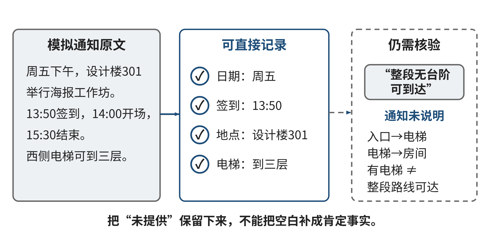
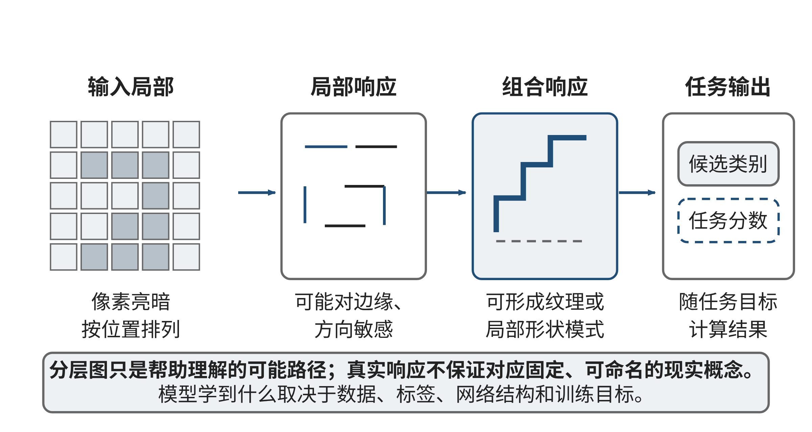

## 2.1 抽象 (Abstraction)：数据本质的智能萃取

### 导语

每天打开地图、课程平台或图书馆目录时，我们都在使用别人替我们整理好的表示：现实中的地点被画成点和线，课程要求被列成字段，书籍被归入主题。整理让信息更容易处理，也必然有所取舍。地图若只标“楼”，可能回答不了“从哪扇门进去”；课程表若只写“周五”，也可能无法生成准确提醒。人工智能能够从文字和图像中提出候选字段，也能从大量样本中学习特征，但它同样只能根据输入形成表示。本节先练习从一段熟悉材料中挑出必要信息，再理解人工选择字段与AI学习表示的差别，以及怎样检查一份表示能否支撑当前任务。

### 2.1.1 案例：一条最短路线为何让人走错门

**案例描述。**一所大学为新生开放日制作校园导览。网页上把每栋建筑画成一个点，路段画成连线，旁边标注预计步行时间。访客从北门出发，系统推荐一条总时间较短的路线，终点写着“信息服务中心”。访客到了建筑北侧，却发现眼前是台阶；可无台阶进入的门在南侧，距离当前地点还要绕行。导览小组随后把门的位置补进地图。下一次测试中，程序又把从西侧进入的道路和从南侧离开的道路拼成一条路线，仿佛访客能在建筑内瞬间从一个门移动到另一个门。每条画在地图上的道路都确实存在，组合后的路线却仍然走不通。

**案例分析。**这个故障并不是加法算错了。第一版表示把“建筑”当作唯一地点，隐藏了入口之间的区别；第二版虽然新增入口，却没有说明进入和离开不同入口之间需要怎样转换。模型中的一个点或一条线，承载着对现实的主张：哪些对象相同，哪些移动可行，哪些时间可以相加。决定这些主张能否成立的，不是图画得多精细，而是它保留的信息是否足以回答访客的问题。

信息服务中心这个名字对宣传页可能足够；对规划通行路线，入口、方向、台阶和开放状态会改变可行性；对设施维修，还要知道路面和维护记录。不同读者面对同一校园，关心的字段并不相同。计算机专业学生很容易从“我可以把它画成图”直接跳到图算法，却需要先问：图上的“点”指什么，边允许什么行动，两个看起来相似的地点能否真的合并？

我们把现实情境整理成便于回答某个问题的对象、属性和关系，称为**表示**。选择保留哪些性质、暂时隐藏哪些差异，称为**抽象**。抽象不是随意删掉细节，而是围绕目标筛出足够的信息。Wing将抽象视为计算思维的重要组成，并讨论如何以一个对象代表多个对象、保留共同性质、隐藏与当前处理无关的差异[[S01]]。本节会把这个思想落到一项具体检查上：如果两种现实情况被写成相同记录，正确行动是否可能不同？若会，就应补回能区分它们的信息，或降低系统所作承诺。

### 2.1.2 先把一段通知整理成可用记录

先看一个与后面独立练习无关的完整示例。学生事务办公室发布了一则教学模拟通知：“周五下午，设计楼301举行海报工作坊。13:50开始签到，14:00开场，15:30结束。组织者会准备纸张和马克笔。西侧电梯可到三层。”读者可能问：什么时候到场？地点在哪里？能否据此确认从校园入口到教室的无台阶路线？

第一次练习不需要机器学习或数据库知识。我们只需按顺序做四步。

第一，先写清需要回答的问题。若要设定日历提醒，签到时间比“下午”重要；若要在楼内找教室，楼名和房间号比活动材料重要；若要承诺整段路线无台阶，仅知道有一部到三层的电梯还不够，还须知道入口到电梯、出电梯到房间的连接情况。

第二，把通知中能直接找到的事实逐项记录。第三，给事实附上它实际支持的范围。第四，未写明的信息标作“未提供”，不自行补齐。表2-XW1展示了这份记录：

表2-XW1 通知事实与未提供信息的教学示例

| 要素 | 从通知可记录的内容 | 当前仍不知道的内容 |
| --- | --- | --- |
| 活动 | 海报工作坊 | — |
| 日期 | 周五 | 对应的具体年月日 |
| 时间 | 13:50签到；14:00开场；15:30结束 | — |
| 地点 | 设计楼301 | 从校园入口到房间的完整路线 |
| 通行线索 | 西侧电梯可到三层 | 楼外入口、各楼层间的可通行连接 |
| 材料 | 纸张和马克笔由组织者准备 | — |

来源：本书原创教学示例，通知内容为模拟。

这样一张记录可以支持提醒和基本定位，却不能支持“从任一入口均可无台阶到达教室”的承诺。我们没有把“未知”当成“没有电梯”，也没有把“有电梯”推广成“整条路线无障碍”。记录的边界与已知事实一样重要。

假设让一个文本模型根据同一通知生成结构化记录。以下是专为课堂讨论编写的**模拟候选**，不是实际模型输出：“日期：本周五；签到：13:50；地点：设计楼301；无障碍：有西侧电梯，因此可无障碍到达。”前三项基本可从通知摘出，最后的推断超出了原文：电梯只说明某一段垂直交通可用，没有说明入口、楼层走廊和房间门口的情况。若模型把“周五”换成具体日期，也需要额外的发布时间和日历上下文；当前材料没有这些信息。

我们由此得到一个可复用流程：先定问题，再从来源中摘取相关事实，标注单位、时间和出处，最后列出尚缺的信息。人工完成时，领域知识帮助选择字段；AI参与时，输出是待核对的候选记录。它可以减少整理文字的重复劳动，却不能凭格式整齐就获得事实权威。对关键字段，学生要能回到原通知逐项定位；对缺失值，要保留“未知”，不要让系统把沉默填成肯定答案。

图2-1把原通知事实与尚缺的路线连接信息分开。读图时，先指出通知直接支持的字段，再判断哪些信息必须另外核实。

**图2-1 通知事实、记录与未知信息**

来源：本书原创教学示意；通知内容为模拟。

### 2.1.3 同一材料可以有不同抽象

海报通知并没有一份唯一正确的“完整表格”。给参加者发提醒时，签到时间和地点优先；安排教室设备时，人数、投影需求和电源位置更重要；为有通行需求的参加者做路线说明时，入口、坡道、电梯与门的开放状态才是核心。同一原文可以投影成不同的记录，关键是记录适合其用途，并清楚说明还不能回答什么。

想象两位参加者都要从校园东门前往设计楼301。一位只关心普通步行时间；另一位需要无台阶路线。如果系统只记录“东门至设计楼，约8分钟”，两种需要就被合并了。若一个人经台阶捷径、另一个需要搭乘电梯绕行，两者不应被视为完全相同的通行情境。此时“交通方式或通行条件”不是装饰字段，而是会改变候选路线的条件。

可以用一个小反例判断表示是否足够：找出两种允许出现的真实情况，检查它们在当前记录中是否相同，再看正确答案是否不同。假如两扇门都记录为“设计楼入口”，但一扇有台阶、一扇可无台阶进入，它们在原表示中相同；遇到无台阶路线请求，正确答案却不同。因此当前表示不够。修复时可把门拆为两个地点，或者保留门的通行属性。哪一种更好，取决于之后的任务；若需要计算门之间的路线，就拆成节点通常更清楚；若只需要筛选可用入口，一个属性或许足够。

**拓展阅读：用符号表达同一项检查。**以下符号不是完成基础任务的先备，可以在理解门的例子后再读。令现实情况为w，整理过程为α，整理后的记录为α(w)。若两种情况w₁和w₂得到同一记录，即α(w₁)=α(w₂)，但任务要求给出不同决定，那么只依据这份记录的程序无法区分它们。因为它看到的输入相同，没有理由在两次处理中选择不同结果。这不是说任何信息压缩都不好，而是说压缩以后仍要满足目标。若两种情况的正确行动本来相同，保留它们之间的细小区别可能只增加维护成本。

此检验也能避免“字段越多越好”的误区。记录所有访客的姓名、学号、健康情况并不能自动改进路线规划；如果这些字段与路径无关，反而引入隐私与维护负担。反过来，一张字段很少的表若保留了任务所需的信息，可能更可靠。设计时可逐项问：这个字段支持哪一种判断？谁提供它，多久更新一次？误填会产生什么后果？没有来源的字段即使看起来合理，也不应被当成已证实事实。

对象如何划分同样是一项抽象选择。把地图节点设为“整栋楼”，简单直观；设为“入口”，能区分门；设为“入口加时段”，可能表达某些门只在白天开放。划得更细会带来数据维护成本，划得太粗则会把不同情境混为一谈。可从最简单的表示开始，当它不能解释一个具体错误或任务时，再添上所缺差异。每次增加字段，都应写出它消除的歧义；每次合并对象，也应检查是否会改变动作、评价或承诺。

### 2.1.4 方法应用：人工选择字段与机器学习表示

刚才我们根据问题自己挑出“时间”“入口”“通行方式”等字段，这叫**人工设计特征**：设计者先决定什么信息可能有用，再规定如何填写。对通知文本，这种方式透明、容易复核；字段是否合适，可与任务直接讨论。它的弱点也很明显：设计者可能没有想到重要线索，或只能依赖固定词汇和明确格式。不同楼宇各自写“电梯”“无障碍升降机”“可搭乘”，手工规则就需要持续维护。

机器学习换了信息形成的方式。与其要求人预先说清每一种有用视觉形状或语言组合，不如给模型大量输入例子和任务标签，让算法调整内部参数，逐渐形成对分类或预测有帮助的表示。对读者来说，可以把这过程想象为：开始时模型把原始输入映射成一组内部数字；训练例子告诉它哪些输出与任务目标相符；反复比较输出与标签，参数逐步改变。训练所得的表示可能包含人工没有逐条命名的模式，但它不因此等同于人类理解，也不自动与任务的真实原因一致。

这一变化既带来能力，也转移了人的工作。手工字段要由人写出定义、检查填写一致性；学习表示则要求人检查训练材料覆盖了谁、标签如何形成、输入环境是否与使用时相近。人工设计的规则暴露在说明书里，却可能漏掉隐蔽线索；学习到的特征能组合复杂信息，却常更难直接说明每个数字的含义。两种方式都要经过任务验证，不存在“手工就可解释、AI就必然准确”的简单二分。

以图像为例，卷积神经网络（CNN）会在局部区域处理像素，再把多层处理得到的结果组合起来。入门时不必先推导卷积运算：可以先把它理解为一组可学习的图像筛查器。靠近输入的一层可能对边缘、方向和颜色变化敏感；后续层组合这些局部响应，形成更复杂的纹理或局部形状；更深层将这些响应用于任务输出。训练时具体学到什么取决于数据、标签、网络和目标，不保证每一层都对应稳定、可命名的现实概念。深度学习的重要变化之一，是让部分特征由训练数据和目标共同塑造，而非完全由程序员逐条手工指定[[S11]]。

设想一个课堂模拟任务：把校园设施照片分成“有楼梯”和“未见楼梯”。若训练照片大多在白天拍摄，且“有楼梯”的照片恰好总带有红色警示带，模型就可能把红色当成有用线索。遇到没有警示带的台阶，或一条铺着红色地毯的平路，输出可能改变。模型在已见数据上表现不错，并不能单独证明它学到的是“台阶”这一与任务有关的特征。学生应检查训练样例是否覆盖不同光照、拍摄角度、材质和场景，并找出容易混淆的反例。

视觉解释工具可以帮助查看模型输出与输入区域的关系。Grad-CAM为给定类别计算一幅粗略热图，显示哪些较大图像区域与该类别分数相关。**拓展理解。**若继续追问它怎样得到热图，可以把机制理解为：从目标类别分数向卷积层反传梯度，用梯度概括该层不同特征图对分数的影响，再加权组合为定位图；常见做法会保留正向响应，并把较小热图放大叠到原图上。课堂中不必先会微积分，但要知道热图来自模型内部激活和梯度，并非人工标出的真实障碍边界。可以把它当成“模型在这次判断中可能利用了哪里”的线索，而不是模型思维的完整记录。热区落在台阶附近，不能证明模型理解了通行风险；热区落在背景上，提示值得调查，却也不自动证明模型完全错误。热图的分辨率、模型结构和输入都会影响呈现；它不能证明因果关系、正确性或真实通行状态[[S13]]。

因此，表示审查至少有两个层次。第一，记录是否包含任务需要的对象、属性和关系，来源是否明确；第二，学习表示是否在不同条件下仍支持目标判断，是否存在模型借助背景或样本偏差的可能。前者可用材料对照与反例检查，后者需要分组样例、独立测试和领域人员参与。对涉及安全、可达性或公共服务的建议，模型输出只能辅助筛查；真实设施状态仍须用可靠记录或现场确认。

图2-2只示意局部响应到组合响应的关系。箭头表示计算组织，不表示已经观察到某个真实模型理解了台阶；实际学习结果还要用样例检验。

**图2-2 卷积网络的局部与组合响应示意**

来源：本书原创概念示意；非真实模型激活图或实测结果。

### 2.1.5 跨专业知识决定哪些信息重要

回到校园导览。计算机科学提供节点、边、属性、数据来源和一致性检查的表达方法；设施管理人员知道哪扇门临时维修、哪段走廊只能单向通行、记录更新归谁负责；无障碍服务人员和使用者能够指出坡度、门宽、台阶等因素怎样影响真实通行。将这些知识接在一起，表示不再只是“校园的抽象地图”，而是能支持特定人群、特定时段导航的模型。领域知识改变了字段定义和评价标准，计算方法则使条件可被系统一致处理。

这个协作也展示了学习能力如何落到行动。开发者遇到不熟悉的“无台阶”“可通行”字段时，不应先自行编出阈值；可以列出不确定词、查阅适用标准、向专业人员确认，并将得到的定义记录在数据字典中。随后拿几条真实情境做走查，邀请不同使用者检查描述是否足够。问题、资源、验证对象都具体可见，跨界合作便不只是把专家名字写在致谢里。

同一原则可迁移到文化遗产数字化。视觉模型可以提出“这两幅纹样相似”的候选，图像特征帮助从大量影像中查找；编目人员还需依据来源记录、年代、修复史和收藏背景判断它们是否具有可比性。纹样像素相似并不证明器物来自同一时期，也不能替代档案证据。计算机人员负责候选检索和数据结构，历史与文物专业人员提供术语、出处和解释边界。表示中若只留图片向量而删去来源档案，就可能方便检索却无法支持可靠的历史判断。

跨领域协作中，每位参与者都可以问三件事：这个字段由谁定义，依据什么材料更新；模型输出用于发现候选还是直接作决定；当资料冲突或缺失时由谁处理。回答写在接口和流程里，才真正进入系统设计。它也让计算思维从“把事物变成数据”扩展为“明确什么值得表示、哪些证据能够支持下一步行动”。

### 2.1.6 思维训练：E01 信息取舍与模型复核

以下数据全部为原创教学模拟，不是校园实测值。无特别说明时，道路为有向边，表中未列出的边不存在；时间单位为分钟。H是起点，L是服务大厅。9:57从H出发，目标为在10:05前使用无台阶路线到达L。边H→J和J→L有台阶；J→L这段必须在10:00前完成。边H→K与K→L均为无台阶；L→H为单向记录。各段数据见表2-XE01。

表2-XE01 E01道路与通行条件教学数据

| 道路 | 时间 | 无台阶 | 额外条件 |
| --- | ---: | --- | --- |
| H→J | 2 | 否 | 无 |
| J→L | 2 | 否 | 须不晚于10:00完成 |
| H→K | 3 | 是 | 无 |
| K→L | 4 | 是 | 无 |
| L→H | 5 | 是 | 无 |

来源：本书原创教学数据，不是校园道路或开放时间记录。

**基础：先整理一条候选。**把路线判断需要的信息写成字段清单，至少包含方向、用时、通行条件、时间限制和确认状态。手算路线H→K→L：先分别相加道路时间，再从出发时刻推算到达时刻。列出你判断“符合目标”时实际使用了哪些字段。

**应用：比较表示和模拟候选。**另一种表示把J、K合并成中间点P，只保存最短连接时间；较完整的表示则保留各点、方向、用时、通行条件和时间限制。说明哪一份能够支持当前目标，不能支持的那一份丢失了哪些区别。下面是专为练习构造的模拟AI候选，不是任何实际系统的输出：“H→J→L用时4分钟，是较快路线，建议采用。”用题面数据逐段检查它的通行资格、到达时刻和单向关系，写出至少两条需要修正或补证的地方。

**拓展：条件改变后重述结论。**先只取消“无台阶”要求，其余条件不变，判断结论是否会改变。再恢复无台阶要求，但将K→L的通行状态改为“尚未核实”；区分“已确认有可行路线”“当前没有足够证据作承诺”和“现实中一定无路”这三种说法。最后讨论若仅保留合并后的P和最短时间，哪些错误会被隐藏。拓展题不影响基础任务的完成。

交付一页字段表、一段路线计算和一段候选复核说明。评价时看每项主张能否回到题面证据，是否把未知说成未知，是否说明表示能回答的问题；字段数量和AI候选的措辞流畅度不计分。独立参考解见章末E01。

### 2.1.7 反思：你压缩了什么，留下了什么责任

本节从两扇门被合并后出现的错误开始，逐步建立了抽象的判断方法：先说清目标，再选择信息，用反例检查不同情况是否被不当地当成相同。人工设计字段使选择过程清楚，却可能漏掉未预想到的线索；AI学习表示可以从例子中形成复杂特征，但输出仍受样例和目标影响。解释图、相似度或整齐的结构化结果，都不能替代来源核验。

回看E01或通知示例：你曾准备删掉哪项信息，后来发现它会改变判断？你怎样知道一条字段是事实还是推测？若只收到一句“地图显示可通行”，你还需要查哪条记录、问哪位专业人员？把尚未解决的问题写成一张两栏清单——“当前记录可支持的决定”和“仍需取得的证据”。这份清单会成为下一节拆解任务时的输入：只有把子任务所需信息写清，模块之间才能可靠协作。
