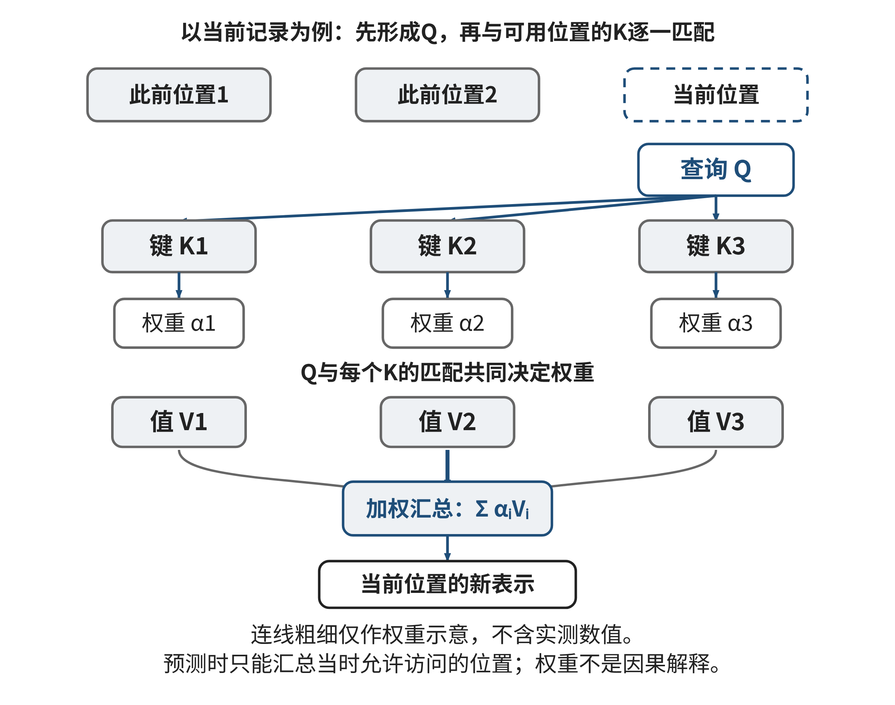
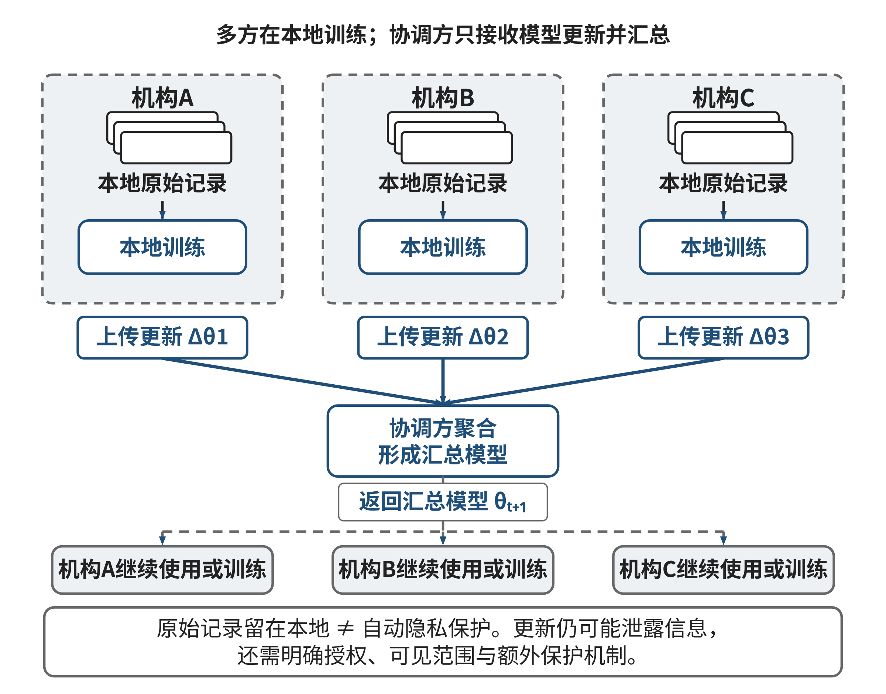

## 2.3 模式识别 (Pattern Recognition)：深度学习的隐规律挖掘

校园里每天都留下许多记录：图书馆什么时候座位紧张，食堂某个窗口何时排队，校园接驳车在什么时段乘客较多。单看一条记录，只能描述一次发生了什么；把相似情境中的记录放在一起，我们有机会发现重复出现的关系，并据此作出更早的准备。

模式识别从这种日常观察开始。本节先练习从少量记录中指出重复之处，再看一条规则怎样接受新记录的检验，最后讨论AI如何从大量样例中学习更复杂的关系。我们会进一步解释序列注意力和联邦学习为何有用、又不能替代哪些判断。读完后，你应能区分“看到了规律”“规则在新资料上有效”和“规律说明了原因”，也能指出一个数据模型在什么条件下才值得采用。

### 2.3.1 案例：接驳车候车人数为何忽高忽低

某校交通服务小组希望在候车队伍明显变长之前，提醒调度员检查是否需要增开接驳车。小组不采集学生姓名，只在若干时间段汇总观察：该时段是否临近下课、是否下雨，以及接下来十分钟的最高排队人数。为讨论如何发现规律，下表采用一组虚构的教学记录；“拥挤”暂按人数达到40人定义。这个门槛是练习设定，不是通用交通标准。

表2-Xpat 四次候车观察的讲解示例

| 记录 | 临近下课 | 下雨 | 接下来十分钟最高人数 | 按40人门槛标记 |
|---|---:|---:|---:|---|
| 甲 | 是 | 是 | 52 | 拥挤 |
| 乙 | 是 | 否 | 43 | 拥挤 |
| 丙 | 否 | 是 | 34 | 不拥挤 |
| 丁 | 否 | 否 | 19 | 不拥挤 |

先只看甲、乙。两次观测都临近下课，而且都达到门槛。学生可以用一句话描述共同点，也可以提出一个暂时的简单规则：“临近下课时，候车人数可能较多。”这就是一次可开始、可完成的模式识别：从相似条件与重复结果中找出值得继续检验的联系。此时不需要先理解神经网络，也不需要运行程序。

把丙、丁加入后，规则在这四条记录上都说得通。不过，小组又观察到一条新记录：校内活动散场时并非下课时段，队伍也超过了40人。原规则没有把“活动散场”纳入考虑，因而漏掉了一个拥挤场景。再后来，校园道路临时施工，接驳车改走另一条路线；即使临近下课，队伍仍未变长。此时，“临近下课”与“拥挤”之间的关系又可能减弱。

这些对照说明，模式不是贴在数据上的永久标签。它总是相对于一个目标、观察范围和使用条件而言。交通时段、天气、校园活动和路线安排可能共同影响需求；交通管理人员知道哪些调度动作可行，课程管理人员能说明下课时间，气象资料描述天气条件，学生工作者能解释活动日程。把这些领域信息放在同一分析中，才可能形成比单看历史人数更有用的判断。即便如此，数据中的同时变化只能提示关联，不能单独证明某一因素造成了排队。

### 2.3.2 从手工规则到数据中学习的模式

人观察若干记录后，可以直接写出判断规则。例如“临近下课且人数达到某阈值，就提示检查运力”。这种规则便于解释，条件由人确定；若校园出现晚间活动、路线施工或考试周，设计者需要判断是否增加条件。规则太少会漏掉重要情况，条件过多又可能只适合已看过的那些记录。

AI参与后，人的工作有一部分从逐条编写条件转向准备例子、确定任务、选择可观察的信息并检查模型表现。仍以前面的交通问题为例，模型可以接收过去某时段的天气、课表、活动安排与汇总人数，并学习如何从这些输入估计下一时段是否会拥挤。它从样例中调整内部参数，使输出与已记录的判断尽可能一致。参数可以理解为模型内部许多可调的数值；学生此处无需手算它们，只要知道模型的判断方式是由数据与训练过程共同形成，而不是由人逐条写完。

这里有几个常用词，先从例子理解即可。模型作出判断前可使用的字段，如是否下课、是否下雨，叫作特征；希望模型判断的结果，如下一时段是否拥挤，叫作标签。包含若干特征和已知标签的一条记录是一个样例。学习程序利用一批样例形成模型，再把新记录交给模型，得到预测。模型给出“可能拥挤”并不等于拥挤已经发生，更不等于这个预测能说明拥挤的原因。

手写规则和数据学习都可能帮助判断，但它们依赖的信息和责任分配不同。规则把人的明确假设直接写进条件；模型则从数据中拟合重复关系，可能发现人没有逐条想到的组合，也可能放大数据中的偏差。人仍需说明目标标签如何定义、哪些记录可以使用、误报和漏报各自有什么后果。例如，过早建议增开车辆可能增加成本；漏报高峰则会增加候车时间。优化目标不能仅由历史中出现最多的标签自动决定。

训练模型时应把已知记录分为开发部分与保留的检验部分。开发数据可用来构造或调整规则；检验数据用于检查规则面对新记录时是否仍有用。若研究者每看一次检验结果便不断改规则，再报告同一批记录上的好结果，检验数据就已参与调整，结果会显得比真实新样本更可靠。评估模型需要把数据准备和调参过程一起考虑，不能只看一个最终准确率。[[S03]][[S04]]

切分方式也要符合资料产生的顺序。预测未来客流时，先用较早时段开发，再用较晚时段检验，比随机打乱时间更接近实际使用。若同一场活动的多条记录被分到两边，模型可能借助相近重复信息而显得会预测新情形；若部署地点换到另一校区，还要检查当地课表、道路和出行习惯是否不同。一个模型在熟悉的校区表现良好，不足以保证它能迁移到新的校区。

字段还应在预测作出前就能取得。如果目标是提前十分钟预警，却把十分钟后的实际排队人数放进模型输入，模型即使判断完全正确，也是在使用当时不可能知道的信息。这个错误可能源于资料表把“预测时可知的条件”与“事后记录的结果”放在一起，却没有区分使用时点。准备模型前，可为每个字段标注采集时间、来源和用途；特别核对标签是否由可靠记录产生，以及样本是否只包含曾经被特别关注的线路。模型学到的是观察到的资料关系，资料缺失的群体不会自动出现在它的经验里。

### 2.3.3 读懂错误：四种结果回答不同问题

说“模型答对了八成”听上去直观，但如果拥挤事件很少，即使模型一律预测“不拥挤”，总体正确比例也可能很高。调度小组真正关心的可能是两件事：发出的提醒有多少真的对应拥挤，以及实际拥挤中有多少被提前发现。要回答这些问题，先区分四种结果。

先看另一组独立于E03的七条虚构记录，把“拥挤”记作目标事件，把“非拥挤”记作另一类；表中列出实际标签和模型预测。

表2-Xerr 七条预测与实际标签的讲解示例

| 记录 | 实际标签 | 模型预测 |
|---|---|---|
| 甲 | 拥挤 | 拥挤 |
| 乙 | 拥挤 | 拥挤 |
| 丙 | 非拥挤 | 拥挤 |
| 丁 | 拥挤 | 非拥挤 |
| 戊 | 拥挤 | 非拥挤 |
| 己 | 非拥挤 | 非拥挤 |
| 庚 | 非拥挤 | 非拥挤 |

逐行对照：甲、乙是命中，共2条；丙是把非拥挤报成拥挤的误报，共1条；丁、戊是实际拥挤却没有提醒的漏报，共2条；己、庚是正确排除，共2条。四类记录合计7条，没有重复或遗漏。由此总体准确率为(命中+正确排除)/7=(2+2)/7，约57.1%。

在分类任务里，把希望找到的情况称为正例，把其他情况称为负例。命中也叫真正例（TP），误报是假正例（FP），漏报是假负例（FN），正确排除是真负例（TN）。精确率只看所有提醒中有多少是真正例，即TP/(TP+FP)=2/3，约66.7%；召回率只看所有实际正例中有多少被找到，即TP/(TP+FN)=2/4=50%。三种比例回答的问题不同：精确率低可能意味着无效调度较多；召回率低可能意味着高峰被漏掉较多；准确率还受正负例数量影响。哪些错误更重要，取决于交通服务目标和成本，不能由模型自动决定。对应的英文术语分别是Accuracy、Precision与Recall。它们可帮助比较候选判断，但依赖标签口径与样本构成，不能代替现场检查。

在更复杂的模型中，还可以考察不同日期、线路或服务群体的指标。若总体精确率不错，但某个校区的漏报集中在晚间，平均数就掩盖了实际问题。分组报告需要谨慎：样本过少时比例会随一两条记录大幅波动，也不应因为标签不足而把群体差异解释成个体能力。可先标出还缺哪些观测，增补资料后再评估。这个过程使错误统计成为修正数据与决策的起点，而非给模型盖一个永久的“通过”印章。

本案例把实际人数达到40人定义为“拥挤”，等于先选定了标签边界。若服务要求改变，可以重新讨论这个人数标准；测量不稳定时，40人附近的标签也容易变化。但修改标签定义不会自动改变已经固定的提醒。例如两次实际人数为35、45，预测分别为不提醒、提醒：按40人定义时两次都正确；若把实际人数标准改为30，两次都成为正例，第一条变成漏报，提醒次数却仍只有一次。我们改变的是评价问题，不是模型已经发出的动作。

另一种门槛用于把模型分数转换成提醒，称为决策门槛。固定实际标签为非拥挤、拥挤，模型分数为0.4、0.7；约定分数不小于0.5才提醒时，只提醒第二条。若只把决策门槛降到0.3，两条都提醒，第一条新增一次误报。对同一批固定分数，降低此门槛可能找到更多正例、减少漏报，也可能增加误报；这与改写实际标签不同。[[S19]]门槛要依据服务目标和资源成本选择。学生既要问正例怎样定义，也要问分数如何转成动作；定义改变后，旧成绩与新成绩不能不加说明直接比较。

### 2.3.4 观察连续变化：注意力怎样联系不同时刻

到目前为止，我们可以把每条记录看成独立的一行。但许多任务的记录有先后顺序：五分钟前、现在、接下来的十分钟，不能随意交换。接驳车即使在同一时刻观测到相同人数，若一辆车刚刚离站，和若下一辆车还要等很久，随后排队变化也可能不同。只用当前人数会丢失上下文。

深度学习模型可通过多层计算从样例中形成内部表示。以文本为例，模型处理一句话时可以把词语转成数值表示；在序列任务中，模型还需要利用各位置之间的关系。Transformer是一类用于处理序列的神经网络架构，其中的自注意力机制提供了一种建立位置关系的方式：处理某一位置时，模型会把它与序列中其他位置作比较，估计哪些位置的信息在当前上下文下更值得参考，再按相应权重汇总信息。可以把它想成在一串候车记录中，当前时刻会“查阅”此前哪些时段与自己相似，而不是只盯着紧邻的上一条记录。[[S12]]

若把这一步再拆开看，当前位置会形成一个“查询”向量，每个可参考位置形成一个“键”向量和一个“值”向量。查询与各个键的匹配分数决定关注权重；权重再用于合并对应的值，得到当前位置的新表示。它们都是从输入经过可学习的线性变换得到的数值表示，不是人写的一条条搜索关键词。原始Transformer使用缩放点积计算匹配，并把多组注意力并行组合。读者只需先抓住关键：模型根据训练到的参数计算关联权重，再组合输入信息，具体关联会随当前上下文而改变。

这种比喻只帮助建立直觉。实际注意力计算由数值向量之间的匹配关系组成；原始Transformer还使用位置信息，使模型能够利用词语或记录的顺序。注意力权重描述模型在某一步如何组合信息，并不自动等同于人能够理解的因果解释，也不能证明模型参考的字段在现实中确实造成了结果。模型可能利用与目标偶然相关的日期编码、节假日标记或数据收集习惯。若训练资料中某个校区总在雨天记录，模型也可能把“校区”误当成判断雨天需求的捷径。

用于预测未来时，模型还不能偷看未来。实际序列模型会依据任务设置只让当前位置访问允许的历史位置，或在数据准备时确保未来记录不会进入输入；如果把整段序列不加区分地同时交给模型，训练和检验便可能混入预测时尚未发生的信息。理解注意力因此不只是在图中看到若干权重，还要知道模型可访问哪些位置、每个输入何时产生，以及这些信息在实际调度时是否已经可用。模型结构越灵活，越需要把数据时间线写清楚。

深度模型的复杂结构并不使小样本问题自动变好。它需要足够且有代表性的训练资料、可靠的标签和适当的评估。某校只积累了少量拥挤记录时，先用简单基线和补充观察可能更稳妥；如果天气、课程安排发生变化，旧关系也可能失效。模型输出应带着适用范围和证据一起使用，新的环境需要再次检验。

图2-4按查询、匹配和汇总三个步骤显示注意力。此预测情境只允许访问决策时已知记录；连线不表示实际测得的权重，也不构成因果证据。

**图2-4 自注意力中查询、键和值的关系**

来源：本书原创概念示意；无实测权重。

### 2.3.5 跨机构学习：共享经验与隐私边界

设想几所高校都想改善接驳车调度。把各校的学生级记录汇总到一个中心，理论上可以扩大训练资料，但可能触及机构管理规则、学生隐私和数据授权。另一种思路是联邦学习：资料留在参与机构本地，各处用本地数据更新一份共同模型，再把经过规定流程的模型更新提交给协调方汇总。随后，汇总后的模型可以返回各参与机构继续改进。研究中的联邦平均方法以多方本地训练并聚合模型更新为基本思路。[[S14]]

“原始记录没有集中到一处”是数据流转方式的变化，不是隐私保证。模型更新仍可能携带关于本地样例的信息；梯度是一组描述模型误差随参数微调如何变化的数值信号，该项研究在攻击者知道模型结构与参数、能够取得相应共享梯度等条件下，用优化过程尝试重建训练样本。它展示了更新泄露的可能性，不意味着任何汇总更新都会被成功还原。[[S15]] 因此，实际方案仍要核对是否有明确授权、需要哪些字段、谁能看到更新、更新保留多久、退出后如何处理，以及是否采用安全聚合、差分隐私等额外机制。安全聚合希望让协调方看到整体汇总而非单个参与方更新；差分隐私通过控制并扰动信息降低单个样例的可识别风险，但参数选择会影响模型可用性。具体保护强度取决于威胁模型、参与人数、实现方式和参数，不能只凭“用了联邦学习”四个字下结论。

不同学校的资料也可能不相同：校区规模、接驳路线、课程时间、天气和活动安排有差别。若一方数据量很大，汇总模型可能主要反映它的模式；小校区或少数用户的情况被平均后，效果可能变差。参与方需约定标签口径、特征定义、模型更新频率和评估办法，也要查看各地表现，决定何时拒收更新或重新训练。隐私保护、跨校协作和预测质量需要共同设计，不能把数据留在本地就视为全部问题已经解决。

因此，这类项目的协作清单也不只是“谁来训练模型”：交通人员要说明可接受的候车时间和增车成本，课程与活动管理者要解释时间表的含义，数据工程人员要保证各校字段和时点一致，隐私负责人核对授权与保留周期，服务人员则检查提醒能否转成可执行的调度。每类知识都改变问题的一个环节；缺少任何一方，都可能把统计上的预测误当成可直接执行的服务承诺。

图2-5区分机构内部的原始记录与发送给协调方的模型更新。请沿两类箭头说明本地计算和聚合各做什么，再指出流程图仍未回答的隐私问题。

**图2-5 联邦学习中的本地数据与模型更新**

来源：本书原创系统示意；不表示任何真实机构部署。

### 2.3.6 思维训练：让候选规律接受新记录检验

E03：某校园服务中心想提前判断某时段是否需要增派服务人员。表中x为决策时已经记录的过去十分钟到访人数，event=1表示决策前已知有校内活动，event=0表示无活动；y=1表示随后十分钟现场记录确认需要增援，y=0表示不需要。作出预测时只能使用x和event，y用于事后核验，不能作为输入。d1—d8用于开发候选规则，d9—d12按时间先后保留作检验。下列数字为教学模拟，不是学校真实运营资料。

表2-Xe03 E03预测时已知输入与事后标签

| 记录 | x（到访人数） | event | y（实际需增援） | 用途 |
|---|---:|---:|---:|---|
| d1 | 80 | 0 | 1 | 开发 |
| d2 | 70 | 0 | 1 | 开发 |
| d3 | 55 | 0 | 1 | 开发 |
| d4 | 45 | 0 | 0 | 开发 |
| d5 | 30 | 0 | 0 | 开发 |
| d6 | 60 | 1 | 1 | 开发 |
| d7 | 40 | 1 | 1 | 开发 |
| d8 | 20 | 1 | 0 | 开发 |
| d9 | 65 | 0 | 1 | 检验 |
| d10 | 48 | 0 | 1 | 检验 |
| d11 | 38 | 1 | 0 | 检验 |
| d12 | 25 | 0 | 0 | 检验 |

比较两条人工设定的候选规则：RA在x≥50时预测y=1，否则预测0；RB在x≥50时预测1，或者在event=1且x≥35时预测1，否则预测0。它们是为本题编写的固定规则，不是实际训练得到的AI模型。

【基础】先只检查d1、d4、d7。对每条分别写出RA与RB的预测值，再对照y。暂时不计算模型指标。自检标准是能说明每次判断使用了哪个字段和阈值，而不是凭“看上去人数很多”作答。

【应用】继续使用E03的12条教学模拟记录。d1—d8是开发部分，d9—d12是按时间保留的检验部分。对规则RA与RB分别标出四种结果：预测正确的正例、把负例报成正例、漏掉的正例、预测正确的负例。先用这些数计算总体正确比例，再计算“被判为正例的记录中有多少真实为正”和“真实正例中有多少被找到”。前一比例影响多发无效调度的可能性；后一比例影响高峰是否被漏掉。三个比例回答的问题不同，必须先看业务希望减少哪类错误。检验部分只有四条记录，每条都会让比例大幅变化；这里的目的在于练习计算与比较，不能据此估计真实部署效果。

【拓展】题目中的12条记录不足以代表整个学期，更不能证明模型部署后会有效。请为下一轮资料提出一项改进：可以在记录中增加校区和时段、按周留出检验数据、单独检验活动日，也可以检查不同地点的误报。说明新增字段为何与决策有关、由谁提供、是否需要个人信息，以及若改进数据收集后样本量仍很小应怎样处理。再审查以下模拟AI候选：“RB在开发部分全部正确，因此已经找到可靠原因，可以直接部署。”请指出结论中哪一部分可由现有记录支持、哪一部分超出了证据。

交付一页分析单：写明标签定义、规则比较表、你优先关注的错误、下一步需要补充的证据，并注明所有数据为教学模拟。评价看三点：能否依给定规则判断，是否正确区分训练/检验资料，是否把相关性、预测与因果区分开。若结果支持不了直接部署，给出范围更小的后续试验，例如先在一个服务点只记录建议并交给负责人核对，而不自动增派人员。

### 2.3.7 反思

少量记录让我们能够发现并描述重复关系，却也很容易把偶然相伴误当成规律。读到一条AI预测时，不妨追问：它使用了什么信息？标签代表什么？哪些记录是新证据？错误会影响谁？在跨机构场景中，更新共享给谁、还需要什么保护？模式识别的能力既来自归纳，也来自主动寻找它不再成立的情形。面对不熟悉的数据方法，先把目标、字段和错误后果写清，再补读与问题直接相关的资料，最后用新的记录检查自己的判断；这种学习步骤比记住更多模型名称更能迁移到下一次任务。
