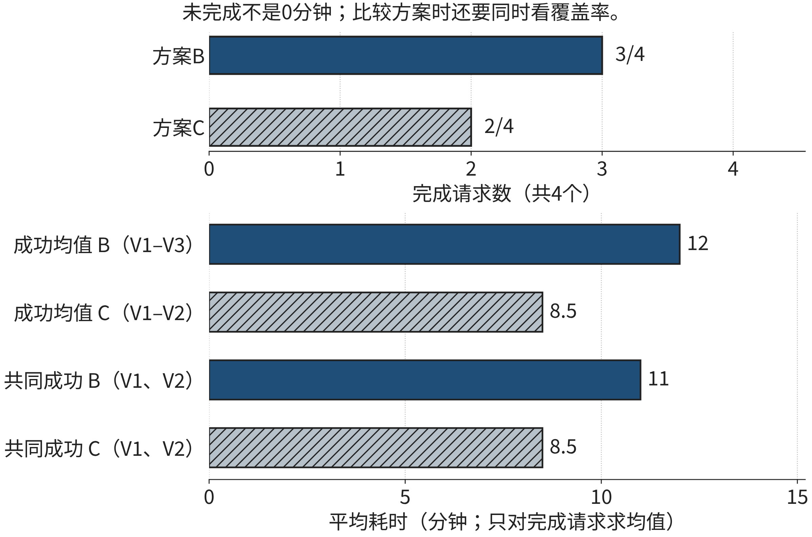

## 2.5 评估与优化 (Evaluation & Optimization)：AI赋能的闭环进化系统

设计出一个方案以后，我们往往还会遇到两个问题：它是否真的更好，以及下一步应改哪里。AI能够帮助整理结果、寻找错误、提出参数调整，甚至在预先规定的范围内自动试验。变化由此发生在“做完再评价”的工作方式上：评价可以更频繁地进入设计过程。然而，频繁反馈只有在比较对象、评价标准和调整权限清楚时，才可能形成有效的改进。本节先从几次导览服务的简单比较开始，再逐步讨论模型检验、成本与闭环控制。

### 2.5.1 案例：更快的方案为什么没有被采用

校园开放日的筹备组设计了两种导览方案。方案B按已经核对的道路信息推荐路线；方案C加入模拟拥堵预测，希望避开人流较多的路段。筹备组没有立即面向所有访客发布C，而是先用同一组四个模拟请求比较两种方案。结果如表2-Xdemo所示。“未完成”表示没有在题设规定的时间和通行条件下完成请求，不是一个零分钟的结果。

**表2-Xdemo 四个模拟请求的初次比较**

| 请求 | 方案B耗时/分钟 | 方案C耗时/分钟 |
| --- | ---: | ---: |
| V1 | 12 | 8 |
| V2 | 10 | 9 |
| V3 | 14 | 未完成 |
| V4 | 未完成 | 未完成 |

来源：本书原创教学模拟；两方案处理同一组请求。

先看完成情况。B完成三个请求，C完成两个请求，分母都是四。因此，B的完成比例是3/4，C是2/4。再看各自成功请求的平均耗时。B的三个成功耗时合计36分钟，平均12分钟；C的两个成功耗时合计17分钟，平均8.5分钟。仅凭第二组数值，C似乎明显更好；结合第一组数值，我们知道这个结论少考虑了一个方面：C少完成了一个请求。

这个比较不需要先学复杂统计方法。关键在于给每个数字补上“对哪些请求计算”。12分钟回答的是B成功请求的平均耗时，8.5分钟回答的是C成功请求的平均耗时，两者包含的请求并不完全相同。若只比较两个方案都完成的V1与V2，B平均11分钟，C平均8.5分钟。此时可以说：在这两个共同成功的请求上，C平均快2.5分钟。这个结论仍然不能代替对全部四个请求的判断。

筹备组最终没有直接采用C，原因并非反对AI，而是活动要求先保证访客完成指定参访。V3为什么失败，成为下一轮调查的起点。可能是模型高估了某条路的拥堵，绕行超过了截止时间；也可能是C读取了错误的通行信息。前一种问题需要改进预测或路线评价，后一种问题需要修正数据和接口。如果只对“平均耗时”进行优化，两种失败都容易从报表里消失。

案例体现了跨领域知识怎样改变技术选择。算法提供路线和耗时，活动组织提供完成标准，无障碍服务要求检查特定访客能否使用路线。这些知识共同决定“好方案”的含义。仅把导览模型运行得更快，不能满足活动的全部需求。

图2-7分别显示成功数量和耗时，两个尺度各回答一个问题。注意成功请求均值与共同成功子集均值使用的请求范围不同，不能混用。

**图2-7 四个模拟请求的完成情况与耗时比较**

来源：本书原创教学示例；四个请求为2.5节的模拟数据，不代表实地服务性能。

### 2.5.2 基础必学：先定义什么叫做好

评价标准应在看结果之前尽量明确。否则，我们很容易在看到某个漂亮数字后，临时把它称为最重要的指标。对本节的导览任务，可以先问三个具体问题：有没有完成请求，完成用了多久，为取得结果花了多少资源。它们分别对应服务结果、效率和代价。不同任务可能还需要核对解释是否清楚、信息是否有出处、用户能否纠正错误，但不必在一个小任务里同时设十几个指标。

“指标”就是把我们关心的性质变成可以记录和比较的量。例如，“路线可靠”过于含糊；“在这批请求中，满足通行要求且准时到达的请求数”则可以逐个核对。定义指标时要写清单位、分母与判断条件。分钟与秒不能混算，成功请求平均值与全部请求平均值不能混称，模型给出路线与访客实际完成参访也不能当作同一事件。

一个有帮助的顺序是先检查硬条件，再比较好坏。硬条件是当前任务不能用其他优点补偿的要求，例如轮椅路线不能包含楼梯，参访必须在开放时间内完成。两个方案都满足硬条件以后，才比较耗时、绕行距离或计算成本。这样做避免把“某些方面很优秀”误当作“整体合格”。如果活动组织者后来决定允许超时五分钟，那是任务条件改变，应明确记录，而不是在评价失败方案时悄悄放宽。

评价也应保留一个简单的基线。基线是已有的、可以解释的比较方案，不一定最先进。例如，经过核对的静态道路最短路，就是引入拥堵预测时的一种基线。没有基线，我们只知道AI方案取得一个结果，不知道它相对于原做法改善了什么。有基线也不能要求AI一定胜出；若新增模型在小范围测试中没有改善，保留原方案可能是合理结论。

**讲解示范：写一条完整的评价规则。**假设四个模拟请求必须全部满足无障碍要求，而且至少完成三个，才进入效率比较。可以把规则写成：“逐条核对通行条件；完成比例不低于3/4；在满足前两项的方案中，再比较共同成功请求的平均耗时。”这句话把合格门槛与效率指标分开了。学生可以实际执行，也能够解释为什么一个速度更快但完成率只有2/4的方案暂时不合格。

有时门槛无法在开发前完全确定，例如某类异常第一次出现。此时可以补充规则，但应说明修改缘由，并对受影响方案采用同一新规则。不能只给偏爱的方案增加例外。评价的公平性主要来自可追溯的口径和一致执行，而不是报表形式是否复杂。

### 2.5.3 方法应用：让测试回答尚未回答的问题

开发过程中，我们会查看错误并修改模型。用于这些调整的数据称为开发材料；保留到方案确定后再使用的材料，承担测试作用。这里的区别不是文件名，而是信息是否进入过选择过程。某批记录即使叫“测试集”，只要我们已经反复根据它调参数，它就参与了开发，不能继续被当作完全独立的检验。[[S03]]

可以用一次准备演讲来理解这个区别。对着同一段稿件排练十次，能够改善熟悉程度，但不能充分证明你能回答一个新问题。模型在看过的数据上表现变好，也不能直接说明它能处理新时间、新地点或新用户。保留新材料，是为了提出一个开发过程尚未回答的问题。

在AI参与的任务中，还要分开检验不同环节。图像模型是否正确找到道路是一件事，拥堵模型是否预测准确是一件事，规划程序是否遵守通行限制又是一件事。最终路线失败时，只有一个总分很难帮助定位。可以先检查输入道路记录是否正确，再检查预测误差，最后把固定输入交给规划程序核对约束。这样分开调查的目的不是多制造报表，而是使修复落在真正出错的环节。

比较方案时应固定请求。若B处理的是四个容易任务，C处理的是四个困难任务，平均耗时的差异混入了任务组成的差异。最直接的教学做法是让两方案处理同一组固定请求，逐行记录结果。现实中若不能对同一用户重复试验，需要设计适当的分配与观察方式。本章的固定模拟对照不是现实随机实验，不能据此推出校园实际部署中的因果效果。

除了整体数字，还要查看有实际意义的分组。例如，新访客可能不熟悉道路，无障碍访客的允许路线更少。若模型改善只发生在普通访客中，而无障碍组经常失败，整体平均数可能掩盖重要问题。分组应由任务和服务对象决定，不是在结果出来后不断切分，直到找到一个有利的小组。组内样本很少时，记录可以帮助发现问题，不能支撑稳定的总体比例估计。[[S08]]

**自己尝试。**回看V1—V4，写出一句有范围限制的效率结论，再写出一句关于完成情况的结论。两句话应能够同时成立，不把未完成填成零分钟。这项短练习只要求使用已经解释的求和、除法与请求范围。

AI能够协助把日志转换成逐请求记录，指出缺失值，或者提出“先检查V3”的调查顺序。使用这种辅助时，给出字段定义和原记录，并要求输出保留请求ID。核对时先检查行是否一一对应，再复算少量关键数字。一段措辞自信的总结，不能替代这些基础操作。如果AI建议删除失败请求以“清洗异常”，还需要判断失败是不是正是我们要评价的结果；本案例中将失败删掉，会改变评价问题。

### 2.5.4 从人工调整到受约束的自动试验

传统优化往往由人查看瓶颈、提出修改、运行一次测试，再决定是否继续。AI参与后，可以从记录中归纳常见失败，生成候选修改，或者根据已定义的评分函数搜索参数。人的工作由逐个尝试，部分转向设计试验范围、确定评价依据和核对候选。这个变化扩大了试验能力，也使错误评价标准的影响扩大：若标准本身有问题，自动化可能更快、更大量地选出不适合的方案。

先看一个无需学习训练算法的小例子。模拟拥堵预测器输出一个0到100的分数，分数越大，表示越可能拥堵。规划系统需要决定：分数达到多少时避开这条道路。这个阈值是系统设置的一种参数。阈值太低可能让大量可用道路被绕开，阈值太高可能遗漏真正拥堵的道路。我们先在开发材料上试三个候选设置，记录结果，而不是凭AI一句建议采用它。

**表2-Xtune 三个模拟阈值设置的开发结果**

| 设置 | 误报次数 | 漏报次数 | 开发评分：误报+2×漏报 |
| --- | ---: | ---: | ---: |
| 低阈值 | 4 | 1 | 6 |
| 中阈值 | 2 | 2 | 6 |
| 高阈值 | 1 | 4 | 9 |

来源：本书原创模拟；只演示参数选择，不表示任何真实模型性能。

评分中的“2”表示本次开发任务给漏报更高代价。低阈值与中阈值得分都为6，单凭此项无法决定两者谁更合适。若改成误报与漏报同等计分，三个得分依次是5、4、5，中阈值会成为这三个候选中的最低分。这不是系统发现了唯一正确的评价，而是选择标准改变后，候选排序改变了。因此，自动搜索开始前，人要说明漏报为什么代价更高，以及这个代价是否适合当前场景。

把候选设置列出来并逐个试验，称为一种网格搜索：在预先列定的参数组合中比较。它不要求使用生成式AI，许多普通程序也能完成。AI可以参与提议搜索范围、分析失败类别或减少无效尝试，但“自动调参”和“AI优化”不能不加区别地混用。采用哪种方法，取决于参数数量、试验成本和我们掌握的信息，而不是是否需要给方案加一个新名字。

完成开发选择后，应该冻结候选，再用保留材料检查。若测试不合格，需要返回开发，记录本轮问题；后续独立评价应使用合适的新材料，不能无限反复利用同一测试结果。[[S04]]对少量模拟数据来说，这种做法主要帮助理解流程，不保证统计稳定性。实际项目还需要考虑数据数量、时序变化与用户分布。

### 2.5.5 拓展深化：怎样理解元学习与闭环

当任务不断变化时，我们还可能问：能否利用过去多个任务的经验，使新任务更容易学会？这就是元学习的一类目标。“元”强调学习过程本身也成为研究对象，并不表示系统能够自行找到所有最佳方法。Finn等人的MAML研究以多个训练任务调整模型初始化，使模型在新的、相关任务上能够通过较少更新较快适应。[[S18]]这里的初始化可以直观理解为开始学习时的一组参数；元训练在寻找一个更适合后续适应的起点。

它与普通调参的侧重点不同。调参示例是在一个开发任务上选择阈值，元学习研究跨任务形成适应能力。即使元训练成功，新任务也要有适当数据和更新过程，仍需检验适应后的结果。如果训练任务与新校园的道路、访客或时段差别很大，快速适应不能靠名称保证。原提纲提到“自动选择优化器和超参数”，属于部分自动化研究所探索的问题；不能把MAML的具体机制写成机器普遍能够自行选出最佳优化器。

再看闭环。“环”来自一个基本结构：采取行动，观察结果，依据结果调整下一次行动。前面的阈值试验已经具备这个结构。AI能够更频繁地参与观察、归纳和提议，但闭环并不必然意味着在线系统自动修改自己。一个每周由筹备组审核新记录、再发布新版本的流程，同样可以形成反馈闭环；是否自动执行，只是其中的权限与速度安排。

**讲解示范：为一次调整划边界。**假设系统发现午后路线经常超时，允许的自动动作只是从三个已批准的拥堵阈值中提出候选。系统可以用开发数据比较，保存候选及依据；它不能删除无障碍限制，也不能未经复核就修改公开路线。新的候选须经过独立测试，合格后由有权限的人发布；系统应让人能检查和纠正建议，人机交互的相关设计原则也强调支持有效纠正与控制[[S10]]。这里的自动化提高了调查效率，保持了“修改什么”“谁能发布”“如何回退”的清晰边界。

闭环还有两个容易忽略的问题。第一，系统采取的行动会改变后续数据。例如，所有访客都被引导到一条原本较空的路上，那条路可能变拥堵；旧预测不一定继续适用。第二，系统看到的数据可能只来自自己选择的路线，很少经过的道路缺少记录。若把没有记录理解为“不拥堵”，就会把采样不足当作安全事实。因此，反馈质量也需要检查，自动调整并不能消除观察偏差。

关于联邦优化，本节沿用2.3的基本理解：多个机构可以在本地数据上更新模型，再通过规定方式聚合更新。这种组织方式解决了“如何共同训练”的一部分问题，并不自动等于“在加密数据上计算”、保证银行数据绝不泄露，或使各机构目标自然一致。是否使用安全聚合、差分隐私或其他措施，需要另行说明。当前基础任务无需实现这些机制，但应学会向方案提出具体问题：共享什么，谁能看到，聚合后怎样验证各组效果。

### 2.5.6 优化还要算投入，并知道何时暂停

模型速度变快，有时要先投入数据整理、训练或预计算。为理解这个取舍，设逐次计算一个结果需要30毫秒；另一方案先用100毫秒整理可复用信息，之后每次查询需要10毫秒。若同一份信息服务q次查询，前者总时间为30q，后者为100+10q。这里q只是查询次数，100只支付一次，单位均为毫秒。

先代入小整数比直接解不等式更容易理解。一次查询时，两方案分别为30和110；五次时都是150；六次时分别为180和160。因此，在这组固定代价和可复用条件下，超过五次查询后第二方案才严格更快。这个例子说明，我们应比较整个使用周期，而不仅是某次查询。若道路信息每次都改变，整理结果不能复用，第二方案每次都需要110毫秒；先前优势便不成立。实际数据整理或训练费用也应按相应的使用范围计算，不把一次性代价悄悄分摊到不存在的用户上。

自动化处理反馈时，还要区分“发现错误”与“知道动作是否已完成”。例如系统自动给负责人发送一条异常通知，网络超时后没有收到回复。可能是通知未发送，也可能已经送达而确认丢失。此时不能仅凭超时就重新发送同一通知。可以保留请求标识，查询接收方记录；若仍无法确认，暂停该自动动作并交由有权限的人处理。这个工程边界只影响自动发送部分，不妨碍继续做只读分析。[[S09]]

这里没有要求读者先掌握分布式系统。需要记住的基础判断是：结果未知与已确认失败不同。允许重试的条件应由系统接口与任务性质决定；若接口保证同一标识重复提交只产生一次效果，还须确认这个保证确实成立。不能让AI根据“通常没问题”自行判断已经发生的动作。对本章模拟导览，未经确认的道路状态也类似：系统可以记录不知道，并推荐经过已确认道路的候选；不能把缺少通行记录转写成可以通行。

### 2.5.7 思维训练E05：评价一个AI候选改进

以下八个固定请求为原创教学模拟。B使用确认道路上的基线规划；C加入模拟拥堵预测。两者目标相同，满足通行要求并准时到达才算完成。表中“未完成”不具有耗时值，不得记作0。U1—U4为普通访客组N，U5—U8为无障碍访客组A。采用门槛是A组至少完成3/4；满足这一条件的方案才进入部署候选。

**表2-Xe05 E05固定请求的比较记录**

| 请求 | 分组 | B耗时/分钟 | C耗时/分钟 |
| --- | --- | ---: | ---: |
| U1 | N | 8 | 6 |
| U2 | N | 10 | 8 |
| U3 | N | 9 | 7 |
| U4 | N | 11 | 9 |
| U5 | A | 12 | 9 |
| U6 | A | 14 | 未完成 |
| U7 | A | 未完成 | 未完成 |
| U8 | A | 13 | 10 |

来源：本书原创固定教学模拟；不得将结果写成真实校园实测。

**基础。**分别数出B与C完成多少请求，写明分母；计算各自成功请求的平均耗时。审查一条模拟AI总结：“C的成功请求平均耗时更低，因此可以直接部署。”指出这句话尚未回答的一个评价问题。提示：先写出每个平均值包含的请求ID。

**应用。**只对两方案都成功的请求比较耗时，再单独计算A组完成比例。按题设门槛判断C是否进入部署候选；用两句有范围限制的结论描述其速度变化与当前不足。给出一次最值得补充的调查，说明需要查看哪种原始记录，而不是只要求“继续优化”。

**拓展。**若为每个未完成请求记入16分钟的统一评价代价，计算两方案在全部八个请求上的平均评价值。说明这个数为何不能自动取消A组门槛。另一模拟系统逐次计算为40毫秒，复用方案一次准备120毫秒、每次查询10毫秒。按这个固定模型，判断复用次数的转折点，并说明道路信息每次变化时结论如何改变。最后，为一次自动发出的失败通知写出“可继续调查”和“应暂停执行”的条件。

提交一页评价记录，含请求范围、计算过程、门槛判断、调查建议和结论限制。基础评价看分母、缺失处理与求和；应用评价看同对象比较及分组条件；拓展评价看能否区分综合指标、硬条件与自动执行状态。核对位置为章末E05参考解与讨论。

### 2.5.8 反思：闭环改进的方向由谁确定

回顾本节，最开始的问题只是“哪个方案更快”，后来我们补上完成范围、用户分组、评价代价和调整权限。新增条件不是为了把比较变复杂，而是为了使结论与任务一致。AI可以扩大候选和试验规模，但选择什么样的反馈、允许什么样的调整，仍然决定改进方向。

请检查自己的评价记录：是否先写标准再看结果，是否保留失败，是否把开发成绩当成新任务能力，是否能从一次失败找到需要补学的知识。若暂时无法判断联邦隐私或某种调参算法，就明确写出知识缺口，选择一个对应原始研究或官方说明，补读后用自己的例子解释它解决和没有解决的问题。学会确定下一步需要什么证据，也是AI时代的重要学习能力。
