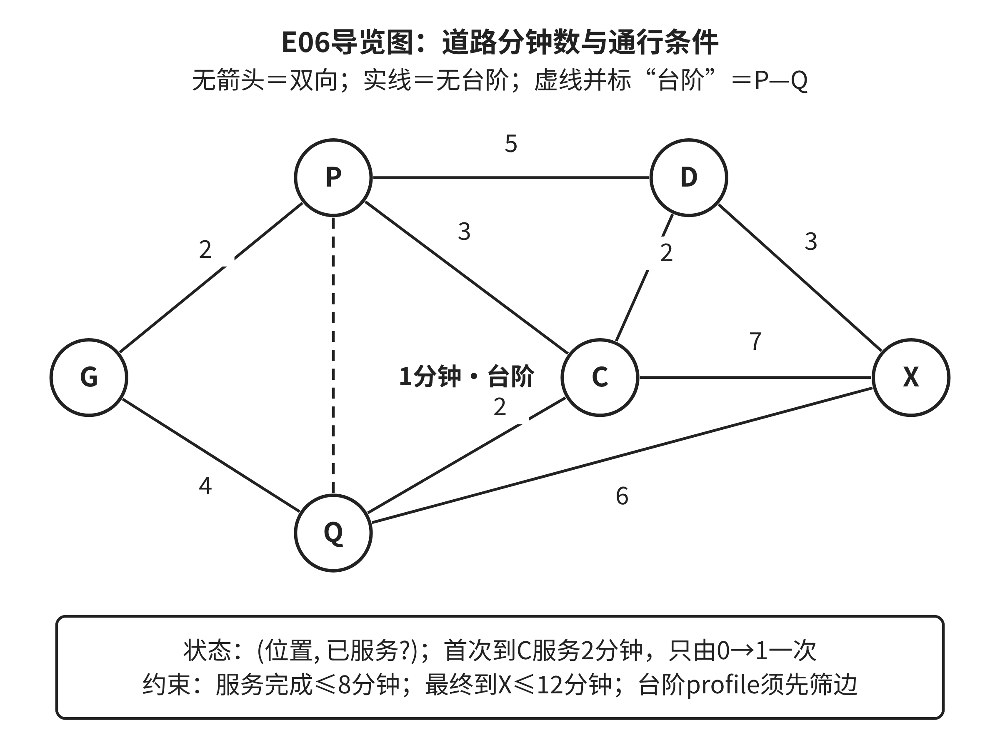

## 章末综合训练

### E06：社区导览的模型、策略与交付证据

一个虚构社区服务区希望给访客提供导览：从入口G出发，到服务点C领取资料，随后到出口X。P为小广场，Q为展板区，D为连廊。以下是完整的教学地图，与前文讲解和独立练习不是同一数据。没有列出的道路不存在；所有列出道路均可双向走，代价为确定的分钟数。只有P—Q有台阶，其余道路已确认无台阶。

表2-XP3 E06完整道路表

| 两端 | 步行时间／分钟 | 通行条件 |
| --- | ---: | --- |
| G—P | 2 | 无台阶 |
| G—Q | 4 | 无台阶 |
| P—Q | 1 | 有台阶 |
| P—C | 3 | 无台阶 |
| Q—C | 2 | 无台阶 |
| P—D | 5 | 无台阶 |
| C—D | 2 | 无台阶 |
| Q—X | 6 | 无台阶 |
| D—X | 3 | 无台阶 |
| C—X | 7 | 无台阶 |

来源：本书原创教学地图，非真实社区设施、开放制度或调查数据。

在C领取资料需要2分钟，任务只要求领取一次；每次首次到达C后立即办理，并在服务完成后继续走。办理必须在出发后第8分钟之前或恰于第8分钟完成，且必须在第12分钟之前或恰于第12分钟到X。所有访客从时刻0出发，不需要其他等待。不要求避免经过同一地点；算法可以通过状态与代价排除无益绕行。分别处理允许台阶与要求无台阶两种profile，不将它们合并。

图2-8 E06社区导览地图

来源：本书原创教学图，根据表2-XP3绘制；实线表示无台阶道路，标注“台阶”的虚线表示P—Q，数字单位为分钟。

阅读图2-8时将每条线与道路表对应，先找出profile筛选会删除哪一条边，再考虑怎样表示“已经领取”。图展示道路关系，不暗示图形距离与步行时间成比例。领取所用2分钟属于节点服务代价，不得遗漏或重复加入。

**任务一：建立表示与职责。**交付节点/道路模型和状态定义，说明为何只保存当前位置不足够。写出通行筛选、领取更新和完成条件；将整项任务分成可检验的职责，说明每个职责的输入、输出、版本与失败结果。地图统一标记为M1，规则为C1，各步骤不能使用不一致版本。无需实现网站或接口部署。

**任务二：比较两个处理过程。**基线在满足profile的状态图上，按道路段数优先搜索，邻接按节点字母升序，同段数时保留先发现候选；候选按总分钟数搜索。两者都在首次到C时完成领取，并检查服务与到达截止。请先求各自的最少道路段或最短时间候选，再检查硬条件；若某一候选超时，不能声称该profile整体无解。给出两种profile的路径、逐段累计时间、服务完成时刻与到X时刻。可手推，也可用短程序，解释为什么选出的结果对应所定义目标。

**任务三：设计并执行边界检查。**至少包含：去掉领取条件、改变profile、关闭C—D、把某个需要的通行状态改成未知、打乱边表顺序、同一输入重复运行。明确哪些检查应保持结果代价不变，哪些应改变可行集合，哪些只能得到待确认。打乱顺序不要求保留同一条并列最优路径，但应保留最优代价及约定的确定平局规则。已知C—D关闭时，其他道路仍按M1有效，硬截止不变，重新求解并解释是否有解。

**任务四：有限AI辅助与评估。**任选一项让AI提出表示、伪代码或边界测试；只提供上述材料，不允许补造设施。保存候选中的一个具体判断并用手算或程序检查。没有AI时，可审查下面的预给候选：“先求G到X最短路线；如果不经过C，在结果中插入C；遇到关闭边，把它设成一个很大的时间。”指出这种候选何时会改变原搜索问题，并给出可验证修正。评价两种方法时分别记录可行率、路线分钟和计算成本；不得把六节点模拟表现推广为真实用户效果。

最终交付一份可复算的小报告，包含模型、依赖图、策略说明、关键状态推演、测试记录和修订依据。评价如下：模型与状态25%，算法解释与硬条件25%，边界测试25%，来源/模拟边界及有限AI核验15%，表达与复现10%。这是一份教学量规，尚无课堂评分效度证据。完整参考解在章末E06。

## 本章回顾

本章提供了一条更细的检查路径。首先，抽象应保留会改变任务判断的区别；两种情境在表示中相同而结论不同，是有力的修订证据。其次，分解既要减少局部复杂性，也要使接口语义、版本和依赖可以被检查。第三，从样本归纳的规则只在已观察与已检验范围内获得支持，例外帮助定位适用条件。第四，算法的成立依赖状态、代价与不变量，熟悉的算法名不能代替这些条件。最后，评估必须明确比较单位和失败处理，自动执行还要区分已知结果与未知结果。

这些方法共同帮助你解释一个结果为什么可信、为什么失败、怎样修正。遇到问题时不必整套流程重做，也不能总归咎于代码细节或工具不够强。应当沿着具体失败寻找需要改变的对象，并保留能够复核的证据。后续第三章进一步讨论人机协作与AI素养，第四章深化证据和论证；它们在这里的计算过程之外加入更多判断条件。

## 关键术语

**任务相关抽象：**按照要回答的问题选择对象、关系与性质；简化后仍须检查哪些判断被保留。

**状态：**足以决定后续合法动作、代价和完成条件的信息摘要，可以包含位置及必要的任务进度。

**接口契约：**供给方与使用方对输入、输出、语义、版本及失败情形的共同约定。

**依赖与关键链：**一项工作所需的前置输出，以及在给定并行条件下限制完成时间的依赖链。

**规则与例外：**对有限观察的概括及不符合该概括的记录；例外可能要求修订范围，也可能反映噪声，须查证。

**不变量：**处理过程中在关键步骤保持成立的性质，用来解释每次状态变化为何仍支持目标。

**稳定排序：**键相同的记录保持原有相对顺序；它保证已有次序得到保留，不自动选定合理次序。

**评估分母与覆盖：**纳入某项指标的比较单位及其中获得合格结果的范围，二者决定平均值能说明什么。

**摊销与幂等：**前者解释一次准备成本如何由多次处理分担；后者描述重复操作对约定目标状态是否产生与一次相同的效果，两者是不同概念。
