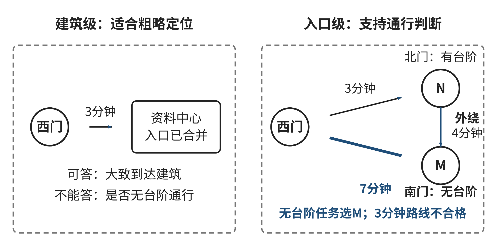
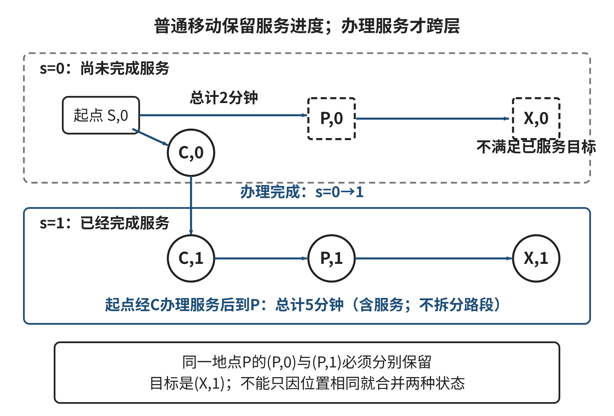

## 2.1 抽象：选择信息、建立表示、检查遗漏

把一幅地图转换成图并不困难，困难在于判断转换后还能回答什么。平面距离相同的两条道路，对步行者可能可以互换，对使用轮椅的人却可能具有完全不同的可行性。熟悉图结构和最短路径程序，并不能替我们决定节点该代表建筑、入口还是某一时刻的人员状态。本节从一个导览表示的失败出发，讨论怎样使信息取舍与任务相匹配。

### 2.1.1 一张看起来正确却无法使用的地图

**讲解示例：到达建筑还是到达入口。**一个原创教学情境中，访客从西门去资料中心。设计者在地图上把每栋建筑表示为一个节点，把道路表示为边，记录步行分钟数。程序找到“西门—资料中心”的最短路线。到达后，访客发现道路接到的是北侧台阶入口，而可使用的无障碍入口在南侧，需要绕行。程序的加法正确，错误发生在更早的表示阶段：节点“资料中心”把两个不能互换的入口合并了。

先不要急于把所有建筑细节都加回地图。如果任务只是在宣传页展示建筑之间的大致位置，一个建筑一个节点可能很合适；如果任务要求到达某个可进入的门，这种表示就不足够。表示的质量取决于它所支撑的判断，不能仅凭字段数量、视觉精细程度或文件大小评价。一张像素很高的地图可能缺少入口通行信息，一张只有六个节点的关系图却可能足以回答当前问题。

我们把资料中心的两个入口记为北门N和南门M。西门到N需要3分钟，西门到M需要7分钟，N到M的建筑外绕行需要4分钟。北门有台阶，南门可无台阶进入。如果把N和M直接压成节点B，并仅保存最短接近时间3，就丢失了“到达哪一个入口”的区别。对无台阶通行任务，3分钟不是一个精度略差的估计，而是一个对应错误动作的结果。将它修成4分钟或5分钟也无济于事，因为丢掉的首先是通行语义。

抽象是为特定目的选择对象、关系与性质，并隐藏当前判断不需要的区别。Wing讨论抽象时强调以一个对象表示多个对象、保留共同性质并隐藏无关差异[[S01]]。这里进一步提出一个本书用于检查抽象的办法：先找出被合并的区别，再问这些区别会不会改变可行动作、评价或输出。它是任务分析方法，不是一条保证所有现实问题都能完全形式化的定理。

### 2.1.2 用两个情境检查信息是否丢得过多

设真实情境为w，表示函数为α，得到的模型为α(w)。如果两个情境w₁、w₂被映成相同表示，而所需判断不同，依靠该表示的任何确定处理过程都无法在这两个情境上同时给出正确判断。这个结论不需要复杂证明：处理过程拿到的输入一样，就没有依据区分应当不同的结果。增加算法步骤、换用更大的模型，也不能恢复输入中没有保留而又无法另行取得的信息。

例如，一条道路在情境一中有缓坡，在情境二中有台阶。如果表示只保留“长度80米”，两种情境得到相同输入；任务却要求判断轮椅能否通行，那么该表示无法独立完成任务。它也许能输出“需核实”，但不能把不确定性自动变成“可通行”。发现这类反例后，应当补充通行属性或缩小系统承诺，而不是把某一次猜对当作表示充分的证明。

注意，我们比较的是同一任务下的结果。对于估算道路养护面积，台阶与缓坡是否需要区分还取决于养护工艺；对于生成一张非常粗略的空间关系图，80米也许已经足够。抽象没有脱离用途的绝对好坏。说明“这张表足够”时，应当接着说明“足够回答哪个问题、在什么条件下”。否则读者无法知道结论是否能迁移到新任务。

若任务是选路线，单一的“是否可行”也可能不够。需要保留每个候选路线的可行性及用于比较的代价。两种表示都找到了可行路线，不代表它们保留了相同的最优结果；它们可能把通行时间取成不同口径，使两条路线的排序倒转。检查抽象时可以逐层问：可行集合是否发生变化，候选间的优劣是否发生变化，最终输出中的说明是否仍然有依据。这比笼统地问“信息是否完整”更容易发现具体问题。

信息合并在类别设计中尤其常见。把所有访客归为“普通用户”，可能删除不同的通行条件；把所有道路归为“连接”，可能删除方向；把所有开放状态归为“可用”，可能删除检查时间。这里不要求为每个人建立独立模型。可以将具有相同任务条件的人划成同一类，例如当前任务中的“允许台阶”与“要求无台阶”。类别应由会改变判断的性质建立，而不是由外观相似或已有数据库字段方便与否决定。

图2-1 两种导览表示及其可回答的问题

来源：本书原创教学图，依据本节入口情境绘制，时间为模拟值。

图2-1把建筑级表示与入口级表示并置。读图时先追踪3分钟道路究竟接到哪一个入口，再检查将两个入口合并后，哪一项判断失去了依据。右侧的表示更详细，但它的价值在于补回当前任务需要的区别。若后来只需展示建筑所在区域，可以从右侧生成更粗的视图，不必让所有用户都阅读全部字段。

### 2.1.3 表示既选择对象，也选择关系

对象选对了，关系仍可能选错。以入口为节点后，若把单向通行写成无向边，程序便可能推荐一条不能反向走的路线。若把“两个入口属于同一建筑”误当成“两个入口之间零代价可通行”，程序又会制造不存在的连接。图中的边不是任何两点之间的一条线，而是当前任务所允许的一种状态变化。

进一步看合并节点的风险。假设一条路接到北门，另一条路从南门离开，北门与南门之间需要经过室外绕行。把两门合成B后，路径“西门—B—东门”可能偷偷包含一次从北门到南门的零时间移动。每条外部道路分别都是真的，但把它们拼起来的内部转移是假的。抽象因此不仅要保留单个字段，还要保留组合时成立的关系。检查一条路线是否有意义，应核对相邻两条边在同一个具体端点上衔接。

方向、单位和时间基准也属于关系语义。边权写“4”，使用者不能判断它是分钟、百米还是拥堵等级。写“开放”而不说明何时核验、对谁开放，可能使上一时刻的事实变成当前承诺。适当的边记录至少说明起点、终点、代价单位、适用通行条件和证据时间。某些任务还需坡度或门宽；这些属性应由目标引入，而不是一次性把一切可能细节都录入。

数据表的主键决定对象身份。如果使用建筑简称作为入口ID，同名入口可能被错误合并；如果同一个入口在两份表中使用不同拼写，又可能被重复建立。主键的职责不是使名称好看，而是在当前模型中稳定地区分对象。展示名称可以改变，连接关系所引用的身份必须一致。否则程序可能运行成功，却在一个被错误拼接的图上计算。

判断结果与证据状态应分开。可以用“确认可通行”“确认不可通行”“尚无足够信息”表示三种不同情况。缺失值不应自动编码为0分钟或不可通行，也不应为了使图连通而编码为确认可用。保守筛除未知边能够生成有证据支持的路线，但如果没有路线，只能说明在已确认子图中没有找到符合条件的路径，不能据此断言现实中绝无路线。表示越明确，结果的解释也越准确。

### 2.1.4 决策相同，不等于状态相同

当任务要求“先到服务点领取材料，再到出口”时，节点位置已经不足以描述全部状态。同一个人站在广场P，可能已经领取材料，也可能尚未领取。下一步允许做什么取决于这段经历。如果程序只保存“当前位置P”，就会合并两个具有不同未来行动条件的状态。

可以把状态表示为“当前位置、是否已经完成领取”。到达服务点且完成领取时，第二个分量由0变成1；离开其他节点不会改变它。目标状态不是任意到达出口，而是“出口、1”。这里新增的分量不是用户画像，也不是为了记录完整轨迹，它只保留未来判断所需的一项历史。一个简短的状态足以替代冗长的活动日志。

设从起点到P的直接路线只需2分钟，但不经过服务点；经过服务点再到P需要5分钟。如果搜索仅保留到P的最小距离2，并删除较长路线，就可能把唯一能满足领取条件的候选一起删掉。对于只要求到P的任务，删除5分钟候选正确；对于要求领取后出站的任务，两个候选不是同一种状态，不能按同一节点距离直接比较。算法看似用了熟悉的“保留最短”规则，真正的问题是比较对象被定义错了。

图2-2 同一位置在不同任务进度下的状态扩展

来源：本书原创教学图；0与1分别表示尚未完成、已经完成指定服务，不代表现实用户记录。

图2-2用两层节点表达这一差别。普通移动只在相同进度层中进行，完成指定服务才改变进度。阅读时应找出从哪一层到达出口才符合目标，并解释为什么“位置相同”不能作为合并全部候选的理由。2.4讨论的算法必须在这个状态图上处理，不能把附加条件留在路径算完以后才随意检查。

时间条件也可能要求扩展状态，但不意味着任何时间问题都需要无限细的时间网格。若代价只取决于当前节点且保持静态，节点可以支撑后续计算；若一扇门只在某些时段开放，需要知道到达时刻和允许等待的规则。若一个任务还要求最多转弯两次，转弯次数或上一条边的方向可能成为状态的一部分。选择状态的原则是：被删除的过去能否改变未来合法动作或代价？若能，应保留与该影响有关的摘要。

状态扩展会增加计算量。n个地点与一个二值任务标记组合，最多形成2n个状态；保留原标记后若再加入三个独立二值条件，最多会扩展到16n个组合。这是全部取值组合的上界，不表示每种组合都可达。设计者应利用条件关系排除无意义状态，而不能仅因为状态多就把必要条件删掉。模型大小是需要管理的成本，模型语义是不能随意牺牲的正确性条件。

### 2.1.5 简化、精度与保守性的取舍

并非所有任务都需要精确到秒。若目的只是给访客估计大致步行时间，分钟级表示可能足够；若必须赶上某项服务的结束时刻，取整方式就会影响可行性。把1.8分钟四舍五入为2分钟，与把2.4分钟四舍五入为2分钟，都会得到整数2，却具有不同的截止风险。

一种办法是保留时间区间。例如一条边通常需要3—5分钟。若任务必须保证10分钟内到达，可以按上界检验；若上界总和不超过10，且区间确实覆盖当前条件，就能得到保守的可行判断。若只按下界得到9分钟，则只能说存在一个乐观估计，不足以保证按时。区间上界超过10也不证明一定迟到，它说明当前估计不能提供所要求的保证。

上下界求和还需要注意解释。把每条边的最坏时间相加是一种保守上界，可能非常宽松；若这些极端情况互不可能同时发生，不能声称这个上界是实际最坏时间。对于一条固定路线，把各路段耗时的期望相加，得到总耗时的期望，并不要求路段耗时彼此独立；但仅凭这些期望，不能推得某个保证概率。这里区分的是不同问题：平均体验、确定上界和概率承诺需要不同的信息。本节只要求你发现表示中的承诺变化，不要求已学习完整概率模型。

相同原则适用于金额、容量和测量误差。把若干不同金额归为一个“低费用”类别，可能足以筛选大致预算，却不能再声称比较了精确总费用。一个类别阈值附近的候选需要特别检查，因为微小的测量变化就会改变分类。抽象应同时说明被保留的分辨率和因此不能回答的问题。给出这种边界，比附上很多没有用途的小数更有价值。

### 2.1.6 AI生成的表示怎样接受检查

AI可以从一段道路说明中提取候选字段，也可以建议把哪些地点合并。它有助于发现未想到的表示方式，但生成的字段并不自动获得真实值。例如输入“资料中心南侧有坡道，开放时间另见公告”，合理输出应保留“南侧”“坡道”和“开放时间未取得”，而不能填成“全天开放”。关键不在于输出是不是JSON，而在于它是否把未知内容改写成了确定事实。

可以给AI一个有限任务：仅根据提供的四条说明提出节点表和边表；每个值标注来自哪条说明；没有依据的字段留为待确认；另外列出会改变通行判断的潜在遗漏。学生随后逐条对照原材料，检查对象是否混淆、方向是否反转、单位是否补造。手工完成同样的提取与对照，可以获得相同的学习成果，不需要特定账户。

对更难的表示方案，可要求AI给出一对反例情境：它们在当前表示中相同，但正确判断应不同。人随后检查该反例是否符合原任务。如果反例只能通过引入题设禁止的情形成立，就没有反驳当前模型；如果它使用了允许的情形并改变结果，就应当修订表示。提出反例与检验反例是两个不同任务，让同一个生成过程直接宣布自己的方案充分，容易遗漏共同假设中的错误。

另一个有效任务是审查一个故意不完整的候选。比如候选表只有“建筑名、距离、推荐顺序”，学生应指出它可以支持粗略游览排序，却缺少入口、方向和通行条件。要求AI“检查模型”过于宽泛；要求它“寻找把不同入口合并后形成虚假连接的具体路径”则有明确输出和可核查对象。提示词的精细程度在这里服务于思考，不能替代材料本身。

### 2.1.7 E01：决定哪些信息必须保留

下面是另一份完整的原创教学地图，所有边均为有向边，分钟为确定的教学代价，其余边不存在。H是入口，J是台阶平台，K是坡道平台，L是服务大厅。任务是在09:57从H出发，使用无台阶路线到达L，最迟10:05到达，不允许跳过边或把两点直接视为相通。

表2-XP1 E01道路与通行条件

| 起点→终点 | 时间／分钟 | 无台阶通行 | 时间条件 |
| --- | ---: | --- | --- |
| H→J | 2 | 否 | 无额外限制 |
| J→L | 2 | 否 | 必须在10:00之前或恰于10:00完成整段通行 |
| H→K | 3 | 是 | 无额外限制 |
| K→L | 4 | 是 | 无额外限制 |
| L→H | 5 | 是 | 无额外限制 |

来源：本书原创教学数据，不是校园道路或开放时间记录。

某候选表示把J和K合并为“中间平台P”，只保留每对节点间最短时间；另一候选保留各节点、方向、时间、通行与时间条件。请完成以下任务：比较两种表示能否支撑当前目标；给出一条符合要求的路线并算到达时刻；为粗表示构造两个不能互换的具体路径，说明信息损失；解释为何L到H存在5分钟边，并不表示H到L存在同样的直接边。

再处理两个独立变化。变化一仅取消无台阶限制，截止时刻仍为10:05，道路时间条件不变，重新比较候选。变化二恢复无台阶限制，但K→L的通行状态变成“尚未核实”，其余已知条件不变，说明现在可以承诺什么、还需取得什么证据。不要把“缺少已确认路径”写成“现实绝对无路”。

交付一页模型比较、具体时间推演和证据缺口说明。评价重点是被合并信息怎样改变决策、路径每一步是否有依据、变化后结论强度是否正确；不按字段数量评分。完整参考解在章末E01，请先独立判断。若使用AI，只让它提供候选表示或反例，并保留逐项复核，不能让它自行补齐道路信息。

### 2.1.8 从模型返回问题

经过本节，抽象不再只是“删除细节”。你应当能够追问一个更精确的问题：我们把哪些情境当作相同，而这种相同对所需判断是否成立？反例把抽象质量变成可讨论、可修改的对象。它也说明一种常见的修复顺序：发现错误结果后，先检查输入所区分的对象与状态，再决定是否更换算法。

反思自己的E01模型：哪一个区别最初看起来只是描述细节，后来却改变可行性？如果需要支持到达后返回、领取材料或不确定通行时间，原状态还够不够？你愿意用怎样的范围说明告诉读者当前模型能够回答什么？这些回答将成为2.2中接口约定的内容：一个模块不能向后续步骤交付它没有保留的信息。
