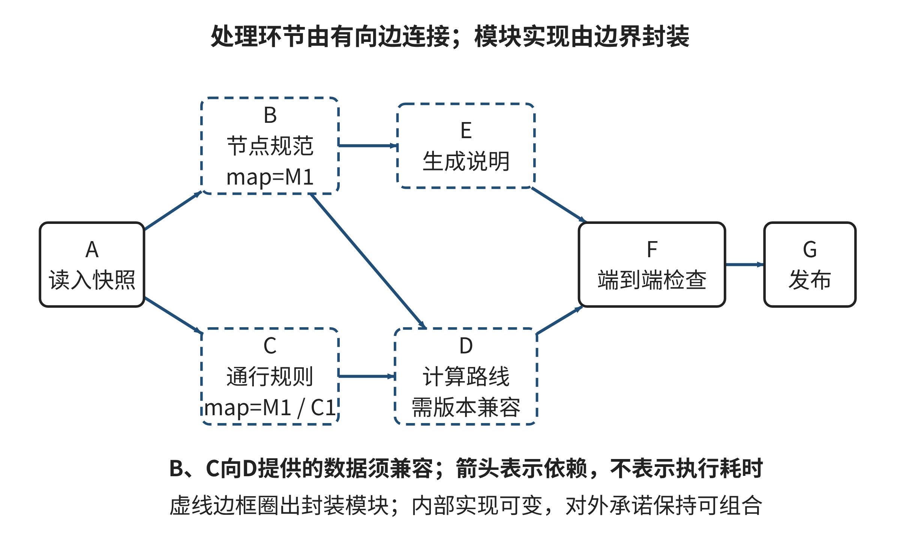

## 2.2 分解：组织子问题与依赖关系

一个场馆讲解预约系统看起来可以按顺序拆成几步：接收申请、检查资格、寻找空闲时段、登记预约、发送通知。这样的流程图能说明“先做什么、后做什么”，却还不能回答一个更难的问题：每一步由不同的人或程序实现后，怎样确认它们对“合格申请”“空闲时段”和“已预约”说的是同一件事？如果资格规定改了，日历使用的时区与申请表不同，或者两位团体负责人同时看到同一个时段为空，局部程序都可能运行成功，最后得到的却是错误结果。

分解的目标不是把一个任务切成尽可能多的小块，而是让复杂性能够被分别理解，同时让各部分在明确条件下重新组成整体。对计算机专业学生来说，真正需要掌握的是两种判断：一是子问题是否有清楚而稳定的责任边界，二是每个边界交出的结果是否满足下一部分的语义和整体不变量。函数能被单独调用，或流程图上存在一条箭头，都还不足以证明这两件事。

### 2.2.1 顺序步骤与模块边界不是一回事

先看预约系统的一种朴素拆法：把“收到申请”作为第一步，“查资格”作为第二步，“查日历”作为第三步，“保存并通知”作为后续步骤。它按时间顺序描述一个申请从进入系统到结束的经历，适合解释用户会看到什么，也便于定位哪一步没有执行。但它可能把同一项规则散落在多个步骤中。例如，“夜间讲解只能由已核实成年身份的团体负责人预约”若既写在资格检查，又写在可预约服务列表的过滤条件里，身份规则更新时两处必须同时改变；只更新一处，就会出现页面显示可以申请、提交时却被拒绝的情况。

另一种拆法按可能变化的设计决定组织模块：资格策略负责解释谁可以申请哪些讲解服务；资源日历负责解释某一时段是否可用；预约记录负责把一次确认变成具有排他性的占用；通知模块负责把已经确定的状态传达给申请者。申请的业务流程仍有先后顺序，但这些模块内部可以分别维护自己的实现。资格规则随场馆规定变化时，日历内部的存储方式不必跟着变化；短信服务改成场馆应用消息时，预约记录也不必改写。

这两种拆法回答不同问题。流程分解把一段工作切成阶段，帮助安排执行顺序；模块分解关注哪些知识或设计决定应被封装，让其他部分不必依赖其内部细节。Parnas讨论模块划分时强调，好的边界应隐藏易变的设计决定，而不是仅按程序执行的先后切段。这个思想并不意味着“所有细节都藏起来”，而是要求调用方只依赖完成任务所需的承诺；模块内部的表示和算法可以变化，只要承诺继续成立。[[S02]]

“可能变化”也不能凭空猜测成无限多的未来需求。实际划分时，可观察当前职责中是否混合了不同原因的变化：规则改动、数据存储改动、外部服务改动是否迫使同一组代码一起修改？如果答案经常是肯定的，现有边界可能把相互独立的决定绑在了一起。相反，若为了每个字段都新建模块，调用和协调成本会大于隐藏细节带来的收益。分解的粒度要与任务的规模、变化方式和团队协作成本相称。

因此，不要把“模块多”当成分解质量的指标。一个边界值得保留，是因为它形成了可理解的职责，并减少了跨边界的隐含依赖；如果拆分后仍需同时改动所有模块、逐个同步内部状态，或者为了完成一个简单判断必须穿过许多层，拆分可能只是把复杂性改了位置。

### 2.2.2 接口不仅是字段清单，还要约定含义

两个模块要合作，通常需要交换输入和输出。但接口不能只列“申请人、讲解员编号、开始时间、结束时间”四个字段。开始时间采用哪个时区？结束时刻算不算占用区间的一部分？申请人身份来自已经核实的访客账号，还是由表单自由填写？空值表示“不知道”、不适用，还是确认未通过身份核验？若调用方和提供方对这些问题理解不同，字段名完全相同也会产生语义冲突。

可以把接口看成一组对输入、输出和状态变化的承诺。对于一次预约请求，模块至少要约定：前置条件是什么；成功时输出代表什么状态；失败时区分哪些原因；调用会不会改变日历；重复调用是否可能产生两笔记录；结果依据的规则或日历版本是什么。前置条件描述“调用前必须成立的事实”，后置条件描述“返回后能够保证的结果”。这不是要求每个小函数都写形式化证明，而是让团队能在实现前后检查一份可讨论的约定。

例如，资源日历返回“空闲”，并不自然等于预约已经成立。它可能只表示在查询瞬间没有已登记的占用。若检查与登记之间允许其他请求并发进入，两个请求都可能看到空闲，再各自写入成功。此时局部查询正确，局部写入也可能正确，整体仍违反“一名讲解员同一时段最多有一组有效预约”的不变量。系统必须把检查与确认放进一个能够保证排他性的操作，或在写入时再次验证并明确处理冲突。这个例子说明，局部结果能否组成整体，不仅取决于数据格式，还取决于执行期间状态是否会改变。

接口还需要表达“暂时无法判断”。如果身份核验数据未同步，把缺失值解释为“未核实成年身份”可能误拒申请，把它解释为“已经通过核验”则可能放行不合格申请。稳健的边界应区分“通过”“未通过”和“待核实”等结果，并说明下一步该由谁处理。明确不确定状态，比把它伪装成布尔值更容易组合，也更容易审计。

版本是语义的一部分。版本为R7的地点清单、按照R8重新划分的区域规则，可能分别有效，却不一定能够组合。让双方都提供`map_version`和`profile`等字段只是第一步，组合时还必须检查这些值满足兼容关系。相同版本标签也未必自动表示含义兼容：如果一方把`profile`理解为使用者类别，另一方把它理解为讲解服务类别，字段和取值甚至都可能相同，约定仍然不一致。要让版本可用，必须先明确由谁发布、何时变化、下游何时失效，以及兼容关系如何判定。

### 2.2.3 依赖图表示“需要什么”，不是所有执行细节

当多个模块通过数据和承诺连接时，可以用有向图表达依赖。若模块B只有在模块A提供某个结果后才能开始，就用边A→B表示“B依赖A”。在有向无环图中，任何按边方向都不违背依赖的节点顺序，都是一种合法拓扑序；这表示局部先后约束，不表示只有这一种执行次序。彼此没有路径连接的节点，在不考虑额外资源争用时可以并行。

图2-3展示了这种阅读方式。先看节点标签识别每个处理环节，再沿箭头确认谁需要谁的结果，最后查看接口旁的版本标记：图上的箭头说明数据依赖，接口标签说明组合条件，二者不能互相替代。若两个输入必须引用同一份地图版本，这项要求应出现在接口契约中；单凭图上B和C都连接到D，无法看出它们交出的信息是否兼容。图2-3的图像由本章作者按教学模拟数据绘制。

**图2-3 有向无环依赖图与带版本语义的接口**

来源：作者依据本节教学模拟情境绘制。

在依赖关系和用时已知、没有资源争用、各环节不可拆分且必须等待全部前置完成的简化模型中，还可以计算工期。按任意合法拓扑序扫描节点：最早开始时刻取所有前置环节完成时刻的最大值，无前置的环节从0开始；最早完成时刻再加上自身用时。汇合处取最大值，是因为较短分支完成后要等较长分支，而不是让两条已经并行的分支再串行执行。

例如W读取说明用1分钟；随后Y生成目录用2分钟、Z核对署名用4分钟，可以同时开始；最后V合并两项结果用1分钟。Y在第3分钟完成，Z在第5分钟完成，V必须等到第5分钟才开始，第6分钟结束。W、Y、Z、V和W、Z、Y、V都是合法拓扑序，却不是要求Y和Z依次串行运行的时间表。沿依赖边相加，W—Z—V共6分钟，控制整体完工；本节把达到最大工期的最长依赖链称为关键链。若Y也要4分钟，两条分支便同时达到6分钟，缩短其中一条仍可能被另一条限制。此处未包含缓冲、资源调度等管理方法；增加人员或设备限制后，单凭最长依赖链不能给出实际工期。

依赖图通常不表示所有控制条件、循环和失败恢复。如果模块B只在条件C成立时调用，单一箭头会遗漏条件；可在边或节点上补充条件。若某阶段发现数据错误后需要返回前一步修订，系统中存在反馈环，不能继续把全程当作一个简单DAG来计算顺序。可以把“一次提交”与“返工修订”分成两个层次描述，但必须保留回路何时发生、何时结束的规则。把循环画成无环图而不说明边界，会制造虚假的确定性。

表2-XA1把“流程阶段”和“模块边界”的观察重点放在一起。读表时比较各列所隐藏的决定及对外承诺，判断某个拆分是否真正减少了对内部细节的依赖。

**表2-XA1 流程拆分与模块边界的观察差异（教学示例）**

| 观察对象 | 预约流程阶段 | 资格策略模块 | 资源日历模块 | 预约记录模块 |
| --- | --- | --- | --- | --- |
| 主要回答 | 用户请求当前走到哪一步 | 谁可申请何种资源 | 哪一时段符合可用条件 | 申请是否已成为确认占用 |
| 易变决定 | 阶段顺序、交接时机 | 身份、年龄与权限规则 | 时段表示、开放日历 | 并发冲突与状态持久化 |
| 对外承诺 | 交出下一阶段可处理的状态 | 返回通过、拒绝或待核实 | 返回带版本的可用性信息 | 原子确认或明确冲突 |
| 需要检查 | 后续是否收到正确阶段结果 | 规则变化是否只改此处 | 时间边界和版本是否一致 | 是否保持唯一占用的不变量 |

依赖关系和组织边界也不应混为一谈。两个模块可能共享一个上游数据，但彼此不应互相调用；一个模块也可能在不同执行阶段被多次使用。把流程节点全都变成模块，会产生过细的管理负担；把所有处理放进一个大模块，又会让本来独立变化的决定互相牵连。判断边界时同时看数据依赖、变化原因和责任归属。

### 2.2.4 子问题局部正确，整体还需要组合条件

设整体任务由若干子任务组成。对子任务分别求解，只能说明每个局部处理满足自己看到的条件。要证明组合后可用，还要确认至少三类关系：其一，前一个模块提供的信息满足后一个模块的前置条件；其二，各模块没有对同一资源或状态作出相互冲突的承诺；其三，所有局部结果共同满足整体目标中的关键不变量。

可以把每个接口概括成“在假设A成立时，保证G”。上游若声称提供某个结果，下游应确认自己使用它时依赖的假设确实成立；如果上游只能保证一个较弱条件，下游就不能悄悄把它当成更强保证。比如，日历只保证“查询时刻看起来可用”，预约记录却假设“写入时仍然可用”，这两者之间缺少并发变化的处理约定。系统需要增加一次原子检查，或让记录模块拒绝过期结果并让上游重新决策。

整体检查也会暴露资源耦合。设计上相互独立的两个子任务，运行时可能共享同一数据库、限额或工作人员。依赖图没有箭头，不表示现实中永远互不影响；它只表示当前契约没有写出先后依赖。若共享资源会改变完成条件，就要补充容量或互斥约束，重新判断哪些任务可以并行。反过来，若实验设定明确规定资源无限且输出完整后才可用，可以在本次推演中忽略这些冲突，但应把假设写出来，避免把简化模型误当作实际运行结论。

还有一种容易漏掉的组合条件是“同一时点”。上游可能给出一份有效的资格结果，下游也可能给出一个有效的可用时段，但如果二者依据的账户状态、政策版本或日历更新时间不同，组合后未必对应同一个现实状态。判断模块输出能否拼接时，应同时核对对象身份、适用时间和依据版本。若其中一项无法确认，应保留“需要复核”的结果，不能仅凭每个局部值看起来合理就自动产生最终承诺。

模块输出还可能带有质量等级、时间范围和证据来源。下游不能只问“字段是否存在”，还要问“值在什么条件下可信”。例如，资格服务返回的状态来自多久以前？失效后哪些预约需要重新确认？如果不同模块分别缓存同一规则，它们需要共享失效机制，或由单一权威模块解释规则。否则每个模块在自己的局部测试里通过，集成时仍会因读取时点不同而产生矛盾。

### 2.2.5 选择边界并安排集成验证

可以按三步检查一份分解方案。第一，说明每个子问题的责任和它不负责的事情；“处理预约”过于宽泛，“只负责在确认时段内创建唯一有效记录”更容易检验。第二，列出每个接口的语义，包括单位、时间区间、标识符、版本、错误状态和副作用；对决定是否可组合的字段，明确谁是权威来源。第三，把整体不变量重新写回组合过程，例如“同一讲解员的有效时段不能重叠”“只有已确认的预约才能触发成功通知”，逐项检查所有路径是否满足。

集成测试应专门安排边界情形，而不只是正常输入。可以测试：字段缺失时是否进入待核实；旧版本结果是否拒绝；时段恰好首尾相接时是否重叠；两个请求同时提交时是否只产生一个确认；通知失败时预约状态是否仍然真实。每个测试对应一条接口承诺或整体不变量，失败时能定位是哪项约定未成立。用“全部模块各自单测通过”代替集成检查，会漏掉跨模块语义不一致。

契约测试适合验证边界两端对同一输入是否作出约定的解释，整体性质测试则检查多个边界连接后的结果。比如，单测可以确认日历把结束时刻作为不占用的右端点；跨模块测试还要确认预约记录也采用同一约定，否则连续相邻的两个时段仍可能被一方判为重叠。测试名称应指出它覆盖哪项承诺，输入应包含恰在边界上的例子。这样发生回归时，团队能分清问题来自模块内部实现，还是接口约定没有被一致执行。

边界越多，协调和沟通也越多。接口不该成为写完后才补的一层文档，而应是拆分工作时共同商定的语言。早期可以用小型样例和反例试接口：提供一组边界数据，分别让两个模块解释其含义，再比较是否得到兼容结果。若人必须通过私下口头约定补充字段含义，那么真正的接口还没有写出来。

AI可以帮助列出候选模块、草拟接口字段或从需求文档中抽取可能的约束，但生成的划分只是待验证的假设。给它一段需求并要求“拆成模块”时，结果经常会把流程标题改写成模块名，却没有说明谁拥有规则、输出何时有效、版本如何兼容。更有用的请求是要求它同时列出每个边界隐藏的决定、输入含义、前置条件、承诺、错误状态、可能的并发冲突和一个反例；随后由团队对照真实需求和代码逐项确认。

还可以让AI扮演下游调用方，尝试只用接口文档完成调用：它若不得不猜测时区、空值含义或状态来源，说明接口文本仍有歧义。接着让它生成边界测试候选，再由人确认测试是否覆盖真实不变量并实际执行。AI能加速提出问题，不能替团队决定权限规则、资源权威来源或失败后果；这些决定要由对系统负责的人依据需求、数据和组织约束作出。

### 2.2.6 练习E02：让局部结果接成完整交付

以下为原创教学模拟数据。假设处理环节之间没有资源冲突，所有环节可以无限并行；启动时刻为0。每个环节用时确定，输出只有在环节完成后才能使用。

| 环节 | 工作内容 | 用时（分钟） | 前置环节 |
| --- | --- | ---: | --- |
| A | 读取快照 | 2 | 无 |
| B | 统一节点标识 | 4 | A |
| C | 核对通行规则 | 3 | A |
| D | 计算路线 | 5 | B、C |
| E | 生成节点说明 | 2 | B |
| F | 端到端检查 | 3 | D、E |
| G | 发布交付包 | 1 | F |

路线计算的输入来自节点与规则两份资料；路线以及规则摘要都要携带`map_version`和`profile`。两份资料不能只因为字段名称一致就被当作来自同一版本。

请提交一张依赖图，写出两种不同的合法执行序列，并计算无限并行条件下的最早完成时刻及一条或多条关键依赖链。然后诊断这样的接口交接：B输出R7节点，C输出R8规则。说明D能否安全地将其作为同一快照直接组合，并指出核验接口还应比较什么。最后把D的用时从5分钟改为2分钟，重算最早完成时刻与关键依赖链；说明哪些分支的完成时间现在会影响F的启动。

成果包括依赖图、两条序列、时间推演表和接口诊断。评价时检查边是否符合题意、序列是否满足全部依赖、开始时刻是否等于所有前置环节完成时刻的最大值、关键链是否达到项目完工时刻，以及版本结论是否依据语义兼容条件。若图画对了但把“字段同名”当作“版本一致”，接口诊断仍不完整。

参考推演见章末“E02参考解与讨论”；先写出各环节的开始依据，再核对完成时刻。

【本节反思】如果每个子模块都能独立通过自己的测试，整体错误最可能藏在哪些接口假设中？对其中一条假设，补写一个能暴露问题的边界测试，并说明它检查的是局部承诺还是整体不变量。
