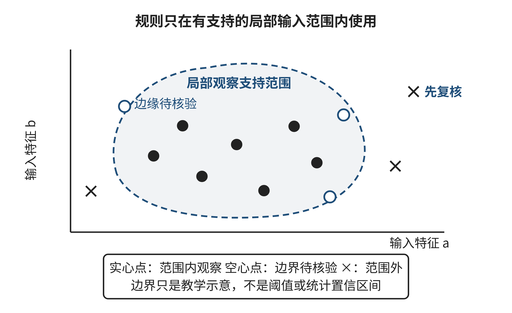

## 2.3 模式识别：归纳规则、保留例外

一份测试日志里出现许多相似报错，或者一组观察数据里反复出现某些共同特征，很容易让人相信自己“看到了规律”。难处在于：相似究竟指向一个可以复用的结构，还是样本偶然排在一起？一个规则在已见记录上表现很好，是因为它抓住了稳定关系，还是因为它记住了这几条记录？模式识别的价值不是替重复现象命名，而是从有限观察提出可检验的规则，并明确哪些条件下可以使用、哪些反例会使它失效。

本节的核心能力，是从样本构造有限规则，同时保留例外、时间边界和不确定性。初学者容易把“常一起出现”当作“可以互相解释”，把“开发数据上全对”当作“未来也可靠”。以下先看一种不依赖数值阈值的结构模式，再讨论怎样评价预测规则，避免把模式识别缩减成调一个分类器。

### 2.3.1 相似记录背后可能有不同的模式

“模式”至少有几种常见含义。第一种是重复的取值组合，例如某类输入经常对应某类结果；第二种是事件之间重复的顺序或关系，例如一个状态总在另一个状态之前出现；第三种是多个表面不同的问题具有相同的结构，例如不同程序都发生了“旧状态覆盖新状态”。这些模式可以帮助我们压缩描述、提出规则或迁移已有处理方式，但它们所支持的判断不同。

归纳前还要确定观察单位。同一段运行日志可以按“事件”“任务”或“整次运行”统计；一位用户可以对应许多操作记录；一个场次也可能包含多名观察者。单位不同，频率和例外的含义会变。如果把同一任务的十条日志当成十个独立样本，表面上证据变多了，实际可能只是重复看见同一次事件。定义单位时要写出“一行代表什么、重复记录如何处理、缺失记录是否意味着没有事件”。否则，后来比较的不是同一种对象。

观察到输入X和结果Y经常同时出现，只能说明当前资料里存在一种关联。它可能适合用于预测，也可能只是二者共同受第三个条件影响；如果要解释因果关系，还需要额外的比较设计、干预或领域证据。本章第三节只训练如何从观察归纳有限规则并检验其预测表现，不把预测分数当作原因解释。学生后续学习批判性思维与因果论证时，才系统分析这些证据要求。

结构模式也不等于“所有记录一模一样”。假设一组原创教学模拟的文件同步轨迹中，两次失败都表现为：客户端甲读取版本v0，客户端乙也读取v0；甲基于v0提交修改并生成v1；乙随后仍基于v0提交，覆盖了甲的新内容。另一次相似轨迹中，乙在甲提交后重新读取v1，再提交自己的修改，没有覆盖。表面上三条轨迹都有两个客户端写入，但真正有解释价值的模式是：两个修改是否都建立在同一个旧版本上，以及后写入者是否检查了当前版本。

如果只统计“两个客户端写入”这一个特征，成功轨迹也会被误报；如果把甲、乙的名称和时间戳逐字记住，规则又过于具体，无法迁移到其他客户端。较好的表示保留决定结果的关系：并发读取同一版本、先后提交、缺少版本冲突检查。它允许用户身份、文件名和具体时间变化，但仍能识别相同的失效结构。

然而，轨迹中存在这种顺序仍不足以证明它必然导致所有覆盖问题。也可能有服务端合并策略或重试机制介入。可以提出一个更窄的假设：“在没有冲突检测且后写入直接替换当前内容时，基于旧版本的提交可能覆盖先前修改。”随后构造边界测试：让两个客户端基于同一版本并发修改，观察是否拒绝冲突、合并还是覆盖；再令后写者先重读最新版本，比较结果。只有将模式转成可预测的操作并检验反例，归纳才从观察走向可用知识。

### 2.3.2 从样本到规则，要说清适用范围

当目标是预测一个尚未观察到的结果时，可把任务表示为：在预测时刻t，使用当时可获得的输入x，给出未来或未知结果y的候选估计。这里的“当时可获得”很关键。若某个变量在y已经发生之后才产生，它即使与结果高度相关，也不适合作为预测输入。若任务改成事后诊断，同一字段可能有用；任务定义变化，合法信息边界也随之变化。

一个可解释的规则往往由“适用对象、输入条件、输出结论”组成。例如，条件组合规则可能要求数值达到阈值，并且某个事前已知类别属于指定范围。规则的表达要完整说明：阈值适用于什么单位；缺失值怎样处理；两个条件同时满足还是满足其一；规则覆盖哪些对象和时间；输出表示风险、分类还是行动建议。遗漏这些定义，规则无法复现，团队也无法判断例外来自数据错误、条件边界还是概念本身。

规则越具体，越容易贴合已见样本，却越可能记住偶然细节；规则越简单，越容易解释和迁移，却可能忽略真正重要的差异。比如，只按总量设定一个界线，可能把高容量系统与低容量系统放在一起；增加系统类别作为条件也许改善表达，但每增加一条特例都会带来新的数据需求和测试负担。简洁不是目的本身，复杂也不天然意味着准确；要看新增条件是否能在未参与设计的记录中重复支持原判断。

比较规则复杂度时，可以问：“去掉这条条件，哪些具体判断会改变？改变是否有足够证据支持？”如果条件只让开发集中的一条记录被正确分类，却没有更多同类观察，新增它可能只是记住特例；若它代表一个稳定且可事先观测的群体差异，则把它删掉也可能掩盖重要机制。两者都需要由后续样本区分。规则说明应留下反例，不因它降低分数就自动删除，也不因为它让故事更完整就任意添加解释。

适用范围可以画成一个区域：区域内有足够观察支持当前规则，边缘处有相邻但尚不确定的样本，区域外则不应直接外推。读图2-4时，先找规则的输入条件，再区分已有支持、边界样本和未观测区域；不要把边界线误读成自然界中已被证明的分界。图中区域只是帮助讨论模型适用范围的教学示意，没有真实观测点或统计置信区间。

**图2-4 观察样本、规则适用区域与例外边界**

来源：作者按概念关系绘制的教学示意图，非实测数据。

图2-4中的样本点用于提醒：几条相邻记录可能支持一项局部规则，但空白区域里是否仍然成立尚未得到观察。若新样本落在既有边界之外，应触发复核，而不是让规则自动扩展；若例外反复出现，也可能说明原表示遗漏了一个重要条件。图示本身不提供阈值，也不替代数据检验。

### 2.3.3 例外不只是噪声，可能指出模型少了什么

规则遇到反例时，不应先急着删去反例。需要先区分几种情况：记录或标签有误；观测过程改变，导致数据含义不再一致；输入字段遗漏了一个影响结果的条件；规则本身只在更窄范围内成立；或者结果确实包含不可避免的随机变化。每一种情况都要求不同的修正，不能把所有不合预期的记录都称为“噪声”。

可以用一张规则卡片记录：目标、可用输入及其采集时刻、输出含义、适用对象、规则条件、支持样本、反例、数据版本和下一次复核时间。表2-XB1比较了几种规则表达的能力与风险。选择表示时要问，它保留了什么结构、略去了什么差异、怎样暴露不适用情况，而不只看它是否容易写进代码。

**表2-XB1 规则表示与适用边界（教学归纳）**

| 表示方式 | 保留的结构 | 适合提出的问题 | 常见风险 |
| --- | --- | --- | --- |
| 单一阈值 | 一个数值与结果的界线 | 结果是否随某变量单调变化 | 忽略群体容量或测量口径差异 |
| 条件组合 | 两个以上条件的交互 | 某类别下是否需要不同界线 | 条件越加越多，样本支持变稀 |
| 顺序或关系 | 事件先后、状态连接 | 失效是否由某种操作结构触发 | 把共现顺序误当作因果机制 |
| 例外清单 | 已知不适用情形 | 规则在哪些边界必须暂停 | 例外不断增长，暴露规则过窄 |

规则还要绑定它所依赖的数据定义。若计数方式、标签标准或对象边界改变，旧阈值与新数据可能不再可比。例如，同一个“拥堵”标签若一批记录按现场观察填写，另一批改由自动计数器产生，标签误差和输入尺度都可能变化。此时不能只把新旧样本合并再报一个分数；应先记录定义变化发生的时间和范围，判断哪些数据仍可比较，再决定沿用旧规则、分段分析或重新采集。规则版本应与字段说明、适用对象和验证记录一起保存。

模式识别可以由人手工完成，也可以借助程序或AI搜索规律。AI可能从样本中列出一条得分很高的规则，却不一定知道字段是在预测前还是预测后产生，也不一定知道某个记录是否来自同一对象的重复测量。让AI提出候选时，应要求它标出使用字段、阈值、正负样本、被覆盖的反例和未知边界；再由人确认字段含义和生成时间。候选规则应能够被另一位读者按原始记录重算，而不是只交一段无法追溯的自然语言解释。

### 2.3.4 开发和测试必须隔开

用于构造规则的样本和用于估计规则表现的样本，承担不同作用。开发集用于比较候选、选择阈值和修订规则；测试集用于在候选与判断标准冻结后估计未见数据上的表现。如果看过测试结果后再改规则，测试集已经参与开发，不再是独立的检验依据。需要再次估计时，必须收集新的未使用数据，或重新设计适合当前问题的验证方案。

即使没有查看测试集，开发者若尝试几十种字段组合和阈值，再只汇报开发集上最好的一个，分数也可能高估规则的稳定性，因为候选选择本身已经适应了有限样本。应记录候选范围、选择依据和最终冻结时刻；在资料稀少时尤其要避免把每个偶然差异都变成一条特例。独立测试用于检查选中的完整流程，而不是为寻找下一个“最好规则”提供无限次提示。

“隔开”不是只在表格中画一条分界线。若数据含有同一对象的多条记录，随机按行拆分可能让同一对象的一部分进开发集、另一部分进测试集。模型便可能认出对象特征，而不是学会对新对象有效的规则。若目标是预测未来，随机混排时间记录也可能让早期训练过程间接利用未来分布的信息。应按实际部署问题决定分组或时间切分：要泛化到新个体，就让同一对象的记录留在同一侧；要面对未来，就用过去开发、后续时间测试。[[S04]]

切分方式还决定了“新数据”究竟有多新。若未来部署面对同一批对象的下次观察，按对象隔离可能过于严格；若部署面对从未出现过的对象，只按时间切分又可能让同一对象泄漏到两侧。应把目标说具体：预测下一时段、预测新个体，还是同时预测新个体和新时期。然后用与目标相符的分割方式验证。把数据拆得整齐并不自动构成好评估，检验情境必须对应实际要作出的判断。

处理数据的步骤也可能泄漏信息。假设在全部记录上先计算平均值和标准差，再把标准化后的记录分成开发与测试，测试样本已经参与了转换参数的估计。缺失值填补、特征筛选、降维、阈值选择等操作都要放在每次开发数据内部拟合，再将同一转换应用于相应验证数据；官方实践指南特别提醒，先拆分再拟合变换能够避免测试信息进入训练流程。[[S03]]

泄漏还可能来自结果定义。若系统要预测未来拥堵，却把拥堵发生后才记录的排队长度放进输入，表面分数再高也不能支持上线预测。检查每个字段时，可问三个问题：它在预测时刻之前是否已经生成？它的记录来源是否独立于目标标签？部署时能否以相同含义及时取得？如果不能，应该删除、重定义任务或明确将其改为事后诊断，而不是继续报告同一预测结论。

### 2.3.5 分数要连同分母和错误代价一起阅读

对二分类结果，可以把预测和实际标签交叉，区分四种计数：真正例TP是实际为正且预测为正；假负例FN是实际为正却预测为负；假正例FP是实际为负却预测为正；真负例TN是实际为负且预测为负。准确率为(TP+TN)/全部记录，精确率为TP/(TP+FP)，召回率为TP/(TP+FN)。每个比例都要报告分子和分母；若分母为0，该指标未定义，不能随意记作0或100%。

只报告准确率可能隐藏重要失败。若正类很少，一个总是预测负类的规则也可能有很高准确率，但对任何正类都没有召回。反过来，扩大正类覆盖常会增加误报。选择规则前应先确定错误的实际代价：错过一次拥堵预警与多发一次提醒，影响可能不同；偏好哪一类错误要由场景责任人和受影响者共同讨论，不能从一个总分自动推出。

小测试集上的一个样本就可能显著改变比例。四条记录中错一条与四百条中错一条，不具有相同的信息量。小样本可用于发现明显反例、检查计算与提出后续采集问题，却不足以证明总体性能、统计显著性或跨场景优势。描述结论时应限定为“在这批记录上观察到……”，再说明需要怎样的新数据验证。

阈值选择还包含行动后果。把预测分数转换成“提醒”或“暂不提醒”，不是纯数学步骤：阈值降低通常会覆盖更多可能的正类，同时可能增加误报；阈值升高可能减少提醒，也可能漏掉需要处理的情况。若不同错误会引发不同代价，可报告多项计数或比较不同阈值的代价情景，而不是把某一个指标称为唯一客观标准。一个阈值在纸面上合适，也要检查现场是否能采取后续行动；无法响应的告警不应被视为完整解决方案。

### 2.3.6 练习E03：从有限记录构造拥堵规则

以下记录是原创教学模拟数据，不代表校园实测。目标是在预测时点判断某入口未来10分钟是否拥堵。`x`是预测时点前5分钟已观测的人数，`event`表示当时已知是否安排活动，`y`是随后10分钟实测的拥堵标记（1为拥堵，0为未拥堵）。所有记录来自不同场次，按时间从d1到d12排列。d1—d8为开发集，d9—d12为冻结测试集。不得把`y`作为预测输入。独立学习时，可先遮住测试集四行；写下开发集比较结论后再查看。

| 记录 | x（人） | event | y |
| --- | ---: | ---: | ---: |
| d1 | 80 | 0 | 1 |
| d2 | 70 | 0 | 1 |
| d3 | 55 | 0 | 1 |
| d4 | 45 | 0 | 0 |
| d5 | 30 | 0 | 0 |
| d6 | 60 | 1 | 1 |
| d7 | 40 | 1 | 1 |
| d8 | 20 | 1 | 0 |
| d9 | 65 | 0 | 1 |
| d10 | 48 | 0 | 1 |
| d11 | 38 | 1 | 0 |
| d12 | 25 | 0 | 0 |

比较两个预先给定的候选规则：RA为`x >= 50`；RB为`x >= 50`或`event = 1 且 x >= 35`。先只用d1—d8，分别计算TP、FN、FP、TN、准确率、精确率和召回率，并记录你会选择哪一条规则及其理由。然后按原规则对d9—d12作预测，重新计算计数和指标，不依据测试结果回头改阈值。解释这四条记录支持和不能支持的结论。

再指出一个足以挑战所选规则的具体记录或边界变化，说明它改变了哪条条件判断。提出一种可在预测时点追加采集的信息，写清字段含义、测量时刻以及它可能补充的区分；不能把预测之后才产生的结果当作输入，也不能预先宣称新字段一定提高表现。最后构造一个若按随机行拆分就会造成泄漏的“同一对象多次记录”例子，以及一个未来数据泄漏的时间顺序反例。

成果为一张开发与测试混淆计数表、一段有限结论、一条反例、一项新增信息方案和两种切分反例。评价重点是没有混用数据、计数完整、指标分母正确、知道小样本限制，并能把规则与可用信息的时间点对应起来。规则在某组数据上得分更高，不等于它已经被证明普遍更可靠。

参考推演见章末“E03参考解与讨论”；请把开发阶段选择与测试后的结论分别写下。

【本节反思】你看到的一条“规律”是重复取值、事件结构还是统计关联？如果新例外出现，你会先检查数据、条件、表示还是规则范围？说明判断依据。
