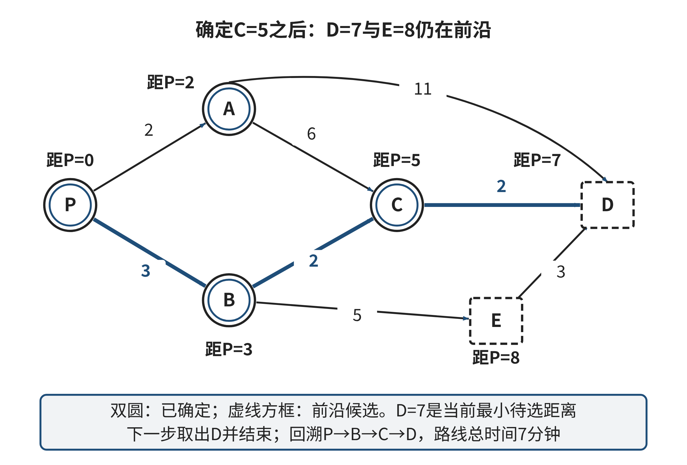

## 2.4 算法设计：搜索、排序与决策过程

一条路线上有许多岔口时，人很容易把“眼前看起来最省事”当成“最后最省时”。对计算机而言，问题更具体：什么信息代表当前处境？哪些后续处境值得继续检查？何时可以确定某条路线已经最好？如果我们把答案写成程序，这些判断必须变成能执行、能检验的步骤。算法设计的难点不在于把流程写得足够详细，而在于让流程求解的目标与原问题一致，并说明它依赖哪些条件。

本节用一张小型有向路网考察不同搜索策略。设配送员从P点出发，终点为D；各条道路时间是固定的分钟数，图中没有列出的道路不存在。边权都非负。路线信息如下：

| 起点 | 可直接到达的地点与时间（分钟） |
|---|---|
| P | A：2，B：3 |
| A | C：6，D：11 |
| B | C：2，E：5 |
| C | D：2 |
| E | D：3 |
| D | — |

这是原创教学示例，不代表真实校园路网。它故意让“少走几段路”“每一步选最小边”“最终用时最短”给出不同答案。若一个方法只在看上去顺手的例子里成立，学生还不能据此判断它适合什么任务；需要追踪状态，并指出证明结论所依赖的条件。

### 2.4.1 把问题写成状态、转移和目标

算法首先要有一个明确的“当前状态”。在上面的静态路网中，状态可以只是所在地点；从P到A的一次移动就是一条状态转移，其代价为2分钟。一条候选路线是若干转移的序列，路线总时间是边权之和。任务目标也要说清：到达D即可，还是必须经过某个地点？要最少经过路口，还是最少耗时？如果未先回答这些问题，“最优”没有可检验的含义。

把问题简化成“地点”是否足够，取决于地点之外的信息会不会改变后续选择。假设配送员必须先领取门禁卡，才能进入机房。此时同在A点但“尚未领卡”和“已经领卡”不是同一状态：两种情况允许的后续转移不同。可以将状态写为“（地点，是否持卡）”。若某项信息不改变可选动作、转移代价或目标判断，它或许不必加入状态；若它改变其中任何一项，合并这两种情况就可能删除真实可行路径。状态设计由问题规则决定，而不是由地图上节点的名称决定。

一个搜索问题通常可以拆成五个彼此关联的部分：初始状态、可用动作、状态转移、代价或偏好、目标条件。还需说明哪些状态禁止进入、目标是否唯一，以及没有路线时应如何报告。动作和转移把现实规则变成可执行关系；代价说明候选方案如何比较；目标条件确定何时完成。缺一项，程序仍可能输出某个结果，却无法说明它是不是用户要求的结果。

状态模型还决定算法究竟在多大的空间里搜索。假如路线受到“剩余电量”的限制，单记录地点会把电量充足和即将耗尽两种处境合并；加入电量后，同一个地点可能对应许多状态。状态越细，越能区分后续选择，但节点数也可能大幅增长。减少搜索的剪枝规则因此需要证明：被剪掉的状态确实不会产生优于保留状态的解。常见做法是比较到达同一地点的候选：只有当一个候选在所有相关资源上都不差、代价也不高于另一个，才能考虑将后者排除。只看当前已花时间少就丢弃电量更多的路径，可能删掉唯一能到终点的方案。

现实代价还可能随时间变化。若边P→A在不同时段的耗时不同，给这条边固定一个数字就无法同时代表早高峰和深夜。可以把到达时间并入状态，并按当前到达时刻计算下一段耗时；若又把时间粗略分成“早/中/晚”，这会降低状态数量，却可能把同一时段内的重要差异抹掉。必须说明这种离散近似会不会改变可行性或路线比较。更改状态、代价或转移规则后，原来适用于静态路网的算法证明不一定仍成立。

搜索过程会维护一组尚待展开的候选状态，称为搜索前沿。处理一个状态时，算法检查它能到达的新状态，再按特定规则把候选放进队列或优先队列。已访问集合用于避免在有限图中反复展开同一状态；不过，若带有资源或任务进度等状态信息，只能合并完全相同的状态，不能仅因地点相同就标记为“已经访问”。可达状态有限、每个状态只按规则有限次入队并展开时，搜索才有终止依据；目标不可达也应最终报告无解，而不是无限等待。

### 2.4.2 广度优先搜索回答的是“最少几步”

广度优先搜索（BFS）把起点放入先进先出队列。每次取出队首状态，按规则枚举相邻状态；第一次发现的新状态被记下前驱并放到队尾。因为队列按层处理，距起点一步的状态先于两步状态，随后才是三步状态。若目标是最少转移次数，且每次转移代价相同，BFS第一次发现目标时得到的就是步数最少的路线；在按边的数量计费且所有边费用同为常数时，这也对应总费用最少。其队列顺序构成正确性的关键，而不只是实现细节。[[S06]]

“第一次找到”能证明什么，取决于队列表达了什么顺序。在本节的路网中，先按字母顺序枚举邻点，BFS会先从P发现A，再从A发现C和D。因此它得到P—A—D，两段道路、总时间13分钟。另一条P—B—C—D需要三段。对“最少经过几段道路”而言，两段确实比三段少；对“最短用时”而言，13分钟并不比7分钟优。BFS没有算错，它忠实优化了步数。错误发生在把它的目标偷换成最短时间。

如果边的代价不相等，把队列规则改成按当前已知总时间排序，才有机会优化加总代价；此时需要额外的正确性条件和证明。若某一步包含等待、换乘、拥堵状态或是否携带设备等信息，单纯节点图也可能不足。比如一条边通常走2分钟，但在“闭馆后”不能通过；这时状态还要包含时间阶段，或者明确将该边视为不可用。先把问题表示正确，再谈选择搜索方法，能避免把某个熟悉算法套在不满足前提的表示上。

BFS的分层结构也给出一个简单的不变量：队列中更早进入的状态不会比后进入的状态离起点更远。起点距离为0；处理距离k的状态时，只会把首次发现的相邻状态放在距离k+1层。已发现标记阻止环路让同一状态不断入队。由此，首次发现某目标时，不会还有一条经过更少边数、但尚未处理的路线。若每条边费用相同，边数与总费用成固定比例；若边费用不同，层数仍正确，但它不再代表时间成本。比如前述路网中，P—A—D虽然只有两段，耗时却是13分钟，而三段路线P—B—C—D只需7分钟。BFS的结论边界由不变量精确限定。

### 2.4.3 用Dijkstra算法处理静态非负代价

当边的时间不同，但每条边代价固定且非负时，可以用Dijkstra算法求单源最短路径。原论文讨论正长度的边；现代教材中常见的非负权版本也允许零权边。[[S05]][[S06]] 它为起点设置暂定距离0，其余状态先设为无穷大；每轮选取暂定距离最小、尚未确定的状态，将它的距离确定下来，再用它更新相邻状态。这里“暂定”表示已经发现一条真实路线，但还没有证明不存在更短路线；“确定”表示按算法条件可以证明当前距离已经是最短距离。两者不能混为一谈。

对本节六节点示例，开始只有P的距离为0。确定P后，A和B分别得到2、3。确定A后，C得到8，D得到13。此时再把B确定下来，经B到C的距离为3+2=5，比已有8更小；到E的距离为3+5=8。随后确定C，经C到D的距离为5+2=7，替代已有13。达到D时，算法可以停止并给出路线P—B—C—D、总时间7。表2-XC1记录了每轮处理之后的暂定距离；没有列出的状态仍为∞。

表2-XC1 Dijkstra的距离更新记录（单位：分钟）

| 确定的状态 | 本轮可改进的距离 | 本轮之后尚未确定的关键距离 |
|---|---|---|
| P（0） | A=2，B=3 | A=2，B=3 |
| A（2） | C=8，D=13 | B=3，C=8，D=13 |
| B（3） | C由8改为5，E=8 | C=5，D=13，E=8 |
| C（5） | D由13改为7 | D=7，E=8 |
| D（7） | 到达目标，终止 | E=8（未处理） |

注：∞表示尚未发现从起点到该状态的路线。

图2-5把“已经确定”和“仍在前沿等待比较”的状态放在同一张图中。读图时应跟踪一个事实：边的终点可能先得到一条较长的暂定路线，之后被另一条更短路线更新。若把“第一次发现”误当作“已经最优”，就会停在D=13；优先队列的用途正是每次取出当前最小暂定距离，让这些后续改进有机会发生。



图2-5 路径搜索中的前沿状态与暂定距离

说明：边旁数字表示分钟，节点旁数字表示从P到该点的距离；节点样式和线型区分已确定状态与仍在搜索前沿的状态。该图对应正文独立讲解示例，不对应练习E04。

来源：作者自绘。

这个停止规则需要证明。若当前取出的最小暂定距离状态u仍有一条更短的真实路线，那么沿那条路线从起点向u前进，必有一个首个尚未确定的状态x，它的前一个状态已确定。此前驱被处理时，算法已检查通往x的边，因此x的暂定距离不大于这条更短路线到x为止的前缀代价。由于剩余边权非负，前缀代价不大于整条路线，也就小于u的暂定距离。这与u是前沿中暂定距离最小者矛盾。因此，u出队并被确定时，它的距离已经最优。证明使用了“所有边权非负”；如果有负边，路径走得更远后总费用仍可能下降，前缀顺序便不再支持这个推理。[[S05]]

使用二叉堆实现优先队列时，稀疏邻接表上的Dijkstra通常需要约O((|V|+|E|)log|V|)时间和O(|V|+|E|)空间；使用数组扫描而不用堆，选择最小暂定距离可能需要O(|V|²)时间，稠密图上实现简单且未必更差。BFS使用邻接表时为O(|V|+|E|)时间，队列和访问标记为O(|V|)额外空间。算法选择也包括表示与数据结构的取舍：堆会增加维护成本，稠密矩阵则可能占用O(|V|²)空间。实际比较还取决于图的规模、稀疏程度和边是否需要临时过滤。[[S06]]

优先队列实现还有一个值得检查的细节：某状态的暂定距离可能被改小，旧的较大键值仍留在堆中。常见实现可以在堆中插入新值，取出时若它已不等于当前记录，就跳过这个过期条目；也可以使用支持降低键值的数据结构。无论采用哪种方式，都要保证“被确定”的确是当前最小有效暂定值。读代码时若看到同一状态多次入队，不应立刻判断为错误；应追问旧条目如何识别、是否会重复展开，以及复杂度分析是否包含这些操作。

零权边仍满足非负条件，Dijkstra的距离正确性不因此失效，但多个等距前驱会让路径本身不唯一。实现者仍须决定如何处理等距候选、怎样稳定输出前驱，以及何时停止。负边则不满足标准Dijkstra的保证；有负权环时，某些路线可反复绕行而使总代价不断下降，最短有限路线可能不存在。若模型允许负边，需要改用满足相应条件的算法，或重新检查代价定义；不能只把Dijkstra的符号改一改。

下面的伪代码把关键规则连在一起。它以静态非负边权、已按通行条件过滤的图为输入；堆以（距离，节点字母）比较。dist保存目前发现的最小代价，prev用于回溯路线，done保存已经确定最优距离的节点。

```text
所有 dist 置为无穷；dist[start] = 0
prev = 空映射；done = 空集合；heap = [(0, start)]
while heap 非空:
    (d, u) = 弹出最小项(heap)
    if d != dist[u] or u in done: continue
    将 u 加入 done
    if u == target: 返回 (d, 由 prev 回溯的路线)
    for 每条合法出边 (u, v, w):
        if v not in done and d + w < dist[v]:
            dist[v] = d + w；prev[v] = u
            将 (dist[v], v) 插入 heap
返回“目标不可达”
```

严格小于才更新使等距候选保留先发现的前驱。只从start入堆可以避免把不可达节点当作待展开对象；起点就是目标时，回溯得到只含起点的路线。把目标判断放在发现邻点的位置，会把暂定结果误当成最终结果。这里的代码采用旧条目跳过法，堆可能保存O(|E|)个条目；对无平行边的简单图，log|E|为O(log|V|)，与前述时间量级一致。若允许任意多条平行边，就应按实际堆大小写成O((|V|+|E|)log(|V|+|E|))，不能省略输入表示的条件。

目标的最短距离确定后，最优路线仍可能不唯一。算法若只记录距离，仍能回答“最短时间是多少”，却不能回答“哪条路线更方便”；若要偏好少转弯、避开台阶或减少换乘，需要把这些偏好加入比较规则或状态信息。按节点字母打破平局可以让程序每次输出一致，但这只是可复现的技术约定，不意味着字母顺序在现实中更公平或更适合用户。算法的确定性与决策理由应分开说明。

### 2.4.4 局部贪心为何会走错方向

回到示例路网。如果配送员每到一处就选当前可走且最短的一条边，并且不回头，那么从P会先选A（2分钟）；在A选C（6分钟，而到D需11分钟）；再从C到D（2分钟），总计10分钟。算法每一步都作出了局部最小选择，但没比较尚未走过的另一条支路。Dijkstra则把所有已发现路线放在同一前沿中比较：P—B的3分钟暂定距离早于A—C的8分钟被处理，进而发现总计7分钟的路线。

这说明“贪心”不是一个统一算法，而是按某种局部指标选择下一步的策略。要证明局部选择能导向全局最优，必须说明它具有适合该问题的交换性质或其他结构，不能从“每一步都不浪费”直接推出“整体最佳”。贪心在某些问题上正确，在另一些问题上会失败；失败也不说明局部选择毫无价值，它可能适用于近似、排序或特定约束问题，只是需要单独说明目标和保证。

路径任务常见的三个问题可以互相区分：BFS在统一边代价下找最少步数；Dijkstra在静态非负边权下找最小累计代价；局部最小边策略每次只看当前位置的直接边。第三种策略没有把搜索前沿和累计距离放在一起比较，因此容易把“眼前便宜”误当成“从起点到终点总价低”。算法名称不会自动给出适用条件，能否匹配目标要看状态、转移、代价和停止条件。

### 2.4.5 排序也是决策过程的一部分

路径搜索中，候选处理顺序影响什么状态先被检查；很多非图任务也会通过排序决定先处理谁。排序不是无害的展示操作：若后续程序遇到同优先级对象时采用“第一个”或“最后一个”，排序顺序会改变决策结果。因而需要说明关键字、方向、平局规则、稳定性和缺失值如何处理。

考虑整理一组图书目录，类别顺序由任务规定为“传记”在前、“科普”在后，每类内部按出版年份从早到晚排列。样例数据为：甲（传记，2018年）、乙（科普，2022年）、丙（传记，2020年）、丁（科普，2019年）。复合键（类别顺序，出版年份）得到甲、丙、丁、乙。所谓字典序，是先比较第一项，只有第一项相等才继续比较第二项；它把口头上的“先……再……”变成确定规则。

同一结果也可由两次稳定排序得到：先按出版年份升序，得甲、丁、丙、乙；再按类别顺序稳定排序。稳定排序会保留同一类别记录在上一步中的相对次序，于是传记类为甲、丙，科普类为丁、乙，最终为甲、丙、丁、乙。复合键（类别顺序，出版年份升序）也得到相同次序。[[S07]]

排序前就要明确偏好：上例按指定类别顺序分组，再在组内按出版年份升序；若资料馆希望新书在前，第二关键字就要改为年份降序。还需约定类别或年份都相同时，是否保留输入记录顺序。稳定性只保证关键字相等时不打乱原有相对顺序，不会自动替学生决定平局应该意味着什么。多轮排序时，先排次要关键字，再用稳定排序排主要关键字；复合键直接编码所有比较规则，更便于读者审查。

### 2.4.6 让AI生成候选，再检验算法主张

生成式AI可以根据自然语言需求草拟伪代码、解释复杂度或补充测试数据，但输出首先只是候选方案。算法是否正确，不能由说明文字流畅、样例运行成功或“看起来像标准写法”来判定。需要把检查拆成可答的问题：状态是否保存了影响后续决策的信息？优化目标是否与题目一致？入队、更新和已访问规则是否匹配算法？边界情况下能否终止？声明的复杂度对应什么数据结构？

一个有限的协作过程是：先让AI把需求改写成输入、输出、状态、约束和停止条件；由人确认其中没有丢失必要条件；再要求它给出伪代码和每个关键变量的含义；最后用手算小例、反例和自动化测试分别检查常规情况与边界。对本节的路线搜索，至少应检查起点即为终点、目标不可达、图含环、有相同暂定距离、边权为零，以及算法不允许负边的情况。对于排序，还需检查重复关键字、并列值和不同升降序。边界测试不是“多跑几个样例”而已：每个用例都要针对一项规则或假设。

AI也可能把目标写错后仍生成内部一致的程序，例如把最少跳数误称作最短时间，或看到目标第一次出现便提前停止。阅读程序时，应从输入追踪一次状态更新，确认每条边只在规则允许时使用，核对输出路径的相邻节点确有边、累计代价确实等于各边之和。若程序给出路线但无法说明它优化了什么，先回到问题契约，而不是再要求模型把代码改得更漂亮。人保留目标设定、条件核对和结果解释的责任；AI适合加快候选生成和审查，不替代正确性证明或独立检验。

### 2.4.7 E04：比较三种路线策略

以下邻接表描述一幅原创教学图。所有道路有向、时间单位为分钟且静态；边权非负，其他边不存在。图的邻接点按字母顺序枚举。

| 起点 | 可到达地点与时间 |
|---|---|
| S | A：1，B：4 |
| A | B：2，C：1，T：9 |
| B | T：2 |
| C | T：9 |
| T | — |

任务：分别模拟BFS（邻接点按字母顺序枚举，目标T出队时停止）、当前位置选最小可用边且不重复经过节点的局部贪心策略（边权相同按字母顺序），以及按最小暂定距离确定节点的Dijkstra算法（距离相同时按字母顺序）。记录每种方法的访问或确定顺序、返回路线和总时间；Dijkstra逐轮记录暂定距离及前驱。然后把边B→T的时间改为−3，判断这是否违反标准Dijkstra的条件，并说明原图改动后算法结果本身是否必然错误；再给出顶点和边尽量少的有向图，证明标准Dijkstra会确定错误距离。不得把负时间解释成现实路线，只用它检验算法假设。

另有四项待处理记录，priority越小越先处理：r1（priority=2，submitted=09:03）、r2（1，09:02）、r3（2，09:01）、r4（1，09:01）。先按submitted升序稳定排序，再按priority升序稳定排序；写出每轮次序并与一次复合键（priority升序，submitted升序）排序结果比较。说明若priority和submitted都相同，稳定性保留了什么信息，以及若要求新的平局规则应修改哪里。

提交物：三种搜索方法的状态记录、每条返回路线的代价核算、负边变体说明、稳定排序的两轮中间结果。评价看：目标和假设是否写清；距离更新及前驱是否一致；步数与代价是否区分；反例是否确实推翻“负边也能用标准Dijkstra”；排序是否正确执行了复合规则。只报路线名称或程序输出不构成完整论证。可以手算，也可提交短程序；程序须说明数据结构，并对未设定或不可达的情况给出可读处理。

本题的参考推演见章末“E04参考解与讨论”；请先保存自己的逐轮记录，再比较差异。

### 2.4.8 反思：结果正确的依据是什么

回顾你选用的搜索和排序规则：题目中的“最好”具体指什么？把状态从“所在节点”扩展为“节点加一个条件”后，访问标记和路线是否需要变化？如果图上每条边都相同代价，你的选择是否更简单？如果某个比较关键字缺失或平局策略改变，结果会如何变化？指出一条能够区分两种算法的最小反例，并说明它检验的是目标、状态、边权假设还是停止条件。回答这些问题，能把“程序运行了”进一步变成“知道它何时能回答这个问题，以及答案凭什么可信”。
