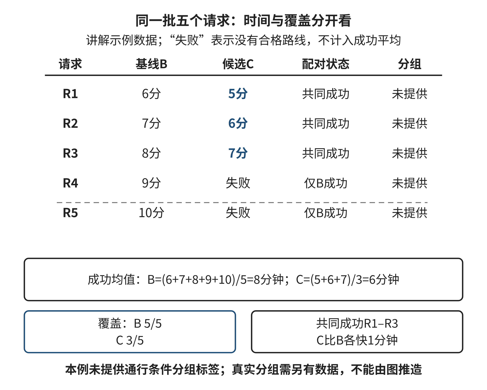
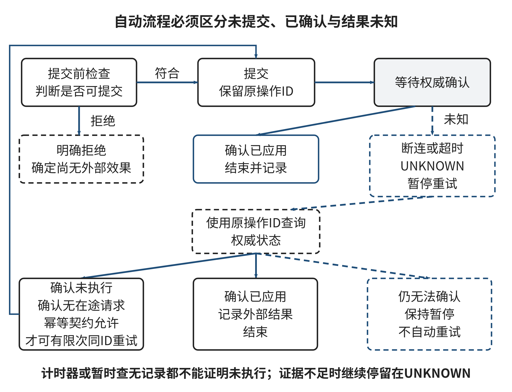

## 2.5 评估、优化与自动化：建立反馈闭环

两种方法都输出了路线，怎样判断哪一种更好？一种方案给出的成功路线更快，却更经常拒绝行动受限访客；另一种查询速度更快，却需要较长的预处理，而且地图一变就要重做。评估应当把这些差异放到同一个任务中解释。本节从“平均值改善”的疑问进入，连接比较指标、优化成本和自动执行的前提。

### 2.5.1 平均值下降为什么仍可能不宜采用

**讲解示例：不同分母的平均。**在一组原创模拟请求中，基线为五个请求返回路线，耗时分别为6、7、8、9、10分钟；候选只为前三个请求返回路线，耗时为5、6、7分钟，另外两个没有合格结果。成功请求的平均时间从8降到6分钟。这个计算没有错，但它不能单独支持“候选对这五个请求更好”：两种平均值比较的对象不同，候选没有成功的请求被移出了分母。

如果服务要求所有请求都有合格结果，候选已经违反要求。如果允许部分请求转交人工，需要同时记录覆盖率、转交原因和额外等待，而不是把失败行删除。报告“平均6分钟、成功3/5”使读者能够判断代价；报告“缩短25%”却不说明覆盖变化，会把一个有限指标包装成整体改善。评价错误有时发生在计算前的样本选择，而不是计算公式本身。

可以先将结果按请求ID配对，比较两种方法共同成功的那部分，再单独报告只在一种方法上成功的请求。配对比较回答“对共同成功的请求，时间怎样变化”，覆盖比较回答“有多少请求得到结果”。两者不能互相替代。若希望计算一个综合量，必须明确怎样处理失败，例如给每个未完成请求赋一个约定的等待代价，并解释这个代价的依据。这样的量是任务方定义的评价规则，不是失败在现实中必然产生的准确损失。

某个群体的结果也可能被总体平均遮住。假设多数普通步行请求得到小幅改善，少数无台阶请求的失败却增加，总体分数可能仍然变好。因而需要按实际需求分组查看，而非先假定一个总分足以代表每个人。分组也不应无限细到无法判断；应优先检查具有不同硬条件、不同失败成本和不同数据覆盖的群体。对本章导览而言，是否要求无台阶通行就是一个具有语义依据的分组。

### 2.5.2 先确定比较单位，再选择指标

比较单位可能是一个请求、一条道路、一场活动或一次系统调用，不同单位对应不同问题。若一个访客连续发起十次查询，把十次当成十个独立用户会夸大样本多样性。若测试目标是每次调用的计算耗时，则十次调用又可以是合法记录，但要说明它们共享用户与地图。评价不是禁止重复测量，而是要知道重复来自哪里。

本章采用三层检查。第一层检验硬条件：方向、通行要求、必须经过的地点、截止时刻与版本是否满足。第二层比较任务代价：行走时间、绕行、拒绝与等待。第三层比较实现成本：计算时间、预处理、内存与维护。先确定第一层，才能防止用更快的错误路线击败稍慢的正确路线。第二、三层也不能混为一谈；少算几毫秒不会直接让访客少走几分钟。

指标须附单位、统计范围和失败处理。平均查询时间容易计算，但少数很慢的请求可能影响交互；最大值能显示本批极端情况，却容易受单次异常影响。中位数描述本批中间位置，不能显示全部尾部。可以报告这些量的组合，并查看原始记录。小样本的分位数取法不同会得到不同值，教材中的小表不适合据此制造精确的“99%请求保证”。

指标之间的冲突需要决策原则。有些条件是门槛，例如确认无台阶通行；有些是门槛通过后的优选标准，例如平均时间。把门槛乘一个权重与其他指标相加，可能让足够大的速度收益抵消通行失败，改变原任务。若任务确实允许这种补偿，须先说明并取得相应领域决策依据，不能由程序暗中改变。本节练习的硬门槛直接给定，学生无需猜测权重。

当多个方案在不同指标上各有优势时，可先判断是否存在支配关系：一个方案在所有约定指标上均不更差，并在至少一个上更好，则另一个没有这些指标上的优势。没有被支配不表示应当采用，只说明还需取舍；被支配也依赖所选指标和适用条件。遗漏维护成本或某类请求，可能改变支配关系。因此，多指标表是帮助看清选择的工具，不是消除价值判断的机器。

### 2.5.3 同批、同条件和保留的测试

比较两种路径策略时，应当固定输入图、边权、通行条件、请求集合和失败定义。若基线在早高峰地图上运行，候选在平峰地图上运行，差异同时包含算法与环境变化。对静态模拟图，可以保存同一快照并重复运行；对真实道路，环境会变化，需要另行设计采样与比较。这两类证据的强度不同，不能把离线模拟成绩称为现场效果。

NIST的AI风险管理框架要求记录测试集、指标和测试工具，说明与使用情境相近的评价条件，并记录适用范围的限制[[S08]]。本节将这项要求落实为一个很具体的习惯：在比较表旁保留输入版本、请求ID、约束版本、策略版本和运行方式。不是为了堆积文档，而是使一个异常结果能够被定位和复算。没有这些信息，后来换了地图还看到旧分数，便无法知道分数属于谁。

图2-6 配对比较、覆盖与分组评价

来源：本书原创教学图；图中数量来自2.5.1五个请求的讲解示例，与E05数据分开，不表示实地服务性能。

图2-6应从共同的五个请求开始读，而不是只看平均值。观察每种方法在哪些行成功，再检查平均时间用了哪些行。共同成功的前三行可以配对比较，另外两行的失败必须另报；具有不同通行条件的请求还应分组检查。图表把不同分母显式分开，使“速度更快”与“服务更多请求”能够分别接受判断。

开发集用于发现问题和选择方案；测试集用于在选择完成后检查新材料上的表现。反复根据测试失败修正候选后，那批数据就逐渐变成开发材料。可以保留它检验已知问题是否复现，却不能继续把同一成绩当成完全未见数据上的证据。2.3讨论的规则归纳有同样边界；此处扩大到完整路线策略与评价过程。

没有新数据时怎么办？可以诚实报告“改动消除了已知反例，在这批回归材料上没有发现新失败”，同时说明尚缺独立泛化证据。不能把缺少测试当作无法改进，也不能通过改名把旧集重新变成独立集。新测试应针对未覆盖条件，例如不同图结构、相同代价的多条路线、入口临时关闭与没有可行路径，而非只改变已有记录的编号。

比较方法也应控制自己的代价。若在一个六节点确定图上可以穷举全部简单路径并得到精确最优值，就可以直接检查候选是否最优，不必先做一个含糊的“用户更喜欢哪种算法”的测试。若某成熟算法的适用条件已经成立，应优先采用已有可靠方法，再用当前数据验证实现。只有对当前场景仍有实际未知，例如动态预测误差与交互行为，才需要针对未知设计额外比较。验证要回答问题，不能把实验形式本身当成果。

### 2.5.4 优化要计算准备成本和失效条件

**讲解示例：预处理是否值得。**某策略每次查询需要30毫秒；另一策略先花90毫秒建立索引，以后每次需要12毫秒。对q次查询，前者总耗时为30q，后者为90＋12q。只有q大于5，后者在这项总耗时上严格更快；q等于5时相同。若地图每次查询前都变化，索引不能复用，那么每次都要重新支付90毫秒，原先的优势消失。

这个推导把“更快”拆成了三个条件：测量哪些操作、重复多少次、准备结果可以复用多久。现实优化经常依赖这种摊销。建立缓存、排序后查找、预计算常用路线，都可能把一次成本换成多次收益；反过来，输入变化、内存约束或缓存验证也可能抵消收益。不能只展示优化后最便宜的那一步，把必须发生的准备工作藏起来。

缓存的键应包含会改变结果的全部输入。对本章路线，起终点相同但通行条件不同，不能复用同一结果；地图版本改变，旧路线也不能自动继续有效。缓存键中加入profile和map_version，只能减少遗漏这些已识别输入的风险，不能证明真实通行信息完整。如果底层事实没有更新，缓存甚至会更高效地重复一个过时错误。

可以从两个维度识别瓶颈：某一步单次占用时间大，或某一步被反复执行很多次。一个解析步骤只要2毫秒，却重复一万次，可能比一次100毫秒的搜索更值得优化。先观察调用次数与总耗时，再决定是否改算法或减少重复。只根据函数看起来复杂就优化，可能投入很多努力却几乎不改变完整任务的时间。

优化还可能改变结果。剪枝减少搜索，但只有在不删除必要候选的条件下才能保留完整性；近似方法可能更快，却有不同的误差或最优性承诺。比较时应说明输出保证是否变化。例如“在当前非负图上得到精确最短路径”与“快速得到一条可行路线”是不同成果，不能只用运行时间一列比较。若允许近似，应记录误差怎样定义、怎样估计、哪些请求需要回退到精确方法。

### 2.5.5 从计算过程到自动执行

自动化意味着某些步骤不再逐次由人操作，但它仍然需要输入条件、状态和结束规则。计算一条候选路线与向访客发布“此路线现在可用”是两个不同动作。后者包含对证据时效和输出责任的承诺。为了提高自动化程度而省略这些条件，会把模型内可行偷换成现实已确认。

可以先把过程分为准备、检查、提交和确认。准备阶段生成候选；检查阶段验证当前输入和全部硬条件；提交阶段产生外部效果；确认阶段判断效果是否发生。若检查失败，应返回具体原因；若提交后没有收到确认，应保存“结果未知”。未知不是肯定失败，也不是肯定成功。这个区别对任何带外部作用的自动流程都重要。

**讲解示例：通知是否应重发。**系统向某访客发送路线更新，网络在发出请求后断开。服务器可能已经发送，客户端只是没拿到确认；也可能请求根本没有到达。直接重发会在第一种情形中产生重复通知。若系统可以按同一个操作ID查询已发送记录，便可先取得证据；若没有这样的能力，应暂停该项并交给明确的恢复处理，而不能用“多试几次总会成功”消除不确定性。

幂等性描述重复相同操作对约定目标状态产生与一次操作相同的效果。RFC 9110对HTTP方法给出这种语义，并指出非幂等请求的自动重试需要额外依据，例如知道原请求未被应用或其实际语义可幂等[[S09]]。这里借用的是重试判断的原则，不将某个协议方法名当成应用业务绝对安全的证明。即使最终状态相同，重复请求仍可能产生日志或其他附加作用。

给通知附操作ID还不够。接收方必须真正依据该ID识别同一次业务动作，并明确多久保留记录、重复请求返回什么、并发请求如何处理。若每次重试生成一个新ID，系统就把同一动作伪装成了两次新动作。教材不要求实现完整分布式系统，但你应能指出自动流程需要怎样的契约，才能证明某次重试有根据。

图2-7 自动执行中的检查、确认与未知状态

来源：本书原创教学状态图；提交指可能产生外部效果的教学步骤，不代表已执行任何真实通知。

图2-7区分提交前的明确拒绝与提交后的结果未知。请沿箭头说明，什么证据允许回到重试，什么情况下应保持暂停。图中的恢复路径要求先取得结果证据，不能由一个计时器自动把未知改成失败。这种状态设计使自动化拥有清晰的停止点，而不只是运行得更久。

### 2.5.6 反馈要能解释变化来自哪里

闭环不是“得到分数后再让AI改一遍”。一次有效反馈应连接输入、结果、失败类型和可修改对象。若路线走错入口，回到表示与地图；若模块分别成功却版本不一致，回到接口与依赖；若新场次预测失准，回到规则的适用范围；若搜索提前停止漏掉更优候选，回到算法；若分母变化造成假改善，回到评价。相同的“未通过”需要不同修正。

这也解释为什么不能每次失败都换更强的生成模型。生成模型可能帮助提出假设、构造边界测试或解释日志，但它不能替代判断失败属于哪一层。可以给AI已核实的失败记录，要求提出互不相同的原因候选和各自需要的检查；不让它直接凭语言合理性选定根因。随后按已有数据或新增观察逐一排除。这是2.2的分解与2.3的模式方法在反馈中的配合。

人机交互研究提出在系统出错时支持纠正、在长期使用中提供控制等设计原则[[S10]]。在本章任务中，具体表现为让用户看到适用条件、拒绝原因和需要确认的事项，并能修正输入或停止发布。该研究给出设计指导，不能证明本章某个界面已经提升了学生理解或用户满意度。实际效果仍需在相应使用情境中观察。

持续观察可以选择少量具有明确含义的触发条件。例如发现一条已发布路线引用旧地图版本，就暂停受影响结果并重新检查；连续出现本来未覆盖的请求类型，就增加数据核对；某次查询超过限定预算，就返回当前确定的状态而非假装完成。触发值应来自任务容忍度和可恢复方式，不能把随意设的数字称为普遍安全阈值。保留事件的实际时间与输入，使改动后的结果能与改动前对应。

### 2.5.7 E05：选择方案并设计恢复条件

以下八个请求在同一地图版本与同一组已确认条件下进行离线模拟，记录符合全部通行硬条件的路线及其总分钟数。“失败”表示没有返回合格路线，不是已让访客走了错误路线。N组无额外通行要求，A组要求无台阶。所有数据均为教学示例。

表2-XP2 E05同批请求的结果

| 请求 | 组别 | 基线路线分钟 | 候选路线分钟 |
| --- | --- | ---: | ---: |
| U1 | N | 8 | 6 |
| U2 | N | 10 | 8 |
| U3 | N | 9 | 7 |
| U4 | N | 11 | 9 |
| U5 | A | 12 | 9 |
| U6 | A | 14 | 失败 |
| U7 | A | 失败 | 失败 |
| U8 | A | 13 | 10 |

来源：本书原创模拟测试数据，不代表现实算法或人群性能。

采用门槛为：A组至少3/4请求成功；每条返回路线都符合全部通行条件；成功路线均不超过15分钟。通过门槛后，可参考成功请求均值、全体覆盖和一个辅助综合量作选择。该辅助量将每个失败记为16分钟，是题设的评价代价，不是实际出行时间。

请计算两种方法的总体及分组成功数、成功请求均值、按共同成功请求配对的平均差，以及辅助综合量。依据门槛作采用判断，并解释为何不同指标可能支持不同方向。不能把辅助量较低当成自动取消门槛的理由。再给出两个当前表不足以支持的现实结论，以及对应还需哪些材料。

查询计算另有模拟测量：基线每次40毫秒；候选预处理120毫秒，之后每次10毫秒，地图版本不变时可以复用。求不同查询次数下的总成本和严格更快的条件。地图每次都变化时重算，不把行走分钟与计算毫秒相加。

最后处理一个自动执行片段：将路线包发送到展示端，发出后连接断开，未取得确认。只读查询若能按原操作ID确认已接收、确认未接收或仍未知，分别怎样处理？若没有查询能力，怎样保存状态与停止？给出一个有限恢复流程和所需契约，不实际发送任何内容。评价看分母、硬门槛、成本口径及未知状态是否一致，参考解见章末E05。

### 2.5.8 本章方法如何组成一个可靠过程

评估把前四节的选择变成可比较的证据。表示决定我们计算什么，分解决定信息怎样衔接，模式决定哪些经验能被调用，算法决定怎样得到结果，反馈又帮助定位哪一项需要改变。它们可以往返配合，不必每次按同一顺序从头经过。对一个明确的排序错误，直接检查比较键和稳定性可能足够；对入口未知，则不能靠重跑排序解决。

反思E05的采用判断：你是否曾被成功均值吸引而忽略分母？有没有把实现速度与任务效果混成一个数？当确认丢失时，哪条证据真正允许你恢复行动？这些问题要求你解释方法与结果之间的关系。章末综合训练将要求在一张新地图上把这种解释与实际路线、测试和有限AI辅助一起交付。
