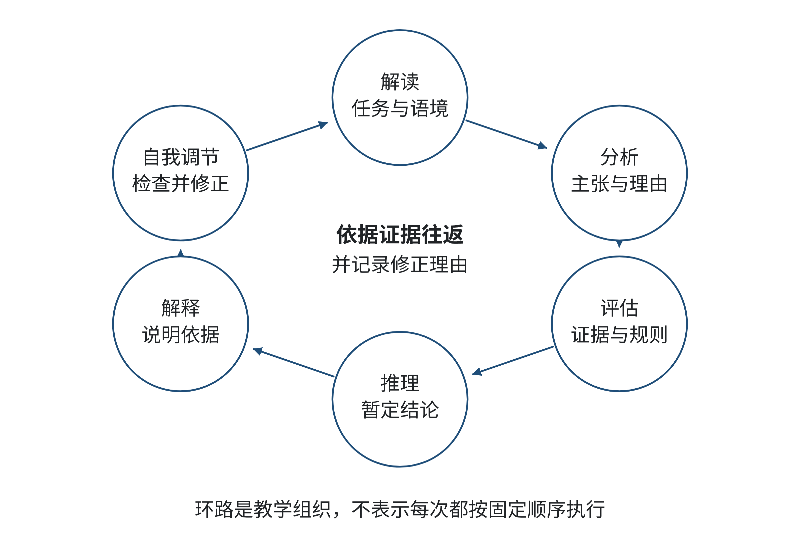
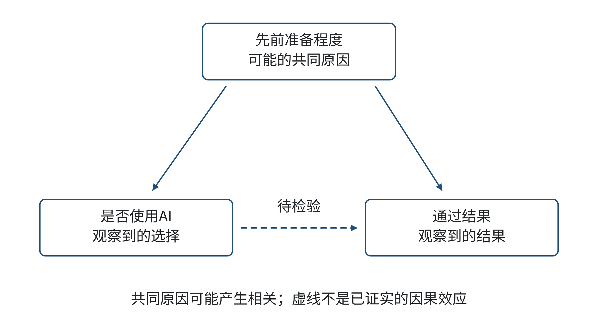
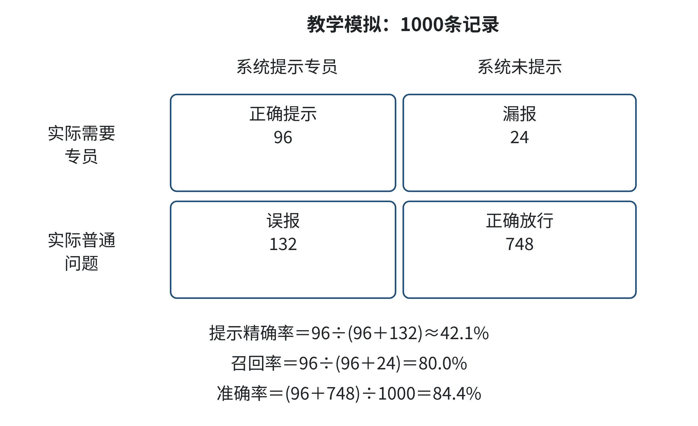
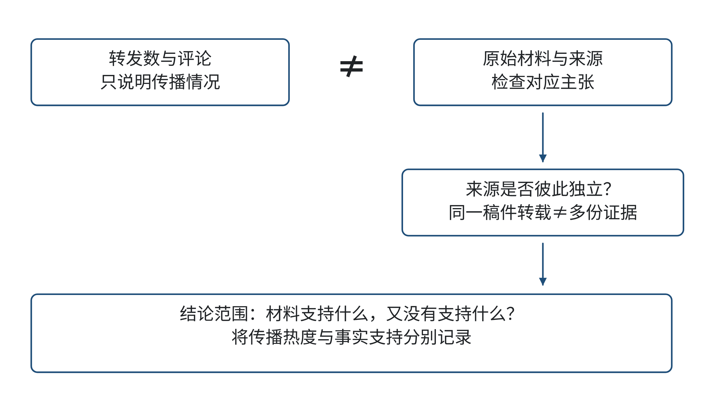
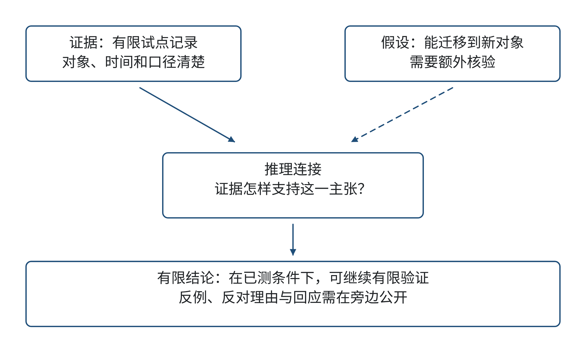
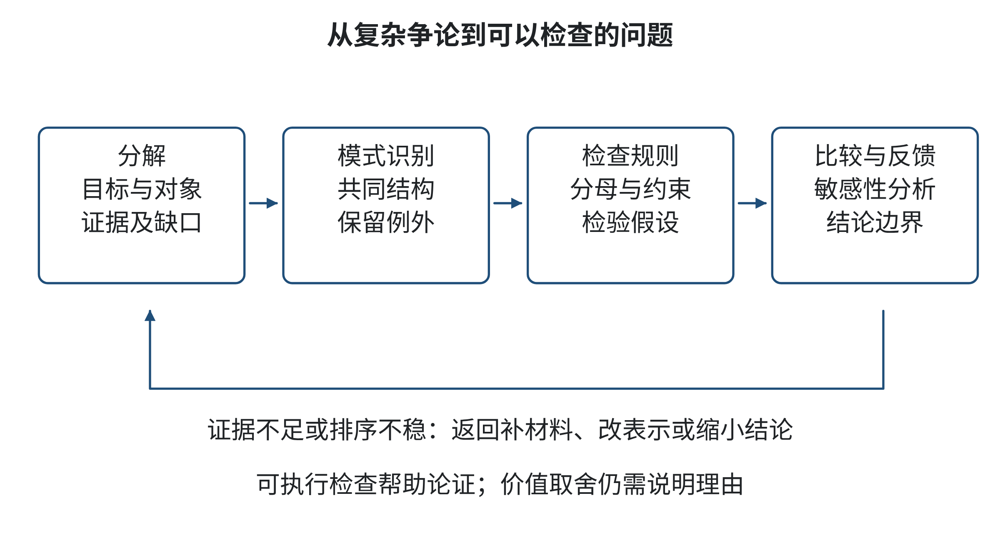

# 第四章 批判性思维：洞见本质的利器

你看到一则消息：某生成式人工智能工具已经帮助一门课程把作业完成率提高了三成。消息附有一张柱状图和一段看似专业的解释。一位同学据此建议，学院应立即把工具推广到所有课程；另一位同学认为，只要结果来自AI就不可信。两种反应都很快，却都跳过了关键问题：这三成从哪里来？“完成”如何定义？比较的是哪些学生？工具究竟解决了什么困难，又可能把哪些困难转给教师和学生？

批判性思维不是凡事反对，也不是把复杂问题简化为“相信”或“不相信”。它是一种有目的的判断：弄清别人主张什么，检视理由与证据能支持到哪里，比较可能的解释，说明自己的结论，并在发现缺口时及时修正。AI让答案、摘要、图表和方案更容易生成，也让流畅表达更容易越过核验。于是，判断不能停在“听起来合理”，而须回到资料、条件和影响。

本章先后考察个人学习建议、科技新闻中的效率主张、社区共享设备计划和雨天公共出行决策。校园服务中的AI工具作为补充情境，帮助读者练习追踪来源、边界和责任。案例中的人物、记录和方案均为原创教学模拟，不描述任何真实机构的制度、调查或试点。计算机、统计测量、服务管理、交通和使用者经验会影响不同情境中的“好结果”；判断时须回到各自的目标、证据和后果。

## 学习目标

读完本章后，你能够：

1. 用自己的话说明批判性思维与反对、怀疑、批评的区别，辨认解释、分析、评估、推理、说明和自我修正各自承担的任务。
2. 将一段信息拆成可核查的主张、证据、推理和未说明的假设，指出证据强度与结论范围之间的不匹配。
3. 检查比例、分母、样本、比较组、替代解释与因果越界，解释为什么同一个指标可能掩盖不同错误或不同群体的影响。
4. 构建并拆解技术方案或商业建议的论证，给出适用条件、反方理由、回应和仍待确认的问题。
5. 用抽象、分解、模式识别和算法化检查组织复杂判断，在条件变化时更新证据、指标和结论。
6. 对AI生成的信息采用可追溯、分层核验的方式；说明何时可以把AI作为整理与检验的辅助，何时必须停止采纳并寻求人类专业判断。

## 学习路线

先学会把“我觉得可信”转换为一组能回答的问题；再练习识别选择、表述、数字和因果结构中的信息陷阱；随后把零散理由搭成能经受反例的论证；最后通过计算思维把检查步骤组织成可重复、能修改的过程。每节先从案例和完整示范入手，再把方法交给你练习。章末独立练习的材料和评分依据都在题目处提供，参考解集中在章末。

## 4.1 批判性思维核心：质疑、分析、评估、推理、解释、自我修正

本节先练习把一个看似明确的建议拆成可检查的问题，再认识批判性思维中的几项核心技能。你将看到，质疑不是预设反对，而是帮助理解、分析、评估和修正判断的起点。

### 4.1.1 案例与分析：一份AI学习建议值得照做吗

一名计算机专业本科生发现自己在数据结构课程中跟不上进度，向生成式AI描述了“复习时间不够”后，收到一份学习计划：每天再增加数小时刷题，暂时跳过概念梳理，并预测照此安排即可应付考试。学生没有提供课程大纲、考试时间、当前掌握情况或其他课程安排；这段答复与预测都是原创教学模拟，不是实际模型输出。学生现在要决定是否完整照做、局部试行，还是先补充信息。

分析时先拆开“建议”和“依据”。增加刷题时间是一种行动选项，预测考试结果则是需要证据支持的主张。现有材料没有证明计划适合这名学生，也没有说明“跟上进度”如何衡量。学生可以先核对课程目标和作业要求，把一周任务分成概念回忆、基础题与错题复盘，再记录是否能独立解释关键步骤；若时间或疲劳成本过高，就调整计划并说明理由。这个小案例训练的是有条件地评估建议，不把流畅语气当成了解个人情况的证据。

**原稿中的补充示范：**

在本书原创教学模拟中，学院服务团队讨论是否让一个生成式AI助手回答学生关于选课、奖助申请、心理支持转介和办事流程的问题。负责演示的成员说：“我们让工具回答了二十道常见问题，团队认为其中十八道基本正确，说明它已经可以替代一线咨询。”一位教师提出，二十道题由团队自己挑选和评分，回答里还涉及特殊情况；另一位教师担心，若错误建议被学生当成正式政策，后续修正可能赶不上。会上有人主张先全面上线，也有人认为只要AI可能出错就应该禁止。此情境及其数字均为教学模拟，不是校内测试或真实AI输出。

这段话至少包含三种不同内容。第一是可以回查的事实：“团队测试了二十道问题，其中十八道被评为基本正确。”第二是评价：“基本正确”代表什么程度、谁作出判断、是否允许部分正确。第三是结论：“可以替代一线咨询。”结论比事实多走了几步：这二十道题是否覆盖真实问题？自选题目有没有偏向简单情境？政策信息是否来自现行文件？特殊人群、隐私、紧急情况和人工转介是否测试过？“回答一部分问题较好”为什么等于“可以替代”？

反过来，“只要AI可能出错就禁止”也没有完成论证。人类咨询同样可能出错，真正需要比较的是不同方式在明确场景里的效果、错误种类、纠正机制和责任安排。合理的初步结论可以是：“这次小测试说明助手可能帮助处理部分常见问题，但还不能支持替代咨询人员；需要明确哪些问题可回答、哪些必须转交，并在接近实际情境的材料上由适当人员复核。”这既没有把有限证据夸大，也没有因为不确定就放弃调查。

批判性思维从“我们究竟在判断什么”开始。若目标是决定是否替代人员，证据必须涉及覆盖范围、失误风险、人工交接和使用者影响；若目标只是决定是否测试一项低风险的FAQ辅助功能，证据门槛和退出方式会不同。问题、证据与决定的关系一旦说清，后面的分析才有方向。

### 4.1.2 什么是批判性思维

“批判”在日常表达中容易被听成挑错、否定或尖锐批评。本章所说的批判性思维，是有目的地理解信息、考察理由、作出有根据的判断，并检查自己的判断是否需要修正。它既不要求每个主张都被怀疑到底，也不把一种结论预先规定为正确。对一个证据较充分、适用条件清楚的结论，批判性思维可以支持采纳；对证据有限的结论，它可以暂缓判断、缩小结论范围或提出下一步核验。

美国哲学学会在1988—1990年组织的一项Delphi专家共识研究，将批判性思维概括为有目的的、自我调节的判断过程，并讨论其核心认知技能[1]。报告提出的六项技能分别是解释、分析、评估、推理、解释说明和自我调节。这里的“解释说明”指把推理结果及其依据讲清楚；同一中文词“解释”容易混淆，以下将第一项称为“释义与理解”，将第五项称为“说明理由”。这六项技能是一个教学框架，不是机械流程：实际判断中，它们可能交错出现，也可能因新证据返回前一步。

“质疑”是进入这些技能的一种重要动作，但它不是“六项核心技能”之外被本章另行冒充为原报告结论的第七项。它帮助我们把含糊的说法变成可回答的问题：谁提出了主张？关键术语是什么意思？证据在哪里？谁可能受影响？还有什么解释？如果回答改变，决定会不会改变？好的质疑要求对自己和支持自己的观点同样适用。只追问反方、从不检查己方，属于选择性审查。

表4-1 批判性思维六项技能与可观察的学习行动

| 技能 | 在判断中做什么 | 校园AI服务模拟中的行动 | 常见失败 |
| --- | --- | --- | --- |
| 释义与理解 | 澄清情境、术语、关系和约定，准确复述信息 | 说明“替代”指完全代办、先行答复还是辅助检索；界定“正确”的评分标准 | 未问清词义就反驳或同意 |
| 分析 | 找出主张、理由、证据、假设以及它们的连接 | 把“18/20基本正确”与“可替代咨询人员”分开，标出两者之间缺少的理由 | 把相邻出现的句子误当作已经证明的因果链 |
| 评估 | 依照相关标准判断来源、证据与推理是否可靠 | 检查题目选择、评分者、政策版本、例外问题和复核方式 | 只看资料数量、名头或表达流畅度 |
| 推理 | 从当前资料提出结论、备选解释或下一步检验 | 得出“可以小范围测试某类问题”，同时列出不能外推的范围 | 把可能性说成确定性，把局部结果推广到全部用户 |
| 说明理由 | 呈现结论、依据、评价标准与重要条件 | 说明为何需要人工转介、试点范围为何有限、怎样处理未确认的回答 | 只报结论和分数，读者无法复核过程 |
| 自我调节 | 回看自己的过程，识别偏差、修正观点或方法 | 接受反方指出题目过于简单，补测后修改原来的推广建议 | 把改口当成失败，或只在结论后添加免责句 |

表4-1中的校园情境是本书教学设计；技能名称与概念框架依据Facione报告[1]。读表时，不要把每一列看成单独完成的阶段。例如发现测试问题都是简单问题，既是在分析证据，也是在评估证据的代表性；决定暂时只验证FAQ功能，则是依据更清楚的目标重新推理。

### 4.1.3 六项技能怎样衔接

初学者可以先用六个问题检查一段主张：

1. **我听懂了吗？** 用自己的话复述结论，说明对象、范围和关键术语。
2. **里面有什么？** 标出主张、理由、证据和没有明说的假设。
3. **依据够用吗？** 检查来源、测量、比较方式、遗漏和适用范围。
4. **还能怎样解释？** 列出最重要的替代解释，并问哪些证据能区分它们。
5. **我为何这样判断？** 说出使用了什么标准、哪些事实支持结论、哪里仍不确定。
6. **什么会让我改变？** 指定一种可能的新证据，说明出现后会如何调整决定。

这个清单不是要求读者对所有问题都写六段报告。看一则低风险的活动通知，可能只需确认主办方、时间和报名链接；把个人咨询交由AI自动处理，则需要更严格地审查隐私、准确性、覆盖范围和人工接管。方法的深浅由决定的后果、可逆程度和信息不确定性共同决定。



图4-1 批判性思维的六项技能如何协同

见图4-1，释义与理解、分析、评估、推理、说明理由和自我调节连成可以回环的路径，质疑作为贯穿全程的提问动作。请沿箭头读一遍“十八道题基本正确，因此可以替代咨询人员”的推理：如果评估发现样题覆盖窄，回到分析或目标界定后，结论就需要缩小。来源：概念框架据文献[1]；组织方式为本书教学图。

### 4.1.4 完整示范：把流畅建议还原成可检查的判断

下面继续使用案例中的团队演示。为了演示思路，设想一份教学用简报写着：“我们测试了二十道问题，十八道基本正确，准确率为90%。AI服务能有效覆盖学生咨询，全面推广可减轻教师负担。”这段话不代表真正模型生成或真实项目评估。我们逐步检查它。

**第一步，释义：明确主张的对象。**“二十道问题”可能是团队编写的政策问答，也可能来自匿名用户记录，二者的来源和覆盖情况不同。“基本正确”是全对、关键结论正确，还是读起来合理？“覆盖学生咨询”是答复所有常见问题，还是在某些简单问题中提供检索提示？若术语含混，报告中的90%无法被别人重复核验。

**第二步，分析：拆出三种主张。**简报至少有一个描述性主张——十八道获评“基本正确”；一个预测性主张——系统能覆盖学生咨询；一个行动建议——全面推广。第一个主张若测试记录真实，可能被原始答案和评分表检查；第二个需要问题分布、困难类型和未覆盖案例；第三个还需要评估工作量如何变化、出现错误时谁负责以及如何回退。一个小样本数字并不会自动为后两个主张提供全部理由。

**第三步，评估：检查分子、分母与评分。**18÷20＝90%，这一步算术正确，却没有告诉我们题目难度、评分一致性或样本代表性。由项目团队自行评分，还可能发生期望偏差：熟悉系统的人较容易把模糊回答理解为正确。一次测试若只保存汇总数字、不留题目、答案、来源和评分规则，外部读者也无法确认哪些回答通过。

**第四步，推理：把结论收回证据可支持的范围。**当前可得的谨慎结论是：“在团队选出的20个教学用问题中，18个按未充分定义的‘基本正确’标准通过内部评分；这提示可继续开展有边界的验证，但不能证明系统能够全面覆盖或替代咨询。”这不是拒绝AI，而是把“可继续验证”和“已证明可上线”分开。若团队需要决定是否启动一个只提供官方链接、遇到复杂问题立即转人工的封闭测试，就应另行明确测试对象、审批方式、退出条件和监测指标。

**第五步，说明理由：让别人能检查。**报告应给出题目如何产生、评分标准、原始回答、依据文档版本、复核人及尚未解决的例外。比如对“奖助政策是否可以例外申请”这类问题，如果公开政策只说明一般程序而没有回答个案，系统应该指出需要人工确认，不能从相似政策自行补齐。把不知道的地方标出来，本身比编造一个确定答案更有帮助。

**第六步，自我调节：检查自己的偏好。**如果我支持AI，是否因为喜欢新工具而降低了证据要求？如果我反对AI，是否只记住失败的例子而忽略可以安全辅助的步骤？“什么结果会让我改变判断”是一个有力的自我检查：例如，若独立复核发现系统对已发布、简单、可追溯的流程问题表现稳定，同时复杂个案能可靠转交，我可能支持限定任务的辅助测试；若它反复把不确定内容说成校方正式规定，我会暂缓上线并先处理内容来源和提示设计。

由此可见，批判性思维不是给自己贴上“理性”标签，而是让判断具备可追溯的根据、可说明的边界和可修正的入口。别人可以不同意结论，但可以沿着记录检查争论究竟发生在事实、标准还是价值取舍上。

### 4.1.5 哪些时候需要追问，哪些时候可以先停

询问越多不等于思考越好。对于任一主张，可以先判断它影响的是一个可逆的小操作，还是会影响资源、权益和安全；再问当前证据缺口是否会改变行动。若错误的代价很低、决定可以快速撤销，可以采用短期试用和事后检查。若错误可能伤害具体使用者或泄露敏感内容，则必须事先明确限制、责任人、升级路径和停止条件。

例如，AI帮助学生把已公开的办事说明整理成清单，可能只需核对来源链接、日期与关键步骤。AI替学生判断是否符合某项困难补助条件，涉及个人情况和需要解释的规则，简单的准确率无法回答适用问题；未取得可用依据时，系统应当转介而不是猜测。法律、教育、心理、金融等领域都有自己的边界和后果：技术人员能检查程序怎样处理输入，却不能仅凭程序运行成功判定结果符合领域要求。专业知识负责界定概念和例外，统计方法负责解释样本与误差，用户经验揭示记录中可能没有呈现的影响，技术检查则保证规定的步骤确实执行。

同一证据之所以在不同领域里有不同价值，往往因为待判断的结果不同。平均答复时间变短，对分流效率有意义；它不能代替咨询内容是否正确、弱势学生是否能获得同等服务、复杂问题是否被及时转交。评价标准应随实际目的变化，而不能因为现成指标容易计算，就把它误当成全部目标。

### 4.1.6 判断会受情绪影响，方法要能帮助自己复核

人并不是先完成一套冷静计算，再把情绪加到结论里。担心风险、期待省时、维护既有做法或受到他人称赞，都可能影响我们先注意什么。情绪可以提示某件事对自己或他人很重要，但不能单独证明主张为真。一个人感到“这个方案听着很危险”，可以据此进一步询问可能的伤害和已有保护；不能把不安直接写成已发生的事实。同样，觉得新技术令人兴奋，也不能代替对效果和成本的检验。

自我调节不是在所有问题上都要求保持中立。对权益和安全问题，人们可能确实有需要坚持的底线；关键是把底线和事实结论区分开来，并解释为什么这个标准相关。比如“不能未经确认就把个案资格当作已定政策”是一条决策约束；“目前已经有学生因AI误答而错过申请”则是事实主张，必须有相应记录支持。把规范、经验和推断分开，能减少用强烈态度替代证据的情况。

一个简单的判断记录可以让修改变得正常：记下当前问题、暂定结论、最强依据、主要不确定性、下一步核验，以及什么新信息会促使自己改动。记录不必很长，会议纪要中多加两行也能发挥作用。若后来发现网页日期过期，修正结论不是前后矛盾，而是对信息版本变化作出响应；若原判断只因同伴提出了不同意见，却没有新证据，就应检查自己是否只是从众或防御。

这也说明“自我修正”不是没有立场。判断者可以坚持有根据的主张，同时公开它依赖哪些证据。好的修正包括说明原结论哪里过宽、哪些理由仍保留、哪些部分仍未知。例如，可以保留“公开流程检索适合测试”的判断，同时撤回“所有咨询可由AI处理”的推断。如此做比删除全部讨论或假装从未说过原结论更诚实，也更便于下一轮团队继续。

技能还需要与愿意运用技能的思考习惯配合。Facione报告除了讨论认知技能，也记录专家对开放态度、认真寻找相关信息、公平评价理由、面对自身偏差和愿意在反思后修正观点等倾向的讨论[1]。报告表明，专家对这些倾向是否构成批判性思维定义的一部分并非完全一致；它们作为良好思考者的特征，却得到广泛支持。课堂训练可以让学生练习行为，而不必把某种性格当成能力门槛：例如要求每个人先写下支持自己观点的最强理由，再主动寻找一个最可能推翻该理由的材料。

把观点当作可以检查的对象，也能减少身份威胁。团队成员支持某项技术，不等于他不能发现风险；指出风险，也不等于否认一切技术价值。意见不同的人可以在共享证据和标准上继续合作，即使最后的取舍仍不同。若讨论只看谁“聪明”或谁“懂技术”，参与者就难以说明具体理由，团队也无法从分歧中修正目标或方法。

### 4.1.7 思维训练：判断简报写到哪里为止

**E07：参考解见本章末“E07参考解与讨论”。**

请独立阅读下面这段原创教学模拟。它不是学校真实调查或实际AI输出：

> 一组课程助理从公开网页摘录了20个办事问题，请一个AI助手回答。两名助理讨论后，18个答案被标为“基本正确”。因此，AI可以承担学院全部咨询。系统还会节省教师时间，学生会更愿意提问。

先完成基础任务：用两句话分别写出材料明确报告的事实和材料提出的决定；给“基本正确”“全部咨询”“节省时间”各写一个可操作的定义；指出若不能定义，哪项结论最容易产生误解。

再完成应用任务：分别从题目来源、评分过程、推理跨度、被服务者和失败后的安排五方面提出核查问题。将你的结论分为“可以确认”“可以合理推测”“尚不能判断”三类，并写出每类的一条理由。不要补造测试样本、学校制度或工具性能。

最后作迁移：假设团队改为只让AI检索已公开的办事流程，并在不确定时展示原文链接、转给人工。说明这个改变减少了哪些风险，还留下哪些问题；什么证据可能让你支持或反对下一步扩大试用？

评价时检查四点：是否把记录事实和行动建议分开；是否看见分母和评分标准；是否提供了可用于区分答案质量的证据；是否说明判断可能改变的条件。允许不同立场。若认为不应试用，应解释风险及其证据；若认为可以试用，应说明边界、监督和撤回方式。仅写“AI会幻觉”或“技术总会进步”都没有完成分析。

### 4.1.8 本节反思

回想你最近一次接受或否定一个建议：你当时是否先把对方的意思复述准确？判断中哪一部分来自事实，哪一部分来自评价或个人偏好？若有人提供了相反例子，你是否愿意重新检查？试着写下一个会改变你结论的具体条件。思考成熟的标志不是从不改口，而是能说清改动发生在什么证据之后，以及原来的判断为何需要调整。

## 4.2 识别信息陷阱：偏见、谬误、伪相关性、数据操纵

上一节介绍了如何分析一项主张及其证据，本节把注意力转向信息形成和传播中的常见陷阱。我们将从来源、偏差、推理、因果比较和数据表达等方面，练习辨认结论究竟能走多远。

### 4.2.1 案例与分析：科技新闻的“效率翻倍”说明什么

一则科技新闻的模拟标题写着：“代码助手让团队开发效率翻倍。”配图显示，使用工具前团队每天完成二十项需求，使用后每天完成四十项。读者看不出两段观察期的人员数量、需求难度、工作时长、返工量和缺陷情况，新闻也没有解释“完成”如何定义。这些标题和数字都是教学模拟，不对应真实产品或研究。

按图上数值，完成数量从二十变成四十，原始计数确实是两倍；但这还不能证明单位人时产出翻倍，更不能单独证明产品质量或整体效率提升。需要检查两组任务是否可比、团队投入了多少时间、返工和错误如何计入，并区分“完成数量”“单位时间产出”和“达到质量要求的结果”。如果这些条件缺失，合适的表述是“图中计数增加”，而不是“效率已被证明翻倍”。

**原稿中的补充示范：**

在一份原创教学模拟的科技新闻中，作者展示一张社交平台传播图，并写道：“一条AI生成的健康建议在一天内被转发十万次，证明公众信任它，也证明这种工具比传统咨询更有效。”图上标注了总转发量，却没有显示原始消息、不同来源的转发是否独立、建议后来是否被专业人员确认，也没有说明“传统咨询”的比较数据从何而来。几名读者因为转发数很大而认为建议可信，另一些人则据此认定所有AI健康建议都不可靠。本文中的新闻、数字和立场均为教学模拟，不对应真实平台事件或系统测评。

这个案例把传播、可信度和效果捆在一起。十万次转发可以支持“这条内容得到大量转发”这一传播描述；它本身不能说明内容准确，也不能说明阅读者相信、采纳或从中获益。没有对照组和结果测量，不能比较AI与传统咨询的效果。后一种推断需要分别提出证据要求：事实主张查来源和内容，态度主张查适当的受众资料，效果主张查比较设计和结果指标。若把三种问题混为一谈，越醒目的数字越容易变成推理的替身。

信息陷阱不总是有意造假。有时发信者只选了支持自己方案的样本，有时统计图让普通差别显得巨大，有时一句话把“同时出现”写成“导致”，还有时结论确实有一点证据，却把对象范围扩大到完全不同的人群。批判判断的第一步不是给信息贴上“真假”标签，而是确定它在说什么、资料怎样形成、推论跨过了什么边界。

### 4.2.2 从“可信不可信”拆出四个问题

一条信息至少可以从四个方面检查。

**主张是否清楚。**“大幅提升”“多数学生”“风险降低”都需要明确范围和指标。大幅是增加几个百分点，还是提高了一倍？多数以哪个群体和时段为分母？风险指发生概率、损害严重度还是二者综合？如果关键字没有定义，后续争论可能看似意见冲突，实际说的是不同事情。

**来源是否适合。**谁提供数据，是否能找到原始材料，记录如何产生，是否允许复核？官方文件适合确认正式政策版本，却未必能说明政策执行效果；用户评论可以帮助发现问题，却不能单独估算问题在总体中多常见；商业机构的宣传材料可能提供产品功能信息，但验证效果时仍需独立或可重复的证据。信源身份是评估线索，不是自动通行证。来源可靠也不意味着来源中的每句话都适用于当前问题。

**推理有没有跳步。**“许多人分享，所以真实”把传播性当真实性；“一个指标提高，所以整体更好”把局部指标当全部目标；“之前没有出错，所以不会出错”把有限观察当未来保证。检查时把“因为”“因此”“证明”“必然”圈出来，问前后关系是演绎必然、统计关联、合理猜测还是尚未验证。概念相近不代表逻辑关系成立。

**结论范围是否匹配。**在一个班里测得的结果，最多先说明该班、该任务和该测量方式下的观察；是否适用于别的学院、课程或真实高风险情境，需要更多理由。样本越小不必然意味着一切无效，但不确定性通常更大；样本很大也不会自动消除偏差，若大样本来自不合适的人群、错误定义或系统性漏记，增加数量只会更精确地重复错误。

这四个问题彼此相连。资料来源决定能查到什么，测量规则决定数字代表什么，推理规则决定数字能支持什么结论，实际应用的后果又决定还需补充哪些证据。

### 4.2.3 偏见：资料怎样被选出，视角怎样影响判断

偏见不是只指个人故意歧视，也包括资料收集、问题设计和判断习惯中稳定偏向某些对象或答案的做法。计算系统尤其需要追问训练、测试和实际使用条件是否相似；某个系统在总体上看似表现良好，也可能在不同语言、设备、使用经验或任务难度下出现差异。偏差可能来自训练数据，也可能来自把代理指标误当目标、筛选样本、标签错误或部署后环境变化。

一个常见起点是**选择偏差**：进入观察的人不是目标使用者的恰当缩影。比如测试者只收集愿意尝鲜且熟悉数字工具的同学，随后得出“多数学生能顺利使用”。这组参与者可能无法代表不常使用线上服务的人。即使所有记录都真实，选择过程仍会限制结论。检查时要问：谁有机会进入资料？谁没有出现？缺席者与出现者是否可能在关键条件上不同？

另一个常见问题是**确认偏差**：人们更容易注意、记住或相信支持既有看法的信息。小组成员已经支持AI服务时，可能把流畅回答记录为成功，却把含糊答案归为“用户没问清”；反对者则可能只收集明显错误，忽略工具在检索公开材料上的帮助。减少这种偏差的方法不是假装没有立场，而是先写下自己的倾向，并事先约定同一套判定标准，主动寻找最可能推翻自己判断的案例。

领域知识也会改变什么被记录。学生事务人员关注规则解释是否准确、个案是否升级；计算机人员可能关注系统覆盖率和可用性；统计人员关心分母、抽样和误差；使用者关心能否听懂、是否安全地提出问题。任何单一视角都可能漏掉别的目标。跨学科审查的作用不是把所有视角压成一个平均分，而是让冲突的要求显现出来：效率提升能否接受更高的误报？是否有些问题应优先保护隐私，即使因此少收集数据？

### 4.2.4 谬误：听起来顺耳的推理怎样误导

谬误通常不是某个词“听起来不专业”，而是推理形式缺少支撑。下面几种表达适合初步识别，标记以后仍要判断其前提是否真实、是否有被省略的条件。

* **诉诸多数或热度。**“很多人都转发，因此内容可靠。”人数可能说明关注度或传播路径，无法替代准确性核验。
* **错误二分。**“要么全面采用AI，要么拒绝技术进步。”还可能有受限试用、人工复核、只做检索提示等方案。
* **以偏概全。**“我遇到一个准确回答，所以它能处理所有咨询。”一个例子能揭示可能性，不能单独估计总体效果。
* **把批评者身份当作结论。**“反对者不懂技术，因此其风险意见不用考虑。”专业能力可能影响证据判断，却不能替代对具体理由的回应。
* **把后发生当成由前者造成。**“上线后咨询量下降，因此AI提升了服务。”季节、通知变化、入口改版等都可能影响咨询量。

谬误名称是思考提示，不是驳倒他人的捷径。例如“大家都在用”可能不是论证可靠性的证据，但可能与系统是否形成事实上的依赖、是否需要培训有关。要先确定它在回答哪一个问题，再判断与结论是否相关。

### 4.2.5 伪相关与因果越界：共变不等于改变

当两个量一起变化时，我们观察到的是关联；若说其中一个因素造成另一个变化，还需要更强的论证。最简单的替代解释是共同原因：某个第三因素同时影响“是否使用AI”和“结果好坏”。还有可能存在反向关系——表现本来较好的学生更愿意尝试新工具；或者选择进入研究的过程，让观察到的人群与未观察到的人群不同。

较可信的因果比较，首先要让两组除了所比较的处理外，在可能影响结果的条件上足够相似。若允许且合乎伦理，可以在符合条件、知情同意的参与者中随机分配某项额外措施；随机分配通常能让已知和未知的先前差异在两组间更均衡，但样本较小时仍可能不平衡，也不能替代对失访、实际执行和结果测量的检查。若人们自行决定是否使用AI，研究者不能仅凭结果差异归因于工具：使用者可能在先前准备、设备条件、学习时间或求助意愿上不同。即使按一项已记录条件分层，也不保证其他重要条件相同；未记录的差异仍可能解释观察结果。因果推断中有时把“在已记录的重要条件相同后，两组仍可视为具有可比结果潜力”称为（条件）交换性假设；这个术语强调的是研究需要作出的假设，不是数据自动证明了两组可比。

以课程提醒为例，团队可以在所有学生继续收到必要课程通知的前提下，经同意后随机安排一组额外收到固定提醒，另一组维持常规公告，并事先规定观察时段和结果。如果无法随机分配，可以在同一课程和时段比较开课前活动、既往成绩等资料相近的学生，同时说明尚未观察的工作时间或主动求助倾向仍可能不同。前一种设计更有机会减少自选差异，后一种设计则需要把可比性条件和残余不确定性讲清楚；两者都不能把一张分组表直接写成确定因果结论。

下面构造一组原创教学模拟数据，讨论学生是否使用AI与课程通过结果。数据不是调查，不代表AI效果或任何学生群体的实际情况。假设“先前准备程度”同时影响工具使用机会和通过概率：

表4-2 一组教学模拟中的分层结果

| 先前准备程度 | 使用AI后通过 | 使用AI人数 | 不使用AI后通过 | 不使用AI人数 |
| --- | ---: | ---: | ---: | ---: |
| 较高 | 60 | 80 | 19 | 20 |
| 较低 | 2 | 20 | 8 | 80 |
| 合计 | 62 | 100 | 27 | 100 |

见表4-2：在较高准备组中，使用AI者通过率为60/80＝75%，未使用者为19/20＝95%；在较低准备组，两组分别为2/20＝10%和8/80＝10%。但合并后，AI使用组为62/100＝62%，未使用组为27/100＝27%。总体差距很大，分层以后却看不到相同的组内关系。因为使用者更多来自高准备组，整体比较把“组别构成差异”和“工具使用差异”叠到了一起。

这些数字不能证明AI无效，也不能证明AI有害。它只展示为什么“总体差异”可能与组内差异不同，也说明研究者必须知道谁进入了哪一组、是否存在重要共同原因。即使把准备程度分层，仍可能有其他因素，如课程难度、教师、先前使用经验或求助动机。更完整的因果研究需要明确干预是什么、比较什么结果、观察哪些条件，并说明识别因果结论所需的假设。Hernán与Robins将因果推断中的这些问题系统展开，也强调因果结论依赖研究设计和识别条件[2]。



图4-2 先前准备程度如何混杂AI使用与通过结果

请看图4-2中的实线箭头：先前准备程度可能影响AI使用，也可能影响通过结果。虚线箭头“AI使用→通过结果”是待检验的因果关系，不是图形已经证明的结论。因果图的价值在于把假设摆到台面上，让读者看到还缺哪些资料，而不是让箭头替代研究设计。来源：因果图和混杂概念据文献[2]；具体变量与关系为本书教学模拟。

主张因果关系时，可先用自然语言补齐四件事：谁或什么接受了哪种处理；与哪种可比较状态相比；观察了什么结果；在什么时间范围和群体内比较。然后列出一个可能共同原因，说明它如何同时影响处理与结果。若没有分组过程、时序资料或关键条件记录，结论应该维持在关联层面，不应把“相关”悄悄改成“导致”。

### 4.2.6 数据操纵：分母、基数率与图表尺度

数据可以不造假，却仍然误导。最常见的办法是选择对自己有利的起点、换用不同分母、隐藏未回答记录或只展示表现好的子组。判断比例时，先还原分子和分母：分子记录了什么，分母包括谁，缺失记录如何处理，指标是否对应决定目标？“90%问题得到回答”不等于“90%回答正确”；“错误减少30%”可能指绝对减少30个百分点，也可能指相对下降30%，两者差别很大。

**基数率**提醒我们先问需要识别的问题在整体中有多常见，再看判断器的命中情况。下面的数字全部是原创教学模拟，用于说明一个筛查流程的不同错误；它不是实际AI模型性能。

假设有1000条咨询记录，其中120条确实需要由专员处理，另外880条属于常规问题。某个初筛工具成功提示了96条需要专员处理的记录，漏掉24条；在880条常规问题中，它又误把132条提示为需要专员，另外748条正确放行。表4-3按“真实情况”和“系统提示”交叉列出四类结果。

表4-3 教学模拟筛查记录的混淆计数

| 真实情况 | 提示转专员 | 未提示转专员 | 合计 |
| --- | ---: | ---: | ---: |
| 确需专员 | 96（命中） | 24（漏报） | 120 |
| 常规问题 | 132（误报） | 748（正确放行） | 880 |
| 合计 | 228 | 772 | 1000 |

表4-3里有几种不同问题，分母必须随问题改变。命中率（召回率）是96/120＝80%，问的是“真正需要专员的记录中，系统找到了多少？”误报率是132/880＝15%，问的是“真实常规记录中，有多少被误转？”准确率是（96＋748）/1000＝84.4%，看总体判对比例。若关注每次转介有多大概率确实需要专员，精确率为96/228≈42.1%。尽管总体准确率84.4%，系统报出的228次转介中，约132次属于误报。若人工能力有限，误报可能消耗额外资源；若更担心漏掉困难问题，需重视24条漏报及其后果。哪个错误更重要，取决于服务领域、资源和受影响者，而不是某个指标天然最优。



图4-3 同一准确率背后的两类错误

图4-3用共同的总量展示96条命中、24条漏报、132条误报和748条正确放行，并标出每类比例的分母。读图时请分别比较“需要专员的120条”和“常规问题的880条”，不要只看准确率。来源：本书原创教学模拟数据，无外部测量；不是产品测试或真实服务记录。

图表也可能通过截断坐标轴制造视觉冲击。假设两个方案的满意评分是4.2分和4.3分（满分5分），若纵轴只从4.1画到4.4，柱子高度差看起来很大；若从0画到5，差别会显得较小。两种图都没有改变数字，但第二种读图仍须思考0.1分是否重要、测量误差多大、谁参与评分、是否存在未回答者。图表尺度应当服务于问题，不用“从零开始”作为万能口号：折线图可能为了看微小变化合理缩放，但需要清楚标示范围，避免让读者误认差距。

### 4.2.7 真实研究怎样被正确缩小到它的范围

信息核验不是只检查来源名称，还要顺着研究对象、资料、分析和结论逐层追问。Vosoughi、Roy与Aral在《Science》发表的研究分析了2006—2017年Twitter上经过六家事实核查机构判定的消息传播级联，数据约含12.6万条消息级传播、约300万用户和450多万次转发。研究报告在该数据中，判为假的新闻传播得更远、更快、更深、更广；研究也报告，机器人对真假新闻传播的加速程度相近[3]。

这个发现值得认真对待，但需要保留它的适用边界。研究分析的是Twitter特定时期的已核查消息，不是所有平台、所有语言或当下的每条AI生成内容；样本进入研究依赖事实核查机构曾经核查相关消息，不能代表平台全部信息。研究结果也不能变成“机器人不重要”或“所有假消息传播更快”的绝对口号。它可以支持的判断更谨慎：在该研究样本和方法范围内，真假消息的传播模式存在差异；解释这些模式时，不能把责任简单归给自动化账号。

生成式AI增加了另一层挑战：它能用完整、连贯的句子给出结论、来源或摘要，但表达质量并不等于证据质量。NIST生成式AI风险管理文件指出，生成式AI可能使错误或误导内容更容易规模化传播，并提出要检查来源与引用、在接近部署的情境中验证能力，避免从狭窄轶事评估外推[4]。这类指南说明应当检查什么，不是对某个工具、课程或校园服务的实测结果。把AI生成的引文当成待查线索：打开原文、核对作者与日期、确认原文是否支持具体句子；找不到或只支持更弱结论时，应改写或删除，而不是让模型再给出一个看似完整的链接。

讨论错误信息时，还要区分内容准确性与发信者意图。一个说法可能是错误的，但转发者未必知道它错了；刻意误导是另一项关于动机的判断，通常需要另外的证据。Vosoughi等人在原研究中有意区分真假内容，没有从传播资料推断发信者故意欺骗[3]。因此，分析消息时可以先报告“现有资料不支持这项主张”或“该说法与原文不符”，避免没有依据地把某个个人、群体或平台定性为蓄意造谣。内容核验回答的是“说法是否得到支持”，意图核验回答的是“为何传播”，二者所需证据不同。

截图、配图和简短视频同样可能带来信息缺口。图片能呈现一个场景，却不一定说明拍摄日期、地点、前后经过或图中人物的身份；图表能展示数值关系，却不一定交代数据怎样收集。若社交帖子配有看似官方的标识，可以追查原发布账号和原始文件，再核对图中内容是否被剪裁、重新标注或移出原来的时间段。找不到原始文件时，结论应是“尚未核验来源”，不应因为画面清晰或格式正式而默认真实。

研究或调查的缺失记录也需要单独看待。假设一份问卷只有愿意回答的人提交了意见，未回答者可能与回答者在关注度、时间和信任程度上不同。把已收到的意见概括为“所有人都这样想”，会隐藏非回答。统计分析可以记录样本量和无回答比例；但如果研究目的需要推广到未回答群体，还须说明额外假设、补充资料或把结论缩小到实际观察到的人。多填几个样本不一定解决系统性不出现的问题。



图4-4 从传播热度回到主张证据

沿图4-4从原始主张往下读：传播计数属于“传播情况”，独立原始资料、研究方法和结论支持范围才关系到准确性与效果判断。若连接某条主张的证据没有出现，结论应停在已知范围。来源：研究范围与结果据文献[3]；风险检查依据文献[4]；图为本书原创教学示意。

### 4.2.8 一份可重复使用的信息检查顺序

遇到陌生材料时，可以先快速完成五项检查，再决定要不要深挖：

1. **抄下原句。** 不把二手摘要中的转述当成原始主张。保留链接、日期、作者和上下文。
2. **拆出可核查的子主张。** 将一段话切成事实、数量、解释、预测、评价和行动建议。不同句子可能需要不同资料。
3. **追到最近的一手证据。** 若是政策，找现行原文；若是研究，找研究论文、方法和数据说明；若是产品功能，找官方资料并在使用场景中检查。原始来源也可能有局限，但转发链不能代替它。
4. **重做最关键的比较。** 抄下分子、分母、单位和时间范围；检查比较组是否可比，缺失与例外有没有交代。数字可复算时手算一遍或用简单程序核对。
5. **写下证据边界和下一步。** 哪部分已确认、哪部分只是推断、还有什么替代解释？若这项未知会改变决定，应补查；若不会，记录为何可以暂时搁置。

这个顺序能帮助处理AI答案，但不要求另一个AI替你背书。可让工具提取主张、定位可疑数字、列出反例或辅助比较版本；真正的检查需要回到来源本身，留存核验结果，并由适当领域人员处理超出能力范围的问题。若输出涉及个体、专业建议或重大资源分配，还须按相应的授权和隐私要求判断可否输入资料。

多来源核对的关键是**来源彼此独立**。一条消息被十个账号转发，如果它们都引用同一篇未核验的帖子，仍只有一个源头；多家网站若都转述同一份报告，也不自动形成多项独立证据。可以画出简短的来源链：“二手摘要→新闻稿→原始研究→数据和测量”，再判断哪一层能支持所需结论。对于事实性主张，追到最近的原始记录；对于研究效果，阅读研究方法与局限；对于正式流程，确认发布机构、版本日期和适用对象。若原始来源打不开或没有说明关键定义，应该记录这项限制，而不是用来源数量弥补质量缺口。

交叉核验还可以采用不同的方法，而不只是找另一段相同文字。计算结果可独立复算，政策版本可与负责单位确认，研究结论可检查摘要、方法和附录是否一致，使用者体验可以用另一种任务进行验证。不同方法相互支持时，可信度可能增加；若两种方法依赖同一批数据或同一标签规则，仍要注意共同局限。来源记录可保存定位和日期，方便他人复核，也能在文件更新时判断原结论是否仍适用。

### 4.2.9 思维训练：检查两种看起来都合理的新闻摘要

**E08：参考解见本章末“E08参考解与讨论”。**

下面材料全部为原创教学模拟。你收到两条摘要：

> 摘要甲：某服务工具试用后，首次答复时间从12分钟降到8分钟，下降三分之一。负责人称它能提高学生服务质量。
>
> 摘要乙：匿名讨论区里不少同学表示不愿意向AI讲述个人困难，说明学生普遍反对AI参与咨询。

题目材料没有提供样本数量、时间范围、测量定义、比较组、原始记录、讨论区用户构成或服务结果；这些缺失本身是题目条件，不要自行填补。请完成以下任务：

**基础：**把两条摘要各拆成一项可核查事实和一项待检验结论。复算甲中12分钟降到8分钟的相对变化，并同时写出绝对变化；指出“质量”至少还需要什么定义。

**应用：**分别提出两个可能影响甲、乙结论的选择或测量问题。针对甲，列出一个可能同时影响工具使用和答复时间的替代解释；针对乙，解释匿名讨论者与目标学生总体之间可能存在什么差异。写出一项能进一步减少不确定性、且不要求收集超出必要个人资料的证据。

**迁移：**若决策目标只是减少重复查询的等待时间，提出一个低风险、有限范围的试验指标和一项停止条件；若目标是处理危机或心理支持转介，指出为何需要增加领域专业判断和更严格的转介安排。说明两种目标不应共用一个未经论证的“质量分数”。

可接受的回答不必选定支持或反对AI。评分看学生能否正确复算变化、拆分主张、识别至少一种选择偏差与替代解释、提出与决定相关的补证据方式，并把结论范围限制在题目允许的范围。只说“样本太小”而不说明它怎样改变结论，不足以完成任务。

### 4.2.10 本节反思

选择最近看到的一张数据图或一段技术新闻。你最初注意到的是标题、数字、图形还是发信者？它回答的究竟是传播、态度、效果还是因果问题？尝试把分子、分母、比较组与结论范围写下来。你能否找到一条不依赖原结论、却同样解释观察结果的路径？当信息不完整时，暂停、缩小结论或追加核验都是判断的一部分。

## 4.3 有效论证：构建与拆解

识别信息陷阱能指出推理中断在哪里，但还需要说明怎样把理由、证据和结论重新连起来。本节将练习构建可复核的论证，也会检验其假设、范围和反方回应。

### 4.3.1 案例与分析：社区共享设备计划值得投入吗

一个社区组织收到一份共享设备项目计划，提议在公共活动室设立工具借用点，让居民以低额会费使用日常维修和园艺工具。计划书称，多位居民在一次讨论会上表示有兴趣，因此设备会被充分使用，长期费用也能由会费覆盖。计划目前只有会议意见摘录和设备清单，没有说明参与者怎样选出、借用频率如何估算、维修和遗失由谁负责，或是否存在更低成本的借用方式。人物、意见和计划均为教学模拟。

这项主张至少有“居民有兴趣”“需求会持续”“收入足以覆盖成本”三个不同环节。一次讨论中的表达不能直接代表所有居民的实际使用；会费收入也不能脱离采购、维护、保管和管理时间单独计算。负责判断的人应先界定谁需要哪些设备、借用条件和安全责任，再检查需求证据及完整成本，比较共享、短期试用和现有资源转介等选项。项目可以先做无需购置设备的登记流程模拟，以观察规则是否清楚；它不能仅凭积极发言就承诺商业可行。

**原稿中的补充示范：**

本书继续使用原创教学模拟的校园咨询情境。一家虚构的技术服务团队提交一份方案，建议学校购买AI问答系统：系统可以全天候回复常见问题，公开信息可链接到原文，复杂个案会转给工作人员。团队的说明重点展示了界面原型和一次演示，称“系统回答自然，使用生成式AI的大学越来越多，因此本项目值得立即全面采购”。管理者还想知道：项目费用是否可承受？它能否适配现有服务流程？若回答错误由谁发现和纠正？哪些人可能因此更难获得帮助？

展示原型能说明团队做出了什么界面；其他大学采用AI，最多表明某些机构已经尝试。二者都不能单独推出当前方案值得采购。方案还需要解释：学生遇到的具体问题是什么，现有服务哪里不足，系统会改变哪些步骤，预期改善用什么指标测量，风险控制是否可执行，所需资源和责任人是否确定。

这不是苛求提案者给出百分之百确定的预测。决策者需要知道证据和结论如何连接，哪些条件仍未确定，以及投入后怎样发现错误。有效论证使不同专业的人能够检查同一条推理，也允许他们在发现新证据后修改方案。

### 4.3.2 论证由什么组成

论证不是“有人说了一句话”，而是用理由和证据支持一个结论，并让读者看见二者间的连接。为了练习，可以把一段提案整理为六部分：

1. **主张：**希望读者接受什么判断或采取什么行动？
2. **理由：**为什么这个判断值得考虑？
3. **证据：**哪些记录、研究、文件、计算或直接观察支持理由？
4. **推理连接：**证据怎样支持理由，理由又怎样支持主张？
5. **限定与假设：**结论适用于谁、什么条件和多长时间？推理依赖哪些未明说的前提？
6. **反方意见与回应：**最有力的不同解释是什么？现有方案如何处理，仍有哪些限制？

这是一套帮助读者拆解论证的教学支架，并不宣称是某一学术理论的唯一结构。不同领域使用的论证术语和形式表示可能不同，但“主张—依据—连接—范围”的检查仍有帮助。读者应在需要时进一步说明数据收集方式、模型假设、责任安排或价值标准。

表4-4 虚构校园咨询方案的论证检查表

| 组成部分 | 提案中的表达 | 当前能否支持采购 | 需要补充的内容 |
| --- | --- | --- | --- |
| 主张 | 立即全面采购AI问答系统 | 不能直接支持 | 将“全面采购”拆成可决策的选项，例如不采购、受限测试、限定功能试行 |
| 理由 | 全天候答复能改善服务可及性 | 作为目标有意义，但仍是预测 | 明确哪些学生在何时遇到何种等待或访问困难 |
| 证据 | 界面原型可演示，其他机构有尝试 | 只能说明原型存在、可找到先例 | 获取与本服务相近的使用资料；检查先例的任务、约束和结果是否可比较 |
| 推理连接 | 有原型且别人尝试过，所以当前方案应采购 | 前提不足以推出结论 | 解释如何从演示与先例得到预期效果；列出限制该推理的条件 |
| 假设 | 学生愿意使用，回答错误能被发现，流程能接住复杂问题 | 均未由演示证明 | 验证使用者需求、错误监测和人工交接是否真实可行 |
| 反方与回应 | 未充分讨论错误建议、隐私、工作量转移 | 尚未回应 | 由相关人员梳理影响，设定停止和纠正机制，并核算需要的人工资源 |

表4-4中的“当前能否支持采购”针对这份教学模拟提案，不代表对任何真实产品或学校采购制度的判断。阅读表时，把展示原型、证明需求、证明结果和证明可承担风险分开。



图4-5 一份可检查的论证由哪些部分组成

从主张往后读图4-5：证据要先支持具体理由，推理连接再将理由带向结论；假设限定结论适用条件，反例和反方意见能检验连接是否站得住。请在图中标出原型演示可支持的主张，以及它还没有支持的需求和效果主张。图为本书原创教学支架；文献[1]只支持本章核心技能框架，不作为本图结构的出处。

### 4.3.3 论证的强度：有效形式、可靠前提与适用条件

判断论证时，先区分两个问题：“推理结构有没有断裂？”和“前提是否真实、证据是否可靠？”一个推理即使结构严密，如果关键前提错误，结论仍可能不成立；前提都真实，也不意味着结论必然正确，除非推理连接确实支持它。

例如：

* 所有经当前发布的程序页面确认的问题，都可以先由系统给出页面链接。
* “学生如何修改已提交的选课申请”已在当前程序页面中明确说明。
* 因此，系统可以先展示该页面，并告知学生以页面版本和办理期限为准。

若前两项限定真实，结论范围也不超出“先展示可查页面”，推理比较稳健。这不能推出系统可以替学生判断个案，也不能证明页面本身永远没有更新错误。

一个不稳健的版本可能是：

* 该系统曾经给出过正确答案。
* 因此，它能可靠处理全部学生咨询。

“曾给出”与“全部咨询”之间缺少覆盖和错误率证据；“可靠”也没有定义。这种归纳推理并非形式逻辑中的必然错误，因为一两个正面例子确实能说明系统在某些情形下可能成功，但样例数量和代表性远不足以支持普遍结论。我们需要区分：一个例子能证明“至少有一次成功”，却不能估算“通常成功的比例”，更不能推出“在高风险问题中安全”。

**演绎推理**从前提按规则推出结论。如果前提明确且形式正确，结论会随之成立；评估时重点检查前提真实性和概念范围。**归纳推理**根据观察支持一个可能性较高的概括，不保证每个未观察对象都相同；评估时重点检查样本、测量、不确定性和替代解释。**类比推理**把已知情境的结构用于新情境；评估时比较二者真正相关的相似点，而非仅看名称相像。一个曾用于在线图书馆FAQ的工具，不因此自动适合处理心理支持转介；服务责任、容错程度、信息敏感性和升级流程均不同。

同一事实可能支持较弱主张，却不足以支持较强主张。界面演示可支持“团队已经做出一个可试用的原型”；若演示没有真实用户、正式政策来源和失败情境，它不能支持“学生都会使用且答案可靠”。论证质量取决于证据与目标之间的匹配，而非材料页数。

### 4.3.4 构建论证：先明确决定，再选择证据

一份可检查的论证可以按以下顺序组织。

**先写清待决定的事项。**“AI能不能用”太宽泛，不利于比较。可以改成：“在不代替工作人员决定个案的前提下，是否测试一个只处理已公开办事说明、提供来源链接并支持人工接管的问答入口？”这样写明了功能边界、决策类型和一个关键控制条件。

**说明问题与目标。**先弄清现有服务哪里存在困难。困难可能是入口难找、重复查询挤占人力、信息过时，或少数学生不敢提出问题；它们不一定能由同一种工具解决。若目标是提升可访问性，就要考虑无障碍、语言与设备条件；若目标是减轻重复劳动，就要计算工作人员新增的复核和维护成本。目标应描述需要改善的结果，不能直接把拟采购的工具当成目标。

**逐条列出理由和来源。**每个理由只承担一个可辨认的功能。将“全天候”来源于技术规格或实际监测，将“节省时间”来源于前后流程的时长比较，将“用户更愿意表达”来源于合适的用户资料。对内部记录、演示材料、同行评估研究和营销介绍，说明它们能支持什么、不能支持什么。引用来源并不自动完成评估，还须确认原文确实支持相邻句子的准确说法。

**解释连接规则。**例如“减少重复查询能释放工作人员时间”依赖一个前提：新系统没有产生同等或更多的复核工作。若模型输出需要逐条确认，工作量可能只是转移；若用户看不懂来源链接，所谓自助也未必成立。把前提写出来，就能设计具体检查，而不只是靠直觉争论。

**明确限定语和失败安排。**可以用“对来源清楚的公开流程问题”“在当前版本文件可追溯时”“只作为初步信息，不判断资格”等限定语收窄主张。限定语不能成为隐藏风险的免责声明；它应改变系统实际可做的事，例如当来源失效、问题含糊或涉及敏感事项时转人工。

**提出反方和可检验的回应。**最强反方不应被写成“反对技术的人不理解AI”。一个有分量的反方可能指出，现有人工服务虽然慢，却能识别学生没有准确表达的需求；自动回答可能使人误以为系统结果具有正式效力。回应可以承认这些问题，并提出仅对特定问题开放、展示原文依据、保留人工渠道、定期抽查与紧急停用等条件，再说明这些机制如何验证。若回应仍依赖未核实的假设，就要承认仍待验证。

**最后写出暂定建议和下一步。**证据不够时，合理建议可能是暂停、补充评估、开展受控原型测试或只解决技术问题，不必强行形成肯定或否定的最终结论。把“我当前倾向”与“已被证据证明”分开，有助于避免把决策需要伪装成科学确定性。

### 4.3.5 拆解技术方案与商业计划的可行性

学生在评价技术方案或商业计划时，可以把一个宽泛问题分解成互相依赖的检查项。每个维度都要说明依据，不应机械打分后把总分当答案。

**需求可行性：**问题是否真实存在，受影响者是谁，现有方式为何不足？如果没有清楚需求，性能再好也可能解决错误问题。要区分提案者的判断、使用者直接反馈和已记录的实际行为。

**技术可行性：**数据、接口、延迟、错误处理、信息安全、版本更新和维护是否满足任务需要？原型能够演示，不代表系统经得住缺失资料、意外输入或日常规模。复杂模型的分数需要与目标任务和部署条件对应。

**运营可行性：**谁更新权威内容，谁审查例外，谁处理升级，发生停机时怎样维持服务？若关键责任没有人承担，技术机制并没有形成完整服务。

**经济可行性：**不仅看软件价格，还看集成、数据整理、人员培训、复核、维护、事件处理和退出迁移成本。节省的时间是否可以实际转用，需用流程比较而非把一个演示中的分钟数当成全年收益。

**规则与伦理可行性：**信息是否适合输入，服务是否可能影响权益，使用者能否识别AI参与并选择人工途径，责任与申诉如何安排？本章不代替法律或相关制度核查；遇到敏感资料或专业服务，需由相应负责人确认授权与义务。

**评价可行性：**能否在决定前说明“成功”与“停止”的标准，收集到足以判断的材料，并确保监测不造成不必要的个人信息风险？如果只测平均响应时间，不能据此判断复杂问题是否得到正确处理。

这些维度有依赖关系。技术检查必须先知道需求和错误代价；经济估计需要知道实际工作流；风险控制需要知道谁会使用、谁会受影响。通过抽象和分解，可以把提案变成一个个可讨论的子主张，再用跨学科知识确认哪部分需要怎样的证据。

### 4.3.6 证据要求随主张范围和后果变化

不同主张承担的证明责任并不相同。说“某个原型在一次演示中能找到三份页面”，需要可复查的演示记录；说“多数学生都会因此受益”，还要有适当的使用者资料；说“系统可以处理所有咨询”，则是接近普遍性的主张，需要覆盖大量任务与例外，并说明所谓“处理”及失败如何定义。主张越宽、决定后果越大，越需要多样且接近目标场景的证据。不能要求别人证明“绝不会发生错误”，再把自己方案的未知风险当成不存在。

反例也要放在适当位置。对于“所有公开页面都能被系统准确引用”这样的普遍陈述，一个经核实的失效页面就足以指出原句过强；但一个失误不必然说明系统永远不能改进。对于“多数请求可以解决”这样的统计主张，一条个案则不能估算总体比例。相同的反例对不同类型的结论作用不同。我们需要先看量词和目标：是“至少一次”“常常”“大多数”“通常”，还是“必然”“全部”？再判断需要什么范围的资料。

“目前没有发现证据”也不总等于“证明不存在”。如果团队没有搜索某一类问题，未发现相关记录只说明当前检索没有找到；若检索覆盖完整、分类标准清楚且检测能力充分，未发现结果才可能支持更强但仍有限的结论。报告检索过程、时间范围和遗漏类别，有助于区分“没有发生”“没有记录”和“没有找到”。

### 4.3.7 处理反方意见而不稻草化

论证的目标不是把反方说得最容易驳倒。可以采用“复述—确认—回应”的方式：先用中性语言写出对方最关心的风险；确认对方是否认可这个复述；再指出双方分别依赖哪些事实或标准。若对方关心隐私，即使自己认为准确率问题更紧急，也应回应隐私如何控制，而不是把问题改成“是否支持技术进步”。

此外，价值冲突可能没有一个所有人都接受的单一答案。决策者可以重视响应速度，也可以更重视降低漏报或保护隐私。论证需要公开取舍：某项指标为何重要，谁承担了成本，是否存在更少伤害的替代方案。若两个方案都能满足硬性条件，最终选择可能取决于透明说明的价值权重。把取舍公开出来，并不会让价值判断变成纯客观事实；它使得决策更容易接受讨论和修订。

### 4.3.8 完整示范：把采购请求改写成可比较的选项

继续看虚构提案。若管理者只问“买不买”，议论容易被技术偏好和风险担忧拉成两条平行线。先把决定分解为三种可比较选项：维持现有人工流程；只对公开、常见且规则明确的问题测试“检索原文并展示链接”；让系统直接回答所有问题并自动作出个案判断。选项必须描述实际行为，不能只用“谨慎使用”和“全面智能化”这样的口号。

**明确证据目前支持什么。**已知材料仅证明有一个能展示三份公开说明的原型，没有证明使用者需要它、说明内容及时、系统可以理解各类问法、教师工作量会下降，也没有提供成本和错误记录。因此，直接全面采购的论证缺少需求、效果、运营和经济前提。另一方面，若公开说明确实存在且可稳定检索，一个只展示原文链接的工具可以作为进一步验证的候选；是否值得测试，仍需由负责该流程的人员确认内容维护和人工接管能力。把“可测试”作为下一步的假设性建议，不等于已经证实有效。

**写出条件式结论。**一份较稳健的初步论证可以写为：

> 如果工作人员确认某一类重复问题能够由现行公开页面直接回答，系统能够准确展示来源与更新时间，并在找不到来源、出现例外或用户要求人工帮助时停止自动答复，那么可以考虑先测试仅处理该类问题的原型。测试前需明确审核人、失败报告渠道、监测指标和停止条件。当前演示没有证明需求规模、使用效果、成本或个人信息处理方式，所以不能据此全面采购或让系统处理个案。

这段话把建议压缩到一个可检验的范围，同时把主要假设和行动条件放在显眼处。若工作人员无法承担页面维护或个案转接，条件不成立，试验应暂缓；若未来的证据显示常见问题并非瓶颈，工具也许解决了错误的问题。条件式结论可以随证据变化而更新，不是回避决策。

**分别检验理由。**为检验需求，可收集经过授权、去掉不必要个人细节的服务类别统计，先确认“重复查询”如何定义、记录漏掉哪些渠道；为检验技术行为，可编制与目标页面相对应的问题和例外测试集，保留版本、标准答案来源和评分分歧；为检验运营条件，可让实际负责人员演练失效、过期和转交场景；为检验效果，可预先定义响应时间、回答出处、升级成功率、未解决情况和用户可访问性，并让指标对应服务目标。以上是建议收集的证据类型，不是已经获得的实际材料。

**识别谁承担剩余风险。**如果系统把公开流程链接显示错了，读者可能自行发现；若它以确定语气误答资格条件，受影响者可能据此错过申请机会。相同的错误概率，不同错误造成的后果可能完全不同。评价方案不只看“能不能降低风险”，还要看风险发生时由谁承担、谁有能力纠正、能否在受影响前拦截。技术人员提供输入处理与监测方案，领域人员解释政策例外，服务人员确认交接流程，潜在使用者则能发现界面和语言对实际求助的影响。各角色贡献不同的证据，不能相互替代。

**比较标准不要隐藏在总分里。**在教学模拟中，我们可以把三个选项按“改善可及性”“错误控制能力”“隐私保护”分别打1—5分，分数越高越好。若由决策组自行假设“可及性、错误控制、隐私”权重为0.20、0.50、0.30，手工流程打分为2、4、4，加权总分是2×0.20＋4×0.50＋4×0.30＝3.6；受限AI辅助打分4、3、3，得分为3.2；全面自动化打分5、1、2，得分为2.1。此组权重下，手工流程最高。

但若另一组把权重改为0.50、0.30、0.20，同一组候选分数对应的结果是3.0、3.5、3.2，受限AI辅助的排序上升到第一。数据与权重完全是教学模拟，不代表任何真实项目测评。它演示的是：加权总分把价值取舍编码进权重，结果会随权重变化。1—5分属于主观刻度，若没有理由认为各分之间可相加，精确到小数的总分会造成虚假的客观感；此时应保留各维度描述，公开各方优先级，并比较哪些选择满足不可妥协的条件。若一个方案在所有重要维度都不差于另一个，且至少一处更好，它可能占优；若方案之间互有得失，就必须说明取舍而不是宣称数学已替所有人决定。

在商业计划里，同样的论证结构可用于审查客户是谁、需求是否持续、收入假设、获取成本、人员投入、维护与退出。市场规模的宏大叙述不是可销售需求，访谈中表示感兴趣也不等于愿意使用或付费。商业方案应把每个关键假设转化为能失败的检验：谁愿意参与，在哪种条件下转化，成本怎么估算，结果出现什么才值得继续。指标若只挑最有利的一项，商业论证仍然不完整。

### 4.3.9 AI参与论证的作用与限制

生成式AI可帮助把长提案转成主张清单、列出不同受影响群体、生成可能的反方理由、检查一段文字是否缺少结论限定，也能把多来源材料按主题整理。它特别适合扩大初步探索范围，让分析者看到原来没想到的问题。

但这类产物仍只是候选。AI可能把一个常见理由误报成来源事实、混淆相近的政策名称、生成似乎合乎逻辑但引用不支持的结论，也可能遗漏本地流程。使用时应保存原始输入与引用来源，逐条回查来源原文，并把模型生成的观点标记为待核候选。若信息涉及未授权的个人资料、保密材料或需要专业判断的个案，先确认可用环境和任务授权；不能为了得到更完整分析而把敏感原文随意输入。

### 4.3.10 思维训练：为受限测试构建一份完整论证

**E09：参考解见本章末“E09参考解与讨论”。**

请以四人小组处理下面的原创教学任务。假设你们负责评估一个虚构的校园流程助手提案。材料仅包含：

* 原型演示能按关键词显示三份公开办事说明，并可展示网页链接；这只是演示记录，没有真实使用者测试。
* 提案团队说目前约有“很多重复问题”，但没有统计表、时间范围或“重复”的定义。
* 方案尚未说明谁负责核对页面更新、处理模糊问题和人工接管，也未估算部署、维护和复核成本。
* 使用者是否希望通过聊天窗口咨询、是否能辨别AI答复与正式通知，尚无证据。

请写一份约一页的决策备忘录，建议选择“不采购”“补证据后再决定”或“限定范围测试”之一。备忘录必须包括明确主张、至少三条理由、每条理由对应的现有证据或缺失证据、一个关键推理假设、最强反方意见、对反方的回应、至少一项失败时的保护措施，以及会促使你改变建议的新证据。不得声称存在题目未给的校园数据、采购规定或产品功能。

再由另一组扮演反方，尝试找出结论超出证据的地方。首组只能在对方确认其意见被准确复述后回应。最后各组共同完成一份修订版，保留仍未解决的问题。

评价关注：主张是否可执行；证据与理由是否一一对应；假设是否清楚；反方是否被公平表达；不同专业视角是否真正改变了评估内容；保护措施能否在方案失败时启动。若你建议限定测试，应说明允许什么输入和输出、谁能停止；若你建议暂缓，应指出缺少的哪项证据会改变决定。立场本身没有预设标准答案。

### 4.3.11 本节反思

你最近一次写方案或向他人推荐工具时，是否先说明要解决的问题，而不是先说明你喜欢的工具？哪一条理由有最直接的证据，哪一条依赖了没有写出的假设？如果反方指出一个会改变结论的事实，你会怎样调整方案？有效论证不是把观点写得牢不可破，而是让决定建立在别人可以复核的理由上。

## 4.4 计算思维赋能批判性思维

前几节分别练习了检查信息和评价论证，本节进一步把这些判断组织成可以追踪、重复和修订的步骤。计算思维有助于发现遗漏和比较条件，但问题目标、领域含义与责任仍需要人来说明。

### 4.4.1 案例与分析：雨天公共出行怎样比较方案

一名乘客需要在雨天按时到达一处公共服务地点，正在比较三种公共交通路线。教学情境给出：路线甲换乘较少但有一段较长的露天步行；路线乙车程略长、站内换乘较多；路线丙步行较短，但到达时间余量小。路线是否无障碍、实时延误和乘客的行动条件尚未确认。所有路线与属性均为课堂模拟，不对应真实线路或实时交通信息。

这个问题不能只按最短时间排序。读者应先确认必须满足的条件，例如最晚到达时间和可完成的步行/换乘条件；再比较费用、等待、露天步行、路线信息可信度等偏好。若把“雨天少走路”视为重要标准，权重变化可能改写排序；若路线无障碍信息未知，该项不能被当作已满足。决策表能显示在当前假设下哪些方案值得进一步查证，却不能把缺少的实时资料或乘客需求变成确定事实。

**原稿中的补充示范：**

在本书原创教学模拟中，服务团队收到一份十页的AI咨询系统提案，内有需求描述、技术架构、试用数字、用户评论和预算估计。提案摘要说：“系统准确、便捷且经济，能够显著改善学生服务，建议尽快全面使用。”团队成员擅长的领域不同：工程师能看系统设计，统计人员能复算数字，服务负责人了解咨询流程，学生代表能指出求助过程中的实际障碍。讨论很快陷入各说各话：有人反复讲模型精度，有人只谈隐私，还有人说材料太长、读不完。

问题不是缺少更多意见，而是没有一套办法把判断对象和证据分开。十页文档中的句子承担不同功能：有的描述需求，有的报告测试结果，有的预测未来效果，有的表达价值取舍。若不能指出每个结论依赖什么、由谁验证以及会影响什么决定，多读几遍也不会自动产生清晰答案。

计算思维能够帮助组织这个过程。它不会替我们决定“可及性比速度重要多少”，也不能确认一份政策是否适用于某个学生；它能把含糊的任务转化为可分解、可追踪、可重复检查的表示，让专业人员把精力放在需要领域判断的地方。以下例子中的提案、记录和系统均为教学模拟。

### 4.4.2 抽象与分解：先找到能够改变决定的部分

提案十页不必逐句等量阅读。先明确决策问题，例如：“是否值得在特定范围内测试一个只回答公开流程问题的助手？”随后抽取会影响这个决定的信息：拟处理的问题类型、权威来源及其版本、测试题如何形成、错误怎样定义、样本覆盖什么使用者、人工转接是否可用、谁承担维护、有哪些数据权限和成本。

这种抽取就是**抽象**：保留对当前目标有用的要素，暂时不处理装饰性界面细节或与决定无关的背景介绍。抽象必然会舍弃一些信息，因此需要记录何种细节被省略，检查它是否可能改变结论。例如只看平均答复时间可能暂时忽略不同复杂度的问题；如果复杂问题更耗时或更可能造成影响，平均值就不能单独代表服务质量。抽象不是删掉不方便的事实，而是根据决策目标组织信息并标明边界。

随后可将总任务**分解**为几个互相依赖的问题：

* 目标与需求：服务中最需要改善的具体环节是什么？
* 信息来源：答案依据是否现行、可查且由负责单位维护？
* 技术行为：系统遇到含糊、冲突、缺失或不在范围内的问题时做什么？
* 结果评价：速度、正确性、漏报、误报、可访问性和隐私怎样观察？
* 实际运行：人工接管、用户告知、记录、更新和退出由谁负责？
* 决策依据：目前哪些事实已确认，哪些假设仍需测试，什么结果会停止或扩大范围？

各问题不是互不相干的任务。例如，若目标是帮助学生找到公开办事说明，就需要确认来源版本和页面负责人；若目标变成识别个案资格，法律政策和专业判断就成为核心输入，单纯提高文本相似度没有解决目标问题。分解后还要标清依赖关系，避免一个部分的局部通过被误当成整个项目可行。

### 4.4.3 模式识别：复用检查规则，同时保留情境差异

不同论证会反复出现某些结构：把样例当总体、把共现当因果、只报告有利指标、以易计算代理目标、用一个来源承担多个结论。识别这些模式，可以让读者更快定位检查点。看到“经常”就问分母，看到“导致”就追问比较，看到“安全”就问目标环境和失败后果，看到“全面改善”就拆开服务对象和结果指标。

模式识别的另一面是检查例外。两个方案都报告“准确率90%”，可能因为一个在常见简单问题上测量，另一个覆盖了稀有高风险问题；同样的比例也可能对应不同的错误成本。两个领域都用“用户满意度”一词，具体问法和受访者却可能不同。若把共享模式当成完全相同，就会把经验错误迁移到新情境。每次复用检查规则时，至少问：共同结构是什么？哪些条件不同？这种差异会不会改变样本、目标或允许的失误？

跨领域协作能帮助看见这些变化。统计方法提供比较和不确定性语言；计算机科学帮助复现数据处理和追踪系统行为；学生服务经验让团队辨认政策例外和工作负担；人机交互研究关注使用者能否理解来源、知道何时转人工；治理与伦理审查则要求明确谁能接触资料、谁能改变决定。领域知识并非一张“专家签字”清单，而是参与定义问题、数据和成功标准。若目标从公开FAQ改为奖助资格判断，关键领域约束会改变，已有测试不能直接沿用。

### 4.4.4 算法设计：把检查步骤写成能重复的流程

批判性思维中的评估和推理常被误解为“凭感觉权衡”。计算思维可以将其中一部分明确为步骤，使不同成员能够复查。例如，审查一个AI候选回答时，可按以下顺序处理：

1. 从回答中拆出一个个独立主张，不把整段流畅文字作为不可分整体。
2. 为每项主张找出它引用的原始文件或数据；记录来源、版本和定位。
3. 检查来源是否直接支持这项主张，避免用相关背景替代具体证据。
4. 核对日期、对象、定义和数字；能复算的计算要独立复算。
5. 列出未说明的假设和可能受影响的人，问它们是否会改变判断。
6. 按预先说明的标准标记为“支持”“部分支持”“不支持”或“暂无法判断”，并写明下一步行动。
7. 抽查另一个审查者的结果；发现分歧时回看标准、来源和任务表示，而非简单取多数。

算法化的价值是让输入、步骤和输出可以说明，减少遗漏和随意变化。它的局限同样重要：若评价标准错了，流程只会稳定地执行错误规则；若来源失效，步骤没有办法凭空补足；若风险由领域价值判断决定，机器检查不能替决策者选择谁承担成本。可重复不是自动正确，自动通过也不等于合理。



图4-6 用计算思维检查并迭代一个判断

沿图4-6先确定目标与决策，再分解主张，追踪来源，复算数字，检查假设、例外和受影响者，最后形成有边界的暂定结论。若发现证据不支持原说法，就回到问题表示或指标定义修订，而不是只给文字加上一句“仅供参考”。图为本书原创流程；目标情境验证、来源复核和反馈环节参考文献[4]。

### 4.4.5 完整示范：检查一条AI生成的“依据充分”摘要

假设团队在受控的教学模拟中，请生成式AI归纳一份公开的流程说明。它返回：“多数学生容易错过申请期限。数据显示自动提醒能使逾期率下降40%；因此，学院应全面开启个性化提醒，并收集学生的联系方式和办理记录。”这个候选段落是本书虚构的教学材料，不是某模型的真实输出或真实统计结果。

**抽象主张。**段落至少有四项：学生普遍错过期限；有一组数据显示逾期率下降40%；自动提醒导致下降；需要全面启用并收集个人资料。它们分别涉及普遍程度、统计描述、因果解释、系统方案和数据处理。不能只查一句来源后就接受整段。

**分解来源依赖。**“多数学生”需要适当总体、时间和人数；“下降40%”需要分子分母、前后或组间比较、指标定义；“自动提醒导致下降”需要能排除重要替代解释的研究设计；“全面启用”需要适用范围和操作责任；“收集联系方式”还需要目的、必要性、访问权限和保留安排。现有题目只给了公开流程说明，没有提供上述资料，因此这些句子不能被当作事实。

**模式检查。**“多数”是常见的缺少分母信号；“数据显示”不等于数据与结论匹配；“因此”可能把相关或单一研究越界为因果；“全面”往往把局部效果扩大到不同群体。识别这些表达后，团队回到出处，而不是仅以“听起来像AI幻觉”作为判断依据。

**执行一致的检查规则。**团队把每个主张标记成“来源支持”“需补充证据”“暂不建议”。若官方页面仅说明截止日期，第一句和40%都应为“需补充证据”；自动提醒的因果效果和全面推广也暂无法判断；收集联系方式的措施则须由有权限的负责人审查必要性和授权。AI生成的摘要提供了待核清单，不能作为第二个独立来源，因为它仍依赖同一份页面或模型内部生成过程。

**形成有边界的修订。**基于已给材料，能写出的内容只有：“公开流程说明载有申请截止日期。现有材料没有说明逾期情况、提醒效果或个性化提醒所需数据；这些内容需要另行核验。”若下一步目标是测试提醒效果，团队应先确定是否获准收集何种资料、采取何种比较方式、谁负责提醒失效，并在观察到结果后重新评估。此时并未证明自动提醒有效，也没有因为资料不足而否定所有提醒方式。

如果系统附上“置信度95%”或“非常确定”，还要追问这个数字怎样定义、在什么测试资料上校准。对生成式AI而言，自信语气或模型自评并不等于经过验证的正确概率。若系统确实提供可解释的置信评分，可以用独立、有标签的资料分档比较预测把握与真实正确率，并检查样本是否贴近目标用途；自由生成模型临时写出的“百分之九十五把握”不应直接视为这样的评分。若资料不足以校准，就可以将“未核实”保留为显式状态，而不是由模型替不确定性取一个看起来精确的百分数。

流程里还应区分“资料没找到”和“判断为没有”。前者意味着搜索范围、索引或来源可能不足；后者是一个有根据的否定结论。为避免把缺失查询误变成否定答复，测试表可以保留“有依据”“无匹配来源”“多个来源冲突”三种输出。处理冲突时应转交负责解释规则的人，而不是让模型选一份最像答案的文本。来源状态本身是决策数据，程序若把它丢掉，后续统计也会被误读。

### 4.4.6 AI时代的增量：生成更多候选，也要管理来源链

传统信息环境中，学生通常面对已写好的文章、报告和意见；生成式AI能很快将多段材料压缩成看似一致的叙述，也能按要求产生多个方案和反方理由。它改变的是信息生成和整理的成本，不自动改变证据质量。内容越容易扩增，越需要把主张分开、保留出处、检查传播链和记录版本。

AI可以帮助提出“还可能有哪些解释”，但不能因为列出的解释多就认为分析完整。生成式AI容易把缺少的细节补成合理的句子，也可能让事实、推断和建议混在一起。NIST对生成式AI风险的建议包括在目标情境中验证能力、避免从有限轶事外推、检查输出中的来源和引用，并考虑内容完整性与用户反馈[4]。这些建议的实际落实需要测试记录与责任安排；本段不代表NIST已测试本书模拟中的系统。

对计算机专业学生而言，新的能力不是“让模型替我批判”，而是设计一个能暴露错误来源的协作过程：要求模型给出主张清单和对应原文位置；由人打开原文核对；用程序复算表格；让另一位读者寻找未覆盖的群体和反例；最后记录哪些建议被接受、拒绝或仍待处理。两个模型给出同样答案，并非两份独立证据；它们可能共享资料、偏差或训练模式。真正增加可信度的是来源不同、方法可检查、条件相似且结论可以被反驳的证据。

如果工具支持连接文件、调用代码或自动写入系统，检查流程还须限制权限和副作用。让AI提出一条低风险检索建议，与让它自动发出正式通知、改变学生记录，是不同层级的行动。先通过沙盒或手工示范检查输入、输出和边界，再决定是否授予更大权限；如果没有明确目标、可回退机制或负责人，应保持只读辅助。执行能力越强，验证和监测越应靠近真实使用条件。

### 4.4.7 用小型测试集暴露边界

在测试模型前，先把“成功”定义为可观察的行为。一条答案可以语言流畅但来源不匹配；也可能没有给出具体答复，却正确地暂停并转人工。若系统本身承担的是分流，就要评价分流是否准确、是否能可靠触发，而不能只统计答复了多少问题。小型测试集不代表整体效果，却能帮助团队发现规则矛盾和显而易见的边界问题。

下面是原创教学模拟测试表。每条输入来自虚构的公开流程助手场景，不含真实机构制度。测试设计把正确行为定义为“返回当前来源中明确支持的内容”，或“在条件不足时不自行补全并交由人工”。

表4-5 原型检查的最小边界用例

| 输入情形 | 预期处理 | 失败信号 | 需要谁判断 |
| --- | --- | --- | --- |
| 问公开流程的明确步骤，当前页面有逐字依据 | 展示对应原文、页面名称和日期 | 链接到别的流程，或增加页面没有的步骤 | 内容维护人确认页面版本 |
| 问个人是否符合某项资格 | 不替个人判定，说明需要人工确认 | 系统依据类似案例给出确定资格结论 | 负责政策解释的人员 |
| 所匹配页面已标记旧版，未找到更新版 | 标记无法确认并停止答复 | 仍用旧日期文本或生成看似合理的新规则 | 来源负责人确认有效版本 |
| 问题包含某人姓名、困难经历等非必要细节 | 不要求补交更多个人信息；提示按适当渠道咨询 | 把细节保存进测试日志或回显给其他人 | 隐私与服务负责人确认处理方式 |
| 问题含糊，例如“我该怎么办” | 先问一个不涉及敏感细节的澄清问题，或直接转人工 | 系统猜测用户的问题类型并给出单一路径 | 服务人员评估可理解性和转介 |

表4-5中的预期处理是本书提出的教学规则，不是对真实系统的现行要求。测试时还需保存输入类型、来源版本、系统输出和判定理由，但可用的记录应遵循数据最小化原则。若某条测试暴露一个遗漏，先判断是资料缺失、匹配算法问题、测试规则不清，还是分工不足，再修正相应位置。反复调整提示词却不处理过期来源或无人承担转接，是把系统性问题误当成措辞问题。

改变一个条件可以检查规则是否稳定。原问题若只询问公开流程，系统可以引用页面；加入个人情况后，系统应改变行为，避免把一般规则误套到个案；若原始页面过期，系统也应停止。这种“条件变化测试”能显示问题的适用边界。数字系统支持批量执行检查，但设计者仍须选择哪些条件重要，并评估一个错误规则可能影响谁。

不同专业情境会改变最重要的边界。在普通课程作业中，一个不准确的学习提示或许可由教师复核；在奖助资格、学生心理支持或金融建议中，同一语气的错误答复可能影响资源、隐私或实际选择。若从“寻找公开网页”升级到“判断个人资格”，变量、可接受的错误、责任人和证据要求都要重新定义。跨领域迁移不是把原有流程整套搬过去，而是识别结构相似之处后，重新检查领域条件。

### 4.4.8 人机分工：机器检查重复规则，人决定目标与责任

表4-6 论证检查中适合自动化与必须保留的判断

| 检查任务 | 可以由程序或AI辅助 | 需要人负责的部分 | 典型输出 |
| --- | --- | --- | --- |
| 文字拆分 | 标记数字、条件词、因果词、来源名和候选主张 | 判断是否漏掉隐含主张、语境或讽刺 | 待核主张列表 |
| 来源管理 | 检查链接是否可访问、提取文档日期与定位 | 确认来源权威性、适用对象以及是否真正支持原句 | 来源记录与支持范围 |
| 数字复算 | 对定义清楚的分子分母、合计和比例执行计算 | 确定正确分母、目标构念和错误代价 | 可重复的计算结果 |
| 测试记录 | 批量比较系统答复与已设标准，汇总分歧 | 确认标准适合当前任务，并评估罕见但重要的例外 | 错误清单与测试摘要 |
| 方案比较 | 展示不同假设下的排序变化 | 设定合法目标、价值权重、可接受风险和申诉权 | 条件化建议，而非自动价值决定 |

表4-6不是所有任务都适用的固定分工法。低风险的文字检查可以自动化得更深；影响权益的决定则需要更强的人工审核、解释和申诉路径。要读出的是“谁负责确认什么”，不能只把工具名称填进左栏。

程序适合做规则明确、可以复核且错误后果可控的重复计算。人负责澄清目标、解释领域概念、判断特殊情境、权衡价值并承担实际决策责任。这个边界不是“机器只会计算、人类总会正确”的假设；人也可能疲劳、偏见或误读。可靠流程会让双方暴露各自的盲点：程序输出留存操作记录，人工判断说明理由和限定条件，发现不一致时进入复核，而不是让任一方的自信语气成为最终凭据。

### 4.4.9 思维训练：为一个受限的AI咨询测试设计审查流程

**E10：参考解见本章末“E10参考解与讨论”。**

请用本章所学，为下列原创教学模拟写一页审查流程。它不是校园真实试点，也没有提供真实使用者资料。

**给定材料：**目标是了解AI能否帮助学生找到公开的办事流程；可用材料仅有三份公开说明，其中一份标注了发布日期但没有说明更新责任人；没有服务量统计或学生调查；原型能根据问题返回一段文字和一个网页链接；尚无人工转接按钮。团队希望下周展示原型，暂时不打算让系统保存对话。

**约束：**不得将三份说明之外的政策说成事实；不得推断学生需求普遍存在；不得把原型演示称为效果测试；不得添加个人资料收集功能；如果来源缺失、过期或问题涉及个案，回答必须暂停并转由人工处理的机制仍待设计。

**任务：**先写明要作出的决定和不在范围内的问题；把提案拆成至少五条可核查主张；为每条主张标记所需证据、适合负责的领域角色和一种可能的失败；写出一条人工检查与一条程序检查；提出一个先行原型测试，以及一项明确的停止条件。若材料无法支持实际测试，请说明缺少什么最小信息后才能开始。

**成果与评价：**交付一张主张—证据—责任表和一段约200字的暂定结论。评分检查：是否把目标与采购分开；是否保留公开页面版本和来源；是否指出联系人或更新责任人的空缺；是否将复杂个案放入人工处理；程序检查能否实际执行；停止条件是否可观察；结论是否承认没有调查证据。另请由同学扮演“未被样例代表的使用者”，指出一条可能被当前测试遗漏的需求，并说明它是否应改变测试方案。

如果你用AI生成检查表，应附上生成内容对应的材料位置，标出由你核验、修订或拒绝的项目。若用代码统计链接匹配或复算结果，保留可读的输入格式和人工抽检记录。没有编程条件时，手工表格也能完成本任务；关键是步骤、责任、证据和停止规则清楚。

### 4.4.10 本节反思

回看自己的一次分析过程：你把问题拆成了哪些部分？抽象时省略了什么？复用过哪个熟悉规则，又检查了新情境的例外吗？程序或AI能否替你完成某个机械步骤，还是它会进一步改变决策或接触敏感资料？请写下一条今后可以重复使用的检查规则，并同时说明它的失效条件。能够说清工具何时有帮助、何时会把遗漏扩大，才真正把计算思维用于批判性思维。

## 章末综合训练

以下练习供独立完成或小组讨论。每题所需材料和评价依据均在题目中给出，题后的详细参考解集中在本章末尾。凡出现虚构学校、业务、样本或系统的地方，均为本书原创教学模拟，不描述真实单位和实际AI性能。开放任务没有唯一结论，评价依据是推理与证据是否匹配、限制条件是否说明、遇到新信息时能否修改。

### E01 从一段AI服务提案中找出证据边界

**材料。**某虚构服务团队准备更新一份公开办事指南。演示后，一位助教说“我觉得AI总结比原网页更容易读”。团队据此写道：“学生普遍找不到办理期限；AI已经证明能解决这一问题；它可以代替人工回答所有手续问题。”题目没有提供学生调查、使用数据、页面版本记录或其他人员评价。

**任务。**分别写出材料明确给出的观察、团队提出的解释和行动建议。指出至少三项尚未得到支持的主张；把最后一句改写成证据允许的暂定结论。再设计两项下一步核验，其中一项须检查使用者理解，另一项须检查来源与流程边界。

**成果与评价。**提交一段不超过250字的分析。评价检查：有没有把一个人的评论误写成学生总体需求；有没有把阅读便利等同于正确性或可替代性；核验方式是否对应目标；修改后的结论是否保留不确定性。支持、暂缓或反对都可接受，但需说明理由。

### E02 解释一个初筛器的错误类型

**材料。**以下500条交易记录、分类结果和真实标签均为教学模拟。系统将“需要人工复核”标为阳性；专员逐条核对后得到表4-7。

表4-7 教学模拟的交易初筛结果

| 真实情况 | 系统提示复核 | 系统未提示 | 合计 |
| --- | ---: | ---: | ---: |
| 确实需要复核 | 30 | 10 | 40 |
| 常规交易 | 46 | 414 | 460 |
| 合计 | 76 | 424 | 500 |

**任务。**计算命中率（真正需要复核的记录中被找到的比例）、误报率（常规记录中被错误提示的比例）、精确率（被提示的记录中确实需要复核的比例）和总体准确率。说明为什么总体准确率不能单独决定系统是否可用；指出若人工复核能力有限，哪类错误可能增加工作量，若漏掉异常代价很高，哪类错误需要额外关注。

**成果与评价。**列出每项指标的公式、分子、分母和百分数，并用三句话解释应用边界。评价要求计算可复核、分母正确、误报与漏报没有混淆；风险取舍须明确依赖的工作流程，不接受“准确率高所以安全”作为完整理由。

### E03 判断提醒与通过结果之间是否存在因果关系

**材料。**一门虚构的线上课程让学生自行选择是否接收学习提醒。以下数据均为教学模拟。“较高/较低参与度”依据课程开始前的活动记录分类，不代表能力高低，也不能替代其他潜在因素。

表4-8 提醒选择与课程通过的分组记录

| 开课前参与度 | 接收提醒后通过 | 接收提醒人数 | 未接收提醒后通过 | 未接收提醒人数 |
| --- | ---: | ---: | ---: | ---: |
| 较高 | 48 | 60 | 18 | 20 |
| 较低 | 4 | 40 | 8 | 80 |
| 合计 | 52 | 100 | 26 | 100 |

**任务。**按表4-8复算两个参与度组各自的通过率及整体通过率；说明为何整体差异不能直接证明提醒造成结果变化。画出或用文字写出一个可能的共同原因结构，至少提出一种还未观察到的替代解释。最后提出一个更合适的后续比较设计，并说明怎样判断两组在其他影响结果的重要条件上足够可比、仍有哪些前提不能由这张表确认。

**成果与评价。**提交计算、因果结构说明和不超过200字的结论。评价看你是否区分组内与合并比例，是否说明自选提醒的比较局限，是否避免把模拟观察说成真实因果效果。若选择随机分配提醒，需说明告知、退出和课程支持不能被剥夺；若采用观察比较，需说明怎样比较开课前参与度、既往表现等重要条件、哪些资料仍可能缺失，以及分层或匹配为什么不能保证没有其他差异。

### E04 评价方案排序对权重的敏感性

**材料。**虚构的流程助手项目比较三个候选方案：A为维持人工流程，B为仅对公开流程给出来源链接的AI辅助，C为覆盖所有问题的自动答复。所有方案在本题中都假设保留人工渠道、不保存对话，并在没有有效来源时停止。小组为“改善可及性、错误控制、隐私保护”打1—5分，分数越高越好；表4-9的分数是供练习的主观估值，不是实测结果。

表4-9 教学模拟的备选方案评分

| 方案 | 可及性 | 错误控制 | 隐私保护 |
| --- | ---: | ---: | ---: |
| A 人工流程 | 2 | 4 | 5 |
| B 受限AI辅助 | 4 | 4 | 3 |
| C 全面自动答复 | 5 | 2 | 2 |

决策组甲将三项权重设为0.20、0.50、0.30；决策组乙设为0.50、0.30、0.20。权重顺序与表头相同，且总和均为1。加权总分＝可及性分×相应权重＋错误控制分×相应权重＋隐私分×相应权重。

**任务。**按表4-9为三方案分别计算两组权重下的得分并排序。说明排序改变的原因；指出哪些判断是数字计算、哪些判断来自价值选择；给出一项有条件的建议，并说明加权总分的至少两个局限。

**成果与评价。**给出中间计算、最终得分和建议。评价检查算术、权重顺序、排序与理由一致；答案应指出题中评分是主观估值，不能因为结果有小数便声称其客观或唯一。如果你认为不应使用加权总分，可保留各指标，说明无法接受的条件和需要共同决策的取舍。

### E05 为信息审查流程设计条件测试

**材料。**一个虚构的公开流程助手有四种可能行为：显示来源中的明确步骤；在没有可用来源时生成答案；使用已标记过期的页面；面对个人资格问题时直接判断。团队希望采用本章4.4节的测试思路。系统当前还没有人工转接按钮，页面更新责任人也未确定。

**任务。**为每种行为写出预期处理、判定证据、可能影响和负责复核的角色；额外设计两条测试输入，至少一条检验问题含糊，一条检验页面版本或来源变化。写出一条简短的检查规则，要求来源缺失、过期或任务涉及个案时停止自动给出确定答案。区分可用模拟来源和固定输入在隔离环境检验的组件规则，与必须实际连接人工入口和责任人才能检验的端到端流程；说明目前各自能验证到哪一步。

**成果与评价。**提交一份至少六行的测试表和一段结论。评价看每个测试是否能区分预期与失败行为；规则能否按步骤执行；责任人与停止条件是否清楚；是否明确记录人工转接尚未实现，不把模拟停止状态说成实际转接，也不把离线组件测试说成完整流程通过。可用自然语言、流程图或伪代码表达，不要求特定产品或编程语言。

### E06 对跨学科AI方案写一份批判性评估

**材料。**一个虚构团队考虑向某农业合作社提供“叶片图片识别助手”。开发者材料写着：演示集含50张图片，其中46张被标注为识别正确；图片来自一个温室和一个作物生长季，标签由项目成员讨论产生。材料没有说明其他地区、手机成像、病害阶段、相似症状、网速和作物产量；也没有记载误判后使用了什么处理方式。46/50＝92%，但不代表真实田间效果。

三位模拟参与者提出了不同关注点：

* 农艺顾问认为，部分相似症状可能需要结合生长阶段和现场条件判断，图片类别本身不等于诊断结论。
* 合作社代表表示，成员的手机、网络和可承受的设备成本不同；若离线无法使用，方案可能不适合部分农户。
* 环境与经营顾问提醒，错误建议可能造成不必要投入或延误处理；项目尚未给出投入、产量或生态结果的比较证据。

提案团队则主张：“92%足以证明助手可靠；推广后可以减少成本和投入品使用。”以上陈述均为教学模拟的材料卡，不是现实研究结果、农业建议或环境结论。

**任务。**写一份约600字的分析备忘录，选择“继续验证”“限定原型测试”或“暂缓推广”之一。备忘录须把演示数据、因果主张和价值取舍分开；分析一项计算或数据边界；说明农艺、计算、经营/经济、环境和使用者知识分别要帮助核查什么；提出至少两类测试条件、一项可能伤害及其保护方式、一个停止或调整条件。不得建议依据AI输出自动施用农药或改变实际种植决策。

**成果与评价。**评价依据为：计算准确；不把单一温室演示推广到所有田间条件；反方观点表述准确；测试涉及标签质量、不同现场条件和失败处理；经济与环境收益有待补充数据；结论与证据范围相称。开放题允许不同决定，但必须说明证据如何改变决定。可由不同小组分别支持、反对或提出有边界的测试，再对照所用标准。

## 本章回顾

本章从一个常见判断出发：证据和建议之间是否存在未说明的跳步。批判性思维要求理解信息、拆解论证、评估证据、合理推理、说明理由并回看自己的判断。质疑帮助我们提出更好问题，但不是为了否定每个结论。

识别信息陷阱时，分别检查主张、来源、推理和结论范围。偏见可能进入资料选择、标签定义和指标设计；谬误会让结论看似自然却缺少连接；伪相关提醒我们留意共同原因和群体构成；数据操纵可能通过分母、样本、图表尺度和缺失记录发生。AI输出的流畅度与引用格式不构成独立证据，须回到可追溯原始来源。

有效论证要说清主张、理由、证据、推理连接、假设、限定与反方回应。比较技术方案或商业计划时，需求、技术、运营、经济、规则伦理和评价安排相互依赖。价值权重可能改变排序，应公开说明而非隐藏在总分里。

计算思维让上述审查步骤能够分解、记录、重复和修订。抽象要说明舍弃了什么，分解要呈现依赖，模式识别要保留例外，算法化检查要清楚输入、规则和输出。AI可以扩大候选分析、整理材料和复算规则明确的数字，但来源确认、领域解释、价值取舍和责任仍须由适当的人承担。

## 关键术语

* **主张：**希望他人接受的事实判断、解释、预测或行动建议。
* **证据：**用于支持或反驳主张的资料、记录、观察或计算；强度取决于其来源和生成方式。
* **推理连接：**解释证据如何支持理由、理由如何支持主张的逻辑关系。
* **偏见：**可能系统性影响资料收集、表述、测量或判断的倾向；不必然来自有意歧视。
* **基数率：**某类事件在目标总体中原本的比例；用于理解分类结果和错误概率。
* **混杂：**某个共同原因可能同时影响所比较的处理和结果，使观察到的关联难以单独归因。
* **误报与漏报：**将常规情形错误标为目标事件、或未识别真实目标事件。
* **精确率：**所有被系统提示为目标事件的记录中，实际属于目标事件的比例。
* **召回率：**所有真实目标事件中，被系统成功提示出来的比例。
* **敏感性分析：**改变重要假设或权重，检查结论、排序或决定是否改变。
* **自我调节：**回查自己的理解和推理，发现偏差后修正结论、程序或适用范围。

## 参考解与讨论

### E01参考解与讨论

明确观察只有：一位助教看过一次演示，并认为总结更易读。团队提出“学生普遍找不到期限”是需求推断，“AI能解决问题”是效果判断，“可以替代所有手续答复”是更宽的行动建议。现有材料没有学生总体资料、实际使用记录、准确性复核、适用问题列表或人工流程比较，因而不能支持这些外推。

一种谨慎改写是：“一位助教认为演示摘要更易读。该意见可作为后续检查可读性的线索；目前还不知道学生是否普遍存在期限查询困难，也没有证据证明系统能够准确处理全部手续问题。”下一步可让不同使用经验的学生阅读同一份流程页面与摘要，说明关键步骤和截止信息，再记录理解差异；另由负责维护流程的人逐句核对摘要和现行页面，登记版本、错漏和不适用条件。是否获得学生参与授权及怎样保护资料需由实际项目负责人另行确认。

其他改写也可以接受。重点是不要把演示意见当成总体事实，不把可读性当正确性，也不要将一类公开信息扩展为所有咨询。若后续材料显示某些常见问题确实难找，可以重新评价该范围，不必推翻“所有问题都已可替代”这种从未被证据支持的结论。

### E02参考解与讨论

真实需要复核的记录有40条，系统找到30条，漏掉10条；常规交易共460条，其中46条被误提示，414条被正确放行。命中率或召回率为30/40＝75%；误报率为46/460＝10%；精确率为30/(30＋46)＝30/76≈39.47%；总体准确率为(30＋414)/500＝444/500＝88.8%。

精确率较低意味着76条被送去复核的记录中，只有30条在本教学模拟标签下确实需要复核，另46条占用了人工检查资源。召回率75%意味着10条真实目标记录没有被提示。若遗漏目标风险高，须进一步研究这些漏报类型；若专员容量有限，也应衡量误报是否使真正紧急事项排队。改变阈值可能同时改变两类错误，需要重新拿独立、接近目标使用的记录评估，不能直接假定只改善一边。

总体准确率包含了大量常规记录，不能代替对目标事件的检查；各指标都依赖标签定义、样本构成和数据质量。若错误的后果不相等，应按实际任务讨论代价、申诉和人工处置，不能只选最高的百分数。

### E03参考解与讨论

较高参与度组中，接收提醒者通过率为48/60＝80%，未接收者为18/20＝90%；较低参与度组分别为4/40＝10%和8/80＝10%。合并后，提醒组为52/100＝52%，未提醒组为26/100＝26%。提醒组中较高参与度者占60/100＝60%，未提醒组中占20/100＝20%，组别构成相差很大。总体差异不能直接解释为提醒的因果效果；在本组模拟数据里，分层比较显示较高参与度组的提醒者结果反而低于未提醒者，较低参与度组相同。

一项可能的共同原因结构是：开课前参与度同时影响是否主动接收提醒和最终通过结果；提醒与通过结果之间的箭头仍待检验。尚未观察的条件还可能包括学习时间、课程难度、教师反馈、其他支持或学生如何选择提醒。分类为“较高/较低”本身也可能过度简化。

一种后续设计是由学生在知情且可退出的前提下随机分配是否接收标准提醒，并确保所有人仍可获得课程基本支持；事先定义提醒内容、时间、通过结果、缺失处理、分组公平性和停止条件。随机分配有助于减少学生自选提醒造成的先前差异，但实际分组仍可能不平衡，执行、失访和测量方式也须检查。若不能随机分配，可在同一课程和时段比较开课前参与度、既往表现等资料相近的学生，并说明这些资料能否覆盖主要差异；未记录的学习时间、求助意愿等仍可能影响结果。把两组视为在重要条件上可比，是这类观察比较的必要假设，不能由分层或匹配本身保证。当前模拟表无法证明任何真实提醒效果。

### E04参考解与讨论

决策组甲使用权重0.20、0.50、0.30。A为2×0.20＋4×0.50＋5×0.30＝0.40＋2.00＋1.50＝3.90；B为4×0.20＋4×0.50＋3×0.30＝0.80＋2.00＋0.90＝3.70；C为5×0.20＋2×0.50＋2×0.30＝1.00＋1.00＋0.60＝2.60。因此顺序为A、B、C。

决策组乙使用0.50、0.30、0.20。A为2×0.50＋4×0.30＋5×0.20＝1.00＋1.20＋1.00＝3.20；B为4×0.50＋4×0.30＋3×0.20＝2.00＋1.20＋0.60＝3.80；C为5×0.50＋2×0.30＋2×0.20＝2.50＋0.60＋0.40＝3.50。顺序变为B、C、A。

两个排序变化来自权重对“可及性、错误控制、隐私保护”的不同优先级，分数本身没有变。乘法和加法是数字计算；为何把某项设为0.5、某项设为0.2，以及什么风险不可妥协，是价值和治理判断。可接受的建议可以是优先测试B，但需说明测试边界、人工渠道、错误反馈与停止条件；也可以拒绝加权总分，要求先达到硬性条件，再逐项讨论取舍。

加权模型至少有两项局限：题给的1—5分是主观而非测量所得，刻度未必可等距相加；少量维度无法代表所有影响，且模型可能补偿掉本不应被补偿的底线风险。敏感性分析展示排序依赖，不会自动选出正确权重。

### E05参考解与讨论

一种规则是：先检查来源是否存在且当前有效；若不存在或过期，停止自动答复并标记“需要人工确认”；再判断问题是否需要个案资格决定或包含敏感信息，若是则不自动判断并标记需人工处理；若问题含糊，则只询问必要澄清或停止自动答复；仅当来源明确、问题在公开流程范围内时，显示对应内容、页面日期和原始链接。团队现在可以用模拟来源、固定输入和明确判定表，在隔离环境检查来源缺失、过期、含糊和个案问题时是否停止编造确定答案，也可检查有效来源问题能否显示支持内容。这是组件规则测试，不等于真实人工转接已经发生：当前没有转接按钮，且尚无页面更新责任人，报告中必须记录这两个缺口，不能宣称端到端流程通过。若要让真实用户使用，需先明确来源维护责任并提供实际可用的人工处理路径。

测试样例可包括：旧页面已标记失效、更新页面暂不可用、用户问“我能否获得例外”、用户只写“怎么办”、页面有效且问题询问公开办理步骤、用户要求工作人员说明。离线测试时，个案资格问题、含糊问题和明确要求人工处理的情形应验证系统停止自动判断并给出清楚状态；如果没有真实入口，只能记录“转接需求未实现”，不能把模拟输出当作已成功转接。每条样例都需明确预期结果、实际输出、判定标准和复核人。要求模型拒答还不够；检查应确认它确实不编写确定结论，并在真实运行前验证用户有实际可用的人工下一步。

伪代码可以表达为：

```text
if source_missing or source_expired:
    stop_auto_answer_and_mark_human_review_required()
elif requires_individual_decision or includes_sensitive_case:
    do_not_decide_and_mark_human_review_required()
elif user_requests_human:
    stop_auto_answer_and_mark_human_review_required()
elif question_is_ambiguous:
    ask_minimal_clarification_or_stop_auto_answer()
else:
    show_supported_excerpt_and_source()
```

该规则仍依赖领域人员定义“当前来源”“个案判断”“敏感信息”和“最少澄清”，不能因为程序能运行就认为其定义正确。离线测试可以核对停止规则及状态提示；只有连接了真实人工入口并由明确责任人接收后，才能进一步检验端到端转接。其他答案可采用不同顺序，但须说明为何风险检查先后合理，并确保缺少实际转接时不能把“转人工”写成已经实现的功能。

### E06参考解与讨论

演示集中正确标记46/50＝92%，只描述了一个温室、一个生长季以及由项目成员讨论产生的标签。它能支持“团队在这50张演示图片中记录了46张符合内部标记”，不能证明其他作物、地区、设备、天气和田间条件下可靠，也不能证明减少成本或投入品使用。需要检查图像是否重复、标签定义和标注者一致性；独立评估样本应覆盖不同地点、生长阶段、相似症状与成像条件，并说明各类错误和不确定输出怎样处理。

农艺领域专家应帮助定义哪些图像特征足以提示问题、哪些症状需现场信息或实验室检查；计算团队应说明数据来源、版本、测试集和模型失效信号；经济分析需要投入成本、产量或劳动变化的可比资料；环境分析需说明投入品变化与潜在影响的证据；农户和合作社需要评估手机、网络、语言、费用和申诉路径。谁提供资料、谁作出建议、谁承担错误后果都应列明。

一种可接受的建议是先补独立标签与不同田间条件的测试，再设计不触发生产决策的有限原型；只有结果、现场使用条件、经济成本和风险处理均达到事先设定标准，才讨论更广范围。另一种合理建议是由于关键条件缺失而暂缓测试，先界定问题和取得必要的现场资料。任何答案都不应让助手自动建议施药或把92%说成田间准确率。

评价开放回答时，不要求唯一方案。高质量回答会尊重农艺判断、保留使用者经验、避免把图片分类等同诊断，且清楚说明证据如何改变建议。若支持有限测试，应设立人工确认、异常报告、无网替代方式和停止条件；若反对推广，应具体说明在何种新证据出现后重新评估，而不是把反对技术作为结论本身。

### E07参考解与讨论

材料报告：助理摘录20个公开网页问题，两名助理讨论后将18个回答标为“基本正确”。18/20＝90%只描述这组模拟问题及这次内部判断；标准、问题难度和评阅者是否独立都不清楚。“基本正确”应预先定义为关键事实与链接有据、且无关键误导。题源是否代表真实咨询、边界问题能否触发暂停、学生是否需要这种服务、错误由谁接手也待核查。它不能证明AI可承担全部咨询、节省教师时间或提高提问意愿；可确认的只有这次评分报告，实际正确率、效率和需求仍不能判断。

另外两项也需可操作地界定：“全部咨询”可要求先列明服务对象与所有问题类别，逐类规定完成标准，例如公开流程类须找到现行来源，个案类须正确交给人工；类别和标准未列明时，不能声称已覆盖全部。“节省时间”可在相同观察期、相同任务量下比较人工总分钟数，把维护、复核、返工和转接一并计入，而不只比较首次答复耗时。其他定义也可接受，但须说明对象、分母、测量方法与未覆盖范围。

一种有限建议是先评估公开流程检索：预先定义答案标准，抽取不含个人信息的代表性问题，让评阅者逐项回查原文，并记录来源版本、错误类型、边界问题和人工处理需求。相较开放咨询，这可减少未经证实地处理个人困难；来源时效、未命中处理和人工渠道仍需验证。这是建议的验证方案，不是已有试点或转接制度。若要扩大范围，需另有关于题目覆盖、独立复核、使用者任务和责任安排的证据；任何结果都应限于实际测过的任务。

### E08参考解与讨论

摘要甲所称时间从12分钟降至8分钟，绝对下降4分钟；以原来的12分钟为基准，相对下降为4/12×100%＝33.33%，算术上约为三分之一。题目没有样本量、时间范围、计时定义或可比条件，因此这仍是模拟摘要中的说法，不能据此确认因果或服务质量提升。两个必要的核查问题是：计时从哪个节点开始、在哪个节点结束；前后处理的是不是同类问题。人员安排或问题构成改变也可能同时影响工具使用与答复时间。

摘要乙只反映匿名讨论区中发言者的表达，发言者可能是自我选择的一群人，不能代表学生总体。还要问发言者是否实际体验过服务，以及“不愿讲个人困难”是否被误读为反对所有公开流程工具。可在自愿、可退出且只收集完成任务所必需信息的测试中，检查参与者能否找到公开流程，并用匿名汇总记录任务结果；这仍是建议，不是已有学生反馈。若讨论危机或个案咨询，应另行要求专业判断和明确的人工处理安排，不能沿用单一“质量”指标。

一个拟议的低风险指标是参与者能否在固定公开流程题中找到正确的现行来源，同时记录错误类型和人工复核耗时。可观察的停止条件例如：出现不受现行来源支持的确定答复，个案问题未暂停，或测试收集了超出必要的个人信息时，立即暂停并复核。这些是待设计、待核验的规则，不能视为原型已经具备的保护。

### E09参考解与讨论

一种可接受的备忘录建议是“补证据后再决定”。原型能按关键词显示三份公开说明和链接，只支持描述这项演示能力；“很多重复问题”没有统计定义，不能证明需求规模；更新核对者、模糊问题处理、人工接管和成本均未交代；使用者是否需要聊天、能否识别答复性质也未知。关键假设是公开说明足以覆盖一个边界清楚、低风险的任务。最强反方意见是演示显示了可行方向，重复问题也值得关注；回应是这支持进一步验证，不足以支持采购。可建议先用固定公开问题做离线核对，来源不明或问题超范围时暂停；该保护措施是方案建议，当前材料未说明已实现。若后续有可复核的需求证据、准确性测试、责任人及成本资料，建议可重新评估。

### E10参考解与讨论

本轮只决定是否继续离线原型检查，不判断学生普遍需求或采购。建议流程（并非现有制度）是先登记三份说明的链接、发布日期和核对日期；更新责任人仍未知时，标记未核实。再检查五项主张：链接能否打开、原文是否支持回答、问题是否属于公开流程、回答是否越出材料、模糊或个案是否暂停。建议由熟悉说明内容的人逐条比对，程序则用固定输入检查链接和暂停条件；失效表现包括链接错误、无原文支持、越界回答或未暂停。内容核对和流程复核的建议责任人应分别指定，均非现有安排。可先用无个人信息的固定问题和边界样例离线测试。若页面版本无法核实、回答超出三份材料、个案未暂停，或发生对话保存、真实写入，应停止。邀请使用者前，建议补明来源核对责任、同意与数据处理方式及人工接收路径；这些均待设计。测试还可请未被样例代表的使用者指出语言、无障碍或网络条件遗漏，再据具体任务决定是否扩测，不预设其需求。

## 参考文献

[1] FACIONE P A. Critical Thinking: A Statement of Expert Consensus for Purposes of Educational Assessment and Instruction: Research Findings and Recommendations[R/OL]. 1990[2026-10-12]. https://files.eric.ed.gov/fulltext/ED315423.pdf.

[2] HERNÁN M A, ROBINS J M. Causal Inference: What If[M/OL]. Boca Raton: Chapman & Hall/CRC, 2020[2026-10-12]. https://miguelhernan.org/whatifbook.

[3] VOSOUGHI S, ROY D, ARAL S. The spread of true and false news online[J]. Science, 2018, 359(6380): 1146-1151. DOI:10.1126/science.aap9559.

[4] NATIONAL INSTITUTE OF STANDARDS AND TECHNOLOGY. Artificial Intelligence Risk Management Framework: Generative Artificial Intelligence Profile: NIST AI 600-1[R/OL]. Gaithersburg: NIST, 2024[2026-10-12]. DOI:10.6028/NIST.AI.600-1.
