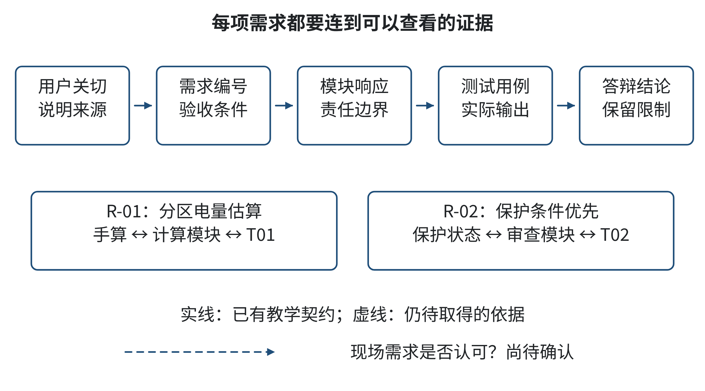
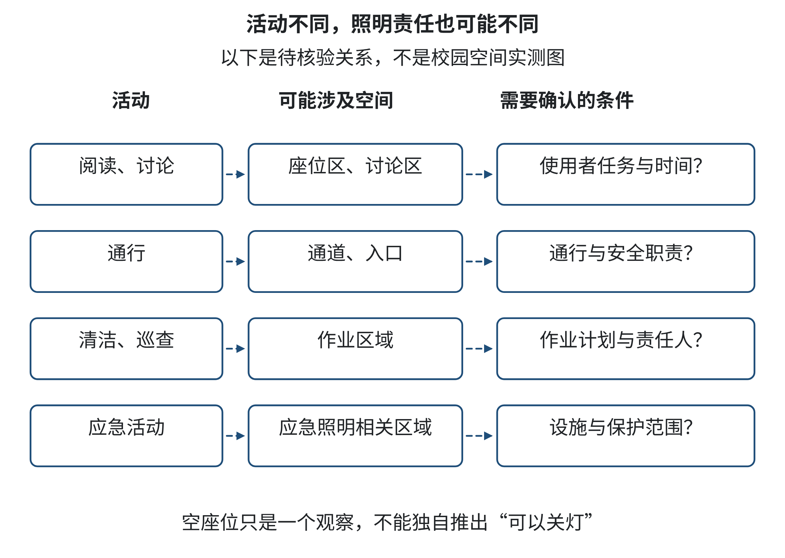
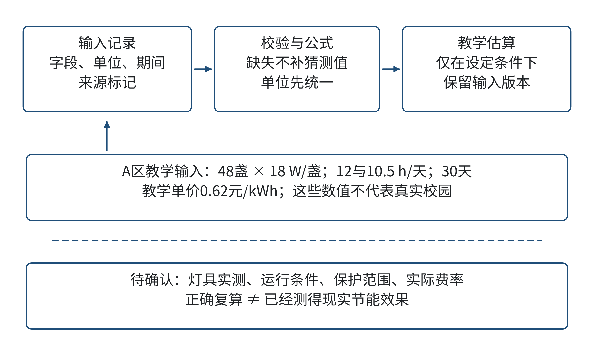
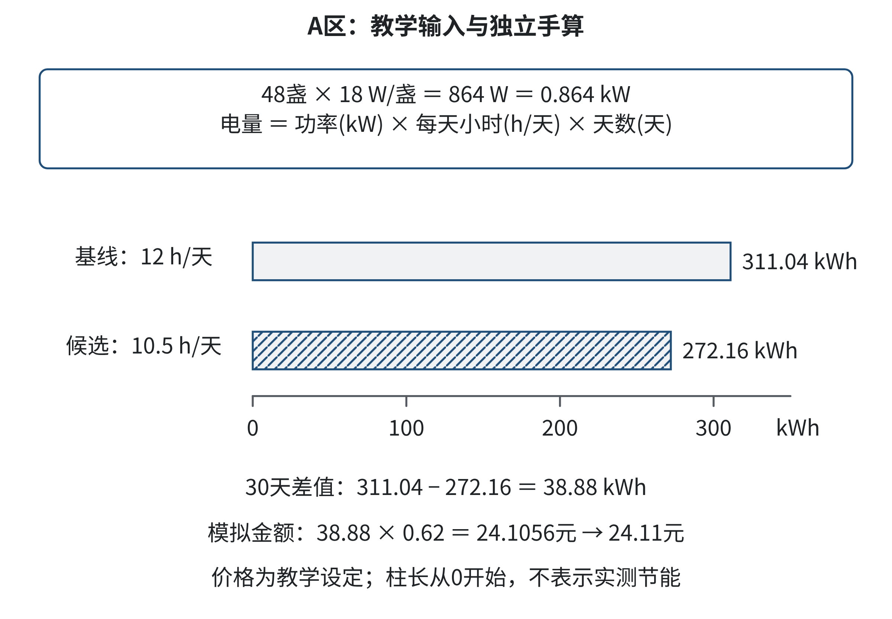
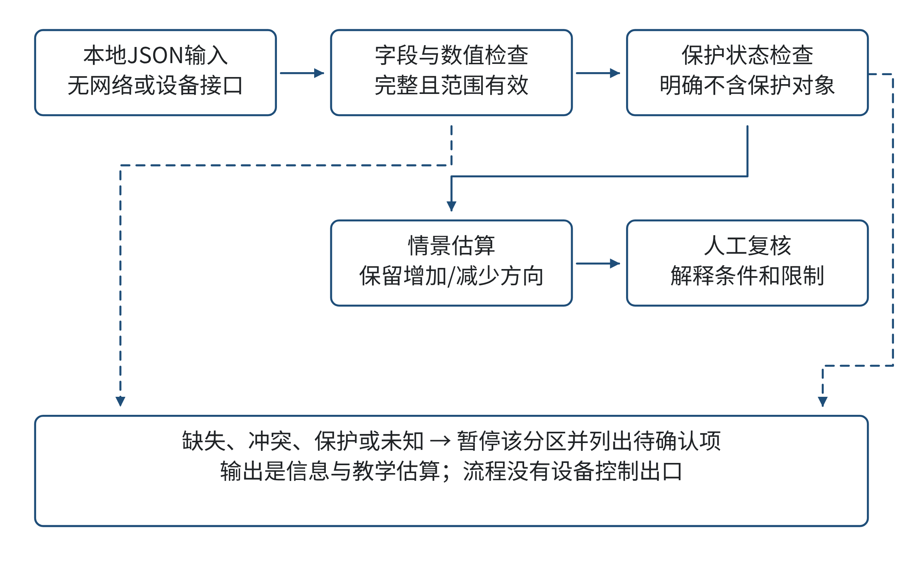
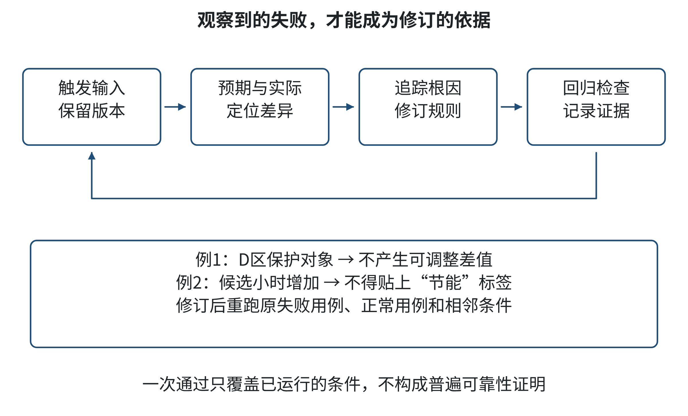
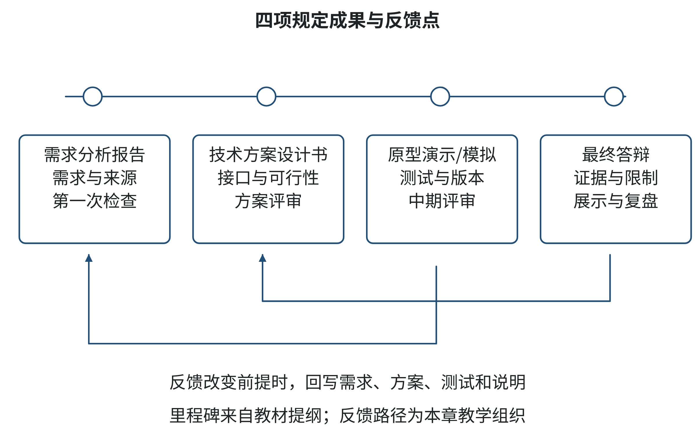
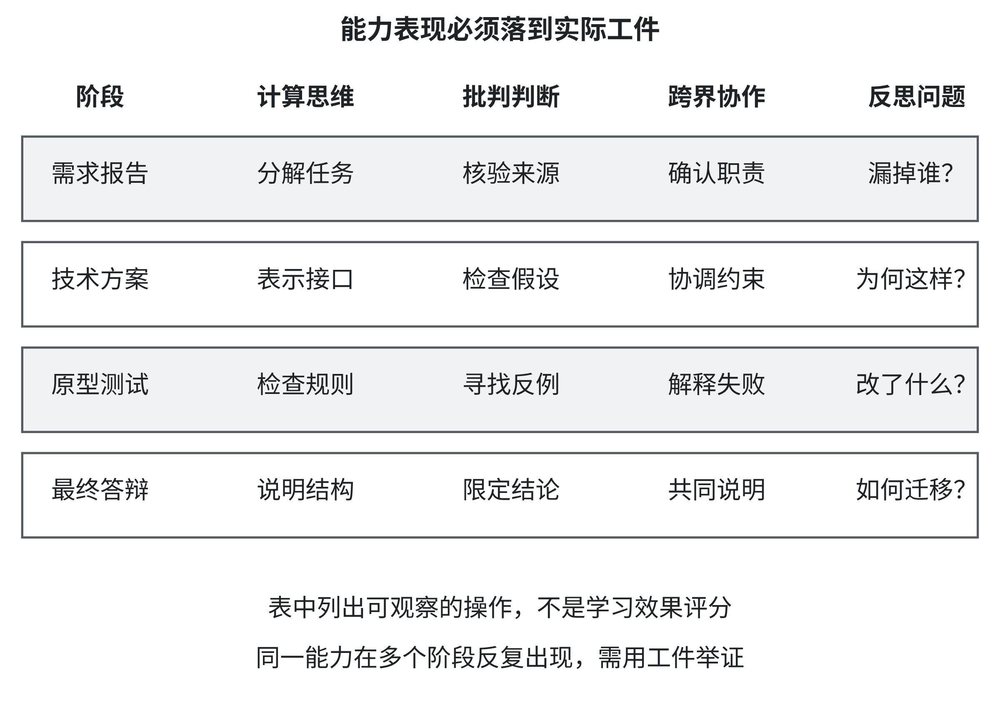

# 第六章 综合项目：面向[本校特色领域]的跨界解决方案设计 (PBL核心)

> 本章章题保留教材提纲中的“[本校特色领域]”校本占位，具体领域尚未核定。为让方法可以练习，本章使用“校园共享学习空间照明建议系统”作为教学项目。人物、空间、设备参数、观察记录、价格和计算结果均为作者自拟的教学材料，不代表西南财经大学或任何学校的真实调查、制度、能耗账单或用户意见。原型只在本机读取教学输入并生成待人工确认的建议，不连接灯具、传感器、校园网络或管理系统。

复杂项目常从一个看似简单的愿望开始：让共享学习空间更节能、更舒适。愿望本身还不是可实施方案。有人希望减少空置时段的照明消耗，有人担心晚间阅读和无障碍通行，有人需要预留清洁、巡查和应急照明时间。技术团队若一上来就写程序，可能只把最容易计数的“电量”当成目标；若只讨论体验，又可能没有可复算的方案。项目要把不同领域的关切放在同一张问题地图上，说明哪些判断有证据，哪些是待确认的假设，哪些工作只能由有职责的人决定。

本章将和你一起完成一个小组PBL项目：提出共享学习空间照明建议系统的需求，核对教学数据和计算边界，设计离线原型，测试异常输入与条件变化，再以报告、模拟结果和答辩展示方案。重点不在于“做出一个智能系统”，而在于你能否从问题出发，选择合适的技术深度，建立可以检查的证据链，并说明方案对不同使用者、维护者和资源管理者意味着什么。

## 学习目标

完成本章后，你应能：

- 把宽泛愿望改写成有用户、边界、目标和验收依据的项目问题；
- 从教学数据中区分事实字段、假设、未知项和冲突项，复算功率、时间、电量与教学模拟成本；
- 将用户体验、设施管理、计算实现、能源核算和责任边界共同纳入系统模块与决策流程；
- 制作或理解一个最小离线原型，并用正常值、缺失值、冲突值和条件变化检查它；
- 整理需求分析报告、技术方案、原型或模拟和最终答辩材料，回应质询并根据反馈修订。

## 学习路线

本章的学习路线依次经过选题与需求、证据与可行性、方案与原型、测试与迭代、展示与复盘。每一部分都留下一个能被后续使用的项目工件：问题陈述与需求表、证据和约束清单、模块与原型、测试记录、最终成果包。PBL不是把一个学期末的大任务提前布置给学生；项目问题需要持续追问，阶段性反馈要能改变作品，反思也要进入过程。PBLWorks列举的项目设计要素包括有挑战的问题、持续探究、真实性、学生声音与选择、反思、批评与修订及公开成果；本章用分阶段交付和模拟答辩落实这些要素，但不把某一机构的框架说成所有课程唯一的PBL定义[1]。

课堂可由三至五人组成小组，轮换承担需求联络、数据核验、原型实现、体验与责任检查、汇报记录等职责；成员人数不足时可合并职责，但最终每人都要能够解释完整方案。教师或同学扮演使用者、设施管理人员和评审者，所有“访谈意见”若由课堂角色扮演产生，须标注为情境模拟。项目可在纸上、电子表格或本章Python程序中完成；没有编程环境时，用计算器照着公式手算也能完成同一学习目标。


## 6.1 选题与需求：确定用户、目标和边界

### 导语

当一个团队听到“校园照明太浪费了”，很容易把它当成已经定义好的问题。可“太浪费”需要比较基线，“照明”包含多个空间与不同用途，“减少”也不意味着可以牺牲安全、阅读体验或必要运行。项目第一步不是追求漂亮方案，而是弄清楚谁遇到了什么问题、希望改变什么、哪些条件不可被方案越过。本节将从一个虚构的教学情境开始，练习把愿望改写成可调查、可讨论、可检验的需求。

### 6.1.1 案例：一条节能建议为什么被退回

课程小组收到一项模拟任务：为一处共享学习空间提出照明改进建议。组员把“空教室的灯有时还开着”写进需求表，随后用一份教学数据估算空置时间，提出缩短照明时段。方案初稿把一片区域的所有灯都列为可调整对象，预算表还把每减少一小时的运行直接换算成节省金额。

在课堂角色演练中，几位“利益相关者”提出了不同问题。晚间学习者说，座位区和通道的照明需求并不一样；一位使用轮椅的同学提醒，出口和转向处不能仅按“有人坐在座位”判断是否需要照明；扮演设施管理人员的同学指出，空间开放前后有清洁和巡查时段，表格没有记录；小组负责财务核算的同学发现，教学电价不等于学校账单上的实际费率，也没有考虑计量和设备改造费用。组员重新读了一遍需求表，发现记录的其实是“想减少照明时间”，而不是经过确认的“哪里、何时、在不影响何种活动的条件下可以调整”。

这个案例是课堂编写的虚构情境，没有真实用户访谈，也不反映任何校内实际投诉或照明状况。它呈现的问题却具有普遍的项目结构：提出者用一句目标压缩了许多具体判断；项目组先按可量化的数据作决定；未被记录的条件于是像不存在一样。把它当作真实调查报告会误导读者，因此我们要同时保留情境的教学价值与证据边界。

先做分析而不是批评某个角色。晚间使用者掌握日常任务体验，设施人员掌握开放、维护和安全流程，能源核算者关注功率、时间、计费口径，技术团队关心数据与流程如何表示。任何一方都不能单独代表“整体最优”。项目需要把意见变成可以检验的问题：哪些空间有不同用途？现有照明对象能否区分？开放时段、必要照明时段和可讨论的候选时段分别是什么？如何取得这些信息？谁有权确认？只有回答这些问题，算法或程序才有可靠输入。

图6-1把项目初始愿望连接到需求、设计、测试和答辩，图中每条连线都应能追溯一个明确的需求编号。读图时，请沿着一项需求向下追问：它由哪个用户或职责提出，用什么材料支持，在哪个测试中得到检查？如果某一需求没有对应测试，团队仍无法说明它是否满足。



图6-1 从项目愿望到验证证据的需求追踪链

来源：作者根据本章教学项目设计。

读图引导：从左向右追踪“用户关切—需求编号—系统响应—测试证据”；若某项关切没有落到测试或人工确认点，就在需求分析阶段补上。

### 6.1.2 从愿望到可讨论的问题

问题陈述是团队当前对“需要改变什么”的简明表述。它不应提前把解决方式写成问题。例如，“如何用AI控制灯光”已经预设了AI和自动控制；“如何降低共享空间的照明成本”可能忽略舒适和安全；“如何在保障不同活动需求的前提下，识别可以进一步核查的照明时段，并形成可解释的改进建议”则给调查和方案比较留出了空间。

在这个项目里，驱动问题可以写成：“怎样设计一个离线的照明建议原型，帮助项目组根据已确认的教学参数估算不同候选时段的电量变化，并把缺失信息、冲突条件和必须由人确认的事项清楚列出来？”这个问题有一个可以交付的结果：一份建议和待确认清单。它没有承诺真实节能，也没有授权系统控制设备。学生可以比较不同建议方式，而不必假装在掌握校内实测数据。

为了将驱动问题落实，项目组要分辨四类表达：

表6-1 需求表达类型与处理方式

| 表达类型 | 本项目例子 | 处理方式 |
|---|---|---|
| 目标 | 比较候选方案的照明用电估算 | 说明比较对象和时间范围 |
| 约束 | 不得把应急照明当作可关闭对象 | 将其作为硬边界并设置检查 |
| 偏好 | 希望输出易于阅读、便于打印 | 可比较方案，但不能覆盖硬约束 |
| 未知 | 当前计费规则、实际使用时段、照度和设备状况 | 标为待确认，不自行填入确定值 |

这张分类表不是现实管理制度，也不是法律判断。它帮助项目团队避免把“希望”误写成“必须”，或把“不知道”误当作“没有限制”。偏好之间可以权衡；硬约束一旦确认，就不能为了让结果看起来可行而偷偷放宽；未知项则需要补证据、请责任方确认，或者明确排除出本轮结论。

一条需求至少要能回答：谁提出、需要完成什么、在什么条件下成立、怎样判断完成、由谁确认。比如“系统能够估算每个分区候选方案的教学月电量差，单位为千瓦时，并显示计算输入”比“系统要准确”更可检查。这里的“准确”是相对于给定输入和公式而言，并不意味着它能准确预测真实用电。

表6-2列出本章情境中的角色与信息边界。角色为教学设计，不表示这些人员已经真实访谈或认可任何方案。用户体验、设施运行、能源核算、计算实现和责任审阅共同改变项目问题；跨界合作不是把多个专业名称堆在首页，而是让不同知识实际影响需求、数据、设计和评价。

表6-2 项目相关角色、关切与待确认信息

| 角色（教学情境） | 主要关切 | 可提供的材料 | 团队仍需核实 |
|---|---|---|---|
| 晚间学习者 | 阅读、讨论、通行和休息区域的体验 | 情境化任务描述、模拟反馈卡 | 真实使用时间、区域差异、不同人群需求 |
| 无障碍体验审阅者 | 入口、转向、标识与通道的可识别性 | 纸面任务走查、可访问性检查问题 | 实际建筑条件、用户体验及适用标准 |
| 设施管理角色 | 开放、清洁、巡查、维护和应急流程 | 课堂模拟的职责清单 | 真实流程、责任人和不得调整的设备 |
| 能源核算角色 | 功率、时间、单位、价格口径 | 教学设备参数与计算公式 | 实际电表、账单和计价方式 |
| 原型开发者 | 输入、计算、状态、错误提示 | 本章数据结构和程序 | 输入来源、异常处置、版本和操作权限 |
| 项目评审者 | 证据、可行性、影响和表达 | 评审提问卡、评分维度 | 真实评审意见和实施决策 |

### 6.1.3 用户任务、领域约束与系统边界

“用户”不是一类整齐划一的人。共享空间可能承载个人阅读、小组讨论、短时通行、清洁和设备维护。需求描述若只写“学生”，就会把任务差异藏起来；若只记录“开灯/关灯”，就可能忽略空间分区、灯具组合和操作权限。学生不需要在本章第一步制作复杂的人群统计模型，可以先写出少数有代表性的任务场景，并说明哪些内容来自给定材料、哪些只是待验证假设。

一张简易任务卡可以包括：用户处境、需要完成的活动、当前困难、对结果的期待、可能受影响的人，以及证据状态。例如：“一位晚间自习者从座位走到出口，需要辨认通道和门的位置；教学情境假定通道灯与座位灯可分区，但实际布局未核验；设计问题是建议界面怎样提醒评审者单独检查通道照明。”任务卡不会替用户发言，它只让团队看见还缺什么。

领域约束会改变技术可行性。设施管理关心谁可以提出变更、谁负责核验、哪些设备需要保持原状态；人机交互关心建议是否易懂、错误是否可发现；能源核算关心功率和小时是否使用一致单位；安全与无障碍体验提醒团队，座位是否有人不能自动代表通道是否需要照明。计算机专业学生可以实现数据结构和计算流程，却不能仅凭代码决定照明要求、校内权限或现实责任。

因此，本章原型将系统边界定为“候选建议计算与展示”。输入是人工整理的教学参数，处理是透明的算术和状态检查，输出是每个区域的估算及待确认项目。系统不采集人流，不识别个人，不控制灯具，不生成实时开关指令，不提供照度合规结论，也不替代电气、安全、无障碍或财务人员的审查。边界不是产品介绍里的免责声明，而是架构、输入和输出的真实限制。

图6-2把阅读、讨论、通行、清洁和应急活动连接到座位区、通道或入口，再把尚未核实的连接指向责任确认。实线表示教学情境中要讨论的活动关系，虚线和问号表示布局或规则仍待核验；“空置”因此不能直接推出“可以关灯”。读图时，请找出哪些关系必须由现场走查或有职责的人补证，而不是由模型推断。



图6-2 空间活动、照明区域与责任条件的关系

来源：作者根据本章教学情境设计；关系为待核验的示意。

读图引导：区分已经给定的教学假设、尚待现场核实的关系和不可由原型自行决定的事项；虚线不是已存在的校内设施事实。

### 6.1.4 把目标改写成可验收需求

将项目目标拆成几类可检查需求，能够减少“做完了但说不清完成什么”的情况。功能需求说明系统应做的事，例如读取各分区的灯具数量、单灯功率、基线小时和候选小时，计算候选电量差；信息需求说明每个输入从何而来、单位是什么、是否已确认；质量需求关注输出是否能被理解、是否能复算、异常是否可见；边界需求说明哪些设备和决定不进入系统；交付需求规定学生最终要提交哪些报告、代码、测试记录与答辩证据。

需求还要有优先级。最低交付能力包括：单位明确、计算可复核、缺失或冲突时不输出确定建议、应急照明边界可见、每项结果保留输入。较高层的能力可能包括多情景比较、无障碍界面检查和版本对照。优先级不代表后者不重要，而是让团队知道在时间有限时，什么是项目能否安全演示的基础。

做一个初始小示范。假设教学区域A有48盏灯，每盏18瓦，基线每天运行12小时，候选方案为10.5小时，比较30天。先将瓦换算为千瓦：48×18瓦=864瓦=0.864千瓦；每天候选减少1.5小时，所以教学估算减少0.864千瓦×1.5小时/天×30天=38.88千瓦时。若仅为课堂算术练习，暂设模拟电价为0.62元/千瓦时，则模拟金额差为38.88×0.62=24.1056元，按分四舍五入为24.11元。功率乘时间得到电量，电量乘单价才得到金额；不要将24.11元写成现实账单节省。

这个算例只教学生复算单位与输入关系。它没有证明候选10.5小时适合真实空间，也没有扣除灯具、驱动、电路、维护、改造、人员安排或计量误差。它的“结果”是条件句：如果给定的灯具数量、功率、两种运行小时和模拟费率都成立，且候选运行时间可由责任方接受，那么数学模型计算出这个差值。项目答辩必须把条件说出来。

### 6.1.5 形成需求分析报告：第一道里程碑

原提纲规定的第一项里程碑是需求分析报告。该报告应让不在小组中的读者判断：团队是否理解了问题、依据是否充分、哪些边界没有解决。建议包含项目问题与驱动问题、用户任务、相关角色、已知信息和未知项、硬约束与偏好、系统范围与非目标、需求编号和验收方法、风险与下一步调查计划。报告可以先短，但必须清楚地区分信息类别。

每个需求可使用如`R-01`这样的稳定编号。举例：`R-01：程序对每个分区计算候选月电量差，显示输入功率、基线小时、候选小时和天数；核验：用手算样例复算；责任：计算模块。`另一项`R-02：包含应急照明的分区不生成可执行调整建议；核验：输入边界测试；责任：输入审查与状态逻辑。`R-03：用户看见模拟电价属于教学设定；核验：运行输出与答辩检查；责任：界面和报告。`需求应该可以被后续设计和测试引用，而不是留在头脑风暴白板上。

质量较高的需求还会说明来源与确认人，例如`来源：教学数据包`、`状态：本章示范值`、`待确认：现场使用情况`。团队如果没有真实用户或设施人员参与，也可以完成课程设计，但必须把访谈写成“拟议问题”或“课堂模拟”，不能生成一段听起来逼真的访谈结果。

### 6.1.6 让小组决策可以追溯

跨界小组可能在目标上并不一致：能源核算角色希望缩短候选时间，体验审阅者希望保留阅读和通行便利，开发者希望尽快稳定字段，答辩负责人则想把结论讲得简洁。这些差异不一定意味着有人不合作；它们可能来自不同职责和掌握的信息。团队需要一套轻量的讨论办法，使意见不会被职务较高或发言较多的人自动取代。

可用一页项目约定记录：当前驱动问题、共同底线、谁承担什么职责、怎样提出异议、怎样记录未知项、由谁决定下一次检查是否通过。任何人都可以提出资料或逻辑问题；涉及现实设施和责任的事项应由课程模拟角色转交有职责的人确认；对于教学原型本身的设计，团队可在约定范围内投票或轮值决策。课堂小组没有现实审批权，因此“多数人同意”不能把设备风险改成已确认。

团队会议也可记录决定日志，每条只需写清日期、问题、可选路径、采用路径、证据或理由、未采纳意见及后续检查。例如，小组选择纯离线JSON输入，理由是当前项目目标只要求展示可复算流程，而没有设备授权和真实数据；另一种联网数据方案暂缓，原因是需要新权限、隐私和运营审查。这样做既保存技术取舍，也让未来接手者知道为何没有继续扩展。

项目范围随着证据变化可能扩大或收缩。若小组发现“候选小时”并非用户能调整的参数，而是空间运营制度规定的时间表，就应重新界定问题，不要为了保留既有代码而硬把它当成软件输入。反过来，如果一项需求无法在课程时间里解决，可以列为下一阶段计划，并说明本轮仍能回答的子问题。范围变更要同步影响需求编号、测试集、演示话术和评分目标。

### E01 基础训练：为一个小空间写需求卡

请两至四人组成小组，使用以下完整教学材料，制作一张项目需求卡，不需要访问真实校舍。情境：一间共享学习室有座位区、通道和入口。教学假设是三个区域可能采用不同灯具分组；实际空间布置未知。课程目标是讨论是否值得进一步比较不同分区的照明候选方案。你可以为座位阅读、短时通行、清洁和应急活动提出问题，但不得把任何自拟回答写成真实调查。

任务：写出一条不预设AI或自动控制的驱动问题；列出至少三个角色及其不同关切；分别给出两个硬约束、两个偏好和三个未知项；写出四条带编号的可验收需求；为每条需求指定一种证据或测试方法；标记一项若未确认就不得生成确定建议的条件。交付为一页需求卡和三分钟口头说明。若使用生成式AI协助改写，须保留原始需求、记录其改写内容，并由小组逐项核对；不能让AI代替真实访谈或替角色承诺。

评价时检查五件事：驱动问题是否允许比较多种解决路径；角色是否确实影响设计，而非只列专业名称；硬约束、偏好、未知是否分开；每项验收方法是否能看见证据；是否明确谁负责确认现实条件。没有现实资料时，正确成果可以是“尚需核实”，而非填写一个貌似完整的数值。

### 本节反思

回看你刚才写的需求卡。最初的愿望在哪一步变成了项目问题？有没有因为某项信息容易测量，就把它误当成最重要的目标？哪些人的活动被你先想到，哪些活动容易被遗漏？若团队现在没有条件获得真实数据，你能交付什么可信的学习成果，又必须把什么结论留白？

需求会随着证据变化而修订，这不是团队失败，而是项目认识逐步变好的表现。真正需要警惕的是：在没有核实输入时提前承诺效果，或者把待确认事项藏在实现细节里。下一节将把需求放进证据、单位和可行性检验中，进一步判断哪些结论现在可以算，哪些还只能作为问题提出。


## 6.2 证据与可行性：数据、资源和风险

### 导语

需求表告诉我们“应该回答什么”，却不能自动告诉我们“答案是什么”。项目组可能拿到灯具铭牌、空间开放时间、观察记录、账单或一段AI生成的解释，每种材料能支持的结论不同。若把估计值当成实测值，或把模拟电价当成实际价格，计算再精确也会造成误导。本节从一份明确标为教学示例的数据表开始，练习追踪信息来源、核对单位、比较方案，并判断技术和跨领域条件是否足够支撑下一步。

### 6.2.1 案例：一张“节省金额”表格的证据链

项目组把三处教学分区的灯具数量、单灯功率、基线运行小时和候选运行小时录入表格，设置比较期为30天，暂用0.62元/千瓦时作为课堂模拟单价。计算结果显示，三处分区的候选用电量合计比基线少99.36千瓦时，按模拟单价相乘，差额为61.60元。另一处区域混有应急照明，表格中的“候选小时”虽然更短，但项目组没有把它纳入金额计算，而是将其标为需要责任人员确认。

组员起初准备在封面写“月省61.60元”。核对数据后，他们发现这句话把三个未确认的前提压成了一个肯定承诺：教学给定的灯具数和功率是否适用于现实设备；候选小时是否能够在实际工作流程中采用；实际电价是否与模拟单价一致。表格的算术可以完全正确，而结论仍可能过度。

分析这个案例时，要把三种判断分开。第一，计算判断：给定的数字带入公式后，结果是否复算一致。第二，证据判断：这些数字来自哪里，是否代表现实系统，资料有没有时间和范围限制。第三，决策判断：即使候选情景在计算上可行，是否有权实施，是否会影响安全、使用者或维护流程。前一种正确不能替代后两种判断。

项目组最后把表格标题改成“教学情景下的候选方案电量与模拟金额差”，并在备注里写明所有数值皆为作者自拟教学参数；真实设备、账单、时段和审批流程均未核验。这个改名不是文字游戏，而是把证据允许的结论边界写回交付物。没有证据时，项目可以交付一个可复算的模拟，不可以把它包装成对校园节能效果的实测证明。

图6-3展示从数据来源到结论表达的证据路径。每份输入应保留来源、单位、时间范围、责任状态和转换方式。若数据经过整理或AI辅助提取，团队还要能从结果追溯至原始材料。读图时，请检查“教学假设”与“现场观测”是否在同一个字段里混淆，以及一条估算结论是否越过了它的输入边界。



图6-3 教学数据、来源标记与结论边界

来源：作者根据本章项目的数据治理流程设计。

读图引导：沿每项结论反向追踪计算输入、单位和来源状态；没有真实来源的数值必须标为教学设定，不能通过换一张图表升级为实测数据。

### 6.2.2 先认识数据字段，再计算

本章的离线原型读取一个JSON文件。JSON是一种用文字表示对象、列表、数字和字符串的数据格式；你可以把它理解成带有字段名的结构化记录。本项目里，最外层有比较天数、教学模拟电价和分区列表；每个分区有标识、名称、灯具数量、单灯额定功率、基线小时、候选小时、是否包含应急照明，以及数据来源说明。字段名让程序知道某个数字代表什么，但它不能证明数字真实。

每一列数据至少要说清四件事：含义、单位、来源、确认状态。灯具数量单位是“盏”，单灯额定功率是“瓦/盏”，每天运行时长是“小时/天”，比较周期是“天”，电量是“千瓦时”，模拟单价是“元/千瓦时”，金额是“元”。若单位遗漏，24可能表示24瓦、24盏、24小时或24元，程序不一定能发现语义错误。

我们用一张轻量数据字典把含义显式写出：

表6-3 教学原型的数据字典

| 字段 | 含义及单位 | 本章来源状态 | 主要校验 |
|---|---|---|---|
| `lamp_count` | 分区灯具数量，盏 | 自拟教学输入 | 正整数，且大于零 |
| `watts_per_lamp` | 单灯额定功率，瓦/盏 | 自拟教学输入 | 大于零；铭牌与实际负载未核验 |
| `baseline_hours_per_day` | 基线每日小时数，小时/天 | 自拟教学情景 | 0至24之间 |
| `candidate_hours_per_day` | 候选每日小时数，小时/天 | 学生可修改的教学情景 | 0至24之间；允许大于基线，并明确标记为候选情景估算增耗，不称节能建议 |
| `period_days` | 比较期，天 | 教学设定 | 正整数 |
| `teaching_price_cny_per_kwh` | 模拟价格，元/千瓦时 | 任意课堂演示参数 | 非负；不能称实际费率 |
| `emergency_lighting_status` | 是否包含应急照明：`confirmed_yes`、`confirmed_no`或`unknown` | 人工输入的边界信息 | `unknown`或`confirmed_yes`时不得产出可调整建议 |
| `source_note` | 数值与边界条件的说明 | 记录字段 | 空白时需提示补充来源 |

在这个JSON接口中，灯具数量和比较期必须是JSON整数，布尔值`true`不能代替整数；灯具功率、基线与候选小时、模拟单价必须使用JSON数字。写成带引号的数字字符串（例如`"18"`）或布尔值都属于类型错误，不会被悄悄转换。这样的类型检查只能确认输入形式符合接口，不能证明数值的现实来源。

二元标志只有“真/假”两个状态，但现实信息往往还有“未知”。如果团队把“没有记录应急照明”直接解释成“没有应急照明”，就会把缺失误当作否定。更稳妥的数据结构应当区分“已确认不包含”“已确认包含”“未知”。本章最小原型用`emergency_lighting_status`表达这三种状态；缺失字段、无法识别的拼写或`unknown`都不被当作“已确认不包含”。真实系统若扩展，也应保留这种区分。

### 6.2.3 能源估算：让单位暴露假设

功率描述某一时刻的能量使用速率，单位瓦（W）；电量描述一段时间里累计使用的能量，常用千瓦时（kWh）。1千瓦等于1000瓦。若每盏灯的额定功率为18瓦，有48盏，则总额定功率为48×18=864瓦，也就是0.864千瓦。这里暂且假定所有灯具同时开启并按额定功率运行；实际负载、调光方式、镇流器或驱动损耗、设备状态等均可能改变结果。

在上述假设成立时，某情景电量估算为：

**电量（千瓦时）= 灯具数量（盏）×单灯功率（瓦/盏）÷1000×每日运行小时（小时/天）×比较天数（天）。**

由于`盏`和`天`分别约去，最终单位为`千瓦×小时`，即千瓦时。候选节电估算是基线情景电量减去候选情景电量；如果候选运行小时多于基线，差值会为负，表示按当前数据候选情景反而增加估算电量。项目不应把负数改写为零来掩盖变化，而应显示情景方向。

沿用上一节的区域A数据：总功率为0.864千瓦，基线每天12小时，候选每天10.5小时，比较30天。基线估算为0.864×12×30=311.04千瓦时；候选估算为0.864×10.5×30=272.16千瓦时；差值为311.04−272.16=38.88千瓦时。另一种算法是0.864×(12−10.5)×30，结果仍为38.88千瓦时。两条路径结果一致，构成一个简单的交叉核验。

金额不是电量的同义词。课堂模拟金额差为节电估算（千瓦时）×教学模拟单价（元/千瓦时）。本章设定的0.62元/千瓦时只是为了教学时演示单位相乘；它不是从学校、电力供应商或账单取得的实际费率。区域A的模拟金额差为38.88×0.62=24.1056元，按人民币分四舍五入显示为24.11元。若比较周期或单价变化，金额会变化；成本核算也尚未纳入设备、改造、维护、人工、税费、需量、电价分时或其他计费因素。

表6-4展示三个可计算区域及一个保护边界例子。表内值都是本章自拟的教学数据，表格中“估算差额”只表示特定假设下的算术结果。包含应急照明的D区不参与可调整方案计算，即使输入其他参数看起来完整，也只输出待人工确认状态。

表6-4 教学情景分区参数与候选电量差

| 分区 | 灯具数（盏） | 单灯功率（瓦/盏） | 基线（小时/天） | 候选（小时/天） | 30天估算电量差（千瓦时） | 处理状态 |
|---|---:|---:|---:|---:|---:|---|
| A座位区 | 48 | 18 | 12 | 10.5 | 38.88 | 可作教学估算，须人工复核 |
| B讨论区 | 36 | 24 | 14 | 12 | 51.84 | 可作教学估算，须人工复核 |
| C静读区 | 24 | 12 | 10 | 9 | 8.64 | 可作教学估算，须人工复核 |
| D入口边界区 | 20 | 18 | 15 | 14.5 | 不计算 | 包含应急照明，等待责任方确认 |

A、B、C三处的估算差合计为38.88+51.84+8.64=99.36千瓦时。以0.62元/千瓦时乘算，模拟金额差为61.6032元，显示为61.60元。总量相加成立的前提是三处分区不重复计数、比较周期相同、设备功率口径一致。若区域共享电路或输入来自不同时间段，直接相加可能重复或不具可比性；此时要先整理测量边界。

图6-4先把48盏×18瓦换算为0.864千瓦，再分别计算区域A的基线311.04千瓦时和候选272.16千瓦时，最后得到38.88千瓦时及24.11元的教学模拟金额。功率换算、小时与天数相乘、电量再乘模拟单价被分成连续步骤；逐步读单位可以发现漏除1000、把元/千瓦时误写成元/千瓦或把单日差额误说成月差额等错误。



图6-4 从功率与时长到电量及模拟金额的单位核算

来源：作者根据本章教学数据与公式制作；费率为教学设定。

读图引导：从W换算到kW，再乘小时和天数得到kWh，最后乘教学模拟费率得到元；逐步核对每个单位和期间。

### 6.2.4 证据的强弱、未知与AI辅助

项目证据可以来自设备铭牌、现场观察、管理记录、使用者反馈、公开标准、技术文档或教学假设。它们回答的问题不一样。铭牌可能说明额定参数，不一定反映实际功率；观察记录可能呈现某个时段，不一定代表整个学期；使用者反馈能帮助发现体验差异，却不单独证明能耗；公开标准或指导资料提供适用范围，不能直接替代本地审批或现场检测。团队要写清证据类型，不给来源贴一个笼统的“可信”标签就停止分析。

一个简单做法是建立证据表，列出“主张、所需证据、已获得材料、局限、下一步”。例如，主张“某区域夜间存在可调整照明时间”，至少需要知道空间开放时间、该区域的实际任务和必要照明边界；当前教学数据只能让学生练习估算，不能支持真实校园结论。再如“分区方案有助于减少不必要照明”，需要了解电路或控制边界，不能因图上画了三块区域就断言现场可以分别控制。

生成式AI可以协助整理资料摘要、列出潜在使用者问题、检查表格字段或生成测试情景，但它给出的内容仍需要追溯原始材料。NIST的生成式人工智能风险管理文件把其定位为AI风险管理框架的补充资源，并提出按治理、识别、测量和管理风险组织行动；该文件也说明具体风险随使用场景与生命周期变化[2]。本章据此只借用“先界定场景、识别影响、安排检查、跟踪变化”的组织思路，不声称照明原型经过NIST认证，也不把NIST建议变成现实合规结论。

可以让AI提出“项目还缺哪些证据”，但团队须把每条建议分类：可从原始文件直接验证的事实、需要领域人员确认的流程问题、不能由现有材料回答的未知项、与任务无关的泛泛提醒。AI可能生成虚构的设备规格、法规编号或研究结论；若它把某条规则说得十分肯定，学生仍需找到原始出处，核对适用范围和日期。没有来源就删除或明确标为待查，而不是把流畅程度当作证据。

### 6.2.5 跨领域可行性与影响边界

可行性不是“代码能不能运行”一个问题。计算可行性关心输入能否表达、规则能否执行、输出能否复算；运营可行性关心责任、时段、维护、权限和人工流程；体验可行性关心不同人的活动和通行；资源可行性关心设备和人力是否可得；经济可行性则需要实际计价、投入和持续维护信息。本项目没有取得现实校内数据，因此只能对教学原型的计算可行性做实测，对其他维度形成问题清单和模拟评估，不得写成现实可行性结论。

照明不仅是能源数据。若学生设计屏幕原型，文字和状态提示应清楚可辨，不要只靠红绿颜色区分“通过”和“待确认”。W3C的WCAG 2.2成功准则1.4.3针对网页文本提出最低对比度要求，并有大字例外等具体范围[3]。它可以帮助团队讨论界面文本是否容易阅读，但不能直接证明实体空间的照度、眩光或无障碍通行符合要求；网页文字对比度标准和建筑照明测量是不同的问题。真实项目需要查找适用于具体环境的权威资料并由有资质人员确认。

经济讨论也应分开“理论节电量”“电费估算”和“净成本”。理论节电量基于功率与时间；电费估算还需实际计价结构；净成本需包含设备、安装、维护、替换、人工和其他影响。学生不得把某个模拟金额当作采购决策或投资回报建议。对一次性费用和日常费用的比较，可以在方案阶段列出信息需求，但没有真实报价与财务情境时，不给出回收期或商业结论。

责任分析可用“谁提出、谁核验、谁批准、谁实施、谁观察、谁可以暂停”六个问题展开。一个原型可以建议某时段进一步调查，设施责任人才能确认真实运行边界；有安全职责的人判断需要保持的照明；使用者反馈提醒方案是否带来困难；学校指定的决策主体才决定是否试点。若项目超出学生课程权限，答辩成果应停留在设计和模拟层面。

### 6.2.6 技术可行性分析与竞品调研：第二项准备

原提纲要求进行技术可行性分析与竞品调研。这里的“竞品”不一定意味着学生要购买商业系统。可以先整理常见方案类别：固定时段策略、分区计时、人工巡查提醒、由管理平台提供的统计报表、基于传感器的自动响应。对每种方案，记录它需要什么输入、会产生什么输出、谁维护、哪些风险尚未评估。若引用具体产品或公开案例，必须取得真实、当前、可追溯的一手资料；本章不虚构产品名称、功能、价格或实测效果。

用方案比较表关注可比维度：需求覆盖、数据要求、实现复杂度、可解释性、人工确认、无障碍与安全影响、维护成本信息、故障时退路。没有证据的栏写“未知”，而不是给一个看似精确的分数。对教学项目而言，手工表格、离线程序和假想的联网系统可以作为不同设计选项；联网系统需要真实设备、网络、隐私和安全审查，本章不实现也不声称可部署。

技术可行性分析要写明基础条件、关键风险和替代方案。例如，若输入字段缺失，程序能否拒绝输出确定建议？若当前无法获取现场数据，能否用明示的教学数据验证算术？若编程环境不可用，学生能否手工复算？若AI工具不可用，小组能否用检查表提出同样的风险问题？这些替代能力让项目不会因工具或资料不可得就伪装结论。

### 6.2.7 建立基线和观察计划

如果项目从课堂模拟转向真实现场调查，团队首先要写明“基线”代表什么。它可能是某类灯具在规定时段内的额定功率估算，也可能是电表记录的总用电，还可能是空间管理方提供的运行时间。三种口径不能直接互换。每个候选方案都要与相同边界和周期下的基线比较，否则差额没有可解释的参照。

观察计划要回答时间、地点、记录对象、频率和权限。若团队只在一个工作日午间看到空间空置，不能据此描述夜间或周末；若数据来自某个区域，也不能自动推广到整栋楼。计划可先覆盖不同时段和不同类型的日子，再根据课程目标决定是否需要扩展。样本量不大时，应如实写“探索性观察”并列出局限，而不是使用“校园普遍规律”等表述。

记录方法要尊重隐私和必要性。本项目学习目标不需要识别具体学生，因此课堂原型不采集姓名、面部、学号或个人轨迹。真实调查若仅需了解某区域在某个时点是否有人，可以探讨由授权人员以不识别身份的方式记录；若确实要采集更敏感的数据，则需先确认授权、告知方式、保存和访问规则，并重新审视是否有更低侵入的办法。把“没有采集个人数据”写进边界，也是一项可检查的设计决定。

多个来源对同一字段给出不同值时，不能任意选择更方便的一个。团队可以保留来源和采集时间，标记差异，提出需要谁确认；如果差异不影响演示，可以选择一个明确标记为教学假设的值运行，但不能覆盖原记录。版本表记录字段变化，避免后续答辩者不知道结果为何变动。

竞品或替代方案研究也可使用同样的证据纪律。收集公开资料时，保存页面或文档标题、日期、具体功能描述和适用场景；把“产品宣称的能力”和团队独立测得的结果分栏记录。课程里没有条件实际试用或核对功能时，写“公开资料说明”或“待验证”，不要声称产品具有未经确认的功能。对比的目的在于为设计选择提供依据，而不是为了证明自己的方案必然更好。

### E02 基础应用：校验一组教学估算

材料：区域X有20盏额定功率为15瓦的灯，教学基线为每天11小时，候选为9.5小时；比较期30天；模拟电价0.62元/千瓦时。全部参数为教学设定。另有区域Y，记录为“18盏、每盏20瓦、基线10小时、候选12小时”，并注明“是否包含应急灯未知”。

任务：独立计算区域X的基线与候选电量、差值和模拟金额差；为区域Y决定程序应给出何种状态；把两个区域的证据等级、至少两个未验证的现实前提和需要谁确认的事项写进半页审查记录。最后把比较期改为31天重新计算区域X，并说明新旧金额差为什么不能只靠四舍五入判断变化大小。

成果：一张含公式和单位的计算卡、一条区域Y处理说明、一份边界清单。评价标准：复算正确；单位完整；将价格标为教学参数；没有把未知应急照明状态当作“无”；能够区分程序计算、数据真实性和实施决定。没有使用电脑也可以完成。

### 本节反思

哪一个数字最容易让你误以为项目已经“有证据”？数据来源、单位、时间和确认状态中，哪一项最容易在整理时被丢失？当AI给出一条看似可靠的能源或标准信息，你会如何回到原始材料？如果一个方案的电量估算很吸引人，但安全和维护信息仍未知，你应该如何表达可行性？

计算的价值在于把条件和推理暴露出来，便于别人检查；它不能替未获得的证据填空。下一节会把当前需求和证据组织成技术方案，并实际运行一个只做教学计算的离线原型。一个合格的方案不仅说明“如何得到建议”，还要定义何时不输出建议，以及谁必须接手确认。


## 6.3 方案与原型：模块、接口和关键流程

### 导语

有了需求和证据，项目才适合进入设计。设计不是先选一个热门算法，而是说明输入如何进入系统、每一步如何处理、输出由谁解释，以及什么情况下流程必须停下来。本节从纸面流程开始，再把同一逻辑变成一个可在本机运行的最小Python原型。程序只为教学数据计算候选电量差，不控制设备；没有编程环境时，手工复算仍是有效的同等路径。

### 6.3.1 案例：先画清“建议”的含义

在模拟评审中，组员展示一页原型：左侧是三处分区输入，右侧列出候选电量差和模拟金额差。评审者问：“这是不是会在晚上自动关灯？”负责开发的同学解释：“不会；它只读取给定文件，输出一个供人讨论的候选估算。”另一位评审者继续追问：“如果电价没填，或者D区是否包含应急灯未知，会显示什么？”组员点击一个测试输入，原型对缺失资料显示“待补充”，对D区显示“需要人工确认”，没有给出能执行的开关时间。

这段是课堂演示脚本，不是已经开发或投入使用的校内系统记录。案例表明，系统是否“智能”不由名称决定，而由它实际输入、处理、输出和权限边界决定。如果界面把候选估算显示为“自动节能指令”，即使后台程序只是计算，也会让用户误解它能做什么。原型要让数据状态和人类责任一同可见。

我们先沿需求追踪链建立接口。`R-01`要有分区参数输入、公式计算和结果显示；`R-02`要有保护条件输入和暂停状态；`R-03`要显示教学价格属性；`R-04`可以要求输出中保留依据与待核实项。由此形成组件职责，而不是把所有逻辑塞进一个难以检查的大函数。

图6-5展示离线原型的模块关系与人工关口：数据读取、完整性检查、单位和约束校验、估算、结果呈现。只有完成必要检查的候选情景，才进入“可提交人工复核”状态；缺失、冲突或保护状态会阻断确定性建议。箭头表示信息流，不代表灯具或校园平台的控制流。读图时请沿异常路径追踪，确认每种异常都能停到人工处置节点。



图6-5 离线建议原型的模块与人工确认关口

来源：作者根据本章项目边界设计。

读图引导：从输入向输出追踪；出现缺失、数值越界或保护区标记时，应进入暂停和人工确认路径，不跨过检查直接生成调整指令。

### 6.3.2 从手工流程到程序模块

最容易理解的流程如下：第一，读取一个明确指定的本地教学数据文件；第二，检查数据结构和必要字段是否存在；第三，检查字段类型、单位范围、比较时长和保护条件；第四，对通过检查的区域计算基线与候选电量；第五，列出模拟金额差、假设和未完成事项；第六，把结果交给团队和有职责的评审者阅读。输入不通过检查时，流程输出具体原因并停止计算该项。

这个流程可以拆成五个相互配合的模块：

1. **输入模块**只读取本地JSON，不连接网络。它不从环境变量、数据库或真实校园平台自动补入数据。
2. **结构与状态检查模块**核对顶层比较天数、模拟单价、分区列表和每个分区必需字段；检查数值范围、重复编号、缺失字段和保护标记。
3. **估算模块**对通过检查的区域执行单位换算和电量差计算，不自行推测时间、功率或价格。
4. **结果模块**保留原输入、显示计算、单位、教学设定和状态；任何四舍五入都不覆盖内部未舍入值。
5. **人工审阅模块**由项目组或教师读取结果、核实来源、确认体验和责任事项。它不是自动化软件组件，而是工作流程中必须存在的人类判断点。

以“接口”思考组件关系，能避免一个模块偷偷替另一个模块作决定。输入模块只说“文件里有这些字段”；校验模块说“本字段满足本原型的格式限制”；估算模块说“按公式和输入计算的差值为多少”；人工审阅者才判断数据来源是否符合实际、是否允许进一步讨论。功能边界清楚后，测试也能针对每个接口设计。

表6-5对照关键模块、输入、输出与责任。它帮助项目组避免把“模型”一词当成全部技术方案。项目若没有训练AI模型，也能有清楚、可验证的计算流程；若未来引入AI做资料分类或自然语言解释，则要将它作为可选、可检查的辅助组件，而不是不加说明的权威来源。

表6-5 模块接口、输出和责任分配

| 模块 | 输入 | 输出 | 责任与检查 |
|---|---|---|---|
| 本地数据读取 | 指定JSON文件 | 结构化记录或读取错误 | 不访问外部数据；记录所用文件版本 |
| 字段与边界校验 | 结构化记录 | 通过、缺失、冲突或保护状态 | 不替缺失项填值；检查范围和单位 |
| 情景估算 | 通过校验的数据 | 基线、候选与差值，单位为kWh | 逐项复算；仅对教学输入给出教学估算 |
| 结果呈现 | 计算结果与状态 | 可读报告和待确认清单 | 明确模拟价格、来源、限制和状态 |
| 人工评审 | 报告、来源材料、职责清单 | 接受讨论、要求修改或暂停 | 评审者确认现实条件；本程序无批准权 |

### 6.3.3 让接口能拒绝不确定输入

现实项目的输入可能缺失、冲突、过期或含糊。原型不应为了让演示顺利而用“平均值”“常见值”偷偷补齐。候选状态至少要区分：`可复算并待人工复核`、`缺少必要字段`、`数值或口径冲突`、`包含受保护对象`、`需要进一步澄清`。每种状态给出导致它的字段或问题，使团队能知道下一步找什么材料、询问谁。

几个典型条件值得提前约定：灯具数量和功率要为正值；基线和候选小时须在0至24小时/天；比较天数为正整数；模拟价格非负且不得称实际价格；候选小时若大于基线，作为方向相反的情景可以继续展示增耗，但不能标记为节能建议；若分区涉及应急照明，或是否涉及尚未知，应暂停可调整建议并转人工确认；若区域编号重复，结果不能静默合并；任何核心字段为空，不做默认猜测。

其中“错误输入可以打印出来”与“系统判断其现实意义”不是一回事。格式和取值范围可由程序检查，现实设备是否确为24盏要从来源验证，灯光是否会影响安全要由相关责任人审查。这个区别能帮助团队防止一种常见错觉：程序没有报错，似乎就说明数据正确。

可以把算法规则写成简洁的伪流程：

```text
读取教学输入
如果文件结构错误：报告错误并停止
逐个检查分区：
  如果必需字段缺失：标记“待补资料”，不计算该分区
  如果数值越界或编号重复：标记“冲突”，不生成建议
  如果保护信息为真或未知：标记“人工确认”，不生成调整建议
  否则计算基线、候选电量和差值，并标明教学参数
汇总可复算项目与全部待确认事项
结束；不执行任何设备操作
```

这段流程不是“智能决策算法”，它是易读的输入校验和算术规则。用伪流程先讨论逻辑，再改写成程序，可以让非程序成员检视系统行为；等效地，也可以直接画状态图或制作纸面流程卡。

### 6.3.4 一个小型离线原型如何工作

本章随文提供的`materials/ch06/project/prototype.py`只依赖Python标准库，启动方式是从命令行运行`python3 prototype.py inputs.json`。学生在终端中看到各分区状态和算术结果。原型不会安装第三方依赖，不会联网，不会读取或写入真实设备；程序输出中的“建议”指的是“建议提交人工复核的情景”，不是自动控制指令。

输入文件提供A、B、C三个可计算教学区域，以及D入口边界区。D区带有“包含应急照明”的保护标记，因此即使参数齐全，程序也不计算可调整电量差。项目材料另包含缺失字段、候选小时超过基线、负功率、重复区域编号和未知保护状态等异常输入示例，便于检查 fail-closed 行为。Fail-closed在这里指关键状态无法确定时，程序暂停该项的确定结论，并显示原因；它不等于问题已解决，也不自动证明系统安全。

原型的建议措辞应保持在证据范围内。例如，“按输入的教学参数，候选情景估算比基线低38.88 kWh；需人工确认时段、照明边界和数据来源”比“系统决定关闭A区灯光”更准确。报告还应说明输入快照、运行日期或版本、异常列表、计算方法和使用限制。学生演示时可以现场修改候选小时，观察结果如何变化，但不能将一次模拟称为现场试点。

原型也能帮助计算机专业学生理解“最小”是什么意思。最小原型只保留能验证核心假设的输入、处理和输出，不意味着忽略必要的错误路径。此项目核心假设是：项目组可以用结构化参数复算候选方案电量，并可清楚呈现哪些情景仍待人工审查。它不需要图像识别、预测模型或物联网控制，因为这些技术无法回答当前最核心的需求问题，还会额外引入数据、设备和责任风险。

### 6.3.5 人机协作与可访问表达

生成式AI可以帮团队把一段文字需求整理成字段草案，或者建议边界测试样例。使用时，应把原始文本、AI输出和小组确认后的版本分别保存，确保每项数值有可追溯来源。AI生成的“照明标准”“节能率”“设备规格”不能未经原始来源核验就进程序。NIST AI 600-1讨论生成式AI相关风险及建议行动，适合作为风险识别的参考之一[2]；它没有评价本章程序，也没有授权学生用AI生成实施结论。

AI的帮助要有具体任务和检查办法。比如，给AI一份去除真实身份信息的虚构需求卡，让它提出可能漏问的问题；小组把问题分类为“可从给定材料确认”“需要教师或责任人员确认”“当前范围之外”，再手工核对是否合理。如果AI列出的内容重复、与项目无关或没有依据，就删除。若不使用AI，成员按角色清单逐项走查即可完成同等工作。

结果界面要用明确文字表达状态，不能只显示颜色或图标。对于网页或界面文字，可以参考WCAG 2.2有关文本对比度的要求，但真实可访问性评估还涉及键盘操作、焦点、字号、结构和用户测试等多个方面[3]。本章课堂原型可以在纯文本终端运行，教师也可把输出打印成纸面材料，方便没有相同软件环境的组员参与。

### 6.3.6 技术方案设计书：第二道里程碑

原提纲规定第二项里程碑为技术方案设计书。本章的设计书应包含：目标和非目标；输入数据字典与来源状态；模块结构和接口；核心公式或流程；状态、异常与保护条件；演示方案；测试计划；人工复核点；所需资源；安全、体验、隐私、经济与责任风险；不确定事项和备选方案。

设计书的价值是把“写程序的人心里知道”变成“整个小组能够审阅”。例如，方案写明“系统使用灯具额定功率估算”，还要同时写明实际负载未测量；写明“输入不完整时不计算”，还要说明什么字段属于必需字段；写明“涉及应急照明时停止”，还要说明该状态如何进入数据，谁可以确认。只画模块图却没有输入、异常和责任说明，尚不足以支撑项目实现。

### 6.3.7 设计结果呈现和人工交接

结果说明要帮助下一位阅读者回答三个问题：程序从什么输入得出这个结果；当前状态允许进行什么讨论；接下来需要谁采取什么行动。为此，每个分区结果可以同时显示状态、输入快照、公式简述、输出单位、来源说明和待办事项。若状态是缺失或冲突，屏幕应优先显示缺的字段和纠正路径，而不是把空白结果留在表格里让人猜测。

系统结果和人工交接之间可以设计为“查看—核对—选择后续动作”的阅读流程，而不是“确定—执行”的按钮流程。课程原型只需打印报告和待确认列表，不设置模拟“立刻关灯”按钮。若未来应用确有正式审批流程，应由系统所有者设计身份、授权、审计、撤回和事故处置要求；本章没有这些前提，因此不把它们假装成已实现功能。

对不同读者可以提供不同深度的信息，但不能让简版隐藏限制。面向管理者的摘要可以概括可复算区域和未决事项；面向开发者的附录保留字段、版本和测试结果；面向使用者的说明解释估算含义和申诉渠道。三种视图应引用同一套结果和边界，避免摘要写“建议可行”而技术记录仍标“数据未经确认”。

如果输出包含图表，颜色不能成为唯一状态标识；应同时提供“可复核”“待补资料”“保护暂停”等文字。终端输出、打印纸、屏幕截图和口头演示都要保持状态含义一致。比如，未知值若在代码里是`unknown`，报告里就不能显示成“否”。交接材料若在运行后由人手工摘录，也应核对原始程序输出，避免转录时改掉状态。

### E03 应用训练：设计一个清楚的建议流程

材料：某小组已完成需求卡，确定原型读取`lamp_count`、`watts_per_lamp`、`baseline_hours_per_day`、`candidate_hours_per_day`、`period_days`、教学模拟单价和`emergency_lighting_status`字段。当前程序只读取JSON。测试角色设定为“演示者、同伴评审者、记录者”，全为课堂角色。

任务：绘制或写出至少五个处理步骤；标出一个正常状态、一个缺失状态、一个冲突状态和一个保护状态；为每一状态写出展示给用户的文字、是否计算、下一步由谁处理；解释为什么程序不会在校验失败时自动把数字设为常见值；最后给出一个无需代码的手工替代流程。

成果为一页流程图或纸面状态表、四条测试输入和一段边界说明。评价标准：每个输入都能找到负责模块；错误和保护状态都有明确分支；没有把格式校验误称为现实真实性核验；人工角色在流程中拥有实际工作；替代方案能完成同一计算与复查目标。

### 本节反思

你设计的系统边界如何由需求和证据共同决定？有没有哪一部分本来想交给程序，却其实需要使用者、设施人员或责任主体作判断？若程序给出一个数字很精确但输入来源未知，使用者可能会怎样误读？团队是否能在没有AI、没有联网设备或没有编程环境时继续完成同一学习任务？

设计不仅是技术模块清单。每一个接口都承载了某种假设，每一个状态都会影响谁采取下一步行动。下一节会检验这些假设：我们将用测试用例观察原型的正常行为和失效边界，并让失败反馈改变方案，而不是只在展示前挑选最顺利的输入。


## 6.4 测试与迭代：指标、失败和修正

### 导语

程序成功运行，只说明当前输入没有让它立即中断；程序输出一个数字，也不代表数字对应的判断可信。测试要把“我以为系统会这样”变成可以重复执行的检查，覆盖正确输入、边界输入、缺失和冲突，并确认修改没有破坏先前结果。本节将先审查一次失败演示，再设计测试集、评价指标和迭代记录，最后用版本对照说明哪些结论可以从当前模拟中得出。

### 6.4.1 案例：看似合理的输出如何暴露错误

在一次课堂演示中，团队用D入口边界区做测试，程序打印“估算节电0.36千瓦时”。演示者本想说明系统能够处理所有分区，评审者却指出：D区标记为包含应急照明，按照项目边界应先等待人工确认；程序既计算了数值，也把状态显示成可调整建议。团队回看实现发现，判断保护标记的代码只负责输出提醒，计算模块仍照常运行。另一位组员随后把候选时长改成比基线更长，程序得到负的“节电量”，却仍使用绿色“节能建议”标签。

这是课堂故障模拟，不是本章交付程序已经发生的实测事故。它说明测试不能只核对算术结果，还需检验状态、措辞和工作流是否一致。一个数值可能公式算对了，系统整体行为仍违背需求。若团队只在答辩前挑选一个正常区域，设计中的边界缺陷就会隐藏。

项目组据此新增两项测试：任何保护状态不得进入“可提交调整”状态；候选时长高于基线时，程序须标为“候选情景估算增加”，不能沿用“节能建议”。他们修订状态逻辑后，再运行此前的A、B、C正常算例，确认原有电量差未变化。这种“由缺陷推出测试，再修复并回归”的过程，才让失败真正改进了项目。

图6-6从触发输入开始，经过预期与实际比较、根因定位、规则修订，再返回原失败用例和相关正常用例进行回归检查。版本记录保存本轮输入、输出、判断和修改理由。若缺陷是保护条件未先于计算，只改输出标签仍会让底层产生不应给出的结果；因此要检查根因是否真正被阻断。



图6-6 失败用例驱动的项目迭代与回归检查

来源：作者根据本章教学原型的测试流程设计。

读图引导：从失败输出向前追到触发输入和对应需求；修复后重新运行原失败用例及正常用例，确保错误被阻断且已有正确能力保持。

### 6.4.2 测试不是一次性“跑通”

测试用例是事先准备的输入、预期行为和检查依据。每条用例都要回答：它检查哪条需求、输入是什么、期望系统做什么、实际发生了什么、若不一致由谁追查。只有“打开程序看起来没问题”无法形成可复核记录。小组可以把需求编号、测试编号和版本号关联起来，让评审者沿链追踪。

本原型的基础测试至少覆盖四组。

**正常路径测试**使用A、B、C的完整教学数据，手工算出预期基线、候选和差值，再逐项对照程序；不能只检查合计，因为某两个分区的误差可能恰好相互抵消。**边界测试**分别使用0小时、24小时、0灯具、负功率、候选等于基线等输入，确认合法边界和非法值的处理。**异常测试**删除必需字段、把数字写成文字、重复区域编号、制造候选高于基线、将保护标记设为真或未知，观察程序是否清楚暂停。**变化测试**改变天数、费率或功率，计算新的预期值，验证结果按公式随输入改变。

异常测试的预期结果要准确。例如，候选大于基线并不一定代表输入错误；它可能用于比较一个更长开放时间的情景。程序可以计算该候选情景电量差，但应明确显示差值方向为增加，不能称为节电建议。与之不同，灯具数量为负数、小时超过24或缺字段，违反原型的数据域约束，应停止该分区估算并说明原因。未知应急照明状态意味着边界尚未澄清，也要停止生成确定建议。

表6-6把需求和测试行为配对。表中的预期输出是项目设计要求，不是对真实设施行为的承诺。测试运行后，应把实际输出填入记录；如果实际与预期不同，标记缺陷和修订版本，不要事后修改“预期结果”以掩盖失败。

表6-6 原型测试矩阵与预期处置

| 测试ID | 输入变化 | 关联需求 | 预期行为 | 失败后动作 |
|---|---|---|---|---|
| T01 | A区完整正常输入 | R-01 | 计算基线、候选和38.88 kWh差值 | 检查单位换算及天数 |
| T02 | D区包含应急照明 | R-02 | 标记保护待人工确认，不给可调整差值 | 检查保护状态是否先于估算 |
| T03 | 移除`watts_per_lamp` | R-04 | 标记缺失，不补默认功率 | 检查字段校验和说明 |
| T04 | 候选小时设为高于基线 | R-05 | 可显示增加方向，不称节能 | 检查方向和标签 |
| T05 | `lamp_count`设为负数 | R-04 | 拒绝该分区估算并报错 | 检查数值域和消息 |
| T06 | 比较期从30天改31天 | R-06 | kWh按比例重算，其他输入不变 | 用独立手算复核 |
| T07 | 教学费率从0.62改0.70 | R-03 | 电量不变，模拟金额重算 | 检查电量与金额是否混算 |
| T08 | 保护状态改为未知或缺失 | R-02 | 暂停确定建议并列入待确认 | 检查未知是否被当成否 |

### 6.4.3 从目标出发选择指标

指标是用来判断项目目标是否得到支持的量，不是越多越好。计算一致性指标可以核对结果是否和独立手算相同；数据完整性指标可以统计必需字段缺失比例；需求覆盖率可检查每项已确认需求是否有设计和测试；人工复核事项数能帮助了解项目仍有多少开放问题。用户体验指标需要通过适当任务和真实参与者获得证据；本章没有进行用户研究，因此不报告任何满意度或可读性得分。

指标必须说明分子、分母、样本、时间和范围。例如，“测试通过率100%”只说明本轮列出的测试通过，若测试集只有一个正常样例，这个比例不能代表整体可靠性。可将指标改写成“8条明确列出的教学测试用例中，8条实际行为与预期一致”，同时附上用例列表和版本身份。指标的边界随数据一同展示，避免一个孤立百分比替代证据。

项目也存在指标冲突。减少估算用电可能与晚间体验、安全照明、维护便利或不同人群的可达性发生张力。可用一个简单的决策矩阵把候选方案并列比较，但不能把任意权重加总后叫作客观最优。团队应让每个维度的依据、权重由谁提出、哪些硬约束不能补偿都可见。若某方案在电量方面领先，却违反已确认的保护要求，就不应因总分高而获选。

在项目早期，最重要的指标可能不是“省多少”，而是“能否正确揭示当前不知道什么”。例如，未知的照明边界是否会进入待确认清单？系统能否显示每个数字的来源状态？评审者能否从一条估算追溯其输入？这类质量维度不会直接生成节能率，但能帮助团队避免过度承诺。

### 6.4.4 用条件变化检验方案是否稳健

稳健性讨论不是要求学生开展复杂统计。先选择一个关键假设并做单变量变化：只改比较天数，其他输入不变；只改费率，电量结果应保持不变；只改单灯功率，电量差随功率同比变化；只改候选小时，差值按小时变化。如此可以检查公式结构是否正确，也能明确哪些输出受哪类假设影响。

仍以A区为例，30天时差值38.88千瓦时，31天时差值应为0.864×1.5×31=40.176千瓦时。相对30天增加1.296千瓦时，即多比较一天的差值。以0.62元/千瓦时估算，30天金额差24.1056元，31天为24.90912元；按两位小数分别显示为24.11元和24.91元，显示差额0.80元。先用未舍入值做运算，再在展示时按分四舍五入，避免逐天先舍入后累积误差。

如果费率变成0.70元/千瓦时，30天A区电量差仍是38.88千瓦时，模拟金额差为27.216元，显示27.22元。这检验了程序是否把“电量变化”和“单价变化”分开。若改变价格却改变了电量结果，就说明计算变量关系或实现有误。

条件变化还可以超出数字。假设现场确认座位区和通道不能共用同一个调整时段，那么原先一个“大区”可能需要拆成两个区域。这样改变的不只是表格行数，也改变了数据采集、模块接口、测试集合和责任人。项目团队需要更新需求、方案、版本与测试，不能只把新数字加在旧结论后面。

### 6.4.5 失败类型与修复策略

将失败先分类，能降低盲目修改的概率。数据失败包括缺失、单位错、来源过期和重复；模型失败包括公式或边界逻辑错误；交互失败包括状态不明显、用户误以为输出是指令；领域失败包括漏掉清洁、安全、维护或无障碍要求；治理失败包括没人负责确认、数据未经授权或越过系统边界；沟通失败包括报告用词超过证据范围。多个类别可能同时存在。

修复时从需求与证据向实现回溯：如果数字公式不一致，独立手算输入与换算路径；如果输入不存在，回到来源和采集安排，不补默认值；如果角色误解建议，把状态、说明和答辩表达都纳入修订；如果业务条件冲突，记录责任人和待议项，不让程序自行降低硬约束；如果结论过度，修改摘要、图题和演示话术，而不只修改正文的一句脚注。

修复完成后运行回归测试，即重新执行过去通过的相关用例，确认旧行为没有意外改变。对本章小程序，修改保护状态判断后，需要重跑D区保护测试，也要重算A/B/C结果；调整显示小数位后，要检查演示输出和金额变化；新增可访问状态文案后，要查看缺失、冲突、通过状态的文字是否一致。只测修复用例而不测相邻功能，容易引入新的错误。

### 6.4.6 版本记录和中期评审

版本号用于说明测试证据对应哪份输入和哪份程序。教学项目可以使用简单的`v0.1`、`v0.2`：`v0.1`实现正常输入与算术；测试发现保护状态仍进入计算；`v0.2`将保护检查提到估算之前并增加未知状态测试。每次修改记录日期、输入文件版本、改变的需求、测试结果、未解决问题和修改责任。版本号本身不代表成熟度或质量认证。

原课程提纲的第9—11讲安排了PBL攻坚和中期评审。本章用一个课堂中期评审节点承接该要求：小组演示当前原型或模拟，说明一项已经复算通过的关键结果、一项失败或尚未解决的问题、做过的修正和下一步计划。评审者围绕需求边界、技术选型、证据质量、伦理风险和协作过程提出问题。团队应记录意见来源并决定采纳、试验或说明不采纳理由。

中期评审不能只评“演示是否流畅”。例如，某组原型可以成功加载JSON，但其唯一数据是自拟参数；另一组还不能运行程序，却能提交完整的需求—手工计算—异常处置流程。两者要按当前项目目标评价：第一组需说明真实性边界和测试覆盖，第二组可用纸面成果展示流程逻辑但需明确程序实现尚未完成。教师反馈应帮助学生决定下一步学习，而不是把工具使用熟练度误当作全部项目能力。

图6-7呈现从需求分析、技术方案、中期原型、测试修订到终期答辩的项目时间线。它把四个规定里程碑分别落到成果和反馈点，并显示每一轮修订要回写需求、代码、测试和说明中的相关部分。读图时，留意评审并非项目的终点：如果反馈改变了问题定义，后续材料也要同步调整。



图6-7 四项里程碑与反馈、修订的时间线

来源：作者根据教材提纲中的PBL里程碑及本章实施方案设计。

读图引导：逐段查看每次评审要交付什么、谁提供反馈、反馈如何进入下一版；最终答辩应保留前序版本和修订理由。

### 6.4.7 建立可核对的预期结果

每条测试都需要一个“判定标准”或预期结果。对于算术，可以先让第二位成员独立手算，再与程序输出比较；对于保护状态，可以直接从需求编号推导出“不得计算”；对于界面文案，可以检查是否清楚说明状态、来源和下一步。不能用同一段程序代码一边生成结果、一边自动宣布结果正确，否则验证可能重复了同一个实现错误。

测试预期还应在运行前写下。若运行后才看结果，再把预期改成与实际一致，测试就无法揭示错误。团队可以将每条测试标成“尚未运行、通过、失败、阻塞”并附日期、文件版本和复核者。阻塞表示依赖的信息尚未提供，不是通过。失败表示实际与预期不一致，需要调查。通过只适用于这条测试和当前快照，不代表整套项目达到现实可用水平。

用例数量有限时，可以按输入类别和风险优先级安排覆盖。最重要的边界先测：保护状态、核心字段缺失、单位范围、候选与基线方向。随后测试常见合法输入和极端边界。不同参数组合可能很多，课程不要求把所有排列穷举；小组要说明为什么选择这些代表用例、还有哪些组合未覆盖。对可能使系统越权或错误生成确定建议的条件，应优先安排暂停测试。

发现问题后要确定严重程度和处置人。会让受保护区域进入建议路径的缺陷，必须在继续演示该分支前修复；只影响一个非关键格式的显示问题，可以记录并明确它如何影响理解；外部数据尚未取得则作为调查阻塞，不应伪装成程序缺陷。缺陷记录至少写触发条件、观察结果、影响需求、根因、修复责任和复测结果，让其他小组可以复现并检查。

### E04 应用训练：执行一次测试与迭代

材料：区域A数据为48盏、18瓦/盏、基线12小时/天、候选10.5小时/天；比较期30天，教学模拟价0.62元/kWh。区域D数据同上节教学表，并标注“包含应急照明”。另有异常用例：区域X参数为12盏、每盏18瓦、基线8小时、候选9小时，30天，教学价格0.62元/kWh；不涉及保护设备。所有数据均为自拟教学材料。

任务：为每个输入写出预期状态和输出；手算A区电量差与模拟金额；决定D区是否计算；为X区说明为什么它不是节能建议，并计算其相对基线的情景电量变化；把A区比较周期改为31天复算；记录一次假设的“保护状态误算”缺陷及其修复和回归步骤。最后以一页测试记录展示输入、预期、实际、差异、版本和结论。你可以手工模拟实际输出，不必运行代码。

评价标准：计算包含单位；D区明确暂停；X区显示情景增加方向而不贴节能标签；31天结果与30天相比可解释；回归测试覆盖原缺陷和正常样例；记录把“教学模拟”与实际系统状态分开。若运行程序得到与手算不同的结果，应保留输出并追查，不可改写输入或直接说“程序一定对”。

### 本节反思

失败用例让你发现了哪项需求没被落实？指标是否能揭露系统缺陷，还是只让报告看起来漂亮？修改一项输入、公式或状态判断后，哪些相邻成果也要更新？如果一条候选建议在电量上更优，却需要新的维护流程、资源或体验取舍，谁的证据和意见必须进入下一轮评估？

测试让方案的可检验部分更可信，也让不能凭原型回答的部分更明显。版本记录和中期评审把这些发现变成小组可共享的知识。最后一节将把需求、证据、设计和测试整合成可展示、可质询、可复盘的成果，完成从“做出一个原型”到“解释自己为什么这样设计”的转变。


## 6.5 展示与复盘：解释成果及其限制

### 导语

项目的最后阶段不只是把幻灯片做漂亮，而是把问题、证据、设计、测试和责任判断连成一条别人能够追问的论证。优秀展示允许听众看见团队仍不知道什么，也能解释为什么选择当前边界和下一步。此时，项目成果必须同时服务两类读者：准备了解方案的使用者与责任方，以及需要判断学生学习成果的教师和同伴。本节将用一场模拟答辩展开，整理四个里程碑的关系，并练习以可复核证据回应质询。

### 6.5.1 案例：答辩中的三次追问

小组在终期答辩中展示离线原型和三处分区的教学估算。报告摘要写着“系统可节约照明成本并提升校园能源管理水平”。评审者先问：“你们测量了真实校园用电吗？”小组回答没有，所有参数均为作者自拟的教学数据。评审者要求他们把摘要改为“在给定教学参数下，对候选照明时长进行离线电量与模拟金额估算”。接着评审者问：“如果把0.62元换成另一种价格，电量差会变吗？”开发者当场调整输入，解释电量由功率和时间计算，价格只影响金额。最后评审者问：“为什么系统不能顺便把D区灯关掉？”小组指出D区包含应急照明，原型没有控制设备的功能，也没有现实授权；它只把该区域列入人工确认事项。

这一答辩是课堂脚本，不是一个真实项目的成果或测评。它引出三种必要的解释：结论与证据相符；模型变量之间的关系清楚；系统能力和责任边界可见。若小组只展示图表而不展示输入来源，观众无法判断数字是什么；若只讲代码而不讲使用者与场景，跨界项目会退化为技术练习；若把试算称为已节省的成本，就超过现有证据。

终期展示要允许被质疑。PBLWorks将项目成果分享给课堂之外的受众列为其Gold Standard PBL项目设计要素之一[1]。本课程可以邀请同班其他小组、教师或经课程安排的行业导师担任听众；若没有外部评审者，学生可以向另一个班级展示，并如实说明实际听众范围。公开展示不等于现实实施，更不意味着成果获得学校或行业认可。

### 6.5.2 四个里程碑要逐步累积

原提纲明确了四项项目成果：需求分析报告、技术方案设计书、原型演示/模拟、最终答辩。它们不是四份彼此无关的作业，而是项目证据逐步累积的过程。第一项回答“值得解决的项目问题是什么”；第二项回答“依据与边界如何转成可实现的方案”；第三项回答“方案的关键行为能否被运行或模拟并接受测试”；第四项回答“团队能否清楚解释结果、限制和社会影响”。

表6-7将四个里程碑映射到输入、成果和评审提问。每一阶段允许修订前一阶段的假设，但需要记录修订理由。教师可以在每次检查点要求小组标出一条“新增问题”或“被推翻的假设”，让探究保持开放而不至于失去方向。

表6-7 第六章PBL项目的四项里程碑

| 里程碑 | 核心问题 | 必交成果 | 评审者重点追问 |
|---|---|---|---|
| 1. 需求分析报告 | 谁遇到什么问题，边界是什么？ | 驱动问题、角色与任务、已知/未知、约束、编号需求 | 需求由谁提出？哪些是教学假设？如何验收？ |
| 2. 技术方案设计书 | 数据怎样进入流程，系统怎样响应？ | 数据字典、模块与接口、公式/流程、异常状态、风险与测试计划 | 为什么选此方案？缺失或保护条件如何处理？ |
| 3. 原型演示/模拟 | 核心行为能否运行、复算和检查？ | 离线程序或手工模拟、测试记录、版本说明、未解决项 | 正常与异常各如何表现？结果能否独立复算？ |
| 4. 最终答辩 | 证据支持什么结论，仍有哪些限制？ | 完整项目报告、演示/模拟、测试与责任说明、修订记录 | 是否把教学结果说成现实成效？不同利益如何权衡？ |

第一项里程碑不要求团队预先知道最终技术方案。若需求分析发现没有可靠数据，下一步可能先设计一次真实调查并申请适当许可；若没有访谈权限，则将项目限定为教学模拟。第二项里程碑不必为了“技术含量”引入人工智能。能够解释、复算、测试并满足需求的简单方案可能比复杂却无法验证的模型更合适。第三项里程碑也允许用纸面模拟达到学习目标，但必须清楚说明与运行软件的差异。

### 6.5.3 把跨领域知识连到实际决策

答辩前，小组可以检查每个领域是否真正影响了项目决策。

**使用体验与无障碍视角**提醒团队按任务和区域区分阅读、讨论、通行与清洁，界面或输出要帮助用户发现状态，不假装一个平均值代表所有人。学生可通过情境走查检查“用户从座位到出口需要看见什么”，但不能声称这等同于正式无障碍评估。

**设施管理视角**帮助界定开放时段、巡查、维护、应急设备和操作权限。项目组即使能够编写开关逻辑，也不意味着有权决定关闭设备。真实方案需要由相关职责人员核对场地、流程和责任。

**能源与计量视角**要求功率、时间、单位、期间和计费口径一致。额定功率估算不是电表数据；模拟单价不是账单费率。项目如果进一步探索实测，需要取得合适数据、了解测量边界和变化因素，并遵循相应的数据授权流程。

**软件工程与计算思维**提供结构化输入、状态判断、模块接口、异常处理和回归测试，让建议过程可重复、可审查。计算规则越透明，团队越容易定位错误；但程序检查仍不能证明现实输入真实，也不能自动判断社会影响是否可接受。

**伦理与治理视角**关注个人信息、责任、透明、可申诉和分配影响。本章原型不采集个人身份或人流轨迹，原因是当前目标不需要这些数据。若未来增加传感器或个性化信息，团队必须重新判断是否确有必要、如何取得授权、如何减少收集、谁能访问、数据保留多久以及出现问题如何暂停。不能因为“技术上可以收集”就默认应该收集。

领域整合要在方案决策里留下痕迹。例如，体验审阅者提出通道与座位需求不同后，数据模型由一行分区改成分区和活动说明；设施角色说明应急灯不可纳入后，状态校验增加保护分支；核算角色发现价格只影响成本后，测试要求单独改变费率；责任审阅者提醒AI生成内容可能编造出处后，项目将引用核验写入工作流程。通过这种变化，可以证明跨学科观点确实改变了模型与评价。

### 6.5.4 评价成果：看推理和证据，而非技术炫目

项目评价需要把结果与过程都纳入。一个评分标准至少应区分：问题定义与用户理解；证据和假设管理；跨领域约束整合；技术方案的可解释性；测试与迭代；伦理、责任和影响分析；团队协作与答辩。教师可以将其按课程需要设定权重，但不应让新技术名词、代码行数或幻灯片效果代替能力证据。

下列量规给出四档描述，可作为课堂评价框架。教师可按实际课程要求调整总分与权重；本量规是作者为本章教学提出的方案，不是原提纲已有的校级评分制度，也不是经过效度研究的标准工具。

表6-8 PBL成果的教学评价量规

| 维度 | 基础达成 | 发展中 | 良好 | 深入 |
|---|---|---|---|---|
| 问题与需求 | 能说明主题，用户和边界较模糊 | 有角色和目标，部分需求无验收方式 | 需求有编号、来源与检查方式 | 能根据反馈修订问题并说明取舍 |
| 证据与数据 | 使用材料但来源或单位不完整 | 已标多数来源，仍混有未知和假设 | 来源、单位、时段和限制清楚 | 能质疑证据强度并提出补证计划 |
| 技术方案 | 展示功能想法，流程不完整 | 有模块和流程，异常处理薄弱 | 接口、状态、异常和责任点清楚 | 方案简洁可检验，能解释替代方案 |
| 测试与迭代 | 只展示正常输入 | 有少量测试，缺少复算或回归 | 覆盖正常、缺失、冲突和变化 | 失败推动了有证据的设计修正 |
| 影响与责任 | 只说“注意伦理” | 发现风险但未落实到设计 | 风险、负责人和暂停条件明确 | 多方影响进入方案比较和答辩 |
| 协作与表达 | 成果分工不清，结论难复核 | 能说明各自任务和部分依据 | 团队共享证据，答辩回应质疑 | 能呈现争议、修改过程和未决事项 |

量规不是算法。某组在测试上“深入”，不意味着它可以用分数抵消安全边界错误。对于已经确认的硬约束，教师应在评价时单独标注并要求修正；对于开放性设计选项，可以允许不同方案并要求学生解释评价依据。若评分中用了综合权重，课程需要事先说明每项权重和硬性底线。

个人贡献也要能识别。小组日志可记录谁提出需求、谁完成核算、谁维护测试、谁组织反馈；每名成员还应单独回答至少一个答辩问题，说明自己如何理解整体系统及其边界。这样能减少“分工后只懂自己一块”的情况，也使跨专业交流成为共同学习，而不是把复杂决策全交给某一个技术成员。

### 6.5.5 制作可读的答辩材料

答辩报告或演示稿可以按以下顺序组织：项目问题与用户任务；证据来源和局限；需求与约束；候选方案比较；系统边界和模块流程；关键公式或规则；测试矩阵与版本变化；模拟结果和假设；社会、体验、经济与责任问题；未决事项和下一步。每张图表要有编号、题名、来源和正文引导。数据图需要写出单位与教学属性；流程图需要区分系统处理和人工确认；若图表呈现未知项，应使用文字标签或线型，而非只靠颜色。

数据结果应展示一个可以复算的样例，而不只是总数。比如A区的38.88千瓦时可以展开为48盏×18瓦/盏÷1000×(12−10.5)小时/天×30天。答辩者说明候选金额如何从电量和教学模拟单价得出，再说明实际设备、计量和价格尚未核验。听众因此能检查计算路径，也能看见结论边界。

如果演示程序，先说明运行环境、输入文件名、版本、重要字段和状态含义；演示正常输入，再演示缺失或保护输入。不要只挑选最顺利的场景。若程序现场无法启动，应退回纸面计算或预录制的可追溯运行记录，同时说明故障；不能假装录屏是实时演示，也不能因此把该组工作认定为无成果。

使用生成式AI协助制作材料时，记录它承担的具体工作，例如“改写一段说明”“列出潜在测试条件”，并由团队核对事实、来源和逻辑。任何由AI生成的用户意见、设备数据、法规要求或评审结论都不能伪装为实测资料。项目交付应保留人工编辑责任和引用来源，而不是把“AI协助”作为数据来源名称。

### 6.5.6 答辩提问与团队应答

答辩问题不应只考术语，可以从真实决策切入：如果场地开放时间延长，方案如何变化？如果费率未知，现在能报告什么？如果D区的保护状态改为未知，程序应如何反应？如果一位使用者指出走廊存在暗区，团队先改代码还是先补证据？如果两种方案的电量估算相近但维护需求不同，谁提供判断依据？如果AI生成了一个似乎合理的灯具功率，如何核验？

应答时可使用“我们知道—我们假设—我们还不知道—我们下一步需要谁做什么”的结构。例如：“我们知道教学输入是48盏、18瓦；我们假设比较30天内额定功率不变；我们不知道真实灯具和电表读数；下一步若进入真实调查，需要取得设备资料和计量范围，并由相关责任人员确认。”这比“系统已经算出节能效果”更有价值，因为它把证据与下一步说清楚。

若评审提出新信息，团队需要判断它属于事实、要求、偏好还是建议。对新的事实要询问来源；对要求要确认提出者是否有相应职责；对偏好可以记录比较；对建议可以小范围测试。团队不必接受所有反馈，但要说明依据，保留异议及复核计划。批判性判断不是拒绝批评，而是有理由地处理证据。

### 6.5.7 复盘：从结果回看思考过程

复盘要回到项目过程，找出一次改变判断的证据、一项失败所揭示的假设、一种团队协作方式和下一次需要补的知识。学生可以分别回答：什么需求是我们一开始误解的？哪条证据最改变方案？哪个指标可能让我们只追求一个目标？哪种状态若没有测试会带来误读？如何让未参与编码的组员也能解释系统？哪些现实结论仍需要现场、专家或管理流程支持？

个人反思不应只写“团队合作很重要”。可以用具体动作描述：某同学最初把候选小时写进计算表，后来经角色走查发现D区保护状态未知，于是增加暂停分支；核算者把模拟金额改成教学字段，避免与真实费率混淆；开发者在修改后重跑全部正常和异常测试。具体动作让学生看见思维习惯如何影响项目质量，也提供可迁移到其他课程的经验。

团队下一步计划可以列出知识缺口、需要的材料、负责角色和完成标志。比如“确认如何区分额定功率与现场测量值”，可通过阅读设备铭牌资料并咨询相关人员完成；“提高文字界面可读性”，可由同伴按任务卡走查；“理解更多AI风险”，可先阅读官方风险框架的相关部分，再确定与本项目有关的检查。学习计划要与项目出现的真实问题相连，而不是为了列书单。

图6-8汇总四项里程碑与计算思维、批判判断、跨界协作、学习反思之间的连接。它不表示每一种能力只在一个阶段出现：例如，抽象从需求阶段开始，在测试中仍需修正；跨界责任也贯穿整个项目。读图时，请选一项能力，举出至少两个阶段里实际改变过的项目决定。



图6-8 PBL里程碑、能力表现与学习反思的关联

来源：作者根据教材提纲的项目要求与本章学习目标设计。

读图引导：能力标签需对应真实产物或决策证据；若只能指出口号，不能指出项目中的具体修改，就还没有展示该能力。

### 6.5.8 处理团队分歧和未决事项

终期答辩前，小组常见的困难不是“没人有想法”，而是不同想法依赖不同价值排序。一个成员希望最大化模拟电量差，另一成员坚持先保证通道体验，还有人担心没有设施数据就不能给任何建议。讨论时可以先暂停方案投票，把争论拆成四个问题：这是不是事实或数据差异？是不是对需求的不同解释？是不是对偏好的排序不同？是不是由不同职责引起的决策权限问题？不同类型要用不同办法处理。

事实问题通过来源和复核解决；需求解释可以回到用户任务、驱动问题和验收条件；偏好排序可以比较多方案并公开取舍；权限问题则交给具备职责的人确认。若当前无法取得责任方，最诚实的结果是“待确认”，不是通过团队投票把权限转移给自己。对无法同时满足的要求，可以给出两种有边界的候选方案和后续需补证据，不应把冲突压缩成一个看似客观的总分。

还要问“谁承担代价”。节能收益即使是模拟值，也可能分布在管理者、使用者和维护人员之间；增加维护检查也会占用人员时间；界面清晰度不佳会让部分使用者更难辨认状态。这些影响在教学项目中未做实测，因此答辩应说明它们是待调查的问题，但不能因为没有量化就完全忽略。质量评价允许无法立刻解决的分歧，只要求团队把受影响的人、可用证据和下一步决策路径讲清。

如果小组无法达成一致，可用“暂定方案+暂停条件”继续推进：写明当前选择、支持理由、反对意见、什么新证据会让团队重新考虑、谁负责取得该证据。项目迭代因此成为有依据的学习过程，而不是权力较大的成员赢得讨论。个人复盘可进一步写出自己何时改变观点、为何没有改变观点，以及下一次需要练习的沟通或专业能力。

### E05 综合训练：完成答辩与复盘

请小组准备一次六分钟模拟答辩和四分钟质询。完整材料：教学数据为A区48盏×18瓦、基线12小时/天、候选10.5小时/天；B区36盏×24瓦、基线14小时/天、候选12小时/天；C区24盏×12瓦、基线10小时/天、候选9小时/天；D区20盏×18瓦、基线15小时/天、候选14.5小时/天，并标记包含应急照明。比较期30天，教学模拟价0.62元/kWh。所有数字自拟，不是现场数据。成果必须含需求报告摘要、模块/流程图、一次正常计算、D区保护状态、测试与版本记录、影响与未决事项。

任务：两名成员主讲，两名成员轮流扮演不同角色的评审者；人数更少时合并角色。评审者至少提出四种质询：证据真实性、变量变化、照明体验/责任、原型边界。团队逐条回答“知道、假设、未知、下一步”，再挑选一条意见修订展示稿或设计说明。答辩后每人独立写一段复盘，说明一项改变了判断的证据、一项没有接受的建议及理由、一项后续学习目标。

评价标准：报告结论没有超出教学数据；计算可以复算；跨领域意见改变了设计或测试；应急照明保护状态不会被掩盖；团队能说明反馈如何影响版本；个人复盘引用真实项目动作。若小组没有程序，可以手工算表并用纸面状态卡完成演示，评价标准不变。

### 本节反思

当你把项目展示给别人时，最希望听众记住什么？那句话能否由目前证据支持？哪一项限制最容易被精美界面或准确数字遮盖？项目组如何让技术、体验、设施、能源和责任观点共同改变方案？你会把哪条经验带到下一次跨领域学习任务中？

本章的核心产物不是一个“自动化校园系统”，而是一套可讨论、可复算、能暴露未知并尊重责任边界的项目成果。它展示了计算思维如何参与真实感强的问题：先抽象目标，再分解任务，明确数据和规则，建立可检验流程，并随着证据和反馈修正；跨界创新则要求使用者、设施、能源、软件与责任知识共同改变问题和评价。下方综合训练将让你独立整合这些方法，并在章末提供与题号对应的详细参考讨论。


## 章末综合训练

### E06 项目综合作业：提交一套可质询的照明建议方案

请以三至五人小组完成一个课程级PBL项目。情境完全沿用本章教学设定：校园共享学习空间被抽象为A座位区、B讨论区、C静读区和D入口边界区；A区48盏、每盏18瓦，基线12小时/天、候选10.5小时/天；B区36盏、每盏24瓦，基线14小时/天、候选12小时/天；C区24盏、每盏12瓦，基线10小时/天、候选9小时/天；D区20盏、每盏18瓦，基线15小时/天、候选14.5小时/天，并标明“包含应急照明”。比较期30天，课堂模拟价0.62元/千瓦时。上述数值均为作者自拟教学数据，不代表校内测量、真实价格或设备资料。

完成一份项目成果包，至少包含：需求分析报告；技术方案设计书；可以运行的离线原型或可复算手工模拟；含正常、缺失、冲突、保护和条件变化输入的测试记录；跨领域影响与责任说明；终期答辩材料；版本修订记录；每位成员的个人复盘。原型不得联网或连接设备。若使用AI辅助，记录输入、用途、采纳和核验，不得生成伪造的访谈、设备数据或引用。

答辩应能说明：项目问题怎样形成；哪些观点来自学习者体验、设施职责、能源核算和计算实现；每个输入来自哪里；如何计算A、B、C；为什么D区必须暂停；费率变化是否影响电量；哪些现实结论仍然未知；需要谁提供下一步证据。小组可以提出多种不同设计，但必须证明其符合已声明的边界，并能解释比较依据。

提交前逐项自查：每个需求是否有对应设计和测试；结果是否能独立复算；单位和周期是否完整；教学参数是否清楚标示；未知或冲突是否被列出；展示是否区分“估算”与“实际效果”；代码是否说明不控制设备；答辩能否由每位成员参与。评价采用表6-8的维度描述；某项关键保护条件不满足时，需先修订方案，不能靠其他项目得分抵消。

## 本章回顾

本章把一个宽泛的跨界项目愿望逐步转化为可以研究和检查的成果。问题定义阶段先确定用户、目标、边界和验收方式，不把“使用AI”或“安装传感器”预设为问题答案。证据阶段记录数据含义、单位、来源、时间和确认状态，分清已知、假设、未知及冲突。技术设计阶段将输入、校验、估算、输出和人工复核分开，使系统能在关键条件不确定时停下来。测试阶段用正常、边界、异常和变化用例检查需求落实，并通过缺陷修复和回归测试改善方案。最终展示阶段把报告、原型、模拟、影响分析和个人反思连起来，接受质询并准确表述未决事项。

照明估算展示了一种基础但重要的计算思维操作：将灯具数量、功率、运行时长和比较周期转成有单位的模型，计算不同情景的电量差，再按教学单价演示金额换算。模型把假设显性化，因此可以复算；模型也简化现实，因此不能替代电表、账单、设施流程、使用者体验或责任审查。学习者可以从小示范开始，先看懂`功率×时间=电量`，再判断范围、异常和跨领域影响。

本章的项目核心是“建议系统”，并非控制系统。候选结果需要由负责的人确认；缺失字段、冲突口径或保护状态不能被程序猜测或改写为确定执行。手工路径、纸面流程和原型程序具有相同学习目标：让学生说明输入、步骤、结果和边界。AI可以帮助整理问题或生成测试候选，但引用、数据、领域判断与结论仍由项目组核验。

跨界协作通过具体的设计变化呈现：使用者活动让需求按区域和任务细化；设施流程影响保护状态和审批位置；能源核算使单位与金额口径清楚；软件工程形成可测试的模块；责任判断约束数据收集和系统权限。一个领域的意见如果没有改变需求、数据、流程、评价或展示，仍只是装饰性标签。学生应继续练习追溯证据、比较选项、记录取舍，并在新情境出现时愿意修订原方案。

## 关键术语

**项目式学习（PBL）**：围绕有意义的问题组织持续探究、知识应用、反馈修订和成果展示的学习方式。本章援引PBLWorks自身的设计框架作为一种参考，不将它称为唯一标准。

**驱动问题**：为项目提供方向的开放问题，帮助团队确定探究目标和可交付成果。

**利益相关者**：会受到项目影响、参与项目或承担相应职责的人或组织；不同角色拥有的信息和权责不同。

**需求**：对目标、功能、质量、边界或交付成果的可检查描述。

**约束**：方案必须满足的条件。硬约束不能被偏好评分抵消；是否属于硬约束要由适当职责和证据确认。

**假设**：为当前分析暂时采用、尚未获得充分确认的条件，应记录并检查其影响。

**未知项**：当前资料无法回答的问题，需要补证据、咨询责任方或明确留待后续。

**数据字典**：说明字段含义、单位、来源状态和校验方式的记录。

**额定功率**：设备标示或规格中的功率参数；它与现场实际负载不必然相同。

**千瓦时（kWh）**：电能单位；1千瓦设备连续使用1小时对应1千瓦时的能量。

**最小原型**：只保留验证项目核心假设所需的输入、处理与输出，并明确异常和使用边界的早期系统表达。

**人工复核关口**：程序或流程把候选结果交由有职责的人确认的环节。

**回归测试**：修复或修改后重新运行已有相关测试，检查原有正确行为是否保持。

**需求追踪**：将需求与设计、测试、证据及交付物关联起来，使团队能检查每项要求的落实情况。

**模拟金额**：以教学设定的电量和价格计算出的课堂示例结果，不等于实际账单或经济收益。

**条件变化测试**：只改变一个输入或假设，比较输出如何变化，以检查计算关系及结论边界。

## 参考解与讨论

以下答案是用于核对思路的参考，不是开放项目的唯一解。涉及本章教学参数时，数值经过独立复算；真实空间和制度条件仍未调查。开放题应根据材料、逻辑、边界和可检验性评价，而不是要求与示范措辞一致。

### E01参考解与讨论

一种合格的驱动问题可以写作：“在不改变必要照明和维护责任的前提下，如何用可复算的情景比较帮助项目组识别值得进一步核查的共享学习空间照明时段？”它没有把AI、传感器或自动开关写成前提，也给需求调查、手算和程序模拟留下空间。

三类角色可以是晚间学习者、设施管理角色和无障碍体验审阅者。前者关注阅读、讨论和通行体验；设施角色掌握空间开放、清洁、维护和保护设备流程；无障碍审阅者提醒团队检查入口、转向和通道任务。能源核算人员也可作为第四类角色，负责功率、时间、计费口径的专业解释。若这些角色由学生扮演，应在报告标为教学模拟。

可选硬约束包括“程序不得控制任何实体设备”和“包含或可能包含应急照明的区域不得生成确定调整建议”；可选偏好包括“输出便于打印”和“尽量用短句呈现状态”；未知项包括各区域实际灯具组合、真实开放/清洁时段、真实额定及实测功率、实际费率、相关责任人与审批流程。硬约束应有责任或任务边界依据，偏好可以比较，未知不能用猜测填补。

四条可验收需求示例：`R-01`按给定功率和时间计算各区候选电量差，并显示输入；由独立手算样例核验。`R-02`应急照明为真或未知时暂停建议；用保护和缺失测试核验。`R-03`输入缺失或超范围时显示字段错误且不使用默认值；用异常数据核验。`R-04`在结果旁标明教学参数、模拟价格和非控制边界；用输出走查和答辩检查。需求也可不同，只要可检查且不越界。

如果暂时没有真实校舍访问权，团队仍可交付问题定义、数据模型、程序行为模拟、复算记录和待调查清单；不得声称完成了真实用户调研、实测能耗或学校方案评审。评分关注表达是否能追到证据，不能因未知项较多就要求学生编造完整答案。

### E02参考解与讨论

区域X总功率为20盏×15瓦/盏=300瓦=0.3千瓦。基线电量为0.3千瓦×11小时/天×30天=99千瓦时；候选电量为0.3×9.5×30=85.5千瓦时。差值为99−85.5=13.5千瓦时。也可直接算0.3×(11−9.5)×30=13.5千瓦时。按教学模拟价0.62元/kWh，金额差为13.5×0.62=8.37元。它是教学情景的金额差，不能表述为真实节省。

比较期改为31天时，基线为0.3×11×31=102.3千瓦时，候选为0.3×9.5×31=88.35千瓦时，差为13.95千瓦时；模拟金额差为13.95×0.62=8.649元，四舍五入至分显示为8.65元。与30天相比，电量差多0.45千瓦时，金额差按未舍入值增加0.279元；展示值8.65−8.37=0.28元，两个结果因各自四舍五入而略有差异。比较变动时应先用未舍入数值计算，再决定展示精度。

区域Y的应急照明状态未知，故原型应先标记“边界待确认”，不输出确定的可调整建议。此时不应给它汇总节电量。如果责任人员后来确认相关设备不受保护条件影响，且其余数据来源可靠，假设性计算才是：18×20瓦=360瓦=0.36千瓦；候选比基线多2小时/天，30天情景电量增加0.36×2×30=21.6千瓦时。按教学单价对应模拟金额增加13.392元，显示13.39元。这个条件分析仅解释变量关系，不能取代未知事项的确认。

### E03参考解与讨论

纸面流程可以写为：①读取本地数据；②检查文件结构与周期/价格字段；③逐区检查必需字段、类型、数值范围和重复ID；④检查保护状态，真或未知都进入人工确认；⑤对通过的候选情景计算基线和候选电量；⑥按公式生成差值和单位；⑦显示教学输入说明与待确认列表；⑧停止，不执行设备控制。

正常状态示例文案：“教学输入可复算，候选情景估算差值为X kWh，待人工核实数据来源和使用条件。”缺失状态示例：“缺少watts_per_lamp，未计算此分区；请补充经确认的教学输入。”冲突状态示例：“candidate_hours_per_day大于24，输入越界；请核对原始记录。”保护状态示例：“应急照明状态为真/未知，已暂停建议；需由相关职责人员确认。”文案应说明系统具体发现什么，而不是只给“失败”。

若必需字段未知，填写常见值会制造虚假事实，且错误来源被隐藏。更合适做法是保留空缺、状态和后续责任，使用其他已确认区域继续教学演示。无代码替代路径为：纸面检查输入是否齐全及范围；用计算器计算`数量×功率÷1000×小时×天数`；记录基线、候选和差值；将保护区域标在“待确认”卡片；由同伴按数据字典复核。手工路径也能留下可追踪记录。

### E04参考解与讨论

沿用正文A区教学数据：48盏、每盏18瓦；48×18瓦=864瓦=0.864千瓦；基线12小时/天、候选10.5小时/天，运行差1.5小时/天；30天电量差0.864×1.5×30=38.88千瓦时；金额差38.88×0.62=24.1056元，显示24.11元。独立计算基线311.04 kWh、候选272.16 kWh，差值复算一致。

D区虽然灯具数量和小时数据齐全，输入已声明包含应急照明，因此状态应是“人工确认/保护条件”，不进入可调整结果合计。它的其他参数不能让程序越过保护边界。若学校负责人员确认其中部分照明可以单独讨论，也必须先更新范围、数据、责任及测试；学生不能仅将标志改成false。

X区总功率为12×18=216瓦=0.216千瓦。候选比基线每天多1小时，30天情景电量相对基线增加0.216×1×30=6.48千瓦时；按差值方向定义为“基线−候选”，差值为−6.48 kWh。金额差为−6.48×0.62=−4.0176元，显示为−4.02元；更易理解的表述是“该候选情景估算增加6.48 kWh，模拟金额增加约4.02元”，不得称节能。

31天A区差值为0.864×1.5×31=40.176 kWh；模拟金额为40.176×0.62=24.90912元，显示24.91元。与30天的内部金额差24.1056元相比，精确增加0.80352元；分位显示从24.11到24.91，差0.80元。

假设保护判断遗漏，修复应从根因进行：让应急标记和未知状态在计算模块之前阻断该区域，统一结果状态与摘要措辞，然后重跑D区保护测试、未知状态测试和A区正常算例。若仅隐藏D区数值而其内部仍计入总量，就没有修复汇总风险。记录`v0.1`的问题、修改位置和测试结果，再将新快照标为`v0.2`；避免覆盖旧输出，以便知道差异来自哪里。

### E05参考解与讨论

合格的答辩摘要应明确说“教学情景估算”，并列出自拟数据、30天和模拟价格，而不是声称真实校园节能。三处分区的差值依次是38.88、51.84和8.64 kWh。B区总功率为36×24=864瓦=0.864千瓦，小时差2，故0.864×2×30=51.84 kWh；C区总功率24×12=288瓦=0.288千瓦，小时差1，故0.288×1×30=8.64 kWh。A/B/C合计99.36 kWh，模拟金额差99.36×0.62=61.6032元，显示61.60元。若逐区域先取两位金额，A为24.11元、B为32.14元、C为5.36元，三项显示值相加为61.61元；与总计先加精确值后显示的61.60元相差0.01元，是中间舍入造成的。报告应声明采用“先汇总未舍入值、最后显示至分”的口径，避免误以为算术不一致。

D区状态为“包含应急照明，待人工确认”，不计算也不进入合计。答辩时回答证据真实性：“参数由作者为教学自拟，未调查现场。”回答费率变化：“只会改变模拟金额，电量不变。”回答设施责任：“程序无控制接口，D区需有职责人员确认。”回答体验反馈：“先补充区域与任务证据，再更新需求和测试，不把程序输出当作使用者判断。”

反馈选择可以多种。若评审建议加入照度数据，小组可先检查真实项目中是否需要、由谁测量、采用什么标准；若课程范围仍为离线原型，可记为后续未知，不伪造数字。若建议加强状态文字，则可直接修订输出并安排同伴走查。这类回答应体现选择理由和后续证据，而非机械接受或拒绝。

### E06参考解与讨论

项目需求报告可以把驱动问题设为“如何基于明确标记的教学参数比较共享学习空间不同照明时段，并确保所有不确定或受保护条件被列为人工确认？”报告区分课程情境与现实数据，列用户任务、角色、硬边界、偏好和未知项，至少包含`R-01`电量估算、`R-02`保护状态暂停、`R-03`教学价格标记、`R-04`异常不补值。每条需求都写明对应设计和测试。

技术方案可选择标准库Python小程序或纸面表格流程。无论哪种，都包括本地输入、字段校验、按单位计算、状态与结果展示、人工复核步骤。若原型无法运行，手算仍可检验公式，但报告要如实标记“手工模拟，未验证程序实现”。方案不需要机器学习，也不需要采集个人行为数据；这是因为当前需求可由透明算术回答，而新增数据和自动控制会扩大项目边界与风险。

A、B、C的分区计算与E05一致，合计差为99.36 kWh，模拟金额差按总量乘教学价格为61.60元。D区包含应急照明，暂停计算。改变教学费率不会改变99.36 kWh；若费率改为0.70，金额差为99.36×0.70=69.552元，显示69.55元。改变周期会按天数重算电量和金额，但要说明小时、功率不变的假设。

测试应覆盖A区正常值、D区保护、缺失功率、小时越界、候选大于基线、价格变化和周期变化。每条记录输入快照、预期状态、程序或手算实际结果、差异和版本。某项测试失败时先找根因，修复后重跑关联和正常用例。答辩需展示至少一个正常算式和一个暂停状态，不能只给总数。

跨领域说明需显示决策影响：学习者体验促使不同活动和区域进入需求；设施管理将应急照明放在人工确认路径；能源核算要求单位和计价来源清楚；软件设计将校验前置；责任分析让程序保持离线且不控制设备。开放题允许多种方案，但应至少提出未决事项，例如实际灯具数量、空间分区、使用时段、清洁维护流程、计费方式与相关授权。负责人应作为后续计划提出，不得擅自填写真实部门或制度。

一份高质量复盘会指出至少一次思想或证据导致的修改，例如“原计划把所有分区按同一时段估算，后来发现不同活动需分区；因无现场资料，团队保留分区假设并将其列为待核验”，也会指出下一步如何补证。团队评价可以依据问题定义、证据、技术流程、测试、影响责任、协作和答辩七方面，不以代码复杂或演示流畅单独判断。

## 参考文献

[1] PBLWORKS. Gold Standard PBL: Essential Project Design Elements[EB/OL]. [2026-10-12]. https://www.pblworks.org/gold-standard/pbl-project-design.

[2] AUTIO C, SCHWARTZ R, DUNIETZ J, et al. Artificial Intelligence Risk Management Framework: Generative Artificial Intelligence Profile: NIST AI 600-1[R/OL]. Gaithersburg: National Institute of Standards and Technology, 2024-07-26[2026-10-12]. DOI:10.6028/NIST.AI.600-1. https://nvlpubs.nist.gov/nistpubs/ai/NIST.AI.600-1.pdf.

[3] WORLD WIDE WEB CONSORTIUM. Understanding Success Criterion 1.4.3: Contrast (Minimum)[EB/OL]. [2026-10-12]. https://www.w3.org/WAI/WCAG22/Understanding/contrast-minimum.
