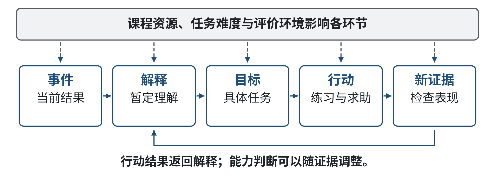
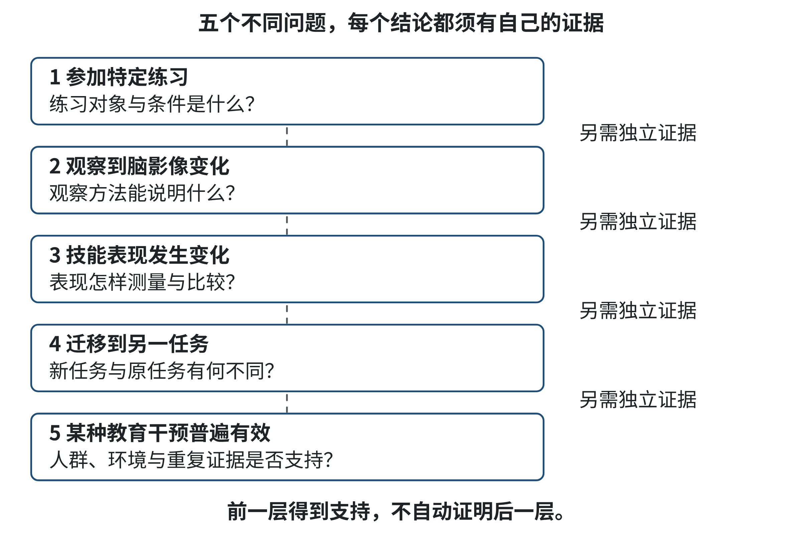
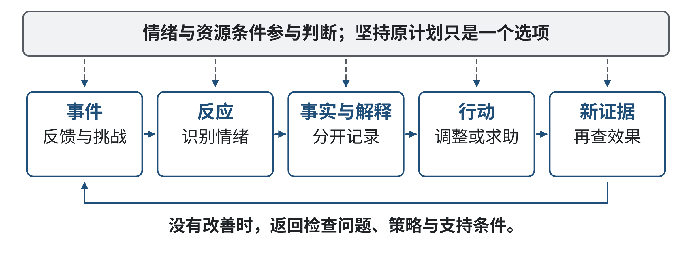
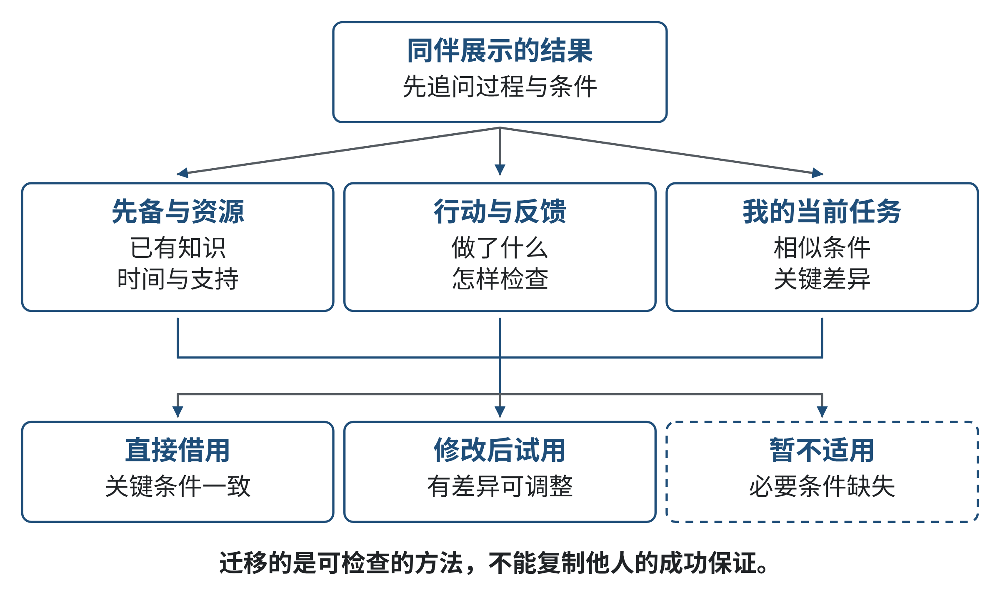
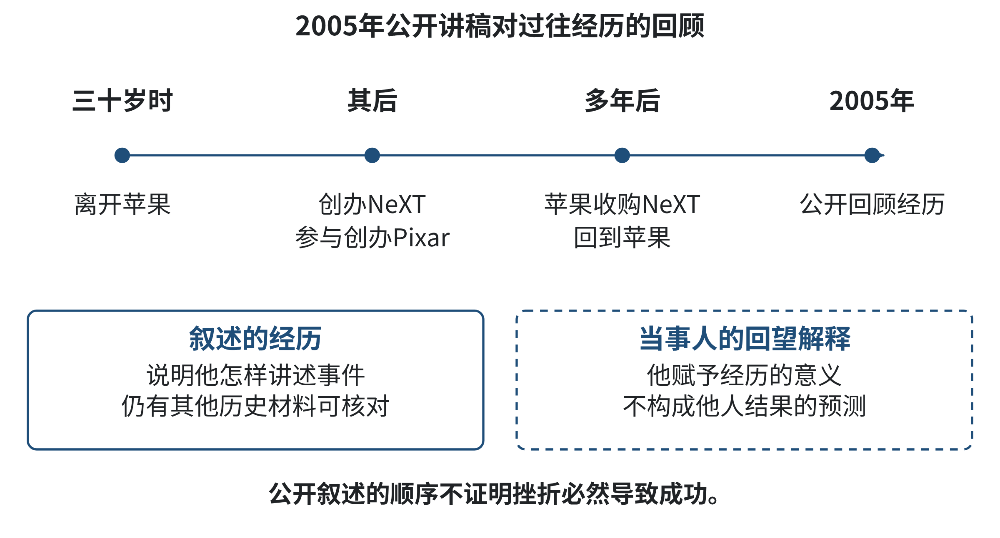
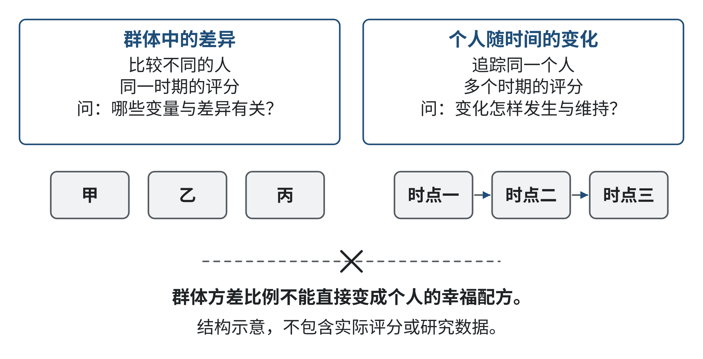

# 第七章 成长型思维与积极心理：自我认知与情绪管理

一个程序连续两天没有通过测试。第一天，小林认为是输入数据整理得不够细；第二天，他发现自己把边界值也当作正常输入，修正后仍有一项结果不符。组员说：“你已经很努力了。”这句话让他好受了一些，却没有告诉他下一步该检查什么。另一个同学说：“这次失败说明你不适合做算法。”这句话把一个局部结果直接变成了能力判决，也同样不能帮助团队找到原因。

在第六章中，我们学习把项目需求、数据来源、设计、测试、答辩和修订连成可追问的证据链。本章继续从项目中的真实困难出发，但把观察焦点转向学习者如何理解自己：一次失败究竟说明什么，反馈中哪些信息值得使用，情绪怎样影响判断，何时需要调整方法、请求帮助或重设条件？这些问题不靠一句“积极一点”解决，也不能只归结为个人意志。知识基础、时间、设备、团队支持与任务设计都会影响学习机会。

本章题目中的“固定型思维”和“成长型思维”是对某类能力信念的概括，帮助我们分析一个人怎样解释能力、困难和反馈。它们不是人格类型，也不是给同学贴上的标签。积极心理学中的“幸福公式”同样需要放回研究语境：模型提出了什么，数字描述的是谁，证据能支持多强的结论。我们会把“看起来鼓舞人心”与“经过证据支持”分开。

## 学习目标

- 用自己的话解释固定型与成长型能力信念，并区分“能力可发展”与“努力一定成功”。
- 面对挑战、批评和他人成功时，提取可核验的信息，设计一个具体的下一步学习行动。
- 依据项目记录分析失败的技术原因、情绪体验和资源条件，不把结果等同于人的全部能力。
- 解释“幸福公式”的原始主张及其统计边界，区分群体差异和个人变化。
- 识别确认偏误、计划谬误等会影响项目判断的倾向，提出可以检验的修正方法。

## 学习路线

我们先从一次编程学习中的挫折认识能力信念，再看挑战、努力、反馈与同伴成功怎样改变学习行动；随后用知名技术领袖对个人经历的公开叙述，练习把事实、事后解释和可迁移做法分开。接着检查“幸福公式”中的百分比，学习它描述群体差异时为什么不能直接变成个人配方，最后把认知偏差的识别落实为项目复盘清单。你无需先学过神经科学或心理统计；首次出现的必要概念会随文解释。每个练习的参考解集中在章末。
## 7.1 固定型思维 vs 成长型思维：核心差异与神经科学基础。

### 导语

写程序时遇到错误，人的第一反应可能是查输入、检查假设，也可能是担心“我是不是根本学不会”。同一个错误并不自动产生同一种结论。我们怎样解释错误，会影响接下来选择更简单的题、继续尝试，还是向同伴请教；但解释只是影响行动的一环，任务难度、可用时间和教学支持也会改变结果。本节从一个简短的模拟情境进入，学习用“能力信念”描述这种解释方式，而不是据此判断一个人的性格。

### 7.1.1 案例：两种解释，同一条失败测试

【教学模拟】计算机专业学生小林第一次独立实现一个有序列表查找函数。测试样例中，目标在列表中间时程序能找到；目标是第一个元素时，函数却返回“未找到”。小林看见红色失败提示，先想到“我连基本算法都不会”。组员小周看见相同结果，先写下“边界条件可能有问题”，随后检查循环起点与停止条件。两人都没有因为这次测试马上知道谁更有能力。小周的假设也可能错；区别在于，他把失败当成需要继续检查的信息，而不是最终能力判决。

如果只把这一幕归纳为“小周有成长型思维”，我们仍不知道他的检查是否有效，也看不到他是否有合适的学习资源。可观察的分析对象应更具体：小周提出了什么解释？他设了哪项可检验的假设？他做了什么操作？结果支持还是推翻了假设？如果把循环条件改了，原有通过的样例还通过吗？这样的过程记录，既能看见信念如何影响行动，也能检查行动本身。

### 7.1.2 能力信念：对“能力会不会改变”的看法

心理学研究中的“内隐理论”不是秘密知识，而是人们在日常判断中使用、未必时时说出口的看法。Dweck与Leggett讨论了人们对能力可塑性的不同信念，以及这种信念同目标选择、对困难的反应之间可能存在的联系[1]。为方便学习，我们把相对倾向于认为能力固定不变的看法称为固定型思维，把相对倾向于认为能力可以通过学习发展而改变的看法称为成长型思维。

这里的“固定”和“成长”并非两种互斥的人格。一个人可能相信自己能学会新的编程语言，却觉得数学能力是天生的；也可能在熟悉的课程里愿意挑战，在公开答辩时却回避困难。信念会随任务、评价方式、过去经验和环境变化。使用这两个概念的目的，是让人发现某一时刻的解释和选择，而不是把学生分成两类。

固定型解释常把一次表现读成相对稳定的能力信号：“我这次写错，说明我不适合算法。”成长型解释则把能力看作可以发展的对象：“这段代码在一个边界条件上失败；我要查清条件、验证修正，并考虑是否需要补充知识。”后一种说法并不保证判断正确，也不意味着必须坚持原目标。它只是暂缓把局部证据推广成总体定论，先问当前结果究竟能说明什么。

同一份作业分数可能同时包含先前知识、任务熟悉度、出题范围、练习机会、反馈时机、身体状态、协作条件与运气。若只看到“没过”，便无法判断是哪一部分造成困难。举例来说，代码未通过测试，可能是算法理解不完整，也可能是题目对输入范围的描述不清、测试环境与本地环境不同，或组内接口约定变了。成长型思维不是把所有失败都归给自己“还不够努力”，而是扩大检查范围，把能改变的过程因素与当下尚不可控的限制分开。

能力信念影响学习的路径可以用五个环节来观察：发生了什么、我怎样解释、我想达到什么目标、我采取什么行动、行动带来什么新证据。固定型解释有时让人优先保护“看起来聪明”的形象，因此倾向于选择能迅速显示能力的任务；成长型解释有时让人更愿意把注意力放到掌握知识的目标上，愿意选择可学习的挑战。这里说“有时”，是因为人的实际行为仍受课堂规则、时间安排和现实风险影响。若延期交付会造成重要损失，选择风险更低的方案未必是缺乏成长意愿；若缺乏必要先备，直接挑战高难度任务也不一定有益。

**图7-1 能力信念怎样影响学习行动**

来源：作者原创。

读图：从“事件”开始，沿箭头依次看解释、目标、行动和新证据；再观察环境条件怎样影响每一环。改变解释可能改变下一步行动，但课程资源、任务难度和评价环境仍在其中；行动结果再回到新的解释，不存在一次选择便永久定型的终点。

### 7.1.3 大脑会变化，但“可塑”不是万能证明

“神经可塑性”可以先理解为神经系统会随发展、经验和使用方式而发生变化。大脑中的神经元通过连接传递信号；学习并非像在空白硬盘上写入一个完整文件，而是涉及多种网络活动和经验积累。对学生而言，关键不是记住复杂神经名词，而是知道：持续练习可能改变处理某类任务的熟练程度，学习经验也可能伴随可观察的脑部变化；这些变化具有任务、时间和个体条件。

例如，Draganski等人让志愿者学习杂耍，并以磁共振成像观察训练前后的脑结构。研究报告了与视觉运动加工有关区域的暂时性结构变化[2]。这项研究让我们看见成人大脑也会对学习经验作出变化，但它研究的是特定技能训练及脑影像测量，不能推出“学杂耍让所有能力普遍增强”，也不能证明讲一堂神经可塑性课程就会让所有学生成绩提高。

把“经验可以带来变化”和“某种教学干预能改善特定结果”分开非常重要。前者是有关大脑和学习的广泛问题，后者要通过具体方案、合适对照、足够样本和实际结果来检验。即便脑影像发现某区域发生变化，也需要继续解释变化与任务表现之间是否有关、这种关联是否稳定、是否能迁移到其他任务。把一张脑图直接当作“增长证据”，会跳过行为和教学效果的检验。

**图7-2 从学习经验到结论之间的证据层次**

来源：作者原创；依据文献[2-4]的证据范围组织。

读图：依次查看“参加特定练习”“观察到脑影像变化”“技能表现变化”“迁移到另一任务”“某种教育干预普遍有效”几个层次。断开的箭头表示每一步都需要独立证据；前面一层得到支持，不自动意味着后面每一层成立。

### 7.1.4 研究结果有条件，不能写成“努力必胜”

成长型思维研究讨论的不是“努力就能成功”的普遍定律。Sisk等人的两项元分析汇总了大量研究：一项考察能力信念和学业成绩的关联，一项考察干预对学业成绩的影响。两项分析整体效应都较弱，但部分结果显示，社会经济地位较低或处于学业风险中的学生可能受益[3]。这提醒我们，信念与成绩之间的关联不能简单解释为“只要有正确想法，分数就必然提高”。

Yeager等人在美国65所公立学校中对12,490名九年级学生开展随机分组研究，测试不到一小时的成长型思维干预[4]。在相对低成绩的预先定义子组中，干预组核心课程平均绩点比对照组高0.10分；这项主要成绩结果属于预先注册分析。研究还报告选修更高阶数学课程的比例增加3个百分点，但作者明确说明这项课程选修分析没有预先注册，属于探索性结果，解释时应比主要分析更谨慎。研究同时发现，干预效果会随学校情境变化；在同伴更愿意选择挑战性任务的学校里，低成绩组的成绩效应更明显。需要注意，研究者随机分配的是学生是否接受干预；学校同伴挑战规范是测量得到的情境变量，并未被随机操纵。因此，研究可以支持“干预效果与同伴规范的关联”，不能证明“人为提高同伴挑战规范会造成相同幅度的成绩改善”。这个结果支持“特定信念干预在特定条件下可能有帮助”，也提醒我们保留环境差异。研究样本、年龄、国家和干预内容都有边界，不能直接预测另一所大学里的任何个人会取得多大改变。

**表7-1 对成长型思维证据的三种读法**

| 证据 | 可以支持的判断 | 不能直接推出的结论 |
|---|---|---|
| 大脑会对某些学习经验发生变化 | 学习与经验可能伴随神经系统变化 | 任何练习都能改变所有能力，或变化必然有益 |
| 元分析发现平均效应较弱、部分群体有获益 | 效果需要结合人群与条件理解 | 成长型思维对所有学生的作用都相同 |
| 学校随机试验发现特定子组与结果有小幅改善 | 特定干预在特定情境中可以产生可测结果 | 个人只要改变想法就能克服资源、健康或制度限制 |

来源：作者依据文献[2-4]归纳；“较弱”“小幅”对应原研究的平均效应结果，不代表所有参与者的体验相同。

写项目报告时，可以把“努力”“策略”和“支持”分别记录。努力描述投入的时间和持续性；策略描述采用了什么方法；支持描述是否获得材料、反馈、协作与可用的学习机会。三者彼此相关，却不能相互替代。若程序员连续投入十二小时但始终不读取错误日志，增加时间可能只增加疲劳；若学生知道错误来自接口变更，却没有时间重新测试，单靠信念也不能自动交付修复。评价学习行为时，问“什么步骤带来了新证据”比问“你够不够努力”更有用。

还可以把“能力”拆成当前表现与未来可发展的知识、技能。一次测验记录的是某人在特定时间、特定题目和特定条件下完成任务的结果，不是对其整个学习潜力的测量。反过来，未来可能发展也不意味着当前水平已经达到课程要求。教师需要准确指出已有证据和差距，学生需要据此安排补学；同时，不能把差距说成不可改变的命运。比如，“你还不能稳定处理空值，需要先练习三种连接情况”同时承认当前困难并指出可学习目标，比“你就是不会数据库”更具体，也比“你一定能学好”更负责。

在课程评价中，将反馈落到可修订的任务上，比猜测学生的思维类型更有效。可以指出“你的查询遗漏了重复键，请补一个含重复值的例子”，而不是说“你有固定型思维”。前一种反馈能让学生知道接下来要做什么，后一种标签容易把一种描述模型再变成新的身份判决。能力信念的概念应该帮助我们理解行为，不能成为教师对学生进行快速分类的工具。

### 7.1.5 用代码情境分开能力信念、知识和条件

设想两名学生面对同一道图搜索题，都未能在限定时间内完成。甲在课程前没有学习过队列；乙学过相关内容，但把已访问节点标记得太晚，因而产生重复遍历。只看“未完成”这个结果，我们无法判断两人面临的是相同困难。甲可能需要先补一项数据结构知识，再做小规模手工追踪；乙可能需要一个反例测试，让错误状态显现。两人都可能相信能力可以发展，但所需教学支持并不相同。

因此，分析学习时至少要把四类信息分开。第一是结果：哪些测试通过、哪些失败、用了多久。第二是知识与技能：学生能否解释队列、访问标记和终止条件。第三是信念与解释：学生把结果理解为局部错误还是整体能力结论。第四是机会与条件：是否有练习材料、反馈、合理时间和可用设备。四者可以相互影响，但不能从其中一项直接推断其余三项。学生说“我学不会”时，教师可以询问失败发生在哪一类题、已经尝试了什么、是否需要讲解先备，而不是立刻要求积极思考。

这也解释了为什么“成长型”不是对所有情境的唯一正确答案。若一位同学已经熟练掌握基础查询，却在有限的项目期限内遇到一个新数据库，团队可以选择成熟库并把学习重点放到接口集成；若课程目标明确要求理解查询计划，则需要安排学习这一概念。决定应回应目标，而不是为了展示“挑战精神”而选最难路线。信念可以鼓励学生把困难看成可学习的部分，但它不会替代目标分析。

### 7.1.6 从神经影像到教学实践：不要跳过中间证据

神经科学研究容易被新闻标题压缩成“学习会让大脑长大”或“某种训练改变脑区”。要审慎阅读，至少需要检查参与者是谁、接受了什么训练、使用什么测量、观察到什么结果、何时复测，以及作者如何解释限制。杂耍训练研究中的被试参加具体动作学习，研究者观察的是影像指标变化。该结果支持一种有限判断：在这项研究所用的训练和测量条件下，成年人脑部结构指标出现变化；它不证明任何学习活动都会产生相同的影像变化，也不说明变化本身让人更聪明。

从影像发现走到课堂建议，中间还有多个待检验环节。某项教学活动是否改善技能，要测量学生能否完成任务；是否迁移，要让学生面对不同表面形式的新题；是否保持，要隔一段时间再测；是否适用于不同学生，要看样本、支持和任务难度。若只有神经指标而没有这些行为结果，我们仍不知道课堂目标是否达成。换言之，神经可塑性告诉我们“变化有可能发生”，而不是“这个课程方案已经有效”。

评估教育主张时，可以画出一条证据阶梯：理论解释、实验中的特定生理变化、原任务表现、迁移表现、长期保持、不同学校或群体中的重复结果。每上一级，都需要新的证据。台阶不是为了贬低实验，而是为了不把一次研究承担不了的结论压到它身上。对计算机专业学生来说，这种阅读习惯与评估新算法或学习软件相通：一项指标改善，不等于实际使用者的问题也解决了。

### 7.1.7 基础练习 E01：辨认解释，不给人贴标签

下面三句话来自教学模拟：“我第一次没通过算法题，说明我根本不适合写程序。”“我这次没通过，想先看失败用例里有哪些共同条件。”“我又失败了，得加倍努力，不许休息。”请分别指出每句话对一次表现作了什么解释，再说明它能否帮助说话者找到可验证的下一步。判断对象是句子表达出的想法，不是说话者的性格，也不是在推测他们最终一定会成功或失败。参考解见章末“E01 参考解与讨论”。

### 本节反思

最近一次学习挫折中，我把哪个局部结果当成了整体判断？如果暂时不评价自己的能力，我还需要哪些证据才能确定问题来源？下一步能不能设计一个规模足够小、结果可观察的检查？如果缺的是资源、时间或指导，我准备向谁提出什么具体请求？
## 7.2 如何培养成长型思维：看待挑战、努力、批评、他人成功的方式转变。

### 导语

知道“能力可以发展”，不等于遇到困难时就会自然做出更好的选择。面对较难的算法题，有人把失败当作能力判决；有人机械地增加练习次数；也有人搜集更多意见，却没有确认这些意见针对的是不是当前问题。本节把成长型思维从一句信念变成几种可观察的学习动作：选择合适挑战、检查努力是否产生信息、把批评拆成可验证内容，并从他人成功中寻找可迁移的方法。

### 7.2.1 案例：重复练习为什么没有减少错误

【教学模拟】小林在一次课程项目中实现二分查找。第一次，程序在空列表上报错；他给循环增加了判断，空列表通过了，但单元素列表仍返回错误位置。第二次，他把练习题重新做了五遍，直到样例输入都通过。第三次，助教提供了一个从右往左排列的列表，程序又失败。小林觉得自己“练得越多越没用”，同伴则建议他先写出二分查找必须保持的不变量，再逐项检查更新左右边界的语句。

这段情境是为教学编写的，并非实录。它提示我们，努力和学习结果之间隔着策略、反馈与任务条件。重复可以巩固方法，也可能重复同一种误解；找到一个可检验的不变量，能把“多做一些”改成“确认每一步是否保留了正确范围”。助教的建议仍要测试，不能因为来自权威就免于检查。

### 7.2.2 面对挑战：既不回避，也不盲目硬闯

挑战的价值取决于它是否能带来学习信息。对刚开始写递归程序的人来说，先跟着示范追踪三层调用，可能比直接挑战一个需要动态规划、图搜索和大量数学先备的项目更合适。另一方面，如果任务过于熟悉，只改几个变量名，学生可能看不出自己是否能独立调用方法。选择挑战时，可以看三个方面：我能否说出任务目标；当前的一个主要困难是否清楚；我能否在有限时间内获得某种反馈。

这里不需要给所有学生套用一个统一难度表。一个适合的下一步，可能是复现一个已有例子，可能是换一组输入，也可能是请助教说明遗漏的先备知识。若连续尝试后仍不知道该检查什么，应该调整任务粒度或补充支持，而不是把痛苦程度当作学习有效的证据。挑战也不是越难越有价值。通过一个小任务准确学会如何处理空集合，往往比复制一份复杂框架却无法解释它更能扩展能力。

挑选挑战可以从“已会—待练—暂缺”三栏开始。以数据库查询为例：已会的是按一个条件筛选；待练的是用两项条件连接表；暂缺的是查询优化器如何选择索引。短期目标可以放在第二栏，第三栏标注为需要讲解或后续阅读的知识。若课程任务要求使用优化器，学生可以一边完成当前可行路径，一边安排必要的查阅，而不是将知识缺口解释成个人无能。

还可以把挑战拆成“难度”和“信息量”两条轴来看。某题很难，却可能因为输入含糊、评测反馈少而几乎不给学生可用信息；另一个小练习虽然容易，却能让学生准确发现自己不理解的边界规则。初学时，后者往往是更好的下一步。选任务前先写下一个可观察目标，如“能解释循环终止时左右指针的关系”，再判断任务是否能让自己检验这一点。如果目标无法描述，先补任务理解或先备知识；如果目标明确而反馈仍不够，找同伴审阅、增加日志或设计更小的测试。

这种做法也帮助团队避免把“有挑战”误解为“把任务交给最不熟悉的人独立完成”。真实项目的挑战可以分层承担：熟悉代码的人做安全审阅，新成员负责一项边界测试，并在反馈后扩大修改范围。让成员拥有可尝试的空间，同时保证项目风险有人负责，是支持学习与交付的结合。若任务涉及隐私、安全或不可逆操作，挑战应受职责和审核流程约束，不能借成长之名取消必要的防护。

### 7.2.3 努力：观察方法，不把时间当成绩保证

努力通常可观察为投入了多少时间、练习是否持续、是否注意错误和是否愿意修订。它能说明学习者做过哪些行动，却不能单独说明掌握程度。比如小林写了五遍同一题，如果每次都沿用同一组简单样例，他仍没有证据表明自己理解边界条件。若他用一张表列出“当前区间、比较位置、下一步区间”，再主动加入空数组、单元素和反向输入，练习时间未必增加很多，却产生了更有辨别力的反馈。

对程序学习而言，可以把一次练习安排成“先预测，再运行，再解释差异”。先预测能减少只盯着运行结果的被动性；运行后比较预期与实际；若不一致，就定位第一个分歧的状态，提出一个可能原因，再改动一项条件。这个过程不保证一次就找到根因，但能留下可以复核的证据。如果修改后通过了新增样例，还要重新运行原先通过的样例，防止局部修补破坏旧行为。这与第六章的回归测试相连，但本节新增的观察对象是：失败发生时，我如何理解自己、如何选择下一次尝试。

练习记录不必变成复杂表格。每次可以只保留四项：本轮想学会什么；我采用了什么策略；哪个反馈改变了我的判断；下一轮要保留或调整什么。比如“目标：判断连接查询如何处理重复键；策略：先画出两张表，再运行两条极小数据；反馈：结果产生四行而非两行；调整：先明确连接键是否唯一，再讨论聚合。”这比“今天学习三小时”更能让学生和教师看见困难在哪一环。时间仍然重要，尤其是需要安排课程、工作和休息时，但时间是投入的一个指标，不是掌握程度的替代测量。

也要小心“努力归因”的另一种误用：结果不好时，旁观者说“你努力还不够”，结果好时又说“你有天赋”。两种评价都可能忽略策略、基础、机会和反馈。教师或同伴可以具体指出哪个学习动作值得保留、哪一步证据还不足，并和学生一起确认所需资源。若是任务条件有问题，调整课程材料比要求学生继续投入更合理；若学生已经找到有效方法，也应留下可复用的过程记录，而不只表扬最终分数。

**表7-2 把挑战、努力、反馈和同伴成功转成学习信息**

| 情境 | 容易出现的判断 | 可观察的调整动作 | 怎样检查调整有效 |
|---|---|---|---|
| 挑战 | “做不出来就说明我不适合” | 把任务缩到一个可验证的子问题，确认所需先备 | 能否独立解释子问题的输入、步骤与结果 |
| 努力 | “时间够长，结果就应该正确” | 检查每轮练习是否改变了策略或增加了有效反馈 | 新用例是否检验了不同边界；旧用例是否仍通过 |
| 批评 | “被批评说明我很差” | 将意见拆成对象、证据和建议，再决定是否采纳 | 是否能指出一项被新证据确认或推翻的判断 |
| 他人成功 | “别人会做，说明我落后” | 询问对方使用的先备、步骤、反馈与练习路径 | 方法能否迁移到自己的条件，需不需要调整 |

来源：作者原创的学习策略整理；案例中的任务为教学示例。

### 7.2.4 接受批评：把针对作品的意见从能力结论中分开

批评有不同质量。有的指出一个可复现的问题，有的给出解释和修正建议，有的只是情绪化表达，甚至包含不准确的信息。学生可以先问：意见针对的是哪段代码、哪条需求或哪次协作？有没有具体数据或可重现的步骤？提出意见的人是否了解任务条件？如果问题真实，我下一步怎样验证修正？这些问题既不要求照单全收，也不鼓励立即拒绝。

以“你写代码太差”为例，这句话没有指出代码位置或失败条件，不能直接转换为修复任务。可以继续询问：“哪一组输入能稳定复现？你预期会出现什么结果？”如果对方指出空输入导致索引越界，学生可以检查代码并补一条测试。如果对方继续贬损人格，则应把关系边界与技术意见分开：不必接受侮辱性评价，也不因此丢弃可能有用的技术信息。若批评来自有职责的评审者并涉及安全、隐私等硬边界，应先暂停高风险操作，找到责任人确认，而不是为了证明能力继续推进。

研究者曾在实验中比较儿童被夸“聪明”或被夸“努力”后的反应，发现不同类型的能力评价会影响儿童后续选择与失败后的反应[5]。这项特定实验对象是美国小学五年级学生，不能直接说明所有年龄、文化和学习场景都应采用同一套表扬话术。更适合日常教学的做法，是描述观察到的策略、修改和证据，例如“你把边界条件写成了独立测试，并找到循环停止条件的错误”，而不是给一个笼统人格标签。肯定策略不是赞扬机械用力：若策略无效，下一步就应讨论怎样调整或取得支持。

面对意见时，可以把它拆为四层：被评价的对象、提供的证据、由证据支持的解释，以及可供选择的建议。比如“空输入触发了异常”是对象和可观察结果；“循环没有处理空集合”是一个可能解释；“增加长度判断”是一个候选修订；“你根本不会写算法”则超出了具体证据，不是修复建议。逐层拆开后，学生能接受确有依据的意见，同时保留判断建议是否适合当前约束的权利。来自评审者的意见也可能错；尊重专业分工不等于放弃验证。

回应可以具体而平和：“我先按你提供的输入复现异常；如果能稳定复现，我会补入测试。关于换库，我需要先比较支持范围和部署条件；请指出目前实现无法满足的需求。”如果对话含有羞辱或持续骚扰，优先结束不安全的交流、保存必要记录，并寻求教师或项目负责人协助。成长型思维不是要求学生接受任何批评，更不要求独自处理不公平的团队关系。

### 7.2.5 从情绪反应到可执行下一步

失败、批评和比较都可能带来恼火、羞愧、担心或疲惫。情绪不是错误，也不能靠命令自己“不许难过”消失；它会影响注意力与判断，但不直接证明某个结论一定正确。Gross对情绪调节研究的综述提出，可从情境选择与改变、注意力分配、认知解释和反应调节等环节理解情绪调节[6]。在本章里，我们把它当作观察工具，不把它当作临床治疗方案。

例如，小林收到评审意见后发现自己很生气。他可以先暂时关闭聊天窗口，避免在激动时发出难以收回的回应；找一份记录，把批评里可核查的内容抄出来；确认自己当前最担心的是什么；再决定是否需要和评审者约定一个更具体的讨论时间。这几步不是让情绪立刻消失，而是让行动不完全被第一反应支配。若小林发现已无法集中注意力，短暂离开任务、休息或找可信任的人交流，可能比继续盯着错误日志更合适。

**图7-3 从挫折到下一步学习行动的反馈环路**

来源：作者原创，参考情绪调节过程模型[6]作教学转化。

读图：沿“事件—反应—事实与解释—行动—新证据”阅读环路，并观察“情绪”和“资源条件”如何影响各环节。若行动未改善结果，可以返回检查问题或寻求支持；不必把“坚持原计划”视作唯一的积极选择。

图中的“觉察反应”不是要求学生先把情绪处理到消失，才可以继续学习。它帮助学生知道自己正处于什么状态，以及这个状态是否影响眼下的决定。一个人可以一边紧张一边把测试结果记录下来，也可以在过度疲惫时先暂停高风险操作。情绪、事实与行动会相互影响：发现误报可能缓解担忧；收到支持也可能让人敢于提出问题。若图中某条路径不适合具体处境，可以从任务要求和自身安全出发重新安排，而不需要把环路当作标准答案。

**AI辅助的使用边界。** 若希望生成式AI帮助阅读评审意见，可以把脱敏后的具体反馈交给工具，要求它将意见分为“可复现事实、推断、建议、情绪性表达”，并为每项列出需要补充的证据。使用者需逐条回到项目记录核对。不要上传可识别同学的私人对话或未经允许的课程数据；不要把AI的共情语气当作心理评估，也不要因为系统建议“继续坚持”而忽略身体状况、期限或求助渠道。没有AI时，使用同一张纸面表格即可完成。

### 7.2.6 从他人成功中学方法，而不把比较变成人的排名

看到同学提前完成任务，可能让人感觉压力，也可能提供一个观察学习路径的机会。有效的问题不是“他是不是比我聪明”，而是“他遇到了什么子问题，先补了什么知识，怎样得到反馈，哪项资源帮助了他”。如果对方愿意分享，就可以请他演示一次具体操作；如果不便分享，查看公开的课程材料或示例也能帮助理解。取得信息后，还要检查自己的条件是否相同：对方可能已经修过相关课程，手头也可能有不同的设备和时间安排。

比较应围绕任务而不是价值。可以把他人的方法拆成“可直接使用、需按当前约束修改、暂时不适用”三类。例如，复制同学的并行开发安排可能不适合只有一台设备的团队；但他记录失败复现步骤的习惯可以迁移。成功经验也可能只是事后挑选出的一个故事，无法告诉我们没有成功的尝试或其他影响因素。学生应询问可观察的步骤，而不是把他人的结果当作个人价值尺度。

迁移经验时，可以用“任务—方法—条件—证据”四格做快速核对。对方的方法解决的是什么任务？使用了哪些步骤？依赖哪些前置知识、设备和协作？怎样知道它奏效？例如，某位同学用自动化脚本生成测试输入，帮助他快速发现日期格式错误；若你的程序没有稳定的输入规范，照抄脚本可能只会批量生成无效样例。可迁移的也许是“从失败类别推导测试样例”的方法，而不是对方使用的具体工具。

同伴经验还可以成为共同学习的起点。两人各自预测一条输入会产生什么结果，再一起运行；若预测不同，就先查规则，而不是争论谁“更聪明”。当对方的方法只在特定条件下有效，记录这些条件本身也是学习。这样，比较产生的不是排名，而是更细的任务模型。若对方不愿分享或项目资料不便公开，应尊重边界，转向公共教材、官方文档和经过授权的示例。

**图7-4 从同伴经验提取可迁移方法**

来源：作者原创。

读图：从他人展示的结果向回追问先备、行动、反馈和资源，再用“能直接借用、需修改、暂不适用”区分迁移条件。图意不是让学生复制另一人的路线，而是把可观察的学习过程带回自己的任务检验。

### 7.2.7 思维训练：写出一个可以检验的学习动作

**E02 基础应用：改写努力计划。** 【教学模拟】小林连续三晚练习数据库查询，每晚两个小时，考试仍把多表连接题做错。他的笔记只有“继续努力”。请为下一次练习写一份不超过五步的计划，说明先检查哪一类错误、将练习分成什么小任务、怎样取得反馈、用哪种新输入检查迁移，以及什么结果会让他改换方法或求助。计划不得把“再多花两小时”当成唯一动作。

**E03 应用训练：拆解一次代码评审。** 【教学模拟】某同学收到三条反馈：“函数在空列表上崩溃”；“这段实现太绕了，换成我那套库吧”；“你们组根本没人会维护代码。”请依次区分可复现事实、缺乏依据的评价和待验证建议。设计一段回应，既承认需要检查的内容，也保护讨论边界，并写出下一项测试。可以选择不采纳建议，但要说明作出决定前还要获得什么证据。

### 本节反思

我把“努力”定义为投入的时长，还是也记录了具体策略、反馈和支持？收到意见时，哪一部分是可检验事实，哪一部分只是评价？比较同学的成果时，我能否找出方法与资源，而不把结果直接用于给自己排名？如果一次尝试没有改善，我是否允许自己改策略、求助或重新界定任务？
## 7.3 在技术学习和项目挫折中应用成长型思维。案例：知名技术领袖的失败与再起。

### 导语

项目失败时，团队往往需要同时回答两类问题：系统为什么没有达到预期，成员怎样理解这次结果。前一类需要需求、日志和测试证据；后一类涉及能力判断、情绪与下一步选择。若把它们混在一起，“程序没通过”很快就变成“我不适合做技术”；若只谈“保持乐观”，则缺少修复产品的办法。本节以一位知名技术领袖的公开叙述为例，练习把经历事实、当事人的事后解释与学生可迁移的方法分开。

### 7.3.1 案例：乔布斯在斯坦福的回顾

2005年，苹果联合创办人史蒂夫·乔布斯在斯坦福大学毕业典礼上发表演讲，讲述了几段个人经历。其中一段回顾了他三十岁时离开自己参与创办的苹果公司。他在这篇事先准备的演讲稿中说，自己和公司管理者对未来方向的看法逐渐分歧，董事会支持了另一位管理者；离开苹果后，他一度不知道该做什么。后来，他创办NeXT，并参与创办Pixar；多年后，苹果收购NeXT，他又回到苹果。他将这段经历解释为一次重新开始的机会，并回望自己后来的一段创造性时期[7]。

这些事实来自乔布斯在2005年的公开讲稿。讲稿是当事人的回忆和解释，不是完整的公司档案，也不能替代对董事会决策、公司治理和当时市场环境的独立历史研究。我们可以确认他在演讲中怎样讲述这段经历，不能据此补写他每个阶段的内心活动，更不能把演讲中的因果判断当成客观定论。下面的分析把“乔布斯如何解释经历”与“学生可以怎样学习”分开。

**图7-5 乔布斯公开叙述中的离开、再起与回归**

来源：作者依据斯坦福大学保存的2005年毕业典礼讲稿整理[7]。

读图：时间线上标出演讲稿提到的主要事件，再看“事实记录”和“当事人回望”两种信息。创办NeXT、参与创办Pixar、苹果收购NeXT及其本人回归属于讲稿叙述；“这次挫折带来了创造性时期”是他事后的解释，不是任何人离开公司后都会得到相同结果的预测。

### 7.3.2 把公开故事读成案例，而不是成功学结论

乔布斯演讲中的叙事结构具有启发性：先说明计划如何中断，再描述自己如何重新寻找方向，最后将过去经历串联成后来工作的意义。可是，读者容易把“后来成功”当作“当时选择正确”的证明。这个推断忽略了没有获得类似结果的人，也忽略了结果可能受到团队、资金、行业变化、产品机会和组织决策等因素影响。把结局已知之后的故事读成一条必然路线，会产生事后偏见：仿佛早期每个选择都注定通向后来成功。

在教学分析中，我们可以从这段公开叙述提取三个有限的观察点。第一，严重挫折并不会自动抹去专业兴趣；乔布斯在演讲中把继续热爱所做工作作为自己重新开始的理由。第二，过去经历的意义可能在后来的工作中变得清晰，但人在当下往往无法预知这种联系。第三，转向新任务并非只是意志行动，还需要可以尝试的机会与支持。后两点提醒我们：回顾可以帮助解释经历，却不能成为事前保证。

不要把这个案例总结成“被解雇是好事”“辍学会成功”或“真正热爱的工作就能克服所有困难”。乔布斯是一位知名技术领袖，他的故事被选入公开演讲，本身经过了筛选和组织；他的经历不能代表普通学生，更不说明所有人都应选择创业、离开团队或忍受不公平条件。一个人的资源和处境也可能与他人不同。对学生来说，更稳妥的迁移是：当重要计划被打断时，先弄清楚哪些事实已知、哪些解释仍是假设、哪些选择仍可行，再决定下一步，而不是把名人故事当作路线图。

这也说明成长型思维并不等于“相信一切挫折都会带来好处”。有些挫折确实指出了可学习的错误；有些是任务定义不合理、资源不足、协作失灵或外部变化造成；有些还会造成不应被轻描淡写的损失。能够发展能力，意味着可以通过经验改善部分能力，并不意味着现实条件必须由个人独自克服。如果一个项目已经缺少关键数据或无法满足安全要求，停止或缩小范围可能比硬撑更负责。

把故事用于课堂分析时，可以沿着三条线索分别阅读。第一条是组织决策：演讲稿称他与公司管理者对未来方向的看法逐渐分开，董事会选择支持另一位管理者；要进一步判断谁的方案更好，需要公司文件、其他当事人叙述和当时产品证据，而不能只依赖一篇毕业演讲。第二条是个人行动：演讲稿描述了他离开后创办NeXT并参与创办Pixar，说明他后来转入新的工作，但不证明每一步都顺利或完全由他个人决定。第三条是事后意义：多年以后，他把经历重新组织成“失去原有位置后仍能继续做自己重视的工作”的故事。它是有价值的自我解释，却不等同于当时就能准确预测未来。

这三条线索避免把技术领袖案例压缩成一句口号。若只看第一条，容易把复杂组织冲突简化成“被解雇的人一定是对的”或“董事会一定是错的”；若只看第二条，容易把创业当作人人都可以复制的补救方案；若只看第三条，则可能误以为只要事后讲出意义，困难本身便值得发生。更稳妥的读法是：成功故事能提供分析问题的入口，但还应追问未被讲述的选项、外部条件与失败路径。

### 7.3.3 技术学习中的挫折：从“全盘否定”到查找根因

请看一个与名人经历无关的教学模拟。四名学生要为课程项目实现一个文档解析模块。第一轮共有20项检查，16项通过；4项失败都与带有中文文件名的输入有关。组员甲在群里说：“我负责这部分，模块失败说明我能力不行。”组员乙建议立刻换整个解析库，组员丙则想继续重复当前测试，直到结果变好。当前有哪些事实？模块有四项失败，四项都涉及相近的文件名条件；项目还没有确认问题来自输入编码、文件路径、测试环境还是库的行为。任何一个解释都需要检查。

一个可操作的复盘顺序可以这样展开。

**第一步：描述结果，不把它扩展成人的标签。** 记录失败测试的输入、预期输出、实际输出、运行环境和版本。比如“当文件名含中文时，解析器未能打开输入文件”比“我很差”提供了更多信息。前者可以让另一个组员复现，后者既无法复现也无法修复。

**第二步：把可能原因列成可区分的假设。** 例如，路径处理时发生了编码转换；测试夹具保存文件的编码与读取方式不一致；依赖库本身不支持某类路径；部署环境的区域设置不同。假设应该能够产生不同的预测：若只在某操作系统失败，环境差异更值得查；若所有系统都无法识别特定字符，输入处理或库的限制可能更相关。列出原因并不等于已经确认原因。

**第三步：一次改变一个条件，保留对照。** 先用同一文件内容分别测试纯英文名和中文名，再用同一文件名更换文件内容，确认失败是否仍与文件名相关。记录每次输入、输出和环境；若同时换库、改文件、换系统，就很难知道哪项变化起了作用。测试范围可以从最小复现开始，避免把几十项变量一起搅动。

**第四步：依据结果决定修订范围。** 若发现路径字符串被错误转换，就先改路径处理并增加一个会失败的回归测试；若确认依赖库有限制，团队可以研究兼容方案或说明项目范围，而不是掩盖限制。修改后再运行原先通过的16项检查和新增的边界检查。如果修复四个失败的同时令三个旧样例失败，说明解决方案尚不完整。

**第五步：检查项目条件与个人学习需求。** 若团队缺少相关知识，可以安排一名成员查文档并与另一名成员交叉核对；如果截止时间迫近，可先选择风险更低的功能范围，明确标注尚未支持的输入。若某位成员连续数日疲惫，团队应调整分工或时间，不该把继续熬夜视为成长型思维。个人可以写明自己需要的帮助：例如“我能复现中文路径失败，但不熟悉系统编码；能否请组员和我一起比较两种环境的日志？”具体请求比笼统地说“我做不了”更容易得到适当支持。

这个顺序和第六章项目中的复现、修复、回归测试相连，但用途不同。第六章强调方案和系统如何通过证据改进；本节还要求记录失败对自我判断的影响，以及成员如何使用帮助、调整目标和照顾持续工作的条件。一个技术上修复了bug的项目，仍可能存在不合理的分工或有害的团队评价方式。反过来，一个成员能够积极面对反馈，也不代表系统问题已经解决。

可把“失败复盘”写成两个相邻但不混淆的记录。技术记录写需求、复现输入、期望、实际、假设、测试与修订，供团队维护系统；学习记录写自己原先理解了什么、什么证据改变了判断、现在哪项知识仍不熟、需要谁提供何种支持。比如技术记录最终确认“中文路径在部署环境解码失败”，学习记录则可以写“我之前只在本地英文路径测试，忽略了部署环境差异；下一次先检查环境和输入范围”。后一条不是把问题归罪给个人，而是形成可复用的检查习惯。若原因主要在需求文档或测试环境，团队也应修正共同流程，不能让个人学习记录遮蔽组织责任。

公开人物的经历也可以用类似的双记录思路阅读：一栏记录演讲中能够核实的事件，一栏记录演讲者赋予这些事件的意义，再用第三栏列出仍需外部资料检验的历史问题。这样，学生既能听见当事人的解释，也能避免把解释误写成独立确认的事实。分析对象不是要裁判乔布斯“是否正确地成长”，而是练习怎样从一段经过整理的成功叙事中区分来源、推断和可迁移的学习问题。

### 7.3.4 什么时候坚持，什么时候调整或退出

成长型思维有时会被误用成“无论如何都要继续”。坚持适用于仍有值得追求的目标、可以得到有效反馈、下一步成本与风险可承受的情况。调整策略适用于现有方法反复失败、失败原因能够定位，或者需要新的先备知识。求助适用于关键知识或资源不在个人能力范围内、同伴反馈能显著缩短试错时间，或任务涉及需要专业判断的条件。退出或缩小目标适用于任务本身不再合理、风险超过收益、资源无法满足硬条件，或继续努力会造成明显的健康与责任问题。

【教学模拟】一组同学的图片上传功能有12项测试通过、8项失败，开发者提出再加班一晚。此时团队可先将失败按文件大小、格式、网络条件分组。如果8项都只在大文件上失败，可以测试相同文件在本机和课程服务器上的上传时间，区分大小限制与超时配置；如果失败分散在多种条件，则优先查共同依赖。团队不必现在就宣布“重写”或“坚持”；先决定半天内完成一项能区分根因的测试，再根据结果选择修复、请教服务器管理员或缩小上传范围。开发者疲劳时，改由同伴运行测试或安排休息，是对资源的调整，不意味着放弃目标。

在这个例子里，“有成长机会”不是团队对开发者作出的保证，而是从当前任务中找到一项可学习且有支持的动作。若格式问题已超出课程目标，可以把兼容多种格式列为后续事项；若上传功能涉及课程必需数据，则不能直接删掉失败测试来制造通过。团队可以同时关心交付与学习：明确本次必须满足的最低要求，保留未来扩展的知识点，并在截止前再做一次风险检查。学生无需从一次决定中证明自己属于哪一种思维模式；决定应随证据和目标变化。

可以用一个简单的三问判断：

1. 我还愿意追求这个目标吗？如果不愿意，是暂时受挫，还是目标已经改变？
2. 下一次行动能否产生新的信息？若只会重复同样的失败，先换方法或请求帮助。
3. 当前成本和风险是否可接受？如果涉及安全、诚信、隐私或持续健康问题，应遵守相关边界并寻求有职责的人协助。

这三问不提供机械答案。它们让学生把“坚持”从抽象价值转成具体决策。修改目标不是承认能力不足；继续努力也不证明选择正确。真正需要保留的是学习能力：能说明为什么暂定一种行动，什么证据会让自己改变主意，怎样避免把代价转嫁给队友或其他人。

**表7-3 项目受挫后的四种可行决定**

| 决定 | 适用信号 | 需要记录的内容 | 可能的风险 |
|---|---|---|---|
| 继续当前策略 | 假设清楚，已有证据支持，检查成本可承受 | 下一轮动作与预期可观察结果 | 可能把偶然通过误当成稳定修复 |
| 调整策略 | 相同失败重复出现，或新证据排除原判断 | 改了什么条件，旧行为是否保持 | 同时改太多变量而失去可解释性 |
| 求助或增加资源 | 缺少先备、访问权限、设备或专业判断 | 需要谁提供什么、期限和责任边界 | 请求过于宽泛，或忽视他人的时间和权限 |
| 缩小/停止任务 | 目标改变、风险过高或必要资源不可得 | 原目标、停止依据、剩余交付和未决项 | 因短期挫折过早放弃，或未说明影响 |

来源：作者原创。表中的决定为教学分析选项，不代替具体项目的安全、伦理和课程要求。

### 7.3.5 思维训练：以证据写一份失败复盘

**E04 应用训练：项目复盘与下一步决定。** 【教学模拟】一个日志分析项目在60组测试中通过47组，失败的13组中，9组来自跨午夜的时间范围，4组来自缺失时区。程序开发者已连续三晚修改代码，组员对是否重写解析模块意见不一。请提交一份不超过800字的复盘，至少包括：准确描述两类失败；提出两项可以区分的根因假设；设计一项最小复现和一项回归检查；说明需要的知识、协作或资源；选择继续、调整、求助或缩小范围中的一项，并解释什么新证据会让你重新考虑。请勿把任务结果写成对某位成员能力的总评。

评价重点是：技术失败有可复现的条件；假设与检查相互对应；修改后有旧行为回归验证；情绪或负担得到承认但不取代事实分析；最终决定考虑目标、成本、资源与责任。不同团队可以选择不同决定，只要说明依据与边界。

### 本节反思

我是否把一个项目结果变成了对个人或团队的全盘评价？这次失败能提供什么新证据，下一步的检查能否区分不同原因？如果复盘只要求成员“更努力”，却不检查任务、资源和协作条件，哪些问题会被继续隐藏？我何时该坚持，何时要调整、求助或停止？
## 7.4 “幸福公式”解析

### 导语

网络上常见一种被称作“幸福公式”的图：遗传因素占50%，生活境况占10%，主动活动占40%。这种表达简洁醒目，也容易让读者产生两个误解：幸福像蛋糕一样由三块精确分割；个人只要努力调整行为，就能够掌控剩下的40%。本节不把幸福简化为个人责任，而是追问这组比例从何而来、它在研究中试图描述什么，以及哪些结论仍然可以谨慎保留。

### 7.4.1 案例：一个百分比如何变成个人任务

【教学模拟】某位同学在校园公众号读到“人的幸福40%由自己控制”。他最近连续赶项目、睡眠不足，还在照顾生病的家人。看到这句话后，他开始责怪自己“没有好好管理情绪”。另一位同学则问：“这40%究竟是谁的、哪种幸福、在多长时间内测得的？研究有没有测量‘控制’？”两人的差异不是一人积极、一人消极；第二位同学是在检查一个统计数字是否被正确解释。

许多公众传播把研究模型改写成行动口号。模型中一个比例若原本描述的是一组人的差异，它就不一定告诉我们一个人可以改变多少，也不说明怎样改变。公众号的简化说法还忽略了资源与处境：健康、经济压力、社会支持和生活安全可能真实影响人的状态，不能因为一个模型而被要求“自己负责”。研究数字值得理解，但不能压过现实经历或用来否定求助。

### 7.4.2 原始模型说了什么

Lyubomirsky、Sheldon和Schkade在2005年的综述文章《追求幸福：可持续改变的架构》中，讨论了如何理解并维持幸福感的变化[8]。他们提出一个用于组织讨论的可持续幸福模型，把影响长期主观幸福感的因素概括为遗传倾向、生活境况和有意活动，并给出大致的50%、10%和“最多40%”估计。原文把这些数值作为基于当时研究的初步、近似建议，用方差比例描述群体中主观幸福感的差异；它们不是对某一个人的幸福做出的三项精确配比，也没有直接测量个人可以“控制”多少。作者提出数字的目的，是提醒读者：生活中的有意活动可能是值得研究的影响因素，而非宣告每个人的幸福由三项精确决定。

“主观幸福感”是一个研究构念，可包括对生活的整体满意、积极情绪和消极情绪等方面。它不是时时刻刻都愉快，也不等于没有悲伤、焦虑或疲劳。不同研究采用的测量工具、时间范围和样本可能不同；日常说的“幸福”、量表中的生活满意度和瞬时心情也不能不加区分地合并为一个数。

原文所画的“饼图”容易让人以为三种因素互相独立、穷尽所有原因，而且百分比是由同一批数据直接计算出的。事实上，原始文章综合了当时不同研究中的估计，提出一个理论框架和数值假设。数字相加等于100，只是模型表达所呈现的形式，不能让它自动成为精确的个人方程。遗传、环境、主动行为和社会条件在现实中可能相互作用；例如，主动安排学习或社交的机会，既可能受到环境资源影响，也会改变一个人所处的生活情境。

这里尤其要留意“遗传因素占50%”这种句子的统计含义。遗传率估计是在特定群体、特定环境和特定测量下，解释群体中观察到差异的一种统计量；它不是某个人的幸福有一半由基因固定决定，也不是“如果一个人改变基因就能改变一半幸福”。不同样本的生活条件不同，遗传因素与环境之间的统计关系也可能随之变化。把群体差异用一个固定比例描述，再转译成个人身上的份额，会改变问题的层级。

同样，“生活境况10%”也不代表房屋、收入、健康或照护压力对某个具体人的影响只能占十分之一。对群体分析来说，一项变量在当前样本中解释的差异很少，可能是因为样本成员的相关条件都很接近，也可能是测量方式不敏感；它不证明处于极端困境的个体受到的影响很小。统计比例依赖于样本变化范围和研究测量，不是对某类因素重要性的道德排序。讨论数字时，先问“样本里谁和谁被比较，什么结果被测量”，比先问“我能控制多少”更可靠。

### 7.4.3 “方差占比”不等于“我的幸福占比”

理解这组数字，需要先区分两种问题。群体层面的问题是：“在某一特定人群中，哪些因素与成员之间主观幸福感的差异有关？”个体层面的问题是：“对某个人来说，哪种改变会使他未来一周或一年更满意？”这两类问题的单位和证据不同。前者比较一群人之间的统计差异；后者需要观察个人随时间变化，并考虑其处境、经历和行为。

假设我们在一所学校抽取100名学生，记录学期末一次生活满意度评分，并搜集他们的可观测条件。研究者可能尝试估计家庭收入、社交支持、学习压力等变量与分数差异的关联。此类分析结果只适用于研究所使用的测量和样本，不能直接说“某个学生的幸福有百分之十来自境况”。也不能由一项横截面调查判断，先前的境况差异造成了某个百分比的幸福变化。

一个教学类比是考试成绩：如果在某个班级中，通勤时间可以解释同学之间成绩差异的一部分，不代表每名学生的成绩有固定百分比“由通勤决定”；要判断某个学生改变通勤时间后会不会成绩提高，还需要看到其个体变化、其他条件和时间顺序。群体统计提供的是群体层面的描述，个体行动需另有证据。

可以把两种研究问题写在纸的两边。左边问“同一时间点上，哪些学生评分不同，哪些变量与差异相关”；右边问“同一个人经历了什么变化，之后的评分是否改变，改变能否持续”。即使左边发现社交支持较高的人总体评分也较高，也有多种解释：支持可能影响幸福感；较高的幸福感可能让人更容易建立关系；某些第三因素可能同时影响两者。若要判断某一项活动能否造成平均变化，研究者需明确干预、比较条件、测量指标和时间，并考虑参与者是否接受活动、是否有退出、效果是否维持。每种设计能回答的问题不同；单次相关调查不能替代这些步骤。

个体观察也有边界。连续记录一人的评分，可以看见变化顺序，却不能自动排除学期压力、身体状况和其他事件；一次改善可能是短期波动，甚至只是今天的评分标准改变。更长时间、更清楚的记录能增加信息，但不要求把个人生活变成实验。若活动影响他人或涉及隐私，须考虑同意和保护；若记录本身让人不适，可以停止。研究方法是帮助我们把问题说清楚的工具，不应变成要求每个人交出私人经历的理由。

Brown和Rohrer对“幸福饼图”开展批判性评估，质疑把不同研究所得遗传率与生活境况估计直接拼在一起，再用100%减去前两项便把剩余部分当作主动活动“40%”的做法；他们讨论了比例估计所依赖的假设、数据范围与因素重叠问题[9]。原文分析的是群体中的幸福差异及其方差估计。把群体方差比例解释为某个人可改变的份额，则是统计对象层级改变后的错误外推——这是本节依据统计含义作出的解释，不是把作者的原话扩展成个人层面的测量结果。若三个因素不是穷尽且相互独立的，简单剩余量也不等于已测得某一项的实际贡献；模型还可能遗漏测量误差、其他因素与交互。

**图7-6 群体差异与个人变化是两类证据**

来源：作者原创；依据文献[8-11]所讨论的统计层级差异绘制。

读图：左侧比较同一群体中不同人的评分差异，右侧追踪某一人多个时间点的评分。左侧的问题是变量怎样与群体差异相关，右侧的问题是某个人怎样变化、变化能否维持；不能把左侧的方差比例直接搬到右侧，当作个人配方。

### 7.4.4 2019年再讨论：保留研究问题，修正数字的地位

2019年，Brown与Rohrer发表批评文章（期刊卷期页码于2020年）指出，原始50/10/40模型中的百分比证据基础有限，把不同样本与不同测量所得估计组合起来，可能造成误导[9]。模型还没有清楚处理遗传、生活处境和主动活动之间可能重叠的关系。其批评重点并不是证明“人的主动行为毫无意义”，而是指出原有40%数字不能被当作稳定、精确的事实，更不能被当作个人责任比例。后来作者刊出的更正说明，原文对遗传率的一处算术处理有误；作者同时表示，这项更正不实质改变其对饼图推理的主要批评[10]。引用这段争论时，应把更正与原始批评一并呈现，既不放大一个已承认的错误，也不把更正误读成原批评整体失效。

2019年在线发表、2021年正式刊于《积极心理学杂志》的回应文章中，Sheldon和Lyubomirsky承认饼图中的百分比受到有效质疑，回顾了最初提出模型的背景，指出这些数字原本是推测性、近似的估计。他们仍主张，有意活动可能影响幸福感，后续研究支持这一较一般的前提，但效果可能比早先估计弱[11]。因此，更准确的读法是：关于行为是否能影响主观幸福感，可以继续用研究去检验；50/10/40并不是每个人都可精确控制的个人预算。

两篇文章存在讨论重点不同的地方。Brown和Rohrer更集中质疑数值和统计推理；Sheldon和Lyubomirsky强调早期模型的探索性质，并指出后续研究对主动行为可能有影响的宽泛命题提供了支持。读者不需要在两种观点里强行选边，而可把问题分成两层：第一，饼图的固定百分比能否准确代表总体差异？第二，特定活动在明确样本中能否改变某些幸福感指标？第一层受到强烈质疑；第二层需要逐项看干预证据、对照条件、效应大小和维持时间。

这场争论对读者的价值还在于示范如何修订一个流行框架。模型提出者可以承认早期数字属于推测，而批评者可以承认这种修订并没有证明所有行为活动都无效。对模型的批评不是对每一项相关研究的否定；对行动有效性的研究也不能反过来替旧饼图背书。更细的研究问题应具体到某个活动、某个对象和某个结果：例如，特定课程中一次互助安排是否影响学生报告的归属感？效果是否只发生在活动期间？哪些学生可能得不到同样支持？这些问题比“幸福有多少可由个人控制”更容易被设计成可检验的研究。

阅读争论双方时，可以用四项检查避免只挑合自己观点的句子：各方在谈同一个结果指标吗；证据来自什么样本和设计；作者承认哪些限制；结论的强度是否超过了数据。Brown与Rohrer的批评聚焦饼图推理及其证据组合，作者后来更正的算术错误不改变其自述的主要论证；Sheldon与Lyubomirsky回应强调早期数值的试探性质和后续活动研究。这样的概括保留了分歧，也不把学术讨论简化成一个“谁赢了”的故事。

### 7.4.5 用一个小样本算平均变化，但不越过因果边界

下面表中的数据是作者为教学练习自拟的。五位学生在一次课程周开始和结束时各自给生活满意度打0到10分。这里仅为了演示计算，不是心理测量工具，也不是任何真实学生的记录。

**表7-4 教学示例：课程周前后的自评变化**

| 学生 | 周初评分 | 周末评分 | 个人变化（周末－周初） |
|---|---:|---:|---:|
| A | 4 | 6 | 2 |
| B | 6 | 6 | 0 |
| C | 5 | 7 | 2 |
| D | 8 | 7 | -1 |
| E | 3 | 4 | 1 |

来源：作者为教学示例自拟；评分没有诊断用途。

我们可以逐项计算。周初总分为4+6+5+8+3=26，平均评分是26÷5=5.2；周末总分为6+6+7+7+4=30，平均评分是30÷5=6.0；平均变化为6.0－5.2=0.8分，也等于个人变化2、0、2、-1、1的平均值4÷5=0.8。三种表示需要互相核对：若结果不一致，就可能是数据抄录或计算错误。

这组数值可以支持“这个五人教学示例的平均评分上升了0.8分”这一描述，不能支持“课程周让幸福提高0.8分”。没有对照组，评分只测了两个时间点，也没有说明评分口径是否稳定；周内其他事件、学习压力、个人理解差异都可能影响结果。组平均上升也不代表每个人都上升：D的评分下降，B没有变化。即使同一人连续数周评分增加，仍需检查变化能否维持、是否与某项活动相连，以及是否还有别的解释。

这就是为什么把幸福感当作个人需要完成的工程任务可能有害。数据记录可以帮助个人了解某种习惯和当下体验之间是否存在联系，但它不是义务，不应成为评判“够不够积极”的工具。如果记录使人更焦虑，或涉及私人、敏感经历，学生可以不记录或选择更安全的观察方式。若持续痛苦已影响日常生活，应考虑向可信任的亲友、学校心理支持渠道或专业服务求助；本章不是心理健康诊断或治疗指南。

### 7.4.6 一个更审慎的应用办法

讨论幸福时，可以先选定自己真正想观察的对象：今天的情绪、最近一周的生活满意度、与同伴的连结感，还是在项目中投入的意义感？这些指标并不相同。接着明确时间窗口和记录方式，例如每周给“学习后的精力”打一个0到10分，并写一句当周发生的重要变化。记录几次后再看是否出现稳定模式，不要从一天的高分或低分推断整体生活。

如果要尝试一种主动行为，可以选一个具体、低成本、可调整的动作，例如每周与朋友共同完成一次学习任务，或为睡前减少一次非必要的消息打扰。把它当作一项观察，不是处方：说明开始时间、预期影响、可能干扰和复核日期；若没有改善，可停止、调整或询问专业人士。不能据此断言该行为对所有人有效，也不能要求处于困境中的人通过自我管理抵消结构性困难。幸福研究的意义在于帮助我们提出更准确的问题，而不是把数字变成个人道德分数。

一个低风险的观察记录可以包含四栏：我想了解什么；我做了什么；有哪些同时发生的重要事件；我何时回看结果。比如学生想知道“与同学一起学习后，我是否更愿意继续课程项目”，可以在三次学习结束后简单记录投入感和是否完成约定任务，再比较不同场景。若观察到一起学习时更愿意继续，这只是个人的初步线索，不足以证明同伴学习导致长期幸福感改善，也不意味着每周都必须约人。下次可观察的选择是：这种安排在考试周、休息充足时是否一样有帮助，或者自己更需要安静独处。

如果遇到相反结果，也能得到有用信息。某项活动没有改善当周体验，可能是动作选得不合适、实施时间不够、当时负担过重，或它根本不是眼下最需要的支持。学生可以停止，而非为符合“积极活动有用”这一预期而继续。对受资源和制度条件限制的人，提供可实际获得的支持可能比强调个人改变更重要。任何记录都应由记录者决定是否保留和分享；本节示例只用于方法练习，不构成幸福管理任务或临床建议。

### 7.4.7 思维训练：区分平均变化、个体变化与因果

**E05 应用练习：比较两次主观评分。**【教学模拟】某项目组的六名学生在项目一周开始与结束时，分别给自己的“本周学习状态”打0—10分。匿名记录为：G 2→4，H 8→7，I 5→5，J 3→4，K 6→7，L 4→3。计算两次平均分和平均变化，再分别统计评分上升、下降和不变的人数。用一句话报告这组数据支持的观察，并说明为什么它不能单独证明某项活动造成了变化，也不能代表整个课程或其他学生。

### 本节反思

我过去是否把群体百分比读成了自己的固定比例？平均分上升时，我有没有忘记观察个体变化？如果某个积极活动对一个人有效，仍需要什么证据才能说它对其他人也有效？生活境况给个人带来的困难，是否被“你可以控制幸福”这类表述遮住？
## 7.5 认知偏差与思维调整

### 导语

项目复盘常常发生在结果已经揭晓之后：程序通过了，我们便认为当初的设计很聪明；程序失败了，我们便认为本来就应该看到问题。可是当时能获得的信息、可选方案和实际结果可能并不相同。人的判断会受到记忆、注意力、期待和情绪影响，这些倾向有时帮助我们快速处理信息，有时却让证据被选择性使用。本节把认知偏差当作可检查的推理风险，不把它当成对人的道德评价。

### 7.5.1 案例：测试通过以后，谁还记得最初的证据

【教学模拟】项目组要在两周内做一个日志分析小工具。组长估计一天就能接入数据；开发同学担心字段不稳定，提出先花半天确认格式。讨论后团队接受了组长的估计，最终用了三天修复不同日期格式造成的解析问题。产品按时完成并通过了演示。复盘时，一位同学说：“你看，最后成功了，第一天先直接写代码就是对的。”另一位同学回答：“失败也没发生，所以这个估计没问题。”

两句话都让最终结果替代了对当时判断质量的检查。演示通过是一个事实，但不自动证明最初的工期判断合理；程序成功也可能来自额外加班、减少范围或偶然没遇到更多输入。如果我们只记录结果，就会漏掉当时的风险、原本可做的检查和未被发现的问题。反过来，如果项目失败，也不能仅凭失败断言当时的决定错误；决策应结合当时可获得的信息判断。

### 7.5.2 什么是认知偏差

认知偏差可以粗略理解为：人在判断某类信息时容易重复出现的倾向，使结论在特定情境下偏离更仔细的证据比较。偏差并不意味着人不会思考。注意力有限，很多时候我们需要使用经验快速行动；问题在于，当任务风险较高、证据相互冲突或结果影响他人时，如果不检查这种倾向，容易把方便的解释当成可靠结论。

还要区别“偏差”“不知道”和“情绪”。学生不知道一个API的行为，是知识缺口；学生因公开批评而紧张，是情绪反应；学生只记住支持自己猜测的日志、忽略反例，则可能是确认偏误。它们可以同时出现，但修正办法不同：知识缺口需要查文档或请教；情绪反应可能需要暂停、调整沟通或获得支持；确认偏误需要主动寻找能区分假设的证据。不能因为对方不同意自己，就给对方贴上“有偏见”的标签。

本节关注三种在项目和学习中容易观察到的倾向：确认偏误、计划谬误和结果偏差。它们不是所有可能的认知偏差，也不意味着每个人每次都会出现。选择它们是因为学生可以从自己的测试记录、时间估计和事后评价中找到可检查的材料。

给一种判断命名之后，不代表已经证明某人“有偏差”。这些概念描述的是可能重复出现的推理风险，具体分析仍要回到行为和材料。一个学生坚持某个假设，可能是因为他有别人尚未看到的证据；一个工期估计偏短，也可能是任务比历史案例简单。我们先说“这份记录只包含支持当前解释的样例”，而不说“你就是确认偏误”；先说“估时没有参考此前类似任务”，而不说“你总是计划谬误”。描述行为能让对方补充证据，也让团队有机会改变做法。

偏差检查也应与风险相称。日常低风险的小练习可以快速尝试、根据结果修正；涉及多人数据、公开发布或难以撤回的变更，则需要保存更完整的决策依据，增加复核人或先做小范围验证。慎重不是每件小事都开会，而是在可能造成较大影响时，安排足以发现错误的步骤。

### 7.5.3 确认偏误：别只找支持猜测的输入

确认偏误常指人们容易寻找或重视支持已有看法的信息，却没有同等认真地寻找可能推翻看法的证据。Wason在1960年的概念任务中，让参与者根据一组三个数“2、4、6”猜规则，并可提出其他数列来检验。许多人提出符合自己猜想的例子，却较少选择能排除竞争解释的序列[12]。如果学生猜“规则是连续的偶数”，再试“8、10、12”，无论正确规则是“任意递增的三个数”还是“连续偶数”，答案都符合，因此测试没有区分能力；改试“1、2、3”，则可能区分两种解释。

把这个方法迁移到代码诊断，可以先列两项彼此不同的假设。例如，“排序逻辑只支持升序”和“函数遇到重复元素会停止”都可能解释某条失败记录。接着挑选一个输入，让两种假设预测不同结果。如果只反复运行能够支持第一项假设的样例，就很难知道它是否正确。更有效的测试不必很复杂，只需要让竞争解释作出不同预测。

有区分力的输入并不总是“最极端的反例”，关键是竞争解释会对它作出不同预测。在程序排错中，若假设甲是“输入排序方向错误”，假设乙是“相等元素处理不一致”，一个没有重复值且已排序的样例可能让两种解释得到相同结果；加入重复值并改变排序方向，可能更容易区分。设计之前先写下预测，能避免程序跑出结果后临时把原有假设解释成什么都能说明。若测试结果不符合两项预测，应承认假设集合不完整，重新检查规格、测试环境和其他可能原因，而不是把意外输出硬塞进最喜欢的解释。

刻意寻找反例也有边界。它不是要求学生一味反驳每个结论，而是让自己知道结论依赖哪些条件。若一种解释已由多项独立测试支持，风险可接受，可以暂时采用它；若后果严重，仍需增加审查。只证明“这个输入能工作”往往不够；应覆盖输入范围、边界和关键约束，并说明为什么当前样例足以支撑当前判断。测试不可能证明程序对所有情况都正确，但能让某些错误更容易被发现。

可以按照下面的顺序组织一次证据检查：

1. 用一句话写下当前最相信的解释，并标注它目前基于哪些观察。
2. 写出至少一个可能的替代解释，不需要马上相信它。
3. 找到一种输入或观察，使两项解释给出不同预测。
4. 预先写下两种预测，避免看到结果后再改口。
5. 运行检查，记录结果；若两种预测都相同，说明这个测试没有区分能力。

这套做法不是要求永远保持怀疑，也不是让学生列出无穷假设。它针对的是目前足以影响方案的少数解释。若手头证据已能排除重要替代项，可以暂时接受一个解释并继续工作；若风险较大或结果难以逆转，则应增加检查或请相关专业人员把关。

### 7.5.4 计划谬误：参考历史耗时，而不是只看理想路径

面对新任务，人们容易把注意力放在“如果一切顺利会怎样”，低估协调、等待、修复和返工所需时间。Buehler、Griffin和Ross对计划谬误的研究讨论了人们为何低估任务完成时间，以及内部计划视角与既往实际经验之间的差异[13]。对软件项目而言，一个干净的示例可能只需半小时；接入真实文件后，字段不一致、字符编码、权限和用户反馈都可能增加时间。

一个简单修正是把计划与过去实际完成的类似任务放在一起看。某组近三次“导入新数据格式”的任务分别花了1天、3天和4天；第四次不能只按理想情况估计半天。团队可先写预计值，同时列出参考任务实际耗时、哪些条件相同、哪些不同，再约定一个中途复核点。历史数据不等于精确预测：如果这次任务更小或接口稳定，时间可以下降；若有新的依赖或人员更换，时间也可能上升。重点是让估计能解释，而非盲目套用平均数。

计划需要随新证据更新。发现资料尚未到齐，不必责备成员“没有积极性”；应把等待条件标注出来，明确谁负责取得资料、最迟何时决定是否缩小任务。学生可以设定缓冲时间，但应说明它用于哪类风险。把全部不确定性统统加倍，和假装没有风险一样不利于安排。

选择参考任务时，类别既不能过宽也不能过窄。把所有软件任务平均在一起，会把写一个静态网页和迁移数据库模式当作可比案例；只找一项与当前任务一模一样的历史记录，则可能没有足够样本。可以选取最相近的少数任务，记录相似处和差异，再用范围而非单个点表达不确定性。例如，历史导入任务耗时1到4天，本次复用现成解析库、数据来源却尚未确认；团队可以暂时说“已知类似任务跨度较大，预计需在半天后根据格式确认结果重新估时”，而不是只报一个看似精确的小时数。

参考历史不是让团队被过去锁住，而是要求解释为什么这次不同。若已有自动化测试、熟悉的接口和固定格式，估计可以低于历史值；若数据来源增加、依赖人员等待或需要兼容多种时区，估计应相应调整。计划还应说明何时更新：到了中途检查点，比较已完成工作与原假设；如果关键前提未成立，及时调整范围和交付承诺，而不是为了维护最初数字继续消耗团队时间。

### 7.5.5 结果偏差：评价决策时回到当时的信息

结果偏差指人们知道决策结果后，会用结果好坏来评价原来的决策质量。Baron和Hershey在一系列实验中发现，即便参与者能够阅读决策当时提供的信息，呈现不同结果仍会改变他们对决策者推理能力的评价[14]。在课程项目中，某个团队按流程检查过依赖版本，后来版本仍然冲突，不能因此认定检查毫无价值；另一个团队完全没有验证却碰巧顺利，也不能把运气当作可靠方法。

为了减少结果偏差，复盘材料应分成两栏：决定作出时已知什么，后来发生了什么。再分别评价两个问题：当时的决定是否合理地利用了当时证据；结果是否达到预期、暴露了什么新风险。这样，团队可以承认一个合理决定仍有不利结果，也可以承认一个不充分的决定碰巧成功。评价流程质量并不等于不关心结果，而是避免用结果改写当时可获得的信息。

事后偏见还会使人觉得“我们早就知道会这样”。为避免这种错觉，可以保留版本记录、测试结果和决策理由。第六章的答辩和复盘要求团队保存修订依据，本节进一步强调记录决定时的证据状态。日后如果新证据推翻原解释，版本记录能显示我们何时改变判断，而不是假装从一开始就知道答案。

**表7-5 三种认知偏差与可检查的修正动作**

| 倾向 | 项目中的表现 | 一个修正问题 | 可保留的证据 |
|---|---|---|---|
| 确认偏误 | 只运行支持“是编码问题”的输入 | 哪个测试会让这个假设失败？ | 输入、事前预测、结果和竞争解释 |
| 计划谬误 | 只估算顺利的编码时间 | 类似任务实际用了多久？本次有何不同？ | 预计值、历史任务和中途更新 |
| 结果偏差 | 演示成功后认为初始决定一定合理 | 当时有哪些信息和可选方案？ | 当时的决策记录与后来结果分开 |

来源：作者原创；偏差研究依据文献[12-14]。

评价决策质量时，要把过程与结果分开，之后再合并形成完整复盘。一个有根据的决定仍可能遇到坏结果，因为不确定性无法全部消除；一个缺少证据的决定也可能偶然成功，但不能因此把冒险方式推广给下一组人。下表中的例子只是帮助建立两条评价轴，不意味着项目可以忽略结果或风险。团队仍须修复已经暴露的问题，并将损失和责任如实记录。

**表7-6 决策过程与实际结果的两条评价轴**

| 当时决策过程 | 后来结果 | 复盘应关注什么 |
|---|---|---|
| 依据当时证据并留有检查点 | 结果不理想 | 哪些风险未被发现，是否合理更新方案，怎样减少损失 |
| 缺少关键检查或依据 | 结果顺利 | 哪些步骤被省略，成功是否依赖偶然条件，哪些风险仍未检验 |
| 依据充分 | 结果达到预期 | 哪些证据和流程值得保留，是否仍有未覆盖边界 |
| 依据不足 | 结果不理想 | 哪项缺失检查会最早发现问题，如何补足知识和责任安排 |

来源：作者原创的复盘框架；用于区分决策时可得信息与事后结果。

### 7.5.6 调整判断：建立一张自己的检查卡

偏差检查的目的不是完全消除偏差，而是在重要决定前加入一个可执行的小步骤。对于有结果风险的技术选择，可以问：最主要的结论是什么？支持它的具体证据是什么？有什么证据会让我改变主意？我对时间的估计是否参考了相似任务的实际耗时？如果结果出来后与计划不同，我能否说明当时为什么这样选择？

这些问题也适用于使用生成式AI。学生可以让AI帮忙列出与当前解释不同的可能原因，或设计一组能够区分两个假设的测试。但AI可能重复用户给出的前提、生成不适用的反例或误读项目背景。可将其输出作为“待检验候选”，逐条回到代码、数据和官方文档核对；不要把模型列出的选项当作穷尽清单。涉及同学身份、成绩、私人信息或未公开项目数据时，先遵守课程和平台的数据规则，能删去身份信息就不要提交可识别内容。手工写出替代假设同样可以完成此项学习。

检查卡也不需要每次从头完整填写。时间紧、风险低时，可以只问：“我最重要的预测是什么？哪条输入能让它失败？”项目估时只要涉及多人排期，就可加一句：“类似任务实际用了多久，本次主要差异是什么？”交付完成后再问：“哪些判断是当时已有依据，哪些只是后来才知道？”若这些问题揭示存在重大未知，就增加相应检查或求助；若没有，就记录暂定判断继续工作。工具的目标是提升判断质量，不是让学生用表格代替思考。

### 7.5.7 思维训练：给一次判断安排反证

**E06 应用训练：设计有区分力的去重测试。**【教学模拟】一个课程CSV工具会删除重复记录；目前只试过两条所有字段都相同的记录，输出剩下一条。请比较两个候选解释：甲只删除所有字段都相同的重复行；乙按`student_id`去重，保留第一条、删除同一ID的后续记录。用两条`student_id`相同、但作业名称和分数不同的虚构记录设计最小测试，预先写出两种解释各自预测的输出。说明为什么再测一次完全相同的两行没有区分力；若实际输出不符合任一预测，你会怎样修订假设？

**E07 综合练习将在章末完成。** 你将同时使用能力信念、情绪观察、时间估计、证据检验与结果复盘，为一次项目挫折拟定学习行动。练习材料在章末完整提供，便于你先独立作答，再阅读参考解。

### 本节反思

我最近一次项目判断中，是否优先搜集了支持自己想法的证据？我的工期估计引用了什么过去经验？我是否在结果出来以后改变了对当时决策的评价？下次遇到不确定情况，我可以在哪个具体节点停下来，提出一个会让我改变主意的问题？
## 章末综合训练

### E07 项目综合作业：从一次解析器失败制定可检验的改进方案

【教学模拟】四名学生为课程小组实现一段日志导入程序。程序用于读取课程提供的CSV文件，汇总每周错误类型。项目要求按期提交，不涉及真实用户账号或敏感个人信息。组内开发者小林已经独立写了第一版，接入样例后发现有8项测试未通过。讨论中，一位组员说“你不适合做后端”；另一位组员提出“换成成熟的CSV解析库”；还有人认为“再努力一晚就能解决”。组长坚持原定一天工期，并在第一次会议后直接开始修改代码。

已知资料如下，数字均为教学模拟，不代表真实课程项目：

- 总测试30项，当前通过22项，失败8项。
- 失败测试中，5项来自日期格式为日/月/年而程序按月/日/年解析；2项输入缺少UTC时区标记；1项是空行。
- 团队过去完成过4项类似的数据格式接入任务，实际耗时分别为1天、3天、4天和2天；原始估计分别是半天、1天、2天和1天。
- 当前项目原计划一天完成解析器接入。演示定在3天后；如果需要更改范围，需在第二天中午前通知教师。
- 团队尚未确认所有CSV来源是否使用同一种日期格式，也未查清解析库对缺失时区的默认处理方式。
- 组员目前意见不同：甲建议先切换解析库，乙建议先完善日期格式测试，丙认为应暂时去掉时区检查，丁希望先和教师确认数据范围。

请提交一份800—1200字的项目复盘与下一步方案，包含以下内容：

1. 将已知事实、待验证假设、能力评价和情绪反应分开记录；不得把某条失败直接作为对成员总体能力的判决。
2. 提出至少两个可以相互区分的技术假设，并设计一项最小测试；提前写明每个假设对测试结果的预测。
3. 计算过去任务的平均实际耗时和中位实际耗时，并与本次一天估计比较。说明这组历史数据能提供什么参考、不能保证什么。
4. 选择继续原方案、调整策略、求助或缩小范围中的一种主决定，写明责任人、下一检查点和可能改变决定的新证据。
5. 说明怎样处理“你不适合做后端”“换库”和“再努力一晚就能解决”三种意见；哪一项可作为线索，哪一项需要证据，哪一项不应以人格评价代替任务讨论？
6. 明确项目结果、学习过程和个人感受各自如何复盘，写出至少一种团队支持或时间安排。

**可提交格式**：事实与解释表、测试计划、耗时估计、下一步行动、复盘摘要。团队也可以提交流程图或问题单，但须包含上述信息。

**评价依据**：测试设计能让竞争假设作出不同预测；数值计算正确并把小样本限定为参考；时间估计考虑项目差异和期限；反馈处理区分技术意见与人格评价；方案包含资源与责任；复盘不以最终演示成败倒推当初决定质量。若团队主张略过时区检查，必须说明这是否改变已确认的硬要求；不能为了按时通过而隐去不确定状态。

## 本章回顾

本章从一次程序失败开始，学习把能力信念、学习行为、技术证据和环境条件分开观察。固定型与成长型思维描述的是人们对能力是否可发展的某种看法，不是永久人格。成长型思维有助于把一次表现当作进一步学习的起点，但努力不是成功保证；方法、反馈、机会、健康和资源也会影响结果。大脑的确会对一些经验发生变化，但特定脑影像研究不能替代对特定教学干预的验证。

面对挑战时，我们可选择能产生有效信息的下一步；面对努力、批评和同伴成功时，可以追问策略、证据和条件。公开案例能够帮助我们提出问题，却不能把名人后来取得的结果转化成普遍道路。乔布斯在2005年的讲稿提供了他的回顾，不证明每个人被迫离开岗位后都会获得相同机会。

“幸福公式”的50/10/40表达来自2005年的理论框架和当时证据估计。后续研究者对比例提出了有力质疑，也有人保留“主动行为可能影响幸福感”的宽泛命题。群体中的方差分解不能直接变成某个人的幸福比例；个体变化需要不同的测量和时间证据。幸福感不是必须个人独自管理的工程任务。

最后，确认偏误、计划谬误和结果偏差可能使我们误读项目证据。通过写出竞争假设、用历史耗时校准估计、分开记录决策时的信息与后来结果，我们能让判断更可检验。面对反复受挫时，继续、改法、求助和缩小目标都可能合理，前提是说明依据、成本和责任边界。下一章将进一步讨论如何在快速变化中组织持续学习；本章的重点是学会看见自己怎样解释经验，并对下一步采取可复核的行动。

把本章方法放在一起，可以形成一张短的复盘卡：先写可核对的事实和当时未知的条件；再写自己对能力、原因或结果作出的解释；接着列出至少一个替代假设，说明哪项观察能区分它们；然后选择继续、调整、求助或缩小范围，并写出责任人与复查时间；最后把新证据和自己的感受分别记录，避免用其一代替另一项。复盘卡不要求每次都写成长报告。对一次边界测试，可能只需几行；对涉及团队承诺或用户数据的决定，则应留下更充分的记录。

这张卡也不是把所有问题都转成个人任务。若事实显示测试环境不一致，团队需要修复环境；若任务要求不清，需由教师或需求负责人确认；若估时反复偏短，团队应改进参考数据和检查点；若一项活动无法提供所需支持，制度和协作安排也可能需要变化。个人能做的部分与团队、课程和组织应承担的部分，可以同时存在。这样，反思既不把困难全部归罪于环境，也不要求个人用积极态度替代必要资源。

读完本章后，可挑选一项当前课程任务试用这张卡，并在下一次反馈后回看：最初假设是否被支持，时间估计是否依据历史，是否有信息让你改变方向？如果没有发生明显挫折，也可以检查一项顺利完成的任务：哪些方法确实奏效，哪些结果可能只是条件刚好有利？从失败和成功两边学习，能让策略更经得起迁移，而不是只在某一种结果出现时才复盘。

开始时无需同时记录所有课程或私人状态。选择一项范围清楚、允许复核的学习任务即可；如果涉及同伴意见或团队材料，先遵守相关约定。经过几轮后再判断这张卡是否帮助自己更快找到问题、提出更好的测试或及时寻求支持。若没有帮助，也可以改成适合当前任务的形式，保留其中“事实—假设—行动—新证据”的基本检查。

## 关键术语

**内隐理论**：人们关于能力、个性等属性本质的日常看法，会影响其解释、目标和行为倾向。

**固定型思维**：相对倾向于把某项能力理解为固定或难以改变的信念；它描述特定判断倾向，不是人格诊断。

**成长型思维**：相对倾向于认为能力可通过学习、有效策略、反馈和支持而发展；不等于努力必然带来成功。

**神经可塑性**：神经系统随发展、经验或使用而发生变化的能力；具体变化需依据测量和研究设计解释。

**情绪调节**：个体影响情绪出现时机、体验方式及表达方式的过程，可在情境、注意、解释和反应等环节发生。

**主观幸福感**：研究中对个人生活满意与情绪体验等方面的测量构念，不能与每一刻的心情或“没有困难”画等号。

**方差分解**：研究者描述一组变量与特定人群中结果差异关系的统计方法；结果不自动说明个体变化或因果效应。

**确认偏误**：在检验判断时倾向寻找或重视支持现有猜想的信息，忽略能区分或推翻该猜想的证据。

**计划谬误**：对任务完成时间或资源的判断容易过于乐观，忽略同类任务的实际经验及过程中的阻碍。

**结果偏差**：知道行动结果后，再用结果好坏来评价原先决策质量，而没有充分回到当时的信息和选项。

**可检验假设**：能提出清楚预测，并可通过观察或测试得到支持、削弱或修订的解释。

## 参考解与讨论

### E01 参考解与讨论

第一句话把一次算法题表现扩展成“我根本不适合写程序”的整体能力判断，尚不能由一次未通过证明。它未指出是哪种知识或步骤有问题，也没有可操作的下一步。第二句话把结果理解为需要检查的信息，下一步可看测试输入、预期输出和实际输出，再找出错误位置；“共同条件”是假设，需要用新输入验证。第三句话提出继续练习，却禁止休息，并把次数当作唯一改进手段；它没有说明练什么、怎样得到反馈，也忽略疲劳可能影响判断。

回答时不需要给说话者分成“固定型”或“成长型”。句子可能反映某一刻的想法，学生也可能同时有多种看法。关键是区分解释、行动和证据：当前结论是什么，哪些事实支撑，下一步能否检验，以及何时需要补先备知识或请求帮助。

### E02 参考解与讨论

一种合理计划是：先把错题按输入特征分类，检查错误是否集中在多表连接的键、空值或重复记录；再用一张小表手工画出两张表的键值关系，确认学生能说出预期匹配结果；接着选择一个最小示例运行查询，把预测结果与实际结果比较；然后设计一个包含重复键或缺失值的新样例，检查规则变化；如果仍然不一致，阅读数据库连接语义的课程资料或约同学/助教核对。计划还应为下一次练习设一个复核点。

也可以从基础示例重新开始或先学习一个概念，前提是说明为什么选择。增加时间可以是必要资源，但不能替代方法调整。若课程考试时间临近，计划还可优先解决最常见的错误类别，而把暂未学会的高级查询优化列为后续目标。评价重点是行动是否具体、结果是否可观察、是否预留求助和调整路径。

一种可检验的复核标准是：小林能否在一组含唯一键的两表数据上口头预测连接结果，能否说明重复键如何增加匹配行数，能否在缺失键时指出预期处理。若他只在原题中答对，说明需要换一组结构不同但规则相同的数据检查迁移；若基础规则仍不清楚，则先查教材或请同伴解释，再继续做综合题。这样计划就不仅有“做什么”，也有“达到什么状态后进入下一步”。

### E03 参考解与讨论

第一条“函数在空列表上崩溃”是可以复现的技术反馈。小林可请对方提供输入、异常信息和预期行为，再补一条空列表测试。第二条“换成我那套库”是建议，但尚未说明现有实现的困难、依赖影响或替代库的优势；可以先询问对方指出的具体问题，再比较维护、许可、环境和接口条件，不能直接照搬。第三条把局部代码问题扩展为“组里没人会维护”，是对群体能力的概括，当前没有证据支持，也无助于修复。

一种回应是：“我先确认空列表是否属于需求范围，并复现崩溃。关于换库，请具体指出当前实现无法满足的条件，以及替代库在我们的环境中如何安装和测试。请不要用成员能力标签代替代码意见。”若安全或课程要求要求处理空列表，就应优先修复；若需求不包括该输入，也应明确记录范围，不因其超出当前要求而擅自忽略已知风险。

如果“换库”最后被证据支持，团队还需检查许可、维护状态、部署环境和迁移测试，而不能只看同学演示时是否方便；若现有函数只需增加一条边界处理，整体替换可能引入不必要的风险。对“组里没人会维护”的评价，可转成更具体的问题：是否缺少接口文档、代码审阅或成员轮换？如果确有维护缺口，安排知识共享比给团队定性更有帮助。

### E04 参考解与讨论

先将13项失败写成可复查状态：9项跨午夜、4项缺少时区。一个假设是跨午夜失败来自日期范围按同一天比较；另一个假设是缺失时区时系统把时间默认为本地时区。可以构造一项起始时间23:30、结束时间00:15且时区明确的最小用例，同时构造一项起止同日的对照；记录期望与实际。对缺失时区的情况，不应直接猜测默认值，可以检查需求或数据来源，必要时将状态设为待确认。

修订前保留原始失败记录，确定根因后只修改相关路径，并运行成功样例和新增边界样例。关于开发者连续工作三晚的信息属于负担状况，不能只用“更努力”回应。可以重新分配代码审阅、安排休息并请求熟悉时区处理的同学协助。若没有可靠业务规则，团队可将时区样例留作未决并缩小承诺范围。

合理决定不唯一。继续原方案要求有证据表明现有架构能处理跨日范围；调整方案适用于确认比较逻辑有错；求助适用于时区规则或时间库超出团队先备；缩小范围适用于需求不明确且截止前无法补齐证据。任何决定都应记录什么新信息会触发重新评估。

最小复现可以固定一个带明确时区、开始于23:30并结束于次日00:15的区间，检查程序是否将其识别为45分钟；回归检查再覆盖同日区间、开始晚于结束且需求允许跨日的情况，以及一个原先通过的正常样例。缺失时区的输入应先核对规格：若规则未定义，就把它标记为待确认，不能擅自按机器本地时区处理。若团队决定缩小本次范围，也应在交付说明中列出未覆盖输入、责任人和后续确认点，而非只报告“剩余测试通过”。

### E05 参考解与讨论

六人周初评分总和为28，平均分为28÷6≈4.7；周末总和为30，平均分为30÷6=5.0。平均变化为(30－28)÷6=2÷6≈0.3分。个人变化依次为+2、-1、0、+1、+1、-1：3人上升、2人下降、1人不变。可以报告：“这组六人的模拟评分均值到周末约高0.3分，但个人变化并不一致。”

这只描述两个时间点的自报评分，不说明哪项活动造成变化，也未说明样本代表谁。评分理解、同期课程事件、工作负担和记录时点都可能影响结果。若要判断变化是否持续，需要更多时间点；若要检验某种活动是否带来影响，还需有合适的比较和清楚的实施记录。不能把这组练习数据当作课程有效性或幸福感研究的证据。

### E06 参考解与讨论

可以输入两行虚构记录：`(student_id=S17, 作业=一, 分数=72)`和`(student_id=S17, 作业=二, 分数=88)`。假设甲预测两行都会保留，因为三列并不完全相同；假设乙预测只保留第一行，因为两行的`student_id`相同。运行后记录输出行数和内容：保留两行符合甲的预测，保留第一行符合乙的预测。这个结果只能区分当前列出的候选解释，不能证明哪一种符合课程需求。

再次输入两条所有字段完全相同的记录，两种解释都会预测只留一行，因此这项测试不能区分它们。若程序输出其他结果，应增加候选解释，例如是否只按作业名、是否按多个字段组合去重，并向代码或需求文档核实；不要在看到结果后悄悄改写原来的预测。测试说明程序在该输入上的行为，预期规则仍须由项目规格确认。

### E07 参考解与讨论

**事实与解释。** 已知30项测试中22项通过、8项失败；5项日期格式不一致、2项缺时区、1项空行。团队过去4项相似任务实际耗时为1、3、4、2天；当前演示在3天后。尚未确认的内容包括CSV来源是否统一日期格式、解析库如何处理无时区输入。组员说“你不适合做后端”是能力评价，不是由8条失败直接支持的事实。“再努力一晚就能解决”是一项行动建议和对完成结果的预测；材料没有说明说话者当时的情绪，若需要了解应直接询问，不能从这句话推断焦虑或压力。是否能在一晚内完成仍要看任务、检查结果和可用时间。

**技术假设与最小测试。** 对一条缺少UTC标记的失败输入，先区分两个候选行为。假设甲是解析器要求输入显式带时区，预测解析调用直接报错且不返回时间值；假设乙是解析器用自身默认时区补出时间值，预测调用会返回带默认偏移的结果。测试时单独记录解析调用是否抛错、是否返回值及其时区偏移；若乙成立，再与团队临时设置的UTC断言比较，可能出现“解析成功但断言失败”。这里的断言只是检查行为的探针，不能代替尚未确认的课程数据规则。该测试可分辨“解析器拒绝”与“静默采用默认值”，却不能决定哪种行为符合需求。先向教师或数据提供方确认缺时区数据的处理规则，不要默默补成本地时区。

**时间估算。** 实际耗时平均值为(1+3+4+2)÷4=2.5天；排序后为1、2、3、4天，中位数是(2+3)÷2=2.5天。当前一天估计低于这四项类似任务的平均和中位实际耗时。历史样本仅四项，而且可能与本次项目在数据来源、代码复用和人员技能方面不同；它支持团队重新检查原估算，不保证本次必然需要2.5天。可以将“半天确认格式和规则、再复核是否可在剩余时间完成”作为检查点，并在中途依据实际进展更新估计。

**决定与意见处理。** 一种合适主决定是求助并调整范围：乙负责在第二天上午建立区分格式的测试；丁在当天联系教师确认来源和日期格式；甲查阅解析库关于时区缺失的官方文档；小林与另一位组员共同复核代码，避免独自承担所有问题。若教师确认时区规则且新测试能按时通过，团队可保留原功能；若规则仍未知，则报告将两项输入标记为待确认，并提交已验证的范围。“换库”可作为待比较方案，需要看接口、依赖和迁移成本；“你不适合做后端”应从技术讨论中移除；“再努力一晚就能解决”可以转成待检验的时间预测，并拆成一晚内可完成的具体工作、负责人和检查点，而不能直接当作可靠计划。

**过程与结果。** 演示按时完成只说明交付发生，不自动证明一天估计准确或技术方案完善；未按时完成也不自动证明成员能力不足。复盘应查看当时有哪些信息、团队为何选择立即修改，以及新增测试后来发现了什么。个人感受可以记录，但不能把私人困扰强迫公开。团队可以将代码审阅与数据规则确认分开，安排轮换和休息，并保留未决事项及责任人。

本题允许不同决定。若团队有证据证明数据格式已规范、解析库行为已确认，也可以继续当前方案；若教师确认输入规范有误，可先修订数据约束。评价不看学生是否选择教师参考路径，而看其结论是否能追到材料、测试是否能区分假设、风险是否公开和决定是否可根据新证据调整。

## 参考文献

[1] DWECK C S, LEGGETT E L. A social-cognitive approach to motivation and personality[J]. *Psychological Review*, 1988, 95(2): 256-273. DOI:10.1037/0033-295X.95.2.256.

[2] DRAGANSKI B, GASER C, BUSCH V, et al. Changes in grey matter induced by training[J]. *Nature*, 2004, 427: 311-312. DOI:10.1038/427311a.

[3] SISK V F, BURGOYNE A P, SUN J, et al. To what extent and under which circumstances are growth mind-sets important to academic achievement? Two meta-analyses[J]. *Psychological Science*, 2018, 29(4): 549-571. DOI:10.1177/0956797617739704.

[4] YEAGER D S, HANSELMAN P, WALTON G M, et al. A national experiment reveals where a growth mindset improves achievement[J]. *Nature*, 2019, 573: 364-369. DOI:10.1038/s41586-019-1466-y.

[5] MUELLER C M, DWECK C S. Praise for intelligence can undermine children's motivation and performance[J]. *Journal of Personality and Social Psychology*, 1998, 75(1): 33-52. DOI:10.1037/0022-3514.75.1.33.

[6] GROSS J J. The emerging field of emotion regulation: An integrative review[J]. *Review of General Psychology*, 1998, 2(3): 271-299. DOI:10.1037/1089-2680.2.3.271.

[7] STANFORD UNIVERSITY. ‘You've got to find what you love,’ Jobs says[EB/OL]. (2005-06-12)[2026-10-12]. https://news.stanford.edu/stories/2005/06/youve-got-find-love-jobs-says.

[8] LYUBOMIRSKY S, SHELDON K M, SCHKADE D. Pursuing happiness: The architecture of sustainable change[J]. *Review of General Psychology*, 2005, 9(2): 111-131. DOI:10.1037/1089-2680.9.2.111.

[9] BROWN N J L, ROHRER J M. Easy as (happiness) pie? A critical evaluation of a popular model of the determinants of well-being[J]. *Journal of Happiness Studies*, 2020, 21: 1285-1301. DOI:10.1007/s10902-019-00128-4. (在线发表于2019-05-09；卷期年为2020。)

[10] BROWN N J L, ROHRER J M. Correction to: Easy as (happiness) pie? A critical evaluation of a popular model of the determinants of well-being[J]. *Journal of Happiness Studies*, 2021. DOI:10.1007/s10902-021-00408-y.

[11] SHELDON K M, LYUBOMIRSKY S. Revisiting the sustainable happiness model and pie chart: Can happiness be successfully pursued?[J]. *The Journal of Positive Psychology*, 2021, 16(2): 145-154. DOI:10.1080/17439760.2019.1689421. (在线发表于2019-11-07；卷期年为2021。)

[12] WASON P C. On the failure to eliminate hypotheses in a conceptual task[J]. *Quarterly Journal of Experimental Psychology*, 1960, 12(3): 129-140. DOI:10.1080/17470216008416717.

[13] BUEHLER R, GRIFFIN D, ROSS M. Exploring the “planning fallacy”: Why people underestimate their task completion times[J]. *Journal of Personality and Social Psychology*, 1994, 67(3): 366-381. DOI:10.1037/0022-3514.67.3.366.

[14] BARON J, HERSHEY J C. Outcome bias in decision evaluation[J]. *Journal of Personality and Social Psychology*, 1988, 54(4): 569-579. DOI:10.1037/0022-3514.54.4.569.
