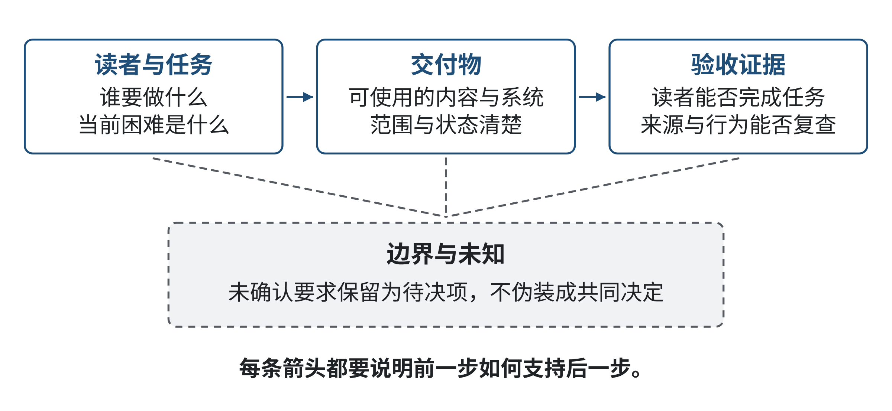
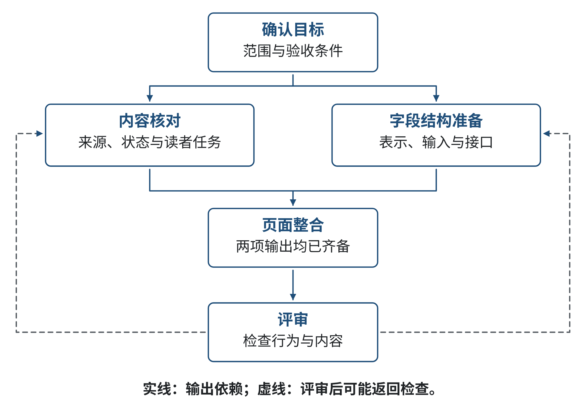
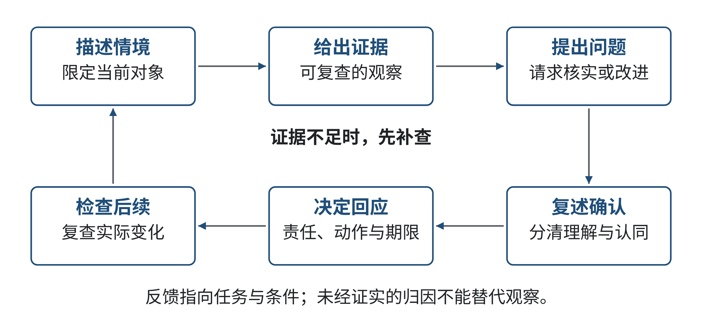
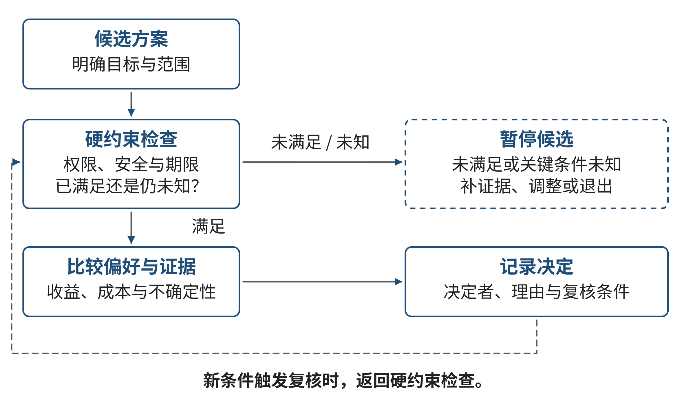
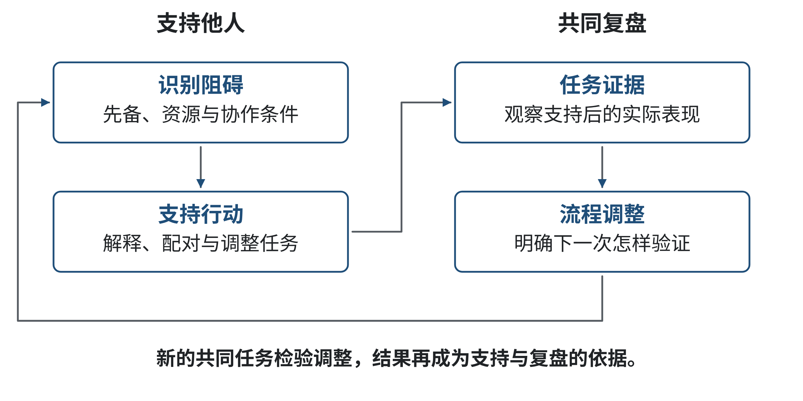

# 第九章 协作与技术领导力：让共同任务持续推进（补充提案）

> 本章题名与九章目录是依据现有编写蓝图形成的补充提案。当前可读的原教材提纲未列第九章，须经课程编写方核定；本稿不把提案写成已确认目录。本章以教学模拟展开，角色、机构、进度与数据均为虚构，不代表西南财经大学的真实团队制度或项目经历。

一项技术工作由多人共同完成时，问题往往不在“大家有没有做事”，而在彼此做的事情能否接上：设计者把什么交给开发者，开发者依据哪一版需求，评审者怎样知道某个结论还只是待确认。即使每个人都很忙，接口没有说清、依赖没有暴露、决定没有记录，工作仍会停在交接处。人工智能可以帮忙整理信息、生成候选任务和起草会议摘要；它也可能把未确认的推测写成肯定句，让团队更快地围绕错误前提行动。

本章不把协作简化成“多开会”或“选一个负责人”。我们从共同目标和可理解的表达出发，练习把任务拆成能交接的部分，管理相互依赖，进行聆听和反馈，形成可追溯的团队决定，再通过支持同伴与复盘让工作继续。重点是小组内共同任务的操作。领导力的完整内涵、项目团队中的目标与激励、以及技术责任和社会影响，将在第十章集中讨论。

## 学习目标

完成本章后，你应能：

- 把宽泛的共同愿望转为团队成员都能解释的目标、交付物和验收条件；
- 为交接写清输入、输出、负责人、期限、版本与尚未确认的事项；
- 从任务依赖判断哪些工作可并行、哪些必须等待，并检验期限是否可行；
- 用聆听、证据和明确问题处理分歧，留下可复查的决定与行动；
- 把生成式AI的总结或任务建议视为待核对材料，检查遗漏、来源、权限和责任；
- 用不归咎个人的复盘找出流程改进点，同时保留个人应承担的责任。

## 学习路线

先看一份虚构的跨专业课程成果展为何在交接时卡住，再用目标、任务关系和沟通记录逐步修复流程。每节都从情境出发，随后给出可迁移的方法；末尾的独立练习提供所需材料，完整参考解集中在章末。第六章已交付的离线教学项目说明了一个有用边界：模拟数据、现场事实与需要他人确认的判断要分开。本章同样保留这种区分，但使用新的成果展情境，不假定校园存在任何特定平台、审批流程或真实项目。

## 9.1 共同目标与可理解的技术表达

### 导语

小组成员都说“我们想把成果展做好”，并不表示他们对“做好”有同一个理解。有人想到网页能上线，有人想到现场演示不出错，也有人想到项目说明让非技术读者看得懂。如果团队不把这些差别说出来，成员各自完成的作品可能都合格，却无法共同构成一个可交付的成果。本节从一个简单的模拟任务入手，练习把目标变成能够共同检查的表达。

### 9.1.1 案例：同一个成果展页面指向不同作品

课程项目小组准备制作一份线上成果展页面。计算机专业学生认为首要任务是把网页做出来；视觉设计成员希望页面有统一风格；一位负责讲解的同学希望每个项目都有一段易懂介绍；另一位成员担心访客看不出作品的数据来自哪里。小组在群聊里不断发送“页面完成了吗”“文案快好了”，但没人能回答：一份“完成”的页面应包含什么？谁来判断它可以交付？

这是一个原创教学模拟，不对应任何真实课程展览。问题不在于成员缺乏热情，而在于目标仍是一句愿望，没有描述读者、使用情境和可观察的成果。若开发者只按“页面可以打开”验收，那么页面也许没有项目说明；若策展成员按“内容完整”验收，网页可能仍没有可访问的导航；若成员各自把“好看”“完整”“能运行”当成唯一标准，最后的评估就会发生在交付之后。

把目标写清，需要先回答三个基础问题：成果给谁使用？使用者要完成什么事？团队拿什么证据判断这件事已经做成？例如，团队可以暂定目标为：“让首次访问者在不接受现场讲解的情况下，能从成果展页面找到每个展示项目的目的、演示方式和资料来源。”这句话仍需讨论，但比“做好页面”多了使用者、任务与可观察结果。为了避免把暂定假设写成事实，小组还应注明访客情境是课程设计假设，须由教师或试读者确认。

### 9.1.2 从愿望走到可检验的目标

目标不是口号，也不是过早指定技术。先说“需要一个AI问答页面”，团队就把注意力锁定在产品形态上，却还不知道访客在页面上需要解决什么问题。一个可检验的目标通常包括四项：谁需要什么结果、在什么情境下使用、结果要满足哪些边界、通过什么可观察证据判断。

例如，“项目说明容易理解”仍然太宽。可以改写为：“第一次访问页面的读者，在三分钟内能找到展览的三项项目信息；每项信息至少说明问题、演示入口和来源状态；由三名未参与制作的同学按任务清单试读，记录能否完成查找。”三分钟与三名试读者只是教学模拟中的便于练习的阈值，不是普遍有效的可用性标准。团队需要根据真实课程的时间和评估目的确认阈值。

把目标变成可检验表达不代表所有价值都可以量化。尊重读者、表达准确、保留项目作者的贡献，常需要由人解释和判断。团队可以为这些原则指定可查证的行为：说明文本是否列出资料来源；任何改写是否经项目作者确认；读者反馈是否有记录。可观察不等于只有数字；它意味着别人能知道判断依据是什么，并有机会提出不同意见。

目标表达还需要区分“成果”与“路径”。“使用某个模型生成说明”是候选路径，不是读者需要的结果。若模型不能使用，或不能获得可靠资料，团队仍应能用人工编写的说明完成目标。先明确要产生什么效果，再讨论方法，才能比较网页、PDF、纸面展签等方案，而不把一个工具误当作目标本身。

目标陈述要尽量使用行为和结果词，而不是模糊形容词。 “简洁”“智能”“有吸引力”可以作为设计讨论的线索，却难以单独作为验收句。团队可以追问：“简洁”是少于几层导航、减少重复字段，还是读者能迅速找到一项信息？答案会因读者任务而异。若成员暂时无法统一指标，保留两个候选定义，在小范围试读后再选，而不是以最先提议者的定义覆盖其它意见。

目标也不应靠堆叠太多指标来制造精确感。若页面任务重点是查找项目来源，衡量加载速度也许有用，但不应取代来源标记是否清楚。每一个指标都要回答“它能说明什么”“不能说明什么”。团队可以保留少量关键验收条件，把其余偏好作为改进建议，避免让成员只为达标数字工作而忽视真实目标。

### 9.1.3 目标的三个层次：读者、交付物、验收

团队可以把共同目标写成一条由上至下的链条：

- **读者与任务**：谁在什么情境下要完成什么事？
- **交付物**：团队会提供什么可被检查的成果？
- **验收依据**：怎样观察或复核成果是否支持读者完成任务？

三层之间要能互相解释。交付物只满足“页面可打开”，无法支撑“访客理解资料来源”；验收只问“团队成员是否觉得不错”，没有验证目标中的首次访问者。反过来，若交付物要求过多，可能超过课程时间或访问权限。团队应把目标缩小到当前可以负责任地完成的范围，并把未能完成的愿望列为后续建议，而不是在摘要中假装已经实现。

**表9-1 目标、交付物与验收依据的对齐示例**

| 读者与任务 | 交付物 | 验收证据 | 未决事项 |
|---|---|---|---|
| 首次访问的读者查找项目目的 | 每个项目一段目的说明及页面索引 | 让未参与制作的读者按任务卡查找，记录结果 | 读者范围与展示时长待教师确认 |
| 读者查看演示入口 | 项目页面的演示入口说明及替代说明 | 核对链接状态；没有在线演示时提供静态截图或说明 | 是否允许公开访问待确认 |
| 读者判断数字资料的来历 | 每个项目的来源状态字段 | 抽查资料说明能否定位到原始输入或明确标注模拟 | 项目作者负责确认资料来源 |

表中是课堂模拟设计，不是对真实网页测试结果的报告。“三层对齐”是本章用于组织讨论的教学方法，不宣称它是唯一或标准的项目管理模型。

**图9-1 共同目标到交付验收的对齐链**
来源：作者原创（教学结构图）。
读图引导：沿“读者与任务—交付物—验收证据”顺序阅读，每个箭头都应能说明前一步怎样支持后一步；旁侧的“边界与未知”提醒团队把尚未确认的要求留作待决项。

同一项成果也可能有多个使用者。例如，学生需要阅读项目说明，教师需要评估课程目标是否达成，项目作者需要确认作品表述准确。团队可以同时承认这几种需要，再决定当前版本重点服务谁，以及对其它使用者提供什么最低限度的支持。若把多个目标混成一句“服务所有人”，很容易要求页面同时做到过多事情，却没有任何一项有明确验收依据。

### 9.1.4 让团队拥有同一份目标，而非同一句话

共同目标不是领导者宣布后其他人照做。成员需要有机会指出目标里的遗漏和冲突：访客是否需要登录？某些作品可否公开？面向大众的短文是否会丢失技术限制？目标里“快速完成”会不会挤掉来源核对？这些问题影响设计，不应被当作最后阶段才处理。

一种实用做法是让每位成员先独立写出三项内容：自己理解的目标、认为最重要的限制、目前缺少的证据。然后把差异分类为事实不确定、价值取舍、资源限制或用语不同。团队不用强求每人使用相同句子，但应对“本轮承诺什么”“本轮不承诺什么”和“哪些决定仍待确认”形成共同理解。若成员表达同意的成本很高，可以让每个人用自己的话复述目标，再由团队检查是否存在重要分歧。

共识也不要求所有人都喜欢每项选择。团队可能在充分讨论后采用多数认可的方案，同时将少数意见与风险保留下来。所谓共同承担，是大家知道最后采用了什么、依据是什么、谁负责下一步，以及什么新证据会触发重新讨论；它不是把有异议的人沉默地计入“全体同意”。

### 9.1.5 AI时代的任务表达：多出候选，也多一道核对

生成式AI可以把聊天记录整理成目标草案，列出可能的读者任务或交付字段。这让文字整理更快，却不自动说明这些目标符合团队实际。AI读到“页面可以公开”可能把它变成确定的产品要求，即使成员原本只是在讨论可能性。它也可能把不同人的意见拼成一段流畅文字，掩盖意见之间的冲突。

因此，团队应把AI生成的目标草案当成“需批准的候选版本”，并回到原始讨论逐项核对：每个要求由谁提出？它是事实、偏好还是猜测？会影响谁？是否获得有权确认的人的同意？把AI建议写入任务单之前，最好保留原话链接、状态标签或修改记录。若AI使用了外部资料，须核对来源；若输入含未公开的个人信息、作品素材或项目数据，先检查团队的授权与数据处理要求，不要把方便使用误当作有权上传。

这种变化也改变了团队协作的注意力。过去，成员可能主要花时间把会议结果写成任务；现在，AI可以迅速生成清单，团队更需要判断清单有无遗漏、顺序是否合理、谁有权确认和谁承担后果。语言越流畅，越不能将流畅本身当作证据。

### 9.1.6 完整推演：从一句愿望产生一份能交接的验收说明

让我们把案例再走一遍。最初需求是“做一个让大家愿意看的成果展网站”。它至少含有两个未回答的问题：“大家”是谁？“愿意看”要如何判断？小组不能把两个词悄悄替换成自己的偏好，而应先访谈或试读有代表性的目标读者；若暂时没有访问机会，就把对象写成假设并限制本轮结论。

团队可先列出三个任务场景：读者在首页选择某一项目；读者查看项目的演示或替代材料；读者判断一段说明中哪些是事实、哪些是作者的教学模拟。假设当前教学任务只要求提供前两个场景，第三项作为来源透明性的最低边界，则目标可以暂拟为：“课程展览页面让首次访问的读者找到指定项目的主题、演示方式和来源状态；未获确认的链接或材料不标成可公开。”这句话同时限定了访客能力、信息字段和边界，但还没有决定页面技术。

接下来把目标拆为验收说明。对“能找到指定项目”可以给一项任务卡：“请打开展览页面，找到标题为‘数据如何改变城市出行’的项目，并指出该项目的问题、演示入口和来源状态。”这只是作者编写的模拟题目。试读者是否完成、用了多久、哪里出错，必须在实际试读后记录；不能因为任务卡写得清楚，就预先声称页面可用。为了防止任务本身暗示答案，试读时应观察读者会看什么、在哪里停顿，再请读者说明自己的理解，而不是先提示入口位置。

若三名读者中两人找不到来源状态，团队不应立刻推出“所有读者都找不到”的统计结论。小样本更适合作为发现问题的探索性检查：记录实际观察，提出可能解释，随后改动页面或开展更合适的测试。即使三人都顺利完成，也只支持“这三位读者在这次任务中完成了查找”，不能推论所有读者、所有设备或所有网络环境均可完成。

目标与验收还应保留“超出本轮范围”的事项。比如，团队可能暂时无法取得公开访问授权，也不能保证所有演示文件长期可用。可交付的替代方案是采用离线页面或静态说明，同时在页面上明确链接状态。这不会让原来的公开访问目标自动算作完成，却可以形成范围更小、事实更可靠的成果。评价时应明确这是“本轮可交付版本”，并将未来条件写入待办。

这一步需要反复校准读者语言与技术语言。开发者可能说“页面路由返回200”，内容编辑关心“读者点了以后会看到什么”，来源核对者关心“文件内容能否追到作者提供的原件”。团队可以把技术检查作为交付物的一部分，但验收不能只停留在技术响应状态。一个可访问的链接可能指向错误版本；一条正确的来源链接也可能让目标读者不知道它证明什么。交付条件要对应目标中每项实际需要。

目标说明还应包含“不能发生什么”。如果团队只写希望的结果，验收就可能忽略不可接受的后果。成果展的任务卡可以补上：“不得把未确认的资料状态显示为已核实；不得让读者误以为静态教学示例来自真实访问记录。”这两句不是功能装饰，而是规定成果的可信边界。测试者可以拿一条缺少来源的样例检查页面是否保留未知状态，并观察说明文字是否交代数据性质。

条件变化也会改变目标。起初作品只在教室内展示，后来组织者提出对校外开放；前一版本的访问和资料核验仍然有用，却不足以支持新的承诺。此时不要简单把“校外可访问”加到页面验收项中，而要先重新确认公开范围、作品作者的许可、链接生命周期和更新责任。团队可把目标版本标为V2，列出新增条件与仍待确认事项；这样既能继续当前可做的内部版本，也不把它错称为公开发布版本。

团队还可以把目标写在一页“本轮说明”上，包含读者任务、交付物、验收条件、明确不做的事项、负责人和版本日期。它不需要替代设计稿、测试记录或课程要求，只需要在成员交接时保持同一含义。若目标改变，应更新版本并用一两句说明改变的依据，避免旧任务卡继续指导新工作。

### 思维训练：把模糊目标转成验收句

选一个你熟悉的小组任务，例如制作课程海报、维护代码仓库或组织一次技术分享。先写一句原始愿望，再分别写出读者与任务、交付物、验收依据、范围边界和未知项。邀请另一名同学复述目标，记录他与你理解不同的地方。评价时检查：交付物是否支持目标，验收依据是否真的观察了目标，未确认的条件是否仍标成未知。无需追求最宏大的愿景，能诚实说明本轮承诺和证据即可。

### 【本节反思】

当你听到“做一个好用的系统”时，自己通常会先想到什么？你是在描述使用者的结果，还是先选择了工具？回顾一次团队任务：哪项未说出的假设后来影响了成果？如果重新开始，你会如何让受影响的成员参与目标解释，又如何记录仍待确认的事项？

## 9.2 分工、依赖与资源协调

### 导语

一项共同任务可以拆成许多小任务，但“拆得越细”并不等于“越容易完成”。任务如果缺少明确的输入和交付标准，拆分只会让更多人等待；如果把高度相连的工作假设成互不相关，最终再集成时才发现接口不一致。本节从一个版本交接失败的案例出发，学习如何按成果拆分工作、识别依赖并留下足以继续工作的交接信息。

### 9.2.1 案例：每个人都完成了自己的部分，整体仍拼不起来

在成果展模拟中，内容组把项目介绍写进文档，视觉组完成卡片样式，开发组做好了网页框架。交付前一天，开发组发现介绍文档的项目名和设计稿中的短标题对不上；几条演示链接指向个人账号，来源说明里还混有“已核实”和“待联系”的状态。每个人都说自己按群里的消息完成了任务，但没有人确定群聊里最后采用的是哪一个版本。

假设这一情境中的资料与人物都是虚构的，问题仍然具有一般性：团队把“每个人的工作量”当作划分依据，却没有先设计可组合的成果。网页页面依赖内容字段和视觉规范，来源说明又依赖项目作者确认；这些依赖不能靠在交付日把文件放到同一个文件夹解决。跨学科团队研究也提醒我们，协作成效不仅取决于成员知识，还涉及任务关系、团队过程和所处环境；本章借此作为分析视角，不把研究领域的结果直接当成学生团队的保证。[1]

### 9.2.2 按交付物划分，而不是按头衔或人数平均分

分工前先列出最小可检验的交付物。例如，成果展不是抽象的“网站项目”，而是由导航结构、项目说明、来源记录、页面实现、演示方式和测试记录组成。每项交付物需要有明确的负责人，但“负责人”指负责推动、更新状态和通知风险的人，不等于独自完成，也不等于可以替领域专家作决定。

任务描述至少包括：

- **输入**：开始前需要什么材料、谁提供、采用哪一版；
- **输出**：需要提交的文件或决定，如何识别其版本；
- **检查条件**：什么证据说明输出达到最低标准；
- **负责人和协作者**：谁跟进、谁提供专业意见、谁接收；
- **依赖和期限**：须先完成什么，最迟何时要让后续任务开始；
- **未知和阻塞**：缺少什么，遇到什么情况要暂停或升级处理。

这些字段是为本章教学设计的交接清单，不是通用工单规范。小任务可以用一句完整文字写清，大任务才需要单独的任务卡。核心在于接收者能回答“我现在拿到什么、还缺什么、下一步可以做什么”。

**表9-2 交接任务卡示例**

| 字段 | 模拟填写内容 |
|---|---|
| 交付物 | 项目展页的说明卡片，包含问题、演示入口、资料来源状态 |
| 输入 | 作品作者提供的说明草稿；本轮确认版编号C2 |
| 负责人 | 内容编辑同学跟进；开发同学接收字段结构 |
| 检查条件 | 三个必需字段均有内容；模拟或真实来源状态没有混写 |
| 依赖 | 作品作者确认资料来源后，才能发布来源说明 |
| 期限与风险 | 计划周四交付；周三仍未确认时，显示“待确认”而不擅自补全 |
| 版本与记录 | 文件名附日期和版本号；变更摘要写明修改字段 |

这张任务卡帮助接收者继续工作，并没有假定“周四”或“C2”是现实课程的要求。具体日期、版本办法和字段应由团队根据任务确定。团队也应避免只在聊天中说“发给我了”：链接失效、编辑权限不同或文件名重复都会导致隐性阻塞。交接成功的标志是接收者确认拿到可用材料，并能复述尚未解决的问题。

### 9.2.3 把任务依赖画出来

先把任务写在卡片上，再问每张卡的输出是否是另一张卡的必要输入。若“项目作者核对来源”完成后，说明卡才能定稿，那么两者之间存在依赖；若视觉稿和页面结构可以先用同一份初步字段设计，二者可能并行，但必须约定字段变化时如何通知和更新。关系图应只表达工作怎样相连，不用节点数量装饰专业感。

一个依赖图至少区分三种情况：

1. **必须先后**：后项缺少前项就无法做出可靠结果；
2. **可以并行**：两个任务当前输入相互独立，彼此完成也不需要等待；
3. **存在反馈**：后项检查可能发现前项错误，需要返回修订。

第三种尤其容易被漏掉。页面测试如果发现导航不能支持读者任务，不应只改页面颜色，还可能需要重新审视目标和信息组织。团队应留出复核时间，不把一条单向流程误当成不会返工的生产线。

**图9-2 成果展任务的依赖关系与返回检查**
来源：作者原创（教学关系图）。
读图引导：实线箭头表示后项必须等前项输出，虚线回箭头表示评审可能要求重新检查前项；并行的内容核对与字段结构准备都可从目标确认后开始，但页面整合需要两项结果齐备。

### 9.2.4 估算期限：先找不能绕过的等待

成员常把“做完需要两天”理解成两天后自然就能交付。实际上，项目持续时间还取决于任务能否并行、谁有时间、谁掌握必要信息，以及等待反馈需要多久。依赖图上的最长连续路径可以给出一个简单的下限：若路径上工作合计八天，团队没有缩短工作、改动依赖或调整范围，就不可能在七个工作日内完成。这个下限没有包含成员同时承担多个任务、返工概率和外部等待，因此不能当成承诺日期。

设想目标确认需一日，来源核对需两日，说明卡写作需两日，页面集成需三日，读者试用需一日。即使其它工作都能并行，这条必须先后执行的路径仍需九日。把“多找一个人”作为解决办法之前，应检查是否存在可以拆分且输入充分的工作；若来源核对只有一人有条件完成，让其他人“并行”只会制造第二份未核实的资料。若期限只有八日，团队可讨论缩小成果展范围、改变试用安排或延长一天，但每个选择都要明确哪个目标被影响、由谁确认。不能把关键确认删掉后仍宣称完成了原目标。

工作量还受不同类型资源限制。团队可能在人员上有空，却没有作品作者确认来源的权限；可能有足够编码时间，却没有获得测试读者的安排。资源清单应同时记录人员时间、访问权限、领域知识、工具、设备与外部回应，不把“有人可以写代码”误当作所有阻碍都能解决。

实际推演时，可以按“最早开始—最早完成”的顺序走一遍依赖图。假设目标确认用一日，资料核对用两日，字段结构用一日；三者中资料核对和字段结构可以在目标确认后并行。说明卡写作需要等资料状态和字段结构都可用，再花两日；页面整合还需要等说明卡和字段结构，估计三日；读者检查安排一日。沿着资料核对这条较长路径计算：目标确认第1日结束，资料核对第3日结束，说明卡第5日结束，整合第8日结束，检查第9日结束。字段结构路径在第2日结束，因此并非当前瓶颈。此处没有考虑成员同时承担几项任务，也假设每个估时指连续工作日；现实排程还需要核对人员和权限。

若团队只看每项任务的日历日期，可能误以为把两个人分配给“页面整合”就能从三日压到一日。只有当任务内部能拆成独立工作、并且接口可以协调时，增加人手才可能改变时间。若瓶颈是资料确认、外部访问或关键决策，增加编码者没有作用。团队在讨论期限前要问：估时是总工作量还是等待时间？哪项可并行？同一人是否被安排在两个同时开始的任务上？哪项需要外部回应？这些问题决定排程是否可信。

还可以观察延误对后续的影响。如果资料核对比预期多一天，说明卡和页面整合也会后移；团队此时应尽快通知后续负责人并决定是否调整范围。若只在周末发现延误，已经投入的页面可能依赖错误文本，返工就会更大。进度状态应表达“已完成”“进行中”“等待确认”“被阻塞”等事实，不只用红黄绿或百分比让进度看起来清楚。每一种状态都要有可解释的判定方法。

任务看板只在能帮助接续工作时才有价值。状态字段应能区分“尚未开始”“正在处理”“等待他人确认”和“被阻塞”；每次变更都尽量指向当前版本和下一步。百分比需要明确分母，例如“完成四张卡中的两张”才可核对；仅写“进度80%”容易让人误把主观估计当作可比较数据。小组规模很小、任务只有两三项时，一页共享清单可能足够；若同步工具比任务本身更耗时，就应简化记录方式。

### 9.2.5 AI帮助拆分任务时，仍要检查前提和接口

AI可以根据一段项目说明生成任务清单，也能建议哪些工作并行。但模型通常只能依据输入的文字推断：若说明没有写明谁可以批准公开资料，生成的工作计划就可能把“确认公开权限”遗漏；若错误地把草稿当成最终内容，后续任务也会被错误地标成可开始。团队可以让AI提出一份候选清单，再用任务目标、角色授权、依赖和未知项逐项核对。

推荐的实际顺序是：先由团队确认交付物；再让工具提出分解草案；成员补齐任务卡和依赖关系；对所有会改变数据、权限或外部承诺的事项指定确认者；最后检查最长依赖路径与资源瓶颈。AI生成的“优先级”不自动有事实基础，也不代表成员已同意。涉及工时、能力或绩效的推断，不应仅因模型输出而写入个人评价。

任务交接发生在两人或多个小组之间时，信息最好附带一个能被接收者确认的“共同对象”，例如共享文档链接、提交编号、测试报告或设计稿页码。只传一张截图可能隐藏上下文，转发一段聊天又可能丢失更早的修订。文件的命名方式可以简单，但团队要约定哪一个是当前版本，旧版是否保留，以及谁有权更新。若多人同时编辑，应避免用个人电脑中的临时副本作为唯一依据。

还要区分“任务本身完成”与“下游准备好”。例如，来源核对者已经提交记录，但页面负责人还没确认字段是否可读；上一项任务可以标记已完成，下游仍需检查输入是否匹配。状态不应为了看起来顺利而提前更新。把阻塞暴露出来不是拖慢进度，而是让团队及早选择等待、替代方案或范围调整。

### 9.2.6 交接契约的前后对照

不充分的消息是：“文案写好后发给我。”接收者不知道需要哪一份文案、如何确认版本、哪些字段仍需作者核实，也不知道发过去以后对方是否收到了。更可用的写法是：“请把成果展项目‘数据如何改变城市出行’的说明卡更新为C2版，保留问题、演示入口和来源状态三个字段。两条来源尚未得到作者确认，请继续标为待确认，不要补写。周四中午前发到本组共享目录，完成后在任务记录中附文件链接并提醒页面负责人确认已收到。若作者未回复，周三下午告知内容负责人，由团队决定是否改用静态展示。”这条消息明确了对象、版本、字段、未知、期限、接收和异常路径。

写得清楚不需要很长。如果任务简单，可以只说明当前版本、输出格式、截止时间和反馈方式；如果涉及他人权限或外部承诺，交接中要明确授权状态和暂停条件。双方还应共同确认“完成”的含义：发送文件只证明发送动作完成，接收者核对内容并确认可用，才算交接成功。遇到接口变化时，提交者应说明变化影响哪些下游成果；接收者可以指出输入缺失或格式不兼容，而不是默默修补后继续。

依赖关系也应随变更更新。若项目作者将字段名由“来源”改成“资料状态”，团队需要检查表单、页面、测试脚本、培训说明是否也依赖旧字段。只改任务卡标题可能导致数据结构仍不一致。可用一份简短的变更说明列出变更项、影响的工作、负责人和复核点。越早暴露接口变化，越容易把调整限制在相邻工作中。

### 练习 E01：成果展任务图与期限检查

**教学情境与数据**：以下为虚构的课程成果展计划。工作日时长均按整日估计；为了单独练习依赖关系，假设不同任务可由不同人员承担，暂不计人员冲突、休假和外部等待。这个假设只用于计算最早完成下限，不代表真实排程。本题新增一项明确的估时更新：课程资料索引已提前整理，B“核对项目标题、说明和资料状态”由原先的两日模拟估计调整为一日；其它任务估时与前置关系不变。该变化是本题给定条件，不可推广成“重复工作总能减半”。

**表9-3 E01 更新后的成果展任务清单**

| 任务 | 工作内容 | 估计工作日 | 前置任务 |
|---|---|---:|---|
| A | 确认读者任务和本轮交付范围 | 1 | 无 |
| B | 核对已建索引中的项目标题、说明和资料状态 | 1 | A |
| C | 确认所有页面共用的字段结构 | 1 | A |
| D | 根据核对后的资料编写说明卡 | 2 | B、C |
| E | 整合页面和说明卡 | 3 | C、D |
| F | 用读者任务卡检查页面 | 1 | E |

**任务**：画出依赖关系，计算每项任务的最早开始和最早结束日期；找出全部最长依赖路径，并判断八个工作日的期限是否可行。说明达到理论下限是否意味着计划有缓冲。若不可行或没有缓冲，提出一种有依据的调整方法，写明它会改变范围、估时或期限中的哪一项，以及需要谁确认。

**提交内容**：一张任务图、一份起止时间表和一段约150字的说明。不得把必须等待的任务仅因增加人手就标成并行。

**评价依据**：使用更新后的B估时；识别并列关键路径；时间计算正确；能区分理论下限与实际排程和缓冲；调整方案没有静默删除关键验收或未知项。

当等待来自外部角色时，应把“联系某人”与“收到确认”分成不同状态。前者由团队成员完成，后者受对方时间影响；两者混为一谈，会让计划表显示已经完成，实际上后续任务仍不能开始。记录发出时间、预计回复时间和无回复时的下一步，可以帮助团队尽早调整，而非在截止日前才发现没有替代方案。

### 思维训练：画出最短的可执行依赖图

选一个你实际参与过或可以模拟的三至六步任务。先写交付物和接收者，再为每一步标出输入、输出、负责人和检查条件。用箭头连接必须等待的前后项，用文字注明可并行与需反馈的关系。找出最长的依赖路径，并提出一个不损害硬要求的改进；若不能在现定期限完成，应具体说明所需调整。检查重点是依赖是否真实、等待是否看得见、接收者是否可以据此继续。

### 【本节反思】

你最常把哪一种“等待”当成没有发生：等一条消息、等领域确认、等访问权限，还是等上一版修订？回顾一次团队分工，哪些任务被按人头平均拆开，却没有考虑接口？当AI生成了一张漂亮的任务清单时，你会回到哪些原始信息检查它的前提？

## 9.3 聆听、反馈与冲突处理

### 导语

团队出现分歧时，最省力的办法似乎是尽快投票、请负责人拍板，或把意见都交给AI总结。但不同争论需要不同处理：一个是资料是否正确，一个是目标优先次序，一个是任务资源不足，还有一个可能只是双方使用了不同词语。若一开始就把分歧归结为“谁不配合”，团队会失去查明事实和重谈方案的机会。本节讨论怎样让彼此听见问题、把反馈落到可行动的信息上，并在需要时形成会议决定。

### 9.3.1 案例：AI会议摘要把待议事项写成了决定

成果展小组讨论是否公开页面。一个成员说：“如果教师同意，我们可以设置公开入口。”另一个成员表示不确定项目作者是否授权。会后，AI工具把录音摘要成“团队决定公开页面，项目成员负责提交文案”。开发者按摘要设置了公开入口，直到内容编辑发现原话中有两个未决条件，才暂停发布。这里的争议不是成员是否认真，而是“提出候选”“附带条件”和“正式决定”被压成同一状态。

若把问题说成“记录员没做好”，团队可能换个人记笔记，却保留了容易误读的决策流程。更好的做法是核对原始发言，区分事实、推测和决定，标明谁有权确认公开条件，并先暂停会扩大影响的动作。该案例为虚构的教学模拟；并非真实录音或AI工具测试。

### 9.3.2 先听清，再判断哪一种分歧正在发生

听见对方的声音不等于听懂对方的理由。有效聆听包含三个可观察动作：先让对方说完；用自己的话复述对方最关心的内容；询问复述是否准确，哪些事实或条件需要补充。复述不是替对方改写成自己熟悉的术语，而是暂时保留对方的重点。例如，对方说“公开之后很难收回”，可以先问“你担心的是未经许可的作品会在页面传播，还是页面上的来源信息无法及时修订？”问题不同，接下来的核查和决定也不同。

分歧至少可能发生在四个层面：

- **事实差异**：成员掌握的材料不同，适合回查原始证据；
- **解释差异**：同一事实支持不同解释，适合说清推理和不确定性；
- **价值或优先次序差异**：例如速度与可追溯性如何取舍，需要确认目标和责任边界；
- **资源或流程差异**：缺少时间、权限或角色确认，需要重新安排工作或提出协商。

有时争论只是词语不同。例如“完成”有人指文件已写好，有人指经审核能发布。澄清词义可能比投票更快。面对高影响决定，团队还应问：目前缺少什么人、数据或授权？如果答案不清楚，就先标为待确认，不要让发言较多的人替所有利益相关者作决定。

### 9.3.3 给出能帮助改进的反馈

反馈的目标是让接收者知道发生了什么、可能影响什么、下一步可做什么。可以试用“情境—证据—问题”三步：

1. **情境**：指明具体的文件、环节或时间点，避免评价一个人的整体能力。
2. **证据**：说明看到或复算了什么，不把推测说成事实。
3. **问题或请求**：邀请对方补充背景，或提出一个可执行的调整请求。

例如，“你总是不检查资料”把个人标签当成原因。较好的反馈是：“在周三版本的项目卡中，我找不到两条图片来源记录；如果这是有意暂缓，请注明状态和确认人；如果记录遗漏，我们能否今天补齐后再请作者复核？”这段话指出可观察的缺口，同时给对方解释和修正的空间。它不是固定脚本；若情况紧急，可直接说明暂停原因和安全需要，再补充证据。

收到反馈也需要一个动作：先复述自己听到的具体问题，确认对方是否指出错误、影响或偏好；再决定立即修改、补证据、讨论标准或保留意见。表示“收到”不等于答应所有要求。若反馈来自AI摘要或自动代码审查，同样需要核对它引用的原文或实际输出；不要把建议文字的确定口吻当作证据强度。

**图9-3 从分歧到可核对反馈的沟通循环**
来源：作者原创（教学结构图）。
读图引导：顺着“描述情境—给出证据—提出问题—复述确认—决定回应—检查后续”的箭头阅读；若证据不足，循环应回到补证据，而非直接进入归责。

给反馈的人也要区分“观察到的问题”和“可能原因”。例如：“测试在安卓模拟器中出现按钮遮挡”是可复现观察；“设计同学不了解移动端”是未经证实的归因。更有帮助的表达是：“在本周版本的窄屏模拟器上，提交按钮被底部菜单遮挡；我担心读者无法完成提交。你能否先核实适配尺寸，之后我们一起复测？”接收者可以回应：“我会先在两个尺寸下复现；如果只发生在一种配置，我会记录条件并修正。”双方把对象限定为当前表现和证据，后续就能验证修改是否有效。

反馈接收者可以选择四种处理方式：接受并修订；询问需要澄清的事实；解释为什么不采用；或暂缓到获得新证据。每种处理都需要一条后续状态，例如“已修订并复测”“等作品作者确认”“风险保留并由教师决定”。“不同意”本身并不是沟通失败；隐瞒拒绝或不说明理由，才会让其他人误以为任务已被接受。若反馈涉及影响较大的内容，接收者还应确认责任范围内谁有最后确认权。

选择沟通渠道时，考虑内容复杂度、紧迫程度、是否需要异步参与以及是否涉及敏感资料。对有多个依赖的技术变更，先写清影响文件和输入版本，可能比临时开会更高效；对需要协调不同领域解释的问题，面对面或线上实时交流可能更快；但实时会议仍需要文字记录，方便缺席成员检查。不要把“即时回复”当成承诺，也不要在公共群聊里公开评价某位成员的能力。沟通渠道让信息可达，不自动替代必要的授权和尊重。

### 9.3.4 有限会议：围绕一项明确决定组织对话

不是所有讨论都需要开会。异步文档适合补充资料、校正文字和列出疑问；当事项需要快速交换信息、处理相互影响或共同选择时，会议可能更合适。会议是否有效，取决于它是否产生团队能继续使用的结果，而非是否排满了时间。

会议开始前，写清要讨论的问题、可选方案、需要在场的角色和希望产出的记录。如果只是收集意见，不必假装当天会做决定；如果要拍板，要先确认谁有决策权以及哪些约束不能被投票改变。会上先读出目标与待确认事项，再让成员补充事实和风险；必要时让大家先静默写下意见，避免最先发言者设定所有人的问题框架。小组可以轮流说，也可以先分组整理，但讨论方式应允许成员指出“我没有相关数据”“我需要核实权限”。

记录至少保留：讨论的问题、采用或暂缓的选项、理由、异议或风险、负责人、截止条件和复核触发点。结束时读回行动项，请责任人确认是否准确。参与者如无法同意，可把“少数意见”与“多数决定”并列记录，不制造全体一致的假象。

把情绪写进复盘时更需谨慎。可以记录“成员在测试前没有提出来源状态疑问，直到发布演练才发现缺失”，不能直接断言“成员害怕表达”或“主持者让人沉默”，除非当事人愿意说明且有证据。复盘中可以提出一个可检查的问题：“我们是否提前给了提意见的时间？下次可否让成员会前提交问题？”这样团队能够改善渠道，又不把心理概念用来诊断个人。

### 9.3.5 心理安全与可追问的工作环境

当成员可以报告错误、承认不知道或质疑计划时，团队更容易获得重要信息；然而，这种氛围并非礼貌用语、无条件赞同或不处理责任。Edmondson对一家制造企业51个工作团队的研究发现，团队心理安全感与团队学习行为相关；该研究的样本和情境有限，不能据此保证所有团队都能提升绩效，更不能把“心理安全”解释成任何行为都不受检视。[2] 团队可以借用其中的谨慎启示：提出异议应当有渠道，说明依据的人不应因提出问题而受羞辱；与此同时，错误造成的影响仍要被识别、修正和负责。

当成员身份、专业能力、话语权或时间不同，沉默也可能有多种原因。有人还没想好，有人不愿当众暴露不懂，有人觉得决定早已定好。主持者可以提供异步补充机会、轮流发言和会后复核渠道；但不能要求某个人公开披露私人经历或心理状态。项目讨论保持在任务和影响范围内，需要个人支持时由当事人选择合适的支持方式。

选择讨论渠道时，还要留意谁有机会表达。小组成员可能因经验、身份或负责范围不同而有不一样的发言空间。可以邀请尚未发言者补充，却不要求其必须支持某个结论；允许先写在共享文档里，也能让需要思考时间的成员参与。对重要事实的确认，不应以“会议上没人反对”为证据。沉默可能只是没看到资料、没时间回应、不了解权限或暂时没有意见，主持者应按事项类型检查，而不是替沉默者赋意。

有些分歧应先暂停，而不是继续寻找折中。若尚未确认公开许可、出现可能伤害某个群体的表述，或发现演示数据并非原先声明的模拟数据，团队可先停止发布相关部分，保留其他不受影响的工作。之后明确需要补充的证据、谁可以确认、何时复核。暂停不是惩罚提出问题的人，也不自动判定风险必然存在；它是给团队留出调查时间的可逆操作。

当成员间的沟通难以继续，或者问题超出课堂小组职责时，可通过课程规定的教师或项目联系人处理。将专业冲突交由更有权限的人审查，比要求成员在个人关系中不断争论更合适。记录事实和影响即可，不需要要求任何人公开披露私人情况。具体渠道应以课程实际安排为准，本章没有假定西南财经大学设有某种特定程序。

对不紧急、需要查阅材料的反馈，可以先写成带版本和来源的评论，并给出合理回复时间；这样成员能够核实事实后再答。若问题会导致立即对外承诺，就先简明说明暂停点，再补齐原因和记录。无论采用何种渠道，反馈都应让接收者知道当前需要完成什么、何时回复、哪些后果会触发升级。不要默认所有人都必须在课程之外持续在线，时限应由团队约定并留出必要的反应时间。

### 9.3.6 完整推演：二十分钟内结束一次资料状态讨论

假设小组有二十分钟解决三条说明卡的来源状态。若会议一开始就讨论“AI摘要能不能用”，议题可能变成工具偏好，原始问题却没有被检查。主持者可以先用两分钟重述决定范围：“今天只决定三条说明卡是否可进入内部评审，不决定对外公开。”接着用三分钟列资料：两条有项目作者提供的来源信息，一条没有回复。再用五分钟让编辑、页面负责人和内容作者的代表分别说明需要和限制；如果有人不知道答案，就记为未知，不将其解释为反对。

讨论的后半段可以比较三种临时选择：在页面显示已核对的两条，第三条标成待确认；把三条全部从页面移除；或暂缓整批发布。团队再检查硬条件和交付期限，若本次只能决定第一种方案，就在记录中写清边界、决定者、执行者和复核触发点。最后三分钟读回结果，明确谁在何时联系尚未回复的作者，谁负责检查网页状态。会议结束后，记录者把会议纪要发给参与者，允许在约定时间内更正事实性错误。

这个例子展示的是流程，而非建议任何团队在每次会议采用相同议程。若参与者无法确定授权，会议的正确产物也可能只是“暂停并请求确认”。若需要补充事实，继续收集意见比在时间结束前假装完成决定更负责。时间盒控制的是讨论时长，不是要求团队必须在该时长内得出答案。

远程或混合协作还需要注意信息进入渠道。异步成员可能因时区、设备或课程安排错过讨论。团队可以提前分享一页材料，允许在会议前提交意见；会后给出短暂校正窗口。AI转录和摘要可以降低整理负担，但若转录错误、成员没有同意记录或原始内容包含敏感信息，就需要调整记录方式，必要时不用录音。即使只有文字聊天，也要标出决定状态和责任人，不能指望系统自动保存的时间顺序能说明谁拥有最终决定权。

### 练习 E02：区分立场、证据和需要的确认

**教学情境与材料**：下面四句话均为作者编写的会议模拟文本，不是真实访谈或录音。

- 甲：“今天先开放页面，不然大家看不到进度。”
- 乙：“来源还没确认，我不建议把第三张卡公开。”
- 丙：“AI会议摘要写着全组同意公开，所以我已经改了页面。”
- 丁：“我不知道这两条图片说明能否公开，但我可以今天联系作品作者。”

**任务**：为每句话标注它主要表达了立场、事实、未知、建议还是行动；再选择其中两句，用“情境—证据—问题”重写回应。最后拟一份不超过六行的会后记录，列出当前决定、异议或未知、负责人和复核条件。

**评价依据**：不把甲的进度担忧解释成必然应公开，不把乙的限制误作反对所有展示；识别丙把AI摘要当成正式授权的错误；确认丁提出的具体行动并给出期限；会后记录清楚区分“已决定”和“待确认”。

会议纪要也要尊重记录对象的范围。若团队不需要录音来完成任务，可以只保留必要的决定和行动项；如果确需转录，要事先说明用途、访问者、保留期限和校正方式，并按实际规则处理。成员能够检查自己的发言是否被准确记录，是减少误解的一种具体办法；录下声音并不天然比准确的行动记录更完整。

### 思维训练：把一段反馈改成可核对的请求

两人一组，选一项常见反馈，例如“这个结果不靠谱”“你们沟通不清楚”。第一位同学说出反馈，第二位先复述，再询问具体情境和证据；随后共同把它写成一条可行动请求。交换角色后，检查改写是否保留了真正的问题，是否把未知误当成事实，是否给对方留下解释和选择的空间。

### 【本节反思】

你遇到不同意见时，第一反应通常是证明自己正确、尽快结束争论，还是先确认双方到底在争什么？哪一种会议记录最可能被误认为正式决定？当成员提出一个暂时无法证实的担忧时，团队能否把它作为待核查事项留下，而不是立即要求其证明或撤回？

## 9.4 团队决策：证据、责任与调整

### 导语

团队已经听取了意见，也有了候选方案，仍然要面对一个问题：谁可以决定，决定依据是什么，之后出现什么情况要重新打开讨论？有些选择成本低、随时可以改；有些选择一旦向外发布，就会影响作品作者、访问者或团队信誉。把这两类选择当作同一件事，容易造成过度拖延或过早承诺。本节练习让决策程序与影响程度相称，并留下足以复核的记录。

### 9.4.1 案例：一个“AI推荐”不等于团队决定

成果展团队要决定采用静态作品集、互动网页，还是嵌入式问答。小组把目标、时间和访问条件交给AI，AI回复“推荐互动网页，可提升参与度并便于展示”。这段话看似给出了结论，却没有说明“提升参与度”的证据，也没有核对访客能否使用交互、项目资料能否公开、课程是否提供维护时间。负责网页的成员愿意尝试，负责来源核对的成员认为公开内容还未确认。

这时，团队要分别回答两个问题：AI提出的选项有什么可验证的依据？谁有权批准作品公开？第一个问题可以通过比较真实功能、测试和资源来调查；第二个问题不能由自动化建议或小组多数票替代。团队可以继续选择暂不公开的静态演示稿，保留候选选项并请求适当确认。所有产品形态均是教学模拟方案，不代表实际工具的功能评测。

### 9.4.2 先分清不可让步的条件与可比较的偏好

**硬约束**是当前任务必须满足的条件，例如不得公开尚未确认授权的材料；**偏好**是在满足硬约束后可比较的性质，例如页面更便于更新、视觉风格更灵活或实现时间更短。偏好可以打分，硬约束不能通过总分较高来抵消。若团队把“是否有公开许可”与“是否方便展示”放在同一张加权表里，某个高分就可能错误地覆盖必需条件。

选择方案前先建立可核查的过滤步骤：每个候选是否满足所有硬约束？证据在哪里？未确认的条件是什么？只对通过过滤的候选比较偏好。如果某个硬约束不明，方案应标为暂缓确认，而不是假装符合。团队也要确认谁能判定某项条件为硬约束：项目成员可以识别风险，但不一定有权限解释课程、版权或组织规则。

对于能够合理量化的偏好，可以建立一张轻量比较表。分数是团队在本情境下的判断，不是方案在所有场景中的客观排名。

**表9-4 成果展页面候选方案的教学比较**

| 判断项 | 权重 | 静态作品集 | 互动网页 | 嵌入式问答 |
|---|---:|---:|---:|---:|
| 按期完成的可能性，1至3分 | 3 | 3 | 2 | 2 |
| 无网络时仍能展示，1至3分 | 2 | 3 | 1 | 1 |
| 后续更新的便利程度，1至3分 | 2 | 2 | 3 | 2 |
| 加权合计，仅用于模拟比较 | — | 19 | 14 | 12 |
| 硬约束：来源状态确认后才公开 | 必须满足 | 可满足，需逐项检查 | 可满足，需逐项检查 | 有额外输出核验负担 |

表内评分由作者为教学情境设计，不是用户研究结果。计算合计采用“权重乘评分后相加”：静态作品集为3×3+2×3+2×2=19；互动网页为3×2+2×1+2×3=14；嵌入式问答为3×2+2×1+2×2=12。数字只表示该模拟团队采用的权重与判断；如果可靠性或维护条件改变，就应重新讨论评分。

评分还需要做一次敏感性检查：如果只把某一项偏好稍微调高，排名就完全翻转，团队应承认结论依赖价值选择，而不是把总分当成稳固事实。表9-4中静态作品集的分数为19，互动网页为14，嵌入式问答为12。如果本轮把“后续更新便利”权重从2提高到5，把“无网络可展示”的权重降为0，同时保持按期完成权重为1，模拟得分就变为：静态作品集13分、互动网页17分、嵌入式问答12分。互动网页因此排到前面。这个变化不是计算错误，而是优先次序变化；团队应说明为什么更重视长期更新、为什么不再把离线展示当作需要考虑的性质。若无网络条件后来确认是硬约束，则再高的偏好总分也不能让不满足该约束的方案通过。

因此，评分表有两个用途：使比较条件显性化，指出哪些假设值得补证。它不适合替代专业判断、取得授权或决定何种影响可以接受。对无法可靠给出分数的因素，可以采用“满足 / 不满足 / 未知”而不是强行量化。未确定信息保留为未知，并安排谁去核实；避免把分数精确到小数点后两位制造虚假的客观性。

若两种方案各有明显优势，团队还可以先判断是否存在“在所有重要标准上都不差”的候选。比如，静态作品集更适合离线展示、互动网页更便于更新，可能谁也没有同时满足两项优势；这时它们构成需要明确取舍的方案，而不是分数误差。团队可以写出被牺牲的性质、补偿办法及受影响读者，再决定哪个方案更适合当前任务。如果评分只给一个总分却看不出这种取舍，就应同时展示单项分数和关键边界。

### 9.4.3 让决策记录能回答“为什么”和“接下来”

一条决策记录可用自然语言写成六项：要解决的问题、参与者和决策者、已知证据与未知项、约束与比较标准、当前选择及被放弃的选项、负责行动与复核触发点。简单决定可写在任务卡里，影响更大的决定应保留更充分的材料。记录的目的不是制造文书，而是让后来接手的人不必通过猜测还原上下文。

**表9-5 决策记录的最小字段**

| 字段 | 需要说明的内容 |
|---|---|
| 决策问题 | 当前要选择或暂缓的事情是什么 |
| 证据状态 | 哪些是已核实事实、哪些是教学假设、哪些仍未知 |
| 约束与标准 | 哪些条件必须满足，哪些偏好可以权衡 |
| 决策者与参与者 | 谁确认边界，谁提供专业意见，谁受决定影响 |
| 当前选择与理由 | 为什么采用该方案，有哪些保留意见或代价 |
| 行动与复核点 | 谁做什么；出现什么新证据或变化时重新讨论 |

注意“有决定者”不代表其他成员没有责任。决定者要说明权责范围；执行者要及时指出不合理、越权或条件改变；接收者要确认自己拿到的是正式版本。若团队通过表决决定某项偏好，同时留下对安全、隐私或来源的未决问题，记录应把这些事项和下一步负责人写在一起。

决策记录不是只记最后的答案。把证据链写在一起，后来者才能区分“没有数据”“数据指向不一致”和“有人不同意解释”。例如，成员A从设计稿看出链接按钮需要外网，成员B用离线副本测试后发现页面其余部分仍能浏览；两条观察不冲突，只是检查对象不同。记录应写明版本和测试条件，避免把不同条件下的结果合并成“页面能离线使用”。

在团队规模较小时，复杂的职责矩阵可能徒增成本，但四种动作仍值得区分：提出想法、提供证据、确认边界、执行改变。一个人可以兼任几个角色，但不能由“最懂技术的人”自动推定其拥有所有授权。若决策对外产生影响，团队要确认由谁代表作品作者、课程负责人或服务对象表达意见；没有代表时，将缺失的意见标为未知，而不是假设大家都会接受。对内的技术试验则可以授权给一位负责人，但须限定测试数据、范围、持续时间和停止条件。

若重要输入仍未知，团队可以采用暂行决定，但要设置自动失效条件。例如，“本轮先按静态页面制作内部演示；若周三前无法确认资料状态，第三张卡保持隐藏，且该方案不转为公开版本。”这种决定有明确范围和截止点。无限期的“先这样”容易变成事实上的永久安排；暂行决定因此也应写明检查日期和谁负责重新评估。

### 9.4.4 按影响和可逆性安排决策节奏

一种简单的判断是：改变是否容易撤回？影响是否会越出团队？如果只是调整内部草稿标题，负责人可以在明确范围内先试，再把变更记下来。如果要向公众发布作品，或把数据交给外部服务，团队应增加证据和授权检查，并给受到影响的人留下确认机会。这里的“可逆性”帮助安排讨论深度，不代替项目规则、职责或专业判断。

团队可以给决定设定复核触发点。例如：“当前静态页面仅供课堂展示；若后续要公开链接，则逐项确认作品作者授权和来源状态后重新审核。”这比“之后再看”更明确。若新条件出现，不能只改个别页面然后沿用旧决定；要检查受影响的目标、交付物、数据和责任是否也变化。

在计算机专业工作中，职业原则也有明确的公共责任方向。ACM《职业伦理与专业行为准则》把“促进社会与人类福祉”“避免伤害”“诚实可信”“公平”“尊重隐私”等列为一般原则，并强调它是伦理判断的依据，不是机械代替判断的算法。[3] 本章把这项提示落实为团队记录要求：把影响对象、预期收益、可能损害、资料来源和谁有权确认写清楚。引用原则并不表示课堂练习已经完成法律或合规判断。

**图9-4 团队决策的约束过滤与复核流程**
来源：作者原创（教学流程图）。
读图引导：先检查硬约束，未满足或未知的候选先暂停；再比较偏好与证据，记录决定者和理由；新条件触发时返回约束检查。

### 9.4.5 记录影响较大的决定

为了让决策记录更具体，可以将一项决定分为“提出—核对—授权—执行—复查”几个环节。提出者可以提出候选，但候选不等于授权；核对者确认事实与限制，但核对不等于批准；具有相应职责的人确认是否可以实施；执行者按获批范围工作；复查者检查新证据是否改变了前提。这些角色可以由同一人承担，也可以分开，取决于风险和团队规模。关键是不要在过程中把“有人说过”逐步变成“已经批准”。

以公开项目页面为例，内容编辑可以提出上线的候选版本，作品作者确认展示内容，教师或课程负责人确认课程范围，页面开发者按确认后的要求部署。这个示例不宣称这些具体角色适用于任何现实课程；实际组织应根据真实授权安排确定责任人。小组成员仍可以在发现问题时要求暂停并补充证据。批准也应有边界，例如只同意课堂演示，不代表同意公开互联网访问。

发生新条件时，团队可沿原决策链反向检查：新信息是什么？改变了哪个目标或约束？哪些交付物依赖它？以前的核验还适用吗？需要谁再次确认？例如，原来假设只能课堂访问，后来页面要向校外访客开放，那么“所有作品作者均允许公开”的条件就从备注变为发布前的硬要求。团队要暂停相应页面，通知相关成员，更新当前版本并重新检查所有依赖，而不只是改标题或链接。

面对难以撤回的决定，团队应说明采用了哪一种谨慎策略、为什么当前证据足够、仍有什么残余风险、什么变化会让结论失效。面对容易撤回的小改动，过度审批反而可能拖慢学习。分层的要点不是套用固定分数，而是让讨论深度和可追溯程度随影响范围、可逆性和不确定性调整。

不是每个团队决定都需要评分表或AI建议。若只有一个满足边界的方案，直接说明为什么没有其它可选项；若信息不足，就安排补证据；若属于低影响、可撤销的编辑选择，可以让负责人在约定范围内试行。工具的使用成本、数据输入范围和后续维护也应算作方案的一部分。某个AI建议只有在带来的信息价值超过核查负担、且使用条件获得确认时，才值得纳入本轮方案。

### 9.4.6 AI建议进入团队流程之前

AI可以帮助团队扩展候选方案、将分歧整理成待回答问题、检查一个项目说明是否缺少字段。然而，模型的建议来自训练与当前输入，不知道团队尚未提供的事实，也不能替被影响者确认是否接受某项代价。团队要把AI建议纳入同一套证据和授权流程：哪些内容能追溯到材料？是否有虚构或遗漏？比较标准是谁确定的？建议是否超出工具的使用目的？如果建议被采用，谁仍对后续结果负责？

NIST的AI风险管理框架提供了一个自愿使用的风险识别与管理参考；本章不把它当成校内制度或法律清单。对教学任务而言，可以借用其贯穿系统生命周期思考风险的方向：先识别使用情境与可能受影响者，再考虑测试和监测，决定是否要采用、限制或停止某种AI用途。[4] 即使生成式AI帮助更快产出多个选项，团队仍须自己确定目标和评价标准，且不得把模型输出虚构成现场调研、外部专家意见或正式批准。

### 9.4.7 练习 E03：候选方案、硬约束与条件变化

**教学情境与材料**：表9-4中的权重与评分均为作者自拟的课堂数值。“无网络时仍能展示”的1—3分只是偏好判断，不代表行为测试，也没有隐藏的及格分数。三种方案都只有在资料来源状态确认后才能进入公开版本。小组起初把离线展示当成偏好，权重为2；之后课程负责人明确确认，本轮课堂演示必须断网完成。团队另有一份作者编制的模拟测试记录：在同一台设备上清空浏览器缓存、断开Wi-Fi并冷启动，再执行预先写好的“找到指定项目卡并核对来源状态”任务。静态作品集从本地包启动，三张卡及状态标记均显示，测试者找到目标并读出状态，判为通过；互动网页只显示空白框架，页面脚本不在离线包中，测试者无法找到目标，判为未通过；嵌入式问答界面打开，但查询依赖远程服务，收到“网络不可用”后无法回答目标项目的来源状态，判为未通过。这些结果是本练习明确给定的模拟行为证据，不是真实产品测试；来源公开许可仍是另一项未解决条件。

**任务**：先复算三种方案在当前偏好权重下的加权总分。然后依据教师确认的断网硬约束和独立模拟行为测试记录，重新筛选候选；明确说明为什么不能从偏好分数或某个未定义的1分门槛推断技术是否可用。为结果写一份六字段决策记录，标明谁确认硬约束、哪些事实仍待核对、选择后果及重新讨论触发点。

**提交内容与评价依据**：列出每项乘法和总和；引用断网测试中的可观察动作及其结果，硬约束筛选必须先于偏好比较；不能把表内作者评分当成真实性能测量，也不能把偏好分数当作测试；记录需区分提议人、确认人和执行人，且条件变化后说明需要重新检查的交付物。

团队采用AI建议后，记录中应留下足够信息，让下一位知道“人工判断发生在哪里”：模型提供了哪些候选，成员如何核对，哪些选项被排除，最终谁确认。没有必要为每个低风险文字润色都保存完整提示词；但如果输出影响决策、对外表述或关键代码，保留来源、输入版本、修订和检查结果就更重要。文档细节按实际风险与规则确定，不把技术记录当成免责声明。

### 思维训练：重做一次有边界的团队选择

独立完成章末E03。对三种模拟页面方案先按硬约束过滤，再计算偏好评分；条件变化后重新判断是否沿用旧结论。不要只写“分数最高所以选它”，还要写明分数从何而来、什么证据可以改变它，以及谁能确认有疑问的边界。

### 【本节反思】

当团队有了一个看起来很合理的建议时，你怎样判断它是证据、意见还是自动生成的候选？哪些决定值得留下“暂缓”而不是被迫给出一个结论？如果后来变化的不是技术参数而是影响对象或权限，原决策记录还能否帮助团队知道应该重新讨论什么？

## 9.5 技术领导力：支持他人与共同复盘

### 导语

当一个人遇到阻碍时，团队可能马上把任务交给更熟练的成员，短期看起来更快，长期却让原负责人失去学习机会，也让关键知识集中在一个人身上。反过来，只说“你可以的”而不提供所需信息，也不算有效支持。本节聚焦同伴之间可操作的帮助：怎样发现真实阻碍、让对方保有参与和判断的空间，并从共同任务中提炼下一次可使用的改进。

### 9.5.1 案例：代替完成，还是帮助对方继续

成果展模拟中的内容编辑要为项目卡片填写来源状态，但两项材料尚未得到作品作者确认。开发成员担心进度，提出先把字段删掉；另一名同学又想直接用AI补写说明，觉得“稍后再改”。内容编辑说明自己不是不知道怎么填，而是缺少授权确认。此时团队可选择替他完成，或一起把当前阻塞转成两项可行动的工作：页面显示“待确认”，负责人联系作品作者；其他成员先测试未涉及这两项资料的页面结构。

这段模拟展示了“支持”与“接管”的区别。支持可以是帮忙联系、检查格式、提供样例，或调整任务顺序；接管则是未经沟通就替原负责人决定内容、删除检查步骤，或把未知写成事实。支持应让任务继续，也让每个人仍能解释自己负责的部分。

### 9.5.2 同伴支持的三个问题

当同伴卡住时，先不判断他是否努力，而是问三个问题：

- **目前卡在哪里？** 是缺信息、缺权限、遇到技术错误、任务太大，还是不知道下一步？
- **你已经尝试了什么？** 这能避免重复建议，也可能发现先前做出的假设。
- **你需要哪一种帮助？** 共同检查、示范一个例子、调换任务、获得领域意见，还是暂时不需要帮助？

随后由原负责人和协作者共同确定行动和边界。比如，一个学生第一次运行程序遇到错误，协作者可以让他描述输入、输出和错误位置，之后一起复现；可以给出一个相似但较小的示范，仍让原负责人完成本题；也可以共同判断错误来自环境配置或程序逻辑。如果协作者直接贴出完整答案，代码虽能运行，原负责人却未必能够维护或说明它。

支持也要尊重对方的选择。有些人需要一段安静时间，有些人希望先收到书面反馈。提供选项、确认需要和停止条件，比持续追问私人原因更合适。团队支持不等于成员要承担超出时间、技能或授权范围的劳动；如果目标过大，团队应调整范围和资源，而不是依靠某位成员长期补位。

可以用一个小型技术任务看出支持是否有效。新加入的同学让AI草拟了一个解析项目清单的函数，程序通过了他准备的两个样例，却把空字段当作字符串“None”写入输出。更熟练的成员没有直接重写整段代码，而是先请他说明输入可能出现的状态，再共同增加“字段缺失”和“空文本”两类测试；接着让原作者选择保留AI草案还是重写，最终由他解释每一条检查规则。协作者负责指出风险和确认测试覆盖，原作者仍负责理解、修改和提交。这里的教学重点不是必须采用某一种代码审查流程，而是让帮助能够增加可理解性，并能在后续交接中留下证据。

如果时间确实不足，团队可以重新分配任务，但要明说这是角色和范围的调整，不把临时接管说成原负责人已完成，也不把输出速度当作学习成果。负责实现的人可以与原负责人结对完成一个最小例子，再由原负责人更新说明和测试。若工作涉及数据或权限，要先限制到已获准的材料；AI生成的代码和文本同样需要审查来源、行为和边界。工具不能替团队回答“谁对这段结果负责”。

将知识留在团队不等于把每个步骤写成冗长手册。一个能让下一位继续的最小记录可以包括：本次输入版本、已经验证的行为、已知限制、下一步操作和可联系的协作者。根据任务风险增加必要信息，而不要求每个成员为一次性小改动维护百科全书。若错误会影响多个组件或读者，补一项自动测试或短示例可能比多写几段抽象说明更有价值。

### 9.5.3 把知识放回团队，而不是留在某个人身上

协作任务常出现“只有一个人知道怎么做”的风险。可以用简短演示、步骤说明、代码评审、共同编辑和变更摘要分散必要知识。目标不是每个人都掌握所有专业内容，而是让团队知道关键知识在哪里、谁可以协助、出现问题时如何恢复。

对于需要专业判断的工作，知识共享不能被误解为人人都有权批准。比如来源状态可以由团队记录，但作品作者仍需确认其内容；安全、隐私或公开范围可能需要有职责的人批准。交接单应标明“可建议”“需复核”“有权确认”分别是谁，降低责任模糊。第十章会进一步讨论项目领导者如何承担权责与伦理判断；本节只要求团队在当前共同任务中尊重已明确的责任边界。

### 9.5.4 复盘是改变流程的机会，不是重新评判人

复盘可以围绕四个问题展开：我们原本期待什么？实际上发生了什么？哪些因素帮助或阻碍了结果？下一次准备试哪一个改变？这四问关注事件和工作系统，不预设谁是失败原因。举例来说，团队可以发现“两个版本的字段规范同时流通”；下一步行动是选定唯一正式版本并给每次修改增加摘要，而不是得出“某人粗心”的标签。

复盘仍须记录实际责任。如果有人未经授权发布了作品，团队可以同时检查流程是否缺少审批字段，并要求相关人员纠正错误、通知受影响者和说明原因。关注系统原因不代表免除个人责任；讨论责任也不应演变为公开羞辱。研究中的心理安全概念有助于提醒团队，表达疑问和报告错误是协作过程的一部分，但这不能替代核实事实、改正错误和追究适当责任。[2]

National Research Council关于团队科学的综合报告讨论了团队过程、领导、虚拟协作和组织支持等不同层面；它提供的是研究与实践的综述视角，不是本课程小组的操作保证。[1] 本章采用的复盘卡将问题限定为学生可以观察和调整的工作方式：交接契约是否清楚、依赖是否及时暴露、异议是否被记录、谁拥有复核权限。每次复盘最好只选一到两个具体改变，下次任务中观察它是否有用，避免开出过长却无人跟进的改进清单。

### 9.5.5 AI参与协作记录时，保留人的责任链

生成式AI可以把会议笔记整理为行动项，也可把文档变更归纳成简短摘要。但摘要可能删去“不确定”“暂缓”等关键限定，也可能将多个人的发言合并成一个无主张。使用前应与原笔记或会议记录核对，至少确认任务负责人、截止时间、决定状态、异议、来源链接和未决条件。对外发布前由实际责任人确认，并注明哪些内容来自工具建议、哪些由团队核实。

AI可以辅助查找模式，例如某一类阻塞反复出现，但团队要谨慎使用聊天记录推断个人绩效、意图或情绪。记录通常为完成任务而产生，不等于成员同意被用于画像。若工具保存或处理团队文件，先确认使用权限和数据边界；如果没有合适授权，改用本地记录或人工摘要。出现不确定时，可以把AI的结果保留为草稿，而不是自动更新任务状态。

支持行动要有边界和检查点。协作者可以约定“今天一起复现错误二十分钟；若仍无法定位，就把最小例子、环境和失败现象交给课程助教或其他技术联系人”，而不是无期限替对方排查。工作依赖的外部答复可能延迟，团队要同时安排不受阻的任务，更新时间预期，并说明哪些活动在确认前不能继续。这样，支持者不需要独自承担所有风险，受助者也知道什么时候应该寻求下一层帮助。

复盘结论应根据实际记录的事件，不从一个例子推断团队的普遍能力。一次材料交接失败可以说明当前字段说明有缺口；是否是反复问题，需要再看其他记录。如果改了字段模板，下一次仍需记录新旧模板使用情况；若返工没有减少，可以重新调查原因，而不是为了维护先前方案而把结果解释掉。对教学小组而言，这个过程本身就是练习：先形成可检验的改进假设，再查看后续证据，最后决定保留、调整或撤回。

协调工作也可能分布不均。约定谁负责记事、追问确认和跟进外部回复时，可以轮换这些职责，或让每项任务注明需要多少时间。轮换不是让每个人都做所有工作，而是避免某类组织劳动被默认成为某位成员看不见、也无法计入的额外负担。若执行者已经超出可用时间，应重新安排期限和范围，而不是要求其以“支持团队”为由持续加班。

**图9-5 同伴支持与团队复盘的双向闭环**
来源：作者原创（教学结构图）。
读图引导：左侧由识别阻碍进入支持行动，支持结果形成任务证据；右侧把证据带入复盘，复盘产生下一次可观察的流程调整，并回到新的共同任务。

### 9.5.6 复盘的最小闭环：从观察到下次验证

一次复盘如果停在“以后要沟通得更好”，就很难知道下一次是否发生了变化。可以把改进写成一个可重复检查的闭环：明确观察到的事件；指出它对交付或团队造成的可见影响；提出一个具体流程调整；指定在什么任务中试行；到了何时检查调整效果。举例：本次说明卡出现两种字段名称，导致页面负责人额外花一小时手工转换；下一轮使用一份字段说明作为唯一来源，任何修改都同时更新版本号和通知；下一次集成前由发送者和接收者共同核对字段。检查时记录额外返工是否减少，以及是否产生新问题。

复盘者要避免把结果倒推成当事人一开始就应当知道。若任务卡没有说明哪些字段可以更改，那么成员依各自理解提交并不意外；这个发现支持改进交接契约，但不自动证明每个成员没有责任。若某位成员收到明确的安全边界后仍故意绕过，也需要单独说明事实、影响和纠正过程。以流程为分析对象可以找到可预防的条件，以事实为依据讨论责任可以防止复盘成为免责口号。

团队可以采用简短的“继续、停止、尝试”提示，但每个项目都要落到明确的行为与检查点。比如“继续保留来源状态”“停止把AI摘要作为决定记录”“尝试在发布前让未参与制作的同学按任务卡试读”。不需要每次都改动所有流程；一项可观察的变更比一长串没有负责人的建议更容易学习。

### 练习 E04：校正一份会议AI摘要并提出复盘行动

**模拟材料**：三名成员在会议中的原话如下，内容由作者编写。甲：“静态页面本周可以用于课堂内审，公开链接还没确认。”乙：“第三张卡的来源状态我会联系作者核实，收到回复前页面要显示待确认。”丙：“我可以先检查首页导航，但不负责确认作品授权。”会后工具生成的摘要写道：“团队一致决定本周公开静态页面；丙负责授权，乙负责全部来源。”这份摘要是教学模拟文本，不是任何真实AI输出。

**任务**：逐句对照原话，标出摘要中的状态升级、责任改写和遗漏；写出更正后的会议记录；再提出一个复盘行动，至少包含流程调整、负责人和下次检查方式。开放性问题可有多种合格方案，但必须保留“课堂内审”与“公开链接”的区别。

**评价依据**：不把工具文本当成会议事实；明确丙没有接下授权确认，乙只负责联系第三张卡作者；当前公开权限仍未知；更正记录应说明未决项、责任人、期限或复核条件；改进建议要能在下一次会议或发布流程中观察。

同伴支持还要留意专业术语和信息呈现差异。接收者没有回应，并不一定意味着不愿意合作；他可能不理解缩写、需要更具体的示例，或正处理另一项优先任务。团队可以改用图示、短例子或异步文字来补足信息，但应先询问对方需要哪种方式，避免把语言熟练度或表达习惯当作能力高低。支持是否有效，最终看当事人能否继续参与和解释工作，而不是协作者觉得自己讲得够多。

同伴支持还可以成为一种知识迁移练习：帮助者不仅给出眼前修复，也可邀请受助者在另一个小例子中尝试同一方法，再由同伴检查。练习不必延长到超出任务需要；关键是确认知识是否能够被接收者解释和复用。若对方无法复述，协作者可以换一种示范，而不需要把它理解为个人不努力。

需要支持的人也可以说明自己目前能承担什么，例如“我可以共同检查一次测试，但不能替你联系作品作者”；这能让团队及时调整需求。拒绝超出范围的任务不等于缺乏协作，模糊的承诺反而会让别人等待。若任务需要持续有人维护，团队要安排轮值、培训或缩小交付范围，不能默认总由第一个伸手帮助的人负责。

为下一轮提供支持前，可以先看当前任务记录：哪些输入已齐备，哪些决策仍待确认，是否已有同伴熟悉该领域，谁能接收帮助后的成果。这样的检查让帮助从“我来救急”转为“团队可以继续往前”。如果短期调整后产生新依赖，例如改由另一位同学维护页面，要同步更新负责人和接收条件，避免协助者成为新的单点阻塞。

### 思维训练：完成一次有行动项的复盘

从本章E04给出的模拟会议记录中挑一个缺口，依次写出预期、实际、影响因素和下一次调整。选择一个可以在下一次小组任务中观察的改变，例如每次口头决定结束前由记录者复述，再请决定者确认。检查行动是否有负责人和复查条件。分享时只引用任务证据，不推测成员动机；若发现真实的责任问题，提出可验证的纠正动作。

### 【本节反思】

你愿意怎样接受帮助？什么样的帮助让你保有判断，什么样的帮助会让你失去参与？团队发现同一问题反复发生时，如何同时修复流程和承担个人责任？AI写出的会议摘要若很完整，你仍要核对哪几类信息？

## 章末综合训练

### 练习 E05：把协作过程整理成可交付的成果展工作包

本练习综合使用E01—E04的虚构材料。角色与数据均为作者编制的教学模拟，不代表任何真实课程展览或组织授权。可以三至五人组队，也可独立完成；若独立完成，请在个人作品中标明哪些角色判断由自己模拟，不能把模拟对话称为真实访谈。

**任务目标**：整理一份使下一组同学能够接手的“成果展工作包”，说明团队本轮能交付什么、尚未确认什么、哪些决定需要权限确认，以及条件变化时怎样调整。

**所需材料**：本章E01的任务清单和期限、E02的会议句子、E03的候选方案与权重及断网模拟测试记录、E04的原始发言和错误摘要。执行过程不得加入未经授权的真实作品、个人信息、课程资料或外部AI服务。

**交付物**：

1. 一页共同目标说明：读者任务、最小交付物、验收依据、明确不做的事项和未知条件。
2. 任务图与交接卡：列出前置关系、负责人、输入输出、版本、期限、确认状态和阻塞处理。
3. 决策记录：先检查硬约束，再给候选方案评分；说明决定者、证据和新条件触发后的复核点。
4. 更正后的会议摘要：保留原话中的条件、异议和未知，不将生成内容冒充实际批准。
5. 一页复盘：写出本轮预期、实际、影响因素和下一次准备试行的具体改变。

**评价规则**：下表是本章作者拟定的课堂评价量规，总分100分。各项分数用于说明本任务重视什么，不是经过统计验证的通用测量工具。

**表9-6 成果展工作包评价依据**

| 维度 | 分值 | 达成表现 |
|---|---:|---|
| 目标与验收 | 15 | 读者任务、交付物、边界和证据相互对齐 |
| 依赖与交接 | 25 | 时间计算正确，关键等待可见，接收者能继续工作 |
| 证据与决定 | 25 | 先处理硬约束，保留未知与异议，明确确认责任 |
| 沟通与AI核对 | 20 | 反馈可行动，摘要对照原话，未把候选改成决定 |
| 复盘与迁移 | 15 | 提出具体可观察的改变，并给出下一次检查方法 |

一份高质量工作包不必只有一个技术方案，也不要求所有成员都赞同每一个取舍。它需要让读者知道哪些材料已经核对、哪些仍在等待、谁可以确认、谁负责执行，以及在确认之前哪些动作必须暂停。若小组无法在现有时限内完成原范围，应提出经过确认的缩小版本，而不是删去验收或把未完成内容标成完成。

## 本章回顾

协作首先需要一个成员能共同解释的目标。目标要说明读者、任务、交付物、验收依据和边界；当读者或范围变化时，旧验收未必仍适用。团队以交付物而非人数平均划分任务，为每次交接说明输入、输出、版本、检查条件、负责人和未知项，才能让下一位接手者继续。

任务图帮助团队看见先后关系、并行条件和可能返回修订的环节。最长依赖路径提供交付时间的下限，却没有自动解决成员资源冲突和外部等待。合理的进度计划要暴露阻塞、说明假设，并在新条件影响下游工作前更新责任人与版本。

分歧不是同一种问题。事实差异需要核对证据，解释差异需要展示推理，优先级冲突需要重申目标，资源冲突需要调整计划，权限问题则需要找到有权确认的人。聆听、复述、具体反馈和明确会议记录，能减少成员把候选误解为决定的机会；心理安全研究提供了有限情境下的团队学习证据，不是保证团队有效的万能办法。

决定要先检查不可让步的约束，再比较可以权衡的偏好，并留下责任人与复核触发点。AI可以帮助整理候选、会议摘要和依赖草案，但它不能替团队确认事实、设置价值权重、授权发布或承担后果。协作中的AI提效常把工作从“整理文字”转向“核查摘要、权限和依赖是否真实”，所以团队必须保留原始来源和人的确认链。

支持他人意味着帮助任务继续并让知识能够交接，不是无条件接管。复盘要从可观察事件形成一项可试行、可验证的改进，同时保留适当的个人责任。通过这些做法，协作不再只是同时做事，而是共同维护一条可理解、可调整、可追溯的工作过程。

## 关键术语

**共同目标**：成员共同解释的任务方向，说明读者、结果、范围和验收依据。

**交付物**：团队计划交给使用者或下一位成员的可检查成果，例如数据表、说明卡、程序或决策记录。

**验收依据**：支持判断交付物是否达到目标的材料或观察方法。它可以是数字测试，也可以是能复核的文本、走查或确认记录。

**交接契约**：一段说明输入、输出、版本、负责人、期限、检查条件和未知项的交付信息，使接收者能够继续工作。

**任务依赖**：后续任务开始或完成所需的前置输出、确认或条件。依赖关系可能要求先后，也可能支持并行或返回修订。

**关键路径**：在给定依赖与估时下，决定项目最早完成时点的最长连续任务路径。它是时间下限分析，不等同于包含所有资源限制的实际日程。

**硬约束**：候选方案必须满足的条件，不能用其他偏好高分来抵消。

**偏好**：满足硬约束后用来比较方案的相对优先项，权重与评分须说明由谁依据什么确定。

**决策记录**：保存问题、证据状态、责任角色、选择理由、异议、行动和复核条件的短记录。

**心理安全**：Edmondson提出的团队成员对人际冒险是否安全的共同信念概念。研究结果应结合其样本和情境理解，不能推成普遍保证。

**复盘**：基于实际事件检查预期、结果、影响因素和下一步改进的过程；关注流程不等于免除个人责任。

**生成式AI摘要**：由生成式模型整理的文本或行动清单，属于需要与原始发言和来源核对的候选记录。

## 参考解与讨论

以下答案展示可接受的推理路径，不要求使用相同表述。数字题按E01与E03给定的数据独立复算；开放题由目标、证据、边界、责任和可检验性评价。

### E01 参考解与讨论

按照练习给定的更新估时从第0日开始计算：A最早第0日开始、第1日结束。B和C都依赖A，因此都在第1日开始；更新后的B和C均用1日，在第2日结束。D须等待B和C都完成，最早第2日开始、第4日结束。E等待C与D，最早第4日开始、第7日结束。F等待E，最早第7日开始、第8日结束。

**表9-7 E01任务的最早时间计算**

| 任务 | 最早开始 | 最早结束 | 计算依据 |
|---|---:|---:|---|
| A | 第0日 | 第1日 | 无前置任务，持续1日 |
| B | 第1日 | 第2日 | A结束后1日 |
| C | 第1日 | 第2日 | A结束后1日 |
| D | 第2日 | 第4日 | 等B、C完成，持续2日 |
| E | 第4日 | 第7日 | 等C、D完成，持续3日 |
| F | 第7日 | 第8日 | E结束后1日 |

现在有两条并列最长路径：A—B—D—E—F为1+1+2+3+1=8个工作日，A—C—D—E—F也为1+1+2+3+1=8日。B与C都决定D最早何时开始；任一支线延迟一天，E和F都会相应延后。八日承诺在这个只计算依赖、并接受B已缩短为一日的模型里刚好达到理论下限，没有缓冲；这不代表现实排程有把握按期完成。任何资源冲突、作者回复等待、资料返工或B索引不完整，都可能使终点晚于第8日。不能把两个并行任务合并成一个更短时长，也不能把D提前到B或C之前开始。

可接受的调整有不同取舍：

- **争取缓冲**：向课程安排者说明8日仅是更新数据下的依赖下限，提出增加至少一个工作日的排期余量，并核对B的一日估时是否有可复用索引作为依据。若B的索引并不完整，应恢复或重新估计它的工作量，随之重算期限。
- **缩小本轮范围**：例如只交付资料已确认的项目说明，其他项目明确标为待确认。团队要重新写清读者任务和验收范围，并由课程任务的适当负责人确认缩小范围仍满足要求。
- **分阶段承诺**：先完成B、C并检查输入是否齐备，再确认D、E、F的交付日期；若课程要求必须一次性交付，则提前说明当前计划无余量，不能承诺尚未验证的加速。

任何方案都要保留必要的资料确认和读者检查。若任务真实执行，还要把成员同时承担的其它任务、外部回应和设备可用性纳入详细排程。依赖路径只说明理论下限；恰好压到下限时，团队更应让余量和不确定条件可见。

### E02 参考解与讨论

甲表达了希望展示进度的立场，并预测没有公开页面会让大家看不到进展；原话没有给出具体截止时间、受众，也没有证明必须今天对外开放。回应可以是：“我听到你担心进度不容易被看见。你指的是需要在今天给谁看、满足什么任务？如果只是需要课堂上查看，我们可以把内部预览作为候选，但还要核实课程要求和资料范围。”内部预览只是一个待比较的建议，不是原话已经批准的方案。

乙说第三张卡的来源“还没确认”，这是关于状态的报告；在没有其它材料前，应记为“乙报告尚未确认”，并核对现有来源记录。乙随后提出“不建议公开第三张卡”，这是建议，不等于团队已形成不得公开的决定，也不等于反对整个成果展。需要继续确认由谁能核实该卡、缺少什么信息、确认前可以展示到什么范围。

丙的原话包含两件事：他把AI摘要当作“全组同意公开”的依据，并声称自己已经改了页面。前一项不是原始会议证据，不能证明团队一致同意或有人有权批准；后一项是需要核实的行动报告，但题面没有说明修改了哪个版本、页面现在是否可被外部访问。应请丙提供修改记录和当前访问状态，再回到原话与有效决定记录核查。不能因摘要错误就虚构已经发生公开发布，也不能假定丙负责授权。

丁报告自己不知道“两条图片说明”能否公开，并提出今天联系对应作品作者。它支持的只是存在一个待确认问题和一项主动提出的行动；没有材料说丁已经联系作者，也不能把这两条图注与乙提到的第三张卡合并成同一事项。会议可以请丁确认是否愿意承担联系、记录作者回复及未回复状态，并保留作品作者确认范围。

一份不超出原始发言的六行记录可以写成：

1. **当前决定状态**：四句原话未提供已经批准公开的决定；也未说明页面是否已对外可访问，当前范围待核实。
2. **甲的意见**：希望进度可见；需补充具体受众、时间和展示任务，不把“看不到进度”当作公开许可。
3. **来源未知**：乙报告第三张卡来源未确认并建议先不公开；丁对两条图片说明权限不确定，两项分开核查。
4. **页面状态核对**：丙说明自己改过页面；请丙提供版本与访问状态，核对摘要声称的“全组同意”是否有原始记录支持。
5. **待确认行动**：丁提出联系两条图片说明的作者；会议须确认是否由丁承担及回复时间。题面未指定公开权限确认人，不能擅填姓名。
6. **复核与建议**：在页面状态、来源和权限核实后再记录真正决定；在此之前，暂停扩大对外发布可作为一项待团队确认的临时建议，而不是伪称原会议已作决定。

开放题可以采用不同的展示方式，但要把原始发言、待核事实、建议和已批准决定分开。答案不应把建议升级为决定，也不应借用E04中丙的其他职责来填补本题没有提供的责任信息。

### E03 参考解与讨论

按原权重和评分逐项相乘，再相加：

- 静态作品集：按期完成3×3=9；离线展示3×2=6；后续更新2×2=4，合计19分。
- 互动网页：按期完成2×3=6；离线展示1×2=2；后续更新3×2=6，合计14分。
- 嵌入式问答：按期完成2×3=6；离线展示1×2=2；后续更新2×2=4，合计12分。

在最初条件下，静态作品集排名最高。这个结果只反映作者为本练习设定的权重与分数，不能推论真实页面的可用性、维护成本或读者兴趣。

后来教师确认“演示必须断网完成”是硬约束。这里的筛选依据是题面另给的模拟行为测试：同一设备清空缓存并断网冷启动后，静态作品集从本地包打开三张卡，测试者找到指定卡并读出状态，因而通过；互动网页只出现空白框架，找不到目标；嵌入式问答虽能打开界面，查询却返回“网络不可用”，未能提供来源状态，后二者均未通过。互动网页和嵌入式问答的1分只是作者设置的偏好分，不是失败证据，也不存在由1分自动触发的门槛。按本次明确的测试条件，静态作品集是唯一通过的候选。即使它通过断网演示，来源状态仍是公开版本的另一项前置条件；离线功能不等于资料获准公开。因此可把结论记为“静态版是本轮断网演示的唯一可行候选；公开许可尚未确认；如要扩大访问范围，重新核实许可并检查版本”。

若更新便利变得比离线展示更重要，偏好权重变化会让互动网页的总分超过静态版。但当断网成为必须满足的条件时，偏好总分仍不能使互动网页通过。可以把方案写成两条路线：当前断网课堂演示采用静态版本；未来如有稳定网络且维护人力与授权均确认，再评估互动版本。路线改变的条件应具体，并说明由谁确认。

一个合格的决策记录可以包括：

- **问题**：本轮选择什么形式提供课程成果展？
- **证据状态**：作者模拟评分；断网要求由教师确认；各作品公开状态尚待核实。
- **约束**：课堂演示必须离线；未确认来源的作品不得进入公开版本。
- **决定和理由**：采用静态页面作为本轮课堂演示候选，因其满足断网条件且当前总分最高。
- **责任**：团队中指定成员维护静态副本；课程负责人或有权确认者确认展示范围；作品作者核验本人的资料内容。练习没有提供真实姓名，执行时不能凭空填写真实职责。
- **复核点**：收到全部需要的确认后才讨论公开访问；课程访问条件变化时重新筛选方案。

### E04 参考解与讨论

原始发言只支持以下事实：本周静态页面可用于课堂内审；公开链接还没有确认；乙会联系第三张卡作者，并在回复前保留待确认状态；丙愿意检查首页导航，但不负责作品授权。工具摘要将“内审”提升成“公开”，把“未确认”改成“决定公开”，又把授权职责错误分配给丙，并把乙只负责联系第三张卡改成负责全部来源。

更正后的示例记录可以写成：“本周准备静态页面供课堂内部评审。公开访问权限未确认，当前不发布公开链接。乙联系第三张卡的作品作者核实来源状态，回复前将该卡标为待确认。丙检查首页导航，不负责确认作品授权。公开权限确认人尚未指定，待团队依据实际课程安排补充。收到确认后，团队重新讨论公开范围并检查页面版本。”

还要把更正摘要与实际页面状态分开。题面没有提供页面已经被修改或公开的证据，因此不应推断这些行动已发生。拟议的复盘流程是：下次会议开始时，可由团队指定的记录者逐项读回原始发言支持的决定、条件和责任分工；相关成员确认记录是否忠实，公开权限继续标为待确认。会后，可由团队另行指定的复核者对照原始发言与更正记录，检查摘要是否把状态升级（如把课堂内审写成公开决定）或发生责任改写（如把导航检查写成授权确认）；发现偏差时，恢复为有证据支持的状态与责任，并列出仍待确认事项。下次检查可安排在下一次会议开始，由记录者报告复核结果和未决事项；记录者、复核者的具体人选及检查时间均需团队提出并确认，题面没有指定，也不能写成已经分派的任务。以上是作者提出的流程调整建议，不表示相关复盘或页面检查已实际开展。

### E05 参考解与讨论

下面给出一条可交接的参考路线。表内时间、候选分数、离线结果和发言都来自本章作者编制的模拟材料；本答案是教学示范，不表示真实团队已作决定、完成任务或取得发布许可。E02与E04是两组各自独立的模拟发言，整理时不能合并成一次会议。

**一、共同目标说明**

“本轮工作包为课堂内部演示准备一份离线静态成果展，供未参与制作的同学查找项目目的、演示方式和资料状态。最小交付物是一份可在指定设备断网打开的本地页面、与页面一致的三张项目卡、资料状态清单和读者任务卡。读者能找到指定项目卡并说出其状态，即完成本轮演示检查。未确认的资料要明确标为‘待确认’，不得进入公开版本。本轮不制作依赖远程查询的功能，不开放互联网链接，也不把作者模拟分数当作真实用户研究。作品来源、公开范围和课程任务是否允许缩小，仍由实际有权人员确认。”

该说明把目标、最小交付物、验收和边界放在一起，也标出了未知事项。若真实课程要求所有作品都公开或交互式访问，这个缩小范围就不能由学生自行决定，必须先确认任务合同并重写目标。

**二、任务图与交接卡**

按E01，依赖关系为A→B、A→C、B与C→D、C与D→E、E→F。A需1日；B和C各需1日，可在A完成后并行；D需2日；E需3日；F需1日。两条并列关键路径分别是A—B—D—E—F和A—C—D—E—F，最早完成时间都是8个工作日。八日期限没有缓冲；如果B的预建索引不完整、资料回复迟到或读者试用发现问题，就要重估期限或缩小经授权的范围，不能靠把依赖画成并行来隐藏等待。

任务卡应由实际团队填写具名负责人；本练习没有给出姓名，以下只用角色占位：

- **B资料核对卡**：输入是已有项目索引；输出为带版本号的标题、说明、来源状态清单；交给D编写说明卡。完成条件是每项状态能回到索引或来源记录；查不到时标“待确认”，记录查询人和待回复项，不将空白解释为已确认。
- **C字段结构卡**：输出共用字段和含义，交给D与E；检查标题、目的、演示方式、资料状态在卡片和页面中含义一致。若团队对字段定义仍有分歧，应先请任务负责人确认，不让页面各自采用不同命名。
- **D说明卡**：等待B、C的输出，生成说明卡v1，交给E；将尚未确认的来源状态原样保留。发现输入冲突时退回指出具体字段和版本，不默默挑选一个版本。
- **E页面整合卡**：等待C、D，输出本地静态包v1及变更记录，交给F；按断网启动条件检查页面与三张卡的状态一致。遇到缺少脚本或远程依赖，标为阻塞并回到候选方案，不用空白页面冒充已完成。
- **F读者检查卡**：输入是v1页面和“找到指定项目卡、核对资料状态”的任务说明；由未参与制作的读者执行，记录设备、版本、能否完成、读者说出的状态及遇到的错误；结果交回E修订或记录为通过。

负责人姓名、具体日历日期、作者回复期限和任务合同在材料中均未给出，应由真实团队补充。交接卡把“已发送”与“已收到确认”分开记录；后者未到时，不得让依赖它的内容冒充已核实。

**三、决策记录**

- **问题**：在必须断网完成课堂演示的条件下，哪个候选可支持本轮读者任务？
- **硬约束证据**：E03模拟情境给定教师已确认断网要求；同设备清缓存、断网冷启动后，静态本地包能显示三张卡且测试者找到目标并读出状态，判为通过。互动网页只出现空白框架，无法找到目标；嵌入式问答依赖远程服务，无法给出状态，均判为未通过。这些是题面模拟观察，不是真实产品测试。
- **偏好比较**：给定权重下模拟总分为静态作品集19、互动网页14、嵌入式问答12。先筛除不满足硬约束的候选，再把静态版记录为本轮课堂演示候选；不能用偏好总分抵消断网失败。
- **边界与责任**：这只是练习中的候选建议，不是E02或E04已经作出的团队决定。公开链接和作品授权仍未知；须由真实课程中有权确认的人确定展示范围，具体人选待补。未获确认前，工作包限定在课堂内部，不发布公开链接。
- **复核触发点**：若网络条件、目标读者、作品范围、来源状态或维护人力改变，重新检查硬约束、评分和测试任务；若目标转为公开访问，重新确认许可并复测发布版本。

**四、更正后的会议摘要**

E02的四句话可以分别整理，不合并成已经批准的决定：甲希望今天开放页面以便看见进度；尚未给出目标受众和必须公开的证据。乙报告第三张卡来源未确认，并建议先不公开该卡；这是状态报告与建议，不是全组决定。丙说自己依据AI摘要改了页面；摘要中的“全组同意公开”不构成原始证据，须核对页面版本和当前访问状态，但不能据此断言页面已对外开放。丁对另外两条图片说明的可公开性不确定，并提出今天联系相应作者；是否已联系、由谁跟进仍待确认。

E04是另一组模拟文本，其更正摘要可写为：“本周静态页面可供课堂内部评审；公开链接尚未确认。乙提出联系第三张卡的作者核实来源，回复前将该卡标为待确认；丙愿意检查首页导航，但不负责作品授权。授权确认人未在发言中指定，待团队按实际课程安排确认。”这只整理了E04原始发言。它不证明E02中的丙负责导航，也不把两组发言合并。若要把更正摘要用于真实记录，还需请相关发言者校对，并注明页面状态核查结果和真正的决定者。

**五、复盘示例与迁移**

以下是仅根据题面模拟行为结果写出的课堂复盘示例，不声称有真实项目已经运行。**预期**：断网后读者能打开页面，找到目标卡并读出来源状态。**模拟观察**：静态包通过给定任务；互动网页因离线包缺页面脚本只显示空白框架；嵌入式问答因需要远程服务而无法返回状态。**影响**：本轮断网候选只剩静态包，但E01八日下限没有进度余量，作品公开权限仍未确认。**尚未知**：不同设备表现、真实读者的理解、实际课程日期和授权人都没有提供。**下一步试行**：经课程任务负责人确认后，让一位未参与制作的同学在目标设备上执行同一找卡任务，记录页面版本、网络状态、完成时间和读者读出的状态；若任一字段不一致，先修复再复测。排期则核实B的一日估时依据，并提出至少一天缓冲或经确认的范围调整。

团队可以改用纸面展签、投影或只展示已确认资料，但都要重新验证同一读者任务并说明访问范围。依据表9-6讨论时，应分别检查目标与验收、依赖与交接、证据与决定、沟通与AI核对、复盘与迁移；不能仅因页面更复杂、展示更漂亮或使用了AI而给高分。高质量提交既说明怎样完成，也明确哪些事情尚不能声称完成。

## 参考文献

[1] NATIONAL RESEARCH COUNCIL. Enhancing the Effectiveness of Team Science[M/OL]. Washington, DC: The National Academies Press, 2015[2026-10-12]. DOI:10.17226/19007. https://www.nationalacademies.org/read/19007.

[2] EDMONDSON A. Psychological Safety and Learning Behavior in Work Teams[J]. Administrative Science Quarterly, 1999, 44(2): 350-383. DOI:10.2307/2666999. https://journals.sagepub.com/doi/10.2307/2666999.

[3] ASSOCIATION FOR COMPUTING MACHINERY. ACM Code of Ethics and Professional Conduct: Code 2018[EB/OL]. 2018[2026-10-12]. DOI:10.1145/3274591. https://www.acm.org/binaries/content/assets/about/acm-code-of-ethics-booklet.pdf.

[4] TABASSI E. Artificial Intelligence Risk Management Framework (AI RMF 1.0)[R/OL]. Gaithersburg, MD: National Institute of Standards and Technology, 2023[2026-10-12]. DOI:10.6028/NIST.AI.100-1. https://nvlpubs.nist.gov/nistpubs/ai/NIST.AI.100-1.pdf.
