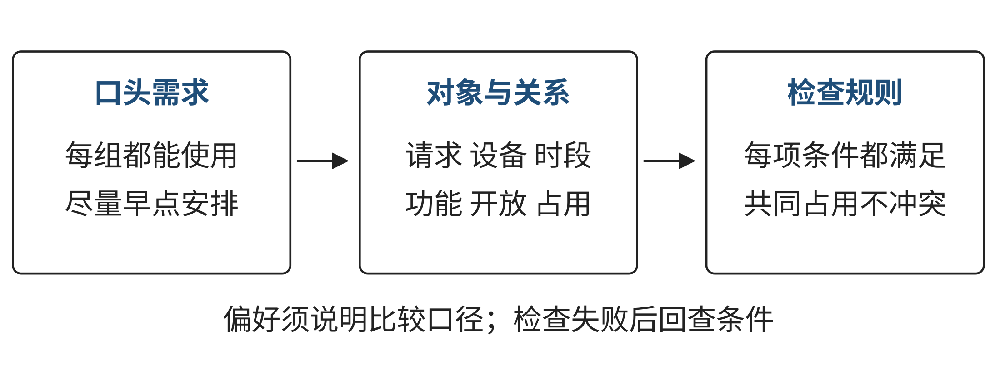

# 第一章 计算思维：从现实问题到可检验的解决过程

一张排程表填满了，任务就完成了吗？一个程序正常运行了，现实问题就解决了吗？这些判断需要回到目标、条件、处理过程和检查依据。本样张节选第一章的少量内容，独立编排图表编号；跨页表格测试材料只用于检查版式，完整章节仍以原稿为准。

## 学习目标

- 区分计算思维、编程与工具使用，用一个反例解释区别。
- 把含糊需求改写为目标、输入、硬约束、偏好、输出与检查标准。
- 形成候选安排，逐项检验，并在条件变化后重新判断可行性。

## 学习路线

先阅读问题表示和方法协同的说明，再完成E01。练习所需数据和评价标准放在题目处，详细参考解集中在样张末尾的“参考解与讨论”。请先独立完成并保留失败候选，再对照参考解分析。

## 1.1 从需求到可检验的过程

计算思维与编程相关，但二者并不相同。Wing将计算思维联系到运用计算机科学的基本概念解决问题、设计系统和理解人类行为，并强调概念化超越单纯编程[1]。程序可以准确执行写入其中的规则；如果规则遗漏了重要条件，程序仍可能给出一个现实上不可用的答案。

### 1.1.1 方法如何共同工作

抽象帮助我们选择与目标相关的对象、关系和状态。安排显示设备时，装饰颜色可能暂时无关，设备具备什么功能、何时开放却不能略去。判断一项信息是否需要保留，可以问：如果它改变，方案的可行性或评价会不会随之改变？

分解使请求整理、候选生成、占用检查等工作更容易处理，但要保留它们之间的联系。每个请求单独有可选位置，不代表所有请求能够同时安排；整体检查还要发现它们是否争用同一个设备时段。

模式识别让我们复用功能、时间和占用规则，同时寻找例外。算法思维把选择和回退过程写清楚，评估把候选与标准联系起来。自动化可以扩大重复执行的规模，泛化则要求重新检查规则的适用条件。这些方法交错出现，不能仅靠逐个列出术语证明完成了问题分析。

图1-1把口头需求、对象表示和检查规则联系起来。请沿箭头指出：哪项关系使“设备合适”成为可以检查的条件？哪些偏好仍需由提出者说明？

来源：本书原创教学结构图，依据第一章共享设备情境重绘为试排图，不替换原章图。

生成式工具可以协助整理条件或提出候选，但流畅回答不能充当核验结果。NIST将生成式AI输出错误或虚构内容等现象列为“confabulation”风险[2]。输入数据、规则和输出仍须由使用者检查。

### 1.1.2 思维训练 E01 安排借用并检验资源变化

数据为教学示例，不来自真实课程或学校。建议用时四十分钟，可独立完成或两人互相检查。每个请求占一个完整时段，三个时段按S1、S2、S3排列；题目不要求编程。

表1-1给出设备功能与开放状态，表1-2给出借用请求。display表示显示功能。

表1-1 E01设备与开放时段

| 设备编号 | 具备功能 | 可用时段 |
| --- | --- | --- |
| D1 | display（显示） | S1、S2、S3 |
| D2 | display（显示） | S2、S3 |

来源：第一章E01教学示例数据。

表1-2 E01借用请求

| 请求编号 | 所需功能 | 允许时段 |
| --- | --- | --- |
| R1 | display（显示） | S1 |
| R2 | display（显示） | S1、S2 |
| R3 | display（显示） | S2、S3 |
| R4 | display（显示） | S2、S3 |

来源：第一章E01教学示例数据。

安排必须同时满足五项硬约束：每个请求恰好安排一次；设备在所选时段开放；设备具备所需功能；所选时段属于请求允许范围；同一设备在同一时段最多安排一个请求。全部硬约束满足后，可以比较较早完成的偏好，但本题不规定唯一最优安排。

**任务一：重述问题。**写出目标、输入、硬约束、偏好、输出格式及至少一个可能需要确认的问题。输出为请求编号、设备编号、时段编号三列。

**任务二：形成并检查候选。**为每个请求列出满足功能、开放状态和请求时段限制的候选位置，选择一组完整安排。用表1-3记录检查依据；发现冲突后重新检查全部约束。

表1-3 E01学生核验记录表

| 检查项 | 你的核验结果 | 依据或说明 |
| --- | --- | --- |
| 请求各安排恰好一次 |  |  |
| 功能符合请求 |  |  |
| 设备在所选时段开放 |  |  |
| 请求允许所选时段 |  |  |
| 设备时段无重复占用 |  |  |

来源：第一章E01核验记录表节选；空白单元格供学生填写，不表示数据缺失。

**任务三：处理变化。**现在D2关闭，其可用时段变为空集合。重新判断四个请求能否全部满足原有硬约束。给出可行安排或无解依据；协商建议单独标明改动及待确认事项，不得当作原条件下的可行解。

**评价标准。**检查条件是否完整、表示是否清楚、候选是否满足全部硬约束、结论是否区分可行与无解及待协商、修正是否有依据。评价推理和检查质量，不以工具数量或表格是否整齐作为依据。参考解见章末“参考解与讨论”的E01。

### 1.1.3 跨页表格测试

表1-4的核验记录仅用于版式压力测试，不是E01参考答案。用连续记录检验三线表、跨页重复表头与普通行不拆页；各行是模拟的检查说明。

表1-4 跨页核验记录示例

| 记录 | 检查关注点 | 模拟检查说明 |
| --- | --- | --- |
| T01 | 对象标识 | 核对编号是否唯一，原始记录和检查记录是否能够对应；异常位置单独记下，不能用空白表示已经通过。 |
| T02 | 开放时段 | 按当前数据核对可用时段，说明所依据的版本；资源发生变化后，旧结论只能作为历史记录保留。 |
| T03 | 功能对应 | 逐项核对所需功能与资源功能，记录比较依据；不将名称相似当成条件已经满足的证据。 |
| T04 | 请求时段 | 检查请求允许范围与已选时段，保留具体比较结果；涉及待确认事项时，明确写出下一步需要的信息。 |
| T05 | 整体占用 | 对所有资源时段位置作共同占用检查，区别局部条件与整体条件；说明冲突如何被定位和复查。 |
| T06 | 条件变化 | 记录变化前后数据及重新检查范围，区分未找到、无解和待协商提案；不复用失效的结论。 |
| T07 | 对象标识 | 核对编号是否唯一，原始记录和检查记录是否能够对应；异常位置单独记下，不能用空白表示已经通过。 |
| T08 | 开放时段 | 按当前数据核对可用时段，说明所依据的版本；资源发生变化后，旧结论只能作为历史记录保留。 |
| T09 | 功能对应 | 逐项核对所需功能与资源功能，记录比较依据；不将名称相似当成条件已经满足的证据。 |
| T10 | 请求时段 | 检查请求允许范围与已选时段，保留具体比较结果；涉及待确认事项时，明确写出下一步需要的信息。 |
| T11 | 整体占用 | 对所有资源时段位置作共同占用检查，区别局部条件与整体条件；说明冲突如何被定位和复查。 |
| T12 | 条件变化 | 记录变化前后数据及重新检查范围，区分未找到、无解和待协商提案；不复用失效的结论。 |

来源：本样张自拟版式测试记录，不属于第一章练习数据。

## 本章回顾

表示是为任务作出的选择。候选的单项条件与资源共同占用必须分别检查；条件变化后重新判断结论。请保留一条失败候选，说明它如何改变了你的表示或步骤。

## 关键术语

**硬约束：**决定方案是否合格的条件。**偏好：**在合格候选之间进行比较的依据。**无解：**有证据表明不存在满足当前全部硬约束的安排。

## 参考解与讨论

### E01 安排与条件变化

原条件下，一组可行安排见表1-5。

表1-5 E01参考安排

| 请求编号 | 设备编号 | 时段编号 |
| --- | --- | --- |
| R1 | D1 | S1 |
| R2 | D1 | S2 |
| R3 | D2 | S2 |
| R4 | D1 | S3 |

来源：第一章E01参考解；该安排不是唯一解。

R1只允许S1，D1具备显示功能并在S1开放；R2允许S1或S2，使用开放的D1和S2；R3允许S2或S3，使用开放的D2和S2；R4允许S2或S3，使用开放的D1和S3。四个请求各出现一次，D1—S1、D1—S2、D2—S2、D1—S3互不重复。因此该安排满足全部硬约束。按题目给定数据和规则有限枚举，原条件有十二组可行安排。

D2关闭后，D1只有S1、S2、S3三个设备—时段位置，四个请求却各需独占一个位置。因此原条件下不存在完整安排。增加设备、开放新时段或确认替代时段是改变题目条件的协商提案，应在确认后更新数据并重新检查。

这项练习说明，资源或规则变化后应重新检验可行性。请将自己的记录与参考解比较：原方案在哪项约束下失败？你的结论依据是全部候选、资源位置数量，还是仅仅几次未成功的尝试？

## 参考文献

[1] Wing J M. Computational Thinking[J/OL]. Communications of the ACM, 2006, 49(3): 33-35. https://doi.org/10.1145/1118178.1118215.

[2] Autio C, Schwartz R, Dunietz J, et al. Artificial Intelligence Risk Management Framework: Generative Artificial Intelligence Profile: NIST AI 600-1[R/OL]. 2024-07-26: 6. https://doi.org/10.6028/NIST.AI.600-1.
