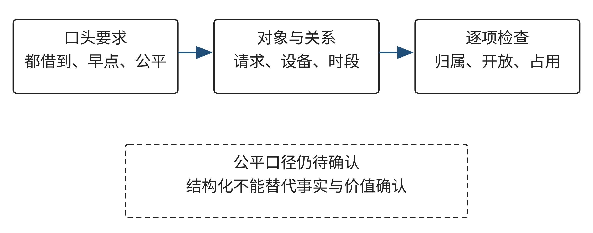
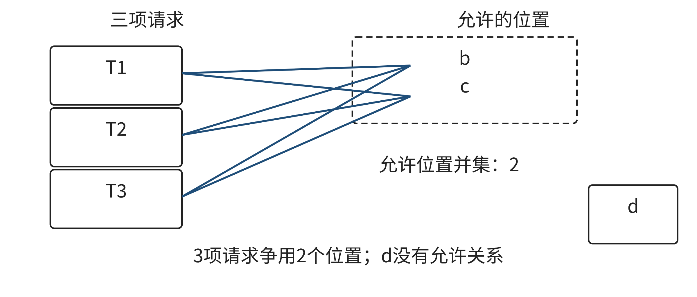
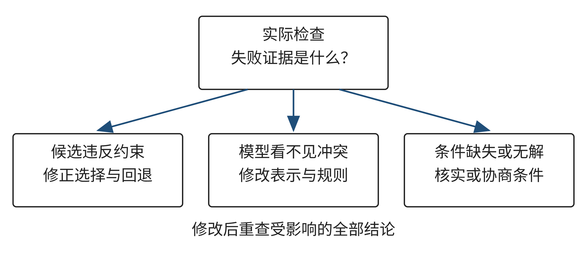
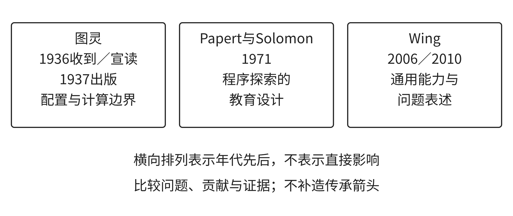
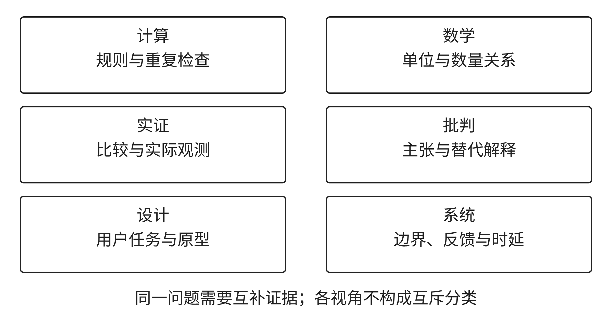
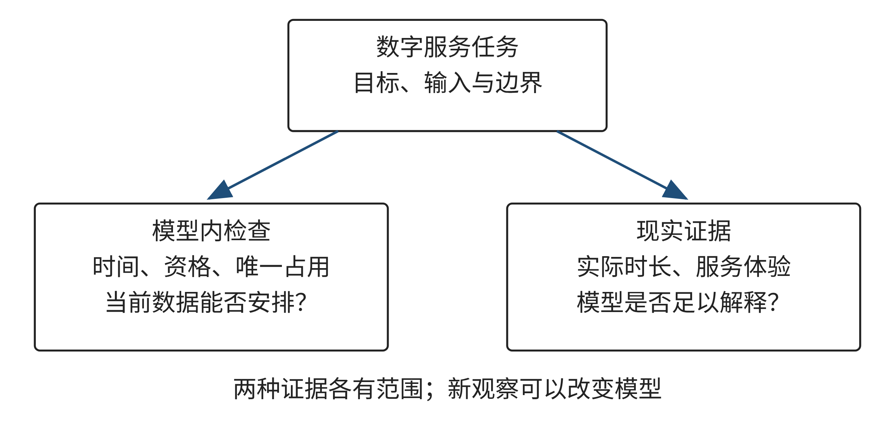

# Chapter 1 Figure Context

Source: manuscripts/ch01-rewrite/ch01.md; SHA-256 9a741d30cc9e6bf04e2bbf0d6c2ab5597a753f03ce190c1fda95cdd2e4c664ec

## Figure 1-1 — original lines 26–47

### 1.1.1 案例：每个请求都有位置，为什么仍然排不出来

一个虚构课程项目组需要协调两台共享显示设备。一天分为S1、S2、S3三个完整时段，D1三个时段都开放，D2仅在S2、S3开放。四条请求都需要显示功能：R1只能选S1，R2可以选S1或S2，R3、R4各可以选S2或S3。每条请求占一个完整时段，同一设备同一时段只能交给一条请求。这个情境及其数据均为本书教学示例，不代表学校的设备或管理制度。

第一位协调者只比较数量：两台设备、三个时段，似乎最多能服务六次，四条请求应当足够。这个算式忽略D2在S1没有开放，实际只有五个设备时段；进一步说，即使五个位置仍多于四条请求，也不能仅凭总量得到完整安排，因为某条请求可能无法使用那些空闲位置。资源有多少和资源是否可达，是两个不同问题。

第二位协调者为每条请求列出至少一个允许位置，认定“每条都能排”已经足够。如果把R1和R2都放到D1-S1，两行分别满足功能、开放和请求时段要求，合在一起却重复占用。同一行的合法性依赖该行的数据，整体的合法性还依赖行与行的关系。一个逐行检查而没有共享占用状态的程序，会准确检查前一种性质，却遗漏后一种性质。

第三位协调者按顺序先安排R2，选择D1-S1。轮到R1时，它没有剩余位置，于是宣布资源不足。这个结论比前两个看起来谨慎，但仍然错把当前选择的后果当成原问题的性质。撤销R2的选择，让它改用D1-S2，R1就能使用D1-S1。失败说明某条分支无法继续，未必说明所有分支都失败。

这三个判断分别丢掉了允许关系、共同占用和替代选择。它们可以发生在手工填表、电子表格、程序或AI生成中，工具名称不会改变错误的逻辑。问题分析的价值，正是找出结论依赖哪些信息，并检查当前表示是否足以保留这些信息。

把需求写成可以复查的约定，需要明确：四条请求都要完成，每条恰好安排一次；所选设备具备所需功能，设备与请求都允许该时段；设备时段不能重复使用。在这些条件满足后，可以讨论较早完成的偏好。“每组都满意”则还需要知道满意的口径，不能由请求编号或填表顺序代替确认。图1-1展示了从口头要求到检查关系的转化。

图1-1 需求如何变成可检查的规则

来源：本书原创教学图，依据共享设备教学示例绘制。

读图时请沿一项具体要求寻找它对应的字段和检查项。例如，“同一时刻不能借给两组”需要设备身份和时间共同参与判断，单独查请求编号不能完成这项检查。图中的“待确认”还提醒我们：把要求结构化不等于补齐所有事实。缺失条件应保留其状态，而不是让表格默认值把未知变成已经确认。

## Figure 1-2 — original lines 93–116

### 1.1.4 分解：局部合法怎样组成整体方案

把任务拆成请求筛选和位置选择，可以减少一次面对的复杂性，却不能切断两部分的关系。筛选得到D(r)，只保证每个候选单独可用；位置选择还要处理不同请求争用同一资源。分解后的接口不应只有“每个请求有几个候选”，还应传递“这些候选分别是谁”。否则候选数量相同而共享程度不同的两组任务，会被错误看成同一种情形。

先推演一条失败分支。安排R2到a，已经占用的位置为{a}。随后R1的候选只有a，与占用集合相交，不能加入。此时失败的是包含R2→a的部分安排。回退应撤销这一选择及其占用，再试R2→b；然后R1→a，R3→c，R4→d，可以组成完整方案。注意回退撤销的是选择，没有修改R1的时段，也没有让设备重复使用。

搜索可以维持一个不变量：当前已安排的请求各出现一次，每行属于对应候选集合，位置互不重复。加入一项选择前先检查它是否保持这一性质；回退后恢复进入该分支之前的状态。这个不变量保证部分解合法，但不保证一定可以扩展成完整解。R2→a本身合法，却阻挡R1；因此“已检查的部分都正确”仍然不能等同“整个任务必能完成”。

先处理候选少的请求，在本题里会先选R1，能避开这条失败分支。它是利用约束程度的策略，不是对所有任务无需回退的保证。假如两个同样灵活的请求都只能使用最后一个空位，早期顺序无法凭空增加位置；如果偏好要求优化总成本，找到第一条可行解也可能远未结束。策略价值应按减少搜索和满足目标的证据评价，不能因一次成功便称最优。

有些失败能用瓶颈直接证明。考虑任意一组请求A，它们合起来能够使用的位置数，必须至少等于这组请求数：|⋃D(r)|≥|A|，其中并集只对A中的请求取。理由是每条请求都要占据不同位置；若三条请求合起来只能使用两个位置，至少一条无处可放。这个计数是本模型下的必要条件，本章不展开完整匹配定理或证明。

现在给一个独立反例：T1、T2、T3都只能选b或c，资源表还列出d。每条请求候选非空，位置总数等于请求总数，仍然无解，因为d对它们不可达。把A取为这三条请求，允许位置并集只有两个。图1-2把无连接的位置放在瓶颈框外，帮助你区分“有资源”与“这组请求可以使用的资源”。

图1-2 局部候选与全局瓶颈

来源：本书原创教学反例；T1—T3不是E01请求。

识别“若干请求共同争用不足的位置”，是模式识别在这里的具体作用。它没有按相同文字给请求分类，而是在关系结构中识别会改变可行性的特征。把请求换成其他名字，这个计数理由仍能成立；把一个位置改为可并行服务两条请求，理由就必须加入容量。模式能复用到哪里，取决于不重复占用这一假设是否保留。

分解还会暴露另一种错误：把同一实体交给两个子任务独立安排。如果甲组和乙组分别为自己的请求做出合格排程，但共用D1，合并结果可能冲突。解决办法不只是最终“看看有没有冲突”，还要明确共享状态由谁维护、哪个选择更新了它、发生冲突时哪项决定可以撤回。整体约束决定了子问题之间需要怎样的接口，而不是组织分工决定约束可以忽略。

## Figure 1-3 — original lines 147–164

### 1.1.6 人机协作中的分工与修改位置

AI可以帮助整理需求、列候选、解释失败或生成检查程序，但它的输出仍属于需要检验的材料。NIST的生成式AI风险资料讨论了自信而错误、虚构或偏离输入的输出风险[4]。这里采用的是一般风险说明，不是对某个工具当前性能的测量，也不要求你开通特定服务。手工、表格和本地程序均可完成本节任务。

一个有用的协作请求应让任务边界显现，例如：“只使用所附设备、请求和时段，不添加资源，不改变允许时段；先给候选安排，再列每项硬约束的检查依据；无法确认的条件单列。”这有助于组织输出，但提示本身不能证明模型遵守要求。你仍要对照数据检查，而且要警惕解释与表格不一致：文字说没有重复，表中却可能出现相同位置。

发现错误后，先决定修改什么。若输出把两条请求放在同一位置，规则没有问题，候选或实现需要修正；若请求的连续占用根本未表达，单改一行可能掩盖模型问题；若全部合法候选已被穷尽而无解，应讨论现实条件是否允许协商。让AI“再给一版”只有在错误类型明确时才有目标，否则可能只是换一个表面流畅的答案。

图1-3用三条返回路径表示这种区别。检查失败不必总回到同一环节：选择错误返回选择，规则或表示不足返回模型，信息不清返回需求。每次修改都要重新核对受到影响的结论。改变设备开放时段会影响候选和可行性；仅修正说明文字不会凭空改变一个非法安排。

图1-3 从检查证据返回选择、表示与条件

来源：本书原创教学图；箭头表示纠错对象，不表示固定顺序。

保留一份足够复查的记录，比保留所有对话更有价值。记录当前数据版本、采用的规则、候选、检查结论和修改依据，就能说明答案对哪些条件成立。不同尝试之间若偷偷改变条件，则不能把成功归因于搜索策略改善。将“新增时段后找到安排”写成“原问题终于解决”，会让学习者误判方法能力和资源需求。

## Figure 1-4 — original lines 273–298

### 1.2.4 通用能力倡议与定义的时间位置

Wing于2006年在《Communications of the ACM》发表《Computational Thinking》，倡议把计算思维作为更广泛人群可以学习和运用的基本能力。她强调“Conceptualizing, not programming.”：计算思维关注概念化，不等同于编程活动本身[1]。这一倡议不是宣称编程无用，也不能证明计算思维相关思想直到2006年才出现。它的作用是把计算机科学中的思考方式带到更广泛的教育和公共讨论中。

还要把倡议与后续表述分清。Wing在2010年的文章《Computational Thinking: What and Why?》采用的问题与解法定义，文中明确归于Cuny、Snyder和Wing共同提出：将问题及其解决方案表达为信息处理主体能够有效执行的形式；主体可以是人、机器，或二者组合[2]。这不是2006年文章的逐字定义，也不应写成Wing一人于2006年创造的完整理论。年份与作者署名是证据的一部分，不能为了时间线整齐而删去。

把图灵、Papert与Solomon、Wing放在同一张图里，是本书为学生建立比较视角的做法，不代表三者共同使用同一套术语，也不预设他们之间存在直接传承。图灵的形式模型可以帮助我们问行为如何被规则描述；教育报告帮助我们问学习者是否能够表达并探索；Wing的倡议帮助我们问计算思维为何应向更广泛人群开放。它们彼此可比较，正因为问题不同，而不是因为一份文献已经证明另一份文献由它产生。

表1-6对照三个节点的问题与解释范围。图1-4按出版年份并置文献节点，区分时间先后与本书的主题比较；图灵节点另注收稿和宣读年份。

**表1-6 研究、教育设计与能力倡议**

| 来源节点 | 主要问题 | 本节可用的教学解释 | 解释范围 |
| --- | --- | --- | --- |
| 图灵，1937年出版 | 怎样形式化描述机器行为和计算边界 | 明确状态与操作规则，才能讨论可执行行为 | 特定形式问题的结果不等同于所有现实任务的判决 |
| Papert与Solomon，1971 | 学习者与计算机活动可以怎样组织 | 学习者可表达、运行和修改程序 | 设计建议不是已证明的普遍学习效果 |
| Wing，2006；2010 | 如何倡议更广泛的计算思维能力并表述定义 | 概念化超越编程；定义有其共同署名和文本时间 | 不据此宣称全部思想起源或单线影响关系 |

来源：本书原创教学材料与作者分析；数值材料的模拟性质见对应题设。

图1-4 计算与学习相关文献的时间节点及比较边界

来源：本书绘制；依据Turing（1937）[5]、Papert与Solomon（1971）[6]、Wing（2006）[1]及Cuny、Snyder与Wing（2010）[2]整理。时间轴表示出版先后，节点并置表示主题可比较；材料未证明人物或文献间的直接影响关系。图灵节点另注论文1936年收稿、宣读日期。

## Figure 1-5 — original lines 425–446

### 1.3.2 哪些可行性会随映射保留

设备与场地在字面上都叫“资源”，还不足以说明它们能互相替换。先把旧任务的请求集合记作 `R`，把可选位置集合记作 `P`。一个位置可以写成“资源、时段”的组合。对每项请求 `r`，允许关系 `A` 给出它可以使用的位置；方案则为每项请求选择一个位置。方案可行至少要求每项选择属于对应的允许集合，且不同请求的选择不违反资源冲突规则。这个小模型不是通用理论定理，而是对本节单位置排程的明确约定。

若新旧任务之间有可说明的一一对应，可把旧请求 `r` 映到新请求 `φ(r)`，把旧位置 `p` 映到新位置 `ψ(p)`。对旧方案中的每个安排，迁移后的安排就是把 `φ(r)` 放在 `ψ(p)`。这里至少有三件事需要同时核对：不同旧请求没有被合并成同一个新请求；不同旧位置仍映到不同新位置；每个被采用的新请求—新位置组合仍属于新任务的允许关系。还要检查冲突规则本身是否保留。满足这些条件时，可以推出映射后的旧方案继续满足它所继承的单位置规则。

这个结论有清楚的边界。它只说明旧方案中已映射的请求满足被检查的规则，不自动说明新任务的全部请求都已安排，也不说明新领域没有额外条件，更不保证公平、低成本或实际效果最好。若新任务增加了请求、硬约束或新的资源冲突，必须单独补入并重新检查。反过来，如果只证明一个具体方案中的位置被映射，不能据此断言旧问题的每一个可行方案都能迁移；要作更广的结论，就必须逐项证明相关允许关系和冲突关系都被保留。

“单射”在这里有直观含义：两个不同对象不能映到同一个新对象，两个不同位置也不能映到同一个新位置。假设旧问题有两台彼此独立的设备D1、D2，二者都能在S2供不同请求同时使用。若新问题把D1和D2都称作同一间场地C，那么旧的D1-S2和D2-S2会合并成同一个C-S2。原来不冲突的两个位置因此变成冲突。错误不在搜索顺序，而在资源身份的映射丢失了区别。若真实场地里确有两台可以并行使用的独立设备，模型就应继续区分设备资源；若同一场地确实不能并行举办活动，则必须新增唯一占用检查。先确认“资源”指房间、设备还是服务能力，才能决定采用哪种对应。

映射还要保留关系，而不只是保留对象。旧设备“具备显示功能”和新场地“有投影”可以构成能力对应，但新活动可能同时要求投影与计算机。若把“满足所需能力”简化成“至少有一种所需设施”，集合关系就被削弱了。反过来，若把场地所有设施都当作请求必须具备的条件，又把需求扩大了。对每个迁移规则，都要说明它在新任务中表达了什么可观察的条件。

还要区分保住一份方案与保住全部解的结构。只证明当前方案中的每一对请求—位置在新任务中仍被允许，只能说明这一份旧方案可被映射；其他旧候选可能因新条件消失。若要声称两类任务的所有解可以往返对应，还必须检查映射是否覆盖新问题所需的对象、是否保留双向允许关系，以及新问题是否没有旧模型之外的额外限制。若教学目标只是迁移一份已审核方案，就不必证明所有解等价，但仍须逐条检查新约束。把结论范围写清，可以避免由“一个例子可行”跳到“这种方法在任何相似问题中都可行”。

图1-5并排展示两套任务的结构对应与容量、设施等新增检查，可对照上述映射条件逐项查看。

图1-5 设备借用与社区场地分配的可迁移关系和新增条件

来源：本书原创教学图，展示本节E01与E03的结构对应及容量、设施等新增检查；数据为教学示例。

## Figure 1-6 — original lines 459–478

### 1.3.4 连续占用改变表示与检查

一个新变化可能不只是筛掉更多候选，而是改变“选择一个位置”这件事的含义。活动如果跨越多个时段，选择开始时刻不能代表场地的完整占用。只为活动增加 `duration=2` 字段，但仍只把开始时段标为已占，冲突检查依旧看不到它占用的第二个时段。新数据字段没有自动改变旧状态更新与检查逻辑。

考虑同一场地的两项教学示例活动。活动A从9:00开始，连续使用两小时，活动B从10:00开始，使用一小时。用半开区间表示实际占用：A为 `[9:00, 11:00)`，B为 `[10:00, 11:00)`。左端点计入占用，右端点不计入；两项活动在10:00至11:00同时占用场地，因此冲突。两个开始时刻不同，旧的“开始时段不能相同”检查却会放过它。

如果另一活动为 `[11:00, 12:00)`，它与A的结束点相接，但没有共享任何时间长度。在没有准备、清理或交接间隔的模型里，端点相接不构成重叠。对两个半开区间 `[s₁, e₁)`、`[s₂, e₂)`，当且仅当 `s₁ < e₂` 且 `s₂ < e₁` 时重叠。如果把端点也算作占用，边界相接会被误判；如果实际要求清场、布置或设备检查，单纯按活动起止时间判断又会漏掉真实占用。

准备和清理必须先转成模型所采用的占用口径。例如，活动A在9:00—11:00使用场地，结束后需20分钟清理；活动B在11:00开始前需15分钟布置。若这两个过程都需要独占场地，两项活动的实际占用区间会延伸并发生冲突。若准备可在活动室外完成，或清理与另一项活动不共用同一空间，区间又不同。时间数值只是示例；谁来确认每项活动怎样使用场地、需要哪些准备步骤，是领域事实，不应由程序替人猜测。

有两种常见表示可表达连续占用。固定时段且每个时段粒度足够时，可为一次安排生成占用位置集合，例如 `O(A)={C-S1,C-S2}`；合法安排要求不同活动的占用集合不相交。若起止时刻不落在固定网格上，则可直接保存开始与结束时间，在相同资源上比较半开区间。选择哪种表示，要看需要识别的最小时间差、时钟精度和业务记录方式。网格太粗会把不同占用合成一格或掩盖短暂重叠；网格过细又增加数据与检查负担。

连续占用还会改变搜索时的状态更新。选择A之后，算法必须把A占用的全部位置标为不可用；尝试另一分支时，必须撤销同一批状态；检查完整方案时，也要比较所有占用集合或区间，而不是只比较开始位置。若候选生成、状态维护和最后验证采用不同口径，就可能出现“搜索阶段认为可行，复核阶段认为冲突”的不一致。图1-6用一对边界相接与区间重叠的情形，帮助读者检查表示是否区分了两者。

图1-6 半开区间中的连续占用、端点相接与准备清理时间

来源：本书原创教学图，区分活动区间的重叠、无间隙端点相接和纳入准备/清理后的实际占用；时间为教学示例。

## Figure 1-7 — original lines 594–611

### 1.4.5 综合判断：方法互补，价值不能被计算隐藏

图1-7中的视角不构成彼此排斥的学派，也没有必须依次走完的固定流程。计算模型帮助把条件写清，数学复算能抓出单位或算术问题，实证计划寻找现实表现，批判审查证据强度，设计发现任务与未满足需要，系统分析寻找影响路径。某项新证据还可能改变最初的问题：从“选A还是B”返回“台阶边缘的辨识任务如何定义”或“是否应先确认窗户受光”。

最终选择还涉及明确的价值取舍。一次性支出上限4000元和不得缩短可通行时段是材料中给出的硬约束；台阶辨识、居民休息、维修便利和能源影响则需要转成可评价的目标，并请相关责任者说明优先级。程序可以筛掉超过预算或削减时段的候选，却不能从数据里自动推出居民休息与检修成本应当怎样排序。若团队确实需要权衡，应写明采用的评价准则、由谁确认、哪些条件不能交换，而不是把所有目标塞进未经说明的总分。

例如，B的报价低于A并满足题设预算，但目前没有试装后的辨认数据；A的模型能耗较高，也没有实际照明分布结果。若把所有指标压成一个总分，权重会隐含“辨认一次改进相当于多少居民反馈、多少能耗或多少维护时间”等价值判断。与其假装存在唯一客观分数，不如先列出不可突破的约束，再公开剩余目标的比较方法，说明由谁参与排序、谁承担未确定的后果。不同利益相关者可能合理地给出不同选择；决策质量取决于证据、权衡和责任是否透明，而不在于答案看起来是否唯一。

行动选择还需要一个可修改的决策规则。先列出关键未知项，再说明不同观察结果会怎样改变候选顺序；例如，“若某位置任务表现恶化，则扩大检查或暂停推广”是一条复核条件。仅说“以后再观察”没有指明什么证据能改变决定。具体怎样选择、哪些结果足以改选，请结合E04的输入和你自行设计的比较完成。

图1-7 不同思维视角需要的证据

来源：本书绘制；依据[8]、[9]、[7]、[10]及E04模拟情境整理。六种视角并列为本书教学组织，不代表所引来源共同提出一套固定分类。

读图时，任选两种视角，指出它们分别需要什么证据、能回答什么问题、哪些结论仍不能单独推出。再想一项新观察如何促使团队修改目标、模型边界或候选方案。

## Figure 1-8 — original lines 695–744

## 章末综合训练

**E05：从设备分配到数字服务预约**

一个虚构社区要为四条数字服务咨询预约安排工作人员。与设备借用不同，有一条请求需要工作人员能够协助使用屏幕阅读器。这里的资格是教学假定能力，不是职业认证或现实授权；任务没有提供个人身份、具体咨询内容或敏感资料，也不要求你收集这些信息。三个完整时段S1、S2、S3依次排列，每条预约有一人，持续一个时段，每名工作人员每时段只服务一个请求。

**表1-18 E05工作人员与可用时段**

| 工作人员 | 教学资格 | 可用时段 | 每时段容量 |
| --- | --- | --- | ---: |
| V1 | general（一般咨询） | S1、S2、S3 | 1个请求 |
| V2 | general、screen_reader（屏幕阅读器协助） | S2、S3 | 1个请求 |

来源：本书E05教学数据。

**表1-19 E05预约请求**

| 请求 | 所需资格 | 允许时段 | 人数与持续时间 |
| --- | --- | --- | --- |
| P1 | general | S1 | 1人、1时段 |
| P2 | general | S1、S2 | 1人、1时段 |
| P3 | screen_reader | S2、S3 | 1人、1时段 |
| P4 | general | S2、S3 | 1人、1时段 |

来源：本书E05教学数据。

目标是为全部四条请求各安排恰好一次；时段同时属于请求允许范围和工作人员可用范围，工作人员资格满足请求，同一工作人员同一时段不得重复。只在满足硬约束后比较较早完成等偏好，不能根据编号推断服务优先级。现在先保留这些条件，不增加未提供的人员和时段。

请提交一份可以让同学复查的任务报告，建议用时60分钟。报告包括以下五项成果。

第一，写一页问题说明，列出目标、已知输入、硬约束、偏好、输出格式和现实应用仍需确认的问题。说明“能安排咨询”和“能提供合适服务”为什么不是同一个验收标准。你不需要解决尚未提供信息的现实服务问题，但要指出当前结论没有覆盖什么。

第二，形成请求与工作人员时段的候选关系，给出至少一份安排，按请求、工作人员、时段三列输出。说明候选关系怎样结合资格和时间；可以手工、表格、小程序或AI辅助，但选择依据必须能够重建。若使用前面某项练习的经验，指出继承的规则与改变的条件，而不只给出实体改名表。

第三，检查每条请求恰好一次、资格满足、双方允许时段和唯一占用，说明至少一种“局部合理、整体错误”的候选如何被拒绝。安排正确并不要求写很多代码；一份可定位的逐项检查可以比长篇过程描述更有效。

第四，处理条件变化：撤除V2的screen_reader资格，其general资格和开放时段不变，其余数据不变。请判断当前任务的可行性，提交支持结论的依据。若提出培训、替代服务或新增人员，明确它属于改变现实条件的协商建议，不把未实施的改变放进原答案。

第五，提出一项可在后续现实应用中区分两种解释的证据获取方案。例如，等待时间变长究竟因为可用资源少，还是单次服务时间超出模型？写出要观测什么、怎样比较、何种结果会改变你的模型或方案，以及仍不能由该证据回答的价值问题。无需编造观察结果，也不因提出方案就声称已经验证。

图1-8 综合任务的模型检验与现实证据

来源：本书原创教学图，依据E05任务与本章互补分析绘制。

图1-8把模型内的安排检查与模型外的服务证据分别显示。请用自己的报告给两条路径各填一项具体输入和成果，指出哪个结论由当前数据即可支持，哪个结论必须等待实际观察。两条路径可以互相反馈，但不能让其中一条的通过替另一条盖章。

评价按完整问题说明、适用表示、可执行方案、实际检验、迁移与边界五个维度使用0—3量规。达到2级需要满足当前要求并解释依据；达到3级需要在此基础上处理有意义的例外，说明结论为何随条件或证据改变。开放的服务价值判断允许不同立场，评价依据是理由、材料与边界，不能按结论是否与参考观点一致评分。完整参考解见章末E05。

## Source ledger baseline

[1] Wing J M. Computational Thinking[J/OL]. Communications of the ACM, 2006, 49(3): 33-35[2026-10-11]. https://doi.org/10.1145/1118178.1118215.
[2] Wing J M. Computational Thinking: What and Why?[EB/OL]. (2010-11-17)[2026-10-11]. https://www.cs.cmu.edu/~CompThink/resources/TheLinkWing.pdf.
[5] Turing A M. On Computable Numbers, with an Application to the Entscheidungsproblem[J/OL]. Proceedings of the London Mathematical Society, 1937, s2-42(1): 230-265[2026-10-11]. https://doi.org/10.1112/plms/s2-42.1.230.
[6] Papert S, Solomon C. Twenty Things To Do With A Computer: AI Memo 248 / LOGO Memo 3[R/OL]. 1971-06: 1-3[2026-10-11]. https://dspace.mit.edu/entities/publication/35dcc702-9306-4ad7-8a42-1209517c9c1c.
