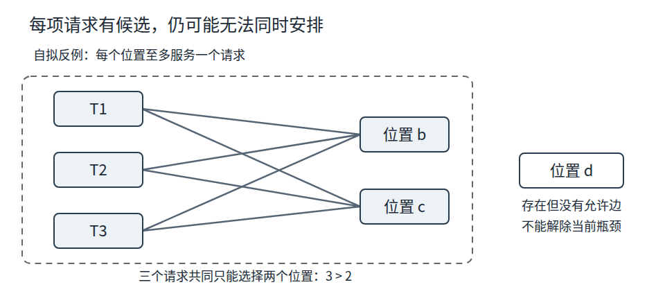

# Version Y

## 1.1.3 核心方法如何共同工作

同一份数据，可能被两个都能正常运行的程序理解成不同的现实量。NASA对Mars Climate Orbiter的调查报告记载：地面程序`SM_FORCES`输出`lbf-s`，接口规范要求`N-s`，后续导航处理低估了推进器影响约4.45倍。报告还列出通信、训练和验证等促成因素。[NASA原报告](https://llis.nasa.gov/llis_lib/pdf/1009464main1_0641-mr.pdf)，p.16；促成因素见p.7、25。

对已会编程的读者，值得追问的是：数字读入成功之后，为什么错误还能继续传播？把一个物理量抽象成普通浮点数，保留了数值，却可能丢掉单位。把系统分成数据生产与导航计算两部分，保留了职责，却要求接口两端对数据含义取得一致。若检验只看文件能否解析、数值是否落在宽泛范围内，就没有检验这种一致性。这是从事故材料引出的教学分析，不是对全部事故原因的重新认定。

用一组自拟数据把问题缩小：输入表示5 `lbf-s`，约取换算因子4.45，则应得到22.25 `N-s`。如果接收者只取数值5并当作`N-s`，数值类型检查仍可通过，含义已经改变。写成`数值＋单位`可以使转换要求显现；但给字段起名并不会自行完成转换，生产者仍须遵守约定，接收者也要拒绝未知单位。怎样避免漏掉重要信息，取决于接下来的判断需要保留什么，而不取决于数据表是否简洁。

### 从局部候选到整体安排

回到共享设备任务。对一个请求单独检查设备功能、双方时段，都很容易；真正的困难是几个局部正确的选择能否一起成立。用集合把这个差别表示出来：

- `R`是请求集合。
- `U`是所有设备—时段位置的集合，一个位置最多服务一个请求。
- `D(r)`是满足请求`r`的功能、开放时段与允许时段的候选位置集合。

先将五个位置简记为`a=D1-S1`、`b=D1-S2`、`c=D2-S2`、`d=D1-S3`、`e=D2-S3`。本节E01的原数据给出：

| 请求 | 局部候选集合 |
| --- | --- |
| R1 | {a} |
| R2 | {a, b, c} |
| R3 | {b, c, d, e} |
| R4 | {b, c, d, e} |

最终要选一个函数`f`，使每个请求都有`f(r)∈D(r)`，并且不同请求选到不同位置。后一个条件是单射：`r≠s ⇒ f(r)≠f(s)`。它把“一条请求有合法位置”和“全部请求可同时安排”区分开来。若R2先占用a，这一行是合法的；R1随后却无处可去。失败不是某台设备缺少功能，而是局部选择消耗了另一请求唯一的位置。

分解因此不能只是“每组各自选一个位置，再拼成表”。各子问题通过共享资源相连，需要一个共同的占用状态。先安排候选少的请求，可以在本题避开R2抢占a；它是一种减少冲突的选择策略，不能据此保证所有问题无需回退。

沿刚才的失败分支回退，把R2从a移到b，就能让R1选a，R3选c，R4选d。四个位置互不相同，也各属于相应候选集合。这里回退改变的是选择，没有更改任何请求或资源条件；若直接给R1新增允许时段，那才是在改变问题。

### 失败究竟证明了什么

试着选择一个位置，再发现后续请求无候选，只能否定这条选择路径。撤销占用并换一个分支，可能仍会找到完整安排。搜索过程可维持一个不变量：已经选择的每行均满足局部条件，且彼此不重复占用。每次加入或回退，都检查这个性质；它保证保存的部分解合法，还没有保证部分解一定能完成。

不必所有失败都靠穷举解释。对任意一组请求`A`，它们能使用的位置总数必须至少等于请求数：

`|⋃_{r∈A} D(r)| ≥ |A|`。

这条必要条件直接来自“不重复占用”：如果三个请求合起来只有两个可用位置，无论程序按什么顺序尝试，都至少有一个请求安排不了。注意，这里要求考察一组请求共同拥有的位置，仅比较全部资源总数还可能漏掉局部瓶颈。

下面是单独自拟的反例，不改变E01数据：有三个请求T1、T2、T3，都只能选择位置b或c；资源表另外还有位置d。资源总数与请求数同为三，每项请求也有候选，但三个请求共同只能用两个位置。因此不能同时完成安排。读者可用两次不同尝试观察失败，再用计数说明为何继续换顺序没有帮助。

图中实线是允许选择，虚线框标出三个请求共同能到达的两个位置；右侧d虽存在，却不连到任何请求。请遮住上面的计数解释，指出若只看“资源够三个”会遗漏哪项关系。

图源为本书原创SVG；T1—T3及b、c、d是自拟反例，不是原题的候选。可编辑源与成图同存于`assets/figures/quality-pilot/`。

现在撤去E01的D2，原题只剩三个位置，却要安排四个请求。选`A=R`便能得到明确的无解依据；这比“算法试了几次都失败”更强。原题全部候选仍可有限枚举复核，练习处给出其结果。模型已经无解时，加快搜索或换一个生成工具不会产生原条件下的合格安排。

### 检验表示，也检验步骤

上面的集合还包含一个关键简化：每个请求只占一个完整时段。如果真实借用跨两个时段，单个位置不再能代表它占用的全部资源。即使`f`保持单射，也可能出现一条请求占用的第二时段与另一条请求冲突。泛化应先检查这个假设，1.3节将用它分析迁移的边界。

评估时可据此区分三类失败。单位被抹掉或跨时段占用未表示，是表示不足；两个请求占同一位置，是候选或实现违反约束；某组请求位置数不足，则是给定模型中的瓶颈。三类失败分别要求修改表示、修正步骤或协商条件，不能只改最后一行输出。

自动化适合重复构造候选与检查这些关系，但检验器必须覆盖原始需求。如果生成程序与检验程序都只比较设备总数，它们可能一致地放过同一个错误。最小反例和已知单位转换值给检验增加了独立参照；通过它们也只证明所覆盖的性质，不等于现实任务已完整建模。

在继续读下一小节前，先不看答案完成两个判断：为何“每个`D(r)`非空”仍不够？若把`lbf-s`与`N-s`都删成一个数字，解析成功还缺哪一项检验？前者应指出请求共同争用的瓶颈，后者应指出量的含义及转换。抽象、分解、算法、评估与泛化在这里相互制约：一个方法是否有效，要看它保留或检查了后续判断真正依赖的关系。

## 1.3.2 从表面相似到结构对应

比较两个任务时，可先分别描述它们的目标和组成，再把可能对应的部分并排列出。共享设备任务的请求对应场地任务的活动请求；设备对应场地；功能对应设施；设备开放时段对应场地开放时段；请求允许的时段仍对应请求允许的时段；同一设备—时段唯一占用则对应同一场地—时段唯一占用。这里迁移的是关系，而不是字母编号、表头名称或答案本身。

表1-17 设备借用与场地分配的结构对应

| 共享设备任务 | 社区场地任务 | 可迁移的关系 | 需要重新确认的内容 |
| --- | --- | --- | --- |
| 请求编号 | 活动请求编号 | 每项请求都要有可区分的标识 | 编号含义及请求是否完整 |
| 所需功能 | 所需设施 | 资源必须满足请求提出的能力要求 | 设施是否足够、是否存在兼容性 |
| 设备开放时段 | 场地开放时段 | 可选时段必须属于资源开放范围 | 场地是否需要额外布置或清理时间 |
| 请求允许时段 | 活动允许时段 | 资源安排要落在请求允许的时间内 | 时段是否连续、活动时长是否固定 |
| 设备—时段唯一占用 | 场地—时段唯一占用 | 同一资源同一时段不能重复分配 | 场地之间是否可合并或共享 |
| 无容量字段 | 参加人数与场地容量 | 不能由原任务规则直接推出 | 人数如何估计、容量依据是什么 |

这个映射表不是把两个问题说成完全相同，而是把“已经相似的部分”和“尚待处理的差异”放在一起。若只列相似项，读者可能看不到新领域要求；若只列差异，也可能忽略可以复用的约束检查。较好的分析会为每项对应说明依据，并将无法继承的字段明确标出。

可以按以下思路完成一次结构映射。首先用一句话说清新任务的目标和结果形式；其次识别任务中的实体、属性和相互关系；然后把旧问题中可能复用的规则逐条对照；接着问“若这个字段改变，安排是否仍有效”；最后把发现的新条件写入模型，并用一个边界例子检查修改是否足够。这个过程不是必须的固定算法，而是帮助学生避免只按名称类比的检查路线。

实际填写映射表时，可以同时记录旧字段代表什么、新字段代表什么、关系为何可复用，以及旧问题中没有表达的新条件。例如，设备是否具备display与场地是否具备projector，都是资源能否满足请求的能力匹配；但“设备只有一种功能”不能转成“场地只需要一种设施”，因为活动可能要求多个设施同时具备。把设施要求表示为集合，就可以检查请求需要的每项设施是否都包含于场地设施集合中。字段形式会随领域变化，底层逻辑关系仍可保留。

把新旧问题各自画成简单关系图，也有助于检查映射。设备任务可以写成“请求—需要功能—可用时段”和“设备—具备功能—开放时段”，再连到“请求选择设备和时段”；场地任务则使用活动、参加人数、所需设施、场地容量和开放时段形成对应关系。两张图若只在节点名称上匹配，却无法说明关系如何对应，迁移就停留在表面。图中没有旧节点对应的新条件，正是提醒我们继续调查的线索。

映射内容还可以分成三类：可以继承的约束，例如每个请求恰好安排一次；需要替换表示的概念，例如设备功能变为场地设施，检查要从单一功能扩展到集合包含；新加入的领域条件，例如参加人数不超过场地容量。把三类分开，有助于在模型出错时定位原因：旧规则被错误套用、概念映射不充分，或新增条件没有记录完整。

领域知识在映射中不可缺少。程序员可以看出“容量”是一个数值字段，却未必知道一个场地的标称容量是否应包含通道、设备摆放或工作人员空间；社区工作人员或安全人员可能掌握这些含义，但不一定熟悉如何写成可执行约束。两类知识需要相互说明：领域人员澄清字段代表什么，计算思维分析这些条件如何进入表示和检查。若数据由估算得来，也要记录估算方式和不确定性，不能把近似值误写成精确事实。

结构相似性也有程度。两个任务可能共享“在有限时段内安排资源”的骨架，但一个任务可以将请求分配给单个资源，另一个可能允许多人或多个组织共同使用同一场地；前者适用的唯一占用规则不能未经确认地转移到后者。另一个任务可能要求场地连续使用两小时，而模型中的时段只有一个完整单位；若时段粒度不够，单靠更换字段名仍无法表达任务。因此，迁移之前要问清对象是否可分、时段是否足够精细，以及哪些资源关系允许共享。

迁移的证据可以是一张映射表、更新后的规则清单、一个符合新条件的候选方案和一个失败案例。能列出对应项但没有验证方案，只展示了类比；能给出方案却不说明新约束，也无法证明已经完成迁移。把边界案例加入说明，可以看出学生是否知道规则在哪些情境下会失效。

**读图任务：**图1-5展示设备借用和场地分配的共同结构，以及容量等新增条件。请找出一条可以迁移的关系和一条不能直接继承的规则，并说明若省略新增条件，哪一项候选安排会失效。

**来源说明：**本书原创教学图，依据E01、E03教学示例与本节作者的结构映射框架绘制。

